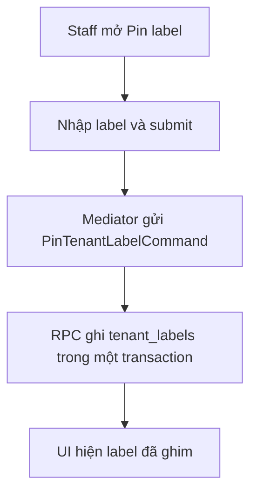

# Work Slice: SL-010 — Ghim nhãn tenant (EXAMPLE_ONLY)

```yaml
id: SL-010
journey: []
usecase:
  - EXAMPLE-UC-01
sources:
  - EXAMPLE-SCR-01
theme: example-only
sample_status: GOLDEN_BAR_B_FIXTURE
```

**design_status** trên [CATALOG.md](CATALOG.md). Pseudo-schema. Fixture bar B, không copy vào theme Vet45.

---

## Objective

Staff ghim một nhãn active cho tenant hiện tại; gửi lại cùng idempotency key không tạo bản thứ hai.

---

## Blocked by

- `None`

---

## Scope & Rules

### In Scope

- `PinTenantLabelCommand`, `PinTenantLabelResultDto`, fake in-memory
- RPC `example_labels.pin_tenant_label` và handler lưu nhãn
- Màn hình `/settings/pin-label`: nhập label, submit, feedback
- Scenario xuyên UI → mediator → RPC → DB

### Out of Scope

- Fact outbox và `integration_commands`

### Boundary

| Concern | Owner |
| --- | --- |
| Command, DTO, fake | `example_labels` application |
| RPC, bảng, idempotency | `example_labels` infrastructure |
| Màn hình | `apps/erp` presentation |

### Rules

| ID | Quy tắc (slice) |
| --- | --- |
| EXAMPLE-UC-01 | Một tenant một nhãn active; retry cùng key không tạo bản thứ hai |

---

## Flow

### Main Flow



1. Staff mở `/settings/pin-label`.
2. Staff nhập label và submit.
3. Mediator gửi `PinTenantLabelCommand`.
4. RPC ghi nhãn và idempotency trong một transaction.
5. UI hiện label đã ghim.

### Failure Flow

1. `label` blank sau trim → `LABEL_INVALID` → không ghi hàng.
2. Cùng idempotency key, khác payload hash → `IDEMPOTENCY_CONFLICT` → không ghi nhãn mới.

---

## Design

### Domain

**Before:** tenant chưa có nhãn active, hoặc đang có một nhãn.
**After:** đúng một hàng `tenant_labels` cho tenant, `label` là giá trị vừa ghim. Replay cùng key giữ hàng đó và trả `replayed`.

### Persistence

Draft lúc implement: `supabase/migrations/_drafts/example_labels_pin_tenant_label.sql`

Bảng `example_labels.tenant_labels`

| Cột | Kiểu | Null | Ràng buộc |
| --- | --- | --- | --- |
| `id` | uuid | không | PK |
| `tenant_id` | uuid | không | |
| `label` | text | không | |

Unique `(tenant_id)`

Bảng `example_labels.idempotency_records`. Cột copy từ [`sales.idempotency_records`](../../../../../supabase/migrations/20260830005_sales_rebuild_schema.sql).

| Cột | Kiểu | Null | Ràng buộc |
| --- | --- | --- | --- |
| `id` | uuid | không | PK |
| `tenant_id` | uuid | không | |
| `command_scope` | varchar(100) | không | |
| `idempotency_key` | varchar(150) | không | |
| `payload_hash` | varchar(128) | không | |
| `status` | text | không | CHECK `in_progress` / `succeeded` / `failed` / `uncertain` |
| `result_type` | varchar(100) | có | |
| `result_id` | uuid | có | |
| `result_snapshot` | jsonb | có | |
| `correlation_id` | uuid | không | |
| `expires_at` | timestamptz | có | |
| `created_at` | timestamptz | không | DEFAULT `now()` |
| `updated_at` | timestamptz | không | DEFAULT `now()` |

Unique `(tenant_id, command_scope, idempotency_key)`

| RPC | Params `p_*` | Returns |
| --- | --- | --- |
| `example_labels.pin_tenant_label` | `p_tenant_id uuid`, `p_label text`, `p_idempotency_key text`, `p_payload_hash text` | `jsonb` `{tenant_id, label, replayed}` |

| Code | Khi nào | Hệ quả |
| --- | --- | --- |
| `IDEMPOTENCY_CONFLICT` | cùng key, khác payload hash | không ghi nhãn mới |
| `LABEL_INVALID` | `label` blank sau trim | không ghi |

### Transaction / Idempotency

- `idempotencyKey` ≠ `command.id`
- UK `(tenant_id, command_scope, idempotency_key)` với `command_scope = pin_tenant_label`
- Cùng key và cùng hash → snapshot trước đó. Khác hash → `IDEMPOTENCY_CONFLICT`
- Cùng transaction: upsert `tenant_labels`, begin/complete idempotency

### Code Layout

```text
modules/
    example_labels/
        application/
            lib/
                src/
                    tenant_label/
                        commands/
                            pin_tenant_label/
                                pin_tenant_label_command.dart
                                pin_tenant_label_handler.dart
                        shared/
                            pin_tenant_label_result_dto.dart
                        testing/
                            fake_tenant_label_port.dart
        infrastructure/
            lib/
                src/
                    supabase_tenant_label_gateway.dart
apps/
    erp/
        lib/
            features/
                settings/
                    presentation/
                        pin_label_page.dart
                        widgets/
                            pin_label_form.dart
```

---

## Contracts

### PinTenantLabelCommand

> Gọi khi user ghim nhãn cho tenant hiện tại. Outcome: nhãn active được lưu; retry cùng idempotencyKey trả kết quả trước.

```dart
class PinTenantLabelCommand {
  final String idempotencyKey; // ≠ command.id
  final String tenantId;
  final String label;
}
```

### PinTenantLabelResultDto

```dart
class PinTenantLabelResultDto {
  final String tenantId;
  final String label;
  final bool replayed;
}
```

`ITenantLabelPort.pin({tenantId, label, idempotencyKey})` → `PinTenantLabelResultDto`.
`FakeTenantLabelPort`: cùng key và cùng payload → `replayed: true`. Khác payload → conflict.

---

## Presentation

### Screens

| Screen | State / action | Nguồn |
| --- | --- | --- |
| Pin label | view / submit | EXAMPLE-SCR-01 |

### Route

- `/settings/pin-label` trong ERP shell example

### State × feedback

| State | UI / feedback | Error code |
| --- | --- | --- |
| loading | disable submit và spinner | — |
| empty | hint «Nhập nhãn» | — |
| error | snackbar hoặc inline | `LABEL_INVALID`, `IDEMPOTENCY_CONFLICT` |
| success | hiện label đã ghim | — |

### Design system

- `Vet45TextField`, `Vet45PrimaryButton`, snackbar pattern từ DS

### Mediator

- `IModuleMediator.send(PinTenantLabelCommand)`
- Dev và test: `FakeTenantLabelPort`
- Presentation: `apps/erp`

---

## Verification

### Acceptance Criteria

- [ ] **AC-01** Given tenant chưa có nhãn, When staff submit `alpha`, Then UI success và một hàng `tenant_labels`
- [ ] **AC-02** Given đã ghim `alpha` với cùng key, When submit lại cùng payload, Then UI success, `replayed`, vẫn một hàng
- [ ] **AC-03** Given label blank sau trim, When submit, Then `LABEL_INVALID` và không ghi hàng

### Tests

| Test id | Given / When / Then | Layer |
| --- | --- | --- |
| `scn_pin_fake` | Cùng key và cùng payload → `replayed: true` | application fake |
| `scn_pin_rpc` | Pin hai lần cùng key → một hàng, `replayed` | application / RPC fake |
| `scn_pin_widget` | Submit blank → error UI | widget |

### Scenarios

| Scenario | Actor | Across | Given / When / Then | Seed / fixture | Pass / fail |
| --- | --- | --- | --- | --- | --- |
| Happy pin | Staff | UI → mediator → RPC → DB | G: tenant T1 không nhãn / W: nhập `alpha` submit / T: UI success và một hàng | seed tenant `T1`; idempotencyKey `ik-1` | pass: một row `alpha`; fail: 0 hoặc 2 row, hoặc UI không success |
| Replay | Staff | UI → mediator → RPC → DB | G: đã pin `alpha` với `ik-1` / W: submit lại cùng key và payload / T: UI success, `replayed`, vẫn một row | reuse `ik-1` | pass: vẫn 1 row; fail: row thứ hai |
