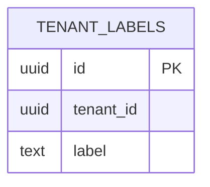

# Work Slice: SL-011 — Pin label BE impl (EXAMPLE_ONLY)

```yaml
id: SL-011
role: be-impl
family: pin-label
sources: [EXAMPLE-UC-01]
theme: example-only
sample_status: GOLDEN_BAR_B_FIXTURE
```

**design_status:** [CATALOG.md](CATALOG.md). Contracts: [SL-010](SL-010-pin-label.be-contract.md).

---

## 1. Objective

RPC + handler lưu nhãn tenant đúng contract SL-010, có idempotency DB.

---

## 2. Blocked by

- [SL-010-pin-label.be-contract.md](SL-010-pin-label.be-contract.md)

---

## 3. Persistence & runtime

### Tables / draft

```text
example_labels.tenant_labels
example_labels.idempotency_records
```

> Draft path (lúc implement): `supabase/migrations/_drafts/example_labels_pin_tenant_label.sql`



| Field | Type | Purpose |
| --- | --- | --- |
| `id` | uuid | PK |
| `tenant_id` | uuid | tenant scope |
| `label` | text | nhãn active |

### RPC

| RPC | Params `p_*` | Returns |
| --- | --- | --- |
| `example_labels.pin_tenant_label` | `p_tenant_id uuid`, `p_label text`, `p_idempotency_key text`, `p_payload_hash text` | `jsonb` `{tenant_id, label, replayed}` |

### Transaction

Must commit atomically:

- upsert `tenant_labels`
- idempotency begin/complete
- (no outbox in this fixture)

### Idempotency & concurrency

- `idempotencyKey` ≠ `command.id`
- UK `(tenant_id, command_scope, idempotency_key)` với `command_scope = pin_tenant_label`
- same key + same hash → prior snapshot; khác hash → `IDEMPOTENCY_CONFLICT`

### Errors

| Code | Khi nào | Hệ quả |
| --- | --- | --- |
| `IDEMPOTENCY_CONFLICT` | cùng key, khác payload hash | không ghi nhãn mới |
| `LABEL_INVALID` | `label` blank sau trim | không ghi |

### Integration

- Không outbox / handoff trong fixture

### Code Layout

```text
modules/
    example_labels/
        application/
            lib/
                src/
                    tenant_label/
                        commands/
                            pin_tenant_label/
                                pin_tenant_label_handler.dart
        infrastructure/
            lib/
                src/
                    supabase_tenant_label_gateway.dart
```

---

## 4. Contracts

Link: [SL-010-pin-label.be-contract.md](SL-010-pin-label.be-contract.md)

---

## 5. Verification

- [ ] **AC-01** RPC trả `{tenant_id, label, replayed}` khớp DTO
- [ ] **AC-02** Replay cùng key không tạo hàng nhãn thứ hai

| Test id | Given / When / Then | Layer |
| --- | --- | --- |
| `scn_sl011_impl` | Pin twice same key → replayed true, one row | application / RPC fake |

---

## 6. Delivery

### Definition of Done

- [ ] Draft path + tests theo AC
- [ ] Catalog → `VERIFIED` sau code-review (khi implement thật)

### Next Action

- [ ] Unblock SL-013 khi SL-012 xong
