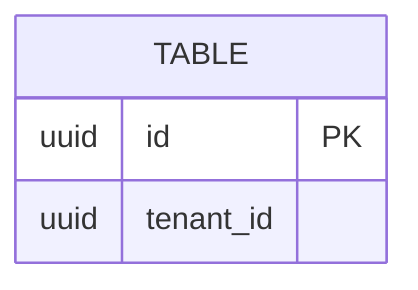

# Work Slice: SL-NNN — tiêu đề ngắn (be-impl)

```yaml
id: SL-NNN
role: be-impl
family: <family-slug>
sources: []
theme: # theme-xx
```

**design_status** trên [`CATALOG.md`](CATALOG.md). Contracts: xem file `.be-contract` cùng family — **không** nhân bản schema. READY gates (RPC bảng; SQL body lúc implement): [reference.md](reference.md).

---

## 1. Objective

Một câu: persistence/RPC/handler thực thi đúng contract đã chốt.

---

## 2. Blocked by

- Link tới `SL-….be-contract.md` (và phụ thuộc khác nếu có)

---

## 3. Persistence & runtime

### Tables / draft

```text
<schema>.<table>
```

> Draft path (tạo lúc implement): `supabase/migrations/_drafts/<scope>_<description>.sql`



| Field | Type | Purpose |
| --- | --- | --- |
| `id` | uuid | — |

### RPC

| RPC | Params `p_*` | Returns |
| --- | --- | --- |
| `<schema>.…` | … | `jsonb` |

### Transaction

Must commit atomically:

- business mutation
- outbox facts (nếu có)
- idempotency begin/complete

### Idempotency & concurrency

- `idempotencyKey` ≠ `command.id` / `messageId`
- UK `(tenant_id, command_scope, idempotency_key)`
- same key + same hash → prior snapshot; khác hash → `IDEMPOTENCY_CONFLICT`

### Errors

| Code | Khi nào | Hệ quả |
| --- | --- | --- |
| `…` | … | … |

### Integration

- Outbox = facts only
- Handoff = `integration_commands` (+ intent tables)

### Code Layout

Handler / gateway / draft — mọi file sẽ tạo hoặc sửa:

```text
modules/
    <module>/
        application/
            lib/
                src/
                    <aggregate>/
                        commands/
                            <use_case>/
                                <handler>.dart
        infrastructure/
            lib/
                src/
                    <gateway>.dart
```

---

## 4. Contracts

Link: [`SL-….be-contract.md`](SL-….be-contract.md) — không copy Dart contracts trừ deviation có ghi chú.

---

## 5. Verification

- [ ] **AC-01** RPC + handler thỏa AC nghiệp vụ từ nguồn
- [ ] **AC-02** Idempotency / failure paths (mutation)

| Test id | Given / When / Then | Layer |
| --- | --- | --- |
| `scn_…_impl` | … | application / RPC |

---

## 6. Delivery

### Definition of Done

- [ ] Draft SQL path + tests xanh theo AC
- [ ] Catalog → `VERIFIED` sau code-review (qua `implement-work-slice`)

### Next Action

- [ ] …
