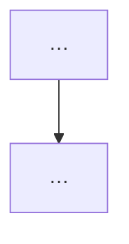

# Work Slice: SL-NNN — tiêu đề ngắn

```yaml
id: SL-NNN
journey: []
usecase: []
sources: [] # BC/SCR/ENT/… ; journey và usecase là key riêng
theme: # theme-xx
```

**design_status** sống trên [`CATALOG.md`](CATALOG.md). Coder implement khi catalog = `READY_TO_IMPLEMENT`. Hành vi lấy từ SRS. Technical contract nằm trong slice. Bar B: [reference.md](reference.md).

**Format:** tối đa một dòng trống giữa block. Heading không đánh số. Thứ tự H2 cố định. Mục optional không thuộc scope thì xóa cả mục và ghi tên mục vào Out of Scope.

---

## Objective

Một câu outcome. Trace nằm ở YAML.

---

## Blocked by

- `None` — frontier, hoặc
- Link markdown tới file slice khác và/hoặc GitLab `#N` / URL

---

## Scope & Rules

### In Scope

- …

### Out of Scope

- …
- Flow — khi outcome một bước và không có nhánh lỗi nghiệp vụ
- Design — khi slice không đổi domain, persistence, transaction, hay file code
- Contracts — khi slice không publish/consume Command, Query, DTO, hay integration
- Presentation — khi slice không có màn hình trên app

Giữ dòng nào đúng với slice. Xóa dòng mục nào thực sự có mặt bên dưới.

### Boundary

| Concern | Owner |
| --- | --- |
| … | … |

### Rules

| ID | Quy tắc (slice) |
| --- | --- |
| [`…`](…) | … |

Slice không thêm rule mới: một dòng trỏ rule nguồn.

---

## Flow

Giữ mục khi outcome có nhiều bước hoặc có nhánh lỗi nghiệp vụ.

### Main Flow



1. …
2. …

Happy path tối đa 5 bước.

### Failure Flow

Giữ H3 khi có nhánh lỗi nghiệp vụ.

1. condition → outcome → side-effect không xảy ra

---

## Design

Giữ mục khi slice đổi domain, persistence, transaction, hoặc file code. Mỗi H3 dưới đây chỉ giữ khi slice đụng concern đó.

### Domain

**Before** / **After** — …

### Persistence

Đường draft `_drafts/`. Body SQL không bắt buộc. Cột và ERD theo [reference.md](reference.md).

Bảng `schema.bang`

| Cột | Kiểu | Null | Ràng buộc |
| --- | --- | --- | --- |
| `id` | uuid | không | PK |
| `tenant_id` | uuid | không | FK `iam.tenants(id)` |

Unique hoặc index, nếu có, một dòng dưới table. Có FK thì một `erDiagram` đứng trước các table này. Bảng dùng chung: link file SQL nguồn trên dòng tên và copy đủ cột.

### Transaction / Idempotency

Mutation:

- `idempotencyKey` ≠ `command.id`
- UK `(tenant_id, command_scope, idempotency_key)` cùng transaction với business và outbox

Query: xóa H3 này.

### Code Layout

Một cây. Mỗi segment một dòng, indent 4 space. Liệt kê mọi file slice tạo hoặc sửa.

```text
modules/
    <module>/
        …
apps/
    erp/
        lib/
            features/
                <area>/
                    presentation/
                        …
```

---

## Contracts

Giữ mục khi slice publish hoặc consume Command, Query, DTO, hoặc integration. Không có type và không có Integration thì xóa cả mục.

### PinExampleCommand

> Gọi khi …

```dart
class PinExampleCommand {
  final String idempotencyKey;
}
```

Command và Query: blockquote 1–2 câu rồi fence đủ field. DTO: fence đủ field.

### Integration

Giữ H3 khi có fact outbox hoặc `integration_commands`.

- Facts (outbox): quá khứ đã xảy ra, `{context}_{entity}_{past}.v1`
- Commands: `integration_commands` khi nhờ module khác làm việc

---

## Presentation

Giữ mục khi slice có màn hình hoặc tương tác trên app. Có mục thì đủ năm H3.

### Screens

| Screen | State / action | Nguồn |
| --- | --- | --- |
| … | … | SCR-… |

### Route

- Path / entry trong app shell

### State × feedback

| State | UI / feedback | Error code |
| --- | --- | --- |
| loading | … | — |
| empty | … | — |
| error | … | … |
| success | … | — |

### Design system

- Widget / pattern DS dùng lại

### Mediator

- Command/Query qua `IModuleMediator`
- Fake khớp Contracts
- Presentation thuộc `apps/erp` hoặc `apps/admin`

---

## Verification

### Acceptance Criteria

- [ ] **AC-01** Given … When … Then …

### Tests

| Test id | Given / When / Then | Layer |
| --- | --- | --- |
| `scn_…` | … | application / widget / RPC |

### Scenarios

Giữ H3 khi có Presentation.

| Scenario | Actor | Across | Given / When / Then | Seed / fixture | Pass / fail |
| --- | --- | --- | --- | --- | --- |
| … | … | UI → mediator → RPC → DB | G: … / W: … / T: … | … | pass khi …; fail khi … |

---

## Open Questions

Chỉ giữ H2 này khi còn việc chưa chốt. Đặt cuối file, sau Verification. Câu hỏi còn chặn thì catalog chưa `READY_TO_IMPLEMENT`.

- …
