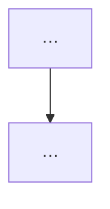

# Work Slice: SL-NNN — tiêu đề ngắn

```yaml
id: SL-NNN
role: full
family: # optional; trống nếu standalone
sources: [] # BJ/UC/BC/SCR/… IDs
theme: # theme-xx
```

**design_status** sống trên [`CATALOG.md`](CATALOG.md) — không ghi trên file này.  
Coder chỉ implement khi catalog = `READY_TO_IMPLEMENT`. Không invent field/RPC.

**Format:** tối đa một dòng trống giữa block. Trace nằm ở YAML/`sources` — không lặp trong Objective.

---

## 1. Objective

Một câu outcome. Không mô tả handler/repository.

---

## 2. Blocked by

- `None` — frontier, hoặc
- Link markdown tới file slice khác và/hoặc GitLab `#N` / URL

---

## 3. Scope & Rules

### In Scope

- …

### Out of Scope

- …

### Boundary

| Concern | Owner |
| --- | --- |
| … | … |

### Rules

| ID | Quy tắc (slice) |
| --- | --- |
| [`…`](…) | … |

---

## 4. Flow

### Main Flow



1. …
2. …

### Failure Flow

Mutation: case business-significant. Query: `N/A — query-only`.

1. condition → outcome → no unintended side-effect

---

## 5. Design

Query: Transaction / Idempotency = `N/A — query-only`.

### Domain

**Before** / **After** — …

### Application & layout

Mirror `modules/iam/`. Path: mỗi segment một dòng; indent 4 space.

### Persistence

N/A hoặc: bảng → draft link → `erDiagram` → field table. Chỉ `_drafts/` đến khi promote.

### Transaction / Idempotency / Errors

- idempotencyKey ≠ command.id
- UK `(tenant_id, command_scope, idempotency_key)` cùng txn business + outbox

---

## 6. Contracts

Mỗi Command/Query/DTO = H4 + blockquote (Command/Query bắt buộc) + Dart fence.

#### ExampleCommand

> Gọi khi …

```dart
class ExampleCommand {
  final String idempotencyKey;
}
```

#### Integration

- Facts (outbox): past tense — không `*.requested`
- Commands: `integration_commands` khi handoff

---

## 7. Verification

- [ ] **AC-01** Given … When … Then …

| Test id | Given / When / Then | Layer |
| --- | --- | --- |
| `scn_…` | … | application / RPC fake |

---

## 8. Delivery

### Definition of Done

- [ ] AC + `scn_*` pass
- [ ] Catalog: `READY_TO_IMPLEMENT` (design) hoặc `VERIFIED` (sau code + review)

### Open Questions

- …

### Next Action

- [ ] …
