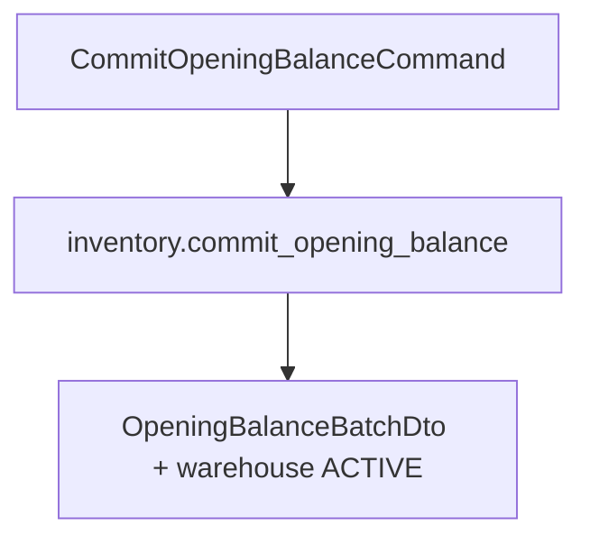
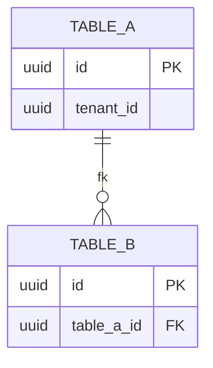

# Work Slice: Sxx-CODE — tiêu đề ngắn

> **STATUS:** `DRAFT` | `IN_REVIEW` | `READY_TO_IMPLEMENT` | `BLOCKED`  
> **Blocked reason:** _(bắt buộc khi `STATUS == BLOCKED`; ngược lại bỏ dòng này hoặc `N/A`)_  
> **Slice:** `Sxx-CODE`  
> **Wave:** `W1` | `W2` | `W3` | `W4`  
> **Theme:** `docs/themes/TH-xx-…/`  
> **BJ / CAP:** `BJ-xx` và/hoặc `CAP-xx` + link SRS — **chỉ ghi key đúng loại có** (`BJ:` / `CAP:` / `BJ / CAP:`)  
> **UC / OP:** tương tự (`UC:` / `OP:` / `UC / OP:`)  
> **BC / API:** tương tự (`BC:` / `API:` / `BC / API:`; EVT/PRJ ghi kèm trong value nếu có)  
> **Owner lane sau freeze:** `Contract` → `BE` → `FE` → `E2E`  
> **Cập nhật lần cuối:** YYYY-MM-DD

**Work Slice** = đơn vị delivery hoàn chỉnh: business outcome + technical design + implementation boundary + acceptance.  
Coder **chỉ** implement khi `STATUS == READY_TO_IMPLEMENT`. `BLOCKED` = dừng mọi lane; phải có **Blocked reason** trong metadata. Đổi field/nullability/RPC sau freeze → Design review lại.

**Fixed structure, variable depth:** luôn đủ **7 phần** dưới đây; độ sâu trong mỗi phần thay đổi theo slice (query mỏng, mutation dày). Không thêm section cấp 1 ngoài 7 phần này. Technical detail nằm trong **Design** / **Dependencies & Contracts** khi cần — không invent (SRS + `07-api-contracts.md`).

**Format:** tối đa **một** dòng trống giữa các block. Trace (BJ/UC/BC) nằm trong metadata blockquote phía trên — **không** lặp lại trong Objective.

---

## 1. Objective

> Work Slice này tồn tại để tạo ra outcome gì? (một primary outcome)

Một câu. Không mô tả handler/repository.

---

## 2. Scope & Rules

### In Scope

- …

### Out of Scope

- …

### Boundary & Ownership

| Concern | Owner module |
| --- | --- |
| … | … |

#### Owns

- …

#### Does Not Own

- …

### Rules

Bảng bắt buộc. Cột **ID** = link markdown; **text link = ID**. Cột phải = tóm tắt áp dụng trong slice.

| ID | Quy tắc (slice) |
| --- | --- |
| [`INV-…`](../../../../../specs/themes/theme-07/srs/03-domain-foundation.md#7-bất-biến-miền) | … |
| [`BC-…`](../../../../../specs/themes/theme-07/srs/06-shared-behavioral-contracts.md) | … |

---

## 3. Flow

Happy path: **Mermaid khi mô tả được**; tên đầy đủ; ≤5 bước sau diagram.

### Main Flow



1. …
2. …

### Failure Flow

Mutation: case business-significant. Query: `N/A — query-only`.

1. condition
2. outcome
3. no unintended side-effect

---

## 4. Design

Tổ chức theo **vấn đề cần giải quyết**, không theo folder layer. Query: Transaction / Idempotency = `N/A — query-only`.

### Domain Model & State

Before / After hoặc aggregate. Mermaid `stateDiagram-v2` **chỉ** khi mô tả lifecycle entity/status **khác** diagram ở §3 Flow (không copy cùng một workflow).

**Before**

- …

**After**

- …

### Application & Code Layout

| Loại | Class name | Module path đích |
| --- | --- | --- |
| Command / Query | `XxxCommand` / `XxxQuery` | `modules/<m>/application/lib/src/<aggregate>/commands\|queries/<use_case>/` |
| Handler | `XxxHandler` | cùng folder |
| DTO | `XxxResultDto` | một DTO / file, colocated |

Mirror `modules/iam/`. **Không** copy implementation `modules/sales/`.  
Layout: mỗi segment path một dòng; indent **4 space**; không `│`/`├─`.

```text
modules/
    <module>/
        domain/
            lib/
                src/
                    <aggregate>/
        application/
            lib/
                src/
                    <aggregate>/
                        commands/
                            <use_case>/
                        queries/
                            <use_case>/
        infrastructure/
            lib/
                src/
apps/
    erp/
        lib/
            features/
                <module>/
```

### Persistence & Schema Draft

Thứ tự cố định:

1. Code block — tên bảng (một dòng / bảng; liệt kê đủ bảng trong nhóm liên kết)
2. Blockquote — link draft (+ note RLS nếu cần)
3. Mermaid `erDiagram` — **một diagram cho cả nhóm liên kết**; không tách ERD theo từng bảng nếu chúng có FK / quan hệ logic
4. Bảng mô tả field — tách theo bảng; cột **Purpose** giải thích tác dụng. Field common (`id`, `tenant_id`, `created_at` / `updated_at` / `created_by` / `updated_by`, …) **vẫn liệt kê** nhưng Purpose có thể để ngắn/`—` (không bắt buộc giải thích dài).

```text
inventory.<table_a>
inventory.<table_b>
```

> Draft: [`supabase/migrations/_drafts/<scope>_<description>.sql`](../../../../../supabase/migrations/_drafts/<scope>_<description>.sql)



**`inventory.<table_a>`**

| Field | Type | Purpose |
| --- | --- | --- |
| `id` | uuid | — |
| `tenant_id` | uuid | — |
| `status` | text | … (giải thích tác dụng) |
| `created_at` | timestamptz | — |

**`inventory.<table_b>`**

| Field | Type | Purpose |
| --- | --- | --- |
| `id` | uuid | — |
| `table_a_id` | uuid | FK → table_a; … |

Query-only: cùng thứ tự; bảng owned slice khác ghi trong Purpose / heading.

### Transaction Strategy

Must commit atomically:

- `…`

### Idempotency & Concurrency

- idempotencyKey ≠ command.id / messageId
- UK: (tenant_id, command_scope, idempotency_key)
- Retry: same key + same hash → prior resultSnapshot
- Concurrency: …

### Invariants & Error Codes

| ID / Code | Check tại / Khi nào | Hệ quả |
| --- | --- | --- |
| `INV-…` / `ERROR_…` | Domain / RPC | … |

---

## 5. Dependencies & Contracts

### Requires

- …

### Provides

- …

### Contracts

Mỗi type / command / query / DTO = **H4** riêng + **Dart code block** (không bảng field; không gom một dòng dù ít field).

- **Command / Query:** ngay dưới H4, **1–2 câu trong blockquote** (`> …`) — khi nào dùng / use case; rồi mới Dart fence.
- **DTO:** blockquote optional nếu tên đã đủ rõ.

#### ExampleCommand

> Gọi khi … (actor + điều kiện trước). Kết quả chính: …

```dart
class ExampleCommand {
  final String idempotencyKey; // ≠ command.id
  final String …;
}
```

#### ExampleQuery

> Đọc khi UI/consumer cần … (không side-effect).

```dart
class ExampleQuery {
  final String …;
}
```

#### ExampleResultDto

```dart
class ExampleResultDto {
  final String id;
  final …;
}
```

#### RPC PostgREST

| RPC name | Params `p_*` | Returns | Schema |
| --- | --- | --- | --- |
| `<schema>.xxx` | `p_tenant_id`, … | `jsonb` | … |

#### Integration

- Facts (outbox): past tense `…_….v1` — không `*.requested`
- Commands: `integration_commands` khi handoff

### Dependencies Table

Cột **Dependency** luôn là link: slice → [`Sxx-<slug>.md`](Sxx-<slug>.md); chưa có file → [`04-slice-roadmap.md`](../04-slice-roadmap.md).

| Dependency | Type | Cần trước implement? |
| --- | --- | ---: |
| [`Sxx-…`](Sxx-….md) — mô tả ngắn | Required / Contract / Optional | Yes/No |

---

## 6. Verification

### Acceptance Criteria

Markdown checklist — **không** bọc trong code block.

- [ ] **AC-01** Given … When … Then …

### Test Scenarios

| Test id | Given / When / Then | Layer |
| --- | --- | --- |
| `scn_sxx_…` | … | application / RPC fake |

---

## 7. Delivery

### Definition of Done

- [ ] Business rules implemented
- [ ] Technical design implemented (Design + Contracts)
- [ ] Persistence / draft SQL + Mermaid `erDiagram` ready (nếu có)
- [ ] Integration contract completed (nếu có)
- [ ] Automated tests (`scn_*`) pass
- [ ] Acceptance criteria verified
- [ ] No unresolved blocking questions
- [ ] `STATUS: READY_TO_IMPLEMENT` (Design lane) / implement + review (Code lane)

### Open Questions

- …

### Next Action

- [ ] Design review → `IN_REVIEW` / `READY_TO_IMPLEMENT`
- [ ] Lane Contract / BE / FE / E2E theo `04-slice-roadmap.md`
