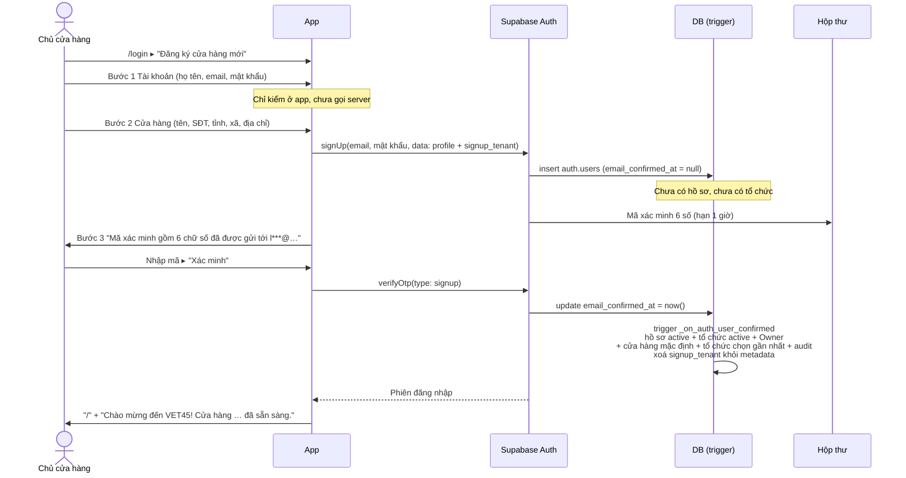
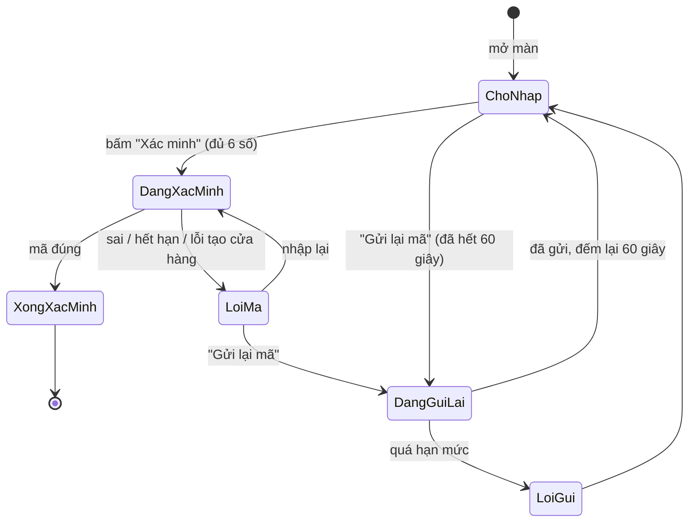
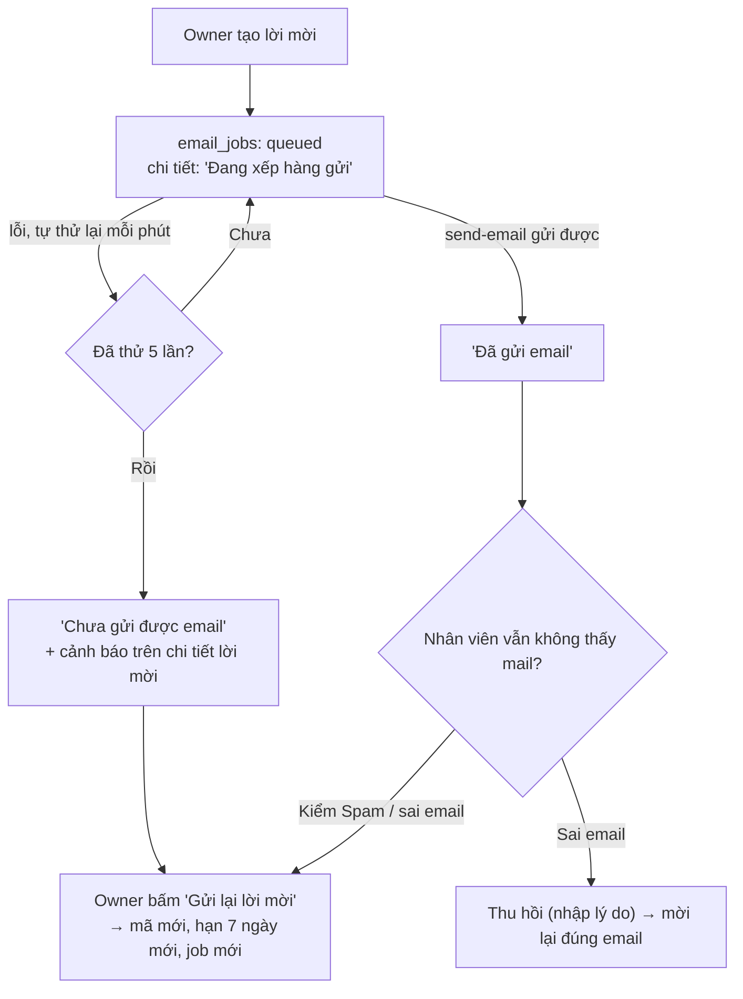

# Luồng tạo tổ chức đầu tiên, xác minh email và gửi lại mail

> Phiên bản 1.0 · 2026-10-09 · Chi tiết hoá [TH-01](TH-01-to-chuc-va-nguoi-dung.md) EP-01, EP-02 (US-02.3), EP-03, US-06.3 và [LUONG-UNG-DUNG](LUONG-UNG-DUNG.md) mục 4.
> Code tương ứng: 2-B1 (đăng ký, xác minh), 2-B2 (email), 2-B3 (gửi lại mã ngay khi vào từ đăng nhập).

## 1. "Kích hoạt" trước đây và bây giờ

App cũ dùng chữ "kích hoạt" cho 3 việc khác nhau. Sau refactor:

| Trước đây | Ai | Bây giờ |
|---|---|---|
| Platform Admin **tạo tổ chức** (`provisioning`) và gửi **lời mời Owner** (mã 8 ký tự) | Platform Admin | **Bỏ.** Chủ cửa hàng tự đăng ký ở `/signup` |
| Owner **"Kích hoạt tài khoản"**: nhập mã lời mời → đặt mật khẩu | Owner | **Bỏ** cho Owner. Thay bằng **xác minh email** bằng mã 6 số Supabase gửi |
| Owner **"Kích hoạt tổ chức"** ở màn readiness → `active` | Owner | **Bỏ.** Tổ chức dùng được ngay khi email được xác minh. Không còn trạng thái tổ chức hay tài khoản bị chặn (3-E, 2026-10-12) |
| Nhân viên **"Kích hoạt tài khoản"**: nhập mã lời mời → đặt mật khẩu → tham gia | Nhân viên | **Giữ**, thêm bước nhập mã 6 số khi nhân viên chưa có tài khoản |

Từ nay trong app và tài liệu:
- **Mã xác minh** = 6 số, Supabase Auth gửi, chứng minh chủ email (đăng ký cửa hàng, nhân viên tạo tài khoản mới).
- **Mã lời mời** = 8 ký tự, Owner tạo, gửi qua `send-email`, dùng ở "Kích hoạt tài khoản".
- **Mã đặt lại mật khẩu** = 6 số, gửi qua `send-email`.

## 2. Luồng A — Tạo tổ chức đầu tiên

### 2.1 Đường chính

### 2.2 Dữ liệu sau mỗi bước

| Sau bước | `auth.users` | Hồ sơ người dùng | Tổ chức / Owner / cửa hàng | Đăng nhập được? |
|---|---|---|---|---|
| 1 Tài khoản | — | — | — | — |
| 2 Tạo cửa hàng | có, **chưa xác minh**, metadata giữ thông tin cửa hàng | — | — | Không (`email_not_confirmed`) |
| 3 Xác minh | đã xác minh, metadata không còn `signup_tenant` | `active` | có, `active` | Có (đã vào app) |

Nếu bước 3 lỗi ở trigger (dữ liệu cửa hàng sai), **cả** việc xác minh bị huỷ: email vẫn chưa xác minh, không có tổ chức nửa vời (US-01.3 AC-03).

### 2.3 Tình huống lệch khỏi đường chính

| # | Tình huống | Supabase / DB làm gì | App phải làm |
|---|---|---|---|
| A1 | Email đã có tài khoản **đã xác minh** | `signUp` không báo lỗi, trả `user` có `identities` rỗng, không gửi mail | "Email đã được đăng ký" + "Đăng nhập" / "Quên mật khẩu" (đã làm 2-B1) |
| A2 | Thoát app ở bước 3, lần sau **đăng nhập** | Đăng nhập lỗi `email_not_confirmed` | Chuyển `/verify-email`, cho **gửi lại mã ngay** (mã cũ có thể đã hết hạn); xác minh xong vào `/` với tổ chức từ metadata đã lưu (đã làm 2-B1, 2-B3) |
| A3 | Thoát ở bước 3, lần sau **đăng ký lại** cùng email | Supabase coi là tài khoản chưa xác minh: gửi lại mã, **không cập nhật metadata** (giữ thông tin cửa hàng lần đầu) và theo một số báo cáo **giữ mật khẩu cũ** | ⚠️ **Chưa xử lý.** Đề xuất ở 2.4 |
| A4 | Bấm "Tạo cửa hàng" / "Gửi lại mã" khi chưa qua 60 giây | Lỗi 429 ("you can only request this after … seconds") | Hiện "Gửi lại mã sau 00:ss", không báo lỗi chung |
| A5 | Hết hạn mức email của project (Dev: 2 email / giờ khi chưa có SMTP riêng) | Lỗi 429 `over_email_send_rate_limit` | "Bạn đã gửi quá nhiều yêu cầu. Vui lòng thử lại sau." |
| A6 | Nhập sai / mã quá 1 giờ | `verifyOtp` lỗi | "Mã xác minh không đúng hoặc đã hết hạn." + nút "Gửi lại mã" |
| A7 | Xác minh lần hai (hiếm: Auth gọi lại) | Trigger thấy đã là Owner → không tạo tổ chức thứ hai (BR-07) | Không cần làm gì |
| A8 | Người **đã là Owner** muốn mở cửa hàng thứ hai | Không hỗ trợ (BR-07) | A1 chặn từ đầu vì email đã có tài khoản |

### 2.4 Đề xuất cho A3 (đăng ký lại khi chưa xác minh)

Vấn đề: người dùng sửa tên cửa hàng hoặc đổi mật khẩu ở lần đăng ký thứ hai, nhưng Supabase vẫn giữ dữ liệu lần đầu. Sau khi xác minh, tổ chức mang **tên cũ**, và đăng nhập lần sau bằng **mật khẩu mới** có thể thất bại.

Cách xử lý, gọn và không cần server riêng:
1. Ở bước 3 của `/signup`, ngay sau `verifyOtp` thành công (đã có phiên), app gọi `auth.updateUser(password: <mật khẩu vừa nhập>)` để chắc chắn mật khẩu là cái người dùng vừa đặt.
2. Toast chào mừng lấy **tên tổ chức từ DB** (sau bootstrap), không lấy từ form.
3. Nếu tên tổ chức từ DB khác tên vừa nhập: toast phụ "Cửa hàng được tạo theo thông tin lần đăng ký trước. Bạn có thể sửa trong Hồ sơ tổ chức." Người dùng sửa ở ID-12.
4. Kiểm trên Dev trước khi làm: đăng ký → thoát ở bước 3 → đăng ký lại với tên cửa hàng và mật khẩu khác → xác minh → xem tổ chức tên gì, mật khẩu nào đăng nhập được.

→ Đưa vào plan tiếp theo (2-B4) nếu bạn đồng ý.

## 3. Luồng B — Xác minh email (một khối dùng chung)

Cùng một khối "nhập mã 6 số" (`VerifyEmailView` + `VerifyEmailCubit`) dùng ở 3 chỗ:

| Điểm vào | Gửi lại mã lúc mở | Xác minh xong |
|---|---|---|
| `/signup` bước 3 | Khoá 60 giây (vừa gửi khi `signUp`) | `/` + toast chào mừng |
| `/verify-email` (từ đăng nhập, A2) | **Mở ngay** | Định tuyến sau đăng nhập → `/` |
| `/invitation`, nhân viên chưa có tài khoản | Khoá 60 giây (vừa gửi khi `signUp`) | Cập nhật hồ sơ → nhận lời mời → đăng xuất → `/login` + "Tham gia tổ chức thành công" |

Quy tắc: mã 6 số, hạn 1 giờ (`otp_expiry = 3600`), gửi lại sau 60 giây (`max_frequency = 1m`), **mã mới thay mã cũ**.

## 4. Luồng C — Gửi lại mail

| Loại mail | Ai bấm "Gửi lại" | Ở đâu | Chờ | Mã cũ | Đi qua | Giới hạn |
|---|---|---|---|---|---|---|
| Mã xác minh (6 số) | Người đăng ký / nhân viên mới | Bước 3 `/signup`, `/verify-email`, `/invitation` | 60 giây | Vô hiệu | Supabase Auth (SMTP) | Dev: 2 email / giờ / project khi chưa có SMTP riêng |
| Mã lời mời (8 ký tự) | **Owner** | Chi tiết lời mời ▸ "Gửi lại lời mời" | — | Vô hiệu, **hạn tính lại 7 ngày** | `email_jobs` → `send-email` → Resend | Chỉ lời mời `pending` (BR-41) |
| Mã đặt lại mật khẩu (6 số) | Người quên mật khẩu | `/login/reset-password` | 60 giây (server chặn; app đếm 60 — KI-12) | Vô hiệu | `email_jobs` → `send-email` → Resend | Gửi quá nhiều → "Bạn đã gửi quá nhiều yêu cầu…" |

### 4.1 Lời mời: không nhận được email

### 4.2 Lời mời hết hạn

- Quá 7 ngày mà chưa nhận: nhân viên nhập mã → "Mã lời mời đã hết hạn…".
- Owner mở chi tiết lời mời:
  - còn trạng thái **Đang chờ** (chưa ai đụng tới) → "Gửi lại lời mời" gia hạn 7 ngày với mã mới;
  - đã chuyển **Hết hạn** → tạo **lời mời mới** cho cùng email.

## 5. Tóm tắt việc còn thiếu so với tài liệu này

| Việc | Trạng thái |
|---|---|
| A1, A2, A6, A7, luồng B, luồng C | Có code (2-B1, 2-B2, 2-B3); chờ đợt kiểm trên Dev |
| A3 — đăng ký lại khi chưa xác minh | **Chưa làm** — mục 2.4, đề xuất plan 2-B4 |
| A4 — 429 khi chưa đủ 60 giây hiện thành đếm ngược | **Cần kiểm**: hiện map chung `RATE_LIMITED` → câu "gửi quá nhiều yêu cầu"; nên tách 2 trường hợp |
| Gửi mail tới người ngoài project trên Dev | Chờ tên miền + SMTP / Resend (RUNBOOK-email) |
