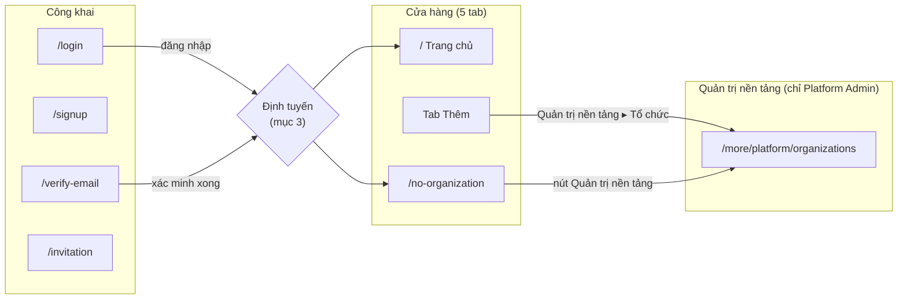
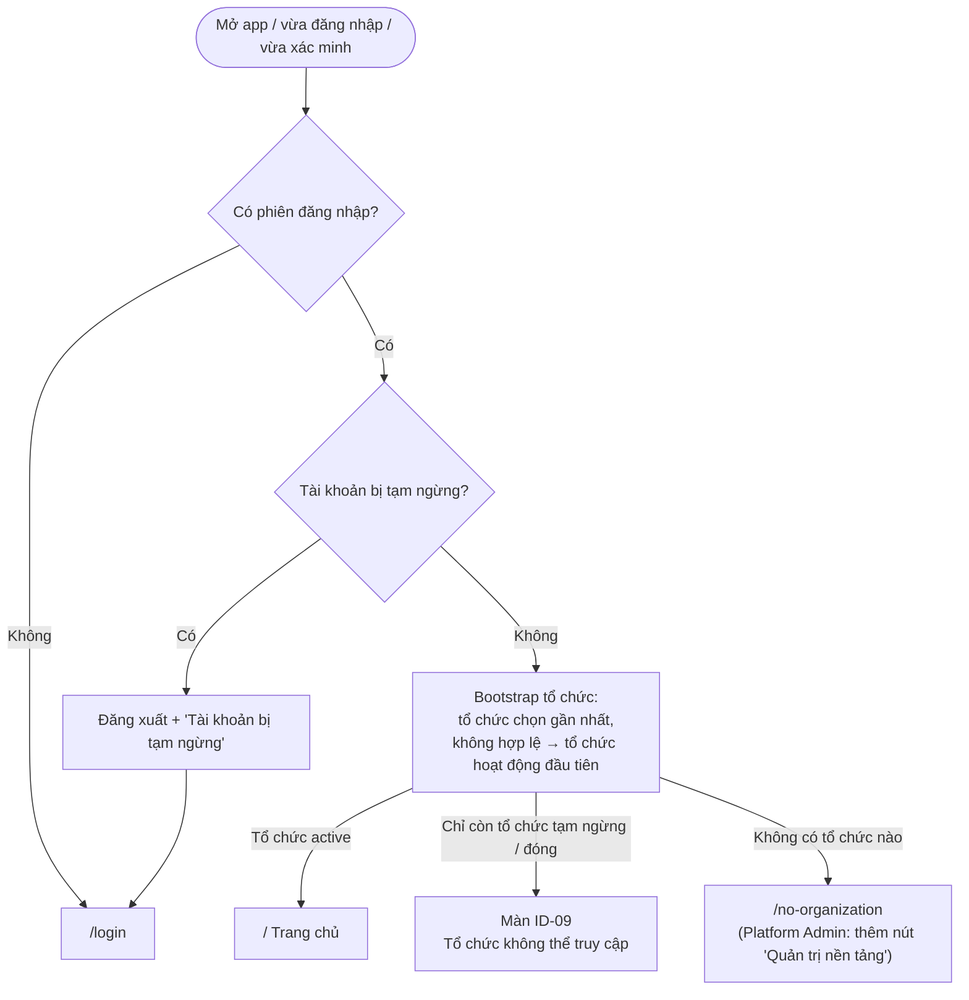
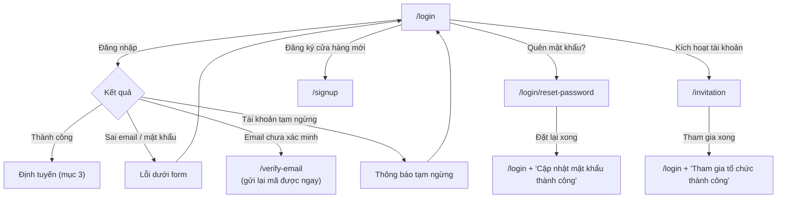
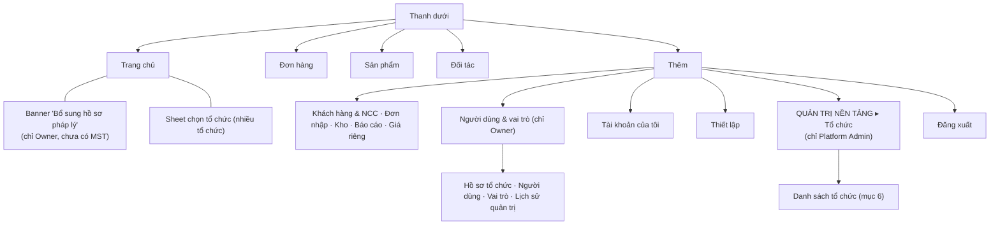
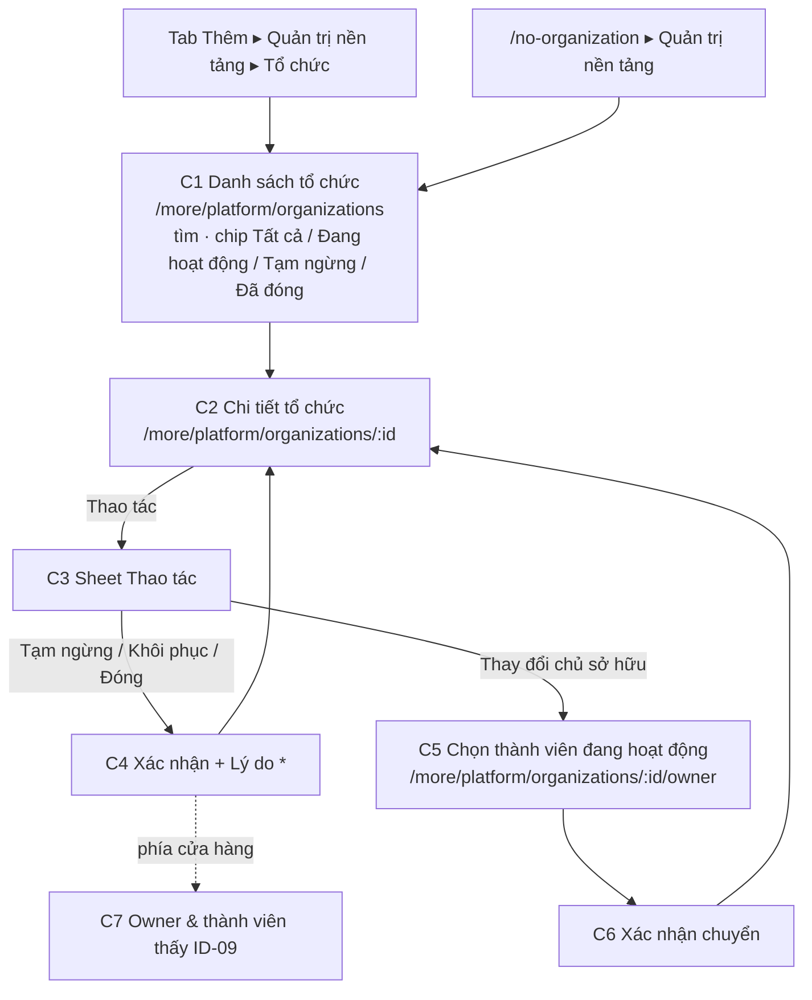

# Luồng ứng dụng sau khi gộp app

> Phiên bản 1.1 · 2026-10-09 · Bổ sung cho [TH-01](TH-01-to-chuc-va-nguoi-dung.md) mục 1.2, 2.3, EP-09 và [PLAN](../refactor/PLAN.md) P2, P8.
> v1.1: chốt **phương án A** — không có khu `/admin`; quản lý tổ chức nằm ở nhóm "Quản trị nền tảng" cuối tab Thêm ([ADMIN-SCREENS](../refactor/ADMIN-SCREENS.md)).
> Tài liệu này mô tả **đường đi giữa các màn**. Nội dung từng màn vẫn lấy theo TH-01…TH-08. Luồng đăng ký / xác minh / gửi lại mail: [LUONG-DANG-KY-XAC-MINH-EMAIL](LUONG-DANG-KY-XAC-MINH-EMAIL.md).

## 1. Tổng quan

Trước đây có 2 app: `apps/erp` (cửa hàng) và `apps/admin` (Platform Admin). Sau refactor chỉ còn `apps/erp`:

| Vùng | Route | Ai dùng | Khung |
|---|---|---|---|
| **Công khai** | `/login`, `/login/reset-password`, `/signup`, `/verify-email`, `/invitation` | Chưa đăng nhập (và người đang nhận lời mời) | Không có thanh dưới |
| **Cửa hàng** | `/`, đơn hàng, sản phẩm, đối tác, `/more/**`, `/no-organization` | Owner, thành viên, Platform Admin | Thanh dưới 5 tab: **Trang chủ · Đơn hàng · Sản phẩm · Đối tác · Thêm** |
| **Quản trị nền tảng** | `/more/platform/organizations`, `/:id`, `/:id/owner` | Chỉ Platform Admin | **Không có khung riêng**: các trang mở từ tab Thêm (hoặc từ `/no-organization`) |

Nguyên tắc:
1. **Một màn đăng nhập** cho mọi người.
2. **Không ai tạo tổ chức sau khi đăng nhập.** Tổ chức chỉ sinh ra từ `/signup` (BR-01).
3. Platform Admin chỉ **quản lý tổ chức**: tạm ngừng, khôi phục, đóng, chuyển chủ sở hữu. Không có tổng quan, người dùng nền tảng, nhật ký nền tảng trên app.
4. Router guard chỉ để ẩn / chuyển màn; quyền thật do RPC kiểm (BR-60).

## 2. Ai thấy gì

| Người dùng | Vào được | Không thấy |
|---|---|---|
| Khách (chưa đăng nhập) | Vùng công khai | Mọi thứ khác → `/login` |
| Thành viên (không phải Owner) | Khu cửa hàng; tab Thêm: nghiệp vụ, Tài khoản của tôi, Thiết lập, Đăng xuất | "Người dùng & vai trò", "Quản trị nền tảng" |
| Owner | Như thành viên + **"Người dùng & vai trò"**, banner hồ sơ pháp lý | "Quản trị nền tảng" |
| Platform Admin có cửa hàng | Như vai trò của họ ở cửa hàng + nhóm **"Quản trị nền tảng"** cuối tab Thêm | — |
| Platform Admin không có cửa hàng | `/no-organization` có thêm nút **"Quản trị nền tảng"** → danh sách tổ chức | Khu cửa hàng |
| Người không còn tổ chức nào | `/no-organization`, `/invitation` | Khu cửa hàng |

## 3. Mở app và định tuyến sau đăng nhập

Platform Admin **không** có nhánh định tuyến riêng: họ đi cùng đường với mọi người, chỉ thấy thêm lối vào "Quản trị nền tảng".

Bảng guard (`core/router/route_guard.dart`):

| # | Điều kiện | Đang ở | Chuyển tới | Làm ở |
|---|---|---|---|---|
| G1 | Chưa đăng nhập | ngoài vùng công khai | `/login` | 1-B |
| G2 | Đã đăng nhập | `/login`, `/signup`, `/verify-email` | `/` | 2-B1 |
| G5 | Không có tổ chức | khu cửa hàng (trừ `/no-organization`, `/invitation`, `/more/platform/**` nếu là Platform Admin) | `/no-organization` | 2-B1; ngoại lệ Platform Admin ở P8 |
| G6 | Có tổ chức | `/no-organization` | `/` | 2-B1 |
| G7 | Không phải Platform Admin | `/more/platform/**` | `/` | P8 |
| — | Email chưa xác minh | — | Không phải guard: màn đăng nhập nhận `email_not_confirmed` rồi chuyển `/verify-email` | 2-B1 |
| — | Tổ chức tạm ngừng / đóng | — | Trang chủ hiện ID-09 | có sẵn |

(G3, G4 của bản 1.0 — chuyển vào / ra khu `/admin` — đã bỏ.)

## 4. Vùng công khai

### 4.1 Đăng nhập

### 4.2 Đăng ký, xác minh, lời mời

Xem [LUONG-DANG-KY-XAC-MINH-EMAIL](LUONG-DANG-KY-XAC-MINH-EMAIL.md) (luồng A, B, C).

## 5. Khu cửa hàng

## 6. Quản trị nền tảng (P8)

Chi tiết từng màn và phần bỏ so với `apps/admin`: [ADMIN-SCREENS](../refactor/ADMIN-SCREENS.md). Mã C1–C7 trùng với bảng thiết kế.

## 7. Mất quyền khi đang dùng (TH-01 US-04.2)

| Sự kiện | App làm gì |
|---|---|
| Tài khoản bị tạm ngừng (làm bằng SQL, không còn màn) | RPC kế tiếp lỗi `PLATFORM_USER_SUSPENDED` → đăng xuất, `/login` với thông báo tạm ngừng |
| Bị loại / tạm ngừng khỏi tổ chức đang dùng | Bootstrap lại: còn tổ chức khác → vào tổ chức đó; không còn → `/no-organization` |
| Tổ chức đang dùng bị Platform Admin tạm ngừng / đóng | Trang chủ hiện ID-09: "Chọn tổ chức khác" / "Đăng xuất" |
| Platform Admin bị gỡ quyền nền tảng | Nhóm "Quản trị nền tảng" biến mất; đang ở `/more/platform/**` → guard G7 về `/` |

## 8. Việc cần làm để khớp tài liệu này

| Việc | Ở đâu |
|---|---|
| G1, G2, G5, G6; `/signup`, `/verify-email`, `/no-organization`; bỏ readiness | Đã làm: 2-B1, 2-B3 |
| `SessionController.isPlatformAdmin`; guard G7; ngoại lệ G5 cho Platform Admin | P8 (8.1) |
| Trang C1, C2, C5 + sheet C3, C4, C6 | P8 (8.2) |
| Lối vào ở tab Thêm và `/no-organization` | P8 (8.3) |
| Chặn chuyển Owner cho người đã là Owner nơi khác (KI-08) | P8 (8.4) |
| Bỏ `apps/admin`, wizard khởi tạo, `provisioning` | P8 (8.6), P9 |
