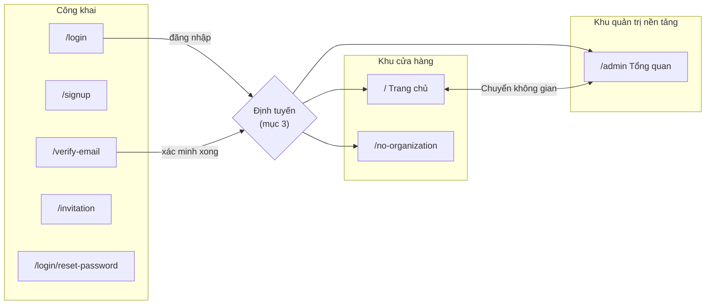
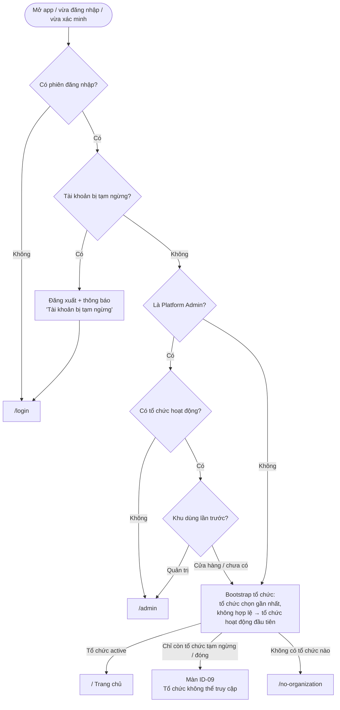
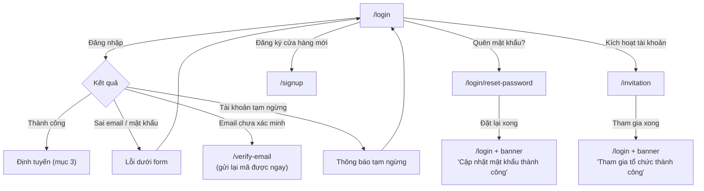
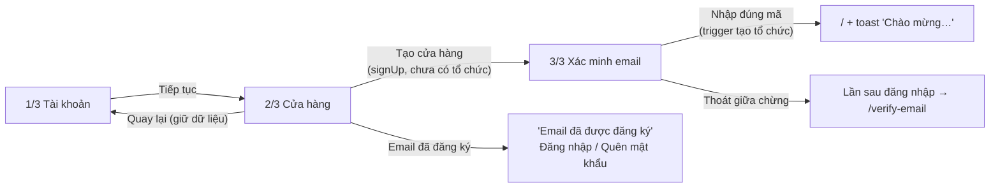
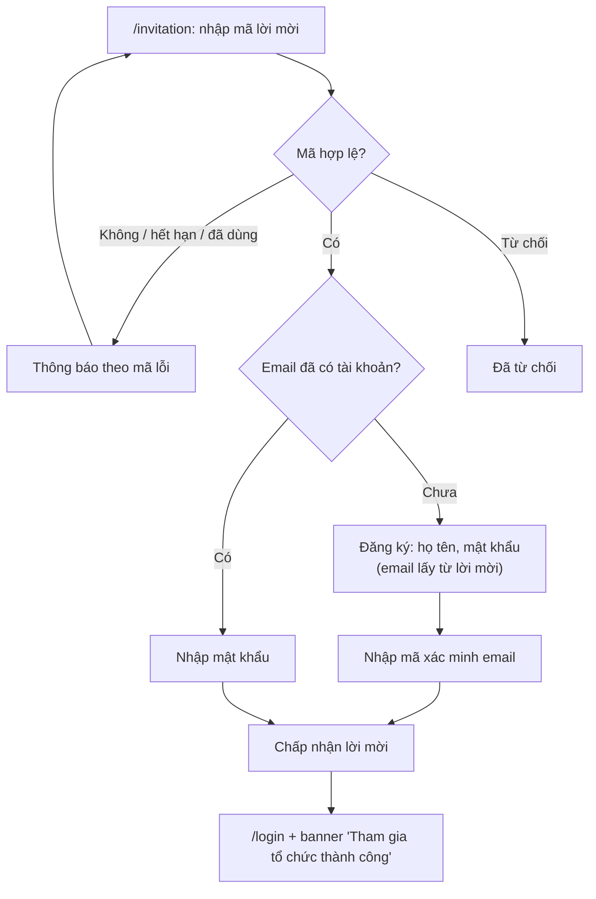
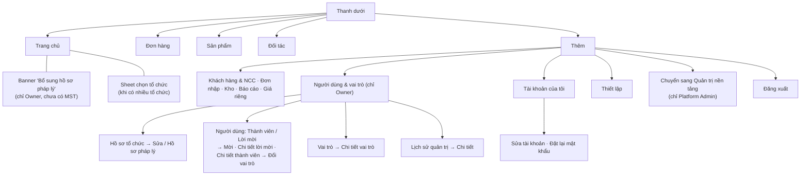
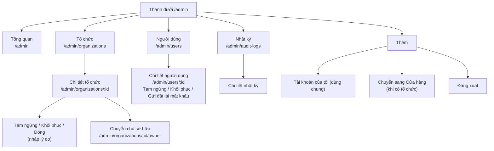

# Luồng ứng dụng sau khi gộp app (một app, hai khu vực)

> Phiên bản 1.0 · 2026-10-09 · Bổ sung cho [TH-01](TH-01-to-chuc-va-nguoi-dung.md) mục 1.2, 2.3, 5.11 và [PLAN](../refactor/PLAN.md) P2, P8.
> Tài liệu này mô tả **đường đi giữa các màn**. Nội dung từng màn (chuỗi UI, trạng thái, lỗi) vẫn lấy theo TH-01…TH-08.

## 1. Tổng quan

Trước đây có 2 app: `apps/erp` (cửa hàng) và `apps/admin` (Platform Admin), mỗi app một màn đăng nhập. Sau refactor chỉ còn `apps/erp`, chia 3 vùng:

| Vùng | Route | Ai dùng | Khung điều hướng |
|---|---|---|---|
| **Công khai** | `/login`, `/login/reset-password`, `/signup`, `/verify-email`, `/invitation` | Chưa đăng nhập (và người đang nhận lời mời) | Không có thanh dưới |
| **Cửa hàng** | `/`, `/orders…`, `/products…`, `/partners…`, `/more/**`, `/no-organization` | Owner, thành viên | Thanh dưới 5 tab: **Trang chủ · Đơn hàng · Sản phẩm · Đối tác · Thêm** |
| **Quản trị nền tảng** | `/admin/**` | Platform Admin | Thanh dưới 5 tab: **Tổng quan · Tổ chức · Người dùng · Nhật ký · Thêm** |

Nguyên tắc:
1. **Một màn đăng nhập** cho mọi người. Đăng nhập xong app tự đưa tới đúng vùng (mục 3).
2. **Không ai tạo tổ chức sau khi đăng nhập.** Tổ chức chỉ sinh ra từ "Đăng ký cửa hàng mới" (`/signup`). Khu `/admin` không có nút tạo tổ chức (BR-01).
3. Người vừa là Platform Admin vừa là thành viên cửa hàng chuyển vùng bằng **"Chuyển không gian"** (mục 7).
4. Router guard chỉ để ẩn / chuyển màn; quyền thật do RPC kiểm (BR-60).

## 2. Ai thấy gì

| Người dùng | Vào được | Không thấy |
|---|---|---|
| Khách (chưa đăng nhập) | Vùng công khai | Mọi thứ khác → `/login` |
| Thành viên (không phải Owner) | Khu cửa hàng: 4 tab nghiệp vụ; "Thêm": Tài khoản của tôi, Thiết lập (phần được phép), Đăng xuất | Mục "Người dùng & vai trò", hồ sơ tổ chức, `/admin` |
| Owner | Như thành viên + **"Người dùng & vai trò"** (hồ sơ tổ chức, người dùng, vai trò, lịch sử quản trị), banner hồ sơ pháp lý | `/admin` |
| Platform Admin (không có tổ chức) | Chỉ khu `/admin` + Tài khoản của tôi | Khu cửa hàng (gõ `/` → về `/admin`) |
| Platform Admin + thành viên / Owner | Cả hai khu, chuyển bằng "Chuyển không gian" | — |
| Người không còn tổ chức nào | `/no-organization`, `/invitation` | Khu cửa hàng |

## 3. Mở app và định tuyến sau đăng nhập

Thay cho bảng TH-01 2.3, viết thành thứ tự kiểm (dừng ở dòng đầu tiên khớp):

Bảng guard đầy đủ (`core/router/route_guard.dart`):

| # | Điều kiện | Đang ở | Chuyển tới |
|---|---|---|---|
| G1 | Chưa đăng nhập | ngoài vùng công khai | `/login` |
| G2 | Đã đăng nhập | `/login`, `/signup`, `/verify-email` | vùng mặc định (G3–G6) |
| G3 | Platform Admin, không có tổ chức | khu cửa hàng | `/admin` |
| G4 | Không phải Platform Admin | `/admin/**` | `/` |
| G5 | Không có tổ chức (không phải Platform Admin) | khu cửa hàng (trừ `/no-organization`, `/invitation`) | `/no-organization` |
| G6 | Có tổ chức | `/no-organization` | `/` |
| — | Email chưa xác minh | — | **Không phải guard**: lúc này chưa có phiên. Màn đăng nhập nhận lỗi `email_not_confirmed` rồi chuyển `/verify-email` |
| — | Tổ chức bị tạm ngừng / đóng | — | Trang chủ hiện màn ID-09 (không đổi route) |

G1, G2, G5, G6 đã làm ở 2-B1. **G3, G4 làm ở P8.**

## 4. Vùng công khai

### 4.1 Đăng nhập

### 4.2 Đăng ký cửa hàng mới (TH-01 EP-01)

### 4.3 Nhận lời mời (TH-01 EP-03)

Điểm vào `/invitation`: nút "Kích hoạt tài khoản" ở `/login`, và nút "Nhập mã lời mời" ở `/no-organization`.

## 5. Khu cửa hàng

Thay đổi so với app cửa hàng cũ:
- **Bỏ**: màn readiness `/more/readiness`, sheet "Kích hoạt tổ chức?", mục "Quyền sở hữu" trong hub (2-B3).
- **Thêm**: banner hồ sơ pháp lý (2-B1), trang Vai trò thật (2-B3), mục "Chuyển sang Quản trị nền tảng" (P8).
- Chuyển Owner **không** làm ở khu cửa hàng — chỉ Platform Admin ở `/admin` (BR-32).

## 6. Khu quản trị nền tảng (`/admin`, P8)

Đối chiếu với `apps/admin`:

| `apps/admin` (cũ) | Sau gộp |
|---|---|
| `/login` riêng | Bỏ — dùng `/login` chung |
| Tab Tổng quan `/dashboard/home` | `/admin` |
| Tab Tổ chức `/dashboard/organizations`, `/:tenantId` | `/admin/organizations`, `/:id` |
| `/dashboard/organizations/new` (wizard khởi tạo) | **Bỏ** (BR-01) |
| "Gửi lại lời mời Owner", "Gửi lại kích hoạt" | **Bỏ** (không còn lời mời Owner) |
| Tab Người dùng `/dashboard/users`, `/:userId` | `/admin/users`, `/:id` |
| Tab Nhật ký `/dashboard/audit` | `/admin/audit-logs` |
| Tab Thêm `/dashboard/more` | Thêm: Tài khoản của tôi, Chuyển không gian, Đăng xuất |
| Bộ lọc "Mức hoàn thiện", nhãn "Đang thiết lập", cảnh báo "Email Chủ sở hữu chưa xác minh" | **Bỏ** (không còn `provisioning`) |

Thứ tự tab giữ giống app cũ trừ đổi chỗ "Tổ chức" lên trước "Người dùng" (tổ chức là việc chính của Platform Admin).

## 7. Chuyển không gian

- Hiện ở tab **Thêm** của cả hai khu, chỉ khi người dùng **vừa** là Platform Admin **vừa** có tổ chức hoạt động.
  - Khu cửa hàng: "Chuyển sang Quản trị nền tảng" → `/admin`.
  - Khu quản trị: "Chuyển sang Cửa hàng" → `/` (bootstrap tổ chức như mục 3).
- **Nhớ khu dùng lần trước** theo từng người dùng, lưu **trên máy** (shared preferences, khoá theo `userId`). Không thêm cột DB. Đăng xuất không xoá giá trị này; người khác đăng nhập dùng khoá riêng.
- Không chuyển được giữa chừng một thao tác chưa lưu: dùng cùng cơ chế "rời trang khi có thay đổi" của màn đang mở.

## 8. Mất quyền khi đang dùng (TH-01 US-04.2)

| Sự kiện | App làm gì |
|---|---|
| Tài khoản bị Platform Admin tạm ngừng | RPC kế tiếp lỗi `PLATFORM_USER_SUSPENDED` → đăng xuất, `/login` với thông báo tạm ngừng |
| Bị loại / tạm ngừng khỏi tổ chức đang dùng | Bootstrap lại: còn tổ chức khác → vào tổ chức đó; không còn → `/no-organization` |
| Tổ chức đang dùng bị tạm ngừng / đóng | Trang chủ hiện ID-09: "Chọn tổ chức khác" / "Đăng xuất" |
| Platform Admin bị gỡ quyền nền tảng | Đang ở `/admin` → guard G4 đưa về `/` (hoặc `/no-organization`) |

## 9. Việc cần làm để khớp tài liệu này

| Việc | Ở đâu |
|---|---|
| G1, G2, G5, G6; `/signup`, `/verify-email`, `/no-organization`; bỏ readiness | Đã làm: 2-B1, 2-B3 |
| `SessionController.isPlatformAdmin` (RPC kiểm quyền nền tảng); guard G3, G4 | P8 (8.1) |
| Shell `/admin` + 5 tab; chuyển màn từ `apps/admin` theo bảng mục 6 | P8 (8.1, 8.2) |
| "Chuyển không gian" + nhớ khu dùng lần trước | P8 (8.4) |
| Bỏ `apps/admin`, wizard khởi tạo, `provisioning` | P8 (8.6), P9 |
| Ô "Định tuyến" trong TH-01 2.3 trỏ sang mục 3 tài liệu này | Cập nhật TH-01 khi bắt đầu P8 |
