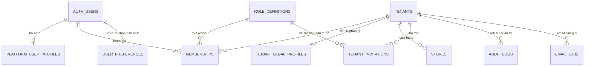

# TH-01 — Tổ chức & người dùng

> **Vai trò:** **đặc tả chuẩn (source of truth)** cho app sau refactor. Mặc định mọi quy tắc = hành vi code hiện tại; riêng **luồng khởi tạo tổ chức được thiết kế lại** (SCOPE 3.5) theo quyết định giữ hướng v3.0.
> - 🆕 = **chưa có code**, làm ở P2 (đăng ký, xác minh, định tuyến, email). Chuỗi UI của phần 🆕 trong tài liệu này là **chuỗi chuẩn** để làm theo.
> - Quyết định 2026-10-12 (3-E): **không còn Platform Admin**, không còn trạng thái chặn tổ chức (`suspended` / `closed`) hay tài khoản (`suspended`), không chuyển Owner. Hệ thống chỉ có Owner và thành viên; mọi tổ chức và tài khoản luôn hoạt động.
> - 🔧 = code hiện tại **sai**, phải sửa khi refactor.
>
> **Phiên bản:** 4.0 · **Ngày:** 2026-10-07 · **Branch đối chiếu:** `refactor/simple-arch` @ `47b4cb188`
> **Thay thế:** bản 3.0 (2026-10-06, cùng phạm vi, ít chi tiết hơn), bản 2.0 (luồng cũ qua 2 app), `Theme 1_ Tổ chức & người dùng.md` (v1), `docs/themes/TH-01-organization-users/`.
> **Nguồn đối chiếu:**
> - DB: schema `iam`, migration `20260811*` (vòng đời, mời, đặt lại mật khẩu, chuẩn hoá vai trò Owner), `20260820*`, `20260826003`, `20260916005`–`006`, `20261009*` (đăng ký, email).
> - App: `apps/erp/lib/features/{auth,iam,tenant_context}` (22 trang); `apps/admin` (sẽ gộp); [SCOPE.md](../refactor/SCOPE.md) mục 3.4–3.5, 4.
>
> **Cách đọc:** mục 1–3 là mô hình chung và dữ liệu; mục 4 chia theo epic → user story (bối cảnh, FR, BR, AC, EC, kịch bản Gherkin); mục 5 đặc tả màn hình; mục 6 RPC, email, lỗi; mục 7 phân quyền và vấn đề đã biết; mục 8 phần bị bỏ và ngoài phạm vi; mục 9 kế hoạch refactor và kiểm thử; mục 10 thuật ngữ.

---

## Mục lục

1. [Tổng quan](#1-tổng-quan)
2. [Mô hình nghiệp vụ](#2-mô-hình-nghiệp-vụ)
3. [Dữ liệu](#3-dữ-liệu)
4. [Epic và user story](#4-epic-và-user-story)
5. [Đặc tả màn hình](#5-đặc-tả-màn-hình)
6. [Kỹ thuật: RPC, email, lỗi](#6-kỹ-thuật-rpc-email-lỗi)
7. [Phân quyền & vấn đề đã biết](#7-phân-quyền--vấn-đề-đã-biết)
8. [Phần bị bỏ và ngoài phạm vi](#8-phần-bị-bỏ-và-ngoài-phạm-vi)
9. [Thay đổi khi refactor & kiểm thử](#9-thay-đổi-khi-refactor--kiểm-thử)
10. [Thuật ngữ](#10-thuật-ngữ)

---

## 1. Tổng quan

### 1.1 Mục đích

TH-01 là nền móng của VET45. Mọi chức năng khác dựa vào nó để biết:

- **Ai** đang thao tác (người dùng đã đăng nhập qua Supabase Auth).
- Đang thao tác trong **tổ chức** nào (ranh giới dữ liệu, cột `tenant_id`) và **cửa hàng** nào.
- Người đó có là **thành viên** của tổ chức không, với **vai trò** gì, có phải **Chủ sở hữu (Owner)** không.

Trên giao diện, `Tenant` hiển thị là **Tổ chức** (hoặc **Cửa hàng** trong luồng đăng ký). Trong DB và code vẫn dùng `tenant`.

### 1.2 Một ứng dụng

| Khu vực | Route | Người dùng | Chức năng chính |
|---|---|---|---|
| **Cửa hàng** | `/`, `/more/**`… | Owner và thành viên | Nghiệp vụ TH-02 → TH-08; quản trị tổ chức (chỉ Owner); tài khoản của tôi |

Chỉ có một app (`apps/erp`) và một màn đăng nhập. App `apps/admin` bị bỏ. Quyết định 2026-10-12 (3-E): bỏ luôn nhóm "Quản trị nền tảng" (phương án A ngày 2026-10-09). Không còn vai trò Platform Admin.

### 1.3 Bối cảnh nghiệp vụ

- Khách hàng của VET45 là hộ kinh doanh và doanh nghiệp bán lẻ thuốc thú y nhỏ. Cách tạo tổ chức theo các phần mềm bán hàng phổ biến (KiotViet, Sapo…): **khách tự đăng ký cửa hàng**, xác minh email xong là dùng được ngay.
- Chủ cửa hàng tự mời nhân viên bằng email; nhân viên tự đặt mật khẩu. Chủ không biết mật khẩu của nhân viên.
- Hồ sơ pháp lý (MST) chỉ cần khi xuất hoá đơn điện tử, nên không bắt buộc lúc đăng ký.
- Tổ chức không phải cửa hàng (Store): khi tạo tổ chức, hệ thống tự tạo **một cửa hàng mặc định** (và cặp cửa hàng – kho mặc định cho Theme 7).

### 1.4 Trong phạm vi

- 🆕 Đăng ký cửa hàng mới từ màn đăng nhập: tài khoản → thông tin cửa hàng → xác minh email bằng mã. Xác minh xong thì tổ chức được tạo và người đăng ký là Owner.
- Đăng nhập, đăng xuất, quên mật khẩu (mã 6 số qua email); 🆕 định tuyến sau đăng nhập.
- Nhận lời mời bằng mã: kích hoạt tài khoản mới hoặc đăng nhập, chấp nhận / từ chối.
- Chọn và chuyển tổ chức; ghi nhớ tổ chức chọn gần nhất; xử lý khi mất quyền.
- Hồ sơ tổ chức và hồ sơ pháp lý (MST); 🆕 banner nhắc thiếu hồ sơ pháp lý.
- Mời thành viên; gửi lại, thu hồi lời mời.
- Quản lý thành viên: đổi vai trò, tạm ngừng, kích hoạt lại, loại khỏi tổ chức.
- Danh mục vai trò (chỉ đọc); lịch sử quản trị của tổ chức.
- Tài khoản của tôi: xem / sửa hồ sơ, đổi mật khẩu bằng mã, đăng xuất.
- 🆕 Gửi email qua `iam.email_jobs` + Edge Function.

### 1.5 Ngoài phạm vi theme

| Nội dung | Thuộc |
|---|---|
| Quyền chi tiết từng nghiệp vụ | Mỗi theme gọi `has_permission`; quy tắc chung ở BR-50…55 |
| Thông tin xuất hoá đơn trên chứng từ | TH-08 (chụp hồ sơ pháp lý lúc phát hành) |
| Nhiều cửa hàng, phân quyền theo cửa hàng | Có bảng `stores` và phạm vi cửa hàng; UI quản lý cửa hàng chưa có |
| Gói cước, thanh toán phí dịch vụ | Chưa có |

### 1.6 Tác nhân

| Tác nhân | Nhận diện | Làm gì |
|---|---|---|
| **Khách đăng ký** | Chưa có phiên đăng nhập | Đăng ký cửa hàng mới; sau khi xác minh email thì thành **Owner** |
| **Owner** | `memberships.is_owner = true` | Toàn quyền trong tổ chức, gồm quản trị tổ chức |
| **Thành viên** | `memberships` đang hoạt động, `is_owner = false` | Mọi nghiệp vụ; không quản trị tổ chức |
| **Người được mời** | Có mã lời mời hợp lệ, chưa là thành viên | Nhận hoặc từ chối lời mời (`/invitation`) |
| **Hệ thống** | Trigger, Edge Function | Tạo tổ chức khi xác minh email; gửi email; ghi lịch sử |

> **Owner không phải vai trò.** Owner là cờ trên thành viên. Owner vẫn có một vai trò (mặc định `Chủ cửa hàng`).

### 1.7 Liên hệ với các theme khác

| Theme | TH-01 cung cấp |
|---|---|
| TH-02 → TH-08 | `tenant_id` hiện hành, người thao tác, vai trò, cửa hàng đang chọn (`active_store_id`); `iam.has_permission` cho mọi RPC nghiệp vụ; tên thành viên cho lịch sử (TH-04 KI-08) |
| TH-05 Bán hàng | Snapshot cửa hàng, người bán (`get_active_store_context`); phạm vi cửa hàng (`can_access_store`) |
| Theme 7 Kho | Cửa hàng mặc định và cặp cửa hàng – kho mặc định, tạo cùng tổ chức |
| TH-08 HĐĐT | Hồ sơ pháp lý hiện hành (HĐĐT chụp lại lúc phát hành) |

---

## 2. Mô hình nghiệp vụ

### 2.1 Khái niệm

```text
Người dùng (auth.users + iam.platform_user_profiles)
 ├── sở hữu tối đa 1 tổ chức (là Owner)
 └── là thành viên của 0..N tổ chức (iam.memberships)

Tổ chức (iam.tenants)
 ├── Hồ sơ pháp lý 0..1 (iam.tenant_legal_profiles)
 ├── Cửa hàng 1..N (iam.stores): cửa hàng mặc định tạo cùng tổ chức
 ├── Thành viên (iam.memberships): đúng 1 Owner hoạt động
 └── Lời mời nhân viên (iam.tenant_invitations)

Vai trò (iam.role_definitions): dùng chung toàn hệ thống, chỉ là nhãn
```

### 2.2 Vòng đời

**Tổ chức** không có trạng thái chặn. Đăng ký và xác minh email tạo tổ chức và tổ chức đó luôn dùng được. Không có tạm ngừng / đóng tổ chức trên app hay RPC.

**Người dùng:** hồ sơ `platform_user_profiles` (tên, SĐT, email đã xác minh) được tạo khi email được xác minh. Không có cột `status`; tài khoản không bị tạm ngừng.

**Thành viên** (tính từ `is_active` và `removed_at` bằng `iam._membership_status_code`):

```text
active (Hoạt động) ⇄ inactive (Tạm ngừng) ; active / inactive ──▶ removed (Đã loại, kết thúc)
```

**Lời mời** (chỉ cho nhân viên):

```text
pending (Đang chờ) ──▶ accepted (Đã chấp nhận) | declined (Đã từ chối) | revoked (Đã thu hồi) | expired (Hết hạn, sau 7 ngày)
```

Trạng thái gửi email tách riêng: Đang xếp hàng gửi / Đã gửi email / Chưa gửi được email.

### 2.3 Định tuyến sau đăng nhập 🆕

| Tình trạng | Đi tới |
|---|---|
| Email chưa xác minh | `/verify-email` |
| Không có membership hoạt động (ví dụ đã bị loại) | `/no-organization` |
| Có tổ chức | `/` |

Tổ chức đang chọn = tổ chức chọn gần nhất (`user_preferences`) nếu còn hợp lệ, không thì tổ chức đầu tiên. Mọi tổ chức đều chọn được.

### 2.4 Quy tắc nghiệp vụ tổng hợp

Số BR giữ từ bản 3.0.


**Đăng ký cửa hàng** 🆕

| Mã | Quy tắc | Nơi thực thi |
|---|---|---|
| BR-01 | Tổ chức **chỉ** được tạo qua "Đăng ký cửa hàng mới" ở màn đăng nhập (`/signup`, khi chưa đăng nhập). Trong app và ở mục Quản trị nền tảng không có chỗ nào tạo tổ chức | Router guard; không có RPC tạo tổ chức cho client |
| BR-02 | Bước 1 – Tài khoản: họ, tên, email, mật khẩu bắt buộc; SĐT tuỳ chọn | App |
| BR-03 | Bước 2 – Cửa hàng: tên cửa hàng, SĐT liên hệ, địa chỉ (tỉnh/thành, phường/xã, chi tiết) bắt buộc. Email liên hệ tự điền bằng email tài khoản; tên hiển thị = tên cửa hàng. **Không hỏi** hồ sơ pháp lý / MST | App, trigger kiểm lại |
| BR-04 | Bấm "Tạo cửa hàng" gọi `auth.signUp` với metadata `profile` và `signup_tenant`. Tổ chức **chưa** được tạo ở bước này | App |
| BR-05 | Bước 3: nhập mã 6 số gửi qua email (`verifyOtp`, loại `signup`); có nút gửi lại mã | Supabase Auth |
| BR-06 | Khi email được xác minh, trigger `iam._on_auth_user_confirmed` chạy **trong cùng transaction**: (1) tạo hồ sơ người dùng `active`; (2) nếu metadata có `signup_tenant` **và** người dùng chưa sở hữu tổ chức nào thì gọi `iam._create_tenant_for_owner`. Hàm này tạo tổ chức `active`, membership Owner (vai trò `store_owner`, `is_owner = true`), cửa hàng mặc định và cặp cửa hàng/kho mặc định; ghi tổ chức chọn gần nhất; ghi audit `iam.tenant.created`; xoá `signup_tenant` khỏi metadata | Trigger |
| BR-07 | Mỗi người dùng sở hữu **tối đa 1 tổ chức**. Đăng ký thêm cửa hàng thứ hai không được hỗ trợ | `_create_tenant_for_owner` |
| BR-08 | Email đã có tài khoản → báo "Email đã được đăng ký", kèm nút Đăng nhập / Quên mật khẩu | App |
| BR-09 | Bỏ dở ở bước 3 rồi đăng nhập → Supabase báo `email_not_confirmed` → chuyển tới `/verify-email` để nhập mã. Xác minh xong thì tổ chức vẫn được tạo từ metadata đã lưu | App |
| BR-10 | Dữ liệu cửa hàng không hợp lệ ở trigger → xác minh thất bại, app hiện thông báo. App phải kiểm tra dữ liệu trước khi `signUp` | App, trigger |

**Trạng thái tổ chức**

| Mã | Quy tắc |
|---|---|
| BR-11 | Múi giờ `Asia/Ho_Chi_Minh` và tiền tệ `VND` do server gán; không sửa được |
| BR-12 | Tổ chức `suspended` / `closed`: `has_permission` ném `TENANT_SUSPENDED` / `TENANT_CLOSED`. App hiện màn thông báo trạng thái, cho chọn tổ chức khác hoặc đăng xuất |
| BR-13 | Tạm ngừng và đóng tổ chức bắt buộc nhập lý do; ghi `status_reason`, `status_changed_by` và nhật ký nền tảng. Khôi phục **không** nhập lý do (RPC `restore_platform_tenant` không nhận lý do; nhật ký nền tảng vẫn ghi người thực hiện, 2026-10-11). Chỉ khôi phục được từ `suspended`; `closed` là trạng thái cuối |
| BR-14 | Chưa có hồ sơ pháp lý → hiện **banner nhắc** ở trang chủ và Hồ sơ tổ chức (không chặn) 🆕 |

**Hồ sơ pháp lý**

| Mã | Quy tắc |
|---|---|
| BR-20 | Hồ sơ pháp lý là tuỳ chọn; chỉ cần khi phát hành HĐĐT (TH-08) |
| BR-21 | MST: 10 số, 12 số, hoặc dạng chi nhánh 10 số-3 số (`0123456789-001`), giữ dấu gạch. Kiểm tra ở cả app và DB (check constraint) |
| BR-22 | Loại chủ thể: `HOUSEHOLD_BUSINESS` hoặc `ENTERPRISE` |
| BR-23 | MST không bắt buộc duy nhất; trùng tổ chức khác thì chỉ cảnh báo ("Vẫn lưu / Kiểm tra lại") và không tiết lộ tổ chức kia |

**Owner và thành viên**

| Mã | Quy tắc |
|---|---|
| BR-30 | Mỗi tổ chức có đúng 1 Owner hoạt động |
| BR-31 | Không tạm ngừng hoặc loại được Owner (`LAST_OWNER_PROTECTED`) |
| BR-32 | Không có thao tác chuyển Owner trên app. Muốn đổi chủ thì sửa thẳng DB (ngoài phạm vi, mục 8) |
| BR-33 | Mỗi người có tối đa 1 bản ghi thành viên trong mỗi tổ chức (`unique(tenant_id, user_id)`) |
| BR-34 | Đổi trạng thái, vai trò, Owner có hiệu lực ngay từ request tiếp theo |
| BR-35 | 🆕 `memberships.user_id` có khoá ngoại tới `auth.users` (không còn user tạm) |
| BR-36 | Vai trò `store_owner` (Chủ cửa hàng) **không** gắn với tư cách Owner: thành viên không phải Owner vẫn được mời hoặc đổi sang vai trò này (ví dụ người quản lý cửa hàng thay chủ); ngược lại Owner có thể mang vai trò khác. Vai trò không cho thêm quyền quản trị tổ chức (BR-52) |

**Lời mời nhân viên** (giữ nguyên, chỉ đổi đường gửi email)

| Mã | Quy tắc |
|---|---|
| BR-40 | Lời mời gồm email, vai trò ban đầu, và tuỳ chọn họ tên, SĐT. Mã 8 ký tự, hạn 7 ngày; DB chỉ lưu `token_hash` |
| BR-41 | Gửi lại → mã mới, mã cũ vô hiệu. Chỉ lời mời `pending` gửi lại / thu hồi được |
| BR-42 | Chấp nhận phải bằng đúng email được mời (`INVITATION_EMAIL_MISMATCH`) |
| BR-43 | Tổ chức không chặn chấp nhận lời mời vì trạng thái tổ chức. Chấp nhận vẫn kiểm email, hạn lời mời và membership |
| BR-44 | Chấp nhận → tạo membership với vai trò ban đầu. 🔧 Nếu người đó đã từng là thành viên và đã bị loại, thì **kích hoạt lại bản ghi cũ** với vai trò mới, không insert bản ghi thứ hai (hiện code insert nên vi phạm BR-33) |
| BR-45 | Lời mời không có bước "Cửa hàng". Người chưa có tài khoản đăng ký bằng họ tên và mật khẩu, email lấy từ lời mời |
| BR-46 | Trạng thái gửi email tách khỏi trạng thái lời mời |
| BR-47 | Owner **không đặt và không biết** mật khẩu của nhân viên |
| BR-48 | Thu hồi lời mời **bắt buộc nhập lý do** ("Vui lòng nhập lý do thu hồi."); lý do lưu vào lời mời và lịch sử quản trị |
| BR-49 | Lời mời hiển thị hạn còn lại: "Hết hạn sau N ngày", "Hết hạn trong N giờ", "Hết hạn trong dưới 1 giờ", "Đã hết hạn"; còn ≤ 1 ngày thì nhãn "Sắp hết hạn" |

**Vai trò và quyền** (`iam.has_permission`). Quyết định đã chốt, áp dụng cho mọi theme.

| Mã | Quy tắc |
|---|---|
| BR-50 | Danh mục vai trò cố định toàn hệ thống: `store_owner`, `staff`, `accountant`, `warehouse` (xem 3.4). `memberships.role` có khoá ngoại tới `role_definitions.code` |
| BR-51 | Owner có **toàn quyền** trong tổ chức |
| BR-52 | Thành viên khác **bị chặn** mọi quyền `tenant.*` / `iam.*` (quản trị tổ chức) và **được phép** mọi quyền nghiệp vụ (`catalog.*`, `partner.*`, `pricing.*`, `sales.*`…). Vai trò chỉ là **nhãn** để biết ai làm việc gì; vai trò không giới hạn quyền nghiệp vụ |
| BR-53 | Các RPC vẫn gọi `has_permission` với mã quyền chi tiết, để sau này có thể phân quyền theo vai trò mà không phải sửa RPC |
| BR-54 | Thành viên tạm ngừng hoặc đã loại không có quyền trong tổ chức đó. Tài khoản không có trạng thái tạm ngừng |
| BR-55 | 🔧 Vì vai trò chỉ là nhãn, UI **không** hiện danh sách quyền theo vai trò: bỏ khối "Quyền được thêm / Quyền bị gỡ" ở màn xem trước đổi vai trò và số "N quyền" ở danh mục vai trò (KI-10) |

**Truy cập và định tuyến**

| Mã | Quy tắc |
|---|---|
| BR-60 | Mọi RPC đều tự kiểm tra quyền (`security definer` + `has_permission`). Router guard chỉ để ẩn UI |
| BR-61 | 🆕 Định tuyến sau đăng nhập theo bảng ở 2.3 |
| BR-62 | `/signup` chỉ mở khi chưa đăng nhập. Route cửa hàng cần đang chọn một tổ chức mà người dùng còn là thành viên |
| BR-63 | Tổ chức chọn gần nhất (`user_preferences`) được kiểm tra lại trước khi dùng |
| BR-65 | Mật khẩu tối thiểu 8 ký tự (cấu hình Supabase Auth); nhập lại phải khớp ("Mật khẩu xác nhận không khớp") |
| BR-66 | Mã đặt lại mật khẩu 6 số, dùng 1 lần, hết hạn sau 10 phút; gửi lại sau 🔧 60 giây ("Gửi lại mã sau 00:ss"; app hiện đếm 45 giây trong khi server chặn 60 giây, KI-12); nhập sai quá nhiều lần → "Bạn đã nhập sai mã quá nhiều lần."; gửi quá nhiều → "Bạn đã gửi quá nhiều yêu cầu. Vui lòng thử lại sau." |
| BR-64 | Không lưu mật khẩu hay mã gốc trong DB nghiệp vụ. Mã lời mời và mã đặt lại mật khẩu chỉ nằm trong job gửi email và bị xoá sau khi gửi 🆕 |

---

## 3. Dữ liệu

### 3.1 Sơ đồ quan hệ



`memberships.role` lưu **mã vai trò**, có khoá ngoại tới `role_definitions.code` (migration `20260811024`).

### 3.2 Danh sách bảng (schema `iam`)

| Bảng | Mục đích |
|---|---|
| `tenants` | Tổ chức + hồ sơ cơ bản |
| `tenant_legal_profiles` | Hồ sơ pháp lý hiện hành (0..1) |
| `stores` | Cửa hàng; kèm phạm vi cửa hàng của thành viên |
| `memberships` | Thành viên: vai trò, Owner, trạng thái thành viên |
| `tenant_invitations` | Lời mời nhân viên |
| `role_definitions`, `role_permissions` | Danh mục vai trò; danh sách quyền trả về trong session |
| `platform_user_profiles` | Hồ sơ cá nhân (tên, SĐT, email đã xác minh). Không có trạng thái tài khoản |
| `user_preferences` | Tổ chức chọn gần nhất |
| `password_reset_operations`, `password_reset_email_throttle` | Đặt lại mật khẩu bằng mã; chống spam (60 giây) |
| `idempotency_records` | Chống thực hiện trùng (giữ ở RPC còn dùng) |
| `email_jobs` 🆕 | Email cần gửi (lời mời, mã đặt lại mật khẩu) |
| `audit_logs` | Lịch sử quản trị theo tổ chức |

Bị bỏ khi refactor: `onboarding_operations`, `owner_activations`, outbox / inbox (mục 8). 🆕 Thêm `email_jobs` (hàng đợi gửi email, 2-B2); `email_delivery_outcomes` **giữ** làm nơi đọc trạng thái gửi.

### 3.3 Trường chính

**`tenants`**: `id`, `name`, `display_name`, `contact_email`, `contact_phone`, `contact_address_text`, `province_code`, `commune_code`, `business_timezone`, `base_currency_code`, `status_changed_at`, `status_changed_by`, `status_reason`, `version`, `created_at`, `updated_at`. Không có cột `status`.

**`tenant_legal_profiles`**: `tenant_id` (PK), `legal_entity_type`, `legal_name`, `tax_code`, `registered_address_text`, `province_code`, `commune_code`, `version`, `created_at`, `updated_at`.

**`memberships`**: `id`, `tenant_id`, `user_id` (🆕 FK `auth.users`), `role` (FK `role_definitions.code`), `is_owner`, `is_active`, `removed_at`, `status_changed_at`, `version`, `created_at` (= ngày tham gia), `updated_at`.

**`tenant_invitations`**: `id`, `tenant_id`, `invitee_email`, `initial_role_id`, `given_name`, `family_name`, `phone`, `status`, `token_hash`, `invited_by_membership_id`, `accepted_membership_id`, `expires_at`, `last_sent_at`, `status_reason`, `status_changed_at`, `version`, `created_at`, `updated_at`.

**`platform_user_profiles`**: `user_id`, `email`, `email_verified`, `status`, `given_name`, `family_middle_name`, `phone_number`, `avatar_reference`, `last_login_at`, `version`, `created_at`, `updated_at`.

**`stores`**: `id`, `tenant_id`, `code`, `display_name`, `status` (`active`/`inactive`), `created_at`.

**`email_jobs`** 🆕: `id`, `tenant_id`, `template` (`tenant_invitation` / `password_reset_code`), `to_email`, `payload` (jsonb; mã gốc bị xoá sau khi gửi), `status` (`queued` / `sent` / `failed`), `attempts`, `last_error`, `created_at`, `sent_at`.

### 3.4 Danh mục vai trò (seed)

| Mã | Tên hiển thị | Mô tả trên UI |
|---|---|---|
| `store_owner` | Chủ cửa hàng | Quản lý toàn bộ cửa hàng (gán mặc định cho Owner khi tạo tổ chức; gán được cho thành viên khác, BR-36) |
| `staff` | Nhân viên bán hàng | Bán hàng và chăm sóc khách hàng |
| `accountant` | Kế toán | Công nợ, hóa đơn và báo cáo |
| `warehouse` | Thủ kho | Nhập xuất, tồn kho và kiểm kê |

Vai trò `manager` (Quản lý) đã bị xoá ở `20260811024`.

### 3.5 Bất biến kiểm tra được

| # | Bất biến |
|---|---|
| I-01 | Mỗi tổ chức chưa `closed` có đúng 1 membership `is_owner = true`, đang hoạt động |
| I-02 | Mỗi người dùng là Owner của tối đa 1 tổ chức |
| I-03 | `unique(tenant_id, user_id)` trên `memberships` |
| I-04 | Mỗi tổ chức có ≥ 1 cửa hàng `active` |
| I-05 | Lời mời `pending` có `expires_at > now()`; quá hạn thì đọc ra là `expired` |
| I-06 | Không có mã lời mời / mã đặt lại mật khẩu dạng gốc trong bảng nghiệp vụ; `email_jobs.payload` đã gửi không còn mã |
| I-07 | Mỗi thao tác quản trị có 1 dòng `audit_logs` |

---

## 4. Epic và user story

### 4.1 Bản đồ

| Epic | Tên | User story | Màn |
|---|---|---|---|
| EP-01 🆕 | Đăng ký cửa hàng | US-01.1 Bước Tài khoản; US-01.2 Bước Cửa hàng; US-01.3 Xác minh email & tạo tổ chức; US-01.4 Xác minh tài khoản đăng ký dở; US-01.5 Email đã có tài khoản | ID-02, ID-03 |
| EP-02 | Đăng nhập & mật khẩu | US-02.1 Đăng nhập; US-02.2 🆕 Định tuyến sau đăng nhập; US-02.3 Quên mật khẩu; US-02.4 🆕 Chưa thuộc tổ chức nào | ID-01, ID-04, ID-05 |
| EP-03 | Nhận lời mời | US-03.1 Nhập mã lời mời; US-03.2 Kích hoạt tài khoản mới; US-03.3 Chấp nhận / từ chối | ID-06, ID-07 |
| EP-04 | Ngữ cảnh tổ chức | US-04.1 Chọn / chuyển tổ chức; US-04.2 Mất quyền khi đang dùng | ID-08, ID-09 |
| EP-05 | Hồ sơ tổ chức (Owner) | US-05.1 Xem hồ sơ; US-05.2 Sửa thông tin; US-05.3 Hồ sơ pháp lý; US-05.4 🆕 Banner nhắc hồ sơ pháp lý | ID-11…ID-13 |
| EP-06 | Thành viên & lời mời (Owner) | US-06.1 Danh sách; US-06.2 Mời; US-06.3 Chi tiết lời mời; US-06.4 Chi tiết thành viên; US-06.5 Đổi vai trò; US-06.6 Tạm ngừng / kích hoạt lại / loại | ID-14…ID-18 |
| EP-07 | Vai trò & lịch sử quản trị (Owner) | US-07.1 Danh mục vai trò; US-07.2 Lịch sử quản trị | ID-19, ID-20 |
| EP-08 | Tài khoản của tôi | US-08.1 Xem; US-08.2 Sửa; US-08.3 Đổi mật khẩu; US-08.4 Đăng xuất | ID-21…ID-23 |

```text
/login ─┬─ Đăng nhập ─▶ định tuyến (2.3) ─┬─ / (cửa hàng)
        │                                  ├─ /verify-email
        │                                  └─ /no-organization
        ├─ Quên mật khẩu ─▶ /login/reset-password
        ├─ Đăng ký cửa hàng mới ─▶ /signup (3 bước) ─▶ /
        └─ Bạn đã nhận được lời mời? ─▶ /invitation
Khác ▸ Người dùng & vai trò (Owner) ─┬─ Hồ sơ tổ chức ─ Sửa / Pháp lý
                                      ├─ Người dùng ─ Mời / Lời mời / Thành viên ─ Đổi vai trò
                                      ├─ Vai trò
                                      └─ Lịch sử quản trị
Khác ▸ Tài khoản của tôi ─ Sửa / Đặt lại mật khẩu / Đăng xuất
```

---

### 4.2 EP-01 — Đăng ký cửa hàng 🆕

**Tổng quan.** Wizard `/signup` 3 bước có thanh tiến trình: "Tài khoản" → "Cửa hàng" → "Xác minh email". Tổ chức **chỉ** được tạo khi email được xác minh (trigger, BR-06). Mọi chuỗi UI dưới đây là chuẩn mới.

**Điểm vào:** `/login` ▸ "Đăng ký cửa hàng mới". `/signup` chỉ mở khi chưa đăng nhập (BR-62).

#### US-01.1 — Bước Tài khoản

| Là | Tôi muốn | Để |
|---|---|---|
| Chủ cửa hàng mới | tạo tài khoản đăng nhập | bắt đầu dùng VET45 |

**Yêu cầu chức năng**

- FR-01: Tiêu đề "Đăng ký cửa hàng", bước "1/3 · Tài khoản".
- FR-02: Trường: "Họ và tên đệm" *, "Tên" *, "Email" *, "Số điện thoại" (tuỳ chọn), "Mật khẩu" *, "Nhập lại mật khẩu" *.
- FR-03: Kiểm: "Vui lòng nhập họ và tên đệm", "Vui lòng nhập tên", "Email không hợp lệ", "Mật khẩu phải có ít nhất 8 ký tự", "Mật khẩu xác nhận không khớp", SĐT 9–11 chữ số.
- FR-04: "Tiếp tục" sang bước 2; chưa gọi server.
- FR-05: Dòng dưới: "Đã có tài khoản? Đăng nhập".

**Quy tắc:** BR-02, BR-65.

**Tiêu chí nghiệm thu**

- AC-01: Mật khẩu 7 ký tự → không qua bước 2.
- AC-02: Quay lại từ bước 2 giữ nguyên dữ liệu bước 1.

#### US-01.2 — Bước Cửa hàng

**Yêu cầu chức năng**

- FR-01: Bước "2/3 · Cửa hàng": "Tên cửa hàng" *, "Số điện thoại cửa hàng" *, "Tỉnh / thành phố" *, "Xã / phường" *, "Địa chỉ chi tiết" * ("Số nhà, tên đường..."), "Email liên hệ" (điền sẵn email tài khoản, sửa được).
- FR-02: Ghi chú: "Thông tin pháp lý (mã số thuế) có thể bổ sung sau trong Hồ sơ tổ chức."
- FR-03: "Tạo cửa hàng" → `auth.signUp(email, password, data: {profile, signup_tenant})`; nút khoá, "Đang tạo...".
- FR-04: Thành công → bước 3, email chứa mã 6 số do Supabase Auth gửi.
- FR-05: Email đã có tài khoản → US-01.5.

**Quy tắc:** BR-03, BR-04, BR-10.

**Tiêu chí nghiệm thu**

- AC-01: Sau bước này **chưa** có dòng nào trong `iam.tenants`.
- AC-02: Thiếu địa chỉ → "Vui lòng nhập địa chỉ cửa hàng", không gọi `signUp`.
- AC-03: Tên hiển thị tổ chức = tên cửa hàng; múi giờ `Asia/Ho_Chi_Minh`, tiền tệ `VND` (BR-11).

#### US-01.3 — Xác minh email & tạo tổ chức

**Bối cảnh.** Chỉ tạo tổ chức cho email thật, tránh tổ chức rác.

**Yêu cầu chức năng**

- FR-01: Bước "3/3 · Xác minh email": "Mã xác minh gồm 6 chữ số đã được gửi tới `<email che>`."; ô 6 số; "Xác minh".
- FR-02: "Gửi lại mã" (chờ 60 giây, "Gửi lại mã sau 00:ss") → `auth.resend(type: signup)`.
- FR-03: "Xác minh" → `verifyOtp(type: signup)`. Trigger `_on_auth_user_confirmed` (cùng transaction): tạo hồ sơ người dùng `active`; tạo tổ chức `active`, membership Owner (`store_owner`), cửa hàng mặc định, cặp cửa hàng – kho mặc định; ghi tổ chức chọn gần nhất; audit `iam.tenant.created`; xoá `signup_tenant` khỏi metadata.
- FR-04: Thành công → vào `/`, toast "Chào mừng đến VET45! Cửa hàng `<tên>` đã sẵn sàng."
- FR-05: Mã sai / hết hạn → "Mã xác minh không đúng hoặc đã hết hạn."

**Quy tắc:** BR-05…BR-07, BR-10.

**Tiêu chí nghiệm thu**

- AC-01: Sau xác minh: 1 tổ chức `active`, 1 membership Owner, 1 cửa hàng mặc định, người dùng vào thẳng trang chủ.
- AC-02: Xác minh lại lần hai (link cũ) không tạo tổ chức thứ hai (BR-07).
- AC-03: Trigger lỗi (dữ liệu cửa hàng sai) → xác minh thất bại, không có tổ chức nửa vời; app báo "Không tạo được cửa hàng. Vui lòng kiểm tra thông tin và thử lại."

**Kịch bản**

```gherkin
Feature: Đăng ký cửa hàng

Scenario: SC-01 — Đăng ký thành công
  Given tôi chưa có tài khoản
  When tôi nhập tài khoản "lan@example.com" và cửa hàng "Thú y An Phát"
  And tôi bấm "Tạo cửa hàng"
  Then tôi thấy "Mã xác minh gồm 6 chữ số đã được gửi tới l***@example.com."
  When tôi nhập đúng mã và bấm "Xác minh"
  Then tôi vào trang chủ của tổ chức "Thú y An Phát"
  And tôi là Chủ sở hữu với vai trò "Chủ cửa hàng"
  And tổ chức có 1 cửa hàng mặc định

Scenario: SC-02 — Chưa xác minh thì chưa có tổ chức
  Given tôi đã bấm "Tạo cửa hàng" nhưng chưa nhập mã
  Then không có tổ chức nào mang tên "Thú y An Phát"
```

#### US-01.4 — Xác minh tài khoản đăng ký dở

- FR-01: Đăng nhập khi email chưa xác minh → Auth trả `email_not_confirmed` → `/verify-email`: "Xác minh email để tiếp tục", ô mã, "Xác minh", "Gửi lại mã", "Đăng xuất".
- FR-02: Xác minh xong → tổ chức được tạo từ metadata đã lưu (BR-09), vào `/`.
- AC-01: Người được mời đăng ký dở (không có `signup_tenant`) xác minh xong → chỉ có hồ sơ, vào `/no-organization` hoặc tiếp tục lời mời.

**Quy tắc:** BR-09.

#### US-01.5 — Email đã có tài khoản

- FR-01: `signUp` báo email đã đăng ký → "Email đã được đăng ký" + "Đăng nhập" / "Quên mật khẩu".
- FR-02: Không tiết lộ người đó thuộc tổ chức nào.
- AC-01: Người đã là Owner muốn mở cửa hàng thứ hai → không hỗ trợ (BR-07, mục 8).

**Quy tắc:** BR-07, BR-08.

---

### 4.3 EP-02 — Đăng nhập & mật khẩu

#### US-02.1 — Đăng nhập

| Là | Tôi muốn | Để |
|---|---|---|
| Người dùng | đăng nhập bằng email và mật khẩu | vào đúng nơi làm việc |

**Yêu cầu chức năng**

- FR-01: `/login`: logo, "Quản trị bán hàng thuốc thú y"; "Email" ("Nhập email"), "Mật khẩu" ("Nhập mật khẩu"); "Đăng nhập"; "Quên mật khẩu?"; 🆕 "Đăng ký cửa hàng mới"; "Bạn đã nhận được lời mời?" → "Kích hoạt tài khoản".
- FR-02: Kiểm: "Vui lòng nhập email", "Chưa nhập email" (khi bấm quên mật khẩu mà trống: "Vui lòng nhập email trước khi đặt lại mật khẩu").
- FR-03: Thành công → `get_session_context` → định tuyến 2.3.
- FR-04: Lỗi:

| Tình huống | Thông điệp |
|---|---|
| Sai email / mật khẩu | "Email hoặc mật khẩu không chính xác." |
| Email chưa xác minh | 🆕 chuyển `/verify-email` (hiện báo "Email chưa được xác thực hoặc kích hoạt.") |
| Tài khoản bị tạm ngừng | "Tài khoản bị tạm ngừng — Tài khoản của bạn đã bị tạm ngừng. Vui lòng liên hệ quản trị viên." |
| Mất mạng | "Không thể kết nối đến máy chủ. Vui lòng kiểm tra lại mạng." |
| Phiên lỗi | "Phiên đăng nhập không hợp lệ." |

- FR-05: Thông báo sau luồng khác: "Cập nhật mật khẩu thành công — Mật khẩu đã được đặt lại. Vui lòng đăng nhập lại."; "Tham gia tổ chức thành công — Đã tham gia tổ chức "`<tên>`" thành công. Đăng nhập để vào VET45."

**Quy tắc:** BR-54, BR-60…BR-63.

**Tiêu chí nghiệm thu**

- AC-01: Tài khoản bị tạm ngừng không vào được, kể cả khi mật khẩu đúng.
- AC-02: Đăng nhập lại mở tổ chức chọn gần nhất nếu còn hợp lệ.

#### US-02.2 — Định tuyến sau đăng nhập 🆕

- FR-01: Theo bảng 2.3.
- FR-02: Platform Admin: tab Thêm có thêm nhóm "Quản trị nền tảng" ▸ "Tổ chức"; không có khu riêng, không có "Chuyển không gian".
- FR-03: Platform Admin không có membership: `/no-organization` có thêm nút "Quản trị nền tảng" (mở `/more/platform/organizations`).
- AC-01: Người thường gõ `/more/platform/...` → về `/` (guard), RPC vẫn chặn (BR-60).

**Kịch bản**

```gherkin
Feature: Định tuyến sau đăng nhập

Scenario: SC-01 — Nhân viên đã bị loại
  Given tôi từng là nhân viên của "Thú y An Phát" và đã bị loại
  When tôi đăng nhập
  Then tôi thấy "Bạn chưa thuộc tổ chức nào"
  And tôi chỉ có "Nhập mã lời mời" và "Đăng xuất"

Scenario: SC-02 — Tổ chức bị tạm ngừng
  Given tổ chức duy nhất của tôi đang tạm ngừng
  When tôi đăng nhập
  Then tôi thấy "Thú y An Phát đang tạm ngừng. Bạn không thể truy cập dữ liệu của tổ chức này."
```

#### US-02.3 — Quên mật khẩu

**Yêu cầu chức năng**

- FR-01: `/login/reset-password` "Đặt lại mật khẩu", 2 bước: "Xác minh email" → "Tạo mật khẩu mới".
- FR-02: Bước 1: "Mã 6 chữ số đã được gửi tới `<email che>`. Xác nhận mã để tạo mật khẩu mới."; "Mã xác nhận"; "Mã chỉ sử dụng một lần và hết hạn sau 10 phút."; "Xác nhận mã"; "Gửi lại mã" / "Gửi lại mã sau 00:ss" (🔧 60 giây, KI-12); "Đã gửi lại mã xác nhận."
- FR-03: Bước 2: "Mật khẩu mới", "Nhập lại mật khẩu mới", "Quy tắc mật khẩu" (≥ 8 ký tự); "Mật khẩu nhập lại không trùng khớp".
- FR-04: Xong → về `/login` với thông báo "Cập nhật mật khẩu thành công".
- FR-05: Phản hồi giống nhau dù email có tồn tại hay không.
- FR-06: RPC: `begin_/verify_/resend_/complete_password_reset_operation_by_email`.

**Quy tắc:** BR-64, BR-66.

**Tiêu chí nghiệm thu**

- AC-01: Email không tồn tại → vẫn sang bước nhập mã (không lộ thông tin).
- AC-02: Mã sai quá số lần → "Bạn đã nhập sai mã quá nhiều lần."
- AC-03: Gửi lại trong 60 giây → "Bạn đã gửi quá nhiều yêu cầu. Vui lòng thử lại sau."
- AC-04: Mã đã dùng không dùng lại được.

#### US-02.4 — Chưa thuộc tổ chức nào 🆕

- FR-01: `/no-organization`: "Bạn chưa thuộc tổ chức nào — Bạn chưa được cấp quyền truy cập tổ chức nào. Hãy kiểm tra lời mời hoặc liên hệ Chủ cửa hàng."; nút "Nhập mã lời mời" (→ `/invitation`), "Đăng xuất".
- FR-02: **Không** có nút tạo tổ chức (BR-01).
- AC-01: Nhận lời mời thành công từ đây → vào tổ chức mới.

---

### 4.4 EP-03 — Nhận lời mời

**Tổng quan.** `/invitation`: nhập mã 8 ký tự → xem tổ chức, vai trò, email được mời → nếu chưa có tài khoản thì kích hoạt (đăng ký) → xác nhận hoặc từ chối.

#### US-03.1 — Nhập mã lời mời

**Yêu cầu chức năng**

- FR-01: "Kích hoạt tài khoản": "Sao chép mã được gửi tới email của bạn rồi dán vào trường bên dưới."; "Mã lời mời" ("Nhập mã lời mời"); "Mã không phân biệt chữ hoa và chữ thường."
- FR-02: Kiểm: "Vui lòng nhập mã lời mời", "Mã lời mời phải gồm 8 ký tự chữ hoặc số".
- FR-03: → `inspect_invitation_token`. Lỗi:

| Mã | Thông điệp |
|---|---|
| `INVITATION_TOKEN_INVALID` | "Mã kích hoạt không hợp lệ. Kiểm tra và nhập lại." → 🔧 "Mã lời mời không hợp lệ. Kiểm tra và nhập lại." |
| `INVITATION_EXPIRED` | 🔧 "Mã lời mời đã hết hạn. Liên hệ người gửi để nhận mã mới." |
| `INVITATION_REVOKED` | "Lời mời đã bị thu hồi và không thể tiếp nhận." |
| `INVITATION_ALREADY_USED` | "Lời mời đã được sử dụng và không thể tiếp nhận." |
| `TENANT_SUSPENDED` | "Tổ chức đang tạm ngừng, chưa thể tham gia." |
| Lỗi mạng | "Không thể xác thực mã. Kiểm tra kết nối và thử lại." |

- FR-04: Chữ "mã kích hoạt" 🔧 đổi thành "mã lời mời" để thống nhất (KI-13).

**Quy tắc:** BR-40, BR-43.

#### US-03.2 — Kích hoạt tài khoản mới

**Yêu cầu chức năng**

- FR-01: Email chưa có tài khoản → form "Kích hoạt tài khoản để tiếp nhận lời mời và vào `<tổ chức>`": "Mã kích hoạt hợp lệ", email (chỉ đọc, từ lời mời), "Họ và tên đệm" *, "Tên" *, "Số điện thoại", "Mật khẩu" *, "Xác nhận mật khẩu" *.
- FR-02: Kiểm: "Vui lòng nhập họ và tên đệm", "Vui lòng nhập tên", "Vui lòng nhập lại mật khẩu", "Mật khẩu xác nhận không khớp".
- FR-03: Email đã có tài khoản → đăng nhập đúng email đó; sai email → "Email không khớp với lời mời." (`INVITATION_EMAIL_MISMATCH`).
- FR-04: Không có bước "Cửa hàng" (BR-45).

**Quy tắc:** BR-42, BR-45, BR-47, BR-65.

#### US-03.3 — Chấp nhận / từ chối

**Yêu cầu chức năng**

- FR-01: Sheet "Xác nhận lời mời tham gia tổ chức?" ("Mã kích hoạt đã hợp lệ." → 🔧 "Mã lời mời hợp lệ."), tên tổ chức, vai trò; "Từ chối" / "Xác nhận".
- FR-02: Xác nhận → `accept_invitation` → "Đã tham gia tổ chức — Bạn đã trở thành thành viên và có thể vào không gian làm việc." + "Vào không gian làm việc".
- FR-03: Từ chối → `decline_invitation` → "Đã từ chối lời mời — Lời mời đã được từ chối."
- FR-04: Lỗi → "Không thể tiếp tục — Mã lời mời không dùng được. Bạn có thể nhập mã khác." ("Nhập mã khác" / "Thử lại sau").

**Quy tắc:** BR-42…BR-44.

**Tiêu chí nghiệm thu**

- AC-01: Chấp nhận → membership với vai trò ban đầu, đang hoạt động.
- AC-02: 🔧 Người từng bị loại chấp nhận lời mời mới → bản ghi cũ được kích hoạt lại với vai trò mới, không lỗi trùng khoá (KI-02).
- AC-03: Lời mời đã dùng không dùng lại được.

**Kịch bản**

```gherkin
Feature: Nhận lời mời

Scenario: SC-01 — Nhân viên mới
  Given Owner mời "minh@example.com" vai trò "Nhân viên bán hàng"
  When Minh nhập mã lời mời, kích hoạt tài khoản và bấm "Xác nhận"
  Then Minh thấy "Đã tham gia tổ chức"
  And Minh là thành viên "Nhân viên bán hàng" đang hoạt động

Scenario: SC-02 — Mời lại người đã bị loại
  Given "minh@example.com" đã bị loại khỏi tổ chức
  When Owner mời lại và Minh chấp nhận
  Then Minh là thành viên đang hoạt động
  And tổ chức chỉ có 1 bản ghi thành viên của Minh
```

---

### 4.5 EP-04 — Ngữ cảnh tổ chức

#### US-04.1 — Chọn / chuyển tổ chức

**Yêu cầu chức năng**

- FR-01: Trang chủ ▸ bấm tên tổ chức → sheet "Chọn tổ chức": ô "Tìm theo tên hoặc mã tổ chức"; mỗi dòng tên + vai trò; tổ chức tạm ngừng / đã đóng hiện mờ kèm " · Tạm ngừng" / " · Đã đóng".
- FR-02: Chọn → "Chuyển sang `<tên>`? — Dữ liệu và quyền truy cập sẽ được tải lại theo tổ chức đã chọn." ("Quay lại" / "Chuyển tổ chức") → `switch_tenant_context` → "Đang chuyển tổ chức — Đang tải dữ liệu và quyền truy cập của `<tên>`." → "Đã chuyển sang `<tên>`."
- FR-03: Lỗi → "Không thể chuyển sang `<tên>`."; thiếu cửa hàng hoạt động → `CONTEXT_INVALID`.
- FR-04: Không có nút "Tạo tổ chức" (BR-01).
- FR-05: Lưu tổ chức chọn gần nhất (`set_last_selected_tenant`); lần sau kiểm lại trước khi dùng (BR-63).

**Tiêu chí nghiệm thu**

- AC-01: Sau khi chuyển, mọi màn nghiệp vụ hiện dữ liệu của tổ chức mới; không còn dữ liệu cũ trong bộ nhớ.
- AC-02: Không chọn được tổ chức tạm ngừng / đã đóng.

#### US-04.2 — Mất quyền khi đang dùng

- FR-01: Bị loại khỏi tổ chức đang dùng, hoặc không còn membership hoạt động → tải lại session. Còn tổ chức khác thì vào tổ chức đó; hết thì `/no-organization` ("Bạn chưa thuộc tổ chức nào").
- FR-02: Bị tạm ngừng membership → cùng đường với FR-01 (`PERMISSION_DENIED` rồi tải lại session).

**Quy tắc:** BR-12, BR-34, BR-54.

**Tiêu chí nghiệm thu**

- AC-01: Owner loại thành viên đang dùng app → request kế tiếp đưa người đó ra khỏi tổ chức đó (BR-34).

---

### 4.6 EP-05 — Hồ sơ tổ chức (chỉ Owner)

**Điểm vào:** Khác ▸ "Người dùng & vai trò" (hub, chỉ Owner) ▸ "Hồ sơ tổ chức" → `/more/organization-profile`.

#### US-05.1 — Xem hồ sơ tổ chức

- FR-01: "Hồ sơ tổ chức": "Thông tin tổ chức" (Tên hiển thị, Điện thoại, Email, Địa chỉ); "Hồ sơ pháp lý" (Loại chủ thể, Tên pháp lý, Mã số thuế, Địa chỉ đăng ký) với nhãn "Đã có hồ sơ pháp lý" / "Chưa có hồ sơ pháp lý — Có thể bổ sung sau. Một số tính năng pháp lý chưa sử dụng được."; ghi chú "Hồ sơ pháp lý dùng cho chứng từ; thay đổi không sửa chứng từ lịch sử."
- FR-02: "Thao tác" → "Thao tác hồ sơ": "Chỉnh sửa thông tin tổ chức — Cập nhật thông tin liên hệ và địa chỉ"; "Thêm hồ sơ pháp lý — Bổ sung thông tin pháp lý" / "Chỉnh sửa hồ sơ pháp lý — Cập nhật thông tin pháp lý".
- FR-03: 🔧 Bỏ nhãn / thao tác của luồng cũ: "Đang khởi tạo", "Tổ chức đang được khởi tạo", sheet "Kích hoạt tổ chức?" (KI-05).
- AC-01: Lỗi tải → "Không tải được hồ sơ" + "Thử lại".

#### US-05.2 — Sửa thông tin tổ chức

- FR-01: "Chỉnh thông tin tổ chức": "Tên tổ chức" * ("Tên hiển thị."), "Số điện thoại" *, "Email liên hệ" *, "Tỉnh / thành phố", "Xã / phường", "Địa chỉ liên hệ" *; ghi chú "Thông tin liên hệ này độc lập với hồ sơ pháp lý và chứng từ đã phát hành."
- FR-02: Kiểm: "Vui lòng nhập tên tổ chức", "Vui lòng nhập email liên hệ", "Vui lòng nhập địa chỉ liên hệ"; thiếu nhiều → "Vui lòng nhập `<số điện thoại, email liên hệ và địa chỉ liên hệ>`."
- FR-03: "Lưu thay đổi" → `update_tenant_profile(expected_version)` → "Thông tin tổ chức đã được cập nhật thành công."
- FR-04: `STATE_CHANGED` → "Dữ liệu đã thay đổi — Dữ liệu đã thay đổi. Vui lòng tải lại rồi xác nhận lại."
- AC-01: Lịch sử quản trị ghi thay đổi trước / sau.

**Quy tắc:** BR-11.

#### US-05.3 — Hồ sơ pháp lý

**Yêu cầu chức năng**

- FR-01: "Thêm hồ sơ pháp lý" / "Chỉnh hồ sơ pháp lý": "Loại chủ thể" * (Hộ kinh doanh / Doanh nghiệp), "Tên pháp lý" *, "Mã số thuế" *, "Địa chỉ đăng ký" (+ tỉnh, xã); ghi chú "Thay đổi hiện tại không làm thay đổi chứng từ lịch sử."
- FR-02: Kiểm: "Vui lòng chọn loại chủ thể", "Vui lòng nhập tên pháp lý", "Vui lòng nhập mã số thuế", MST 10 / 12 số hoặc 10-3; thiếu → "Thiếu thông tin — Vui lòng điền đầy đủ các thông tin bắt buộc".
- FR-03: MST trùng tổ chức khác → sheet "Mã số thuế đã được ghi nhận — Mã số thuế này đã xuất hiện ở hồ sơ khác. Hệ thống không tiết lộ tổ chức liên quan. Mã số thuế không bắt buộc duy nhất. Hãy kiểm tra lại trước khi tiếp tục." ("Kiểm tra lại" / "Vẫn lưu").
- FR-04: "Lưu hồ sơ" → `upsert_legal_profile` → "Đã lưu hồ sơ pháp lý."

**Quy tắc:** BR-20…BR-23.

**Tiêu chí nghiệm thu**

- AC-01: MST "0123456789-001" hợp lệ; "012345678" không hợp lệ.
- AC-02: HĐĐT đã phát hành giữ thông tin cũ sau khi sửa hồ sơ pháp lý.

**Kịch bản**

```gherkin
Feature: Hồ sơ pháp lý

Scenario: SC-01 — MST trùng tổ chức khác
  Given một tổ chức khác đã có MST "0101234567"
  When tôi lưu hồ sơ pháp lý với MST "0101234567"
  Then tôi thấy "Mã số thuế đã được ghi nhận"
  And tôi không thấy tên tổ chức kia
  When tôi bấm "Vẫn lưu"
  Then tôi thấy "Đã lưu hồ sơ pháp lý."
```

#### US-05.4 — Banner nhắc hồ sơ pháp lý 🆕

- FR-01: Tổ chức chưa có hồ sơ pháp lý → banner ở trang chủ (chỉ Owner) và Hồ sơ tổ chức: "Bổ sung hồ sơ pháp lý để xuất hoá đơn điện tử." + "Bổ sung".
- FR-02: Chỉ nhắc, không chặn (BR-14). Đóng banner ở trang chủ thì ẩn trong phiên.
- AC-01: Thành viên không phải Owner không thấy banner.

---

### 4.7 EP-06 — Thành viên & lời mời (chỉ Owner)

#### US-06.1 — Danh sách thành viên và lời mời

**Yêu cầu chức năng**

- FR-01: `/more/users` "Người dùng": tab "Thành viên" / "Lời mời"; ô "Tìm tên hoặc email"; "`<n>` thành viên" / "`<n>` lời mời".
- FR-02: Thẻ thành viên: tên, email, vai trò, nhãn "Chủ sở hữu", trạng thái (Hoạt động / Tạm ngừng / Đã loại).
- FR-03: Thẻ lời mời: email, vai trò, trạng thái (Đang chờ / Sắp hết hạn / Hết hạn / Đã chấp nhận / Đã từ chối / Đã thu hồi), trạng thái gửi ("Lỗi gửi"), hạn còn lại (BR-49).
- FR-04: "Bộ lọc thành viên": Trạng thái (Tất cả / Hoạt động / Tạm ngừng), Vai trò 🔧 theo danh mục thật: Chủ cửa hàng / Nhân viên bán hàng / Kế toán / Thủ kho (hiện là "Quản trị / Bán hàng / Kế toán", KI-11), Sắp xếp (Tên A–Z / Z–A).
- FR-05: "Bộ lọc lời mời": Trạng thái (Tất cả / Đang chờ / Hết hạn / Thu hồi), Kết quả gửi (Đã gửi / Gửi lỗi), Thời gian (7 ngày / 30 ngày / Tùy chọn).
- FR-06: Trống: "Chưa có thành viên khác — Mời thêm người dùng để cùng vận hành tổ chức." / "Chưa có lời mời nào — Tạo lời mời mới để thêm người dùng vào tổ chức." + "Mời thành viên"; không ra kết quả: "Không tìm thấy kết quả — Thử từ khóa khác hoặc xóa bộ lọc đang áp dụng." + "Xóa bộ lọc".
- FR-07: Không phải Owner → "Bạn không có quyền quản lý — Liên hệ Chủ tổ chức hoặc Quản trị viên để được cấp quyền phù hợp."

**Quy tắc:** BR-52, BR-49.

#### US-06.2 — Mời thành viên

| Là | Tôi muốn | Để |
|---|---|---|
| Owner | mời nhân viên bằng email | nhân viên tự tạo tài khoản và vào cửa hàng |

**Yêu cầu chức năng**

- FR-01: "Mời thành viên": "Email" *, "Họ và tên đệm", "Tên", "Số điện thoại", "Vai trò ban đầu" * ("Chọn vai trò"; "Vai trò có thể thay đổi sau khi tham gia."); ghi chú "Người nhận phải đăng nhập đúng email. Lời mời sẽ hết hạn sau 7 ngày."
- FR-02: Vai trò từ `list_assignable_invitation_roles`: mọi vai trò đang dùng — Chủ cửa hàng, Kế toán, Nhân viên bán hàng, Thủ kho (BR-36).
- FR-03: "Gửi lời mời" ("Đang gửi...") → `create_tenant_invitation` → 🆕 tạo `email_jobs` → "Đã tạo lời mời — Đã gửi lời mời thành công."
- FR-04: Email gửi lỗi → "Email chưa gửi được. Bạn có thể gửi lại từ chi tiết lời mời."
- FR-05: Không tải được vai trò → "Không tải được danh sách vai trò" + "Thử lại"; 🔧 bỏ câu kỹ thuật "Kiểm tra catalog iam.role_definitions trên DB rồi thử lại." (KI-14).
- FR-06: Kiểm: "Vui lòng nhập email và chọn vai trò."

**Quy tắc:** BR-40, BR-46, BR-47.

**Tiêu chí nghiệm thu**

- AC-01: Mời email đã là thành viên hoạt động → lỗi, không tạo lời mời.
- AC-02: DB chỉ có `token_hash`; mã gốc chỉ nằm trong job email và bị xoá sau khi gửi (BR-64).

#### US-06.3 — Chi tiết lời mời

- FR-01: "Chi tiết lời mời": email, họ tên, vai trò, trạng thái, hạn, người mời, "Giao nhận: `<trạng thái gửi>`"; cảnh báo "Cảnh báo gửi email — Lời mời vẫn còn hiệu lực nhưng gửi email thất bại."
- FR-02: "Thao tác lời mời": "Gửi lại lời mời — Gửi lại email đến người nhận" → `resend_tenant_invitation` → mã mới, "Đã gửi lại lời mời."; "Thu hồi lời mời — Người nhận không thể tiếp tục tham gia".
- FR-03: Thu hồi: "Thu hồi lời mời? — Người nhận sẽ không thể dùng liên kết hiện tại để tham gia tổ chức."; "Lý do thu hồi" * ("Ví dụ: Sai email người nhận"); "Quay lại" / "Thu hồi lời mời" → "Đã thu hồi lời mời."
- AC-01: Chỉ lời mời `pending` có thao tác (BR-41).
- AC-02: Gửi lại → mã cũ vô hiệu.

**Quy tắc:** BR-41, BR-48.

#### US-06.4 — Chi tiết thành viên

- FR-01: "Chi tiết thành viên": "Thông tin thành viên" (Tên, Danh tính / email, Ngày tham gia, Hoạt động gần nhất), "Vai trò hiện hành", "Quyền sở hữu", "Trạng thái truy cập"; 🔧 bỏ "Phiên bản dữ liệu" (thông tin kỹ thuật, KI-14).
- FR-02: Tạm ngừng: banner "Quyền truy cập đã tạm ngừng — Thành viên không thể truy cập tổ chức cho đến khi được kích hoạt lại." + "Tạm ngừng lúc"; đã loại: "Thành viên đã được loại — Quyền truy cập đã kết thúc. Lịch sử và dữ liệu nghiệp vụ vẫn được giữ lại." + "Đã loại lúc", "Vai trò trước đó".
- FR-03: "Thao tác thành viên": "Thay đổi vai trò — Cập nhật quyền vận hành" → 🔧 "Cập nhật vai trò"; "Tạm ngừng thành viên — Dừng quyền truy cập tạm thời"; "Kích hoạt lại — Khôi phục quyền truy cập"; "Loại khỏi tổ chức — Kết thúc tư cách thành viên".
- FR-04: Owner: không có thao tác tạm ngừng / loại (BR-31).
- FR-05: 🔧 Thiếu dữ liệu "Tạm ngừng lúc / bởi", "Đã loại lúc" thì hiện "—"; không hiện giá trị giả ("14/07/2026 · 09:30", "Lê Thị Lan") như code hiện tại (KI-14).

#### US-06.5 — Đổi vai trò

**Yêu cầu chức năng**

- FR-01: "Chọn vai trò mới": danh sách vai trò kèm mô tả (3.4), nhãn "Hiện tại"; "Mỗi thành viên có đúng một vai trò hiện hành."; "Hủy" / "Tiếp tục".
- FR-02: "Xem trước thay đổi": "Vai trò hiện tại" → "Vai trò mới"; 🔧 thay khối "Quyền được thêm / Quyền bị gỡ" (Tạo đơn bán, Thu tiền, Quản lý hóa đơn…) bằng câu "Vai trò là nhãn công việc; quyền nghiệp vụ của thành viên không thay đổi." (BR-55, KI-10).
- FR-03: "Đổi vai trò của `<tên>`? — Vai trò `<cũ>` → `<mới>`. Quyền mới có hiệu lực ở yêu cầu tiếp theo." ("Quay lại" / "Xác nhận thay đổi") → `assign_member_role` → "Đã thay đổi vai trò thành công."
- FR-04: Chọn được cả "Chủ cửa hàng" cho thành viên không phải Owner; việc này **không** biến người đó thành Owner (BR-36).

**Quy tắc:** BR-34, BR-36, BR-55.

**Tiêu chí nghiệm thu**

- AC-01: Đổi vai trò thành viên sang "Chủ cửa hàng" → thành công; `is_owner` vẫn `false`, người đó vẫn không vào được hub quản trị tổ chức.
- AC-03: Vai trò ngoài danh mục → `ROLE_NOT_ASSIGNABLE`.
- AC-02: Lịch sử quản trị ghi vai trò trước / sau.

#### US-06.6 — Tạm ngừng / kích hoạt lại / loại thành viên

**Yêu cầu chức năng**

- FR-01: Tạm ngừng: "Tạm ngừng thành viên? — Thành viên mất quyền truy cập tới khi được kích hoạt lại." → `deactivate_membership` → "Đã tạm ngừng thành viên."
- FR-02: Kích hoạt lại: "Kích hoạt lại thành viên? — Quyền truy cập sẽ được khôi phục theo vai trò hiện hành." → `reactivate_membership` → "Đã kích hoạt lại thành viên."
- FR-03: Loại: "Loại thành viên khỏi tổ chức? — 🔧 Thành viên sẽ kết thúc vĩnh viễn. Người này cần lời mời mới nếu quay lại." (hiện ghi "Membership sẽ…", KI-14) → `remove_membership` → "Đã loại thành viên khỏi tổ chức."
- FR-04: Thao tác lên Owner → "Không thể thực hiện vì đây là chủ sở hữu cuối cùng." (`LAST_OWNER_PROTECTED`).

**Quy tắc:** BR-31, BR-34.

**Tiêu chí nghiệm thu**

- AC-01: Thành viên bị tạm ngừng: request kế tiếp bị chặn; khi mở app thấy định tuyến 2.3.
- AC-02: Loại không xoá đơn hàng / chứng từ người đó đã tạo.

**Kịch bản**

```gherkin
Feature: Quản lý thành viên

Scenario: SC-01 — Tạm ngừng rồi kích hoạt lại
  Given "Minh" là nhân viên đang hoạt động
  When tôi tạm ngừng "Minh"
  Then "Minh" không gọi được RPC nghiệp vụ nào của tổ chức
  When tôi kích hoạt lại "Minh"
  Then "Minh" dùng lại được với vai trò cũ

Scenario: SC-02 — Không loại được Owner
  When tôi mở chi tiết của chính tôi (Owner)
  Then không có "Tạm ngừng thành viên" và "Loại khỏi tổ chức"
```

---

### 4.8 EP-07 — Vai trò & lịch sử quản trị (chỉ Owner)

#### US-07.1 — Danh mục vai trò

- FR-01: `/more/roles` "Vai trò": "Vai trò hệ thống"; "`<n>` vai trò hệ thống"; mỗi vai trò: tên, mô tả, nhãn "Đang dùng" nếu có thành viên; "Vai trò vận hành không thay đổi tư cách Chủ sở hữu."
- FR-02: Chi tiết: "Vai trò hệ thống · Chỉ đọc", mô tả, danh sách thành viên đang giữ.
- FR-03: 🔧 Bỏ số "`<n>` quyền" và danh sách quyền (BR-55).
- AC-01: Lỗi → "Không thể tải danh sách vai trò — Dịch vụ phân quyền đang tạm thời không khả dụng. Vui lòng thử lại sau."

#### US-07.2 — Lịch sử quản trị

**Yêu cầu chức năng**

- FR-01: `/more/audit-logs` "Lịch sử quản trị": "`<n>` hoạt động trong `<d>` ngày"; ô "Tìm người thực hiện hoặc hoạt động"; chip nhóm "Tất cả / Tổ chức / Thành viên / Vai trò"; thời gian "24 giờ / 7 ngày / 30 ngày"; "Mới nhất trước"; "Tải thêm".
- FR-02: Mỗi mục: hoạt động, người thực hiện, thời điểm, đối tượng, kết quả (Thành công / Lỗi / Bị chặn).
- FR-03: Chi tiết "Chi tiết hoạt động": thời điểm, người thực hiện (hoặc "Không còn thông tin người thực hiện"), đối tượng, "Dữ liệu thay đổi" (Trước / Sau theo trường), "Thông tin truy vết" (Mã theo dõi, "Sao chép mã theo dõi"); dữ liệu nhạy cảm → "[Đã che theo chính sách]".
- FR-04: Rỗng → "Chưa có hoạt động quản trị — Các thay đổi người dùng, vai trò và thiết lập sẽ được ghi lại tại đây."; lọc không ra → "Không có hoạt động phù hợp" + "Xóa bộ lọc"; không tồn tại → "Không tìm thấy hoạt động — Nhật ký không tồn tại hoặc không thuộc tổ chức hiện tại."
- FR-05: Ghi cho: đăng ký tổ chức, sửa hồ sơ, hồ sơ pháp lý, mời / gửi lại / thu hồi, chấp nhận lời mời, đổi vai trò, tạm ngừng / kích hoạt lại / loại, thay đổi trạng thái tổ chức, chuyển Owner.

**Quy tắc:** I-07.

---

### 4.9 EP-08 — Tài khoản của tôi

#### US-08.1 — Xem tài khoản

- FR-01: `/more/my-account` "Tài khoản của tôi": "Tài khoản cá nhân" (avatar, họ tên, nhãn "Chủ sở hữu" nếu là Owner); "Thông tin cá nhân": "Họ và tên đệm", "Tên", "Email đăng nhập", "Trạng thái email" (Đã xác minh / Chưa xác minh), "Số điện thoại" ("(chưa có)").
- FR-02: "Thao tác" → "Thao tác tài khoản": "Chỉnh sửa thông tin cá nhân — Cập nhật hồ sơ cá nhân"; "Đặt lại mật khẩu — Xác minh email và tạo mật khẩu mới"; "Đăng xuất — Kết thúc phiên sử dụng hiện tại".
- AC-01: Lỗi → "Không tải được hồ sơ" + "Thử lại".

#### US-08.2 — Sửa thông tin cá nhân

- FR-01: "Chỉnh sửa thông tin": "Ảnh đại diện" ("Chạm để thay hoặc xóa ảnh"), "Họ và tên đệm", "Tên", "Số điện thoại"; "Email đăng nhập" chỉ đọc.
- FR-02: "Lưu thay đổi" ("Đang lưu...") → `update_my_platform_user_profile` → "Đã cập nhật thông tin cá nhân".
- AC-01: Không đổi được email (mục 8).

#### US-08.3 — Đổi mật khẩu

- FR-01: `/more/my-account/reset-password`: như US-02.3 nhưng email là email đang đăng nhập (`begin_password_reset_operation`, `verify_password_reset_code`, `resend_password_reset_operation`, `mark_password_reset_operation_completed`).
- FR-02: Xong → "Đã đặt lại mật khẩu."; đăng xuất về `/login` với "Cập nhật mật khẩu thành công".

**Quy tắc:** BR-65, BR-66.

#### US-08.4 — Đăng xuất

- FR-01: "Đăng xuất khỏi VET45? — Bạn sẽ cần đăng nhập lại để tiếp tục sử dụng ứng dụng." ("Quay lại" / "Đăng xuất") → `signOut` → `/login`; xoá dữ liệu phiên trong bộ nhớ.

---

### 4.10 EP-09 — Quản trị nền tảng — bỏ (2026-10-12, 3-E)

Phần này không còn trong sản phẩm: không danh sách tổ chức nền tảng, không tạm ngừng / khôi phục / đóng, không chuyển Owner, không route `/more/platform/**`. Các US-09 bên dưới là đặc tả cũ, không làm.

**Tổng quan (cũ).** Chỉ chuyển phần quản lý tổ chức của `apps/admin` vào `apps/erp`, đặt ở nhóm "Quản trị nền tảng" cuối tab **Thêm** (`/more/platform/**`), chỉ hiện với Platform Admin (`has_platform_permission`). **Bỏ** mọi màn khởi tạo tổ chức (wizard onboarding, "Khởi tạo tổ chức") và (quyết định 2026-10-09) tổng quan, người dùng nền tảng, nhật ký nền tảng. Khung màn: [ADMIN-SCREENS](../refactor/ADMIN-SCREENS.md).

#### US-09.1 — Tổng quan ⏭ ngoài phạm vi (2026-10-09)

- FR-01: `/admin`: số tổ chức theo trạng thái (Đang hoạt động / Đã tạm ngừng / Đã đóng), số người dùng nền tảng, nhật ký gần đây; lối vào 3 mục.
- AC-01: Lỗi → "Không tải được tổng quan quản trị" + "Thử lại".

#### US-09.2 — Danh sách và chi tiết tổ chức

- FR-01: `/more/platform/organizations`: ô "Tìm tên hoặc mã tổ chức"; "Bộ lọc tổ chức nền tảng": Trạng thái (Tất cả / Hoạt động / Tạm ngừng / Đã đóng). 🔧 Bỏ "Mức hoàn thiện", "Vòng đời: Thiết lập", "Đang thiết lập" (luồng readiness cũ, KI-05).
- FR-02: Chi tiết: hồ sơ, "Chủ sở hữu", "`<n>` thành viên", "Thông tin nền tảng" (Ngày tạo, Hoạt động gần nhất, Tạm ngừng lúc / Đóng lúc, Lý do, Người thực hiện); cảnh báo "Quyền vận hành đã bị chặn — Thành viên không thể thực hiện nghiệp vụ cho đến khi tổ chức được khôi phục." / "Tổ chức đã đóng vĩnh viễn".
- FR-03: 🔧 Bỏ cảnh báo "Email Chủ sở hữu chưa xác minh", "Hồ sơ cơ bản chưa hoàn thiện", "Kích hoạt lúc", "Ngày khởi tạo" theo nghĩa onboarding (KI-05).
- FR-04: Trống: "Chưa có tổ chức" (🔧 bỏ nút "Khởi tạo tổ chức").

#### US-09.3 — Tạm ngừng / khôi phục / đóng tổ chức

**Yêu cầu chức năng**

- FR-01: "Thao tác tổ chức": "Tạm ngừng tổ chức — Chặn toàn bộ quyền vận hành"; "Khôi phục tổ chức — Cho phép vận hành trở lại"; "Đóng tổ chức"; "Thay đổi chủ sở hữu — Chọn Chủ sở hữu mới".
- FR-02: Tạm ngừng: "Tạm ngừng tổ chức? — Mọi nghiệp vụ trong tổ chức sẽ bị chặn. Dữ liệu và lịch sử vẫn được giữ lại."; "Lý do" * ("Lý do được lưu trong lịch sử quản trị.") → `suspend_platform_tenant` → "Đã tạm ngừng tổ chức thành công."
- FR-03: Khôi phục (chỉ từ `suspended`): "Khôi phục tổ chức? — Thành viên có thể tiếp tục vận hành theo quyền hiện hành sau khi khôi phục." **không có ô lý do** → `restore_platform_tenant` → "Đã khôi phục tổ chức thành công." (2026-10-11: bỏ "Lý do" * vì RPC không nhận).
- FR-04: Đóng: "Đóng tổ chức? — Tổ chức sẽ chuyển sang chỉ đọc vĩnh viễn và không thể khôi phục." + "Lý do đóng" * → `close_platform_tenant`.
- FR-05: Thiếu lý do → "Vui lòng nhập lý do."

**Quy tắc:** BR-12, BR-13.

**Tiêu chí nghiệm thu**

- AC-01: Tổ chức `closed` không khôi phục được (`TENANT_STATE_INVALID`).
- AC-02: Nhật ký nền tảng ghi người thực hiện, lý do, trạng thái trước / sau.

#### US-09.4 — Chuyển Owner

- FR-01: "Thay đổi chủ sở hữu": "Chọn thành viên đang hoạt động", ô "Tìm tên hoặc email"; "Vai trò hiện hành của thành viên sẽ được giữ nguyên."
- FR-02: Xác nhận (có ô "Chủ sở hữu hiện tại" → "Chủ sở hữu mới"): "Chuyển quyền sở hữu cho `<tên>`? — `<Owner cũ>` vẫn giữ vai trò Chủ cửa hàng. `<tên>` tiếp tục giữ vai trò `<vai trò>`." ("Quay lại" / "Chuyển quyền") → `transfer_platform_tenant_ownership` → "Đã chuyển quyền sở hữu."
- FR-03: 🆕 Người nhận đã là Owner tổ chức khác → bị chặn (BR-07, BR-32, KI-08).
- AC-01: Sau chuyển, tổ chức vẫn đúng 1 Owner (I-01).
- AC-02: Không có thành viên hoạt động → "Chưa có thành viên đang hoạt động".

#### US-09.5 — Người dùng nền tảng ⏭ ngoài phạm vi (2026-10-09; tạm ngừng / khôi phục người dùng làm bằng SQL)

- FR-01: `/admin/users`: "`<n>` người dùng", tìm kiếm, "Bộ lọc người dùng nền tảng" (trạng thái).
- FR-02: Chi tiết: thông tin cá nhân, "Mã người dùng", trạng thái, danh sách tổ chức tham gia (vai trò, Owner).
- FR-03: "Tạm ngừng người dùng" / "Khôi phục người dùng?" (lý do bắt buộc) → `suspend_/restore_platform_user`.
- FR-04: "Gửi yêu cầu đặt lại mật khẩu? — Hệ thống gửi hướng dẫn đặt lại mật khẩu. Admin không nhận mật khẩu mới." → `request_platform_password_reset`.
- AC-01: Người dùng bị tạm ngừng → mọi `has_permission` trả false (BR-54); lần dùng kế tiếp bị đăng xuất.

#### US-09.6 — Nhật ký nền tảng ⏭ ngoài phạm vi (2026-10-09; dữ liệu vẫn ghi)

- FR-01: `/admin/audit-logs`: "Bộ lọc nhật ký nền tảng" (Thời gian 24 giờ / 7 ngày / 30 ngày; Kết quả Thành công / Lỗi / Bị chặn; Loại chủ thể Người dùng / Hệ thống); chi tiết như US-07.2.
- AC-01: Rỗng → "Không tìm thấy nhật ký thao tác phù hợp."

---

## 5. Đặc tả màn hình

### 5.1 Danh sách màn hình

| Mã | Màn | Route | Trang (hiện tại) |
|---|---|---|---|
| ID-01 | Đăng nhập | `/login` | `login_page` |
| ID-02 🆕 | Đăng ký cửa hàng (3 bước) | `/signup` | — |
| ID-03 🆕 | Xác minh email | `/verify-email` | — |
| ID-04 | Quên mật khẩu | `/login/reset-password` | `reset_password_page` |
| ID-05 🆕 | Chưa thuộc tổ chức nào | `/no-organization` | — |
| ID-06 | Nhập mã lời mời | `/invitation` | `invitation_token_page` |
| ID-07 | Kích hoạt tài khoản theo lời mời | `/invitation` (bước 2) | `invitation_registration_page` |
| ID-08 | Chọn tổ chức | (sheet) | `select_organization_bottom_sheet` |
| ID-09 | Tổ chức không thể truy cập | (màn chặn) | `organization_empty_view` |
| ID-10 | Hub Người dùng & vai trò | `/more/users-and-roles` | — |
| ID-11 | Hồ sơ tổ chức | `/more/organization-profile` | `organization_profile_page` |
| ID-12 | Sửa thông tin tổ chức | `…/edit` | `organization_edit_profile_page` |
| ID-13 | Hồ sơ pháp lý | `…/legal` | `organization_legal_profile_form_page` |
| ID-14 | Người dùng (Thành viên / Lời mời) | `/more/users` | `organization_users_page` |
| ID-15 | Mời thành viên | `/more/users/invite` | `organization_invite_member_page` |
| ID-16 | Chi tiết lời mời | `/more/users/invitations/:id` | `organization_invitation_detail_page` |
| ID-17 | Chi tiết thành viên | `/more/users/members/:id` | `organization_member_detail_page` |
| ID-18 | Chọn vai trò → Xem trước | `/more/users/select-role`, `/preview-role-change` | `organization_select_role_page`, `organization_preview_role_change_page` |
| ID-19 | Vai trò | `/more/roles`, `/more/roles/detail` | `organization_roles_page`, `organization_role_detail_page` |
| ID-20 | Lịch sử quản trị | `/more/audit-logs`, `/:id` | `organization_audit_logs_page`, `audit_log_detail_page` |
| ID-21 | Tài khoản của tôi | `/more/my-account` | `my_account_page` |
| ID-22 | Sửa tài khoản | `/more/my-account/edit` | `edit_my_account_page` |
| ID-23 | Đặt lại mật khẩu (đã đăng nhập) | `/more/my-account/reset-password` | `reset_password_page` |
| ID-31 🆕 | Tổ chức (Thêm ▸ Quản trị nền tảng) | `/more/platform/organizations` | (từ `apps/admin`) |
| ID-32 🆕 | Chi tiết tổ chức | `/more/platform/organizations/:id` | `organization_detail_page` |
| ID-33 🆕 | Thay đổi chủ sở hữu | `/more/platform/organizations/:id/owner` | `organization_change_owner_page` |
| ~~ID-30, ID-34, ID-35~~ | Tổng quan, Người dùng nền tảng, Nhật ký nền tảng | — | ⏭ bỏ (2026-10-09) |

Bị xoá: `/more/readiness` (`tenant_readiness_page`), mục "Quyền sở hữu" trong hub, wizard `platform_onboarding_*`.

### 5.2 ID-01 — Đăng nhập

| Trạng thái | Khi nào | Nội dung |
|---|---|---|
| A-01 Mặc định | mở | form |
| A-02 Đang đăng nhập | bấm | nút khoá |
| A-03 Lỗi | sai thông tin / mạng | thông điệp dưới form |
| A-04 Thông báo | từ luồng khác | banner "Cập nhật mật khẩu thành công" / "Tham gia tổ chức thành công" |

```text
┌──────────────────────────────────┐
│              VET45               │
│  Quản trị bán hàng thuốc thú y   │
│ Email     [Nhập email          ] │
│ Mật khẩu  [Nhập mật khẩu     👁] │
│                 Quên mật khẩu?   │
│ [          Đăng nhập           ] │
│ ──────────────────────────────── │
│ [     Đăng ký cửa hàng mới     ] │ 🆕
│ Bạn đã nhận được lời mời?        │
│ [      Kích hoạt tài khoản     ] │
│      © VET45 · Phiên bản Mobile  │
└──────────────────────────────────┘
```

### 5.3 ID-02 — Đăng ký cửa hàng 🆕

| Trạng thái | Khi nào | Nội dung |
|---|---|---|
| S-01 Bước 1 | mở | form tài khoản |
| S-02 Bước 2 | "Tiếp tục" | form cửa hàng |
| S-03 Đang tạo | "Tạo cửa hàng" | nút khoá "Đang tạo..." |
| S-04 Email đã đăng ký | lỗi signUp | thông báo + "Đăng nhập" / "Quên mật khẩu" |
| S-05 Bước 3 | signUp xong | nhập mã |
| S-06 Đang xác minh | "Xác minh" | nút khoá |
| S-07 Mã sai | verifyOtp lỗi | "Mã xác minh không đúng hoặc đã hết hạn." |
| S-08 Lỗi tạo cửa hàng | trigger lỗi | "Không tạo được cửa hàng. Vui lòng kiểm tra thông tin và thử lại." |

```text
┌──────────────────────────────────┐   ┌──────────────────────────────────┐
│ ←  Đăng ký cửa hàng              │   │ ←  Đăng ký cửa hàng              │
│ ●───○───○  1/3 · Tài khoản       │   │ ●───●───○  2/3 · Cửa hàng        │
│ Họ và tên đệm * [Nguyễn Thị    ] │   │ Tên cửa hàng *  [Thú y An Phát ] │
│ Tên *           [Lan           ] │   │ SĐT cửa hàng *  [0912 345 678  ] │
│ Email *         [lan@example.com]│   │ Tỉnh / thành phố *  [Hà Nội   ▾] │
│ Số điện thoại   [              ] │   │ Xã / phường *   [Cầu Giấy     ▾] │
│ Mật khẩu *      [••••••••     👁] │   │ Địa chỉ chi tiết * [Số nhà, …  ] │
│ Nhập lại *      [••••••••     👁] │   │ Email liên hệ   [lan@example.com]│
│                                  │   │ Thông tin pháp lý (mã số thuế) có│
│ Đã có tài khoản? Đăng nhập       │   │ thể bổ sung sau trong Hồ sơ tổ chức.│
│ [          Tiếp tục            ] │   │ [ Quay lại ]   [ Tạo cửa hàng ]  │
└──────────────────────────────────┘   └──────────────────────────────────┘
┌──────────────────────────────────┐
│ ←  Đăng ký cửa hàng              │
│ ●───●───●  3/3 · Xác minh email  │
│ Mã xác minh gồm 6 chữ số đã được │
│ gửi tới l***@example.com.        │
│   [ _ ][ _ ][ _ ][ _ ][ _ ][ _ ] │
│ Gửi lại mã sau 00:42             │
│ [           Xác minh           ] │
└──────────────────────────────────┘
```

### 5.4 ID-03, ID-05, ID-09 — Màn chặn

```text
┌──────────────────────────────────┐   ┌──────────────────────────────────┐
│ Xác minh email để tiếp tục       │   │ Bạn chưa thuộc tổ chức nào       │
│ Mã 6 chữ số đã được gửi tới      │   │ Bạn chưa được cấp quyền truy cập │
│ l***@example.com.                │   │ tổ chức nào. Hãy kiểm tra lời mời│
│   [ _ ][ _ ][ _ ][ _ ][ _ ][ _ ] │   │ hoặc liên hệ Chủ cửa hàng.       │
│ [           Xác minh           ] │   │ [      Nhập mã lời mời         ] │
│ Gửi lại mã · Đăng xuất           │   │ [          Đăng xuất           ] │
└──────────────────────────────────┘   └──────────────────────────────────┘
```

ID-09 chỉ còn hai trường hợp, cùng câu với màn chưa thuộc tổ chức: "Bạn chưa thuộc tổ chức nào" / "Bạn chưa được cấp quyền truy cập tổ chức nào." Không còn màn "tổ chức tạm ngừng / đã đóng" và không còn "Tài khoản bị tạm ngừng".

### 5.5 ID-04 / ID-23 — Đặt lại mật khẩu

| Trạng thái | Nội dung |
|---|---|
| R-01 Xác minh email | mã 6 số, đếm ngược gửi lại (🔧 60 giây) |
| R-02 Tạo mật khẩu mới | 2 ô mật khẩu + quy tắc |
| R-03 Lỗi | "Không gửi được mã" / "Không thể đặt lại mật khẩu" / "Không thể tiếp tục" + "Thử lại" |

### 5.6 ID-06, ID-07 — Lời mời

```text
┌──────────────────────────────────┐   ┌──────────────────────────────────┐
│ ←  Kích hoạt tài khoản           │   │ Xác nhận lời mời tham gia tổ chức?│
│ Sao chép mã được gửi tới email   │   │ Mã lời mời hợp lệ.               │
│ của bạn rồi dán vào trường bên   │   │ Tổ chức  Thú y An Phát           │
│ dưới.                            │   │ Vai trò  Nhân viên bán hàng      │
│ Mã lời mời [ AB12CD34          ] │   │ Email    minh@example.com        │
│ Mã không phân biệt chữ hoa và    │   │ [ Từ chối ]      [ Xác nhận ]    │
│ chữ thường.                      │   └──────────────────────────────────┘
│ [          Tiếp tục            ] │
└──────────────────────────────────┘
```

| Trạng thái | Nội dung |
|---|---|
| V-01 Nhập mã | form mã |
| V-02 Mã lỗi | thông điệp theo mã (US-03.1) |
| V-03 Kích hoạt tài khoản | form đăng ký (chưa có tài khoản) |
| V-04 Xác nhận | sheet |
| V-05 Kết quả | "Đã tham gia tổ chức" / "Đã từ chối lời mời" / "Không thể tiếp tục" |

### 5.7 ID-11 … ID-13 — Hồ sơ tổ chức

```text
┌──────────────────────────────────┐
│ ←  Hồ sơ tổ chức      [Thao tác] │
├──────────────────────────────────┤
│ ⓘ Bổ sung hồ sơ pháp lý để xuất  │ 🆕
│   hoá đơn điện tử.   [Bổ sung]   │
│ THÔNG TIN TỔ CHỨC                │
│ Tên hiển thị   Thú y An Phát     │
│ Điện thoại     0912 345 678      │
│ Email          lan@example.com   │
│ Địa chỉ        Số 1, Cầu Giấy, HN│
│ ● Tổ chức đang hoạt động         │
│ HỒ SƠ PHÁP LÝ                    │
│ Chưa có hồ sơ pháp lý            │
│ Có thể bổ sung sau. Một số tính  │
│ năng pháp lý chưa sử dụng được.  │
└──────────────────────────────────┘
```

### 5.8 ID-14 … ID-18 — Người dùng

```text
┌──────────────────────────────────┐   ┌──────────────────────────────────┐
│ ←  Người dùng                [+] │   │ ←  Xem trước thay đổi            │
│ [ Thành viên ] [ Lời mời ]       │   │ Minh · minh@example.com          │
│ 🔎 Tìm tên hoặc email         [⚲] │   │ Vai trò hiện tại                 │
│ 3 thành viên                     │   │   Nhân viên bán hàng             │
│ Nguyễn Thị Lan  [Chủ sở hữu]     │   │ Vai trò mới                      │
│ Chủ cửa hàng · Hoạt động         │   │   Thủ kho                        │
│ Trần Minh                        │   │ Vai trò là nhãn công việc; quyền │ 🔧
│ Nhân viên bán hàng · Hoạt động   │   │ nghiệp vụ của thành viên không   │
│ Lê Hà                            │   │ thay đổi.                        │
│ Kế toán · Tạm ngừng              │   │ [ Quay lại ]      [ Tiếp tục ]   │
└──────────────────────────────────┘   └──────────────────────────────────┘
```

| Màn | Trạng thái riêng |
|---|---|
| ID-14 | đang tải ("Đang tải thành viên" / "Đang tải lời mời"); trống; không kết quả; không quyền; lỗi |
| ID-15 | không tải được vai trò; đang gửi; gửi email lỗi |
| ID-16 | cảnh báo gửi email; lời mời hết hạn / đã dùng (không có thao tác); `STATE_CHANGED` "Dữ liệu đã thay đổi" |
| ID-17 | hoạt động / tạm ngừng / đã loại; Owner (không thao tác vòng đời) |
| ID-18 | vai trò hiện tại có nhãn "Hiện tại"; có đủ 4 vai trò, kể cả "Chủ cửa hàng" |

### 5.9 ID-20 — Lịch sử quản trị

```text
┌──────────────────────────────────┐
│ ←  Lịch sử quản trị           [⚲]│
│ 🔎 Tìm người thực hiện hoặc hoạt…│
│ [Tất cả][Tổ chức][Thành viên][Vai trò]│
│ 12 hoạt động trong 7 ngày        │
│ Thời gian: 7 ngày gần đây · Mới nhất trước│
├──────────────────────────────────┤
│ Đổi vai trò thành viên  ✓        │
│ Lan → Trần Minh · 05/10 10:21    │
│ Nhân viên bán hàng → Thủ kho     │
│ Mời thành viên          ✓        │
│ Lan → ha@example.com · 04/10     │
│ [           Tải thêm           ] │
└──────────────────────────────────┘
```

### 5.10 ID-21 — Tài khoản của tôi

```text
┌──────────────────────────────────┐
│ ←  Tài khoản của tôi  [Thao tác] │
├──────────────────────────────────┤
│ (ảnh) Nguyễn Thị Lan [Chủ sở hữu]│
│ THÔNG TIN CÁ NHÂN                │
│ Họ và tên đệm   Nguyễn Thị       │
│ Tên             Lan              │
│ Email đăng nhập lan@example.com  │
│ Trạng thái email  Đã xác minh    │
│ Số điện thoại   (chưa có)        │
└──────────────────────────────────┘
```

### 5.11 ID-31 … ID-33 — bỏ (2026-10-12, 3-E)

Không còn màn quản trị nền tảng. Khung cũ (C1–C7) chỉ để đối chiếu lịch sử: [ADMIN-SCREENS](../refactor/ADMIN-SCREENS.md).

```text
┌──────────────────────────────────┐
│ ←  Chi tiết tổ chức   [Thao tác] │
├──────────────────────────────────┤
│ Thú y An Phát      [Đã tạm ngừng]│
│ ⚠ Quyền vận hành đã bị chặn      │
│   Thành viên không thể thực hiện │
│   nghiệp vụ cho đến khi tổ chức  │
│   được khôi phục.                │
│ CHỦ SỞ HỮU                       │
│ Nguyễn Thị Lan · lan@example.com │
│ THÀNH VIÊN TỔ CHỨC   3 thành viên│
│ THÔNG TIN NỀN TẢNG               │
│ Ngày tạo        01/09/2026       │
│ Tạm ngừng lúc   05/10/2026 09:30 │
│ Lý do           Chưa thanh toán phí│
│ Người thực hiện admin@vet45.vn   │
└──────────────────────────────────┘
```

| Màn | Trạng thái riêng |
|---|---|
| ID-31 | trống "Chưa có tổ chức" (🔧 không có "Khởi tạo tổ chức"); không kết quả |
| ID-32 | đang hoạt động / tạm ngừng / đã đóng (chỉ đọc, không thao tác trạng thái) |
| ID-33 | không có thành viên hoạt động; người nhận đã là Owner nơi khác (🆕 chặn) |

### 5.12 Khả năng tiếp cận và đáp ứng

- Ô mã 6 số / 8 ký tự hỗ trợ dán cả mã; bàn phím số cho mã 6 số.
- Mật khẩu có nút hiện / ẩn.
- Nhãn trạng thái có chữ, không chỉ màu.

---

## 6. Kỹ thuật: RPC, email, lỗi

### 6.1 Đường đi của một thao tác (sau refactor)

```text
Page ─▶ Cubit ─▶ Repository (AuthRepository, OrganizationRepository, MemberRepository,
                             InvitationRepository, AuditLogRepository, PlatformAdminRepository)
     ─▶ supabase.schema('iam').rpc('<tên RPC>')   hoặc   supabase.auth.*
```

Code nằm ở `apps/erp/lib/features/{auth,iam,tenant_context,platform_admin}`.

### 6.2 Danh mục RPC (schema `iam`)

| Nhóm | RPC / API | Quyền |
|---|---|---|
| Phiên | `get_session_context`, `get_tenant_context`, `list_accessible_tenants`, `switch_tenant_context`, `set_last_selected_tenant`, `get_active_store_context` | người dùng đăng nhập |
| Đăng ký 🆕 | `auth.signUp`, `auth.verifyOtp(signup)`, `auth.resend(signup)`; trigger `_on_auth_user_confirmed` → `_create_tenant_for_owner` | công khai / trigger |
| Mật khẩu | `begin_/verify_/resend_/complete_password_reset_operation_by_email` (quên); `begin_password_reset_operation`, `verify_password_reset_code`, `resend_password_reset_operation`, `mark_password_reset_operation_completed` (đã đăng nhập) | công khai / người dùng |
| Lời mời (người nhận) | `inspect_invitation_token`, `accept_invitation`, `decline_invitation` | công khai / người dùng |
| Tổ chức | `get_tenant`, `update_tenant_profile`, `upsert_legal_profile` | `tenant.*` (Owner) |
| Thành viên | `list_tenant_members`, `get_tenant_member`, `assign_member_role`, `deactivate_membership`, `reactivate_membership`, `remove_membership` | `iam.*` (Owner) |
| Lời mời (Owner) | `list_assignable_invitation_roles`, `create_tenant_invitation`, `list_tenant_invitations`, `get_tenant_invitation`, `resend_tenant_invitation`, `revoke_tenant_invitation` | `iam.*` (Owner) |
| Lịch sử | `search_tenant_audit_logs`, `get_tenant_audit_log` | `iam.*` (Owner) |
| Tài khoản | `get_my_platform_user_profile`, `update_my_platform_user_profile` | người dùng |
| Nền tảng | `search_platform_tenants`, `get_platform_tenant`, `list_platform_tenant_members`, `suspend_/restore_/close_platform_tenant`, `transfer_platform_tenant_ownership`, `search_platform_users`, `get_platform_user`, `suspend_/restore_platform_user`, `request_platform_password_reset`, `search_platform_audit_logs`, `get_platform_audit_log` | `has_platform_permission` |
| Quyền | `has_permission`, `can_access_store` | nội bộ (mọi theme) |

### 6.3 Gửi email 🆕

```text
RPC (create/resend invitation, password reset) ─▶ insert iam.email_jobs (status = queued)
   ─▶ Database Webhook ─▶ Edge Function send-email ─▶ Resend
   ─▶ cập nhật status (sent / failed, attempts, last_error), xoá mã khỏi payload
Mã xác minh đăng ký: do Supabase Auth gửi (email template của Auth)
```

| Mẫu | Nội dung chính |
|---|---|
| `tenant_invitation` | Tên tổ chức, người mời, vai trò, mã 8 ký tự, hạn 7 ngày, hướng dẫn mở app ▸ "Kích hoạt tài khoản" |
| `password_reset_code` | Mã 6 số, hạn 10 phút, cảnh báo nếu không phải bạn yêu cầu |

Trạng thái gửi của lời mời (Đang xếp hàng gửi / Đã gửi email / Chưa gửi được email) đọc từ `email_delivery_outcomes` theo `correlation_id`; Edge Function `send-email` cập nhật bảng này qua `complete_email_job` (BR-46). `email_jobs` giữ mã cần gửi và bị xoá mã khi gửi xong.

### 6.4 Ma trận quyền

| Thao tác | Owner | Thành viên khác |
|---|---|---|
| Hồ sơ, pháp lý, thành viên, lời mời, vai trò, lịch sử quản trị | ✓ | — |
| Tạm ngừng / kích hoạt lại / loại thành viên | ✓ | — |
| Nghiệp vụ TH-02 → TH-08 | ✓ | ✓ |
| Tài khoản của tôi | ✓ | ✓ |
| Tạo tổ chức | Không ai, ngoài luồng đăng ký (BR-01) | |

### 6.5 Mã lỗi và thông điệp app

| Mã | Khi nào | Thông điệp |
|---|---|---|
| `AUTHENTICATION_REQUIRED` | chưa đăng nhập / phiên hết | "Bạn cần đăng nhập lại." |
| `invalid_credentials` (Auth) | sai email / mật khẩu | "Email hoặc mật khẩu không chính xác." |
| `email_not_confirmed` (Auth) | chưa xác minh | 🆕 chuyển `/verify-email` |
| `PERMISSION_DENIED` | không đủ quyền | "Bạn không có quyền thực hiện thao tác này." |
| `VALIDATION_ERROR` | dữ liệu sai | "Dữ liệu không hợp lệ." |
| `RESOURCE_NOT_FOUND` | không tồn tại / không được biết | "Không tìm thấy tài nguyên." (theo màn: "Không tìm thấy hoạt động", "Không tìm thấy người dùng này.") |
| `STATE_CHANGED` | `version` lệch | "Dữ liệu đã thay đổi. Vui lòng tải lại rồi xác nhận lại." |
| `IDEMPOTENCY_CONFLICT` | cùng key khác dữ liệu | "Dữ liệu đã thay đổi. Vui lòng tải lại rồi xác nhận lại." |
| `MEMBERSHIP_REMOVED` | thao tác thành viên đã loại | "Thành viên đã bị loại khỏi tổ chức." |
| `LAST_OWNER_PROTECTED` | thao tác lên Owner | "Không thể thực hiện vì đây là chủ sở hữu cuối cùng." |
| `ROLE_NOT_ASSIGNABLE` | vai trò không gán được | "Vai trò này không gán được cho thành viên." |
| `INVITATION_*` | lỗi lời mời | US-03.1 |
| `CONTEXT_INVALID` | thiếu cửa hàng hoạt động khi chuyển tổ chức | "Không thể chuyển sang `<tên>`." |
| Rate limit / quá số lần | đặt lại mật khẩu | "Bạn đã gửi quá nhiều yêu cầu. Vui lòng thử lại sau." / "Bạn đã nhập sai mã quá nhiều lần." |
| Mất mạng | — | "Không thể kết nối đến máy chủ. Vui lòng kiểm tra lại mạng." |

---

## 7. Phân quyền & vấn đề đã biết

### 7.1 Mã quyền

`tenant.*`, `iam.*` (quản trị tổ chức, chỉ Owner), cùng các mã nghiệp vụ của từng theme.

### 7.2 Phân quyền

Đã chốt và **đã có trong code** (`iam.has_permission`, migration `20260811024`): xem BR-50 → BR-55. Owner toàn quyền; thành viên khác làm mọi nghiệp vụ nhưng không quản trị tổ chức; vai trò chỉ là nhãn; thành viên tạm ngừng hoặc đã loại không có quyền trong tổ chức đó.

### 7.3 Vấn đề đã biết và quyết định

Số KI giữ từ bản 3.0.

| Mã | Vấn đề | Quyết định | Phase |
|---|---|---|---|
| KI-02 | `accept_invitation` luôn insert membership mới; mời lại người đã bị loại lỗi trùng khoá | **Sửa** theo BR-44 | P2 |
| KI-03 | `memberships.user_id` không có FK tới `auth.users` | **Sửa:** thêm FK (BR-35) | P3 |
| KI-04 | Màn IAM lặp ở `apps/erp` và `apps/admin` | **Hết** khi gộp 1 app | P1 / P3 |
| KI-05 | Sót luồng cũ: `owner_activations`, `*_owner_activation`, `bootstrap_owner`, trạng thái `provisioning`, màn `/more/readiness`, sheet "Kích hoạt tổ chức?", nhãn "Đang khởi tạo / Đang thiết lập", bộ lọc "Mức hoàn thiện", cảnh báo "Email Chủ sở hữu chưa xác minh", nút "Khởi tạo tổ chức" | **Xoá** (mục 8) | P2 (app cửa hàng) / P3 (DB, platform) |
| KI-06 | Mục "Quyền sở hữu" trong hub chỉ hiện "Chức năng làm sau" | **Bỏ** (không chuyển Owner trên app) | P2 |
| KI-07 | Email phụ thuộc `messaging_worker` | **Thay** bằng `email_jobs` + Edge Function (6.3) | P2 |
| KI-08 | `transfer_platform_tenant_ownership` không kiểm người nhận đã là Owner nơi khác | **Bỏ** cùng chức năng chuyển Owner (3-E, 2026-10-12) | — |
| KI-09 | `assign_member_role` / lời mời cho gán `store_owner` cho người không phải Owner | **Giữ nguyên** (quyết định 2026-10-07): Chủ cửa hàng là nhãn công việc, không nhất thiết là Owner (BR-36) | — |
| KI-10 | Màn xem trước đổi vai trò hiện "Quyền được thêm / bị gỡ" (danh sách cứng) và danh mục vai trò hiện "N quyền", mâu thuẫn quy tắc vai trò chỉ là nhãn | **Sửa** theo BR-55 | P2 |
| KI-11 | Bộ lọc thành viên có vai trò "Quản trị / Bán hàng / Kế toán" không khớp danh mục | **Sửa**: dùng danh mục ở 3.4 | P2 |
| KI-12 | Gửi lại mã đặt lại mật khẩu: app đếm 45 giây, server chặn 60 giây | **Sửa** app thành 60 giây (BR-66) | P2 |
| KI-13 | Màn lời mời gọi "mã kích hoạt" ở chỗ này, "mã lời mời" ở chỗ khác | **Sửa**: thống nhất "mã lời mời" | P2 |
| KI-14 | Chữ / dữ liệu sai trên UI: chi tiết thành viên hiện ngày giờ và người thực hiện giả khi trống ("14/07/2026 · 09:30", "Lê Thị Lan"); câu kỹ thuật "Kiểm tra catalog iam.role_definitions trên DB"; chữ "Membership"; trường "Phiên bản dữ liệu" | **Sửa** (US-06.2, US-06.4, US-06.6) | P2 |

---

## 8. Phần bị bỏ và ngoài phạm vi

**Bị bỏ khi refactor** (luồng cũ, xoá code):

| Thành phần cũ | Lý do |
|---|---|
| Platform Admin khởi tạo tổ chức + Owner (`create_tenant_onboarding`, wizard `platform_onboarding_*`, nút "Khởi tạo tổ chức") | Thay bằng đăng ký cửa hàng (BR-01) |
| Lời mời Owner, nhánh "hybrid owner" trong `accept_invitation` / `decline_invitation`, `reinvite_provisioning_owner`, `send_activation_invitation`, `_unwind_provisioning_owner_membership` | Owner tự đăng ký |
| Trạng thái `provisioning`, readiness, kích hoạt (`get_tenant_readiness`, `activate_tenant`, `/more/readiness`) | Tổ chức `active` ngay khi tạo |
| Người dùng `pending_activation` với id tạm, trigger `_cleanup_pending_profile_on_auth_user` | Hồ sơ tạo khi xác minh email |
| Bảng `onboarding_operations`, `owner_activations`, outbox / inbox (cho email) | Không còn dùng (`email_delivery_outcomes` vẫn dùng — mục 6.3) |
| App `apps/admin` và nhóm "Quản trị nền tảng" trong tab Thêm | Bỏ (2026-10-12): không còn Platform Admin |
| Tổng quan nền tảng, người dùng nền tảng, nhật ký nền tảng, tạm ngừng / đóng tổ chức, tạm ngừng tài khoản, chuyển Owner | Bỏ (2026-10-12). Cần thì sửa thẳng DB |

**Ngoài phạm vi:**

| Nội dung v1 / ý tưởng | Hiện trạng |
|---|---|
| Một người sở hữu nhiều tổ chức; tạo tổ chức trong app | Không (BR-07) |
| Owner tự chuyển quyền sở hữu hoặc tự đóng tổ chức; chặn một tổ chức hoặc một tài khoản từ app | Không. Muốn thì sửa thẳng DB |
| Phân quyền nghiệp vụ theo vai trò; vai trò tuỳ chỉnh; sửa quyền của vai trò | Không (BR-52) |
| Owner tạo tài khoản nhân viên bằng tên đăng nhập / mật khẩu (kiểu KiotViet) | Đã cân nhắc, không chọn (SCOPE 3.5) |
| Quản lý nhiều cửa hàng, gán nhân viên theo cửa hàng trên UI | Có bảng, chưa có màn |
| Đổi email đăng nhập, MFA, đăng nhập Google / Zalo, quản lý thiết bị | Không |
| Xoá cứng tổ chức, thành viên, lời mời | Không |
| Gói cước, thanh toán phí | Không |

---

## 9. Thay đổi khi refactor & kiểm thử

### 9.1 Kiến trúc

| Hiện tại | Sau refactor |
|---|---|
| 2 app (`apps/erp`, `apps/admin`), màn IAM lặp | 1 app (`apps/erp`): Owner và thành viên |
| `Page → Cubit → IIamModule → Handler → Gateway → RPC` | `Page → Cubit → AuthRepository / OrganizationRepository / MemberRepository / InvitationRepository / AuditLogRepository → RPC` |
| Platform Admin tạo tổ chức + lời mời Owner | 🆕 `/signup` + trigger `_on_auth_user_confirmed` (P2) |
| Email qua `messaging_worker` | 🆕 `email_jobs` + Edge Function `send-email` (P2) |
| Rule MST ở IAM và partner | `core/validation/tax_code.dart` (dùng chung với TH-03) |
| `has_permission` theo Owner / `tenant.*`, `iam.*` | **Giữ nguyên** |

### 9.2 Chia việc theo PLAN P2 / P3

| Việc ([PLAN](../refactor/PLAN.md)) | Nội dung | Mục |
|---|---|---|
| 2A.1, 2A.2 | DB: trigger đăng ký, `_create_tenant_for_owner`, bỏ `provisioning` / `pending_activation`, FK `memberships.user_id`, sửa `accept_invitation`; xoá bảng / RPC luồng cũ | BR-01…BR-10, BR-35, BR-44; KI-02, KI-03, KI-05 |
| 2A.3, 2A.4 | Cấu hình OTP; `email_jobs` + Edge Function; RPC mời / đặt lại mật khẩu ghi job | 6.3; KI-07 |
| 2B.1–2B.4 | `/login`, `/signup`, `/verify-email`, `/no-organization`, định tuyến; quên mật khẩu (60 giây) | EP-01, EP-02; KI-12 |
| 2B.5 | Lời mời (người nhận), chọn tổ chức, mất quyền | EP-03, EP-04; KI-13 |
| 2B.6, 2B.7 | Hub quản trị tổ chức: hồ sơ, pháp lý (banner), người dùng, vai trò, lịch sử; tài khoản của tôi; sửa chữ / dữ liệu giả | EP-05…EP-08; KI-06, KI-10, KI-11, KI-14 |
| 3-E | Bỏ Platform Admin, trạng thái chặn tổ chức / tài khoản, chuyển Owner | KI-08 |

### 9.3 Kiểm thử bắt buộc

**4 kịch bản đầu–cuối.** Sau mỗi kịch bản chạy các bất biến mục 3.5.

| # | Kịch bản | Kỳ vọng chính |
|---|---|---|
| 1 | Đăng ký cửa hàng → xác minh → vào trang chủ → bổ sung hồ sơ pháp lý | 1 tổ chức, 1 Owner, 1 cửa hàng; banner nhắc biến mất |
| 2 | Đăng ký dở (không nhập mã) → đăng nhập → `/verify-email` → xác minh | Tổ chức được tạo từ metadata |
| 3 | Owner mời → nhân viên kích hoạt tài khoản → chấp nhận → bán hàng; Owner loại → mời lại → chấp nhận | Nhân viên làm được nghiệp vụ, không vào hub; mời lại không lỗi trùng |
| 4 | Thành viên đổi vai trò, tạm ngừng, kích hoạt lại | Hiệu lực ở request kế tiếp; lịch sử quản trị đầy đủ |

**SQL / RPC test**

- Trigger: xác minh email có `signup_tenant` → tạo đủ tổ chức, Owner, cửa hàng, cặp cửa hàng – kho; xác minh lần hai không tạo thêm; người đã là Owner không tạo tổ chức thứ hai.
- Không có RPC client nào tạo tổ chức (`create_tenant_onboarding` đã xoá).
- `has_permission`: Owner → true mọi mã; thành viên → false với `tenant.*`, `iam.*`, true với mã khác; thành viên tạm ngừng hoặc đã loại → false.
- 🔧 `accept_invitation` cho người đã bị loại → kích hoạt lại bản ghi cũ.
- `assign_member_role(store_owner)` cho người không phải Owner → thành công, `is_owner` không đổi; vai trò ngoài danh mục → `ROLE_NOT_ASSIGNABLE`.
- `deactivate_/remove_membership` lên Owner → `LAST_OWNER_PROTECTED`.
- Đặt lại mật khẩu: email không tồn tại → phản hồi như email có thật; gửi lại trong 60 giây → bị chặn.
- `email_jobs`: sau khi gửi, `payload` không còn mã.

**Widget / cubit test**

- ID-02: kiểm từng bước, giữ dữ liệu khi quay lại, email đã đăng ký, mã sai.
- Định tuyến: đủ 6 dòng của bảng 2.3.
- ID-06/07: mỗi mã lỗi lời mời ra đúng thông điệp.
- ID-17/18: Owner không có thao tác vòng đời; xem trước đổi vai trò không có danh sách quyền.

### 9.4 Giữ nguyên

`has_permission` / `has_platform_permission`, khoá phiên bản, lịch sử quản trị và nhật ký nền tảng, cơ chế mời bằng mã (trừ sửa ở 7.3), đặt lại mật khẩu bằng mã, hồ sơ pháp lý và cảnh báo MST trùng.

---

## 10. Thuật ngữ

| Thuật ngữ | Trên UI | Nghĩa |
|---|---|---|
| Tenant | Tổ chức / Cửa hàng (lúc đăng ký) | Ranh giới dữ liệu và quyền của một đơn vị kinh doanh |
| Store | Cửa hàng | Điểm bán thuộc tổ chức; có 1 cửa hàng mặc định |
| Membership | Thành viên | Quan hệ người dùng – tổ chức |
| Owner | Chủ sở hữu | Thành viên có `is_owner = true`; không phải vai trò |
| Role | Vai trò | Nhãn công việc gán cho thành viên |
| Invitation | Lời mời | Lời mời nhân viên qua email bằng mã 8 ký tự |
| Legal profile | Hồ sơ pháp lý | Tên pháp lý, MST, địa chỉ đăng ký |
| Đăng ký cửa hàng | Đăng ký cửa hàng mới | Luồng duy nhất tạo tổ chức: tài khoản + cửa hàng + xác minh email |
