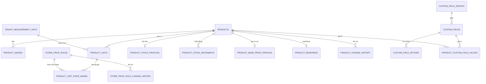

# TH-02 — Sản phẩm & giá bán

> **Vai trò:** **đặc tả chuẩn (source of truth)** cho app sau refactor. Theme đã hoàn thành: **code hiện tại là phạm vi chuẩn**. Mọi quy tắc mặc định = hành vi code hiện tại (SCOPE: giữ 100% chức năng, giữ RPC). Gắn 🔧 = code hiện tại **sai**, phải sửa khi refactor. Làm theo tài liệu, không chép lỗi của code cũ.
> **Phiên bản:** 3.0 · **Ngày:** 2026-10-07 · **Branch đối chiếu:** `refactor/simple-arch` @ `47b4cb188`
> **Thay thế:** bản 2.1 (2026-10-06), `Theme 2_ Sản phẩm & Giá bán.md` (v1) và `docs/themes/TH-02-product-pricing/`. Tính năng v1 không có trong code được liệt kê ở [mục 8](#8-ngoài-phạm-vi-so-với-spec-v1).
> **Nguồn đối chiếu:**
> - DB: schema `catalog`, migration `20260709001`…`20260805003` (bản mới nhất của từng hàm là chuẩn), đặc biệt `20260722001` (khung giá chờ), `20260721002` (tạo có hướng dẫn), `20260717003/008` (cách tính khung giá, tính lại), `20260712006/007` (xoá mềm, trạng thái), `20260805003` (tìm kiếm).
> - App: `apps/erp/lib/features/catalog/presentation/` (22 trang, 15 cubit); module `modules/catalog/`.
> - Tồn kho cơ bản: ghi chú lỗi từ [TH-07 mục 3](TH-07-kho.md#3-lỗi-đã-thấy-trong-tồn-kho-cơ-bản-hiện-tại) chuyển về đây (KI-01…KI-07).
>
> **Cách đọc:** mục 1–3 là mô hình chung và dữ liệu; mục 4 chia theo epic → user story (bối cảnh, FR, BR, AC, EC, kịch bản Gherkin); mục 5 đặc tả từng màn hình (trạng thái, thành phần, phác thảo); mục 6 RPC và thông điệp lỗi; mục 7 phân quyền và vấn đề đã biết; mục 8 ngoài phạm vi; mục 9 kế hoạch refactor và kiểm thử.

---

## Mục lục

1. [Tổng quan](#1-tổng-quan)
2. [Mô hình nghiệp vụ](#2-mô-hình-nghiệp-vụ)
3. [Dữ liệu](#3-dữ-liệu)
4. [Epic và user story](#4-epic-và-user-story)
5. [Đặc tả màn hình](#5-đặc-tả-màn-hình)
6. [Kỹ thuật: RPC, phụ thuộc, lỗi](#6-kỹ-thuật-rpc-phụ-thuộc-lỗi)
7. [Phân quyền & vấn đề đã biết](#7-phân-quyền--vấn-đề-đã-biết)
8. [Ngoài phạm vi (so với spec v1)](#8-ngoài-phạm-vi-so-với-spec-v1)
9. [Thay đổi khi refactor & kiểm thử](#9-thay-đổi-khi-refactor--kiểm-thử)

---

## 1. Tổng quan

### 1.1 Mục đích

TH-02 quản lý **dữ liệu nền của sản phẩm** để các nghiệp vụ khác (bán hàng, đổi trả, giá riêng, hoá đơn điện tử, sau này kho) dùng lại. Theme trả lời năm nhóm câu hỏi:

1. **Nhận diện:** sản phẩm tên gì, mã SKU / mã vạch nào, trông thế nào (ảnh)?
2. **Đo lường:** bán theo đơn vị nào, một hộp bằng bao nhiêu viên?
3. **Giá:** giá cơ sở bao nhiêu, mỗi đơn vị bán giá niêm yết và giá sàn bao nhiêu, giá tự tính hay nhập tay?
4. **Sẵn sàng:** sản phẩm đã đủ dữ liệu để bán chưa, còn thiếu gì?
5. **Vòng đời:** sản phẩm đang kinh doanh, ngừng kinh doanh hay đã xoá; ai đã đổi gì, lúc nào?

Ngoài ra theme giữ **tồn kho cơ bản** (một con số tồn theo đơn vị cơ sở) cho tới khi Theme 7 thay bằng sổ tồn đầy đủ.

### 1.2 Bối cảnh nghiệp vụ

Cửa hàng thú y bán vài trăm đến vài nghìn mã hàng: thuốc, vắc-xin, thức ăn, phụ kiện. Đặc điểm ảnh hưởng tới thiết kế:

- **Nhập liệu dần dần.** Chủ cửa hàng thường tạo sản phẩm lúc hàng về, khi chưa có đủ giá hay ảnh. Hệ thống phải cho tạo với **chỉ một cái tên**, rồi nhắc bổ sung.
- **Bán nhiều đơn vị.** Một sản phẩm có thể bán theo viên, vỉ, hộp. Giá mỗi đơn vị suy ra từ giá cơ sở và tỷ lệ quy đổi, nhưng chủ cửa hàng vẫn muốn sửa tay cho một số đơn vị.
- **Định giá theo tỷ lệ lãi.** Đa số cửa hàng đặt giá bán = giá cơ sở + x% lãi. Đổi giá cơ sở thì giá bán phải tự cập nhật, trừ những giá đã nhập tay.
- **Giá sàn.** Nhân viên được giảm giá nhưng không dưới giá sàn (TH-05 kiểm khi bán).
- **Thông tin chuyên ngành khác nhau theo cửa hàng.** Thành phần, chỉ định, cách dùng, bảo quản… không cố định; mỗi cửa hàng tự cấu hình nhóm và trường thông tin bổ sung.

### 1.3 Ý tưởng chủ đạo

| Khái niệm | Ý nghĩa | Trong code |
|---|---|---|
| **Tạo tối thiểu, hoàn thiện dần** | Chỉ cần tên là tạo được sản phẩm; phần còn thiếu được ghi thành *blocker* | `create_guided_product` |
| **Readiness** | Sản phẩm đã đủ dữ liệu để bán chưa, còn thiếu gì | `catalog.product_readiness` + cột `is_ready_to_sell` do trigger tính |
| **Product Control Center (PCC)** | Màn chi tiết là nơi điều phối: mỗi thẻ có thao tác riêng, không có nút "Sửa" chung | `get_product_control_center`, route `/products/items/pcc` |
| **Đang kinh doanh ≠ sẵn sàng bán** | Sản phẩm đang kinh doanh vẫn có thể chưa bán được vì thiếu giá | `business_status` và `is_ready_to_sell` tách riêng |
| **Giá tự tính có nguồn gốc** | Mỗi khung giá ghi rõ được tính thế nào (nhập tay / theo cửa hàng / tỷ lệ riêng) để biết có tự cập nhật hay không | `product_unit_price_bands.source_type` |
| **Không mất lịch sử** | Đơn vị đã dùng thì tắt chứ không xoá; sản phẩm xoá mềm, khôi phục được; mọi thay đổi quan trọng có lịch sử | `is_active`, `soft_deleted`, `product_change_history` |

### 1.4 Trong phạm vi

- Danh sách sản phẩm: tìm kiếm không dấu (tên, tên thương mại, SKU, barcode, trường bổ sung), lọc theo trạng thái / readiness / tồn / trường bổ sung, phân trang.
- Tạo sản phẩm có hướng dẫn (8 bước + các nhóm thông tin bổ sung), tối đa 8 ảnh.
- Product Control Center: hồ sơ, ảnh, đơn vị, tồn kho, giá cơ sở, khung giá, các nhóm thông tin bổ sung, ghi chú, checklist readiness, lịch sử.
- Đơn vị cơ sở (đặt một lần); đơn vị quy đổi (thêm, tắt, bật lại, xoá khi chưa có dữ liệu phụ thuộc); danh mục đơn vị của tổ chức để gợi ý.
- Tồn kho cơ bản: nhập ban đầu, điều chỉnh có lý do.
- Giá cơ sở nhập tay.
- Khung giá bán theo đơn vị với 3 cách tính: nhập thủ công, theo khung giá cửa hàng, tự động riêng theo cấu hình.
- Khung giá cửa hàng (1 quy tắc mỗi tổ chức) và lịch sử thay đổi.
- Nhóm và trường thông tin bổ sung: tạo, sửa, tạm tắt, sắp xếp, khởi tạo từ mẫu.
- Ngừng kinh doanh / kinh doanh lại; xoá mềm / khôi phục.
- Cung cấp sản phẩm "bán được", đơn vị, khung giá và barcode cho TH-05 Bán hàng.

### 1.5 Ngoài phạm vi theme

| Nội dung | Thuộc |
|---|---|
| Đơn bán, thanh toán, giá cuối cùng trên đơn, kiểm giá sàn khi bán | TH-05 Bán hàng |
| Giá riêng theo khách, ưu tiên giá | TH-04 Chính sách giá |
| Phiếu nhập, kiểm kê, tồn theo kho / lô, trừ tồn khi bán | Theme 7 Kho (spec v1, P11) |
| Giá vốn bình quân / FIFO | Theme 7 Giá vốn |
| Khuyến mãi, coupon, combo | Chưa có |

### 1.6 Tác nhân

| Tác nhân | Mô tả | Thao tác chính |
|---|---|---|
| Chủ cửa hàng | Owner của tổ chức (TH-01) | Mọi thao tác; thường cấu hình khung giá cửa hàng, nhóm trường |
| Nhân viên | Thành viên đang hoạt động | **Mọi thao tác catalog** (quyết định chung, [7.2](#72-phân-quyền)) |
| Hệ thống (DB) | Trigger và hàm nội bộ | Tính readiness, cột tìm kiếm, tính lại khung giá, ghi lịch sử |
| TH-05, TH-04, TH-08 | Theme dùng dữ liệu | Đọc sản phẩm bán được, đơn vị, khung giá, snapshot |

### 1.7 Liên hệ với các theme khác

| Theme | TH-02 cung cấp | TH-02 nhận |
|---|---|---|
| TH-01 Tổ chức & IAM | — | `tenant_id`, người dùng, `iam.has_permission` |
| TH-04 Chính sách giá | Khung giá (giá niêm yết, giá sàn) theo đơn vị làm giá gốc | — |
| TH-05 Bán hàng | Sản phẩm bán được, đơn vị, tồn hiển thị, barcode, snapshot giá và trường bổ sung | — (🔧 KI-08: đọc dòng đơn để chặn xoá đơn vị) |
| TH-08 HĐĐT | Tên, đơn vị qua snapshot của đơn | — |
| Theme 7 Kho | Danh mục sản phẩm, đơn vị | Thay tồn cơ bản bằng sổ tồn (BJ-12); giá vốn (KB-KGV-044) |

---

## 2. Mô hình nghiệp vụ

### 2.1 Khái niệm

```text
Sản phẩm (catalog.products)
 ├── Ảnh 0..8 (product_images) — 1 ảnh mặc định
 ├── Đơn vị (product_units) — 0..1 đơn vị cơ sở + 0..N đơn vị quy đổi
 │    └── Khung giá (product_unit_price_bands) — 1 khung active / đơn vị
 ├── Tồn kho cơ bản (product_stock_profiles) + biến động (product_stock_movements)
 ├── Giá cơ sở (product_base_price_profiles)
 ├── Giá trị thông tin bổ sung (product_custom_field_values)
 ├── Readiness (product_readiness) + cột fact_* và is_ready_to_sell trên products
 └── Lịch sử thay đổi (product_change_history)

Cấu hình cấp tổ chức
 ├── Danh mục đơn vị tính (tenant_measurement_units)
 ├── Khung giá cửa hàng (store_price_rules) — tối đa 1 / tổ chức
 │    └── Lịch sử (store_price_rule_change_history)
 ├── Mẫu trường (custom_field_templates) — dữ liệu hệ thống
 └── Nhóm thông tin (custom_field_groups) → Trường (custom_fields) → Lựa chọn (custom_field_options)
```

| Thuật ngữ | Định nghĩa |
|---|---|
| Tên nội bộ | Tên dùng trong cửa hàng (`name`), bắt buộc |
| Tên thương mại | Tên hiển thị cho khách (`trade_name`), tuỳ chọn |
| Đơn vị cơ sở | Đơn vị nhỏ nhất để tính tồn và giá cơ sở; tỷ lệ = 1 |
| Đơn vị quy đổi | Đơn vị bán khác, có tỷ lệ = số đơn vị cơ sở trong 1 đơn vị này (1 hộp = 10 viên → tỷ lệ 10) |
| Giá cơ sở | Giá của **1 đơn vị cơ sở** dùng làm gốc tính giá bán. Nhập tay. Không phải giá vốn kế toán (giá vốn thuộc Theme 7) |
| Khung giá | Cặp giá niêm yết + giá sàn của **một đơn vị** |
| Giá niêm yết | Giá bán chuẩn chưa chiết khấu |
| Giá sàn | Giá thấp nhất nhân viên được phép bán |
| Khung giá cửa hàng | Quy tắc chung của tổ chức: tỷ lệ lãi (niêm yết) và tỷ lệ sàn so với giá cơ sở |
| Blocker | Một điều kiện còn thiếu khiến sản phẩm chưa sẵn sàng bán |

### 2.2 Vòng đời sản phẩm

```text
            (tạo)
              │
              ▼
          ┌────────┐   Ngừng kinh doanh   ┌──────────┐
          │ active │ ───────────────────▶ │ inactive │
          │Đang KD │ ◀─────────────────── │ Ngừng KD │
          └────────┘    Kinh doanh lại    └──────────┘
              │                                │
              └────────── Xoá sản phẩm ────────┘
                              │
                              ▼
                       ┌──────────────┐
                       │ soft_deleted │ ── Khôi phục ──▶ inactive
                       │    Đã xoá    │
                       └──────────────┘
```

| Trạng thái (`business_status`) | Nhãn UI | Sửa dữ liệu | Hiện ở danh sách | Dùng trong đơn bán mới |
|---|---|---|---|---|
| `active` | Đang KD (thẻ readiness: "Sẵn sàng bán" / "Thiếu dữ liệu") | Có | Có | Có, nếu `is_ready_to_sell` |
| `inactive` | Ngừng KD | Có | Có (lọc "Ngừng KD") | Không |
| `soft_deleted` | Đã xóa | **Không** (hồ sơ, ảnh, trạng thái) | Chỉ ở bộ lọc "Đã xóa" (🔧 KI-13) | Không |

Enum `catalog.product_business_status` = `active`, `inactive`, `soft_deleted`; cột `deleted_at` ghi thời điểm xoá.

### 2.3 Readiness

**Trạng thái** (`product_readiness_status`): code chỉ tính ra `incomplete` hoặc `ready_to_sell`. Giá trị `ready_to_receive` có trong enum nhưng không dùng (dành cho Theme 7).

**Blocker** (hàm `_refresh_product_readiness`, đọc `_product_operational_facts`):

| Mã | Loại | Thông báo (`message`) | Nhóm (`group`) | Điều kiện |
|---|---|---|---|---|
| `missing_base_unit` | bắt buộc | Thiếu đơn vị cơ sở | `units` | Chưa có đơn vị cơ sở |
| `missing_stock` | bắt buộc | Thiếu tồn kho ban đầu | `stock` | Chưa có hồ sơ tồn. **Tồn = 0 vẫn tính là đã có** |
| `missing_price` | bắt buộc | Thiếu giá cơ sở | `basePrice` | `base_price_after_vat` rỗng |
| `missing_price_band` | bắt buộc | Thiếu khung giá bán | `priceBand` | Có **một đơn vị đang hoạt động** chưa có khung giá hợp lệ (xem dưới) |
| `missing_required_custom_fields` | bắt buộc | Thiếu thông tin bổ sung bắt buộc | `customFields` | Có trường bắt buộc, đang dùng, thuộc nhóm đang dùng, chưa có giá trị |
| `missing_image` | khuyến nghị | Chưa có ảnh sản phẩm | `images` | Không có ảnh; **không chặn** bán |
| `pending_stock_from_inventory`, `pending_base_price_from_costing` | dự phòng | — | — | Chỉ khi chế độ `advanced` / `costing_module`; hiện không xảy ra (KI-21) |

**Khung giá hợp lệ** cho một đơn vị = có bản ghi `status = active`, đang hiệu lực, giá niêm yết khác rỗng, **và**:

- `manual`: luôn hợp lệ;
- `customConfig`: sản phẩm đã có giá cơ sở;
- `ruleBased`: sản phẩm đã có giá cơ sở **và** tổ chức có khung giá cửa hàng đang `active`.

**Sẵn sàng bán** (`is_ready_to_sell`) = không còn blocker bắt buộc nào. **Bán được** (TH-05) = `business_status = active` **và** `is_ready_to_sell`.

Các cột `fact_has_*` và `is_ready_to_sell` trên `products` do **trigger** tự tính lại khi ảnh, đơn vị, tồn, giá cơ sở, khung giá, giá trị trường hoặc cấu hình trường thay đổi. App không tự tính readiness.

### 2.4 Giá

#### 2.4.1 Công thức

```text
Giá niêm yết(đơn vị) = round( Giá cơ sở × tỷ lệ quy đổi(đơn vị) × (1 + tỷ lệ lãi) )
Giá sàn(đơn vị)      = round( Giá cơ sở × tỷ lệ quy đổi(đơn vị) × (1 + tỷ lệ sàn) )
```

- Tỷ lệ lưu dạng số thập phân (30% = `0.30`); UI nhập phần trăm.
- `0 ≤ tỷ lệ sàn ≤ tỷ lệ lãi`.
- Làm tròn đến đồng. Chỉ VND.
- Không có thuế suất: giá "trước VAT" = giá "sau VAT". DB vẫn lưu cả hai cột để dành cho sau này.

Ví dụ: giá cơ sở 1 viên = 1.000 đ; hộp = 10 viên; khung giá cửa hàng lãi 30%, sàn 10%. Hộp: niêm yết `round(1.000 × 10 × 1,3) = 13.000 đ`, sàn `11.000 đ`.

#### 2.4.2 Ba cách tính khung giá

| Cách tính (UI) | `source_type` | Giá lấy từ | Khi giá cơ sở đổi | Khi khung giá cửa hàng đổi |
|---|---|---|---|---|
| Nhập thủ công | `manual` | Người dùng nhập giá niêm yết, giá sàn | **Giữ nguyên** | Giữ nguyên |
| Theo khung giá cửa hàng | `ruleBased` | Tỷ lệ của khung giá cửa hàng | **Tự tính lại** | **Tự tính lại** |
| Tự động riêng theo cấu hình | `customConfig` | Tỷ lệ riêng lưu trên khung giá | **Tự tính lại** | Giữ nguyên |

Việc tính lại do `_recalculate_product_price_bands` làm, ghi lịch sử với nguyên nhân "Tự động do Giá cơ sở thay đổi" hoặc "Tự động do khung giá cửa hàng thay đổi". Khung giá không đổi giá trị thì không ghi lịch sử.

#### 2.4.3 Khung giá chờ

Chọn "Theo khung giá cửa hàng" hoặc "Tự động riêng" khi **chưa có giá cơ sở** (hoặc chưa có khung giá cửa hàng đang dùng) → hệ thống vẫn lưu khung giá với giá = 0 và cách tính đã chọn. UI hiện "Đã cấu hình – chờ Giá cơ sở". Readiness vẫn báo `missing_price_band` cho tới khi đủ điều kiện ở 2.3. Khi giá cơ sở được nhập, khung giá tự tính.

Ngoại lệ: khi **tạo sản phẩm** chọn "Cửa hàng" mà chưa có giá cơ sở hoặc chưa có khung giá cửa hàng thì không tạo khung giá nào (KI-22). Kết quả readiness giống nhau.

### 2.5 Tồn kho cơ bản

- Một con số `basic_stock_quantity_base` / sản phẩm, theo **đơn vị cơ sở**, số nguyên ≥ 0.
- Chưa có hồ sơ tồn = "Chưa thiết lập" (thẻ danh sách "Chưa TL tồn"); có hồ sơ với 0 = "Hết".
- Nhập ban đầu (`set_basic_stock_quantity_base`) và điều chỉnh (`adjust_basic_stock`) đều ghi 1 dòng `product_stock_movements` (trước, sau, chênh lệch, lý do, người làm).
- **Bán hàng hiện không trừ tồn** (TH-05 KI-01). Theme 7 sẽ thay toàn bộ phần này.

### 2.6 Quy tắc nghiệp vụ tổng hợp

Số BR giữ ổn định giữa các bản (có khoảng trống để thêm).

**Hồ sơ & tìm kiếm**

| Mã | Quy tắc | Kiểm ở |
|---|---|---|
| BR-01 | Tên nội bộ bắt buộc, không chỉ khoảng trắng | App + RPC tạo / sửa |
| BR-02 | SKU và barcode tuỳ chọn; nếu có thì **không trùng với sản phẩm chưa xoá** trong tổ chức. Sản phẩm đã xoá mềm **không giữ mã**: mã đó dùng lại được. SKU được chuẩn hoá (trim, viết hoa) trước khi so | `check_duplicate_product_code`, `create_product`, `update_product_profile` |
| BR-03 | Khôi phục sản phẩm bị chặn nếu SKU / barcode của nó đã thuộc một sản phẩm khác chưa xoá | `restore_product` (`duplicate sku/barcode`) |
| BR-04 | Tối đa **8 ảnh**, mỗi ảnh ≤ 10 MB, định dạng JPEG / PNG / WebP; đúng 1 ảnh mặc định. 🔧 RPC lưu ảnh phải chặn quá 8 ảnh (KI-10) | App; `request_product_image_upload`; `update_product_images` |
| BR-05 | Sản phẩm đã xoá không sửa được hồ sơ, ảnh hay trạng thái kinh doanh | RPC sửa |
| BR-06 | Sửa hồ sơ, ảnh, trạng thái phải gửi `version`; lệch → `stale_product_version` | RPC sửa |
| BR-07 | Tìm kiếm không phân biệt dấu và hoa thường, khớp chuỗi con trên tên, tên thương mại, SKU, barcode và giá trị các trường "Cho phép tìm kiếm"; SKU khớp tiền tố; barcode khớp chính xác | `search_products` |
| BR-08 | Danh sách xếp: đang KD trước, rồi độ liên quan (khi có từ khoá), rồi mới cập nhật, rồi tên | `search_products` |
| BR-09 | Ghi chú sản phẩm là ghi chú nội bộ, không hiển thị cho khách | `update_product_profile(p_note)` |

**Đơn vị**

| Mã | Quy tắc |
|---|---|
| BR-10 | Mỗi sản phẩm có tối đa 1 đơn vị cơ sở (tỷ lệ = 1). **Đã đặt thì không đổi được** (`Product already has a base unit…`) |
| BR-11 | Đơn vị quy đổi có tỷ lệ > 0 và không trùng tên với đơn vị **đang hoạt động** khác của cùng sản phẩm; không được trùng tên đơn vị cơ sở |
| BR-12 | Chưa có đơn vị cơ sở thì không thêm được đơn vị quy đổi, tồn kho, giá cơ sở hay khung giá |
| BR-13 | Đơn vị quy đổi xoá được **chỉ khi** chưa có khung giá và 🔧 chưa dùng trong dòng đơn bán, dòng nháp, dòng đổi/trả (KI-08). Ngược lại gợi ý "Tắt đơn vị" |
| BR-14 | Đơn vị bị tắt ẩn khỏi lựa chọn khi bán; dữ liệu cũ giữ nguyên; khung giá của nó không còn tính vào readiness. Bật lại thì kiểm trùng tên như BR-11 |
| BR-15 | Tên đơn vị được chuẩn hoá về **chữ thường**, so trùng không phân biệt dấu cách thừa; tên mới tự thêm vào danh mục đơn vị của tổ chức để gợi ý lần sau |
| BR-16 | Tên đơn vị không rỗng, không quá dài (`Unit name is too long`) |

**Tồn kho cơ bản**

| Mã | Quy tắc |
|---|---|
| BR-20 | Tồn tính theo **đơn vị cơ sở**; chỉ chế độ `basic` (`not_basic_stock_mode` nếu khác) |
| BR-21 | Số nguyên ≥ 0 (`invalid_stock_quantity`) |
| BR-22 | Mỗi lần nhập ban đầu / điều chỉnh ghi 1 dòng biến động (trước, sau, chênh lệch, lý do, 🔧 **người thao tác** — KI-01) |
| BR-23 | 🔧 Điều chỉnh **bắt buộc** gửi tồn mà người dùng đang thấy (`expected_quantity`); lệch → `stale_stock_quantity` (KI-02) |
| BR-24 | Tồn ở đây **không** tạo phiếu nhập và **không** bị bán hàng trừ (Theme 7) |
| BR-25 | 🔧 Nhập ban đầu chỉ dùng khi **chưa có** hồ sơ tồn; đã có thì phải điều chỉnh (KI-06) |
| BR-26 | 🔧 Điều chỉnh về đúng số đang có bị chặn: "Tồn mới trùng tồn hiện tại" (KI-05) |
| BR-27 | Lý do điều chỉnh: chọn 1 trong "Kiểm kê", "Nhập tay", "Hao hụt", "Khác" và/hoặc ghi chú; lưu thành 1 chuỗi "`<lý do> - <ghi chú>`". Không bắt buộc |

**Giá**

| Mã | Quy tắc |
|---|---|
| BR-30 | Giá cơ sở ≥ 0, theo đơn vị cơ sở, chỉ chế độ `manual` (`not_manual_base_price_mode`) |
| BR-31 | Khung giá gắn với 1 đơn vị **đang hoạt động** (`inactive_product_unit`); mỗi đơn vị tối đa 1 khung `active` |
| BR-32 | 0 ≤ giá sàn ≤ giá niêm yết (`floor_price_greater_than_list_price`). Nhập thủ công: giá niêm yết bắt buộc, giá sàn tuỳ chọn |
| BR-33 | Đổi một khung giá **đã có giá** sang "Theo khung giá cửa hàng" phải xác nhận ghi đè (`price_band_overwrite_required`) |
| BR-34 | Áp khung giá cửa hàng khi giá cơ sở vừa bị người khác đổi → `stale_base_price` |
| BR-35 | Mỗi tổ chức tối đa 1 khung giá cửa hàng: tên, tỷ lệ lãi, tỷ lệ sàn, trạng thái; `0 ≤ sàn ≤ lãi` (`markup ratios are invalid`) |
| BR-36 | Khung giá là giá **trước khuyến mãi và trước giá riêng**. Giá trên đơn do TH-04 / TH-05 quyết định và lưu snapshot |
| BR-37 | Đổi tỷ lệ / trạng thái khung giá cửa hàng → tính lại **mọi** khung `ruleBased` của tổ chức, sau khi người dùng xác nhận "Áp dụng quy tắc lên sản phẩm đã có giá?" |
| BR-38 | Đổi giá cơ sở → tính lại mọi khung `ruleBased` và `customConfig` của sản phẩm; khung `manual` giữ nguyên |
| BR-39 | Chọn cách tính tự động khi chưa có giá cơ sở → lưu khung giá chờ (2.4.3) |

**Thông tin bổ sung**

| Mã | Quy tắc |
|---|---|
| BR-40 | Kiểu trường: Văn bản (`text`), Số (`number`), Ngày (`date`), Bật/Tắt (`boolean`), Tùy chọn (`singleSelect`, ít nhất 1 lựa chọn) |
| BR-41 | Thuộc tính trường: Bắt buộc, Cho phép tìm kiếm, Cho phép lọc, Hiển thị trên danh sách sản phẩm, Trạng thái (Đang dùng / Tạm tắt) |
| BR-42 | Tạm tắt nhóm hoặc trường **không xoá** giá trị đã nhập; trường tạm tắt không hiện khi tạo / sửa sản phẩm và không tính readiness |
| BR-43 | Mỗi nhóm đang dùng hiển thị thành **1 thẻ riêng** trên PCC và **1 bước riêng** trong tạo sản phẩm, nằm sau Khung giá bán và trước Ghi chú, theo thứ tự đã sắp |
| BR-44 | Trường bắt buộc chưa nhập: **khi tạo** chặn lưu ("Trường này là bắt buộc"); **sản phẩm đã có** thì chỉ thành blocker `missing_required_custom_fields` |
| BR-45 | Mẫu mặc định chỉ tạo nhóm / trường chưa có (so tên đã chuẩn hoá), bỏ qua phần trùng; sửa được sau đó |
| BR-46 | Tên nhóm không trùng trong tổ chức; tên trường không trùng trong nhóm (chỉ xét bản đang dùng) |
| BR-47 | Không đổi kiểu dữ liệu của trường đã có giá trị (`custom_field_type_change_blocked`) |
| BR-48 | "Cho phép tìm kiếm" chỉ có tác dụng với Văn bản và Tùy chọn; "Cho phép lọc" chỉ với Tùy chọn và Bật/Tắt |
| BR-49 | Giá trị phải đúng kiểu (số, ngày, lựa chọn thuộc trường, lựa chọn còn hoạt động) (`custom_field_value_validation`) |

**Vòng đời & lịch sử**

| Mã | Quy tắc |
|---|---|
| BR-50 | Ngừng kinh doanh: nếu có cảnh báo (còn tồn > 0) thì phải xác nhận (`product_business_status_warnings_require_acknowledgment`) |
| BR-51 | Xoá: kiểm tra trước (`check_product_deletion_eligibility`). Còn tồn > 0 là **cảnh báo**, phải xác nhận. Đơn cũ giữ dữ liệu theo snapshot; nháp chứa sản phẩm sẽ bị chặn khi thanh toán (`PRODUCT_NOT_SELLABLE`, TH-05) |
| BR-52 | Khôi phục đưa sản phẩm về **Ngừng KD** (`inactive`); muốn bán lại phải "Kinh doanh lại" |
| BR-53 | Mọi thay đổi hồ sơ, ảnh, đơn vị, tồn, giá, khung giá, trường bổ sung, trạng thái ghi `product_change_history` (hành động, trước / sau, lý do, người, thời điểm) |
| BR-54 | Sản phẩm đang KD rồi Ngừng KD giữ nguyên readiness; Kinh doanh lại không kiểm readiness (sản phẩm có thể đang KD nhưng "Thiếu dữ liệu") |

---

## 3. Dữ liệu

### 3.1 Sơ đồ quan hệ



### 3.2 Bảng sản phẩm

| Bảng | Trường chính |
|---|---|
| `products` | `id`, `tenant_id`, `reference_id`, `name`, `trade_name`, `sku`, `barcode`, `description`, `note`, `business_status`, `deleted_at`, `version`, `idempotency_key`, `created_by/at`, `updated_by/at`; tìm kiếm `search_document`, `search_text`; tổng hợp `fact_has_base_unit`, `fact_has_images`, `fact_has_stock`, `fact_has_base_price`, `fact_has_price_band`, `fact_has_required_custom_fields`, `fact_stock_mode`, `fact_base_price_mode`, `is_ready_to_sell` |
| `product_images` | `product_id`, `storage_key`, `file_url`, `is_primary`, `sort_order`, `processing_status`, `upload_slot_id` |
| `image_upload_slots` | Slot upload ảnh (`storage_key`, `status`, `expires_at`, `consumed_at`); bucket giới hạn 10 MB, JPEG/PNG/WebP |
| `product_readiness` | `product_id` (PK), `status`, `blockers` (jsonb: `code`, `message`, `group`), `updated_at` |
| `product_change_history` | `product_id`, `action`, `payload` (jsonb: trước, sau, lý do…), `actor_id`, `created_at` |

### 3.3 Bảng đơn vị, tồn, giá

| Bảng | Trường chính |
|---|---|
| `tenant_measurement_units` | `tenant_id`, `name` (chữ thường), `is_active` |
| `product_units` | `product_id`, `tenant_measurement_unit_id`, `unit_name`, `is_base_unit`, `conversion_rate_to_base`, `is_active` |
| `product_stock_profiles` | `product_id` (PK), `mode` (`basic`), `basic_stock_quantity_base`, `stock_version` |
| `product_stock_movements` | `product_id`, `movement_type`, `quantity_before`, `quantity_after`, `delta`, `reason`, `actor_id`, `occurred_at` |
| `product_base_price_profiles` | `product_id` (PK), `mode` (`manual`), `base_price_before_vat`, `base_price_after_vat`, `currency` |
| `product_unit_price_bands` | `product_unit_id`, `list_price_before/after_vat`, `floor_price_before/after_vat`, `source_type`, `store_price_rule_id`, `list_markup_ratio`, `floor_markup_ratio`, `is_custom_override`, `status`, `effective_from`, `effective_to` |
| `store_price_rules` | `tenant_id` (duy nhất), `name`, `calculation_type` (`markup`), `list_markup_ratio`, `floor_markup_ratio`, `status` |
| `store_price_rule_change_history` | `store_price_rule_id`, `action`, `payload` (tên / tỷ lệ / trạng thái trước–sau), `actor_id`, `created_at` |

### 3.4 Bảng thông tin bổ sung

| Bảng | Trường chính |
|---|---|
| `custom_field_templates` | `template_key` (`vet_pharmacy_default`), `display_name`, `definition` (jsonb) |
| `custom_field_groups` | `name`, `name_normalized`, `icon_key`, `description`, `sort_order`, `status` |
| `custom_fields` | `group_id`, `name`, `field_type`, `description`, `is_required`, `is_searchable`, `is_filterable`, `display_on_list`, `sort_order`, `status` |
| `custom_field_options` | `field_id`, `label`, `sort_order`, `is_active` |
| `product_custom_field_values` | `product_id`, `custom_field_id`, `value_text` / `value_number` / `value_date` / `value_boolean` / `value_option_id` |

Mẫu mặc định `vet_pharmacy_default`:

| Nhóm | Biểu tượng | Trường (kiểu) |
|---|---|---|
| Thông tin thuốc | 💊 | Thành phần (Văn bản), Chỉ định (Văn bản) |
| Quy cách & bảo quản | — | Bảo quản (Văn bản) |

Ngoài ra có bảng outbox của module (sự kiện `catalog.product.*`); bỏ khi refactor ([9.1](#91-kiến-trúc)).

### 3.5 Bất biến kiểm tra được

| # | Bất biến |
|---|---|
| I-01 | Mỗi sản phẩm có ≤ 1 `product_units` với `is_base_unit = true`, và nếu có thì `conversion_rate_to_base = 1` |
| I-02 | Mỗi `product_unit_id` có ≤ 1 khung `status = active` |
| I-03 | Mọi khung active: `0 ≤ floor ≤ list` (khi floor có giá trị) |
| I-04 | Khung `ruleBased` / `customConfig` của sản phẩm có giá cơ sở = công thức 2.4.1 với tỷ lệ hiện hành |
| I-05 | `is_ready_to_sell` = (không có blocker bắt buộc trong `product_readiness.blockers`) |
| I-06 | Không có 2 sản phẩm chưa xoá cùng SKU (hoặc cùng barcode) trong một tổ chức |
| I-07 | `basic_stock_quantity_base` = `quantity_after` của biến động mới nhất |
| I-08 | Sản phẩm `soft_deleted` ⇔ `deleted_at` khác rỗng |
| I-09 | ≤ 8 ảnh mỗi sản phẩm, đúng 1 `is_primary` khi có ảnh |

---

## 4. Epic và user story

### 4.1 Bản đồ

| Epic | Tên | User story | Màn |
|---|---|---|---|
| EP-01 | Danh sách & tra cứu | US-01.1 Xem danh sách; US-01.2 Tìm kiếm; US-01.3 Lọc theo trạng thái / tồn; US-01.4 Lọc theo thông tin bổ sung | SP-01, SP-02 |
| EP-02 | Tạo sản phẩm có hướng dẫn | US-02.1 Nhận diện & kiểm trùng mã; US-02.2 Ảnh; US-02.3 Đơn vị cơ sở; US-02.4 Tồn khởi tạo; US-02.5 Giá cơ sở; US-02.6 Khung giá bán; US-02.7 Thông tin bổ sung & ghi chú; US-02.8 Lưu sản phẩm | SP-03 |
| EP-03 | Product Control Center & hồ sơ | US-03.1 Xem PCC; US-03.2 Sửa hồ sơ; US-03.3 Quản lý ảnh; US-03.4 Sửa ghi chú; US-03.5 Nhập thông tin bổ sung; US-03.6 Checklist readiness | SP-04…SP-08, SP-21 |
| EP-04 | Đơn vị tính | US-04.1 Đặt đơn vị cơ sở; US-04.2 Thêm đơn vị quy đổi; US-04.3 Tắt / bật đơn vị; US-04.4 Xoá đơn vị quy đổi | SP-09 |
| EP-05 | Tồn kho cơ bản | US-05.1 Nhập tồn ban đầu; US-05.2 Điều chỉnh tồn | SP-10 |
| EP-06 | Giá cơ sở & khung giá | US-06.1 Nhập giá cơ sở; US-06.2 Xem khung giá theo đơn vị; US-06.3 Thiết lập khung giá một đơn vị; US-06.4 Cấu hình khung giá cửa hàng; US-06.5 Xem lịch sử khung giá cửa hàng | SP-11…SP-13, SP-18…SP-20 |
| EP-07 | Cấu hình thông tin bổ sung | US-07.1 Tạo từ mẫu mặc định; US-07.2 Tạo / sửa nhóm; US-07.3 Tạo / sửa trường; US-07.4 Sắp xếp; US-07.5 Tạm tắt nhóm / trường | SP-14…SP-17 |
| EP-08 | Vòng đời & lịch sử | US-08.1 Ngừng kinh doanh; US-08.2 Kinh doanh lại; US-08.3 Xoá sản phẩm; US-08.4 Khôi phục; US-08.5 Xem lịch sử thay đổi | SP-04, SP-22 |

```text
Danh sách (SP-01) ──"Tạo sản phẩm"──▶ Tạo có hướng dẫn (SP-03) ──lưu──▶ PCC (SP-04)
      │                                                                 │
      └──chạm sản phẩm──────────────────────────────────────────────────┘
PCC ─┬─ Hồ sơ (SP-05) · Ảnh (SP-06) · Ghi chú (SP-07) · Nhóm bổ sung (SP-08)
     ├─ Đơn vị (SP-09) · Tồn kho (SP-10)
     ├─ Giá cơ sở (SP-11) · Khung giá (SP-12) ─▶ Sửa khung giá (SP-13)
     ├─ Checklist (SP-21) · Lịch sử (SP-22)
     └─ Nâng cao: Ngừng KD / Kinh doanh lại / Xoá / Khôi phục
Thêm ▸ Cài đặt sản phẩm (SP-14) ─┬─ Nhóm & trường (SP-15 → SP-16 → SP-17)
                                  └─ Khung giá cửa hàng (SP-18 → SP-19, SP-20)
```

---

### 4.2 EP-01 — Danh sách & tra cứu

**Tổng quan.** Danh sách là cửa vào của theme: tìm nhanh một sản phẩm, biết sản phẩm nào đang thiếu dữ liệu, mở PCC để bổ sung.

**Điểm vào:** tab Sản phẩm → `/products/items`.

#### US-01.1 — Xem danh sách sản phẩm

**Bối cảnh.** Chủ cửa hàng cần thấy toàn bộ sản phẩm và tình trạng của từng cái mà không mở chi tiết.

| Là | Tôi muốn | Để |
|---|---|---|
| Thành viên cửa hàng | xem danh sách sản phẩm kèm giá, tồn và tình trạng | biết sản phẩm nào bán được, sản phẩm nào cần bổ sung |

**Yêu cầu chức năng**

- FR-01: Tiêu đề "Sản phẩm", dòng phụ "`<N>` sản phẩm" (tổng sản phẩm chưa xoá, không tính bộ lọc).
- FR-02: Mỗi dòng: ảnh mặc định (hoặc ô trống), tên nội bộ, SKU / barcode, đơn vị cơ sở, giá niêm yết của đơn vị cơ sở, tồn ("Chưa TL tồn" khi chưa thiết lập, "Hết" khi = 0), nhãn trạng thái (Sẵn sàng bán / Thiếu dữ liệu / Ngừng KD), và giá trị các trường "Hiển thị trên danh sách".
- FR-03: Mặc định hiện sản phẩm Đang KD và Ngừng KD, không hiện đã xoá; sắp theo BR-08.
- FR-04: Trang 20 dòng; cuộn cuối tải tiếp; hết dữ liệu hiện "Đã ở cuối danh sách".
- FR-05: Kéo xuống để tải lại. Quay về từ PCC / tạo sản phẩm thì danh sách tải lại.
- FR-06: Nút "Tạo sản phẩm" mở SP-03.
- FR-07: Chạm một dòng mở PCC.

**Quy tắc:** BR-08.

**Tiêu chí nghiệm thu**

- AC-01: Tổ chức chưa có sản phẩm → "Chưa có sản phẩm nào được tạo" kèm nút "Tạo sản phẩm".
- AC-02: Sản phẩm Đang KD luôn đứng trước Ngừng KD.
- AC-03: Sản phẩm chưa có hồ sơ tồn hiện "Chưa TL tồn", không hiện "0".
- AC-04: Đang tải lần đầu hiện khung xương (skeleton); lỗi tải hiện "Lỗi: …" kèm nút thử lại.

**Trường hợp biên**

- EC-01: Sản phẩm không có đơn vị cơ sở → không có giá, không có đơn vị trên dòng.
- EC-02: Có hơn 20 sản phẩm và thêm sản phẩm mới trong lúc cuộn → sau khi tải lại, sản phẩm mới ở đầu nhóm cùng trạng thái.

**Kịch bản**

```gherkin
Feature: Danh sách sản phẩm

Scenario: SC-01 — Danh sách trống
  Given tổ chức chưa có sản phẩm nào
  When tôi mở tab "Sản phẩm"
  Then tôi thấy "Chưa có sản phẩm nào được tạo"
  And nút "Tạo sản phẩm" hiển thị

Scenario: SC-02 — Phân trang
  Given tổ chức có 45 sản phẩm
  When tôi cuộn tới cuối danh sách hai lần
  Then danh sách hiện đủ 45 sản phẩm
  And tôi thấy "Đã ở cuối danh sách"
```

#### US-01.2 — Tìm kiếm sản phẩm

**Bối cảnh.** Khách hỏi một sản phẩm; nhân viên gõ vài chữ không dấu hoặc mã SKU để tìm ngay.

| Là | Tôi muốn | Để |
|---|---|---|
| Thành viên | tìm sản phẩm theo tên, mã hoặc thông tin bổ sung, không cần gõ dấu | tìm nhanh khi đang phục vụ khách |

**Yêu cầu chức năng**

- FR-01: Ô tìm "Tìm tên, SKU, barcode, thông tin bổ sung...".
- FR-02: Tìm sau khi ngừng gõ (debounce), không cần bấm nút.
- FR-03: Khi có từ khoá, sắp xếp theo độ liên quan (BR-08); xoá từ khoá → quay về sắp theo cập nhật.
- FR-04: Từ khoá giữ nguyên khi đổi bộ lọc.

**Quy tắc:** BR-07, BR-08, BR-48.

**Tiêu chí nghiệm thu**

- AC-01: "amoxi" tìm thấy "Amoxicillin 500mg".
- AC-02: "thuc an" tìm thấy "Thức ăn cho mèo".
- AC-03: SKU "AMX" tìm thấy SKU "AMX-500" (tiền tố); barcode phải gõ đủ.
- AC-04: Giá trị trường "Thành phần" có "Amoxicillin" và trường bật "Cho phép tìm kiếm" → gõ "amoxicillin" tìm thấy sản phẩm.
- AC-05: Không có kết quả → "Không tìm thấy sản phẩm".

**Trường hợp biên**

- EC-01: Từ khoá chỉ có khoảng trắng → coi như không tìm.
- EC-02: Từ khoá chứa `%` hoặc `_` → tìm đúng ký tự đó, không coi là ký tự đại diện.
- EC-03: Trường bổ sung **tắt** "Cho phép tìm kiếm" → không tìm theo trường đó.

**Kịch bản**

```gherkin
Feature: Tìm sản phẩm

Scenario: SC-01 — Tìm không dấu
  Given có sản phẩm "Thức ăn cho mèo"
  When tôi gõ "thuc an"
  Then danh sách có "Thức ăn cho mèo"

Scenario: SC-02 — Tìm theo trường bổ sung
  Given trường "Thành phần" bật "Cho phép tìm kiếm"
  And sản phẩm "Amox 500" có "Thành phần" = "Amoxicillin"
  When tôi gõ "amoxicillin"
  Then danh sách có "Amox 500"
```

#### US-01.3 — Lọc theo trạng thái và tồn

**Bối cảnh.** Chủ cửa hàng muốn xem riêng các sản phẩm thiếu dữ liệu để bổ sung, hoặc sản phẩm hết hàng để nhập.

| Là | Tôi muốn | Để |
|---|---|---|
| Thành viên | lọc nhanh theo tình trạng | xử lý từng nhóm sản phẩm |

**Yêu cầu chức năng**

- FR-01: Thanh chip: "Tất cả", "Sẵn sàng bán", "Thiếu dữ liệu", "Ngừng KD", "Còn hàng", "Hết hàng", 🔧 "Đã xóa" (KI-13). Mỗi chip có số lượng.
- FR-02: Ý nghĩa:

| Chip | Điều kiện |
|---|---|
| Tất cả | Đang KD + Ngừng KD |
| Sẵn sàng bán | Đang KD và `is_ready_to_sell` |
| Thiếu dữ liệu | Đang KD và không `is_ready_to_sell` |
| Ngừng KD | `inactive` |
| Còn hàng | Đang KD + Ngừng KD, tồn > 0 |
| Hết hàng | Đang KD + Ngừng KD, có hồ sơ tồn và tồn = 0 (không tính "Chưa TL tồn") |
| 🔧 Đã xóa | `soft_deleted` |

- FR-03: 🔧 "Còn hàng" / "Hết hàng" lọc **ở server** và có số đếm đúng như các chip khác (KI-12).
- FR-04: Rỗng theo bộ lọc → thông báo trống theo chip, không hiện nút tạo.

**Tiêu chí nghiệm thu**

- AC-01: Số trên các chip trạng thái bằng số sản phẩm thực tế, không phụ thuộc số trang đã tải.
- AC-02: 🔧 Có 30 sản phẩm còn hàng, mới tải trang đầu 20 dòng → chip "Còn hàng" vẫn ghi 30 và cuộn được đủ 30.
- AC-03: 🔧 Chọn "Đã xóa" → thấy sản phẩm đã xoá, nhãn "Đã xóa"; chạm mở PCC chỉ đọc có nút "Khôi phục".

**Kịch bản**

```gherkin
Feature: Lọc danh sách

Scenario: SC-01 — Lọc thiếu dữ liệu
  Given có 3 sản phẩm đang KD chưa có giá cơ sở
  When tôi chọn chip "Thiếu dữ liệu"
  Then danh sách chỉ có 3 sản phẩm đó
  And chip ghi "Thiếu dữ liệu (3)"

Scenario: SC-02 — Lọc hết hàng không tính chưa thiết lập tồn
  Given sản phẩm A tồn 0 và sản phẩm B chưa thiết lập tồn
  When tôi chọn chip "Hết hàng"
  Then danh sách có A và không có B
```

#### US-01.4 — Lọc theo thông tin bổ sung

**Bối cảnh.** Cửa hàng cấu hình trường "Loài" (Tùy chọn: Chó / Mèo) và muốn lọc nhanh.

| Là | Tôi muốn | Để |
|---|---|---|
| Thành viên | lọc theo giá trị các trường bổ sung | tìm nhóm sản phẩm theo đặc điểm |

**Yêu cầu chức năng**

- FR-01: Nút "Lọc sản phẩm" mở sheet liệt kê các trường "Cho phép lọc" (chỉ Tùy chọn và Bật/Tắt, BR-48).
- FR-02: Tùy chọn: chọn một hoặc nhiều lựa chọn; Bật/Tắt: "Có" / "Không".
- FR-03: "Áp dụng" lọc; "Bỏ lọc" xoá điều kiện. Nhiều trường kết hợp theo **và**.
- FR-04: Chưa có trường lọc được → "Chưa có thuộc tính mở rộng nào."

**Tiêu chí nghiệm thu**

- AC-01: Lọc "Loài = Mèo" chỉ ra sản phẩm có giá trị Mèo.
- AC-02: Kết hợp với từ khoá và chip trạng thái.

**Trường hợp biên**

- EC-01: Lựa chọn đã tạm tắt vẫn lọc được theo giá trị cũ của sản phẩm.

---

### 4.3 EP-02 — Tạo sản phẩm có hướng dẫn

**Tổng quan.** Một màn nhiều bước ("Tạo nhanh sản phẩm"), mỗi bước là một thẻ mở rộng được; chỉ bước 1 bắt buộc. Bấm "Lưu sản phẩm" gửi **một** lệnh `create_guided_product` tạo sản phẩm cùng mọi dữ liệu đã nhập trong một transaction.

**Các bước:**

| # | Bước | Tóm tắt khi đóng | Bắt buộc |
|---|---|---|---|
| 1 | Nhận diện | "Tên nội bộ, tên thương mại, SKU, barcode" | Tên nội bộ |
| 2 | Ảnh | "Ảnh bìa và ảnh phụ" | Không |
| 3 | Đơn vị cơ sở | "Chọn đơn vị gốc để tính tồn/giá" | Không, nhưng bước 4–6 cần |
| 4 | Tồn kho khởi tạo | "Nhập số lượng tồn ban đầu" | Không |
| 5 | Giá cơ sở | "Thiết lập giá vốn ban đầu" → 🔧 "Thiết lập giá cơ sở ban đầu" (KI-14) | Không |
| 6 | Khung giá bán | "Thiết lập cách tính giá bán" | Không |
| 7…6+N | Mỗi nhóm thông tin bổ sung đang dùng | "`<n>/<m>` trường đã điền" | Trường bắt buộc |
| 7+N | Ghi chú | "Nhắc chính bạn: nguồn hàng, lưu ý riêng..." | Không |

Mỗi bước có "Bỏ qua" và "Tiếp". Thanh dưới: "Huỷ", "Lưu sản phẩm".

**Điểm vào:** "Tạo sản phẩm" ở SP-01 → `/products/items/new`.
**Kết thúc khi:** lưu thành công (toast "Sản phẩm đã được khởi tạo!", về danh sách), hoặc huỷ.

#### US-02.1 — Nhận diện và kiểm trùng mã

**Bối cảnh.** Mã trùng gây nhầm khi quét barcode lúc bán. Cần báo ngay khi nhập, và chỉ tới sản phẩm đang giữ mã.

| Là | Tôi muốn | Để |
|---|---|---|
| Thành viên | nhập tên và mã, được cảnh báo nếu mã đã dùng | không tạo sản phẩm trùng |

**Yêu cầu chức năng**

- FR-01: Trường: "Tên nội bộ" (bắt buộc, gợi ý "Ví dụ: Amoxicillin 500mg"), "Tên thương mại" ("Tên hiển thị cho khách"), "Mã SKU" ("Nhập mã SKU"), "Mã vạch" ("Quét hoặc nhập", có nút quét camera).
- FR-02: Rời ô SKU / barcode → gọi `check_duplicate_product_code`; trùng thì báo dưới ô `SKU "<mã>" đã được sử dụng` / `Barcode "<mã>" đã được sử dụng` và liên kết `Mở sản phẩm "<tên>"`.
- FR-03: Sửa lại mã → xoá cảnh báo.
- FR-04: Lỗi mạng khi kiểm trùng không chặn; lúc lưu kiểm lại.

**Quy tắc:** BR-01, BR-02.

**Tiêu chí nghiệm thu**

- AC-01: Bỏ trống tên rồi lưu → quay về bước 1, "Tên nội bộ không được bỏ trống".
- AC-02: SKU trùng sản phẩm chưa xoá → không lưu được; liên kết mở đúng sản phẩm đó.
- AC-03: SKU trùng sản phẩm **đã xoá** → lưu được.
- AC-04: " amx-500 " và "AMX-500" coi là trùng.

**Trường hợp biên**

- EC-01: Hai người tạo cùng SKU cùng lúc → người sau nhận lỗi trùng khi lưu (`DuplicateSkuException`), quay về bước 1 kèm cảnh báo.

**Kịch bản**

```gherkin
Feature: Kiểm trùng mã khi tạo

Scenario: SC-01 — SKU đã dùng
  Given sản phẩm "Amox 500" có SKU "AMX-500"
  When tôi nhập SKU "amx-500" và rời ô
  Then tôi thấy 'SKU "AMX-500" đã được sử dụng'
  And tôi thấy liên kết 'Mở sản phẩm "Amox 500"'
  And "Lưu sản phẩm" không tạo sản phẩm

Scenario: SC-02 — Dùng lại mã của sản phẩm đã xoá
  Given sản phẩm "Cũ" có SKU "X1" đã bị xoá
  When tôi tạo sản phẩm mới với SKU "X1"
  Then sản phẩm được tạo
```

#### US-02.2 — Thêm ảnh khi tạo

| Là | Tôi muốn | Để |
|---|---|---|
| Thành viên | chụp hoặc chọn ảnh sản phẩm | nhận diện sản phẩm dễ hơn |

**Yêu cầu chức năng**

- FR-01: Sheet "Thêm ảnh sản phẩm": "Chụp ảnh — Dùng camera của thiết bị", "Chọn từ thư viện — Chọn ảnh đã có trên máy", "Chọn tệp — Tải ảnh từ thư mục".
- FR-02: Ảnh tải lên ngay khi chọn (xin slot `request_product_image_upload`), ô ảnh hiện "Đang tải" / "Lỗi tải".
- FR-03: Ảnh đầu tiên là ảnh mặc định; chạm ảnh khác để đổi; xoá được từng ảnh.
- FR-04: Đủ 8 ảnh thì ẩn nút thêm.
- FR-05: Có ảnh lỗi → "Một số ảnh tải lên thất bại — bạn vẫn có thể lưu sản phẩm với ảnh đã tải thành công."
- FR-06: Đang tải ảnh mà bấm lưu → "Đang tải ảnh lên, vui lòng đợi."

**Quy tắc:** BR-04.

**Tiêu chí nghiệm thu**

- AC-01: Ảnh > 10 MB hoặc không phải JPEG/PNG/WebP bị từ chối với thông điệp lỗi.
- AC-02: Chỉ ảnh tải thành công được gửi kèm khi lưu; ảnh mặc định đúng ảnh đã chọn.
- AC-03: Không mở được trình chọn ảnh → "Không mở được trình chọn ảnh."

#### US-02.3 — Chọn đơn vị cơ sở

| Là | Tôi muốn | Để |
|---|---|---|
| Thành viên | chọn đơn vị gốc từ danh mục hoặc gõ đơn vị mới | tính tồn và giá theo đơn vị đó |

**Yêu cầu chức năng**

- FR-01: Ô "Đơn vị cơ sở", gợi ý "Ví dụ: hộp, thùng...", mô tả "Đơn vị gốc để tính tồn/giá. Có thể bổ sung sau."
- FR-02: Gõ → gợi ý từ danh mục đơn vị của tổ chức (so không dấu).
- FR-03: Chọn gợi ý → dùng đơn vị đó; gõ tên mới → tạo đơn vị mới (chữ thường) khi lưu.

**Quy tắc:** BR-10, BR-15.

**Tiêu chí nghiệm thu**

- AC-01: Gõ "Hộp" khi danh mục đã có "hộp" → dùng đơn vị có sẵn, không tạo thêm.
- AC-02: Bỏ trống → bước 4–6 hiện "Cần thiết lập đơn vị cơ sở ở bước trước rồi mới nhập được …".

#### US-02.4 — Nhập tồn khởi tạo

| Là | Tôi muốn | Để |
|---|---|---|
| Thành viên | nhập số tồn hiện có | sản phẩm có tồn ngay khi tạo |

**Yêu cầu chức năng**

- FR-01: Ô "Tồn khởi tạo (`<đơn vị>`)", mô tả "Nhập số lượng tồn kho ban đầu của sản phẩm. Tồn kho này sẽ được ghi nhận vào kho mặc định."
- FR-02: Kiểm: "Tồn kho phải là số nguyên hợp lệ", "Tồn kho ban đầu không được âm".
- FR-03: Bỏ trống → không tạo hồ sơ tồn (blocker `missing_stock`); nhập 0 → tạo hồ sơ tồn 0.

**Quy tắc:** BR-20, BR-21.

#### US-02.5 — Nhập giá cơ sở

| Là | Tôi muốn | Để |
|---|---|---|
| Thành viên | nhập giá cơ sở cho 1 đơn vị cơ sở | hệ thống gợi ý và tính giá bán |

**Yêu cầu chức năng**

- FR-01: Ô 🔧 "Giá cơ sở (`<đơn vị>`)" (hiện ghi "Giá vốn cơ sở", KI-14), hậu tố "đ"; mô tả 🔧 "Giá cơ sở dùng để tính giá bán gợi ý."
- FR-02: Kiểm "Giá cơ sở phải là số không âm".

**Quy tắc:** BR-30.

#### US-02.6 — Thiết lập khung giá bán khi tạo

**Bối cảnh.** Khi tạo, khung giá áp cho **đơn vị cơ sở**. Đơn vị quy đổi thêm sau ở PCC.

| Là | Tôi muốn | Để |
|---|---|---|
| Thành viên | chọn cách tính giá bán ngay khi tạo | sản phẩm bán được luôn |

**Yêu cầu chức năng**

- FR-01: Mô tả "Thiết lập giá bán của sản phẩm. Bạn có thể chọn cách định giá tự động hoặc nhập thủ công."
- FR-02: Ba lựa chọn, mặc định **Cửa hàng**:

| Lựa chọn | Nội dung |
|---|---|
| Cửa hàng | "Quy tắc: `<tên>`", hiện "Lãi cơ sở" và "Giá sàn" theo khung giá cửa hàng, và giá dự kiến nếu đã nhập giá cơ sở |
| Tự động riêng | Ô tỷ lệ lãi (%) và tỷ lệ sàn (%); hiện "Giá niêm yết gợi ý (+x%)", "Giá bán sàn gợi ý (+y%)"; chưa nhập thì "Nhập tỷ lệ % để xem gợi ý giá." |
| Thủ công | "Giá niêm yết" ("Giá bán chuẩn chưa chiết khấu", bắt buộc), "Giá sàn" ("Giá tối thiểu nhân viên được phép bán", tuỳ chọn); ghi chú "Giá nhập thủ công sẽ không tự động cập nhật khi giá vốn thay đổi." → 🔧 "…khi giá cơ sở thay đổi." |

- FR-03: Kiểm khi lưu:

| Điều kiện | Thông điệp | Quay về bước |
|---|---|---|
| Tự động riêng / Thủ công mà chưa có đơn vị cơ sở | "Cần thiết lập đơn vị cơ sở trước khi cấu hình giá." / "…trước khi nhập giá thủ công." | 3 |
| Tự động riêng thiếu tỷ lệ | "Vui lòng nhập tỷ lệ lãi cơ sở và giá sàn hợp lệ." | 6 |
| Tỷ lệ sàn > tỷ lệ lãi | "Tỷ lệ giá sàn không được lớn hơn tỷ lệ lãi cơ sở." | 6 |
| Thủ công thiếu giá niêm yết | "Giá niêm yết là bắt buộc." (dưới ô: "Nhập giá niêm yết") | 6 |
| Giá sàn không phải số | "Giá sàn không hợp lệ." | 6 |
| Giá sàn > giá niêm yết | "Giá sàn không được lớn hơn giá niêm yết." (dưới ô: "Giá sàn phải ≤ giá niêm yết") | 6 |

- FR-04: Cửa hàng mà tổ chức chưa có khung giá cửa hàng đang dùng → nút xác nhận bước bị khoá cho tới khi chọn cách khác.

**Quy tắc:** BR-32, BR-35, BR-39; 2.4.

**Tiêu chí nghiệm thu**

- AC-01: Giá cơ sở 10.000, Tự động riêng 30% / 10% → khung giá đơn vị cơ sở 13.000 / 11.000, `source_type = customConfig`.
- AC-02: Tự động riêng không có giá cơ sở → khung giá chờ 0 / 0, PCC hiện "Đã cấu hình – chờ Giá cơ sở".
- AC-03: Cửa hàng, có giá cơ sở và khung giá cửa hàng → khung `ruleBased` theo công thức.
- AC-04: Cửa hàng, chưa có giá cơ sở → không có khung giá; readiness `missing_price_band`.

**Kịch bản**

```gherkin
Feature: Khung giá khi tạo sản phẩm

Scenario: SC-01 — Tự động riêng
  Given đơn vị cơ sở "viên" và giá cơ sở 10.000
  When tôi chọn "Tự động riêng" với lãi 30% và sàn 10%
  And tôi bấm "Lưu sản phẩm"
  Then khung giá "viên" là niêm yết 13.000 và sàn 11.000

Scenario: SC-02 — Sàn lớn hơn lãi
  When tôi chọn "Tự động riêng" với lãi 10% và sàn 20%
  And tôi bấm "Lưu sản phẩm"
  Then màn quay về bước 6
  And tôi thấy "Tỷ lệ giá sàn không được lớn hơn tỷ lệ lãi cơ sở."
```

#### US-02.7 — Thông tin bổ sung và ghi chú khi tạo

**Yêu cầu chức năng**

- FR-01: Mỗi nhóm đang dùng là một bước, tiêu đề = tên nhóm (kèm biểu tượng), liệt kê các trường đang dùng theo thứ tự.
- FR-02: Ô nhập theo kiểu: Văn bản (ô chữ), Số (bàn phím số), Ngày (chọn ngày), Bật/Tắt (công tắc), Tùy chọn (danh sách "— Chọn —").
- FR-03: Trường bắt buộc có dấu *; thiếu khi lưu → "Trường này là bắt buộc" dưới ô, toast "Vui lòng điền đầy đủ các trường bắt buộc.", mở bước của nhóm đầu tiên bị thiếu.
- FR-04: Không có nhóm nào → không có bước nhóm.
- FR-05: Ghi chú: "Nội dung ghi chú", gợi ý "Ví dụ: Hàng nhập từ NCC A, khách hay hỏi tên cũ ABC...", mô tả "Ghi chú riêng cho bạn. Không hiển thị cho khách hàng."

**Quy tắc:** BR-09, BR-43, BR-44, BR-49.

#### US-02.8 — Lưu sản phẩm

**Bối cảnh.** Lưu phải nguyên tử: hoặc tạo đủ mọi phần đã nhập, hoặc không tạo gì. Mất mạng rồi bấm lại không được tạo hai sản phẩm.

**Yêu cầu chức năng**

- FR-01: Thứ tự kiểm trên app: tên → tồn → giá cơ sở → ảnh đang tải → mã trùng → khung giá → trường bắt buộc. Lỗi đầu tiên mở đúng bước.
- FR-02: Gửi `create_guided_product` kèm `p_idempotency_key` (id lệnh). Gửi lại cùng khoá → trả sản phẩm đã tạo.
- FR-03: Server tạo theo thứ tự: sản phẩm (+ảnh) → đơn vị cơ sở → tồn → giá cơ sở → khung giá → giá trị trường → tính readiness. Lỗi ở bất kỳ bước nào → không tạo gì.
- FR-04: Thành công → toast "Sản phẩm đã được khởi tạo!", về danh sách, danh sách tải lại.
- FR-05: Lỗi khác → toast lỗi; lỗi không xác định → "Lỗi hệ thống khi tạo sản phẩm."
- FR-06: "Huỷ" / quay lại thoát ngay, không hỏi; dữ liệu đã nhập bị bỏ (ảnh đã tải lên chưa gắn sản phẩm thì slot tự hết hạn).

**Quy tắc:** BR-01…BR-04, BR-10, BR-20, BR-30, BR-32, BR-44.

**Tiêu chí nghiệm thu**

- AC-01: Chỉ nhập tên → sản phẩm Đang KD, "Thiếu dữ liệu", blocker: đơn vị cơ sở, tồn, giá cơ sở, khung giá, ảnh (+ trường bắt buộc nếu có).
- AC-02: Nhập đủ tên, đơn vị, tồn, giá cơ sở, khung giá, trường bắt buộc → "Sẵn sàng bán" (ảnh chỉ khuyến nghị).
- AC-03: Gọi hai lần cùng `idempotency_key` → 1 sản phẩm.
- AC-04: Server nhận tồn / giá mà không có đơn vị cơ sở → `base unit is required for stock or pricing`.

**Kịch bản**

```gherkin
Feature: Lưu sản phẩm mới

Scenario: SC-01 — Tạo tối thiểu
  When tôi nhập tên "Vitamin ADE" và bấm "Lưu sản phẩm"
  Then sản phẩm "Vitamin ADE" được tạo với trạng thái "Thiếu dữ liệu"
  And tôi thấy "Sản phẩm đã được khởi tạo!"

Scenario: SC-02 — Tạo đầy đủ
  When tôi nhập tên, đơn vị "chai", tồn 20, giá cơ sở 50.000, khung giá "Thủ công" 70.000 / 60.000
  And tôi bấm "Lưu sản phẩm"
  Then sản phẩm có nhãn "Sẵn sàng bán"

Scenario: SC-03 — Gửi lại sau mất mạng
  Given lần lưu đầu đã tạo sản phẩm nhưng app không nhận được phản hồi
  When app gửi lại cùng idempotency key
  Then không có sản phẩm thứ hai
```

---

### 4.4 EP-03 — Product Control Center & hồ sơ

**Tổng quan.** PCC (`/products/items/pcc`) gom mọi dữ liệu của một sản phẩm thành các thẻ. Mỗi thẻ mở một màn sửa riêng; lưu xong quay về PCC và PCC tải lại.

#### US-03.1 — Xem Product Control Center

| Là | Tôi muốn | Để |
|---|---|---|
| Thành viên | xem toàn bộ dữ liệu và tình trạng của một sản phẩm | biết cần bổ sung gì và vào sửa đúng chỗ |

**Yêu cầu chức năng**

- FR-01: App bar: tên sản phẩm, nhãn trạng thái (Sẵn sàng bán / Thiếu dữ liệu / Ngừng KD / Đã xóa).
- FR-02: Banner readiness khi còn blocker bắt buộc: "Cần bổ sung (N) — Bấm để xem checklist và bổ sung từng mục." → SP-21.
- FR-03: Thẻ theo thứ tự:

| Thẻ | Nội dung | Mở |
|---|---|---|
| Hồ sơ sản phẩm | Tên nội bộ, tên thương mại, SKU ("Chưa có mã SKU"), mã vạch ("Chưa có mã vạch") | SP-05 |
| Ảnh sản phẩm | Ảnh mặc định + số ảnh | SP-06 |
| Đơn vị đo lường | Đơn vị cơ sở + danh sách quy đổi | SP-09 |
| Tồn kho | Tồn theo đơn vị cơ sở / "Chưa thiết lập" | SP-10 |
| Giá cơ sở | Giá / đơn vị cơ sở | SP-11 |
| Khung giá | Mỗi đơn vị: "Niêm yết: …", "Sàn: …", "· Giá riêng" nếu nhập tay, "Đã cấu hình – chờ Giá cơ sở" | SP-12 |
| Mỗi nhóm bổ sung | "`<n>/<m>` trường đã điền", vài giá trị đầu | SP-08 |
| Ghi chú | Nội dung / trống | SP-07 |
| Lịch sử thay đổi | Lối vào | SP-22 |
| Nâng cao | "Ngừng kinh doanh · Xoá sản phẩm" / "Kinh doanh lại" / "Khôi phục sản phẩm" | EP-08 |

- FR-04: Sản phẩm **đã xoá**: mọi thẻ chỉ đọc; Nâng cao chỉ có "Khôi phục".
- FR-05: Thẻ cần đơn vị cơ sở (tồn, giá cơ sở, khung giá) khi chưa có đơn vị → mở màn hiện "Cần thiết lập đơn vị cơ sở cho sản phẩm trước khi …".

**Quy tắc:** BR-05, 2.3.

**Tiêu chí nghiệm thu**

- AC-01: Sản phẩm thiếu giá cơ sở và khung giá → banner "Cần bổ sung (2)".
- AC-02: Thiếu ảnh nhưng đủ phần còn lại → không có banner (ảnh không bắt buộc), nhãn "Sẵn sàng bán".
- AC-03: Sửa ở màn con rồi quay về → PCC hiện dữ liệu mới và readiness mới.

#### US-03.2 — Sửa hồ sơ

| Là | Tôi muốn | Để |
|---|---|---|
| Thành viên | sửa tên và mã của sản phẩm | sửa sai sót |

**Yêu cầu chức năng**

- FR-01: SP-05 "Hồ sơ sản phẩm": "Tên nội bộ" *, "Tên thương mại" ("Tên hiển thị cho khách"), "Mã SKU", "Mã vạch".
- FR-02: Kiểm trùng như US-02.1.
- FR-03: Lưu gửi `update_product_profile` kèm `version`; thành công "Đã cập nhật hồ sơ sản phẩm".
- FR-04: Nút lưu chỉ bật khi có thay đổi. Quay lại không hỏi.

**Quy tắc:** BR-01, BR-02, BR-05, BR-06.

**Tiêu chí nghiệm thu**

- AC-01: Người khác vừa sửa sản phẩm → `stale_product_version` → "Sản phẩm đã được cập nhật ở nơi khác. Vui lòng tải lại."
- AC-02: Xoá trắng SKU → lưu SKU rỗng.

#### US-03.3 — Quản lý ảnh

**Yêu cầu chức năng**

- FR-01: SP-06 "Ảnh sản phẩm": lưới ảnh; "Chạm vào ảnh để đặt làm ảnh mặc định. Tối đa 8 ảnh."; ảnh mặc định có nhãn "Mặc định".
- FR-02: "Thêm" (sheet như US-02.2); đủ 8 → "Đã đạt tối đa 8 ảnh. Xóa bớt ảnh nếu muốn thêm ảnh mới."
- FR-03: Xoá: "Xóa ảnh sản phẩm? — Ảnh này sẽ bị xóa vĩnh viễn. Nếu đây là ảnh mặc định, hệ thống sẽ chọn ảnh còn lại đầu tiên làm ảnh mặc định."
- FR-04: Xem ảnh lớn ("Xem trước ảnh", vuốt để xem ảnh khác).
- FR-05: Lưu → `update_product_images` (danh sách ảnh cuối cùng, kèm `version`); "Đã cập nhật ảnh sản phẩm".

**Quy tắc:** BR-04, BR-05, BR-06.

**Tiêu chí nghiệm thu**

- AC-01: 🔧 Gửi 9 ảnh trực tiếp vào RPC → bị từ chối (KI-10).
- AC-02: Xoá ảnh mặc định → ảnh đầu tiên còn lại thành mặc định.
- AC-03: Xoá hết ảnh → blocker `missing_image` (không đổi "Sẵn sàng bán").

#### US-03.4 — Sửa ghi chú

- FR-01: SP-07 "Ghi chú": ô nhiều dòng, mô tả "Ghi chú riêng cho chính bạn. Không hiển thị cho khách hàng."; lưu "Đã lưu ghi chú sản phẩm".
- AC-01: Ghi chú không xuất hiện trên phiếu bán hàng hay HĐĐT.

#### US-03.5 — Nhập thông tin bổ sung theo nhóm

| Là | Tôi muốn | Để |
|---|---|---|
| Thành viên | điền các trường của một nhóm | đủ thông tin chuyên môn và hết blocker |

**Yêu cầu chức năng**

- FR-01: SP-08: tiêu đề = tên nhóm; các trường đang dùng của nhóm theo thứ tự; ô nhập theo kiểu (US-02.7).
- FR-02: Lưu → `upsert_product_custom_field_values` với các trường của nhóm; "Lưu thông tin thành công".
- FR-03: Lỗi giá trị → hiện dưới từng ô theo `custom_field_value_validation`.
- FR-04: Nhóm không có trường → "Không có trường thông tin nào được cấu hình."

**Quy tắc:** BR-42, BR-44, BR-49.

**Tiêu chí nghiệm thu**

- AC-01: Điền trường bắt buộc cuối cùng → blocker `missing_required_custom_fields` biến mất.
- AC-02: Lưu được dù còn trường bắt buộc trống (chỉ để lại blocker).
- AC-03: Chọn một lựa chọn đã tạm tắt → `custom_field_value_validation`.

#### US-03.6 — Checklist readiness

| Là | Tôi muốn | Để |
|---|---|---|
| Thành viên | xem danh sách mục còn thiếu và đi thẳng tới chỗ bổ sung | hoàn thiện sản phẩm nhanh |

**Yêu cầu chức năng**

- FR-01: SP-21 "Sẵn sàng vận hành": hai phần "Yêu cầu" (blocker bắt buộc) và khuyến nghị (ảnh). Mỗi mục: thông báo + nút:

| Blocker | Nút | Mở |
|---|---|---|
| `missing_base_unit` | "Thiết lập đơn vị" | SP-09 |
| `missing_image` | "Quản lý ảnh" | SP-06 |
| `missing_stock` | "Nhập tồn kho" | SP-10 |
| `missing_price` | 🔧 "Thiết lập giá cơ sở" (hiện "Thiết lập giá vốn", KI-14) | SP-11 |
| `missing_price_band` | "Thiết lập giá" | SP-12 |
| `missing_required_custom_fields` | "Cập nhật trường" | SP-08 của nhóm có trường thiếu đầu tiên |

- FR-02: Mục cần đơn vị cơ sở khi chưa có → "Vui lòng thiết lập đơn vị cơ sở trước."
- FR-03: Không còn blocker → "Sản phẩm đã sẵn sàng vận hành."
- FR-04: Hoàn thành một mục rồi quay lại → checklist tải lại.

**Tiêu chí nghiệm thu**

- AC-01: Mỗi nút mở đúng màn ở FR-01.
- AC-02: 🔧 Không còn thông điệp "Chức năng sẽ được hoàn thiện ở màn sau." / "Tính năng (…) đang được xây dựng." (KI-18).

---

### 4.5 EP-04 — Đơn vị tính

**Tổng quan.** SP-09 "Đơn vị đo lường" có hai thẻ: "ĐƠN VỊ CƠ SỞ" và "ĐƠN VỊ QUY ĐỔI (N)".

#### US-04.1 — Đặt đơn vị cơ sở

| Là | Tôi muốn | Để |
|---|---|---|
| Thành viên | đặt đơn vị cơ sở cho sản phẩm chưa có | nhập được tồn và giá |

**Yêu cầu chức năng**

- FR-01: Chưa có: "Chưa thiết lập (không bắt buộc)." + nút "Thiết lập đơn vị cơ sở".
- FR-02: Nhập "Tên đơn vị cơ sở" (gợi ý "hộp, chai, gói, lọ, kg..." từ danh mục), dòng "Sẽ lưu ở dạng chữ thường: `<tên>`", "Huỷ" / "Lưu".
- FR-03: Lưu → `set_product_base_unit` (đơn vị có sẵn hoặc tên mới); "Đã lưu đơn vị cơ sở".
- FR-04: Đã có: hiện tên, 🔧 dòng phụ "Đơn vị cơ sở không đổi được sau khi đã đặt." (KI-17); không có nút sửa.

**Quy tắc:** BR-10, BR-15, BR-16.

**Tiêu chí nghiệm thu**

- AC-01: Bỏ trống → "Vui lòng nhập tên đơn vị cơ sở".
- AC-02: Gọi RPC đặt lần hai → `Product already has a base unit; change base unit is out of scope`.
- AC-03: Đặt xong → blocker `missing_base_unit` hết; xuất hiện blocker khung giá cho đơn vị cơ sở nếu chưa có.

#### US-04.2 — Thêm đơn vị quy đổi

| Là | Tôi muốn | Để |
|---|---|---|
| Thành viên | thêm đơn vị bán khác với tỷ lệ quy đổi | bán theo hộp, vỉ, thùng |

**Yêu cầu chức năng**

- FR-01: Chưa có đơn vị cơ sở → "Cần đặt đơn vị cơ sở trước khi thêm đơn vị quy đổi."
- FR-02: Chưa có quy đổi → "Chưa có đơn vị quy đổi."
- FR-03: "Thêm đơn vị quy đổi": "Tên đơn vị" (gợi ý "hộp, thùng..."), "Tỉ lệ (x `<đơn vị cơ sở>`)", dòng "Sẽ lưu ở dạng chữ thường: …", "Thêm".
- FR-04: Kiểm: "Vui lòng nhập tên đơn vị", "Tỷ lệ quy đổi phải > 0", "Không thể dùng đơn vị cơ sở làm đơn vị quy đổi".
- FR-05: Lưu → `add_product_conversion_unit`; "Đã cập nhật đơn vị quy đổi".

**Quy tắc:** BR-11, BR-12, BR-15, BR-16.

**Tiêu chí nghiệm thu**

- AC-01: Thêm "hộp" khi đã có "hộp" đang hoạt động → `duplicate product unit "hộp"`.
- AC-02: Thêm đơn vị mới → sản phẩm đang "Sẵn sàng bán" chuyển "Thiếu dữ liệu" (đơn vị mới chưa có khung giá) cho tới khi thiết lập khung giá cho nó.

**Trường hợp biên**

- EC-01: Tỷ lệ thập phân (0,5 = nửa đơn vị cơ sở) được chấp nhận; TH-05 kiểm số lượng cơ sở nguyên khi bán (`INVALID_QUANTITY`).

**Kịch bản**

```gherkin
Feature: Đơn vị quy đổi

Scenario: SC-01 — Thêm hộp 10 viên
  Given sản phẩm có đơn vị cơ sở "viên" và đang "Sẵn sàng bán"
  When tôi thêm đơn vị "Hộp" tỷ lệ 10
  Then danh sách quy đổi có "hộp" = 10 viên
  And sản phẩm chuyển "Thiếu dữ liệu" với blocker "Thiếu khung giá bán"
```

#### US-04.3 — Tắt / bật đơn vị quy đổi

**Yêu cầu chức năng**

- FR-01: Nhấn giữ một đơn vị mở menu: "Tắt đơn vị" / "Bật đơn vị", "Xoá", "Đóng".
- FR-02: Tắt: "Tắt đơn vị này? — Đơn vị "`<tên>`" sẽ ẩn khỏi lựa chọn khi nhập/bán, dữ liệu cũ vẫn giữ nguyên." → `deactivate_product_conversion_unit`. Đơn vị tắt có nhãn "Đã tắt".
- FR-03: Bật: "Bật lại đơn vị? — Đơn vị "`<tên>`" sẽ được dùng lại trong nhập/bán hàng." → `reactivate_product_conversion_unit`.

**Quy tắc:** BR-14, BR-11.

**Tiêu chí nghiệm thu**

- AC-01: Tắt đơn vị chưa có khung giá → blocker khung giá của nó biến mất.
- AC-02: Bật lại khi đã có đơn vị khác cùng tên đang hoạt động → `duplicate product unit`.
- AC-03: Không tắt / bật được đơn vị cơ sở.

#### US-04.4 — Xoá đơn vị quy đổi

**Yêu cầu chức năng**

- FR-01: "Xoá đơn vị quy đổi? — Đơn vị "`<tên>`" sẽ bị xóa vĩnh viễn khỏi sản phẩm. Chỉ dùng khi đơn vị chưa có giao dịch hoặc khung giá. Nếu đã phát sinh dữ liệu, hệ thống sẽ gợi ý "Tắt đơn vị" thay vì xóa."
- FR-02: Bị chặn → hộp "Không thể xóa đơn vị" với lý do từ server và hai nút "Tắt đơn vị", "Đóng".
- FR-03: Lý do chặn (`product_conversion_unit_delete_blocked`):
  - "Đơn vị đã được dùng trong giao dịch. Hãy dùng "Tắt đơn vị" để bảo toàn lịch sử." (🔧 KI-08: hiện luôn sai vì hàm kiểm tra là stub)
  - "Đơn vị đã có khung giá bán. Hãy dùng "Tắt đơn vị" để bảo toàn lịch sử."

**Quy tắc:** BR-13.

**Tiêu chí nghiệm thu**

- AC-01: Đơn vị chưa có khung giá, chưa dùng → xoá được, lịch sử ghi "Xóa đơn vị quy đổi".
- AC-02: 🔧 Đơn vị đã có trong một dòng đơn bán (dù đơn đã huỷ), dòng nháp hoặc dòng đổi/trả → bị chặn với lý do giao dịch.

**Kịch bản**

```gherkin
Feature: Xoá đơn vị quy đổi

Scenario: SC-01 — Đơn vị đã bán
  Given đơn vị "hộp" đã có trong một đơn bán
  When tôi chọn "Xoá" đơn vị "hộp" và xác nhận
  Then tôi thấy "Không thể xóa đơn vị"
  And tôi thấy "Đơn vị đã được dùng trong giao dịch. Hãy dùng "Tắt đơn vị" để bảo toàn lịch sử."
  When tôi bấm "Tắt đơn vị"
  Then đơn vị "hộp" có nhãn "Đã tắt"
```

---

### 4.6 EP-05 — Tồn kho cơ bản

**Tổng quan.** SP-10 "Tồn kho" dùng cho cả nhập ban đầu và điều chỉnh. Tồn luôn theo đơn vị cơ sở. Phần này tạm thời; Theme 7 sẽ thay bằng phiếu nhập, kiểm kê và sổ tồn.

#### US-05.1 — Nhập tồn ban đầu

| Là | Tôi muốn | Để |
|---|---|---|
| Thành viên | nhập số tồn hiện có cho sản phẩm chưa có tồn | sản phẩm hết blocker tồn |

**Yêu cầu chức năng**

- FR-01: "Tồn hiện tại: Chưa thiết lập"; ô "Tồn mới (`<đơn vị cơ sở>`)", gợi ý "Nhập số tồn thực tế"; mô tả "Tồn kho được tính theo đơn vị cơ sở của sản phẩm."
- FR-02: Không có phần lý do.
- FR-03: Lưu → `set_basic_stock_quantity_base`; "Đã nhập tồn kho ban đầu".
- FR-04: Chưa có đơn vị cơ sở → "Cần thiết lập đơn vị cơ sở cho sản phẩm trước khi thiết lập tồn kho."

**Quy tắc:** BR-20, BR-21, BR-22, BR-25.

**Tiêu chí nghiệm thu**

- AC-01: Nhập 0 → hồ sơ tồn = 0, blocker `missing_stock` hết, danh sách hiện "Hết".
- AC-02: Kiểm: "Vui lòng nhập số tồn thực tế", "Tồn kho phải là số nguyên", "Tồn kho không được âm".
- AC-03: 🔧 Gọi `set_basic_stock_quantity_base` khi sản phẩm đã có hồ sơ tồn → bị chặn, phải điều chỉnh (KI-06).
- AC-04: 🔧 Biến động ghi `actor_id` = người đang đăng nhập (KI-01).

#### US-05.2 — Điều chỉnh tồn

| Là | Tôi muốn | Để |
|---|---|---|
| Thành viên | sửa số tồn theo thực tế, ghi lý do | tồn trên hệ thống khớp kệ hàng |

**Yêu cầu chức năng**

- FR-01: "Tồn hiện tại: `<số>`"; ô "Tồn mới (`<đơn vị>`)".
- FR-02: "Lý do": chip "Kiểm kê", "Nhập tay", "Hao hụt", "Khác" (chọn tối đa 1); "Ghi chú (không bắt buộc)".
- FR-03: 🔧 Bỏ câu "Thay đổi sẽ ghi vào Lịch sử. Ở Growth, tồn được đọc từ module Kho (read-only)." → "Thay đổi sẽ ghi vào Lịch sử thay đổi." (KI-04).
- FR-04: Lưu → `adjust_basic_stock(p_new_quantity, p_reason, p_expected_quantity = tồn đang hiển thị)`; "Đã điều chỉnh tồn kho".
- FR-05: 🔧 Màn gọi qua cubit / repository; lỗi hiện thông điệp ở 6.4, không hiện chuỗi exception (KI-07).

**Quy tắc:** BR-21…BR-23, BR-26, BR-27.

**Tiêu chí nghiệm thu**

- AC-01: Tồn 50 → 47, lý do "Hao hụt", ghi chú "vỡ 3 chai" → biến động trước 50, sau 47, chênh lệch −3, lý do "Hao hụt - vỡ 3 chai".
- AC-02: Người khác vừa điều chỉnh → `stale_stock_quantity` → "Tồn kho hiện tại đã thay đổi. Vui lòng tải lại dữ liệu trước khi điều chỉnh."
- AC-03: 🔧 Tồn mới = tồn hiện tại → "Tồn mới trùng tồn hiện tại" và không ghi biến động (KI-05).
- AC-04: 🔧 Gọi RPC không có `p_expected_quantity` → bị từ chối (KI-02).
- AC-05: Lịch sử thay đổi của sản phẩm có mục "Cập nhật tồn kho" với trước / sau / lý do.

**Kịch bản**

```gherkin
Feature: Điều chỉnh tồn

Scenario: SC-01 — Hao hụt
  Given sản phẩm có tồn 50 viên
  When tôi nhập tồn mới 47, chọn "Hao hụt", ghi chú "vỡ 3 chai" và lưu
  Then tồn còn 47
  And lịch sử có "Cập nhật tồn kho" 50 → 47 "Hao hụt - vỡ 3 chai" bởi tôi

Scenario: SC-02 — Xung đột
  Given tôi đang mở màn tồn với tồn hiện tại 50
  And người khác vừa điều chỉnh tồn về 40
  When tôi lưu tồn mới 45
  Then tôi thấy "Tồn kho hiện tại đã thay đổi. Vui lòng tải lại dữ liệu trước khi điều chỉnh."
  And tồn vẫn là 40
```

---

### 4.7 EP-06 — Giá cơ sở & khung giá

**Tổng quan.** Giá cơ sở là gốc; khung giá mỗi đơn vị tính từ gốc này (hoặc nhập tay). Khung giá cửa hàng là cấu hình chung của tổ chức, mặc định cho mọi khung "Theo khung giá cửa hàng".

#### US-06.1 — Nhập giá cơ sở

| Là | Tôi muốn | Để |
|---|---|---|
| Thành viên | nhập / đổi giá cơ sở của sản phẩm | giá bán tự cập nhật theo |

**Yêu cầu chức năng**

- FR-01: SP-11 🔧 "Giá cơ sở" (hiện "Giá vốn cơ sở", KI-14): "Giá cơ sở hiện tại", ô "Giá cơ sở mới (VND)" gợi ý "Ví dụ: 45,000"; mô tả "Giá cơ sở luôn gắn với đơn vị cơ sở của sản phẩm (`<đơn vị>`)."
- FR-02: 🔧 Bỏ ô "Ghi chú" (không được lưu, KI-15).
- FR-03: Lưu → `set_manual_base_price(p_mode='manual')`; "Đã lưu giá cơ sở".
- FR-04: Server tính lại các khung `ruleBased` và `customConfig` của sản phẩm trong cùng transaction (BR-38).
- FR-05: Chưa có đơn vị cơ sở → "Cần thiết lập đơn vị cơ sở cho sản phẩm trước khi nhập giá cơ sở."

**Quy tắc:** BR-30, BR-38.

**Tiêu chí nghiệm thu**

- AC-01: Kiểm "Vui lòng nhập giá cơ sở mới", "Giá cơ sở không hợp lệ" (âm / không phải số).
- AC-02: Giá cơ sở 10.000 → 12.000; khung "hộp" (tỷ lệ 10) theo cửa hàng 30%/10% đổi từ 130.000/110.000 thành 156.000/132.000; khung nhập tay giữ nguyên.
- AC-03: Lịch sử có "Cập nhật giá cơ sở" và "Cập nhật khung giá — hộp" với "Nguyên nhân: Tự động do Giá cơ sở thay đổi".
- AC-04: Khung chờ ("Đã cấu hình – chờ Giá cơ sở") có giá ngay sau khi nhập giá cơ sở.

**Kịch bản**

```gherkin
Feature: Đổi giá cơ sở

Scenario: SC-01 — Khung tự động cập nhật, khung tay giữ nguyên
  Given đơn vị "viên" có khung "Theo khung giá cửa hàng" 30% / 10%
  And đơn vị "hộp" (10 viên) có khung "Nhập thủ công" 120.000 / 100.000
  And giá cơ sở 10.000
  When tôi đổi giá cơ sở thành 12.000
  Then khung "viên" là 15.600 / 13.200
  And khung "hộp" vẫn là 120.000 / 100.000
```

#### US-06.2 — Xem khung giá theo đơn vị

**Yêu cầu chức năng**

- FR-01: SP-12 "Khung giá bán": dòng "Giá cơ sở" ở đầu; mô tả "Khung giá bán được tính theo đơn vị cơ sở của sản phẩm."
- FR-02: Mục "ĐƠN VỊ & KHUNG GIÁ BÁN": mỗi đơn vị (cơ sở ghi "Đơn vị cơ sở") một thẻ: "Giá niêm yết", "Giá sàn", cách tính; nút "Thiết lập" (chưa có khung) hoặc "Sửa".
- FR-03: Đơn vị đã tắt nằm cuối với nhãn "Không hoạt động" / "Đơn vị ngừng hoạt động", không sửa được.
- FR-04: Không có đơn vị → "Chưa có đơn vị bán nào."; chưa có đơn vị cơ sở → "Cần thiết lập đơn vị cơ sở cho sản phẩm trước khi thiết lập khung giá bán."
- FR-05: 🔧 Bỏ câu "Thay đổi có áp dụng cho cửa hàng và kênh phân phối." (không có đa kênh, KI-16).

**Tiêu chí nghiệm thu**

- AC-01: Mỗi đơn vị đang hoạt động hiện đúng khung active của nó; đơn vị chưa có khung hiện "Thiết lập".

#### US-06.3 — Thiết lập khung giá một đơn vị

| Là | Tôi muốn | Để |
|---|---|---|
| Thành viên | chọn cách tính và đặt giá cho một đơn vị | đơn vị đó bán được với giá đúng |

**Yêu cầu chức năng**

- FR-01: SP-13: đầu màn hiện tên đơn vị, 🔧 "Giá cơ sở" của đơn vị (giá cơ sở × tỷ lệ; hiện ghi "Giá vốn cơ sở").
- FR-02: "Cách tính" — ba lựa chọn:

| Lựa chọn | Mô tả | Phần nhập |
|---|---|---|
| Nhập thủ công | "Tự nhập giá cho đơn vị này." | "Nhập giá thủ công": "Giá niêm yết", "Giá sàn"; ghi chú "Giá sẽ không tự cập nhật khi Giá cơ sở thay đổi." |
| Theo khung giá cửa hàng | "Tự động áp dụng khung giá của hàng." → 🔧 "…khung giá cửa hàng." | "Khung của cửa hàng đang áp dụng": Giá niêm yết, Giá sàn tính sẵn (chỉ đọc) |
| Tự động riêng theo cấu hình | "Tự động tính giá theo cấu hình của sản phẩm." | "Nhập cấu hình tính toán": "Tỷ lệ giá niêm yết", "Tỷ lệ giá sàn" (%); "Giá niêm yết (dự kiến)", "Giá sàn (dự kiến)"; ghi chú "Giá sẽ tự cập nhật khi Giá cơ sở thay đổi." hoặc, khi chưa có giá cơ sở, "Cấu hình sẽ được lưu và tự tính giá khi có Giá cơ sở." |

- FR-03: Mở màn gọi `suggest_product_unit_price` để lấy gợi ý theo khung giá cửa hàng (kèm `basePriceVersion`); lỗi → "Không thể tải gợi ý giá."
- FR-04: Lưu:
  - Nhập thủ công / Tự động riêng → `set_product_unit_price_band(p_source_type, giá hoặc tỷ lệ)`.
  - Theo khung giá cửa hàng → `apply_store_price_rule(p_store_price_rule_id, p_base_price_version, p_confirm_overwrite)`.
- FR-05: Áp khung cửa hàng lên đơn vị đã có giá → server trả `price_band_overwrite_required` → hộp "Ghi đè khung giá hiện tại? — Sản phẩm đã có khung giá bán. Áp dụng quy tắc cửa hàng sẽ thay thế giá hiện tại." kèm "Niêm yết hiện tại: …", "Sàn hiện tại: …"; "Ghi đè" gửi lại với xác nhận, "Hủy" giữ nguyên.
- FR-06: Thành công → "Đã cập nhật khung giá bán.", về SP-12.
- FR-07: 🔧 Bỏ sheet "Xác nhận cảnh báo giá" (không bao giờ được kích hoạt, KI-16).

**Quy tắc:** BR-31…BR-34, BR-37…BR-39.

**Tiêu chí nghiệm thu**

- AC-01: Nhập thủ công sàn > niêm yết → "Giá sàn không được lớn hơn giá niêm yết."
- AC-02: Tự động riêng tỷ lệ sàn > tỷ lệ niêm yết → `markup ratios are invalid` → "Tỷ lệ giá sàn không được lớn hơn tỷ lệ giá niêm yết."
- AC-03: Giá cơ sở bị người khác đổi giữa lúc mở màn và lúc áp khung cửa hàng → `stale_base_price` → "Giá cơ sở vừa thay đổi. Vui lòng tải lại."
- AC-04: Tổ chức chưa có khung giá cửa hàng → lựa chọn "Theo khung giá cửa hàng" báo `store_price_rule_not_found` → "Cửa hàng chưa cấu hình khung giá."
- AC-05: Đơn vị đã tắt → `inactive_product_unit` → "Đơn vị bán đang không hoạt động."
- AC-06: Lưu xong, lịch sử có "Tạo khung giá — `<đơn vị>`" hoặc "Cập nhật khung giá — `<đơn vị>`" với cách tính, giá niêm yết, giá sàn trước / sau, "Nguyên nhân: Thao tác trực tiếp".

**Kịch bản**

```gherkin
Feature: Khung giá một đơn vị

Scenario: SC-01 — Ghi đè giá tay bằng khung cửa hàng
  Given đơn vị "hộp" có khung "Nhập thủ công" 120.000 / 100.000
  When tôi chọn "Theo khung giá cửa hàng" và lưu
  Then tôi thấy "Ghi đè khung giá hiện tại?" với "Niêm yết hiện tại: 120.000 đ"
  When tôi bấm "Ghi đè"
  Then khung "hộp" theo công thức của khung giá cửa hàng

Scenario: SC-02 — Tự động riêng khi chưa có giá cơ sở
  Given sản phẩm chưa có giá cơ sở
  When tôi chọn "Tự động riêng theo cấu hình" 25% / 5% cho "viên" và lưu
  Then thẻ khung giá "viên" hiện "Đã cấu hình – chờ Giá cơ sở"
  And sản phẩm vẫn còn blocker "Thiếu khung giá bán"
```

#### US-06.4 — Cấu hình khung giá cửa hàng

**Bối cảnh.** Chủ cửa hàng muốn một tỷ lệ lãi chung cho đa số sản phẩm; đổi tỷ lệ một lần là mọi giá theo cửa hàng cập nhật.

| Là | Tôi muốn | Để |
|---|---|---|
| Chủ cửa hàng / thành viên | đặt tỷ lệ lãi và tỷ lệ sàn chung | định giá hàng loạt nhất quán |

**Yêu cầu chức năng**

- FR-01: SP-18 "Khung giá cửa hàng" (từ Cài đặt sản phẩm ▸ "Giá sàn & Giá niêm yết"): giải thích "Các đơn vị chọn "Theo khung giá cửa hàng" sẽ tự động áp dụng tỷ lệ dưới đây để tính Giá niêm yết và Giá sàn từ Giá cơ sở."
- FR-02: "CẤU HÌNH HIỆN TẠI": "Giá niêm yết — Tỷ lệ lãi so với Giá cơ sở", "Giá sàn — Tỷ lệ sàn so với Giá cơ sở"; nút "Sửa". Chưa có → "Chưa cấu hình khung giá cửa hàng. Nhấn Sửa để thiết lập tỷ lệ lãi và giá sàn."
- FR-03: "Lưu ý": "Giá sẽ tự cập nhật cho các đơn vị chọn "Theo khung giá cửa hàng". Không áp dụng cho đơn vị chọn "Nhập thủ công" hoặc "Tự động riêng theo cấu hình"."
- FR-04: SP-19 "Chỉnh sửa khung giá": "Tính theo % trên Giá cơ sở"; "Giá niêm yết (tỷ lệ lãi)", "Giá sàn (tỷ lệ sàn)"; "XEM TRƯỚC VỚI VÍ DỤ": "Giá cơ sở (ví dụ)" → "Giá niêm yết (dự kiến)", "Giá sàn (dự kiến)". 🔧 Bỏ ô "Ghi chú (tuỳ chọn)" (không được lưu, KI-15).
- FR-05: Kiểm: "Giá trị phải lớn hơn hoặc bằng 0", "Giá sàn không được lớn hơn giá niêm yết."
- FR-06: Lưu → sheet "Áp dụng quy tắc lên sản phẩm đã có giá? — Thay đổi tỷ lệ lãi/sàn sẽ tự động áp dụng và cập nhật lại giá bán cho toàn bộ sản phẩm đang sử dụng "Khung giá cửa hàng"." → "Áp dụng" gọi `set_store_price_rule`; "Đã cập nhật khung giá cửa hàng."
- FR-07: Tên quy tắc cố định "Khung giá cửa hàng", trạng thái luôn `active` (UI không cho tắt).
- FR-08: Lối vào "Lịch sử thay đổi — Xem các thay đổi khung giá cửa hàng" → SP-20.

**Quy tắc:** BR-35, BR-37.

**Tiêu chí nghiệm thu**

- AC-01: Đổi lãi 30% → 35% → mọi khung `ruleBased` của tổ chức tính lại; lịch sử từng sản phẩm có "Nguyên nhân: Tự động do khung giá cửa hàng thay đổi".
- AC-02: Lưu không đổi gì → không ghi lịch sử, không tính lại.
- AC-03: Lần đầu lưu → lịch sử "Tạo khung giá cửa hàng"; các lần sau "Cập nhật khung giá cửa hàng".

**Kịch bản**

```gherkin
Feature: Khung giá cửa hàng

Scenario: SC-01 — Đổi tỷ lệ lãi
  Given khung giá cửa hàng lãi 30%, sàn 10%
  And sản phẩm A (giá cơ sở 10.000) có khung "viên" theo cửa hàng 13.000 / 11.000
  When tôi sửa lãi thành 40% và bấm "Áp dụng"
  Then khung "viên" của A là 14.000 / 11.000
```

#### US-06.5 — Xem lịch sử khung giá cửa hàng

- FR-01: SP-20 "Lịch sử thay đổi": mỗi mục có thời điểm, "Bởi: `<người>`", tóm tắt, "Giá niêm yết" và "Giá sàn" trước → "Hiện tại".
- FR-02: Rỗng → "Chưa có lịch sử thay đổi — Lịch sử chỉ ghi nhận các thay đổi khung giá cửa hàng."
- AC-01: Mục mới nhất ở đầu; người thực hiện hiện tên, không hiện UUID.

---

### 4.8 EP-07 — Cấu hình thông tin bổ sung

**Tổng quan.** Cài đặt sản phẩm ▸ "Nhóm & trường thông tin — Cấu hình các nhóm và trường thông tin bổ sung cho sản phẩm". Cấu hình áp cho mọi sản phẩm của tổ chức.

#### US-07.1 — Tạo từ mẫu mặc định

- FR-01: SP-15 trống → "Chưa có nhóm thông tin nào" + nút "Tạo mẫu mặc định".
- FR-02: Bấm → `initialize_custom_field_template('vet_pharmacy_default')` tạo nhóm / trường ở 3.4.
- AC-01: Bấm hai lần (hoặc đã có nhóm "Thông tin thuốc") → không tạo trùng (BR-45).

#### US-07.2 — Tạo / sửa nhóm

| Là | Tôi muốn | Để |
|---|---|---|
| Chủ cửa hàng / thành viên | tạo nhóm thông tin với tên và biểu tượng | gom các trường liên quan thành một thẻ |

**Yêu cầu chức năng**

- FR-01: SP-16 "Tạo nhóm thông tin" / "Sửa nhóm thông tin": "Tên nhóm *" ("Nhập tên nhóm"), biểu tượng (mô tả "Icon sẽ hiển thị trên card nhóm ở màn hình chi tiết sản phẩm và tạo sản phẩm."), "Mô tả (tuỳ chọn)", "Trạng thái hoạt động".
- FR-02: Lưu → `upsert_custom_field_group`; "Đã tạo nhóm" / "Đã cập nhật nhóm".
- FR-03: Thoát khi có thay đổi → sheet "Thoát mà không lưu? — Thay đổi chưa lưu sẽ bị mất." ("Ở lại" / "Thoát").

**Quy tắc:** BR-46.

**Tiêu chí nghiệm thu**

- AC-01: Tên trống → "Tên nhóm không được để trống".
- AC-02: Trùng tên nhóm đang dùng → "Tên nhóm đã tồn tại."

#### US-07.3 — Tạo / sửa trường

**Yêu cầu chức năng**

- FR-01: SP-17 "Tạo trường thông tin" / "Cấu hình trường": "Tên trường" ("Nhập tên trường"), "Nhóm", "Kiểu dữ liệu" (Văn bản, Số, Ngày, Bật/Tắt, Tùy chọn), "Mô tả (tuỳ chọn)".
- FR-02: Tùy chọn: danh sách lựa chọn, "Nhập tên tùy chọn" + "Thêm"; "Cần có ít nhất 1 tùy chọn"; "Tên tùy chọn không được để trống".
- FR-03: "THUỘC TÍNH": "Bắt buộc", "Cho phép tìm kiếm", "Cho phép lọc", "Hiển thị trên danh sách sản phẩm" ("Danh sách sản phẩm chỉ hiển thị giới hạn field.").
- FR-04: Bật "Bắt buộc" → hỏi "Bật bắt buộc cho trường — Sản phẩm hiện tại chưa điền trường này có thể phát sinh blocker readiness. Tham gia tính readiness của sản phẩm" ("Hủy" / "Xác nhận").
- FR-05: Trường đã có giá trị → khoá "Kiểu dữ liệu", ghi "Không đổi được kiểu dữ liệu do đã có dữ liệu."; trường chưa có dữ liệu mà đổi kiểu → cảnh báo "Thay đổi kiểu dữ liệu có thể ảnh hưởng đến tương thích dữ liệu cũ."
- FR-06: "TRẠNG THÁI": "Đang dùng" / tạm tắt (US-07.5).
- FR-07: Lưu → `upsert_custom_field` rồi `configure_custom_field_attributes`; "Đã tạo trường" / "Đã cập nhật trường".
- FR-08: Thoát khi có thay đổi → như US-07.2 FR-03.

**Quy tắc:** BR-40, BR-41, BR-44, BR-46…BR-48.

**Tiêu chí nghiệm thu**

- AC-01: Bật "Bắt buộc" cho trường mới → mọi sản phẩm chưa có giá trị trường đó thành "Thiếu dữ liệu" (trigger tính lại).
- AC-02: Đổi kiểu trường đã có giá trị (gọi thẳng RPC) → `custom_field_type_change_blocked`.
- AC-03: Trùng tên trường trong nhóm → "Tên trường đã tồn tại trong nhóm."

**Kịch bản**

```gherkin
Feature: Trường bắt buộc

Scenario: SC-01 — Bật bắt buộc làm sản phẩm thiếu dữ liệu
  Given sản phẩm A đang "Sẵn sàng bán" và chưa điền "Thành phần"
  When tôi bật "Bắt buộc" cho trường "Thành phần" và xác nhận
  Then sản phẩm A chuyển "Thiếu dữ liệu" với blocker "Thiếu thông tin bổ sung bắt buộc"
```

#### US-07.4 — Sắp xếp nhóm và trường

- FR-01: SP-15: "Thứ tự nhóm và trường sẽ hiển thị tương ứng trong màn hình sản phẩm. Kéo ⋮⋮ để sắp xếp."; kéo thả → `reorder_custom_field_groups`.
- FR-02: SP-16 chi tiết nhóm: "TRƯỜNG THÔNG TIN", kéo thả trường → `reorder_custom_fields`.
- AC-01: Thứ tự mới áp ngay cho PCC (thẻ nhóm) và tạo sản phẩm (bước nhóm); tải lại màn vẫn giữ thứ tự.

#### US-07.5 — Tạm tắt nhóm / trường

- FR-01: Nhóm: "Tạm tắt nhóm này? — Nhóm đang có N trường (M bắt buộc). Dữ liệu đã nhập trên sản phẩm sẽ được giữ lại. Nhóm sẽ không hiển thị khi tạo/sửa sản phẩm mới."
- FR-02: Trường: "Tạm tắt trường này? — Dữ liệu đã nhập trên sản phẩm sẽ được giữ lại. Trường sẽ không hiển thị khi tạo/sửa sản phẩm mới."
- FR-03: Nhóm / trường tạm tắt có nhãn "Tạm tắt"; bật lại bằng sửa trạng thái.
- AC-01: Tạm tắt nhóm có trường bắt buộc → sản phẩm thiếu trường đó hết blocker (BR-42).
- AC-02: Bật lại → giá trị cũ hiện lại nguyên vẹn.

---

### 4.9 EP-08 — Vòng đời & lịch sử

**Tổng quan.** Thao tác vòng đời nằm ở mục "Nâng cao" cuối PCC. Mọi thao tác gửi `version` và ghi lịch sử; RPC còn ghi outbox (bỏ khi refactor).

#### US-08.1 — Ngừng kinh doanh

| Là | Tôi muốn | Để |
|---|---|---|
| Thành viên | ngừng bán một sản phẩm mà không xoá | nhân viên không bán nhầm nhưng vẫn giữ dữ liệu |

**Yêu cầu chức năng**

- FR-01: "Nâng cao" ▸ "Ngừng kinh doanh" → sheet "Ngừng kinh doanh sản phẩm này? — Sản phẩm sẽ không xuất hiện khi tạo đơn mới. Dữ liệu đơn cũ vẫn giữ nguyên. Bạn có thể mở lại bất cứ lúc nào."
- FR-02: Xác nhận → `deactivate_product`. Server có cảnh báo (còn tồn) → sheet hiện thêm khối "Cần xác nhận" với danh sách cảnh báo; xác nhận lần nữa gửi kèm `p_confirm_acknowledge_warnings = true`.
- FR-03: Thành công → "Đã cập nhật trạng thái kinh doanh của sản phẩm."; nhãn "Ngừng KD".

**Quy tắc:** BR-05, BR-06, BR-50, BR-53.

**Tiêu chí nghiệm thu**

- AC-01: Sản phẩm Ngừng KD không còn trong tìm sản phẩm ở màn bán hàng; nháp chứa nó bị chặn khi thanh toán.
- AC-02: Ngừng KD sản phẩm đã Ngừng KD → "Sản phẩm đã ngừng kinh doanh."
- AC-03: Lịch sử: "Ngừng kinh doanh" với trạng thái trước / sau.

#### US-08.2 — Kinh doanh lại

- FR-01: Sản phẩm Ngừng KD: "Nâng cao" ▸ "Kinh doanh lại" → "Kinh doanh lại sản phẩm này? — Sản phẩm sẽ xuất hiện lại khi tạo đơn và nhập hàng." → `reactivate_product`.
- AC-01: Kinh doanh lại sản phẩm thiếu dữ liệu → Đang KD, nhãn "Thiếu dữ liệu"; vẫn chưa bán được (BR-54).

#### US-08.3 — Xoá sản phẩm

| Là | Tôi muốn | Để |
|---|---|---|
| Thành viên | xoá sản phẩm tạo nhầm hoặc không dùng nữa | danh sách gọn |

**Yêu cầu chức năng**

- FR-01: "Nâng cao" ▸ "Xoá sản phẩm" → hộp "Xoá sản phẩm này?"; trong lúc gọi `check_product_deletion_eligibility` hiện "Đang kiểm tra điều kiện...".
- FR-02: Nội dung: "Sản phẩm sẽ được đánh dấu đã xoá và không xuất hiện trong danh sách. Đơn hàng cũ vẫn giữ nguyên dữ liệu tại thời điểm giao dịch."
- FR-03: Có cảnh báo (`severity = warning`, ví dụ "Sản phẩm vẫn còn tồn kho hiện hành.") → khối "Lưu ý"; bấm "Xoá sản phẩm" là đã xác nhận cảnh báo.
- FR-04: Có blocker (`severity = blocker`, ví dụ "Sản phẩm đã được xóa mềm.") → "Sản phẩm "`<tên>`" không thể xóa vì:" + danh sách; chỉ còn nút "Đóng".
- FR-05: Xoá → `delete_product(p_expected_version, p_confirm_acknowledge_warnings)`, "Đang xóa..."; thành công → "Sản phẩm đã được xóa thành công.", đóng PCC, về danh sách.

**Quy tắc:** BR-02, BR-05, BR-06, BR-51, BR-53.

**Tiêu chí nghiệm thu**

- AC-01: Sau xoá, mã SKU / barcode dùng lại được cho sản phẩm mới.
- AC-02: Đơn cũ chứa sản phẩm vẫn mở xem và in phiếu bình thường (snapshot).
- AC-03: Gọi `delete_product` khi còn tồn mà không xác nhận → `product_delete_blocked: warnings require acknowledgment`.

**Kịch bản**

```gherkin
Feature: Xoá sản phẩm

Scenario: SC-01 — Xoá sản phẩm còn tồn
  Given sản phẩm A còn tồn 5
  When tôi chọn "Xoá sản phẩm"
  Then tôi thấy khối "Lưu ý" với "Sản phẩm vẫn còn tồn kho hiện hành."
  When tôi bấm "Xoá sản phẩm"
  Then tôi thấy "Sản phẩm đã được xóa thành công."
  And A không còn trong danh sách mặc định
```

#### US-08.4 — Khôi phục sản phẩm

**Yêu cầu chức năng**

- FR-01: 🔧 Danh sách chip "Đã xóa" (KI-13) → mở PCC sản phẩm đã xoá → "Nâng cao" ▸ "Khôi phục sản phẩm".
- FR-02: Hộp "Khôi phục sản phẩm này? — Sản phẩm "`<tên>`" sẽ được khôi phục ở trạng thái ngừng kinh doanh. Kiểm tra readiness trước khi kinh doanh lại." kèm "Readiness hiện tại".
- FR-03: "Khôi phục" → `restore_product`, "Đang khôi phục..."; thành công "Sản phẩm đã được khôi phục.", PCC tải lại.
- FR-04: Lỗi → "Không thể khôi phục" + lý do.

**Quy tắc:** BR-03, BR-52.

**Tiêu chí nghiệm thu**

- AC-01: Khôi phục → Ngừng KD, `deleted_at` rỗng.
- AC-02: SKU của nó đã được sản phẩm khác dùng → "Không thể khôi phục: SKU "`<mã>`" đã thuộc sản phẩm khác. Hãy đổi mã của sản phẩm kia trước."

#### US-08.5 — Xem lịch sử thay đổi

| Là | Tôi muốn | Để |
|---|---|---|
| Chủ cửa hàng | xem ai đã đổi gì trên sản phẩm | truy vết sai sót |

**Yêu cầu chức năng**

- FR-01: SP-22 "Lịch sử thay đổi": mục mới nhất trước, trang 20 (`p_limit` 1…100, `p_offset`).
- FR-02: Mỗi mục: tiêu đề hành động, thời điểm, "bởi `<tên người>`", chi tiết trước → sau, "Lý do: …" nếu có.
- FR-03: Tiêu đề theo hành động:

| Hành động | Tiêu đề |
|---|---|
| created | Tạo sản phẩm |
| profileUpdated | Cập nhật hồ sơ sản phẩm |
| imagesUpdated | Cập nhật ảnh sản phẩm |
| baseUnitSet | Tạo đơn vị cơ sở |
| unitAdded / unitDeactivated / unitReactivated / unitDeleted | Thêm / Ngừng / Kích hoạt lại / Xóa đơn vị quy đổi |
| stockUpdated | Cập nhật tồn kho |
| manualBasePriceSet | Cập nhật giá cơ sở |
| storePriceRuleApplied | Áp dụng khung giá cửa hàng |
| priceBandUpdated | "Tạo khung giá — `<đơn vị>`" / "Cập nhật khung giá — `<đơn vị>`" + "Cách tính", "Giá niêm yết", "Giá sàn", "Nguyên nhân: …" |
| customFieldValuesUpdated | Cập nhật thuộc tính sản phẩm |
| deactivated / reactivated / statusChanged | Ngừng kinh doanh / Mở lại kinh doanh / Thay đổi trạng thái kinh doanh |
| softDeleted / restored | Xóa mềm sản phẩm / Khôi phục sản phẩm |

- FR-04: Rỗng → "Chưa có lịch sử thay đổi nào"; lỗi → "Đã xảy ra lỗi" + "Thử lại".

**Quy tắc:** BR-53.

**Tiêu chí nghiệm thu**

- AC-01: Mọi thao tác ở EP-02…EP-08 sinh đúng 1 mục (tính lại tự động sinh mục riêng cho từng khung giá thay đổi).
- AC-02: 🔧 Mục tồn kho hiện tên người thao tác, không phải tên tổ chức / UUID (KI-01).

---

## 5. Đặc tả màn hình

### 5.1 Danh sách màn hình

| Mã | Màn | Route | Trang (hiện tại) |
|---|---|---|---|
| SP-01 | Danh sách sản phẩm | `/products/items` | `product_catalog_tab_page` |
| SP-02 | Sheet lọc thông tin bổ sung | (sheet) | `custom_field_filter_sheet` |
| SP-03 | Tạo nhanh sản phẩm | `/products/items/new` | `product_guided_create_page` |
| SP-04 | Product Control Center | `/products/items/pcc` | `product_control_center_page` |
| SP-05 | Hồ sơ sản phẩm | `…/pcc/profile-maintenance` | `product_profile_maintenance_page` |
| SP-06 | Ảnh sản phẩm | `…/pcc/images-maintenance` | `product_images_maintenance_page` |
| SP-07 | Ghi chú | `…/pcc/note` | `product_note_edit_page` |
| SP-08 | Nhập nhóm thông tin bổ sung | `…/pcc/custom-fields/edit` | `product_custom_field_group_edit_page` |
| SP-09 | Đơn vị đo lường | `…/pcc/measurement-units` | `product_measurement_units_page` |
| SP-10 | Tồn kho | `…/pcc/stock` | `product_stock_adjustment_page` |
| SP-11 | Giá cơ sở | `…/pcc/manual-base-price` | `product_manual_base_price_page` |
| SP-12 | Khung giá bán | `…/pcc/price-bands` | `product_price_bands_page` |
| SP-13 | Sửa khung giá một đơn vị | `…/pcc/price-bands/edit` | `edit_product_unit_price_band_page` |
| SP-14 | Cài đặt sản phẩm | `/more/product-settings` | `settings/product_settings_page` |
| SP-15 | Nhóm & trường thông tin | `…/custom-fields` | `settings/custom_field_groups_page` |
| SP-16 | Chi tiết / sửa nhóm | `…/custom-fields/:groupId`, `…/custom-fields/upsert-group` | `custom_field_group_detail_page`, `upsert_custom_field_group_page` |
| SP-17 | Tạo / sửa trường | `…/custom-fields/:groupId/upsert-field` | `upsert_custom_field_page` |
| SP-18 | Khung giá cửa hàng | `…/store-price-rule` | `store_price_rule_settings_page` |
| SP-19 | Chỉnh sửa khung giá cửa hàng | `…/store-price-rule/edit` | `edit_store_price_rule_page` |
| SP-20 | Lịch sử khung giá cửa hàng | `…/store-price-rule/history` | `store_price_rule_change_history_page` |
| SP-21 | Checklist readiness | `…/pcc/checklist` | `product_readiness_checklist_page` |
| SP-22 | Lịch sử thay đổi sản phẩm | `…/pcc/change-history` | `product_change_history_page` |

Quy ước chung: lưu thành công → toast "Thành công" + nội dung, quay về màn trước, màn trước tải lại; lỗi → toast "Lỗi" + thông điệp ở 6.4. Nút lưu khoá trong lúc gửi.

### 5.2 SP-01 — Danh sách sản phẩm

| Trạng thái | Khi nào | Nội dung / hành vi |
|---|---|---|
| L-01 Đang tải | lần đầu | 6 dòng skeleton |
| L-02 Có dữ liệu | ≥ 1 sản phẩm | danh sách + chip có số |
| L-03 Trống tuyệt đối | tổ chức chưa có sản phẩm | "Chưa có sản phẩm nào được tạo" + "Tạo sản phẩm" |
| L-04 Không kết quả | có từ khoá / lọc, 0 dòng | "Không tìm thấy sản phẩm" |
| L-05 Tải thêm | cuộn cuối | spinner cuối danh sách |
| L-06 Hết | đã tải đủ | "Đã ở cuối danh sách" |
| L-07 Lỗi | lỗi tải | "Lỗi: …" + thử lại |

| ID | Thành phần | Nội dung | Hành vi |
|---|---|---|---|
| SP01-E01 | Header | "Sản phẩm", "`<N>` sản phẩm"; nút "Tạo sản phẩm" | mở SP-03 |
| SP01-E02 | Ô tìm | "Tìm tên, SKU, barcode, thông tin bổ sung..." | US-01.2 |
| SP01-E03 | Nút lọc | "Lọc sản phẩm"; chấm báo khi đang lọc | mở SP-02 |
| SP01-E04 | Chip | Tất cả · Sẵn sàng bán · Thiếu dữ liệu · Ngừng KD · Còn hàng · Hết hàng · 🔧 Đã xóa | US-01.3 |
| SP01-E05 | Dòng sản phẩm | ảnh, tên, SKU, giá niêm yết / đơn vị cơ sở, tồn ("Chưa TL tồn" / "Hết" / số), nhãn trạng thái, trường hiển thị trên danh sách | chạm → SP-04 |

```text
┌──────────────────────────────────┐
│ Sản phẩm                 [+ Tạo] │
│ 128 sản phẩm                     │
│ 🔎 Tìm tên, SKU, barcode, th… [⚲]│
│ [Tất cả 128][Sẵn sàng 97][Thiếu 2…│
├──────────────────────────────────┤
│ ┌───┐ Amoxicillin 500mg          │
│ │img│ AMX-500 · viên             │
│ └───┘ 1.300 ₫   Tồn 250  ●Sẵn sàng│
│ ┌───┐ Vitamin ADE 100ml          │
│ │ ▢ │ Chưa có mã · chai          │
│ └───┘ —         Chưa TL tồn ●Thiếu│
│ ┌───┐ Vòng cổ chống ve           │
│ │img│ VC-01 · cái                │
│ └───┘ 85.000 ₫  Hết      ●Ngừng KD│
│            Đã ở cuối danh sách   │
└──────────────────────────────────┘
```

### 5.3 SP-02 — Sheet lọc thông tin bổ sung

| ID | Thành phần | Nội dung |
|---|---|---|
| SP02-E01 | Danh sách trường | Mỗi trường "Cho phép lọc": Tùy chọn → chip lựa chọn; Bật/Tắt → "Có" / "Không" |
| SP02-E02 | Rỗng | "Chưa có thuộc tính mở rộng nào." |
| SP02-E03 | Nút | "Bỏ lọc", "Áp dụng" |

### 5.4 SP-03 — Tạo nhanh sản phẩm

| Trạng thái | Khi nào | Nội dung / hành vi |
|---|---|---|
| C-01 Đang tải cấu hình | mở màn | tải danh mục đơn vị, khung giá cửa hàng, nhóm trường |
| C-02 Đang nhập | mặc định | bước 1 mở, các bước khác thu gọn với tóm tắt |
| C-03 Đang tải ảnh | có ảnh "Đang tải" | lưu bị chặn với "Đang tải ảnh lên, vui lòng đợi." |
| C-04 Lỗi kiểm | lỗi ở bước nào | mở bước đó, lỗi dưới ô + toast |
| C-05 Mã trùng | SKU / barcode trùng | cảnh báo dưới ô + "Mở sản phẩm "…"" |
| C-06 Đang lưu | bấm "Lưu sản phẩm" | nút khoá, spinner |
| C-07 Thành công | lưu xong | toast "Sản phẩm đã được khởi tạo!" → SP-01 |

| ID | Thành phần | Nội dung | Hành vi |
|---|---|---|---|
| SP03-E01 | App bar | "Tạo nhanh sản phẩm" | quay lại = huỷ |
| SP03-E02 | Bước 1 Nhận diện | Tên nội bộ *, Tên thương mại, Mã SKU, Mã vạch [quét] | US-02.1 |
| SP03-E03 | Bước 2 Ảnh | lưới ảnh, ô thêm, nhãn "Mặc định" | US-02.2 |
| SP03-E04 | Bước 3 Đơn vị cơ sở | ô gợi ý danh mục | US-02.3 |
| SP03-E05 | Bước 4 Tồn khởi tạo | ô số | US-02.4 |
| SP03-E06 | Bước 5 Giá cơ sở | ô tiền "đ" | US-02.5 |
| SP03-E07 | Bước 6 Khung giá bán | chọn Cửa hàng / Tự động riêng / Thủ công | US-02.6 |
| SP03-E08 | Bước nhóm (0..N) | trường của nhóm | US-02.7 |
| SP03-E09 | Bước Ghi chú | ô nhiều dòng | US-02.7 |
| SP03-E10 | Nút mỗi bước | "Bỏ qua", "Tiếp" | sang bước sau |
| SP03-E11 | Thanh dưới | "Huỷ", "Lưu sản phẩm" | US-02.8 |

```text
┌──────────────────────────────────┐
│ ←  Tạo nhanh sản phẩm            │
├──────────────────────────────────┤
│ ① Nhận diện                    ▾ │
│   Tên nội bộ *                   │
│   [Ví dụ: Amoxicillin 500mg    ] │
│   Tên thương mại                 │
│   [Tên hiển thị cho khách      ] │
│   Mã SKU        Mã vạch          │
│   [Nhập mã SKU] [Quét hoặc nh.][▣]│
│   ⚠ SKU "AMX-500" đã được sử dụng │
│     Mở sản phẩm "Amox 500" ›     │
│              [Bỏ qua]  [ Tiếp ]  │
│ ② Ảnh — Ảnh bìa và ảnh phụ     ▸ │
│ ③ Đơn vị cơ sở — Chọn đơn vị… ▸ │
│ ④ Tồn kho khởi tạo             ▸ │
│ ⑤ Giá cơ sở                    ▸ │
│ ⑥ Khung giá bán                ▸ │
│ ⑦ 💊 Thông tin thuốc  0/2 trường ▸│
│ ⑧ Ghi chú                      ▸ │
├──────────────────────────────────┤
│ [ Huỷ ]          [ Lưu sản phẩm ]│
└──────────────────────────────────┘
```

Bước 6 mở:

```text
│ ⑥ Khung giá bán                ▾ │
│ Thiết lập giá bán của sản phẩm…  │
│ [ Cửa hàng ][Tự động riêng][Thủ công]│
│ Quy tắc: Khung giá cửa hàng      │
│ Lãi cơ sở  +30%   Giá sàn  +10%  │
│ Giá niêm yết gợi ý      13.000 đ │
│ Giá bán sàn gợi ý       11.000 đ │
│              [Bỏ qua]  [ Tiếp ]  │
```

### 5.5 SP-04 — Product Control Center

| Trạng thái | Khi nào | Nội dung / hành vi |
|---|---|---|
| P-01 Đang tải | mở | skeleton thẻ |
| P-02 Sẵn sàng bán | không blocker bắt buộc | nhãn xanh, không banner |
| P-03 Thiếu dữ liệu | còn blocker | banner "Cần bổ sung (N)" |
| P-04 Ngừng KD | `inactive` | nhãn "Ngừng KD"; Nâng cao có "Kinh doanh lại" |
| P-05 Đã xoá | `soft_deleted` | nhãn "Đã xóa"; thẻ chỉ đọc; Nâng cao chỉ "Khôi phục" |
| P-06 Đang thực hiện vòng đời | sau xác nhận | sheet khoá nút |
| P-07 Lỗi | lỗi tải | thông báo + thử lại |

| ID | Thành phần | Nội dung | Hành vi |
|---|---|---|---|
| SP04-E01 | App bar | tên sản phẩm, nhãn trạng thái | — |
| SP04-E02 | Banner readiness | "Cần bổ sung (N) — Bấm để xem checklist và bổ sung từng mục." | SP-21 |
| SP04-E03 | Thẻ Hồ sơ | ảnh mặc định, tên, tên thương mại, SKU / "Chưa có mã SKU", mã vạch / "Chưa có mã vạch" | SP-05; chạm ảnh → SP-06 |
| SP04-E04 | Thẻ Đơn vị đo lường | "viên (cơ sở) · hộp = 10 viên" | SP-09 |
| SP04-E05 | Thẻ Tồn kho | "250 viên" / "Chưa thiết lập" | SP-10 |
| SP04-E06 | Thẻ Giá cơ sở | "1.000 đ / viên" / "Chưa thiết lập" | SP-11 |
| SP04-E07 | Thẻ Khung giá | mỗi đơn vị "Niêm yết: … · Sàn: …", "· Giá riêng", "Đã cấu hình – chờ Giá cơ sở" | SP-12 |
| SP04-E08 | Thẻ nhóm bổ sung | biểu tượng + tên nhóm, "`<n>/<m>` trường đã điền" | SP-08 |
| SP04-E09 | Thẻ Ghi chú | nội dung / "Chưa có ghi chú" | SP-07 |
| SP04-E10 | Lịch sử thay đổi | lối vào | SP-22 |
| SP04-E11 | Nâng cao | "Ngừng kinh doanh · Xoá sản phẩm" / "Kinh doanh lại" / "Khôi phục sản phẩm" | EP-08 |

```text
┌──────────────────────────────────┐
│ ←  Amoxicillin 500mg  [Thiếu dữ liệu]│
├──────────────────────────────────┤
│ ⚠ Cần bổ sung (2)                │
│   Bấm để xem checklist và bổ sung│
│   từng mục.                    › │
│ ┌──────────────────────────────┐ │
│ │[img] Amoxicillin 500mg       │ │
│ │      Amox 500 · AMX-500      │ │
│ │      Chưa có mã vạch       › │ │
│ └──────────────────────────────┘ │
│ Đơn vị đo lường                › │
│   viên (cơ sở) · hộp = 10 viên   │
│ Tồn kho              250 viên  › │
│ Giá cơ sở        1.000 đ/viên  › │
│ Khung giá                      › │
│   viên  Niêm yết: 1.300 · Sàn: 1.100│
│   hộp   Chưa thiết lập           │
│ 💊 Thông tin thuốc   1/2 trường › │
│ Ghi chú   Hàng nhập từ NCC A   › │
│ Lịch sử thay đổi               › │
│ Nâng cao                         │
│   Ngừng kinh doanh · Xoá sản phẩm│
└──────────────────────────────────┘
```

### 5.6 SP-05 … SP-08 — Hồ sơ, ảnh, ghi chú, nhóm bổ sung

| Màn | Thành phần | Trạng thái riêng |
|---|---|---|
| SP-05 Hồ sơ sản phẩm | Tên nội bộ *, Tên thương mại, Mã SKU, Mã vạch [quét]; "Lưu" | mã trùng; `stale_product_version` |
| SP-06 Ảnh sản phẩm | gợi ý "Chạm vào ảnh để đặt làm ảnh mặc định. Tối đa 8 ảnh."; lưới ảnh (nhãn "Mặc định", "Đang tải", "Lỗi tải"); "Thêm"; xoá ảnh; xem ảnh lớn | đủ 8 ảnh: "Đã đạt tối đa 8 ảnh. Xóa bớt ảnh nếu muốn thêm ảnh mới." |
| SP-07 Ghi chú | ô nhiều dòng, mô tả, gợi ý ví dụ; "Lưu" bật khi có thay đổi | — |
| SP-08 Nhóm bổ sung | tiêu đề = tên nhóm; các ô theo kiểu; "Lưu" | nhóm rỗng: "Không có trường thông tin nào được cấu hình."; lỗi theo ô |

```text
┌──────────────────────────────────┐
│ ←  Ảnh sản phẩm          [Lưu]   │
├──────────────────────────────────┤
│ Chạm vào ảnh để đặt làm ảnh mặc  │
│ định. Tối đa 8 ảnh.              │
│ ┌────┐ ┌────┐ ┌────┐ ┌────┐      │
│ │img │ │img │ │ ⟳  │ │ +  │      │
│ │Mặc │ │  ✕ │ │Đang│ │Thêm│      │
│ │định│ │    │ │tải │ │    │      │
│ └────┘ └────┘ └────┘ └────┘      │
└──────────────────────────────────┘
```

### 5.7 SP-09 — Đơn vị đo lường

| Trạng thái | Khi nào | Nội dung |
|---|---|---|
| U-01 Chưa có đơn vị cơ sở | — | "Chưa thiết lập (không bắt buộc)." + "Thiết lập đơn vị cơ sở"; thẻ quy đổi: "Cần đặt đơn vị cơ sở trước khi thêm đơn vị quy đổi." |
| U-02 Đang đặt đơn vị cơ sở | bấm thiết lập | ô tên + "Sẽ lưu ở dạng chữ thường: …" + Huỷ / Lưu |
| U-03 Có đơn vị cơ sở | — | tên + 🔧 "Đơn vị cơ sở không đổi được sau khi đã đặt." |
| U-04 Không có quy đổi | — | "Chưa có đơn vị quy đổi." |
| U-05 Có quy đổi | — | danh sách; đơn vị tắt có nhãn "Đã tắt" |
| U-06 Chặn xoá | server chặn | hộp "Không thể xóa đơn vị" + lý do + "Tắt đơn vị" / "Đóng" |

| ID | Thành phần | Nội dung | Hành vi |
|---|---|---|---|
| SP09-E01 | Thẻ "ĐƠN VỊ CƠ SỞ" | U-01…U-03 | US-04.1 |
| SP09-E02 | Thẻ "ĐƠN VỊ QUY ĐỔI (N)" | dòng "hộp = 10 viên" (+ "Đã tắt") | nhấn giữ → menu |
| SP09-E03 | Menu đơn vị | "Tắt đơn vị" / "Bật đơn vị", "Xoá", "Đóng" | US-04.3, US-04.4 |
| SP09-E04 | Form thêm | "Tên đơn vị", "Tỉ lệ (x `<cơ sở>`)", "Thêm" | US-04.2 |

```text
┌──────────────────────────────────┐
│ ←  Đơn vị đo lường               │
├──────────────────────────────────┤
│ ĐƠN VỊ CƠ SỞ                     │
│ viên                             │
│ Đơn vị cơ sở không đổi được sau  │
│ khi đã đặt.                      │
├──────────────────────────────────┤
│ ĐƠN VỊ QUY ĐỔI (2)               │
│ vỉ    = 10 viên                  │
│ hộp   = 100 viên        [Đã tắt] │
│ ────────────────────────────     │
│ Thêm đơn vị quy đổi              │
│ Tên đơn vị   [hộp, thùng...    ] │
│ Tỉ lệ (x viên) [             ]   │
│ Sẽ lưu ở dạng chữ thường: …      │
│                        [ Thêm ]  │
└──────────────────────────────────┘
```

### 5.8 SP-10 — Tồn kho

| Trạng thái | Khi nào | Nội dung |
|---|---|---|
| S-01 Chưa có đơn vị cơ sở | — | "Cần thiết lập đơn vị cơ sở cho sản phẩm trước khi thiết lập tồn kho." |
| S-02 Nhập ban đầu | chưa có hồ sơ tồn | "Tồn hiện tại: Chưa thiết lập"; không có lý do |
| S-03 Điều chỉnh | đã có hồ sơ | "Tồn hiện tại: N"; chip lý do; ghi chú |
| S-04 Xung đột | `stale_stock_quantity` | toast + tải lại |

```text
┌──────────────────────────────────┐
│ ←  Tồn kho                [Lưu]  │
├──────────────────────────────────┤
│ Tồn hiện tại            50 viên  │
│ Tồn mới (viên)                   │
│ [ Nhập số tồn thực tế          ] │
│ Tồn kho được tính theo đơn vị cơ │
│ sở của sản phẩm.                 │
│ Lý do                            │
│ (Kiểm kê)(Nhập tay)(Hao hụt)(Khác)│
│ Ghi chú (không bắt buộc)         │
│ [                              ] │
│ Thay đổi sẽ ghi vào Lịch sử thay │
│ đổi.                             │
└──────────────────────────────────┘
```

### 5.9 SP-11 — Giá cơ sở

| ID | Thành phần | Nội dung |
|---|---|---|
| SP11-E01 | Mô tả | "Giá cơ sở luôn gắn với đơn vị cơ sở của sản phẩm (`<đơn vị>`)." |
| SP11-E02 | Hiện tại | "Giá cơ sở hiện tại" |
| SP11-E03 | Ô nhập | "Giá cơ sở mới (VND)", "Ví dụ: 45,000" |
| SP11-E04 | Nút | "Lưu" |

Trạng thái chưa có đơn vị cơ sở: "Cần thiết lập đơn vị cơ sở cho sản phẩm trước khi nhập giá cơ sở."

### 5.10 SP-12 — Khung giá bán

```text
┌──────────────────────────────────┐
│ ←  Khung giá bán                 │
├──────────────────────────────────┤
│ Giá cơ sở            1.000 đ/viên│
│ Khung giá bán được tính theo đơn │
│ vị cơ sở của sản phẩm.           │
│ ĐƠN VỊ & KHUNG GIÁ BÁN           │
│ ┌──────────────────────────────┐ │
│ │ viên · Đơn vị cơ sở   [Sửa]  │ │
│ │ Giá niêm yết         1.300 đ │ │
│ │ Giá sàn              1.100 đ │ │
│ │ Theo khung giá cửa hàng      │ │
│ ├──────────────────────────────┤ │
│ │ vỉ (10 viên)       [Thiết lập]│ │
│ ├──────────────────────────────┤ │
│ │ hộp  Không hoạt động         │ │
│ └──────────────────────────────┘ │
└──────────────────────────────────┘
```

### 5.11 SP-13 — Sửa khung giá một đơn vị

| Trạng thái | Khi nào | Nội dung |
|---|---|---|
| B-01 Đang tải gợi ý | mở | skeleton; lỗi → "Không thể tải gợi ý giá." |
| B-02 Nhập thủ công | chọn | hai ô giá |
| B-03 Theo cửa hàng | chọn | giá tính sẵn, chỉ đọc |
| B-04 Tự động riêng | chọn | hai ô tỷ lệ + giá dự kiến |
| B-05 Chờ giá cơ sở | B-04 / B-03 khi chưa có giá cơ sở | "Cấu hình sẽ được lưu và tự tính giá khi có Giá cơ sở." |
| B-06 Cần ghi đè | `price_band_overwrite_required` | hộp "Ghi đè khung giá hiện tại?" |
| B-07 Đang lưu | — | nút khoá |

```text
┌──────────────────────────────────┐
│ ←  Khung giá bán · vỉ    [Lưu]   │
├──────────────────────────────────┤
│ Giá cơ sở (vỉ)          10.000 đ │
│ Cách tính                        │
│ ○ Nhập thủ công                  │
│   Tự nhập giá cho đơn vị này.    │
│ ○ Theo khung giá cửa hàng        │
│   Tự động áp dụng khung giá cửa  │
│   hàng.                          │
│ ● Tự động riêng theo cấu hình    │
│   Tự động tính giá theo cấu hình │
│   của sản phẩm.                  │
│ Nhập cấu hình tính toán          │
│ Tỷ lệ giá niêm yết  [ 25 ] %     │
│ Tỷ lệ giá sàn       [  5 ] %     │
│ Giá niêm yết (dự kiến)  12.500 đ │
│ Giá sàn (dự kiến)       10.500 đ │
│ Giá sẽ tự cập nhật khi Giá cơ sở │
│ thay đổi.                        │
└──────────────────────────────────┘
```

### 5.12 SP-14 … SP-17 — Cấu hình thông tin bổ sung

| Màn | Thành phần chính | Trạng thái riêng |
|---|---|---|
| SP-14 Cài đặt sản phẩm | Hai mục: "Nhóm & trường thông tin — Cấu hình các nhóm và trường thông tin bổ sung cho sản phẩm"; "Giá sàn & Giá niêm yết — Cấu hình khung giá cửa hàng dùng làm mặc định khi định giá sản phẩm" | — |
| SP-15 Nhóm & trường thông tin | gợi ý kéo thả; mỗi nhóm: biểu tượng, tên, "`<n>` trường • `<m>` bắt buộc", nhãn "Đang dùng" / "Tạm tắt"; nút thêm nhóm | trống: "Chưa có nhóm thông tin nào" + "Tạo mẫu mặc định" |
| SP-16 Chi tiết nhóm | "TRƯỜNG THÔNG TIN"; mỗi trường: tên, kiểu (Văn bản / Số / Ngày tháng / Bật/Tắt / Tùy chọn), nhãn Bắt buộc / Tìm kiếm / Lọc / Hiển thị; "Thêm trường thông tin"; sửa nhóm, tạm tắt nhóm | trống: "Chưa có trường nào — Thêm trường đầu tiên cho nhóm này."; "Không tìm thấy nhóm" |
| SP-17 Trường | "Tên trường", "Nhóm", "Kiểu dữ liệu", "Tùy chọn", "Mô tả (tuỳ chọn)", "THUỘC TÍNH", "TRẠNG THÁI" | kiểu bị khoá khi đã có dữ liệu; sheet "Thoát mà không lưu?" |

```text
┌──────────────────────────────────┐
│ ←  Nhóm & trường thông tin   [+] │
├──────────────────────────────────┤
│ Thứ tự nhóm và trường sẽ hiển thị│
│ tương ứng trong màn hình sản     │
│ phẩm. Kéo ⋮⋮ để sắp xếp.          │
│ ⋮⋮ 💊 Thông tin thuốc   [Đang dùng]│
│      2 trường • 1 bắt buộc     › │
│ ⋮⋮ 📦 Quy cách & bảo quản [Tạm tắt]│
│      1 trường • 0 bắt buộc     › │
└──────────────────────────────────┘
```

### 5.13 SP-18 … SP-20 — Khung giá cửa hàng

```text
┌──────────────────────────────────┐
│ ←  Khung giá cửa hàng     [Sửa]  │
├──────────────────────────────────┤
│ Các đơn vị chọn "Theo khung giá  │
│ cửa hàng" sẽ tự động áp dụng tỷ  │
│ lệ dưới đây để tính Giá niêm yết │
│ và Giá sàn từ Giá cơ sở.         │
│ CẤU HÌNH HIỆN TẠI                │
│ Giá niêm yết              +30%   │
│   Tỷ lệ lãi so với Giá cơ sở     │
│ Giá sàn                   +10%   │
│   Tỷ lệ sàn so với Giá cơ sở     │
│ ⓘ Lưu ý                          │
│ Giá sẽ tự cập nhật cho các đơn vị│
│ chọn "Theo khung giá cửa hàng".  │
│ Lịch sử thay đổi               › │
└──────────────────────────────────┘
```

| Màn | Trạng thái riêng |
|---|---|
| SP-18 | chưa cấu hình: "Chưa cấu hình khung giá cửa hàng. Nhấn Sửa để thiết lập tỷ lệ lãi và giá sàn."; lỗi: "Lỗi" + "Thử lại" |
| SP-19 | lỗi ô "Giá trị phải lớn hơn hoặc bằng 0" / "Giá sàn không được lớn hơn giá niêm yết."; sheet "Áp dụng quy tắc lên sản phẩm đã có giá?" |
| SP-20 | rỗng: "Chưa có lịch sử thay đổi" |

### 5.14 SP-21 — Checklist readiness

```text
┌──────────────────────────────────┐
│ ←  Sẵn sàng vận hành             │
├──────────────────────────────────┤
│ Yêu cầu                          │
│ ⚠ Thiếu giá cơ sở  [Thiết lập giá cơ sở]│
│ ⚠ Thiếu khung giá bán [Thiết lập giá]│
│ Khuyến nghị                      │
│ ⚠ Chưa có ảnh sản phẩm [Quản lý ảnh]│
└──────────────────────────────────┘
```

Không còn blocker: "Sản phẩm đã sẵn sàng vận hành."

### 5.15 SP-22 — Lịch sử thay đổi sản phẩm

```text
┌──────────────────────────────────┐
│ ←  Lịch sử thay đổi              │
├──────────────────────────────────┤
│ Cập nhật khung giá — hộp         │
│ 07/10/2026 09:12 · bởi Hệ thống  │
│ Cách tính  Theo khung giá cửa hàng│
│ Giá niêm yết  130.000 → 156.000 đ│
│ Giá sàn       110.000 → 132.000 đ│
│ Nguyên nhân: Tự động do Giá cơ sở│
│ thay đổi                         │
│ ──────────────────────────────── │
│ Cập nhật giá cơ sở               │
│ 07/10/2026 09:12 · bởi Lan       │
│ 10.000 đ → 12.000 đ              │
│ ──────────────────────────────── │
│ Cập nhật tồn kho                 │
│ 06/10/2026 17:40 · bởi Lan       │
│ 50 → 47 · Lý do: Hao hụt - vỡ 3  │
└──────────────────────────────────┘
```

### 5.16 Khả năng tiếp cận và đáp ứng

- Mọi nút có nhãn chữ; nhãn trạng thái có chữ, không chỉ dựa vào màu.
- Ô tiền và ô số mở bàn phím số; tiền hiển thị phân cách hàng nghìn và hậu tố "đ".
- Màn rộng (tablet / web): danh sách và PCC tối đa một cột nội dung ~720 px.

---

## 6. Kỹ thuật: RPC, phụ thuộc, lỗi

### 6.1 Đường đi hiện tại

```text
Page ─▶ Cubit ─▶ ICatalogModule.executeCommand/QueryAsync ─▶ Handler ─▶ Gateway
     ─▶ supabase.schema('catalog').rpc(...)
Ngoại lệ: SP-10 (tồn kho) gọi ICatalogModule trực tiếp từ page, không qua cubit (KI-07).
Ảnh: request_*_image_upload → upload Storage → gửi storage_key khi lưu.
```

### 6.2 Danh mục RPC (schema `catalog`)

| Nhóm | RPC | Quyền | Ghi chú |
|---|---|---|---|
| Danh sách | `search_products` | `catalog.product.view` | lọc, tìm, đếm theo nhóm, offset |
| | `list_custom_field_filter_options` | `catalog.product.view` | trường lọc được |
| | `find_product_by_barcode` | `catalog.product.view` | |
| Tạo | `check_duplicate_product_code` | `catalog.product.create` | cũng dùng ở SP-05 |
| | `create_guided_product` | `catalog.product.create` (+ `manage_units`, `manage_stock`, `manage_pricing`, `update` theo dữ liệu gửi) | 1 transaction, idempotent |
| | `create_product` | `catalog.product.create` | gọi trong `create_guided_product` |
| | `request_product_image_upload`, `request_product_maintenance_image_upload` | `create` / `update` | slot upload |
| PCC | `get_product_control_center`, `get_product_readiness` | `catalog.product.view_detail` | |
| | `update_product_profile` | `catalog.product.update` | version |
| | `update_product_images` | `catalog.product.update` | version |
| | `get_product_custom_field_values`, `upsert_product_custom_field_values` | `view_detail` / `update` | |
| | `get_product_change_history` | `catalog.product.view_history` | `p_limit` 1…100, `p_offset`, `p_categories` |
| Đơn vị | `list_tenant_measurement_units`, `check_duplicate_measurement_unit_name`, `list_product_units` | `catalog.product.manage_units` | |
| | `set_product_base_unit`, `add_product_conversion_unit`, `deactivate_/reactivate_/delete_product_conversion_unit` | `catalog.product.manage_units` | |
| Tồn | `set_basic_stock_quantity_base`, `adjust_basic_stock` | `catalog.product.manage_stock` | 🔧 KI-01/02/05/06 |
| | `set_initial_stock` | `manage_stock` | cũ, app không dùng |
| | `get_product_stock_history` | `view_history` | app không dùng (KI-03) |
| Giá | `set_manual_base_price` | `catalog.product.manage_pricing` | tính lại khung giá |
| | `list_product_unit_price_bands` | `view_detail` | |
| | `suggest_product_unit_price` | `manage_pricing` | |
| | `set_product_unit_price_band`, `set_initial_price_band`, `apply_store_price_rule` | `manage_pricing` | |
| | `get_store_price_rule`, `get_store_price_rule_change_history` | `catalog.pricing.manage_store_rule` | |
| | `set_store_price_rule` | `catalog.pricing.manage_store_rule` | tính lại toàn tổ chức |
| Trường | `list_custom_field_config` | `catalog.custom_fields.manage` | |
| | `upsert_custom_field_group`, `upsert_custom_field`, `configure_custom_field_attributes`, `reorder_custom_field_groups`, `reorder_custom_fields`, `initialize_custom_field_template` | `catalog.custom_fields.manage` | |
| Vòng đời | `deactivate_product`, `reactivate_product` | `catalog.product.manage_status` | version |
| | `check_product_deletion_eligibility`, `delete_product`, `restore_product` | `catalog.product.delete` | version |
| Cho TH-05 | `search_sellable_products`, `resolve_sellable_products`, `resolve_sellable_barcode`, `list_sellable_product_units` | `catalog.product.view` | chỉ `active` + `is_ready_to_sell` |
| | `get_product_price_band_snapshot` | `view` (+ `manage_pricing` để thấy giá sàn) | snapshot cho đơn |
| | `get_product_custom_field_snapshot` | `view_detail` | snapshot cho đơn |

### 6.3 Tự động trong DB

| Cơ chế | Việc làm |
|---|---|
| Trigger `trg_*_refresh_operational_facts` trên ảnh, đơn vị, tồn, giá cơ sở, khung giá, giá trị trường, cấu hình trường | Cập nhật `fact_*`, `product_readiness`, `is_ready_to_sell` |
| Trigger `trg_*_refresh_search_document` trên sản phẩm, giá trị trường, trường, lựa chọn | Cột tìm kiếm không dấu |
| Trigger `trg_*_normalize_*` | Chuẩn hoá SKU, barcode, tên đơn vị, tên nhóm / trường |
| `_recalculate_product_price_bands` | Tính lại khung giá (BR-37, BR-38) và ghi lịch sử |
| Outbox | `catalog.product.created/deactivated/reactivated/deleted/restored` (bỏ khi refactor) |

### 6.4 Mã lỗi và thông điệp app

Thông điệp dưới đây là **chuẩn**. 🔧 Hiện nhiều lỗi hiện tiếng Anh hoặc chuỗi thô; refactor phải ánh xạ đúng bảng này (KI-07).

| Mã server | Khi nào | Thông điệp |
|---|---|---|
| `not authenticated`, `actor mismatch`, `permission denied: catalog.*` | phiên hết / thiếu quyền | "Bạn không có quyền thực hiện thao tác này." |
| `product not found` | sản phẩm không còn | "Sản phẩm không tồn tại hoặc đã bị xoá." |
| `stale_product_version` | sản phẩm đã đổi | "Sản phẩm đã được cập nhật ở nơi khác. Vui lòng tải lại." |
| `duplicate sku "<x>"` | SKU trùng | 'SKU "`<x>`" đã được sử dụng' |
| `duplicate barcode "<x>"` | barcode trùng | 'Barcode "`<x>`" đã được sử dụng' |
| `validation_exception: Product name is required.` | tên trống | "Tên nội bộ không được bỏ trống" |
| `product is soft-deleted and cannot …` | sửa sản phẩm đã xoá | "Sản phẩm đã bị xoá, không sửa được." |
| `validation_exception: base unit is required for stock or pricing`, `missing base unit` | chưa có đơn vị cơ sở | "Cần thiết lập đơn vị cơ sở trước." |
| `Product already has a base unit…` | đặt lại đơn vị cơ sở | "Đơn vị cơ sở không đổi được sau khi đã đặt." |
| `duplicate product unit "<x>"` | trùng đơn vị | 'Đơn vị "`<x>`" đã có trong sản phẩm.' |
| `validation_exception: Conversion rate must be greater than zero.` | tỷ lệ ≤ 0 | "Tỷ lệ quy đổi phải > 0" |
| `product_conversion_unit_delete_blocked: <lý do>` | chặn xoá đơn vị | `<lý do>` (tiếng Việt từ server) |
| `inactive_product_unit` | đơn vị đã tắt | "Đơn vị bán đang không hoạt động." |
| `invalid_stock_quantity` | tồn âm / không nguyên | "Tồn kho phải là số nguyên không âm." |
| `stale_stock_quantity` | tồn đã đổi | "Tồn kho hiện tại đã thay đổi. Vui lòng tải lại dữ liệu trước khi điều chỉnh." |
| 🔧 `stock_unchanged` | tồn mới = tồn cũ | "Tồn mới trùng tồn hiện tại." |
| 🔧 `stock_already_initialized` | nhập ban đầu lần hai | "Sản phẩm đã có tồn. Hãy dùng điều chỉnh tồn." |
| `validation_exception: base price cannot be negative` | giá âm | "Giá cơ sở không hợp lệ" |
| `floor_price_greater_than_list_price` | sàn > niêm yết | "Giá sàn không được lớn hơn giá niêm yết." |
| `validation_exception: markup ratios are invalid` | tỷ lệ sai | "Tỷ lệ giá sàn không được lớn hơn tỷ lệ giá niêm yết." |
| `price_band_overwrite_required` | áp khung cửa hàng đè giá có sẵn | (mở hộp "Ghi đè khung giá hiện tại?") |
| `stale_base_price` | giá cơ sở vừa đổi | "Giá cơ sở vừa thay đổi. Vui lòng tải lại." |
| `missing_base_price` | áp khung cửa hàng khi chưa có giá cơ sở | "Sản phẩm chưa có giá cơ sở." |
| `store_price_rule_not_found` | chưa có khung giá cửa hàng | "Cửa hàng chưa cấu hình khung giá." |
| `store_price_rule_inactive` | khung giá cửa hàng tắt | "Khung giá cửa hàng đang tắt." |
| `duplicate custom field group name "<x>"` | trùng tên nhóm | "Tên nhóm đã tồn tại." |
| `duplicate custom field name "<x>"` | trùng tên trường | "Tên trường đã tồn tại trong nhóm." |
| `validation_exception: Single select field requires options.` | Tùy chọn không lựa chọn | "Cần có ít nhất 1 tùy chọn" |
| `custom_field_type_change_blocked` | đổi kiểu trường có dữ liệu | "Không đổi được kiểu dữ liệu do đã có dữ liệu." |
| `custom_field_value_validation: [...]` | giá trị sai kiểu | lỗi theo từng ô |
| `custom field (group) not found` | cấu hình đã bị xoá | "Không tìm thấy nhóm / trường." |
| `validation_exception: Product is already inactive/active.` | trạng thái không đổi | "Sản phẩm đã ngừng kinh doanh." / "Sản phẩm đang kinh doanh." |
| `product_business_status_warnings_require_acknowledgment` | ngừng KD còn tồn | (hiện khối "Cần xác nhận") |
| `product_delete_blocked: …` | xoá có blocker / chưa xác nhận | danh sách lý do |
| `product_restore_blocked: Product is not soft-deleted.` | khôi phục sai trạng thái | "Sản phẩm chưa bị xoá." |
| `duplicate sku/barcode` khi khôi phục | mã đã bị dùng | 'Không thể khôi phục: SKU "`<x>`" đã thuộc sản phẩm khác. Hãy đổi mã của sản phẩm kia trước.' |
| `validation_exception: …` khác | dữ liệu sai | nội dung sau tiền tố |
| khác | lỗi không xác định | "Đã xảy ra lỗi. Vui lòng thử lại." |

---

## 7. Phân quyền & vấn đề đã biết

### 7.1 Mã quyền có trong code

`catalog.product.{view, view_detail, view_history, create, update, delete, manage_units, manage_stock, manage_pricing, manage_status}`, `catalog.pricing.manage_store_rule`, `catalog.custom_fields.manage`.

### 7.2 Phân quyền

**Quyết định đã chốt (mọi theme):** chủ cửa hàng toàn quyền; thành viên khác bị chặn `tenant.*`, `iam.*` và **làm được mọi thao tác catalog**, kể cả xem giá cơ sở, giá sàn, sửa khung giá cửa hàng và cấu hình trường. Dữ liệu catalog theo **tổ chức**, không theo cửa hàng. RPC vẫn gọi `iam.has_permission(tenant, 'catalog.…')` với mã ở 7.1 để sau này phân quyền chi tiết không phải sửa RPC.

### 7.3 Vấn đề đã biết và quyết định

| Mã | Vấn đề | Quyết định | Phase |
|---|---|---|---|
| KI-01 | `actor_id` của biến động tồn và lịch sử sản phẩm ghi `tenant_id` thay vì người thao tác (`adjust_basic_stock`, `set_basic_stock_quantity_base`) | **Sửa**: ghi `auth.uid()` (BR-22) | P5 |
| KI-02 | `adjust_basic_stock`: `p_expected_quantity` tuỳ chọn, gọi thiếu thì ghi đè không kiểm | **Sửa**: bắt buộc (BR-23) | P5 |
| KI-03 | `get_product_stock_history` không màn nào dùng; trả 8 ký tự UUID thay tên | **Giữ trong DB, không dùng.** Lịch sử tồn xem ở SP-22 (mục "Cập nhật tồn kho"). Theme 7 thay toàn bộ | — |
| KI-04 | SP-10 có câu "Ở Growth, tồn được đọc từ module Kho (read-only)" | **Sửa** câu (US-05.2 FR-03) | P5 |
| KI-05 | Điều chỉnh về đúng số đang có vẫn ghi biến động chênh lệch 0 | **Sửa**: chặn `stock_unchanged` (BR-26) | P5 |
| KI-06 | `set_basic_stock_quantity_base` ghi đè tồn không kiểm version | **Sửa**: chỉ khi chưa có hồ sơ tồn, ngược lại `stock_already_initialized` (BR-25) | P5 |
| KI-07 | SP-10 gọi module từ page, không cubit; nhiều lỗi catalog hiện chuỗi exception thô hoặc tiếng Anh | **Sửa**: cubit + repository; ánh xạ lỗi theo 6.4 | P5 |
| KI-08 | `_product_unit_has_sales_transaction_usage` là stub luôn `false`: đơn vị đã bán vẫn xoá được nếu chưa có khung giá | **Sửa**: kiểm `sales.sales_order_lines`, `sales.sales_order_draft_lines`, `sales.return_exchange_order_lines` (BR-13) | P8 (cần bảng sales; làm cùng PR 8.1) |
| KI-09 | Kiểm tra trước khi xoá sản phẩm chỉ xét tồn | **Giữ nguyên** (BR-51): xoá mềm không mất dữ liệu đơn; nháp bị chặn khi thanh toán. Thay quyết định "Sửa" của bản 2.1 | — |
| KI-10 | Giới hạn 8 ảnh chỉ kiểm ở app | **Sửa**: `update_product_images` và `create_product` chặn > 8 (BR-04) | P5 |
| KI-11 | Readiness không xét `business_status` | **Giữ nguyên**: "bán được" = `active` **và** `is_ready_to_sell` | — |
| KI-12 | Chip "Còn hàng" / "Hết hàng" lọc ở client trên các trang đã tải; số đếm chỉ có khi tải hết | **Sửa**: thêm tham số lọc tồn vào `search_products` và đếm ở server (US-01.3 FR-03) | P5 |
| KI-13 | Chip "Đã xóa" bị comment: không có đường vào sản phẩm đã xoá nên "Khôi phục" không dùng được | **Sửa**: bật lại chip (`p_business_statuses = {soft_deleted}`) | P5 |
| KI-14 | UI gọi "Giá vốn cơ sở", "Giá vốn mới", "Thiết lập giá vốn", "Xem Giá vốn" cho giá cơ sở; dễ nhầm với giá vốn của Theme 7 | **Sửa**: thống nhất "Giá cơ sở" | P5 |
| KI-15 | Ô "Ghi chú" ở SP-11 và SP-19 không được lưu (RPC không có tham số) | **Bỏ** hai ô | P5 |
| KI-16 | Code chết / chữ thừa ở giá: sheet "Xác nhận cảnh báo giá" (`WARNING_REQUIRE_ACK` không bao giờ phát sinh), câu "Thay đổi có áp dụng cho cửa hàng và kênh phân phối.", lỗi chính tả "khung giá của hàng" | **Bỏ / sửa** | P5 |
| KI-17 | SP-09 ghi "Tuỳ chọn. Khi đã có giao dịch, không nên đổi." trong khi không đổi được | **Sửa** câu (US-04.1 FR-04) | P5 |
| KI-18 | SP-21 còn toast "Chức năng sẽ được hoàn thiện ở màn sau." / "Tính năng (…) đang được xây dựng." | **Bỏ** code chết | P5 |
| KI-19 | Script import dữ liệu cũ (v1–v3) dùng cột đã đổi tên | **Bỏ**; nhập hàng loạt ngoài phạm vi | P9 |
| KI-20 | Spec cũ ghi một số kịch bản kiểm thử thất bại (sắp xếp nhóm bị reset, lọc theo trường bổ sung, readiness đa đơn vị…) | **Kiểm lại** trong checklist P0; lỗi còn thì sửa theo mục 2 | P0 |
| KI-21 | Chế độ `advanced` (tồn từ kho), `costing_module` (giá từ giá vốn), trạng thái `ready_to_receive`, blocker `pending_*` có trong DB nhưng không dùng | **Giữ trong DB, không dùng**; Theme 7 quyết định | P11 |
| KI-22 | Tạo sản phẩm chọn "Cửa hàng" khi chưa có giá cơ sở thì không tạo khung giá; sửa ở SP-13 thì lưu khung chờ | **Giữ nguyên** (readiness như nhau) | — |
| KI-23 | Tạo sản phẩm và sửa hồ sơ không hỏi khi thoát có thay đổi | **Giữ nguyên** | — |

---

## 8. Ngoài phạm vi (so với spec v1)

App **không có** các phần dưới đây: không màn, không nút, không trạng thái.

| Nội dung v1 | Thay bằng trong app |
|---|---|
| Tồn kho nâng cao từ module Kho, chuyển Basic → Advanced | Chỉ `basic`; Theme 7 (P11) thay toàn bộ |
| Giá cơ sở lấy từ module Giá vốn | Chỉ nhập tay (`manual`) |
| Đổi đơn vị cơ sở có xem trước tác động | Chặn đổi (BR-10) |
| Vai trò đơn vị (bán / nhập / hiển thị), đơn vị mặc định khi bán | Mọi đơn vị đang hoạt động đều bán được |
| Readiness nhiều trạng thái chi tiết | `incomplete` / `ready_to_sell` + danh sách blocker |
| Thuế suất, giá trước / sau VAT khác nhau | Trước VAT = sau VAT |
| Nhiều khung giá cửa hàng, khung giá theo nhóm hàng / kênh | 1 khung giá cửa hàng / tổ chức |
| Khung giá có hiệu lực theo thời gian (lên lịch đổi giá) | Áp ngay; cột `effective_from/to` có nhưng không dùng |
| Cảnh báo giá dưới giá vốn / biên lợi nhuận | Không có (KI-16) |
| Danh mục / nhóm hàng / thương hiệu dạng cây | Dùng trường bổ sung |
| Biến thể sản phẩm (size, màu), combo | Không có |
| Lô, hạn dùng trên sản phẩm | Theme 7 |
| Import / export Excel trong app | Không có |
| In tem mã vạch | Không có |
| Lịch sử thay đổi có lọc theo nhóm trên UI | Hiện theo thời gian (RPC có `p_categories` nhưng app không dùng) |
| Trường bổ sung kiểu nhiều lựa chọn, tệp, đoạn văn dài riêng | 5 kiểu ở BR-40 |
| Phân quyền chi tiết theo vai trò (ma trận quyền) | Không làm (7.2) |

---

## 9. Thay đổi khi refactor & kiểm thử

### 9.1 Kiến trúc

| Hiện tại | Sau refactor (P5) |
|---|---|
| `Page → Cubit → ICatalogModule → Handler → Gateway → RPC` | `Page → Cubit → ProductRepository / MeasurementUnitRepository / CustomFieldRepository / ProductPriceRepository / InventoryRepository → RPC` |
| SP-10 gọi module từ page | `StockAdjustmentCubit` + `InventoryRepository` |
| Tồn kho nằm trong `features/catalog` | Chuyển sang `features/inventory` (vẫn bảng `catalog.product_stock_*`); giữ cặp cửa hàng–kho mặc định |
| Rule (mã, giá, đơn vị, tính giá gợi ý) trong `modules/catalog/domain` | Hàm thuần trong `features/catalog/logic/`, giữ test cũ |
| Ánh xạ lỗi `catalog_error_mapper` | Một hàm ánh xạ theo 6.4, dùng chung các repository |
| Outbox `catalog.product.*` | Bỏ (không có nơi nghe) |
| Trigger readiness, tìm kiếm, chuẩn hoá, tính lại khung giá | **Giữ nguyên** |
| RPC `catalog.*` | **Giữ nguyên**, trừ các sửa ở 7.3 |
| `search_sellable_products`, `resolve_sellable_barcode` | Đặt trong `ProductRepository` để P8 dùng lại |

### 9.2 Theo PR của P5

| PR | Nội dung | Mục |
|---|---|---|
| 5.1 | Sản phẩm cốt lõi: SP-01…SP-08, SP-21, SP-22, vòng đời; bật chip "Đã xóa"; lọc tồn ở server; RPC ảnh chặn 8; bỏ toast chết ở checklist | EP-01, EP-02, EP-03, EP-08; KI-10/12/13/18 |
| 5.2 | Đơn vị: SP-09; sửa câu đơn vị cơ sở | EP-04; KI-17 |
| 5.3 | Trường bổ sung: SP-14…SP-17, SP-02 | EP-07 |
| 5.4 | Giá: SP-11…SP-13, SP-18…SP-20; đổi "Giá vốn cơ sở" → "Giá cơ sở"; bỏ ô ghi chú, sheet cảnh báo giá, chữ thừa | EP-06; KI-14/15/16 |
| 5.5 | Inventory: SP-10 sang `features/inventory`; sửa `adjust_basic_stock`, `set_basic_stock_quantity_base` | EP-05; KI-01…KI-07 |
| 8.1 (P8) | Kiểm đơn vị đã dùng trong sales khi xoá | KI-08 |

### 9.3 Kiểm thử bắt buộc

**5 kịch bản đầu–cuối (điều kiện xong P5).** Sau mỗi kịch bản chạy các bất biến mục 3.5.

| # | Kịch bản | Kỳ vọng chính |
|---|---|---|
| 1 | Tạo tối thiểu (chỉ tên) rồi hoàn thiện qua checklist: đơn vị, tồn 0, giá cơ sở, khung giá cửa hàng | "Thiếu dữ liệu" → "Sẵn sàng bán"; xuất hiện trong `search_sellable_products` |
| 2 | Tạo đầy đủ trong wizard với Tự động riêng 30% / 10% và 1 nhóm có trường bắt buộc | Khung giá đúng công thức; trường bắt buộc thiếu chặn lưu |
| 3 | Thêm đơn vị "hộp" (10) → thiết lập khung → đổi giá cơ sở → đổi khung giá cửa hàng | Readiness đổi đúng từng bước; khung `ruleBased` tính lại 2 lần, khung `manual` không đổi; lịch sử có nguyên nhân tự động |
| 4 | Ngừng KD sản phẩm còn tồn → Kinh doanh lại → Xoá → tạo sản phẩm mới cùng SKU → Khôi phục sản phẩm cũ | Cần xác nhận cảnh báo; SKU dùng lại được; khôi phục bị chặn vì SKU trùng |
| 5 | Điều chỉnh tồn từ hai máy cùng lúc | Máy sau nhận `stale_stock_quantity`; biến động ghi đúng người |

**SQL / RPC test**

- `create_guided_product` cùng `idempotency_key` hai lần → 1 sản phẩm.
- `create_guided_product` có tồn / giá mà không đơn vị → lỗi, không tạo gì.
- SKU trùng sản phẩm chưa xoá → `duplicate sku`; trùng sản phẩm đã xoá → tạo được.
- `set_product_base_unit` lần hai → lỗi.
- 🔧 `update_product_images` 9 ảnh → lỗi.
- 🔧 `adjust_basic_stock` thiếu `p_expected_quantity` → lỗi; delta 0 → `stock_unchanged`; `actor_id = auth.uid()`.
- 🔧 `set_basic_stock_quantity_base` khi đã có hồ sơ → `stock_already_initialized`.
- `set_manual_base_price` → khung `ruleBased`/`customConfig` đúng công thức, `manual` giữ nguyên (I-04).
- `set_store_price_rule` tỷ lệ sàn > lãi → `markup ratios are invalid`; lưu không đổi → không ghi lịch sử.
- `apply_store_price_rule` lên khung có giá, không xác nhận → `price_band_overwrite_required`; sai `p_base_price_version` → `stale_base_price`.
- Bật bắt buộc cho trường → sản phẩm thiếu trường chuyển `incomplete`; tạm tắt nhóm → hết blocker.
- `upsert_custom_field` đổi kiểu trường có dữ liệu → `custom_field_type_change_blocked`.
- `search_products('thuc an')` thấy "Thức ăn"; SKU tiền tố; 🔧 lọc tồn và số đếm đúng.
- 🔧 Xoá đơn vị đã có trong dòng đơn bán → `product_conversion_unit_delete_blocked` (sau P8).

**Widget / cubit test**

- SP-03: thứ tự kiểm khi lưu mở đúng bước; ba cách tính khung giá; ảnh đang tải chặn lưu.
- SP-04: nhãn và banner theo readiness; sản phẩm đã xoá chỉ đọc.
- SP-09: chặn xoá → nút "Tắt đơn vị" hoạt động.
- SP-13: hộp ghi đè; trạng thái chờ giá cơ sở.
- SP-10: chip lý do + ghi chú ghép đúng chuỗi; lỗi hiện thông điệp ở 6.4.

### 9.4 Giữ nguyên

Cấu trúc bảng, trigger readiness / tìm kiếm / tính lại khung giá, công thức giá, idempotency khi tạo, và các RPC không nằm trong danh sách sửa ở 7.3.
