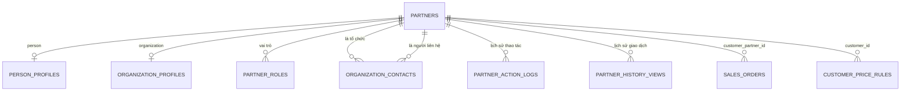

# TH-03 — Đối tác giao dịch (KH & NCC)

> **Vai trò:** **đặc tả chuẩn (source of truth)** cho app sau refactor. Theme đã hoàn thành: **code hiện tại là phạm vi chuẩn**. Mọi quy tắc mặc định = hành vi code hiện tại (SCOPE: giữ 100% chức năng, giữ RPC). Gắn 🔧 = code hiện tại **sai**, phải sửa khi refactor. Làm theo tài liệu, không chép lỗi của code cũ.
> **Phiên bản:** 3.0 · **Ngày:** 2026-10-07 · **Branch đối chiếu:** `refactor/simple-arch` @ `47b4cb188`
> **Thay thế:** bản 2.1 (2026-10-06) và `Theme 3_ Đối tác giao dịch.md` (v1). Tính năng v1 không có trong code được liệt kê ở [mục 8](#8-ngoài-phạm-vi-so-với-spec-v1).
> **Nguồn đối chiếu:**
> - DB: schema `partner`, migration `20260714001`…`20260714004`, `20260714009`, `20260715001` (tìm kiếm), `20260717001`, `20260721001` (lịch sử thao tác), `20260725001` (snapshot khách cho giá).
> - App: `apps/erp/lib/features/partner/presentation/` (8 trang, 8 cubit, 79 widget); module `modules/partner/`; chỗ dùng ở `features/sales/`, schema `sales`, `pricing`.
>
> **Cách đọc:** mục 1–3 là mô hình chung và dữ liệu; mục 4 chia theo epic → user story (bối cảnh, FR, BR, AC, EC, kịch bản Gherkin); mục 5 đặc tả từng màn hình (trạng thái, thành phần, phác thảo); mục 6 RPC và thông điệp lỗi; mục 7 phân quyền và vấn đề đã biết; mục 8 ngoài phạm vi; mục 9 kế hoạch refactor và kiểm thử.

---

## Mục lục

1. [Tổng quan](#1-tổng-quan)
2. [Mô hình nghiệp vụ](#2-mô-hình-nghiệp-vụ)
3. [Dữ liệu](#3-dữ-liệu)
4. [Epic và user story](#4-epic-và-user-story)
5. [Đặc tả màn hình](#5-đặc-tả-màn-hình)
6. [Kỹ thuật: RPC, phụ thuộc, lỗi](#6-kỹ-thuật-rpc-phụ-thuộc-lỗi)
7. [Phân quyền & vấn đề đã biết](#7-phân-quyền--vấn-đề-đã-biết)
8. [Ngoài phạm vi (so với spec v1)](#8-ngoài-phạm-vi-so-với-spec-v1)
9. [Thay đổi khi refactor & kiểm thử](#9-thay-đổi-khi-refactor--kiểm-thử)

---

## 1. Tổng quan

### 1.1 Mục đích

TH-03 quản lý **danh bạ đối tác giao dịch** của cửa hàng: khách hàng, nhà cung cấp, hoặc đối tác có cả hai vai trò. Đây là nguồn dữ liệu chung cho bán hàng (TH-05), giá riêng theo khách (TH-04) và hoá đơn điện tử (TH-08). Theme trả lời bốn nhóm câu hỏi:

1. **Ai:** đối tác là cá nhân hay tổ chức, tên gì, liên lạc thế nào, mua hay bán cho mình?
2. **Xuất hoá đơn:** MST, tên và địa chỉ xuất hoá đơn, email nhận hoá đơn là gì; còn thiếu gì?
3. **Liên hệ:** ở một tổ chức (đại lý, trại, công ty) ai là người làm việc, ai là người liên hệ chính?
4. **Kiểm soát:** hồ sơ có trùng không, đang hoạt động hay đã ngừng, ai đã đổi gì lúc nào?

Trên giao diện, module có tên **KH & NCC**. Trong code và tài liệu, khái niệm gốc là **Partner (đối tác)**.

### 1.2 Bối cảnh nghiệp vụ

- Cửa hàng thú y bán cho cả **người nuôi** (cá nhân, thường chỉ có tên + SĐT) và **trại, đại lý, phòng khám** (tổ chức, cần MST để xuất hoá đơn).
- Một đối tác có thể vừa mua vừa bán (đại lý vừa lấy hàng vừa đổ hàng cho cửa hàng).
- Khách quen hay được tìm bằng **SĐT** hoặc tên không dấu ngay tại quầy.
- Một khách cá nhân lớn dần thành hộ kinh doanh / công ty: cần **chuyển cá nhân thành tổ chức** mà không mất lịch sử đơn.
- Hồ sơ trùng (cùng SĐT, cùng MST) gây sai công nợ và giá riêng, nên phải chặn ngay khi nhập.

### 1.3 Ý tưởng chủ đạo

| Khái niệm | Ý nghĩa | Trong code |
|---|---|---|
| **Một gốc Partner** | Mọi chứng từ tham chiếu `partner_id`, không tham chiếu tên | `partner.partners` |
| **Loại hồ sơ ≠ vai trò** | Cá nhân / Tổ chức là *loại hồ sơ*. Khách hàng / Nhà cung cấp là *vai trò giao dịch*. Hai thứ độc lập | `partner_type` và bảng `partner_roles` |
| **Người liên hệ là một Partner cá nhân** | Tổ chức liên kết tới hồ sơ cá nhân, không lưu tên liên hệ dạng chữ | `organization_contacts` |
| **Chứng từ giữ snapshot** | Sửa hồ sơ không làm đổi đơn bán, nháp, giá riêng cũ | `sales_context_snapshot`, `customer_snapshot`, `customer_phone_snapshot` |
| **Ghi qua RPC, có khoá phiên bản** | Bảng chỉ cho đọc. Mọi thao tác ghi đi qua RPC `security definer` và kiểm `version` | `_lock_partner`, lỗi `STATE_CHANGED` |
| **Mọi thao tác có dấu vết** | Mỗi lần ghi lưu snapshot trước / sau | `partner_action_logs` |

### 1.4 Trong phạm vi

- Danh sách KH & NCC: tìm kiếm, lọc nhanh, bộ lọc, sắp xếp, phân trang, kéo để tải lại.
- Tạo cá nhân / tạo tổ chức; tổ chức có thể tạo kèm người liên hệ chính.
- Kiểm trùng theo SĐT, email, MST, tên + SĐT trước khi lưu.
- Hồ sơ chi tiết: thông tin chính, người liên hệ, hoá đơn / thuế, địa chỉ giao hàng, ghi chú, thông tin hệ thống, cảnh báo thiếu thông tin hoá đơn.
- Chỉnh sửa hồ sơ và vai trò giao dịch.
- Người liên hệ của tổ chức: tạo mới, chọn từ cá nhân có sẵn (chọn nhiều), sửa, đặt làm chính, gỡ khỏi tổ chức.
- Chuyển cá nhân thành tổ chức (3 bước).
- Ngừng hoạt động / kích hoạt lại, có lý do tuỳ chọn; xoá mềm có kiểm tra điều kiện.
- Lịch sử thao tác, hiện khác biệt từng trường.
- Bảng lịch sử giao dịch theo đối tác, 🔧 ghi tự động từ đơn bán (dùng cho điều kiện xoá; chưa có màn xem).
- Cung cấp khách hàng cho TH-04 và TH-05, kể cả tạo nhanh khách khi bán.

### 1.5 Ngoài phạm vi theme

| Nội dung | Thuộc |
|---|---|
| Đơn bán, công nợ phải thu của đơn | TH-05 Bán hàng |
| Sổ công nợ khách / nhà cung cấp | Theme 6 (chưa làm) |
| Phiếu nhập từ nhà cung cấp, trả NCC | Theme 7 Kho (P11) |
| Phát hành hoá đơn điện tử | TH-08 |
| Gộp hồ sơ trùng, khôi phục hồ sơ đã xoá, xoá cứng | Chưa làm |
| CRM nâng cao (phân nhóm, hạng khách, điểm thưởng) | Chưa làm |

### 1.6 Tác nhân

| Tác nhân | Mô tả | Thao tác chính |
|---|---|---|
| Nhân viên bán hàng | Thành viên đang hoạt động | Tìm, tạo nhanh khách, xem hồ sơ |
| Chủ cửa hàng / quản lý | Owner hoặc thành viên | Mọi thao tác, gồm ngừng, xoá, chuyển đổi |
| Hệ thống (DB) | RPC, 🔧 trigger trên đơn bán | Ghi lịch sử thao tác, lịch sử giao dịch |
| TH-04, TH-05, TH-08 | Theme dùng dữ liệu | Tìm khách, snapshot khách, thông tin hoá đơn |

**Mọi thành viên làm được mọi thao tác partner** ([7.2](#72-phân-quyền)).

### 1.7 Liên hệ với các theme khác

| Theme | TH-03 cung cấp | TH-03 nhận |
|---|---|---|
| TH-01 Tổ chức & IAM | — | `tenant_id`, người dùng, `iam.has_permission` |
| TH-04 Chính sách giá | Khách (`customer`, `active`) cho giá riêng; `_get_customer_snapshot_for_pricing` | — |
| TH-05 Bán hàng | Tìm khách, tạo nhanh khách, snapshot khách | 🔧 Đơn bán ghi lịch sử giao dịch (KI-02) |
| TH-08 HĐĐT | Thông tin người mua (MST, tên / địa chỉ / email hoá đơn) | — |
| Theme 6, 7 | Nhà cung cấp, khách cho công nợ / nhập hàng | Sau này ghi thêm loại giao dịch vào lịch sử |

---

## 2. Mô hình nghiệp vụ

### 2.1 Khái niệm

```text
Partner (partner.partners)  — partner_type: person | organization, status, display_name, version
 ├── Hồ sơ cá nhân (person_profiles)        — nếu person
 ├── Hồ sơ tổ chức (organization_profiles)  — nếu organization
 ├── Vai trò (partner_roles)                 — customer / supplier (0..2)
 ├── Người liên hệ (organization_contacts)   — chỉ tổ chức → Partner cá nhân, tối đa 1 người chính
 ├── Lịch sử thao tác (partner_action_logs)
 └── Lịch sử giao dịch (partner_history_views)
```

| Khái niệm | Định nghĩa |
|---|---|
| Partner | Một đối tác trong tổ chức (`tenant_id`). Có `partner_type`, `status`, `display_name`, `version` |
| Hồ sơ cá nhân | Danh xưng, họ và tên, tên thường gọi, SĐT chính / phụ, email, MST, thông tin hoá đơn, địa chỉ giao hàng, ghi chú |
| Hồ sơ tổ chức | Loại tổ chức (`company` Công ty, `business_household` Hộ kinh doanh, `other` Khác), tên tổ chức, tên viết tắt, tên quốc tế, SĐT, email, MST, thông tin hoá đơn, địa chỉ giao hàng, ghi chú |
| Vai trò giao dịch | `customer` (Khách hàng), `supplier` (Nhà cung cấp). Có cả hai → UI hiện **KH & NCC** |
| Người liên hệ | Liên kết (tổ chức, cá nhân) kèm vai trò liên hệ, cờ chính, ghi chú |
| Người chỉ làm liên hệ | Cá nhân không có vai trò, chỉ tồn tại để làm người liên hệ; không hiện trong danh sách KH & NCC |
| Lịch sử thao tác | Loại thao tác, người làm, lý do, snapshot trước / sau |
| Lịch sử giao dịch | Bảng đọc tổng hợp chứng từ theo đối tác (`partner_history_views`) |

### 2.2 Vòng đời

```text
            Ngừng hoạt động               Xoá hồ sơ
  active ─────────────────▶ inactive ─────────────────▶ deleted
    ▲  ◀─────────────────      │                           ▲
    │      Kích hoạt lại       │                           │
    └──────────────────────────┴──────── Xoá hồ sơ ────────┘
```

| Trạng thái | Nhãn UI | Danh sách | Hồ sơ chi tiết | Sửa | Chọn cho giao dịch mới |
|---|---|---|---|---|---|
| `active` | Đang hoạt động | Có | Có | Có | Có (nếu có vai trò phù hợp) |
| `inactive` | Ngừng hoạt động | Có, ghim cuối | Có, banner "KH & NCC này sẽ không được chọn cho giao dịch mới." | Có | Không |
| `deleted` | — | Không | Không (`NOT_FOUND`) | Không | Không |

Không có đường từ `deleted` quay lại.

### 2.3 Dữ liệu tối thiểu theo mục đích

| Mục đích | Cá nhân cần | Tổ chức cần |
|---|---|---|
| Lưu hồ sơ | Họ và tên, SĐT chính, ≥ 1 vai trò | Loại tổ chức, tên tổ chức, SĐT chính, ≥ 1 vai trò |
| Bán hàng (TH-05) | `active` + vai trò `customer` | như cá nhân |
| Bán nợ | Có hồ sơ (không phải Khách lẻ) | như cá nhân |
| Xuất hoá đơn đầy đủ (banner BR-12) | MST, địa chỉ hoá đơn | MST, tên xuất hoá đơn, địa chỉ hoá đơn |

### 2.4 Quy tắc nghiệp vụ tổng hợp

Số BR giữ nguyên từ bản 2.1.

**Loại hồ sơ và vai trò**

| Mã | Quy tắc | Ở đâu |
|---|---|---|
| BR-01 | `partner_type` là `person` hoặc `organization`. Không đổi được bằng chỉnh sửa; chỉ đổi qua chuyển cá nhân → tổ chức | `update_partner` không nhận `partner_type` |
| BR-02 | Tạo/sửa đối tác phải có **ít nhất 1 vai trò**. Sửa thì ghi đè toàn bộ danh sách vai trò | `_validate_roles`, `_upsert_roles` |
| BR-03 | **Ngoại lệ:** cá nhân được tạo qua luồng người liên hệ hoặc qua chuyển đổi thì **không có vai trò** | `add_organization_contact`, `transform_to_organization` |
| BR-04 | `display_name` lấy từ `full_name` (cá nhân) hoặc `organization_name` (tổ chức), cập nhật mỗi lần sửa | `create_partner`, `update_partner` |

**Hồ sơ**

| Mã | Quy tắc | Ở đâu |
|---|---|---|
| BR-05 | Cá nhân bắt buộc: họ tên, SĐT chính. Tổ chức bắt buộc: tên tổ chức, SĐT chính, loại tổ chức | CHECK constraint + `_insert_*_profile` |
| BR-06 | Định dạng (chỉ kiểm ở app): SĐT 9–11 chữ số, cho phép khoảng trắng; email đúng dạng; MST gồm 10 số, 12 số hoặc dạng 10-3 (gõ liền 13 số sẽ tự chuyển thành 10-3). DB không kiểm định dạng | `VPhoneValidator`, `VEmailValidator`, `PartnerCreateFormValidator` |
| BR-07 | Danh xưng (`title`) là chữ tự do, không phải danh sách cố định | `person_profiles.title text` |
| BR-08 | Địa chỉ giao hàng gồm 2 cấp hành chính: Tỉnh/TP và Phường/Xã, chọn từ dữ liệu có sẵn trong app, kèm địa chỉ chi tiết | `vn_administrative_units_loader` |
| BR-09 | Sửa hồ sơ là **ghi đè toàn bộ hồ sơ**: xoá hồ sơ cũ rồi chèn lại. Trường không gửi lên sẽ thành trống | `update_partner` |
| BR-10 | Sửa được khi `active` hoặc `inactive`; khi `deleted` thì báo `INVALID_STATUS` | `_lock_partner` |
| BR-11 | Khoá lạc quan: sửa, chuyển đổi, đổi trạng thái, xoá đều gửi `expected_version`; lệch thì báo `STATE_CHANGED`. Thao tác người liên hệ không kiểm version nhưng vẫn tăng version của tổ chức | `_lock_partner` |
| BR-12 | Hồ sơ đang hoạt động nhưng thiếu dữ liệu hoá đơn thì hiện banner "Hồ sơ còn thiếu thông tin". Cá nhân xét MST và địa chỉ hoá đơn; tổ chức xét MST, tên xuất hoá đơn và địa chỉ hoá đơn. Banner chỉ cảnh báo, không chặn | `partner_detail_page` |

**Trùng dữ liệu**

| Mã | Quy tắc | Ở đâu |
|---|---|---|
| BR-13 | Trong cùng tổ chức, bỏ qua hồ sơ `deleted` và chính hồ sơ đang sửa, hệ thống so trùng: SĐT (bằng nhau sau khi bỏ khoảng trắng hai đầu), email (không phân biệt hoa thường), MST (bằng nhau), **tên + SĐT** (tên bằng nhau không phân biệt hoa thường **và** cùng SĐT) | `check_duplicate` |
| BR-14 | Phía server: có trùng mà không gửi `confirm_duplicate = true` thì báo `DUPLICATE_WARNING` (message là mảng JSON các bản trùng). Có gửi thì vẫn lưu và trả `warnings` | `_guard_duplicates` |
| BR-15 | **Quy tắc chính thức.** App kiểm trùng **trước khi lưu** (tạo, sửa, form người liên hệ; khi tạo tổ chức thì kiểm cả người liên hệ chính). Trùng SĐT, email hoặc MST thì báo "Trùng khớp hoàn toàn", **không cho lưu**, chỉ cho "Đi đến hồ sơ". Chỉ trùng tên thì báo "Có thể là hồ sơ trùng" và cho "Tiếp tục". Cờ `confirm_duplicate` của RPC chỉ được gửi trong trường hợp này | `partner_read_rpc_mapper._deriveMatchLevel`, `partner_create_cubit` |

**Người liên hệ**

| Mã | Quy tắc | Ở đâu |
|---|---|---|
| BR-16 | Chỉ tổ chức có người liên hệ. Người liên hệ là Partner cá nhân; một cặp (tổ chức, cá nhân) là duy nhất; không tự liên kết với chính mình | PK + CHECK `organization_contacts` |
| BR-17 | Thêm người liên hệ theo 2 cách. **Tạo mới:** họ tên và SĐT bắt buộc; app bắt chọn vai trò liên hệ. **Chọn có sẵn:** danh sách cá nhân đang hoạt động, bỏ những người đã liên kết, cho chọn nhiều. 🔧 Server phải kiểm tra người được chọn là hồ sơ cá nhân, thuộc tổ chức và chưa xoá, kể cả khi không đặt làm người chính (hiện chỉ app kiểm) | `add_organization_contact`, `partner_contact_select_list` |
| BR-18 | Vai trò liên hệ ở DB là chữ tự do. App có sẵn các giá trị: Chủ đại lý, Quản lý kinh doanh, Nhân viên mua hàng, Kế toán, Phụ trách công nợ, Giao nhận, Khác | `partner_contact_form` |
| BR-19 | Mỗi tổ chức có **tối đa 1 người liên hệ chính**. Đặt người mới làm chính thì bỏ cờ của người cũ; app hỏi xác nhận "Đổi người liên hệ chính?". Cá nhân không `active` không được làm người chính | `add/update_organization_contact` |
| BR-20 | "Gỡ khỏi tổ chức" chỉ xoá liên kết, **không xoá** hồ sơ cá nhân | `remove_organization_contact` |
| BR-21 | Sửa người liên hệ được sửa cả liên kết (vai trò, cờ chính, ghi chú) và hồ sơ cá nhân đi kèm | `update_organization_contact` |
| BR-22 | Ngừng hoạt động một cá nhân đang là người liên hệ chính thì cá nhân đó **mất cờ chính ở mọi tổ chức**; app cảnh báo trước khi xác nhận | `deactivate_partner` |
| BR-23 | Trong hồ sơ tổ chức, người liên hệ đã xoá bị ẩn; người liên hệ ngừng hoạt động vẫn hiện, kèm nhãn, và không được tính là người chính | `v_partner_detail.contacts` |
| BR-24 | Khi **tạo** tổ chức có thể bật "Thêm người liên hệ chính" (họ tên + SĐT bắt buộc). Hệ thống tạo luôn cá nhân đó và liên kết làm người chính. Khi sửa tổ chức không có mục này | `create_partner(p_organization_primary_contact)` |

**Chuyển cá nhân thành tổ chức**

| Mã | Quy tắc | Ở đâu |
|---|---|---|
| BR-25 | Chỉ áp dụng cho hồ sơ cá nhân chưa xoá. Hồ sơ giữ nguyên `partner_id`, vai trò, trạng thái và lịch sử thao tác; `partner_type` đổi thành `organization` | `transform_to_organization` |
| BR-26 | Thông tin cá nhân cũ (gồm cả hoá đơn, địa chỉ giao hàng, ghi chú) được **sao chép sang một cá nhân mới** (`partner_id` mới, không có vai trò, vai trò liên hệ trống). Cá nhân mới này được liên kết làm người liên hệ chính của tổ chức. Hồ sơ tổ chức chỉ nhận các trường nhập ở bước 1 (loại, tên, tên viết tắt, tên quốc tế, SĐT, email, MST); tên / địa chỉ / email hoá đơn, địa chỉ giao hàng và ghi chú của tổ chức để trống, người dùng bổ sung sau bằng Chỉnh sửa (KI-12) | như trên |
| BR-27 | Bị chặn nếu cá nhân đang là người liên hệ chính của một tổ chức khác (`PRIMARY_CONTACT_OF_ORGANIZATION`). App hiện "Không thể chuyển thành tổ chức" kèm nút "Xem tổ chức" | như trên, `partner_transform_primary_contact_blocked_sheet` |
| BR-28 | Bắt buộc: loại tổ chức, tên tổ chức, SĐT tổ chức. MST và email kiểm theo BR-06. Có kiểm trùng như BR-14 | `partner_transform_step_one_validator` |

**Trạng thái và xoá**

| Mã | Quy tắc | Ở đâu |
|---|---|---|
| BR-29 | Chỉ `active` mới ngừng hoạt động được; chỉ `inactive` mới kích hoạt lại được. Sai trạng thái thì báo `INVALID_STATUS`. Lý do không bắt buộc, được lưu vào lịch sử thao tác | `deactivate/reactivate_partner` |
| BR-30 | Xoá mềm áp dụng cho `active` và `inactive`; trạng thái chuyển thành `deleted`. Không khôi phục được | `soft_delete_partner` |
| BR-31 | Bị chặn xoá khi: (a) cá nhân đang là người liên hệ chính của tổ chức chưa xoá → `PRIMARY_CONTACT_OF_ORGANIZATION`; (b) đối tác **đã có đơn bán** (có dòng trong `partner_history_views`) → `HAS_TRANSACTIONS`, app gợi ý "Ngừng hoạt động". 🔧 Hiện bảng lịch sử luôn rỗng nên (b) không bao giờ chặn; phải sửa theo KI-02 | `check_delete_eligibility`, `soft_delete_partner` |
| BR-32 | App gọi `check_delete_eligibility` trước, đủ điều kiện mới mở hộp xác nhận xoá | `partner_detail_soft_delete_flow` |

**Danh sách và tìm kiếm**

| Mã | Quy tắc | Ở đâu |
|---|---|---|
| BR-33 | Mặc định không lọc trạng thái: hiện cả `active` và `inactive`, hồ sơ `inactive` ghim xuống cuối. Hồ sơ `deleted` không bao giờ hiện; app không có bộ lọc "Đã xoá" | `search_partners` |
| BR-34 | Danh sách KH & NCC chỉ hiện đối tác có **ít nhất 1 vai trò** (`p_role = 'any'`). Vì vậy cá nhân chỉ làm người liên hệ (BR-03) không hiện trong danh sách | `partner_list_cubit` |
| BR-35 | Tìm kiếm **không phân biệt hoa thường và 🔧 không phân biệt dấu** (dùng `unaccent` như catalog và pricing; hiện code còn phân biệt dấu), trên các trường: tên, tên thường gọi, tên viết tắt, SĐT, email, MST. Từ khoá có `@` thì chỉ tìm theo email. Tổ chức cũng được trả về nếu một người liên hệ đang hoạt động của nó khớp tên, danh xưng, SĐT, SĐT phụ hoặc email | `20260715001_partner_list_search_behavior` |
| BR-36 | Lọc nhanh (theo vai trò): Tất cả / Khách hàng / Nhà cung cấp / KH & NCC (có cả hai). Bộ lọc đầy đủ gồm: loại hồ sơ; vai trò (KH, NCC, KH & NCC = có cả hai); trạng thái; thời điểm cập nhật trong 7 hoặc 30 ngày gần đây | `partner_filter_bottom_sheet` |
| BR-37 | Sắp xếp: cập nhật gần nhất (mặc định), cập nhật cũ nhất, tên A-Z, tên Z-A. 🔧 Bỏ hai lựa chọn "Vai trò giao dịch A-Z/Z-A" (hiện có trên UI nhưng server không hỗ trợ). Mỗi trang 20 dòng; server cho tối đa 100 | `search_partners` |

**Lịch sử thao tác và snapshot**

| Mã | Quy tắc | Ở đâu |
|---|---|---|
| BR-38 | Mọi thao tác ghi đều ghi một dòng `partner_action_logs`: `create`, `update`, `add_contact`, `remove_contact`, `transform`, `deactivate`, `reactivate`, `delete`, kèm snapshot trước/sau và lý do. Sửa người liên hệ ghi loại `update` trên tổ chức | `_log_partner_action` |
| BR-39 | `p_actor_id` phải trùng `auth.uid()`; `created_by` và `updated_by` lấy từ đó | `_assert_actor` |
| BR-40 | Màn "Lịch sử thao tác" so snapshot trước/sau và hiện thay đổi theo từng trường (tên tiếng Việt), kèm lý do nếu có | `partner_action_log_diff` |
| BR-41 | Chứng từ giữ snapshot riêng. Đơn bán lưu `customer_partner_id` và snapshot khách (tên, SĐT, MST) trong `sales_context_snapshot`. Đơn nháp lưu `customer_snapshot`. Giá riêng lưu `customer_phone_snapshot`. Sửa đối tác không làm đổi các chứng từ này | schema `sales`, `pricing` |

---


**Bổ sung (bản 3.0)**

| Mã | Quy tắc | Ở đâu |
|---|---|---|
| BR-42 | Mở hồ sơ một cá nhân chỉ làm người liên hệ (không có vai trò) → màn "Không phải hồ sơ đối tác — Người liên hệ chỉ quản lý trong hồ sơ tổ chức. Không mở như hồ sơ cá nhân độc lập." | `partner_detail_page` |
| BR-43 | Ô chọn khách ở TH-05 / TH-04 chỉ trả hồ sơ `active` có vai trò `customer`; chưa gõ từ khoá thì chỉ gợi ý khách cập nhật trong 30 ngày | `search_partners(p_role='customer', p_status='active', p_updated_within_days=30)` |
| BR-44 | Tạo nhanh khách từ màn bán hàng đi qua cùng kiểm trùng (BR-15) và `create_partner` với vai trò `customer` | `sales_partner_customer_lookup` |
| BR-45 | Hoàn tất đơn / tính giá với khách không còn `active` hoặc không có vai trò `customer` → `CUSTOMER_INVALID` (TH-05 KI-03) | `_get_customer_snapshot_for_pricing` |
| BR-46 | Thông điệp UI không giả định vai trò hay giới tính: dùng "Hồ sơ này", "Bạn" (🔧 KI-11) | app |

---

## 3. Dữ liệu

### 3.1 Sơ đồ quan hệ



### 3.2 Bảng và trường chính (schema `partner`)

| Bảng | Trường chính | Ghi chú |
|---|---|---|
| `partners` | `partner_id`, `tenant_id`, `partner_type`, `status`, `display_name`, `version`, `created_*`, `updated_*` | Gốc. Index theo `(tenant_id, status)`, `(tenant_id, updated_at)`, `(tenant_id, display_name)` |
| `person_profiles` | `title`, `full_name`*, `nickname`, `phone`*, `phone2`, `email`, `tax_code`, `invoice_name/address/email`, `delivery_province/commune/address`, `note` | `*` = bắt buộc |
| `organization_profiles` | `organization_type`*, `organization_name`*, `short_name`, `intl_name`, `phone`*, `email`, `tax_code`, `company_address`, `invoice_*`, `delivery_*`, `note` | `company_address` có trong DB nhưng **form chưa có ô nhập** |
| `partner_roles` | PK (`partner_id`, `role`), `is_active` | Hiện luôn ghi `is_active = true` |
| `organization_contacts` | PK (`organization_partner_id`, `person_partner_id`), `contact_role`, `is_primary`, `note`, audit | Cá nhân bị `on delete restrict` |
| `partner_action_logs` | `action_type`, `actor_user_id`, `reason`, `before_state`, `after_state`, `created_at` | |
| `partner_history_views` | `role`, `transaction_type` (`sales_order`, `inventory_inbound`, `accounting_receivable`, `accounting_payable`), `source_module`, `source_id`, `reference_code`, `transaction_date`, `status`, `amount`, `currency`, `can_open_source` | Duy nhất theo (`tenant_id`, `source_module`, `source_id`). 🔧 Ghi bằng trigger trên `sales.sales_orders` (chỉ dùng `sales_order`; các loại khác dự phòng) |

View đọc: `v_partner_list`, `v_partner_detail`, `v_partner_history`, đều `security_invoker`.
RLS: thành viên của tổ chức (`partner._tenant_member`) được **đọc**. Không có policy ghi; mọi thao tác ghi đi qua RPC.

---

### 3.3 Bất biến kiểm tra được

| # | Bất biến |
|---|---|
| I-01 | `partner_type = person` ⇔ có đúng 1 `person_profiles`, không có `organization_profiles`; ngược lại với `organization` |
| I-02 | Partner tạo qua `create_partner` / `update_partner` có ≥ 1 dòng `partner_roles` |
| I-03 | Mỗi tổ chức có ≤ 1 `organization_contacts.is_primary = true`, và người đó `active` |
| I-04 | `organization_contacts.person_partner_id` luôn là Partner `person` cùng `tenant_id`, khác tổ chức |
| I-05 | Không có 2 Partner chưa xoá trong cùng tổ chức trùng SĐT chính, email hoặc MST, trừ khi tạo trước khi có quy tắc BR-15 |
| I-06 | `display_name` = `full_name` (cá nhân) hoặc `organization_name` (tổ chức) |
| I-07 | Mỗi lần `version` tăng có đúng 1 dòng `partner_action_logs` (trừ thao tác người liên hệ ghi `update` trên tổ chức) |
| I-08 | 🔧 Mỗi đơn bán có `customer_partner_id` có đúng 1 dòng `partner_history_views` (`source_module = sales`, `source_id = order_id`), `status` khớp trạng thái đơn |

---

## 4. Epic và user story

### 4.1 Bản đồ

| Epic | Tên | User story | Màn |
|---|---|---|---|
| EP-01 | Danh sách & tra cứu | US-01.1 Xem danh sách; US-01.2 Tìm kiếm; US-01.3 Lọc; US-01.4 Sắp xếp | PT-01, PT-02, PT-03 |
| EP-02 | Tạo & chỉnh sửa hồ sơ | US-02.1 Chọn loại hồ sơ; US-02.2 Vai trò giao dịch; US-02.3 Thông tin chính; US-02.4 Người liên hệ chính khi tạo tổ chức; US-02.5 Hoá đơn / thuế; US-02.6 Địa chỉ giao hàng & ghi chú; US-02.7 Kiểm trùng; US-02.8 Lưu | PT-04, PT-05, PT-06 |
| EP-03 | Hồ sơ chi tiết | US-03.1 Xem hồ sơ; US-03.2 Cảnh báo thiếu thông tin hoá đơn; US-03.3 Thao tác hồ sơ | PT-07 |
| EP-04 | Người liên hệ | US-04.1 Xem danh sách liên hệ; US-04.2 Tạo người liên hệ mới; US-04.3 Chọn cá nhân có sẵn; US-04.4 Sửa liên hệ; US-04.5 Đặt làm chính; US-04.6 Gỡ khỏi tổ chức | PT-08, PT-09, PT-10 |
| EP-05 | Chuyển cá nhân thành tổ chức | US-05.1 Nhập thông tin tổ chức; US-05.2 Xem trước; US-05.3 Xác nhận | PT-11 |
| EP-06 | Trạng thái & xoá | US-06.1 Ngừng hoạt động; US-06.2 Kích hoạt lại; US-06.3 Xoá hồ sơ | PT-07 (sheet) |
| EP-07 | Lịch sử | US-07.1 Lịch sử thao tác; US-07.2 🔧 Ghi lịch sử giao dịch từ đơn bán | PT-12 |

```text
Danh sách (PT-01) ──[+]──▶ Action sheet ──▶ Tạo cá nhân / Tạo tổ chức (PT-05) ──lưu──▶ Hồ sơ (PT-07)
      └──chạm──────────────────────────────────────────────────────────────────────────▶ Hồ sơ (PT-07)
Hồ sơ ─┬─ Chỉnh sửa (PT-05)
       ├─ Người liên hệ (PT-08) ─┬─ Tạo mới / Sửa (PT-09)
       │                         └─ Chọn cá nhân có sẵn (PT-10)
       ├─ Lịch sử thao tác (PT-12)
       └─ Thao tác ─┬─ Chuyển thành tổ chức (PT-11)
                    ├─ Ngừng hoạt động / Kích hoạt lại
                    └─ Xoá hồ sơ
```

---

### 4.2 EP-01 — Danh sách & tra cứu

**Điểm vào:** tab / menu KH & NCC → `/partner`.

#### US-01.1 — Xem danh sách KH & NCC

| Là | Tôi muốn | Để |
|---|---|---|
| Thành viên | xem danh sách đối tác với vai trò, trạng thái, SĐT | tìm và mở đúng hồ sơ |

**Yêu cầu chức năng**

- FR-01: Header "Danh sách đối tác", "`<N>` đối tác"; khi đang tìm / lọc: "`<N>` kết quả phù hợp"; nút "Sắp xếp".
- FR-02: Mỗi dòng: tên hiển thị, nhãn loại (Cá nhân / Tổ chức), nhãn vai trò (Khách hàng / Nhà cung cấp / cả hai; "Chưa có vai trò"), nhãn trạng thái (Đang hoạt động / Ngừng hoạt động), SĐT, "MST `<mã>`" nếu có, "Cập nhật `<ngày>`".
- FR-03: Mặc định hiện `active` và `inactive`; `inactive` ghim cuối; không hiện `deleted` (BR-33). Chỉ hiện đối tác có ≥ 1 vai trò (BR-34).
- FR-04: Trang 20 dòng, cuộn tải tiếp, hết thì "Đã ở cuối danh sách"; kéo xuống tải lại.
- FR-05: Nút "Thêm KH & NCC" mở action sheet "Thêm KH & NCC mới" (US-02.1).
- FR-06: Chạm một dòng mở hồ sơ.

**Quy tắc:** BR-33, BR-34.

**Tiêu chí nghiệm thu**

- AC-01: Chưa có đối tác → "Chưa có KH & NCC — Thêm đối tác để bắt đầu bán hàng, nhập hàng và quản lý công nợ." + "Thêm KH & NCC".
- AC-02: Lỗi tải → "Không tải được danh sách — Vui lòng kiểm tra kết nối internet hoặc thử lại sau." + "Thử lại".
- AC-03: Thiếu quyền `partner.view` → "Bạn không có quyền xem KH & NCC — Liên hệ quản trị viên để được cấp quyền."
- AC-04: Cá nhân chỉ làm người liên hệ không có trong danh sách.

#### US-01.2 — Tìm kiếm

| Là | Tôi muốn | Để |
|---|---|---|
| Nhân viên | gõ tên không dấu, SĐT, email hoặc MST | tìm khách ngay tại quầy |

**Yêu cầu chức năng**

- FR-01: Ô "Tìm tên, SĐT, email, MST..." (debounce), nút "Xóa tìm kiếm".
- FR-02: Tìm theo chuỗi con, không phân biệt hoa thường, 🔧 không phân biệt dấu (KI-07) trên: tên hiển thị, tên thường gọi, tên viết tắt, SĐT, email, MST.
- FR-03: Từ khoá có `@` → chỉ tìm theo email.
- FR-04: Tổ chức cũng khớp khi một người liên hệ **đang hoạt động** của nó khớp tên, danh xưng, SĐT, SĐT phụ hoặc email.

**Quy tắc:** BR-35.

**Tiêu chí nghiệm thu**

- AC-01: 🔧 "an binh" tìm thấy "Đại lý An Bình".
- AC-02: "0912" tìm thấy mọi hồ sơ có SĐT chứa "0912".
- AC-03: Gõ tên người liên hệ "Lan" → tổ chức có liên hệ Lan đang hoạt động xuất hiện.
- AC-04: Không có kết quả → "Không tìm thấy kết quả — Thử kiểm tra lại từ khóa "`<từ khoá>`" hoặc bộ lọc." + "Xóa từ khóa".

**Kịch bản**

```gherkin
Feature: Tìm đối tác

Scenario: SC-01 — Tìm không dấu
  Given có tổ chức "Đại lý An Bình"
  When tôi gõ "an binh"
  Then danh sách có "Đại lý An Bình"

Scenario: SC-02 — Tìm qua người liên hệ
  Given tổ chức "Trại Hoà Phát" có người liên hệ đang hoạt động "Nguyễn Thị Lan" SĐT "0988111222"
  When tôi gõ "0988111222"
  Then danh sách có "Trại Hoà Phát"
```

#### US-01.3 — Lọc

**Yêu cầu chức năng**

- FR-01: Lọc nhanh (chip): "Tất cả", "Khách hàng", "Nhà cung cấp", "KH & NCC" (có cả hai vai trò).
- FR-02: "Bộ lọc KH & NCC" (sheet): "Loại hồ sơ" (Tất cả / Cá nhân / Tổ chức); "Vai trò giao dịch"; "Trạng thái" (Tất cả / Đang hoạt động / Ngừng hoạt động); "Thời gian cập nhật" (Tất cả / 7 ngày gần đây / 30 ngày gần đây). Nút "Đặt lại", "Áp dụng".
- FR-03: Bộ lọc đang áp dụng hiện thành chip có `×`; "Xóa lọc" bỏ hết.
- FR-04: Lọc kết hợp với từ khoá theo **và**.

**Quy tắc:** BR-36.

**Tiêu chí nghiệm thu**

- AC-01: Chip "KH & NCC" chỉ ra đối tác có cả `customer` và `supplier`.
- AC-02: Trạng thái "Ngừng hoạt động" chỉ ra `inactive`.
- AC-03: Gửi `p_updated_within_days` khác 7 / 30 → `VALIDATION_ERROR`.

#### US-01.4 — Sắp xếp

- FR-01: Sheet "Sắp xếp": "Cập nhật gần nhất" (mặc định), "Cập nhật cũ nhất", "Tên A-Z", "Tên Z-A". 🔧 Bỏ "Vai trò giao dịch A-Z / Z-A" (KI-03).
- AC-01: Mọi lựa chọn vẫn ghim `inactive` xuống cuối.

---

### 4.3 EP-02 — Tạo & chỉnh sửa hồ sơ

**Tổng quan.** Một form chia section đánh số, mở tuần tự, mỗi section thu gọn có tóm tắt ("Đã nhập", "Tùy chọn", "Đã bật"). Nút lưu cố định cuối màn: "Lưu & Xem" (tạo) / "Lưu thay đổi" (sửa).

| # | Section | Cá nhân | Tổ chức (tạo) | Khi sửa |
|---|---|---|---|---|
| 1 | Loại hồ sơ | chỉ đọc (chọn ở action sheet) | như cá nhân | chỉ đọc (BR-01) |
| 2 | Vai trò giao dịch | Khách hàng / Nhà cung cấp | như cá nhân | Có |
| 3 | Thông tin cá nhân / tổ chức | Danh xưng, Họ và tên *, Tên thường gọi, SĐT chính *, SĐT phụ, Email | Loại tổ chức *, Tên tổ chức *, Tên viết tắt, Tên quốc tế, SĐT chính *, Email | Có |
| 4 | Người liên hệ chính | — | Tuỳ chọn ("Thêm người liên hệ chính") | Không có |
| 4/5 | Hóa đơn / thuế | Mã số thuế, Tên xuất hóa đơn, Địa chỉ xuất hóa đơn, Email nhận hóa đơn | như cá nhân | Có |
| 5/6 | Địa chỉ giao hàng | Tỉnh / Thành phố, Xã / Phường, Địa chỉ chi tiết | như cá nhân | Có |
| 6/7 | Ghi chú | Ghi chú nội bộ | như cá nhân | Có |

**Điểm vào:** "Thêm KH & NCC" → action sheet → `/partner/new`; hồ sơ ▸ "Chỉnh sửa" → `/partner/:id/edit`; tạo nhanh khách ở TH-05.

#### US-02.1 — Chọn loại hồ sơ

- FR-01: Action sheet "Thêm KH & NCC mới": "Tạo cá nhân — Dành cho khách hàng hoặc cá nhân không có pháp nhân"; "Tạo tổ chức — Dành cho công ty, cửa hàng, đại lý, đơn vị kinh doanh".
- FR-02: Tiêu đề form: "Tạo cá nhân" / "Tạo tổ chức" / "Chỉnh sửa cá nhân" / "Chỉnh sửa tổ chức".
- FR-03: Section "1. Loại hồ sơ" luôn chỉ đọc (biểu tượng khoá), cả khi tạo lẫn khi sửa; loại được chọn ở action sheet.
- AC-01: Muốn đổi loại khi đang tạo → huỷ form và chọn lại; muốn đổi cá nhân → tổ chức cho hồ sơ đã có → EP-05.

#### US-02.2 — Vai trò giao dịch

- FR-01: Chọn "Khách hàng", "Nhà cung cấp" hoặc cả hai.
- FR-02: Không chọn → "Vui lòng chọn vai trò giao dịch".
- FR-03: Sửa → ghi đè toàn bộ danh sách vai trò (BR-02).
- AC-01: Bỏ vai trò "Khách hàng" của một khách → khách không còn chọn được ở màn bán hàng; đơn cũ giữ nguyên.

#### US-02.3 — Thông tin chính

**Yêu cầu chức năng**

- FR-01: Cá nhân: "Danh xưng" (chữ tự do, "Nhập danh xưng"), "Họ và tên" *, "Tên thường gọi", "SĐT chính" *, "SĐT phụ", "Email".
- FR-02: Tổ chức: "Loại tổ chức" * (Công ty / Hộ kinh doanh / Khác, "Chọn loại tổ chức"), "Tên tổ chức" *, "Tên viết tắt", "Tên quốc tế", "SĐT chính" *, "Email".
- FR-03: Kiểm trên app: "Vui lòng nhập họ và tên", "Vui lòng nhập tên tổ chức", "Số điện thoại không hợp lệ" (9–11 chữ số, cho phép khoảng trắng), "Email không hợp lệ".

**Quy tắc:** BR-04…BR-07.

**Tiêu chí nghiệm thu**

- AC-01: Bỏ trống SĐT chính → không lưu được.
- AC-02: Tên hiển thị = họ và tên / tên tổ chức, đổi theo khi sửa.

#### US-02.4 — Người liên hệ chính khi tạo tổ chức

- FR-01: Chỉ khi **tạo** tổ chức: công tắc "Thêm người liên hệ chính"; bật thì hiện Danh xưng, Họ và tên *, SĐT chính *, SĐT phụ, Email.
- FR-02: Lưu → tạo thêm một Partner cá nhân **không vai trò** và liên kết làm người chính (BR-24).
- FR-03: Kiểm trùng cả người liên hệ (BR-15).
- AC-01: "Vui lòng nhập họ và tên người liên hệ" khi bật mà bỏ trống tên.
- AC-02: Sau khi tạo, hồ sơ tổ chức hiện người đó với nhãn "Chính".

#### US-02.5 — Hoá đơn / thuế

**Yêu cầu chức năng**

- FR-01: "Mã số thuế" ("Nhập MST (10 số, 12 số hoặc 10-3 số)"), "Tên xuất hóa đơn", "Địa chỉ xuất hóa đơn", "Email nhận hóa đơn".
- FR-02: MST hợp lệ: 10 số, 12 số hoặc dạng `0123456789-001`; gõ liền 13 số tự chuyển thành dạng 10-3. Sai → "MST phải có 10 số, 12 số hoặc dạng 10-3 số".
- FR-03: Thiếu dữ liệu hoá đơn (BR-12) → nhắc ngay trong section: "Thiếu `<…>`. Vui lòng kiểm tra lại trước khi lưu." Chỉ nhắc, không chặn.

**Quy tắc:** BR-06, BR-12.

**Tiêu chí nghiệm thu**

- AC-01: Gõ "0123456789001" → lưu "0123456789-001".
- AC-02: Tổ chức có MST nhưng thiếu tên xuất hoá đơn → lưu được; hồ sơ hiện banner thiếu thông tin.

#### US-02.6 — Địa chỉ giao hàng & ghi chú

- FR-01: "Tỉnh / Thành phố" → sheet "Khu vực hành chính", tìm "Tìm kiếm tỉnh, thành phố..." (không dấu); "Xã / Phường" mở sau khi chọn tỉnh ("Chọn tỉnh / thành phố trước"); "Địa chỉ chi tiết" ("Số nhà, tên đường...").
- FR-02: Dữ liệu hành chính 2 cấp đóng gói trong app; lỗi đọc → "Không thể tải danh mục địa giới hành chính."
- FR-03: Đổi tỉnh → xoá xã đã chọn. "Xóa lựa chọn" bỏ chọn.
- FR-04: "Ghi chú" nội bộ, không in lên chứng từ.

**Quy tắc:** BR-08.

#### US-02.7 — Kiểm trùng trước khi lưu

**Bối cảnh.** Trùng SĐT / MST dẫn tới hai hồ sơ cho cùng một khách, làm sai giá riêng và công nợ.

| Là | Tôi muốn | Để |
|---|---|---|
| Thành viên | được báo ngay nếu đối tác đã có | không tạo hồ sơ trùng |

**Yêu cầu chức năng**

- FR-01: Bấm lưu → `check_duplicate` (SĐT, email, MST, tên) bỏ qua hồ sơ đang sửa và hồ sơ đã xoá.
- FR-02: Trùng SĐT, email hoặc MST → sheet "Trùng khớp hoàn toàn — Đã tồn tại hồ sơ trùng khớp hoàn toàn. Không thể tạo mới." Danh sách bản trùng (tên, SĐT); nút "Đi đến hồ sơ" / "Xem chi tiết", "Quay lại". Không cho lưu.
- FR-03: Chỉ trùng **tên + SĐT** theo nghĩa tên (BR-13) mà không trùng tuyệt đối → "Có thể là hồ sơ trùng — Tìm thấy các hồ sơ có thông tin tương tự. Vui lòng kiểm tra trước khi tạo mới." + "Tiếp tục tạo mới" (gửi `p_confirm_duplicate = true`).
- FR-04: Tạo tổ chức kèm người liên hệ chính → kiểm cả người liên hệ.

**Quy tắc:** BR-13…BR-15.

**Tiêu chí nghiệm thu**

- AC-01: SĐT "0912345678" đã có ở hồ sơ khác chưa xoá → không tạo được.
- AC-02: SĐT đó chỉ có ở hồ sơ đã xoá → tạo được.
- AC-03: Sửa hồ sơ mà giữ nguyên SĐT của chính nó → không báo trùng.
- AC-04: Gọi thẳng `create_partner` trùng mà không xác nhận → `DUPLICATE_WARNING`.

**Kịch bản**

```gherkin
Feature: Kiểm trùng đối tác

Scenario: SC-01 — Trùng SĐT
  Given có khách "Trần Văn B" SĐT "0912345678"
  When tôi tạo cá nhân "Trần B" SĐT "0912345678" và bấm "Lưu & Xem"
  Then tôi thấy "Trùng khớp hoàn toàn"
  And tôi chỉ có thể "Đi đến hồ sơ" hoặc "Quay lại"

Scenario: SC-02 — Trùng MST khi sửa
  Given tổ chức A có MST "0101234567"
  When tôi sửa tổ chức B nhập MST "0101234567"
  Then tôi thấy "Trùng khớp hoàn toàn" và hồ sơ B không đổi
```

#### US-02.8 — Lưu hồ sơ

**Yêu cầu chức năng**

- FR-01: Bấm lưu → kiểm app; lỗi đầu tiên mở đúng section, lỗi hiện dưới ô.
- FR-02: Tạo → `create_partner`; thành công toast "Đã tạo KH & NCC thành công", mở hồ sơ vừa tạo.
- FR-03: Sửa → `update_partner(p_expected_version)` ghi đè toàn bộ hồ sơ (BR-09); thành công "Đã cập nhật hồ sơ KH & NCC", quay về hồ sơ.
- FR-04: Rời form khi có thay đổi → "Rời khỏi màn hình? — Những thay đổi chưa lưu sẽ bị mất." ("Ở lại chỉnh sửa" / "Rời khỏi").
- FR-05: Lỗi:

| Lỗi | Thông điệp |
|---|---|
| Không có quyền tạo / sửa | "Bạn chưa có quyền tạo KH & NCC." / "Bạn chưa có quyền chỉnh sửa KH & NCC." |
| `STATE_CHANGED` | "Hồ sơ đã được cập nhật bởi người khác. Vui lòng tải lại rồi thử lại." |
| `DUPLICATE_WARNING` lọt qua | "Đã tồn tại hồ sơ trùng MST/SĐT/email. Vui lòng kiểm tra lại." |
| `NOT_FOUND` khi mở sửa | "Không tìm thấy hồ sơ hoặc bạn không có quyền xem." |
| Khác | "Không thể lưu dữ liệu. Vui lòng thử lại." |

**Quy tắc:** BR-09…BR-11, BR-38, BR-39.

**Tiêu chí nghiệm thu**

- AC-01: Hồ sơ `deleted` → `INVALID_STATUS`.
- AC-02: Sửa ghi 1 dòng `partner_action_logs` loại `update` với snapshot trước / sau.
- AC-03: Đơn bán cũ vẫn hiện tên khách cũ sau khi đổi tên (BR-41).

---

### 4.4 EP-03 — Hồ sơ chi tiết

#### US-03.1 — Xem hồ sơ

| Là | Tôi muốn | Để |
|---|---|---|
| Thành viên | xem toàn bộ thông tin một đối tác | liên lạc, xuất hoá đơn, giao hàng đúng |

**Yêu cầu chức năng**

- FR-01: App bar "Hồ sơ KH & NCC". Header: tên, nhãn loại, vai trò, trạng thái.
- FR-02: Banner "Ngừng hoạt động" nếu `inactive`: "KH & NCC này sẽ không được chọn cho giao dịch mới."
- FR-03: Thẻ theo thứ tự: Thông tin cá nhân / tổ chức; Người liên hệ (chỉ tổ chức); Hóa đơn / thuế; Địa chỉ giao hàng; Ghi chú; Thông tin hệ thống (người tạo / sửa, thời điểm, link "Lịch sử thao tác"). Trường trống hiện "Chưa có".
- FR-04: 🔧 Bỏ thẻ "Lịch sử gần đây — Tính năng đang phát triển" (KI-10).
- FR-05: Thẻ Người liên hệ: tối đa vài người, người chính có nhãn "Chính", người ngừng hoạt động có nhãn; "Thêm người liên hệ", "Xem tất cả (n)"; rỗng "Chưa có người liên hệ.".
- FR-06: Thanh dưới: "Chỉnh sửa" và "Thao tác".

**Quy tắc:** BR-23, BR-42.

**Tiêu chí nghiệm thu**

- AC-01: Hồ sơ đã xoá / không tồn tại → "Không tìm thấy hồ sơ — Hồ sơ có thể đã bị xóa hoặc không tồn tại hoặc bạn không có quyền xem."
- AC-02: Thiếu quyền → "Không có quyền xem hồ sơ".
- AC-03: Mở cá nhân chỉ làm liên hệ → "Không phải hồ sơ đối tác" (BR-42).
- AC-04: Lỗi mạng → "Không tải được hồ sơ" + "Thử lại".

#### US-03.2 — Cảnh báo thiếu thông tin hoá đơn

- FR-01: Hồ sơ `active` thiếu dữ liệu hoá đơn (BR-12) → banner "Hồ sơ còn thiếu thông tin" + "Thiếu `<MST, tên xuất hóa đơn và địa chỉ hóa đơn>`."
- FR-02: Thẻ Hóa đơn / thuế có nhãn "Thiếu `<…>`".
- AC-01: Cá nhân không xét tên xuất hoá đơn; tổ chức xét cả ba.
- AC-02: Banner không chặn thao tác nào.

#### US-03.3 — Thao tác hồ sơ

- FR-01: "Thao tác" mở sheet "Thao tác hồ sơ", hiện theo `available_actions` server trả về:

| Thao tác | Mô tả | Hiện khi |
|---|---|---|
| Chuyển thành tổ chức | "Chuyển hồ sơ cá nhân hiện tại sang hồ sơ tổ chức." | cá nhân, có quyền `transform` |
| Ngừng hoạt động | "Tạm ngừng sử dụng trong hệ thống." | `active` |
| Kích hoạt lại | "Cho phép sử dụng lại trong hệ thống." | `inactive` |
| Xóa hồ sơ | "Xóa mềm, không hiển thị trong danh sách." (cuối, màu nguy hiểm) | có quyền `delete` |

- AC-01: Tổ chức không có "Chuyển thành tổ chức".

---

### 4.5 EP-04 — Người liên hệ

**Tổng quan.** Chỉ tổ chức có người liên hệ. Người liên hệ là một hồ sơ cá nhân; một cá nhân có thể là liên hệ của nhiều tổ chức nhưng chỉ là **người chính** khi còn `active`.

#### US-04.1 — Xem danh sách người liên hệ

- FR-01: PT-08 "Người liên hệ": thẻ ngữ cảnh "Tổ chức • `<vai trò>`", "`<n>` người liên hệ", ô "Tìm kiếm người liên hệ" (lọc trên máy).
- FR-02: Người chính đứng đầu, nhãn "Chính"; người ngừng hoạt động nhãn "Ngừng hoạt động".
- FR-03: Rỗng → "Chưa có người liên hệ — Thêm người liên hệ để liên kết làm việc với tổ chức này." + "Gợi ý thêm người liên hệ".
- FR-04: Thiếu quyền → "Không có quyền quản lý người liên hệ — Bạn không có quyền xem hoặc thay đổi người liên hệ của tổ chức này."
- FR-05: Chạm một người → sheet "Thao tác": "Chỉnh sửa liên hệ", "Đặt làm chính" (ẩn nếu đã chính), "Gỡ khỏi tổ chức".

#### US-04.2 — Tạo người liên hệ mới

| Là | Tôi muốn | Để |
|---|---|---|
| Thành viên | thêm người làm việc của một tổ chức | biết gọi ai khi giao dịch |

**Yêu cầu chức năng**

- FR-01: "+" → sheet "Thêm người liên hệ": "Tạo người liên hệ mới — Nhập thông tin để tạo người liên hệ mới"; "Chọn từ cá nhân có sẵn — Tìm kiếm và liên kết cá nhân đã có trong hệ thống".
- FR-02: PT-09 "Thêm người liên hệ": "Họ và tên" *, "SĐT chính" *, email, "Vai trò liên hệ" * ("Chọn vai trò": Chủ đại lý, Quản lý kinh doanh, Nhân viên mua hàng, Kế toán, Phụ trách công nợ, Giao nhận, Khác), công tắc "Là người liên hệ chính cho tổ chức", "Ghi chú".
- FR-03: Kiểm: "Vui lòng nhập họ tên", "Vui lòng chọn vai trò", SĐT hợp lệ; kiểm trùng như BR-15.
- FR-04: Bật "người chính" khi tổ chức đã có người chính → "Đổi người liên hệ chính? — `<A>` hiện đang là người liên hệ chính. Nếu tiếp tục, `<B>` sẽ trở thành người liên hệ chính mới." ("Quay lại" / "Xác nhận đổi").
- FR-05: Lưu → `add_organization_contact` (tạo cá nhân không vai trò + liên kết); "Thêm người liên hệ thành công".

**Quy tắc:** BR-16…BR-19.

**Tiêu chí nghiệm thu**

- AC-01: Người mới không xuất hiện trong danh sách KH & NCC (không vai trò).
- AC-02: Đặt làm chính → người chính cũ mất cờ.
- AC-03: Tổ chức tăng `version`, lịch sử ghi `add_contact`.

#### US-04.3 — Chọn từ cá nhân có sẵn

- FR-01: PT-10 "Chọn từ cá nhân": ô "Tìm kiếm tên, SĐT, email"; danh sách cá nhân `active`, bỏ những người đã liên kết; chọn nhiều; nút "Chọn (`<n>`)".
- FR-02: Rỗng → "Không tìm thấy cá nhân nào."
- FR-03: Xác nhận → gọi `add_organization_contact` cho từng người (không đặt làm chính).
- AC-01: 🔧 Gọi RPC với `person_partner_id` là tổ chức, khác tenant hoặc đã xoá → `VALIDATION_ERROR` / `NOT_FOUND`, kể cả khi không đặt làm chính (KI-05).
- AC-02: Không tự liên kết tổ chức với chính nó.

#### US-04.4 — Sửa liên hệ

- FR-01: "Chỉnh sửa liên hệ" mở PT-09 với dữ liệu sẵn; sửa được cả hồ sơ cá nhân (tên, SĐT, email) và liên kết (vai trò, cờ chính, ghi chú).
- FR-02: Lưu → `update_organization_contact`; "Cập nhật người liên hệ thành công".
- AC-01: Sửa SĐT người liên hệ → mọi tổ chức có người này cùng thấy SĐT mới.

#### US-04.5 — Đặt làm chính

- FR-01: "Đặt làm chính" → hộp đổi người chính như US-04.2 FR-04 → `update_organization_contact(is_primary = true)`; "Đã đặt người liên hệ chính".
- AC-01: Người `inactive` không đặt được → `INVALID_STATUS`.

#### US-04.6 — Gỡ khỏi tổ chức

- FR-01: "Gỡ khỏi tổ chức" → "Gỡ người liên hệ? — Người này sẽ được gỡ khỏi danh sách liên hệ của tổ chức. Hồ sơ cá nhân không bị xóa khỏi hệ thống." ("Quay lại" / "Gỡ liên hệ").
- FR-02: → `remove_organization_contact`; "Đã gỡ người liên hệ".
- AC-01: Gỡ người chính → tổ chức không còn người chính.
- AC-02: Hồ sơ cá nhân vẫn còn; chọn lại được ở US-04.3.

**Kịch bản**

```gherkin
Feature: Người liên hệ

Scenario: SC-01 — Đổi người liên hệ chính
  Given tổ chức "Đại lý An Bình" có người chính "Lan"
  When tôi chọn "Đặt làm chính" cho "Minh"
  Then tôi thấy "Đổi người liên hệ chính?"
  When tôi bấm "Xác nhận đổi"
  Then "Minh" có nhãn "Chính" và "Lan" không còn nhãn "Chính"

Scenario: SC-02 — Gỡ không xoá hồ sơ
  When tôi gỡ "Lan" khỏi "Đại lý An Bình"
  Then "Lan" không còn trong danh sách liên hệ
  And "Lan" vẫn chọn được ở "Chọn từ cá nhân"
```

---

### 4.6 EP-05 — Chuyển cá nhân thành tổ chức

**Bối cảnh.** Khách cá nhân mở hộ kinh doanh / công ty và cần xuất hoá đơn theo MST tổ chức. Phải giữ nguyên `partner_id` để đơn, giá riêng, lịch sử vẫn gắn đúng.

**Tổng quan.** PT-11 "Chuyển thành tổ chức", stepper 3 bước: "Thông tin tổ chức" → "Xem trước" → "Xác nhận".

#### US-05.1 — Nhập thông tin tổ chức

**Yêu cầu chức năng**

- FR-01: Thẻ tóm tắt cá nhân hiện tại; thẻ "Cá nhân hiện tại sẽ được lưu làm người liên hệ chính".
- FR-02: Form "Thông tin tổ chức (mới)": "Loại tổ chức" *, "Tên tổ chức" *, "Tên viết tắt", "Tên quốc tế", "SĐT tổ chức" *, "Email tổ chức", "Mã số thuế".
- FR-03: Kiểm: "Vui lòng chọn loại tổ chức", "Vui lòng nhập tên tổ chức", SĐT, email, MST theo BR-06; trùng → thông điệp theo trường ("Số điện thoại đã tồn tại trên hồ sơ khác.", "Email đã tồn tại trên hồ sơ khác.", "MST đã tồn tại trên hồ sơ khác.", "Tên tổ chức đã tồn tại trên hồ sơ khác.").
- FR-04: Còn lỗi → banner "Không thể chuyển đổi khi thiếu thông tin bắt buộc hoặc dữ liệu bị trùng."
- FR-05: Nút "Tiếp"; nút 🔧 "Huỷ" (hiện ghi "Bỏ qua" nhưng là thoát, KI-13).
- FR-06: Cá nhân đang là người chính của tổ chức khác → sheet "Không thể chuyển thành tổ chức — Hồ sơ này đang là người liên hệ chính của "`<tổ chức>`". Hãy đổi người liên hệ chính của tổ chức trước khi thực hiện chuyển đổi." ("Xem tổ chức" / "Đóng").

**Quy tắc:** BR-25…BR-28.

#### US-05.2 — Xem trước

- FR-01: "Trước khi chuyển": "Cá nhân • `<vai trò>`"; "Sau khi chuyển": "Tổ chức • `<vai trò>`", "Người liên hệ chính (từ hồ sơ cá nhân)".
- FR-02: Dòng "Lịch sử giao dịch và dữ liệu liên quan sẽ được giữ nguyên."; nút "Quay lại", "Xác nhận".

#### US-05.3 — Xác nhận

**Yêu cầu chức năng**

- FR-01: Hộp "Xác nhận chuyển thành tổ chức?": "Hồ sơ hiện tại sẽ trở thành Tổ chức." · "Thông tin cá nhân hiện tại sẽ được lưu làm Người liên hệ chính." · "Lịch sử giao dịch, hóa đơn và công nợ vẫn được giữ nguyên." ("Quay lại" / "Xác nhận chuyển").
- FR-02: → `transform_to_organization(p_expected_version, p_organization_profile)`.
- FR-03: Thành công → "Đã chuyển đổi thành công.", về hồ sơ (giờ là tổ chức).
- FR-04: `STATE_CHANGED` → màn "Dữ liệu đã thay đổi — Hồ sơ đã được cập nhật ở nơi khác. Vui lòng tải lại để tiếp tục." + "Tải lại"; thiếu quyền → "Không có quyền chuyển đổi".

**Tiêu chí nghiệm thu**

- AC-01: `partner_id`, vai trò, trạng thái, lịch sử thao tác giữ nguyên; `partner_type = organization`.
- AC-02: Có cá nhân mới (không vai trò) mang toàn bộ thông tin cá nhân cũ, là người liên hệ chính.
- AC-03: Tổ chức không có địa chỉ giao hàng, ghi chú, thông tin hoá đơn (trừ MST nhập ở bước 1); các dữ liệu này nằm trên người liên hệ chính mới (KI-12).
- AC-04: Đơn bán cũ vẫn mở từ hồ sơ / vẫn tính vào điều kiện xoá; giá riêng của khách vẫn áp dụng.
- AC-05: Hồ sơ đã là tổ chức → `INVALID_STATUS`.

**Kịch bản**

```gherkin
Feature: Chuyển cá nhân thành tổ chức

Scenario: SC-01 — Chuyển thành công
  Given khách cá nhân "Phạm Văn C" có giá riêng và 2 đơn bán
  When tôi chuyển thành tổ chức "Hộ KD Phạm C" loại "Hộ kinh doanh" SĐT "0909000111"
  And tôi bấm "Xác nhận chuyển"
  Then hồ sơ là tổ chức "Hộ KD Phạm C" với người liên hệ chính "Phạm Văn C"
  And giá riêng và 2 đơn bán vẫn gắn với hồ sơ này

Scenario: SC-02 — Bị chặn vì là người liên hệ chính nơi khác
  Given "Phạm Văn C" là người liên hệ chính của "Trại Hoà Phát"
  When tôi chọn "Chuyển thành tổ chức"
  Then tôi thấy "Không thể chuyển thành tổ chức" và nút "Xem tổ chức"
```

---

### 4.7 EP-06 — Trạng thái & xoá

#### US-06.1 — Ngừng hoạt động

| Là | Tôi muốn | Để |
|---|---|---|
| Quản lý | ngừng dùng một đối tác nhưng giữ lịch sử | nhân viên không chọn nhầm khi bán |

**Yêu cầu chức năng**

- FR-01: Sheet "Ngừng hoạt động KH & NCC? — KH & NCC này sẽ không còn được chọn cho giao dịch mới. Hồ sơ và lịch sử vẫn được giữ lại."; "Lý do (không bắt buộc)".
- FR-02: Là người liên hệ chính của tổ chức → thêm "Người này đang là liên hệ chính của "`<tổ chức>`". Sau khi ngừng hoạt động, tổ chức sẽ không còn người liên hệ chính."
- FR-03: → `deactivate_partner(p_expected_version, p_reason)`; "Đã ngừng hoạt động KH & NCC."

**Quy tắc:** BR-22, BR-29.

**Tiêu chí nghiệm thu**

- AC-01: Khách ngừng hoạt động không tìm được ở màn bán hàng; nháp đang chọn khách này bị chặn khi hoàn tất (`CUSTOMER_INVALID`, TH-05).
- AC-02: Cá nhân mất cờ người chính ở **mọi** tổ chức.
- AC-03: Lỗi trạng thái → "Trạng thái hồ sơ không cho phép thao tác này."

#### US-06.2 — Kích hoạt lại

- FR-01: "Kích hoạt lại KH & NCC? — KH & NCC này sẽ có thể được chọn lại cho giao dịch mới." → `reactivate_partner`; "Đã kích hoạt lại KH & NCC."
- AC-01: Không tự khôi phục cờ người chính đã mất.

#### US-06.3 — Xoá hồ sơ

**Yêu cầu chức năng**

- FR-01: "Xóa hồ sơ" → `check_delete_eligibility` trước.
- FR-02: Bị chặn vì đã có giao dịch (`HAS_TRANSACTIONS`) → sheet "Không thể xóa hồ sơ — KH & NCC đã phát sinh giao dịch hoặc chứng từ liên quan nên không thể xóa. Bạn có thể ngừng hoạt động để tránh sử dụng trong giao dịch mới." ("Ngừng hoạt động" / "Quay lại").
- FR-03: Bị chặn vì là người chính (`PRIMARY_CONTACT_OF_ORGANIZATION`) → "Không thể xóa hồ sơ — Hồ sơ này đang là người liên hệ chính của "`<tổ chức>`". Hãy đổi hoặc gỡ người liên hệ chính trước khi xóa hồ sơ." ("Xem tổ chức" / "Đóng").
- FR-04: Đủ điều kiện → "Xóa hồ sơ KH & NCC? — Hồ sơ sẽ bị xóa khỏi danh sách làm việc và không còn được chọn cho giao dịch mới. Thao tác này không xóa giao dịch hoặc chứng từ đã phát sinh."; "Lý do (không bắt buộc)".
- FR-05: → `soft_delete_partner`; "Đã xóa hồ sơ KH & NCC.", về danh sách.
- FR-06: Không kiểm tra được → "Không kiểm tra được điều kiện xóa. Vui lòng thử lại."

**Quy tắc:** BR-30…BR-32.

**Tiêu chí nghiệm thu**

- AC-01: 🔧 Khách đã có ≥ 1 đơn bán (kể cả đơn đã huỷ) → không xoá được (KI-02).
- AC-02: Khách chỉ có nháp hoặc giá riêng → xoá được; nháp bị chặn khi hoàn tất.
- AC-03: Sau xoá, SĐT / MST của hồ sơ dùng lại được cho hồ sơ mới (BR-13 bỏ qua `deleted`).

**Kịch bản**

```gherkin
Feature: Xoá đối tác

Scenario: SC-01 — Khách đã có đơn
  Given khách "Trần Văn B" có 1 đơn bán
  When tôi chọn "Xóa hồ sơ"
  Then tôi thấy "Không thể xóa hồ sơ" và nút "Ngừng hoạt động"

Scenario: SC-02 — Khách chưa có giao dịch
  Given khách "Lê D" chưa có đơn bán
  When tôi chọn "Xóa hồ sơ" và xác nhận
  Then tôi thấy "Đã xóa hồ sơ KH & NCC."
  And "Lê D" không còn trong danh sách
```

---

### 4.8 EP-07 — Lịch sử

#### US-07.1 — Lịch sử thao tác

- FR-01: PT-12 "Lịch sử thao tác": mới nhất trước, phân trang.
- FR-02: Mỗi thẻ: tiêu đề (Tạo đối tác / Cập nhật `<các trường>` / Cập nhật `<a>` và `<n>` thông tin khác / Thêm người liên hệ / Xóa người liên hệ / Chuyển sang tổ chức / Ngừng hoạt động / Kích hoạt lại / Xóa đối tác), thời điểm, "bởi `<tên>`", danh sách trường đổi "cũ → mới" ("Thêm mới: …", "Đã xóa: …", "(trống)" khi rỗng), "Lý do: …".
- FR-03: Tên trường tiếng Việt (Họ và tên, SĐT chính, Tên xuất hóa đơn, Tỉnh/TP giao hàng, Vai trò, Trạng thái…).
- FR-04: Rỗng → "Chưa có lịch sử thao tác nào — Các thay đổi của KH & NCC sẽ xuất hiện tại đây."; lỗi → "Không thể tải lịch sử thao tác" + "Thử lại".

**Quy tắc:** BR-38…BR-40.

- AC-01: Đổi vai trò từ KH sang KH & NCC → "Vai trò: Thêm mới: Nhà cung cấp".

#### US-07.2 — Ghi lịch sử giao dịch từ đơn bán 🔧

**Bối cảnh.** Điều kiện "không xoá khách đã có đơn" (BR-31) cần bảng `partner_history_views` có dữ liệu. Hiện handler ghi là stub nên bảng luôn rỗng.

**Yêu cầu chức năng**

- FR-01: Trigger trên `sales.sales_orders`: khi tạo đơn có `customer_partner_id` → `upsert_partner_history` (vai trò `customer`, loại `sales_order`, `source_module = sales`, `source_id = order_id`, mã đơn, ngày, trạng thái, tổng tiền, `VND`).
- FR-02: Khi đơn đổi trạng thái (huỷ, thanh toán) → cập nhật `status`.
- FR-03: Không có màn xem (mục 8); RPC `get_partner_history` giữ lại.

**Tiêu chí nghiệm thu**

- AC-01: Hoàn tất 1 đơn cho khách A → 1 dòng lịch sử; `check_delete_eligibility(A)` trả `HAS_TRANSACTIONS`.
- AC-02: Đơn Khách lẻ không ghi lịch sử.
- AC-03: Chạy lại trigger cho cùng đơn không tạo dòng thứ hai (duy nhất theo `source_module, source_id`).

---

## 5. Đặc tả màn hình

### 5.1 Danh sách màn hình

| Mã | Màn | Route | Trang (hiện tại) |
|---|---|---|---|
| PT-01 | Danh sách KH & NCC | `/partner` | `partner_list_page` |
| PT-02 | Bộ lọc / Sắp xếp | (sheet) | `partner_filter_bottom_sheet`, `partner_sort_bottom_sheet` |
| PT-03 | Action sheet "Thêm KH & NCC mới" | (sheet) | `partner_create_action_sheet` |
| PT-04 | Sheet trùng hồ sơ | (sheet) | `partner_duplicate_sheet` |
| PT-05 | Tạo / chỉnh sửa hồ sơ | `/partner/new`, `/partner/:id/edit` | `partner_create_page` |
| PT-06 | Chọn khu vực hành chính | (sheet) | `partner_administrative_unit_picker_sheet` |
| PT-07 | Hồ sơ KH & NCC | `/partner/:id` | `partner_detail_page` |
| PT-08 | Người liên hệ | `/partner/:id/contacts` | `partner_contacts_page` |
| PT-09 | Thêm / sửa người liên hệ | `…/contacts/new`, `…/contacts/:contactId/edit` | `partner_contact_form_page` |
| PT-10 | Chọn từ cá nhân | `…/contacts/select` | `partner_contact_select_page` |
| PT-11 | Chuyển thành tổ chức | `/partner/:id/transform` | `partner_transform_page` |
| PT-12 | Lịch sử thao tác | `/partner/:id/history` | `partner_change_history_page` |

Quy ước chung: thao tác thành công → toast "Thành công" + nội dung; lỗi → toast "Không thành công" + thông điệp ở 6.4. Nút gửi khoá trong lúc chờ.

### 5.2 PT-01 — Danh sách KH & NCC

| Trạng thái | Khi nào | Nội dung / hành vi |
|---|---|---|
| L-01 Đang tải | lần đầu | skeleton |
| L-02 Có dữ liệu | ≥ 1 dòng | danh sách |
| L-03 Trống | chưa có đối tác | "Chưa có KH & NCC" + "Thêm KH & NCC" |
| L-04 Không kết quả | có từ khoá / lọc | "Không tìm thấy kết quả" + "Xóa từ khóa" |
| L-05 Hết | đã tải đủ | "Đã ở cuối danh sách" |
| L-06 Lỗi | lỗi tải | "Không tải được danh sách" + "Thử lại" |
| L-07 Không quyền | thiếu `partner.view` | "Bạn không có quyền xem KH & NCC" |

| ID | Thành phần | Nội dung | Hành vi |
|---|---|---|---|
| PT01-E01 | Ô tìm | "Tìm tên, SĐT, email, MST..." | US-01.2 |
| PT01-E02 | Chip lọc nhanh | Tất cả · Khách hàng · Nhà cung cấp · KH & NCC | US-01.3 |
| PT01-E03 | Nút bộ lọc | mở PT-02 | — |
| PT01-E04 | Chip lọc đang áp | nhãn + `×`; "Xóa lọc" | — |
| PT01-E05 | Header | "Danh sách đối tác" / "`<N>` kết quả phù hợp"; "Sắp xếp" | US-01.4 |
| PT01-E06 | Dòng | tên, Cá nhân/Tổ chức, vai trò, trạng thái, SĐT, MST, "Cập nhật …" | → PT-07 |
| PT01-E07 | Nút thêm | "Thêm KH & NCC" | → PT-03 |

```text
┌──────────────────────────────────┐
│ KH & NCC                     [+] │
│ 🔎 Tìm tên, SĐT, email, MST... [⚲]│
│ [Tất cả][Khách hàng][NCC][KH & NCC]│
│ Danh sách đối tác      Sắp xếp ⇅ │
├──────────────────────────────────┤
│ Đại lý An Bình                   │
│ Tổ chức · KH & NCC ·●Đang hoạt động│
│ 0912 345 678 · MST 0101234567    │
│ Cập nhật 05/10/2026              │
│ ──────────────────────────────── │
│ Trần Văn B                       │
│ Cá nhân · Khách hàng             │
│ 0988 111 222   Cập nhật 01/10/2026│
│ ──────────────────────────────── │
│ Công ty Thú y Minh Phát          │
│ Tổ chức · NCC · ○Ngừng hoạt động │
│          Đã ở cuối danh sách     │
└──────────────────────────────────┘
```

### 5.3 PT-02, PT-03, PT-04, PT-06 — Sheet

| Sheet | Nội dung |
|---|---|
| PT-02 Bộ lọc | "Bộ lọc KH & NCC": Loại hồ sơ, Vai trò giao dịch, Trạng thái, Thời gian cập nhật; "Đặt lại", "Áp dụng" |
| PT-02 Sắp xếp | Cập nhật gần nhất · Cập nhật cũ nhất · Tên A-Z · Tên Z-A |
| PT-03 Thêm mới | "Thêm KH & NCC mới": Tạo cá nhân / Tạo tổ chức kèm mô tả |
| PT-04 Trùng | Tiêu đề theo mức ("Trùng khớp hoàn toàn" / "Có thể là hồ sơ trùng"); mỗi bản trùng: Tên, SĐT, trường trùng, "Xem chi tiết" / "Đi đến hồ sơ"; nút "Quay lại", ("Tiếp tục tạo mới" chỉ ở mức "Có thể") |
| PT-06 Khu vực hành chính | Hai cấp "Tỉnh / thành phố" → "Xã / phường" ("`<n>` xã/phường"); tìm không dấu; rỗng "Không tìm thấy tỉnh / thành phố" / "Không tìm thấy xã / phường"; "Đóng" |

```text
┌──────────────────────────────────┐
│ ⚠ Trùng khớp hoàn toàn           │
│ Đã tồn tại hồ sơ trùng khớp hoàn │
│ toàn. Không thể tạo mới.         │
│ ┌──────────────────────────────┐ │
│ │ Trần Văn B                   │ │
│ │ SĐT 0912 345 678  (trùng)    │ │
│ │              [Đi đến hồ sơ]  │ │
│ └──────────────────────────────┘ │
│ [         Quay lại             ] │
└──────────────────────────────────┘
```

### 5.4 PT-05 — Tạo / chỉnh sửa hồ sơ

| Trạng thái | Khi nào | Nội dung / hành vi |
|---|---|---|
| F-01 Đang tải | mở sửa | skeleton |
| F-02 Đang nhập | mặc định | section 2 mở, các section khác thu gọn với tóm tắt |
| F-03 Lỗi kiểm | bấm lưu | mở section lỗi đầu tiên, lỗi dưới ô |
| F-04 Đang kiểm trùng / lưu | — | nút khoá |
| F-05 Trùng | có bản trùng | PT-04 |
| F-06 Lỗi tải | mở sửa lỗi | banner lỗi "Không tải được hồ sơ để chỉnh sửa." |
| F-07 Rời màn có thay đổi | back | "Rời khỏi màn hình?" |

```text
┌──────────────────────────────────┐
│ ←  Tạo tổ chức                   │
├──────────────────────────────────┤
│ 1. Loại hồ sơ          Tổ chức 🔒│
│ 2. Vai trò giao dịch           ▾ │
│   [✓ Khách hàng] [  Nhà cung cấp]│
│ 3. Thông tin tổ chức           ▾ │
│   Loại tổ chức * [Chọn loại t… ▾]│
│   Tên tổ chức *  [Nhập tên tổ c.]│
│   Tên viết tắt   [             ] │
│   SĐT chính *    [Nhập SĐT chính]│
│   Email          [Nhập email   ] │
│ 4. Người liên hệ chính  Tùy chọn ▸│
│ 5. Hóa đơn / thuế       Tùy chọn ▸│
│ 6. Địa chỉ giao hàng    Tùy chọn ▸│
│ 7. Ghi chú              Tùy chọn ▸│
├──────────────────────────────────┤
│ [ Hủy ]             [ Lưu & Xem ]│
└──────────────────────────────────┘
```

### 5.5 PT-07 — Hồ sơ KH & NCC

| Trạng thái | Khi nào | Nội dung / hành vi |
|---|---|---|
| D-01 Đang tải | mở | skeleton |
| D-02 Đang hoạt động | `active` | đầy đủ thẻ |
| D-03 Thiếu thông tin HĐ | BR-12 | banner "Hồ sơ còn thiếu thông tin" |
| D-04 Ngừng hoạt động | `inactive` | banner ngừng; "Thao tác" có "Kích hoạt lại" |
| D-05 Không tìm thấy | `NOT_FOUND` | "Không tìm thấy hồ sơ" + "Quay lại" |
| D-06 Không phải hồ sơ đối tác | cá nhân chỉ làm liên hệ | "Không phải hồ sơ đối tác" |
| D-07 Không quyền | thiếu quyền | "Không có quyền xem hồ sơ" |
| D-08 Lỗi | lỗi mạng | "Không tải được hồ sơ" + "Thử lại" |

| ID | Thành phần | Nội dung | Hành vi |
|---|---|---|---|
| PT07-E01 | Header | tên, Cá nhân/Tổ chức, vai trò, trạng thái | — |
| PT07-E02 | Banner | ngừng hoạt động / thiếu thông tin | — |
| PT07-E03 | Thông tin chính | các trường theo loại | — |
| PT07-E04 | Người liên hệ | danh sách rút gọn, "Thêm người liên hệ", "Xem tất cả (n)" | PT-09 / PT-08 |
| PT07-E05 | Hóa đơn / thuế | MST, tên / địa chỉ / email hoá đơn; nhãn "Thiếu …" | — |
| PT07-E06 | Địa chỉ giao hàng | Tỉnh / Thành phố, Xã / Phường, Địa chỉ chi tiết | — |
| PT07-E07 | Ghi chú | nội dung / "Chưa có" | — |
| PT07-E08 | Thông tin hệ thống | tạo / sửa bởi, lúc; "Lịch sử thao tác" | PT-12 |
| PT07-E09 | Thanh dưới | "Chỉnh sửa", "Thao tác" | PT-05; sheet US-03.3 |

```text
┌──────────────────────────────────┐
│ ←  Hồ sơ KH & NCC                │
├──────────────────────────────────┤
│ Đại lý An Bình                   │
│ Tổ chức · KH & NCC ·●Đang hoạt động│
│ ⚠ Hồ sơ còn thiếu thông tin      │
│   Thiếu tên xuất hóa đơn.        │
│ THÔNG TIN TỔ CHỨC                │
│ Loại tổ chức   Hộ kinh doanh     │
│ SĐT chính      0912 345 678      │
│ NGƯỜI LIÊN HỆ        Xem tất cả (2)│
│ Nguyễn Thị Lan  [Chính]          │
│ Chủ đại lý · 0988 111 222        │
│ + Thêm người liên hệ             │
│ HÓA ĐƠN / THUẾ   [Thiếu tên HĐ]  │
│ Mã số thuế     0101234567        │
│ ĐỊA CHỈ GIAO HÀNG                │
│ Hà Nội · Phường Cầu Giấy         │
│ GHI CHÚ        Chưa có           │
│ THÔNG TIN HỆ THỐNG               │
│ Lịch sử thao tác               › │
├──────────────────────────────────┤
│ [ Chỉnh sửa ]       [ Thao tác ] │
└──────────────────────────────────┘
```

### 5.6 PT-08 … PT-10 — Người liên hệ

```text
┌──────────────────────────────────┐
│ ←  Người liên hệ             [+] │
├──────────────────────────────────┤
│ Đại lý An Bình                   │
│ Tổ chức • KH & NCC               │
│ 🔎 Tìm kiếm người liên hệ         │
│ 2 người liên hệ                  │
│ Nguyễn Thị Lan          [Chính]  │
│ Chủ đại lý · 0988 111 222      ⋯ │
│ Trần Minh       [Ngừng hoạt động]│
│ Kế toán · 0977 333 444         ⋯ │
└──────────────────────────────────┘
```

| Màn | Thành phần | Trạng thái riêng |
|---|---|---|
| PT-08 | thẻ ngữ cảnh, ô tìm, danh sách, "+" | rỗng "Chưa có người liên hệ" + "Gợi ý thêm người liên hệ"; không quyền |
| PT-09 | Họ và tên *, SĐT chính *, email, Vai trò liên hệ *, "Là người liên hệ chính cho tổ chức", Ghi chú; "Hủy" / "Lưu" | hộp "Đổi người liên hệ chính?"; trùng → PT-04 |
| PT-10 | ô "Tìm kiếm tên, SĐT, email", danh sách có ô chọn, "Chọn (n)" | rỗng "Không tìm thấy cá nhân nào."; lỗi "Lỗi: …" |

### 5.7 PT-11 — Chuyển thành tổ chức

| Trạng thái | Khi nào | Nội dung |
|---|---|---|
| T-01 Bước 1 | mở | tóm tắt cá nhân + form tổ chức |
| T-02 Bị chặn nhập | còn lỗi / trùng | banner "Không thể chuyển đổi khi thiếu thông tin bắt buộc hoặc dữ liệu bị trùng." |
| T-03 Bị chặn người chính | `PRIMARY_CONTACT_OF_ORGANIZATION` | sheet "Không thể chuyển thành tổ chức" |
| T-04 Bước 2 Xem trước | "Tiếp" | trước / sau |
| T-05 Bước 3 Xác nhận | "Xác nhận" | hộp "Xác nhận chuyển thành tổ chức?" |
| T-06 Dữ liệu đã thay đổi | `STATE_CHANGED` | "Dữ liệu đã thay đổi" + "Tải lại" |
| T-07 Không quyền | thiếu `partner.transform` | "Không có quyền chuyển đổi" |

```text
┌──────────────────────────────────┐
│ ←  Xem trước chuyển đổi          │
│ (1)───(2)───(3)                  │
│ Thông tin  Xem trước  Xác nhận   │
├──────────────────────────────────┤
│ TRƯỚC KHI CHUYỂN                 │
│ Phạm Văn C                       │
│ Cá nhân • Khách hàng             │
│ SAU KHI CHUYỂN                   │
│ Hộ KD Phạm C                     │
│ Tổ chức • Khách hàng             │
│ Người liên hệ chính (từ hồ sơ cá │
│ nhân): Phạm Văn C                │
│ Lịch sử giao dịch và dữ liệu liên│
│ quan sẽ được giữ nguyên.         │
├──────────────────────────────────┤
│ [ Quay lại ]        [ Xác nhận ] │
└──────────────────────────────────┘
```

### 5.8 PT-12 — Lịch sử thao tác

```text
┌──────────────────────────────────┐
│ ←  Lịch sử thao tác              │
├──────────────────────────────────┤
│ Cập nhật SĐT chính và Vai trò    │
│ 05/10/2026 10:21 · bởi Lan       │
│ SĐT chính  0912 000 111 → 0912 345 678│
│ Vai trò    Thêm mới: Nhà cung cấp│
│ ──────────────────────────────── │
│ Ngừng hoạt động                  │
│ 01/10/2026 08:00 · bởi Minh      │
│ Trạng thái Đang hoạt động → Ngừng│
│ Lý do: Khách chuyển đi           │
└──────────────────────────────────┘
```

### 5.9 Khả năng tiếp cận và đáp ứng

- Nhãn trạng thái / vai trò có chữ, không chỉ dựa vào màu.
- SĐT mở bàn phím số; email bàn phím email; MST bàn phím số kèm "-".
- Hai thiết bị đều là thiết bị chính ([LUONG-UNG-DUNG 1.1](LUONG-UNG-DUNG.md), sửa 2026-10-22): mỗi màn có bố cục iPhone và bố cục web thiết kế đủ như nhau — web không phải cột iPhone đặt giữa hay kéo giãn. Web dùng bố cục chung: danh sách – chi tiết hai cột, bảng khi nhiều cột số, sheet thành hộp thoại, đi được bằng bàn phím; bố cục từng màn chốt trong plan của theme.

---

## 6. Kỹ thuật: RPC, phụ thuộc, lỗi

### 6.1 Đường đi hiện tại

```text
Page ─▶ Cubit ─▶ IPartnerModule.executeCommandAsync/QueryAsync ─▶ Handler
     ─▶ IPartnerCommandGateway / IPartnerReadGateway ─▶ supabase.schema('partner').rpc(...)
Địa giới hành chính: asset trong app (vn_administrative_units_loader)
```

### 6.2 Danh mục RPC (schema `partner`)

| Nhóm | RPC | Quyền | Ghi / đọc |
|---|---|---|---|
| Đọc | `search_partners` | `partner.view` | đọc; trang 20, tối đa 100 |
| | `get_partner_detail` | `partner.detail.view` (+ các quyền khác để tính `available_actions`) | đọc |
| | `check_duplicate` | `partner.create` **hoặc** `partner.update` | đọc |
| | `check_delete_eligibility` | `partner.delete` | đọc |
| | `get_partner_action_logs` | `partner.detail.view` | đọc, phân trang |
| | `get_partner_history` | `partner.history.view` | đọc (app không dùng) |
| Ghi hồ sơ | `create_partner` | `partner.create` | ghi |
| | `update_partner` | `partner.update` | ghi, version |
| Liên hệ | `add_organization_contact`, `update_organization_contact`, `remove_organization_contact` | `partner.contact.manage` | ghi, tăng version tổ chức |
| Chuyển đổi | `transform_to_organization` | `partner.transform` | ghi, version |
| Trạng thái | `deactivate_partner`, `reactivate_partner` | `partner.status.manage` | ghi, version |
| | `soft_delete_partner` | `partner.delete` | ghi, version |
| Nội bộ | `upsert_partner_history` | chỉ `service_role` / trigger | ghi |
| | `_get_customer_snapshot_for_pricing` | nội bộ (TH-04, TH-05) | đọc |

### 6.3 Phụ thuộc

| Bên dùng | Cách dùng |
|---|---|
| TH-05 ô chọn khách | `search_partners(p_role='customer', p_status='active')`; chưa gõ → `p_updated_within_days=30` |
| TH-05 tạo nhanh khách | `check_duplicate` → `create_partner(roles=[customer])` |
| TH-05 ghi nợ | Đơn còn nợ phải có khách (`WALK_IN_RECEIVABLE_NOT_ALLOWED`) |
| TH-04 giá riêng, xem trước giá | `_get_customer_snapshot_for_pricing`; khách sai → `CUSTOMER_INVALID` |
| TH-08 HĐĐT | `get_einvoice_buyer_profile`, `get_einvoice_recipient_snapshot` — còn ở `_drafts/016`, `_drafts/023`, đưa vào migration cùng TH-08 |
| 🔧 `sales.sales_orders` | Trigger gọi `upsert_partner_history` (KI-02) |

### 6.4 Mã lỗi và thông điệp app

| Mã | Khi nào | Thông điệp |
|---|---|---|
| `permission denied: partner.*` | thiếu quyền | theo thao tác: "Bạn chưa có quyền tạo KH & NCC." / "…chỉnh sửa…" / "Bạn không có quyền thay đổi trạng thái hồ sơ." / "Bạn không có quyền xóa hồ sơ." / "Bạn không có quyền thực hiện chuyển đổi hồ sơ này." |
| `VALIDATION_ERROR: …` | thiếu / sai dữ liệu | thông điệp theo trường (US-02.3, US-05.1) |
| `DUPLICATE_WARNING: [...]` | trùng chưa xác nhận | mở PT-04; lọt qua: "Đã tồn tại hồ sơ trùng MST/SĐT/email. Vui lòng kiểm tra lại." |
| `NOT_FOUND` | không có / đã xoá | "Không tìm thấy hồ sơ." |
| `INVALID_STATUS` | trạng thái không cho phép | "Trạng thái hồ sơ không cho phép thao tác này." (xoá: "Trạng thái hồ sơ không cho phép xóa.") |
| `STATE_CHANGED` | version lệch | "Hồ sơ đã được cập nhật bởi người khác. Vui lòng tải lại." |
| `HAS_TRANSACTIONS` | đã có giao dịch | sheet "Không thể xóa hồ sơ"; toast: 🔧 "Hồ sơ đã phát sinh giao dịch nên không thể xóa. Bạn có thể ngừng hoạt động." (hiện "Anh có thể…", KI-11) |
| `PRIMARY_CONTACT_OF_ORGANIZATION` | là người chính | sheet chặn xoá / chuyển đổi; 🔧 "Hồ sơ này đang là người liên hệ chính của …" (hiện "Khách hàng này…", KI-11) |
| khác | lỗi không xác định | "Không thể lưu dữ liệu. Vui lòng thử lại." / "Không thể … Vui lòng thử lại." theo thao tác |

---

## 7. Phân quyền & vấn đề đã biết

### 7.1 Mã quyền có trong code

`partner.view`, `partner.detail.view` (dùng cả cho lịch sử thao tác), `partner.create`, `partner.update`, `partner.contact.manage`, `partner.transform`, `partner.status.manage`, `partner.delete`, `partner.history.view`.

### 7.2 Phân quyền

**Quyết định đã chốt (mọi theme):** chủ cửa hàng toàn quyền; thành viên khác bị chặn `tenant.*`, `iam.*` và **làm được mọi thao tác partner**, kể cả xoá và chuyển đổi. Dữ liệu theo **tổ chức**, không theo cửa hàng. RLS: thành viên tổ chức được **đọc** bảng; không có policy ghi, mọi ghi đi qua RPC. RPC vẫn gọi `iam.has_permission(tenant, 'partner.…')` để sau này phân quyền chi tiết không phải sửa RPC.

### 7.3 Vấn đề đã biết và quyết định

Số KI giữ từ bản 2.1 (KI-01 đã đóng trước đó).

| Mã | Vấn đề | Quyết định | Phase |
|---|---|---|---|
| KI-02 | `partner_history_views` không bao giờ được ghi (handler stub), nên khách đã có đơn vẫn xoá được | **Sửa:** trigger trên `sales.sales_orders` (US-07.2); xoá handler stub. BR-31 chạy đúng | P4 (trigger), kiểm lại ở P8 |
| KI-03 | Sắp xếp "Vai trò giao dịch A-Z / Z-A" có trên UI nhưng server không hỗ trợ | **Bỏ** hai lựa chọn (BR-37) | P4 |
| KI-04 | Cảnh báo trùng: DB chỉ cảnh báo, app chặn | **Giữ hành vi app** làm quy tắc chính thức (BR-15) | — |
| KI-05 | Server không kiểm người liên hệ có sẵn khi không đặt làm người chính | **Sửa** (BR-17, US-04.3 AC-01). Kiểm trùng người liên hệ mới giữ ở app | P4 |
| KI-06 | Cá nhân chỉ làm người liên hệ không hiện trong danh sách; không có "Xem hồ sơ cá nhân" | **Giữ nguyên** (BR-34, BR-42); sửa hồ sơ của họ qua PT-09 | — |
| KI-07 | Tìm kiếm phân biệt dấu | **Sửa**: `unaccent` như catalog (BR-35) | P4 |
| KI-08 | `company_address` có trong DB nhưng form không có ô | **Giữ nguyên**: cột không dùng | — |
| KI-09 | Code chết `PartnerDetailView`, `PartnerDetailOverviewTab` (tab Tổng quan / Lịch sử / Tài liệu) | **Xoá** | P4 |
| KI-10 | Hồ sơ có thẻ "Lịch sử gần đây — Tính năng đang phát triển" | **Bỏ** thẻ (US-03.1 FR-04) | P4 |
| KI-11 | Thông điệp giả định vai trò / giới tính: "Khách hàng này đang là người liên hệ chính…" (cả với NCC), "Anh có thể ngừng hoạt động" | **Sửa** theo BR-46 | P4 |
| KI-12 | Chuyển đổi: địa chỉ giao hàng và ghi chú chỉ còn ở người liên hệ mới, tổ chức bị trống | **Giữ nguyên** (quyết định 2026-10-07): dữ liệu cá nhân đi theo người liên hệ; người dùng bổ sung cho tổ chức bằng Chỉnh sửa (BR-26) | — |
| KI-13 | Bước 1 chuyển đổi có nút "Bỏ qua" nhưng thực chất là thoát | **Sửa** nhãn thành "Huỷ" | P4 |
| KI-14 | Định dạng SĐT / email / MST chỉ kiểm ở app | **Giữ nguyên** (BR-06); MST gộp vào `core/validation/tax_code.dart` | P4 |
| KI-15 | `search_partners(p_status='deleted')` trả cả hồ sơ đã xoá nếu gọi thẳng | **Giữ nguyên**: app không gửi; không có màn hồ sơ đã xoá | — |
| KI-16 | Bản 2.1 ghi lọc nhanh có "Tổ chức"; code là "KH & NCC" | **Đã sửa tài liệu** (BR-36) | — |

---

## 8. Ngoài phạm vi (so với spec v1)

App **không có** các phần dưới đây: không màn, không nút, không trạng thái.

| Nội dung v1 | Thay bằng trong app |
|---|---|
| Màn lịch sử làm việc / giao dịch (SG-06): danh sách, lọc, mở chứng từ nguồn | Không có màn; dữ liệu vẫn ghi (KI-02) cho điều kiện xoá; RPC `get_partner_history` giữ |
| Danh sách mặc định chỉ hiện `active` | Hiện cả `active` và `inactive`, `inactive` ghim cuối (BR-33) |
| Xem hồ sơ đã xoá chỉ đọc, khôi phục hồ sơ | Không mở được (`NOT_FOUND`); không khôi phục |
| Trùng dữ liệu chỉ cảnh báo, cho tiếp tục | Chặn khi trùng SĐT, email, MST (BR-15) |
| Gần trùng theo tên + SĐT (so gần đúng) | So bằng nhau, không phân biệt hoa thường (BR-13) |
| Danh xưng là danh sách cố định | Chữ tự do (BR-07) |
| *Chính* cá nhân ban đầu thành người liên hệ khi chuyển đổi | Sao chép sang cá nhân mới (BR-26) |
| Địa chỉ trụ sở tổ chức bắt buộc khi chuyển đổi / tạo | Không có ô địa chỉ tổ chức (KI-08) |
| Mã lỗi `NO_PERMISSION`, `SYSTEM_ERROR` | `permission denied: …`; lỗi hệ thống không có mã riêng |
| Checkbox "Tôi hiểu tác động" khi xoá | Chỉ có ô lý do tuỳ chọn |
| Action sheet có "Xem lịch sử", "Quản lý người liên hệ" | Nằm trên các thẻ của hồ sơ |
| Tab "Tài liệu", đính kèm tệp | Không có |
| Gộp hồ sơ trùng, xoá cứng, CRM (nhóm khách, hạng, điểm), xuất danh bạ | Không làm |
| Hạn mức công nợ, điều khoản thanh toán theo đối tác | Theme 6 |
| Nhiều địa chỉ giao hàng | Một địa chỉ |
| Phân quyền chi tiết theo vai trò | Không làm (7.2) |

---

## 9. Thay đổi khi refactor & kiểm thử

### 9.1 Kiến trúc

| Hiện tại | Sau refactor (P4) |
|---|---|
| `Page → Cubit → IPartnerModule → Handler → Gateway → RPC` | `Page → Cubit → PartnerRepository → RPC` |
| Rule MST trong `PartnerCreateFormValidator` và trong IAM | Gộp vào `core/validation/tax_code.dart` |
| Outbox `partner.partner.*` (chưa ai nghe) | Bỏ |
| Handler stub ghi `partner_history_views` | Trigger DB trên `sales.sales_orders` (KI-02) |
| `search_partners` phân biệt dấu | Thêm `unaccent` (KI-07) |
| Lịch sử thao tác ghi trong từng RPC | **Giữ nguyên** |
| Tìm / tạo nhanh khách ở sales qua `IPartnerModule` | Dùng `PartnerRepository` (P8 PR 8.1) |
| Các RPC `partner.*` còn lại | **Giữ nguyên**, trừ sửa ở 7.3 |

### 9.2 Chia PR của P4

Các việc 4.1–4.3 của [PLAN P4](../refactor/PLAN.md) (repository, rule MST, trigger lịch sử) chia vào các PR dưới đây.

| PR | Nội dung | Mục |
|---|---|---|
| 4.1 | Danh sách + tìm kiếm + lọc + sắp xếp; `unaccent`; bỏ sắp xếp theo vai trò | EP-01; KI-03, KI-07 |
| 4.2 | Tạo / sửa hồ sơ + kiểm trùng; gộp validator MST | EP-02; KI-14 |
| 4.3 | Hồ sơ chi tiết + trạng thái + xoá + lịch sử thao tác; trigger lịch sử giao dịch; bỏ thẻ "Lịch sử gần đây", code chết; sửa thông điệp | EP-03, EP-06, EP-07; KI-02, KI-09, KI-10, KI-11 |
| 4.4 | Người liên hệ + chuyển đổi; sửa `add_organization_contact`; nhãn "Huỷ" | EP-04, EP-05; KI-05, KI-13 |

### 9.3 Kiểm thử bắt buộc

**5 kịch bản đầu–cuối (điều kiện xong P4).** Sau mỗi kịch bản chạy các bất biến mục 3.3.

| # | Kịch bản | Kỳ vọng chính |
|---|---|---|
| 1 | Tạo cá nhân khách → tìm không dấu → sửa SĐT → xem lịch sử | Tìm thấy; lịch sử có "Cập nhật SĐT chính" cũ → mới |
| 2 | Tạo tổ chức kèm người liên hệ chính → thêm người thứ hai từ cá nhân có sẵn → đổi người chính → gỡ người cũ | Luôn ≤ 1 người chính; hồ sơ cá nhân bị gỡ vẫn còn |
| 3 | Tạo trùng SĐT / MST (tạo, sửa, người liên hệ, chuyển đổi) | Luôn bị chặn ở "Trùng khớp hoàn toàn" |
| 4 | Chuyển cá nhân có giá riêng và đơn bán thành tổ chức | `partner_id` giữ; giá riêng và đơn còn gắn; người liên hệ chính mới mang địa chỉ giao hàng / ghi chú cũ; tổ chức để trống các mục này |
| 5 | Bán 1 đơn cho khách → thử xoá → ngừng hoạt động → thử chọn ở màn bán hàng | 🔧 `HAS_TRANSACTIONS`; sau ngừng không chọn được; nháp có khách đó bị `CUSTOMER_INVALID` |

**SQL / RPC test**

- `create_partner` không vai trò → `VALIDATION_ERROR`; trùng SĐT không xác nhận → `DUPLICATE_WARNING`.
- `update_partner` version cũ → `STATE_CHANGED`; hồ sơ `deleted` → `INVALID_STATUS`.
- 🔧 `add_organization_contact` với `person_partner_id` là tổ chức / tenant khác / đã xoá → bị từ chối, kể cả khi không đặt chính.
- Đặt người `inactive` làm chính → `INVALID_STATUS`; `deactivate_partner` người chính → mất cờ ở mọi tổ chức.
- `transform_to_organization` khi là người chính nơi khác → `PRIMARY_CONTACT_OF_ORGANIZATION`; hồ sơ đã là tổ chức → `INVALID_STATUS`.
- 🔧 Trigger: tạo đơn có khách → 1 dòng lịch sử; huỷ đơn → `status` cập nhật; đơn Khách lẻ → không ghi.
- 🔧 `search_partners('an binh')` thấy "An Bình"; từ khoá có `@` chỉ khớp email.
- `search_partners(p_updated_within_days=15)` → `VALIDATION_ERROR`.

**Widget / cubit test**

- PT-05: mở section lỗi đầu tiên; MST 13 số tự chuyển 10-3; sheet trùng hai mức; hỏi khi rời màn.
- PT-07: banner thiếu thông tin theo loại hồ sơ; "Không phải hồ sơ đối tác"; action sheet theo `available_actions`.
- PT-08/09: hộp đổi người chính; gỡ liên hệ.
- PT-11: chặn người chính nơi khác; `STATE_CHANGED` hiện "Dữ liệu đã thay đổi".

### 9.4 Giữ nguyên

Cấu trúc bảng, RLS chỉ đọc, khoá phiên bản, lịch sử thao tác, quy tắc trùng, snapshot trên chứng từ, và các RPC không nằm trong danh sách sửa ở 7.3.
