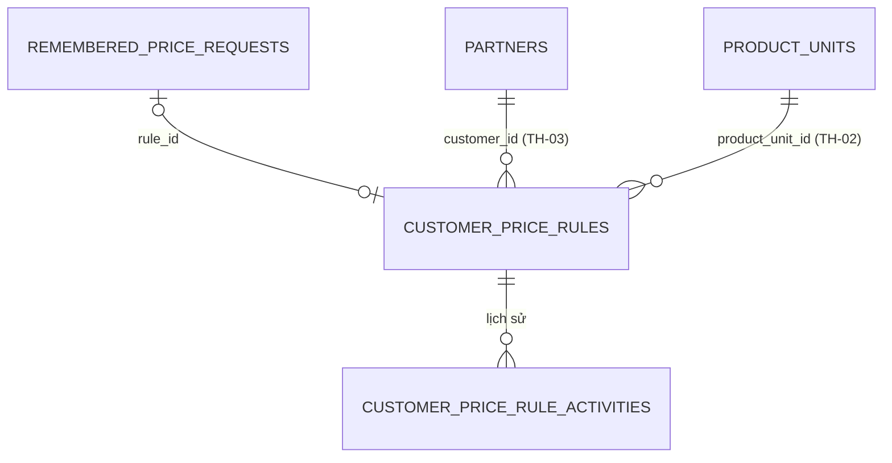

# TH-04 — Chính sách giá (giá riêng theo khách hàng)

> **Vai trò:** **đặc tả chuẩn (source of truth)** cho app sau refactor. Theme đã hoàn thành: **code hiện tại là phạm vi chuẩn**. Mọi quy tắc mặc định = hành vi code hiện tại (SCOPE: giữ 100% chức năng, giữ RPC). Gắn 🔧 = code hiện tại **sai**, phải sửa khi refactor. Làm theo tài liệu, không chép lỗi của code cũ.
> **Phiên bản:** 3.3 · **Ngày:** 2026-11-06 (3.2: 2026-11-06; 3.1: 2026-11-05; 3.0: 2026-10-07) · **Branch đối chiếu:** `refactor/simple-arch` @ `47b4cb188`
> **Bản 3.1:** bỏ nhập Excel (EP-04, PR-09, BR-25…BR-33, KI-03, kịch bản 5) và màn "Chọn cách thêm" (PR-03): nút thêm mở thẳng form. Người dùng chốt 2026-11-04 (plan 6-A1 Q9, 6-A2 Q10).
> **Bản 3.2:** đã sửa theo 6-B (KI-02, 04, 05, 07, 08, 10, 11, 13, 14; KI-15 ở 6-A): bỏ 🔧 ở các mục đó; lọc "Trạng thái" chọn một (Q3); lịch sử bỏ nhóm "Nguồn" (Q6); chữ ký RPC `search_*` / `update_*` mới; `iam._member_display_name`; "Người tắt" / "Cập nhật bởi" là tên thành viên.
> **Bản 3.3:** đã dọn module pricing và xoá phần nhập Excel, 2 RPC create/update context trong DB ở 6-C.
> **Thay thế:** bản 2.1 (2026-10-06) và `Theme 4_ Chính sách giá và ưu đãi.md` (v1). Spec v1 có 6 epic; bản này gồm **EP02 (giá riêng)** và thứ tự áp giá khi bán (một phần EP05). Phần còn lại ở [mục 8](#8-ngoài-phạm-vi-so-với-spec-v1).
> **Nguồn đối chiếu:**
> - DB: schema `pricing`, migration `20260725001`…`20260725018`, `20260805001/002`, `20260810001`, `20260830003` (áp giá khi bán).
> - App: `apps/erp/lib/features/pricing/presentation/` (9 trang, 5 cubit, 35 widget); module `modules/pricing/`; chỗ dùng ở `features/sales/`.
>
> **Cách đọc:** mục 1–3 là mô hình chung và dữ liệu; mục 4 chia theo epic → user story (bối cảnh, FR, BR, AC, EC, kịch bản Gherkin); mục 5 đặc tả từng màn hình (trạng thái, thành phần, phác thảo); mục 6 RPC và thông điệp lỗi; mục 7 phân quyền và vấn đề đã biết; mục 8 ngoài phạm vi; mục 9 kế hoạch refactor và kiểm thử.

---

## Mục lục

1. [Tổng quan](#1-tổng-quan)
2. [Mô hình nghiệp vụ](#2-mô-hình-nghiệp-vụ)
3. [Dữ liệu](#3-dữ-liệu)
4. [Epic và user story](#4-epic-và-user-story)
5. [Đặc tả màn hình](#5-đặc-tả-màn-hình)
6. [Kỹ thuật: RPC, phụ thuộc, lỗi](#6-kỹ-thuật-rpc-phụ-thuộc-lỗi)
7. [Phân quyền & vấn đề đã biết](#7-phân-quyền--vấn-đề-đã-biết)
8. [Ngoài phạm vi (so với spec v1)](#8-ngoài-phạm-vi-so-với-spec-v1)
9. [Thay đổi khi refactor & kiểm thử](#9-thay-đổi-khi-refactor--kiểm-thử)

---

## 1. Tổng quan

### 1.1 Mục đích

TH-04 quản lý **giá riêng theo khách hàng**: một mức giá cố định cho bộ ba *khách hàng × sản phẩm × đơn vị bán*, có thời gian hiệu lực. Khi bán cho khách đó, giá riêng được ưu tiên hơn giá niêm yết. Theme trả lời ba câu hỏi:

1. **Khách này mua món này giá bao nhiêu**, từ ngày nào đến ngày nào?
2. **Giá đó có an toàn không**: thấp hơn giá sàn bao nhiêu, có trùng với giá riêng khác không?
3. **Ai đặt giá, khi nào, sửa gì**?

Giá riêng đến từ 2 cửa: tạo thủ công và "Lưu làm giá riêng" ngay trên màn bán hàng (TH-05). Nhớ giá tự động từ đơn bán **ngoài phạm vi** (mục 8); RPC và cột dữ liệu giữ lại.

### 1.2 Bối cảnh nghiệp vụ

- Đại lý, trại, phòng khám mua số lượng lớn được thoả thuận giá riêng, thường theo **từng mặt hàng và đơn vị** (giá thùng khác giá chai).
- Giá thoả thuận có thời hạn (theo quý, theo hợp đồng) và đổi khá thường xuyên.
- Nhân viên bán phải thấy ngay giá riêng khi chọn khách, không phải nhớ.
- Giá riêng có thể thấp hơn giá sàn (khách chiến lược), nhưng phải có xác nhận và dấu vết.

### 1.3 Ý tưởng chủ đạo

| Khái niệm | Ý nghĩa | Trong code |
|---|---|---|
| **Bộ khoá giá riêng** | Khách hàng × sản phẩm × đơn vị bán | `customer_id`, `product_id`, `product_unit_id` |
| **Không chồng hiệu lực** | Cùng bộ khoá, tại một thời điểm tối đa 1 giá riêng đang hoạt động | Exclusion constraint `customer_price_rules_active_period_no_overlap` |
| **Ghi đè thay vì chặn** | Tạo / sửa / bật lại mà trùng hiệu lực: hỏi xác nhận, rồi **xoá mềm** giá riêng cũ bị trùng | `_auto_disable_overlapping_customer_price_rules` |
| **Trạng thái lưu ≠ trạng thái hiển thị** | DB lưu `active/disabled/needs_review/deleted`; UI hiện trạng thái suy ra theo ngày | `derived_status` |
| **Snapshot tham chiếu** | Lưu kèm tên khách, SĐT, tên sản phẩm, đơn vị, giá niêm yết, giá sàn lúc lưu | cột `*_snapshot` |
| **Tiền là số nguyên** | Lưu theo đơn vị nhỏ nhất (`*_minor`, `bigint`) kèm mã tiền tệ | `rule_price_minor`, `currency_code` |

### 1.4 Trong phạm vi

- Danh sách giá riêng: tìm kiếm bỏ dấu, lọc nhanh, bộ lọc, sắp xếp, phân trang cursor.
- Tạo giá riêng thủ công: chọn khách, sản phẩm, đơn vị bán, giá, hiệu lực, ghi chú; kiểm giá sàn và trùng hiệu lực, xác nhận ghi đè.
- Chi tiết: giá, chênh lệch so với giá niêm yết và giá sàn hiện tại, hiệu lực, nguồn, thông tin tắt, lịch sử gần đây.
- Sửa giá, hiệu lực, ghi chú (kèm lý do thay đổi).
- Tắt (có lý do), bật lại (kiểm tra trước rồi xác nhận).
- Lịch sử thay đổi của từng giá riêng, có bộ lọc và chi tiết trước / sau.
- Áp giá khi bán hàng (thứ tự ưu tiên, dùng ở TH-05).

### 1.5 Ngoài phạm vi theme

| Nội dung | Thuộc / hiện trạng |
|---|---|
| Giá cơ sở, giá niêm yết, giá sàn, khung giá cửa hàng | **TH-02** (schema `catalog`); TH-04 chỉ đọc |
| Giá trên dòng đơn, giảm giá dòng, giảm giá đơn | **TH-05** |
| Khuyến mại (EP03), ưu tiên & xung đột chính sách (EP04) | Chưa có code |
| Bảng giá theo nhóm khách, chi nhánh, kênh | Chưa có |
| Giá vốn, lợi nhuận | Theme 7 |

### 1.6 Tác nhân

| Tác nhân | Mô tả | Thao tác chính |
|---|---|---|
| Chủ cửa hàng / quản lý | Owner hoặc thành viên | Thoả thuận giá, tắt / bật |
| Nhân viên bán hàng | Thành viên | Xem giá riêng khi bán; "Lưu làm giá riêng" |
| Hệ thống (DB) | RPC, constraint, advisory lock | Chặn chồng hiệu lực, ghi đè, ghi lịch sử |
| TH-05 | Theme dùng dữ liệu | `preview_sales_working_state_pricing`, `evaluate_sales_manual_price` |

**Mọi thành viên làm được mọi thao tác pricing**, kể cả xem giá sàn và lưu dưới giá sàn sau khi xác nhận ([7.2](#72-phân-quyền)).

### 1.7 Liên hệ với các theme khác

| Theme | TH-04 nhận | TH-04 cung cấp |
|---|---|---|
| TH-02 Sản phẩm | Sản phẩm / đơn vị bán được, giá niêm yết, giá sàn, tiền tệ (`_get_product_price_band_snapshot_for_pricing`) | — |
| TH-03 Đối tác | Khách `active` có vai trò `customer`, tên, SĐT (`_get_customer_snapshot_for_pricing`) | — |
| TH-05 Bán hàng | — | Giá từng dòng theo thứ tự ưu tiên; kiểm giá nhập tay; lưu làm giá riêng |
| TH-01 IAM | Quyền, tên thành viên (lịch sử, người tắt, người cập nhật; `iam._member_display_name`) | — |

---

## 2. Mô hình nghiệp vụ
### 2.1 Khái niệm

| Khái niệm | Định nghĩa |
|---|---|
| Giá riêng | Một dòng `customer_price_rules`. Mỗi dòng có `rule_type`: `special_price` (giá riêng) hoặc `remembered_price` (nhớ giá) |
| Nguồn tạo (`source_type`) | App tạo 1 nguồn: `manual` (Tạo thủ công). `excel_import` (Nhập Excel) chỉ còn ở dữ liệu cũ (nhập Excel đã bỏ, mục 8); vẫn hiện nhãn. `sales_order` và `migration` có trong DB nhưng là dự phòng, không luồng nào tạo |
| Hiệu lực | `effective_from` (bắt buộc), `effective_to` (để trống = không giới hạn). Tính theo **ngày**, không theo giờ |
| Giá niêm yết / giá sàn | Lấy từ khung giá của TH-02, qua `catalog._get_product_price_band_snapshot_for_pricing` |
| Lô nhập Excel | Đã xoá ở 6-C (nhập Excel bỏ) |
| Yêu cầu nhớ giá | `remembered_price_requests`. Bảng dự phòng, app không dùng (mục 8) |
| Lịch sử | `customer_price_rule_activities`, lưu giá trị trước/sau dạng JSON |

### 2.2 Vòng đời

Trạng thái lưu trong DB (`status`):

```text
           disable                    (ghi đè bởi giá riêng khác)
  active ───────────▶ disabled ─────────────────────────────▶ deleted
    ▲   ◀───────────     │                                       ▲
    │     reenable       │                                       │
    └────────────────────┴──── (ghi đè) ─────────────────────────┘
  needs_review: có trong enum, hiện không có luồng nào tạo ra
```

Trạng thái hiển thị (`derived_status`) được suy ra theo thứ tự:

| Hiển thị | Điều kiện |
|---|---|
| Đã tắt | `status = disabled` |
| Cần kiểm tra | `status = needs_review`, hoặc `review_status ∈ {blocked, needs_review}`, hoặc có `blocking_codes` |
| Hết hiệu lực | `effective_to < hôm nay` |
| Chưa hiệu lực | `effective_from > hôm nay` |
| Đang áp dụng | Các trường hợp còn lại |
| Đã xoá | `status = deleted`: không hiện trong danh sách; vẫn xem được lịch sử |


### 2.3 Chênh lệch hiển thị

```text
So với giá hiện tại = giá riêng − giá niêm yết hiện tại (catalog)      → số tiền và %
So với giá sàn      = giá riêng − giá sàn hiện tại (catalog)            → âm nghĩa là dưới sàn
"Dưới giá sàn"      ⇔ giá riêng < giá sàn hiện tại
```

Chi tiết, form và danh sách đều so với **giá hiện tại** của catalog, không so với snapshot lúc lưu.

### 2.4 Thứ tự áp giá khi bán hàng (dùng ở TH-05)

`pricing.preview_sales_working_state_pricing` (quyền `pricing.sales.preview`) tính giá cho từng dòng của giỏ hàng. Thứ tự ưu tiên:

| Thứ tự | Nguồn | `source_code` | Điều kiện |
|---|---|---|---|
| 1 | Giá riêng của khách | `CUSTOMER_PRIVATE_RULE` | Khách hợp lệ (có vai trò `customer`, đang `active`), giá riêng `active`, `review_status ∈ {clear, warning}`, không có blocker, còn hiệu lực tại thời điểm bán. Nếu có nhiều giá riêng thì lấy giá có `effective_from` mới nhất |
| 2 | Giá nhập tay khi bán | `MANUAL` | Đơn giá, số tiền giảm hoặc % giảm do người bán nhập. Thấp hơn giá sàn thì **chỉ cảnh báo** `BELOW_FLOOR`. Chỉ dùng khi dòng hàng **không có giá riêng**: khách có giá riêng thì giá riêng luôn thắng, người bán không sửa giá dòng đó |
| 3 | Giá niêm yết | `LIST_PRICE` | Lấy từ khung giá (TH-02) |
| — | Không có giá | `LIST_PRICE_UNAVAILABLE` | Dòng bị chặn |

Khách không hợp lệ thì dòng bị chặn với `CUSTOMER_INVALID`. Tiền tệ của giá riêng khác đơn hàng thì bị chặn với `PRIVATE_RULE_CURRENCY_MISMATCH`.

`evaluate_sales_manual_price` (quyền `pricing.sales.manual_price.adjust`) kiểm tra giá nhập tay. Giá dưới sàn cần người bán xác nhận. Người có quyền ghi đè giá sàn mới thấy giá sàn.


### 2.5 Quy tắc nghiệp vụ tổng hợp

Số BR giữ từ bản 2.1; BR-33…35 (trước đây bỏ trống) dùng cho phần bổ sung; BR-33 bỏ 2026-11-04 cùng nhập Excel.

**Dữ liệu giá riêng**

| Mã | Quy tắc | Ở đâu |
|---|---|---|
| BR-01 | Mỗi giá riêng gắn với đúng 1 khách hàng, 1 sản phẩm và 1 đơn vị bán, trong một tổ chức | cột NOT NULL |
| BR-02 | Giá phải lớn hơn 0. Tiền tệ là mã 3 chữ in hoa và phải trùng tiền tệ của khung giá sản phẩm | CHECK, `REFERENCE_INVALID` |
| BR-03 | `effective_from` bắt buộc; `effective_to` để trống hoặc phải ≥ `effective_from` | CHECK `customer_price_rules_period_valid` |
| BR-04 | Khi tạo/sửa, khách hàng phải tồn tại, có vai trò `customer` và đang `active` (TH-03) | `partner._get_customer_snapshot_for_pricing` |
| BR-05 | Khi tạo/sửa, sản phẩm và đơn vị phải bán được và có khung giá hợp lệ (TH-02) | `catalog._get_product_price_band_snapshot_for_pricing` |
| BR-06 | Ghi chú và lý do tắt tối đa 500 ký tự. Lý do khi lưu thay đổi tối đa 200 ký tự. Lý do thay đổi được lưu vào **dòng lịch sử `updated`** (`new_value.reason`), không ghi vào ghi chú của giá riêng | CHECK, `price_rule_save_confirm_sheet`, `update_customer_price_rule` |
| BR-07 | Tạo mới có `idempotency_key`: gửi lại cùng key và cùng nội dung thì trả về kết quả cũ; cùng key mà nội dung khác thì báo `IDEMPOTENCY_CONFLICT` | `create_customer_price_rule` |
| BR-08 | Mọi thao tác sửa, tắt, bật lại, xoá đều kiểm `expected_version`; lệch thì báo `STATE_CHANGED` | các RPC ghi |

**Giá sàn**

| Mã | Quy tắc | Ở đâu |
|---|---|---|
| BR-09 | Giá riêng thấp hơn giá sàn hiện tại → phải xác nhận (`acknowledge_floor_warning`) **và** có quyền `override_floor_price`. Thiếu một trong hai thì báo `BELOW_FLOOR_BLOCKED` | create / update / reenable |
| BR-10 | Lưu được dưới giá sàn thì gắn cảnh báo `below_floor_price`, với `review_status = warning` và `price_check_status = override_allowed` | như trên |
| BR-11 | Người không có quyền `override_floor_price` không thấy giá sàn: API trả `floor_price_hidden = true`, UI hiện "Ẩn theo quyền" | `_customer_price_rule_result` |

**Trùng hiệu lực và ghi đè**

| Mã | Quy tắc | Ở đâu |
|---|---|---|
| BR-12 | DB không cho có 2 giá riêng `active` cùng bộ khoá mà khoảng hiệu lực giao nhau | exclusion constraint (`btree_gist`) |
| BR-13 | Tạo/sửa/bật lại mà giao nhau với giá riêng **đang hoạt động hoặc đã tắt** cùng bộ khoá thì báo `DUPLICATE_ACTIVE_RULE` (`reason = overwriteRequired`). App hiện "Tự động ghi đè giá trùng?" | create / update / reenable |
| BR-14 | Người dùng xác nhận ghi đè (`acknowledge_overwrite = true`) thì mọi giá riêng bị trùng chuyển thành **`deleted`**. Mỗi giá riêng bị xoá ghi một dòng lịch sử `deleted`, `reason_code = AUTO_REPLACED_BY_RULE`, kèm id của giá riêng thay thế | `_auto_disable_overlapping_customer_price_rules` |
| BR-15 | Mọi thao tác trên cùng bộ khoá bị khoá tuần tự trong transaction (advisory lock), tránh hai người tạo trùng cùng lúc | `pg_advisory_xact_lock` |

**Sửa, tắt, bật lại, xoá**

| Mã | Quy tắc | Ở đâu |
|---|---|---|
| BR-16 | Sửa được khi trạng thái là `active`, `needs_review` hoặc `disabled`. Chỉ sửa được giá, hiệu lực và ghi chú; khách hàng, sản phẩm, đơn vị chỉ đọc | `update_customer_price_rule` |
| BR-17 | Tắt được khi `active` hoặc `needs_review`. Lưu người tắt, thời điểm tắt, lý do | `disable_customer_price_rule` |
| BR-18 | Bật lại chỉ áp dụng cho `disabled`. Phải gọi kiểm tra trước (`precheck`) và nhận `precheck_token`. Hết hiệu lực thì không bật lại được (`INVALID_STATUS`); phải sửa hiệu lực trước. Dưới giá sàn thì làm như BR-09. Trùng hiệu lực thì làm như BR-13/14 | `precheck_/reenable_customer_price_rule` |
| BR-19 | Không có thao tác xoá trên app. Giá riêng chỉ bị xoá mềm qua ghi đè (BR-14). RPC `delete_customer_price_rule` giữ lại, không dùng | — |

**Danh sách và tìm kiếm**

| Mã | Quy tắc | Ở đâu |
|---|---|---|
| BR-20 | Danh sách bỏ qua giá riêng `deleted`. Server sắp xếp mặc định theo cập nhật mới nhất. Phân trang bằng cursor, mặc định 20 dòng | `search_customer_price_rules` |
| BR-21 | Tìm kiếm **bỏ dấu, không phân biệt hoa thường**, trên: tên khách, SĐT khách, tên sản phẩm, mã sản phẩm (`reference_id`), SKU; ngoài ra khớp theo chuỗi id | như trên |
| BR-22 | Lọc nhanh: Tất cả / Đang áp dụng / Dưới giá sàn. "Dưới giá sàn" so với **giá sàn hiện tại** của catalog (khung giá hiện hành; không có thì snapshot), giống màn chi tiết; mã `below_floor_price` đã lưu bị bỏ nếu không còn dưới sàn hiện tại | như trên |
| BR-23 | Bộ lọc: trạng thái hiển thị (chọn một), nguồn tạo (Tạo thủ công, Nhập Excel), cảnh báo "Dưới giá sàn", thời gian cập nhật (7 / 30 ngày). Mọi bộ lọc tính ở **server**. Không có cảnh báo "Trùng rule" / "Dữ liệu lỗi" | `search_customer_price_rules` |
| BR-24 | Sắp xếp: cập nhật mới/cũ, giá cao/thấp, tên khách A-Z/Z-A, cảnh báo trước. Sắp xếp ở **server** trên toàn danh sách (`p_sort`), phân trang keyset theo khoá sắp + `id`; tiêu đề hiện tổng số (`total_count`) | như trên |

**Nhập Excel** — BR-25 … BR-32 **bỏ** cùng EP-04 (2026-11-04, mục 8).

**Lịch sử**

| Mã | Quy tắc | Ở đâu |
|---|---|---|
| BR-36 | Loại lịch sử: `created`, `updated`, `disabled`, `reenabled`, `deleted`, `import_created`, `import_updated` (`memory_*` dự phòng). Mỗi dòng có giá trị cũ/mới dạng JSON | CHECK `activity_type` |
| BR-37 | Không có quyền xem giá sàn thì các trường giá sàn trong snapshot lịch sử bị ẩn | `_customer_price_rule_history_snapshot` |
| BR-38 | Lọc lịch sử theo loại hoạt động, nguồn, người thực hiện, thời gian (lọc ở app; lịch sử một giá riêng ngắn nên chấp nhận). Phân trang 50 dòng, tối đa 100 | `get_customer_price_rule_history`, `price_rule_history_filter_sheet` |
| BR-39 | Người thực hiện hiển thị bằng **tên thành viên** (`iam._member_display_name`: họ tên hồ sơ → tên trong metadata → email → "Không rõ"), không phải UUID. Danh sách lọc "Người thực hiện" lấy từ chính lịch sử, không có giá trị mẫu | `get_customer_price_rule_history` |

**Bổ sung (bản 3.0)**

| Mã | Quy tắc | Ở đâu |
|---|---|---|
| BR-34 | Người dùng gọi tính năng là **"Giá riêng"**; không có chữ "Nhớ giá" / "giá nhớ" ở tiêu đề menu, màn danh sách, bộ lọc (nhớ giá ngoài phạm vi) | `more_page`, `pricing_*` |
| BR-35 | Màn bán hàng (TH-05 US-01.5) "Lưu làm giá riêng": dùng `resolve_applicable_customer_price_rule` để biết khách đã có giá riêng cho đơn vị đó chưa, rồi gọi `create_/update_customer_price_rule` (nguồn `manual`), cùng quy tắc giá sàn và ghi đè ở BR-09…BR-14 | TH-05 |


---

## 3. Dữ liệu

### 3.1 Sơ đồ quan hệ



Không có khoá ngoại sang `partner` / `catalog`. Tính hợp lệ của tham chiếu được kiểm qua hàm snapshot nội bộ của từng module.

### 3.2 Bảng chính (schema `pricing`)

| Bảng | Trường chính | Ghi chú |
|---|---|---|
| `customer_price_rules` | khoá (`customer_id`, `product_id`, `product_unit_id`); `rule_price_minor`, `currency_code`; `rule_type`, `source_type`, `status`, `review_status`, `price_check_status`; `effective_from/to`; snapshot (tên khách, SĐT, tên/mã/SKU sản phẩm, tên đơn vị, giá niêm yết, giá sàn); `warning_codes`, `blocking_codes`; `disabled_*`, `deleted_at`; truy vết nguồn (`source_import_*` (không FK, dữ liệu cũ), `source_order_*`, `source_memory_request_id`, `source_sold_at`); `version`, `idempotency_key`, `payload_hash` | Bảng chính |
| `customer_price_rule_activities` | `activity_type`, `old_value`, `new_value`, `created_by`, `import_id/row_id` (không FK, dữ liệu cũ), `source_order_*` | Lịch sử |
| `customer_price_rule_imports` | — | Đã xoá ở 6-C (nhập Excel bỏ) |
| `customer_price_rule_import_rows` | — | Đã xoá ở 6-C (nhập Excel bỏ) |
| `remembered_price_requests` | id đơn và dòng đơn, khoá, `sold_price_minor`, `sold_at`, `status`, `result_type`, `reason_code`, `rule_id` | Yêu cầu nhớ giá |

Tất cả bảng bật RLS và **thu hồi toàn bộ quyền** (kể cả quyền đọc). Mọi truy cập đi qua RPC `security definer`.


### 3.3 Bất biến kiểm tra được

| # | Bất biến |
|---|---|
| I-01 | Không có 2 giá riêng `active` cùng bộ khoá có khoảng hiệu lực giao nhau |
| I-02 | `rule_price_minor > 0`; `effective_to` rỗng hoặc ≥ `effective_from` |
| I-03 | Giá riêng `deleted` do ghi đè có đúng 1 dòng lịch sử `deleted` với `reason_code = AUTO_REPLACED_BY_RULE` |
| I-04 | Giá riêng có `warning_codes ∋ below_floor_price` ⇔ lúc lưu giá < giá sàn và người lưu đã xác nhận |
| I-05 | Mỗi thao tác ghi tăng `version` và sinh đúng 1 dòng `customer_price_rule_activities` |
| I-06 | Lô nhập `completed*`: `imported_rows + skipped_rows + failed_rows = total_rows` |
| I-07 | Tại một thời điểm bán, với mỗi bộ khoá có tối đa 1 giá riêng được `preview_sales_working_state_pricing` chọn |

---

## 4. Epic và user story

### 4.1 Bản đồ

| Epic | Tên | User story | Màn |
|---|---|---|---|
| EP-01 | Danh sách & tra cứu | US-01.1 Xem danh sách; US-01.2 Tìm kiếm; US-01.3 Lọc; US-01.4 Sắp xếp | PR-01, PR-02 |
| EP-02 | Tạo & sửa giá riêng | US-02.1 Mở form thêm; US-02.2 Chọn khách, sản phẩm, đơn vị; US-02.3 Nhập giá và xem chênh lệch; US-02.4 Hiệu lực & ghi chú; US-02.5 Xác nhận dưới giá sàn; US-02.6 Ghi đè giá trùng; US-02.7 Lưu tạo mới; US-02.8 Sửa giá riêng | PR-04…PR-07 |
| EP-03 | Chi tiết & vòng đời | US-03.1 Xem chi tiết; US-03.2 Tắt; US-03.3 Bật lại | PR-08 |
| EP-04 | ~~Nhập Excel~~ (bỏ 2026-11-04) | — | — |
| EP-05 | Lịch sử | US-05.1 Xem lịch sử; US-05.2 Lọc lịch sử; US-05.3 Xem chi tiết một hoạt động | PR-10 |
| EP-06 | Áp giá khi bán (cho TH-05) | US-06.1 Tính giá dòng; US-06.2 Kiểm giá nhập tay; US-06.3 Lưu làm giá riêng từ màn bán | (TH-05 SG-02, SG-05) |

```text
Khác ▸ "Giá riêng" ─▶ Danh sách (PR-01) ──[+]──▶ Form (PR-04) ─▶ Chọn khách / sản phẩm / đơn vị (PR-05/06/07)
                          └─chạm─▶ Chi tiết (PR-08) ─┬─ Sửa (PR-04)
                                                    ├─ Tắt / Bật lại (sheet)
                                                    └─ Lịch sử (PR-10)
```

---

### 4.2 EP-01 — Danh sách & tra cứu

**Điểm vào:** tab Khác ▸ "Giá riêng — Giá riêng theo khách hàng" → `/pricing`.

#### US-01.1 — Xem danh sách giá riêng

| Là | Tôi muốn | Để |
|---|---|---|
| Chủ cửa hàng | xem mọi giá riêng đang có, trạng thái và cảnh báo | biết khách nào đang được giá gì |

**Yêu cầu chức năng**

- FR-01: Tiêu đề "Giá riêng", dòng "`<N>` giá riêng" (`<N>` = tổng số sau lọc, `total_count` của server).
- FR-02: Mỗi thẻ: khách hàng (+ SĐT), sản phẩm, "Đơn vị: `<đơn vị>`", "Giá riêng", "Giá niêm yết" (hiện tại từ catalog), "Hiệu lực: `<từ> – <đến | Không giới hạn>`", badge trạng thái (Đang áp dụng / Chưa hiệu lực / Hết hiệu lực / Đã tắt / Cần kiểm tra), nhãn "Dưới giá sàn".
- FR-03: Không hiện giá riêng `deleted`; mặc định cập nhật mới nhất trước; cursor 20 dòng.
- FR-04: Nút "Thêm giá riêng" → PR-04 (form tạo); hiện khi `available_actions` có `create_manual`. Lưu xong → mở chi tiết PR-08; quay về danh sách thì tải lại.

**Quy tắc:** BR-20.

**Tiêu chí nghiệm thu**

- AC-01: Chưa có giá riêng → "Chưa có giá riêng nào — Tạo giá riêng để bắt đầu."
- AC-02: Không có quyền → "Không có quyền truy cập — Bạn không có quyền xem danh sách giá riêng."
- AC-03: Lỗi → "Không tải được danh sách" + "Thử lại".
- AC-04: Giá riêng có `effective_from` = ngày mai hiện "Chưa hiệu lực"; `effective_to` = hôm qua hiện "Hết hiệu lực".

#### US-01.2 — Tìm kiếm

- FR-01: Ô "Tìm theo khách hàng, SĐT, sản phẩm..." (debounce).
- FR-02: Bỏ dấu, không phân biệt hoa thường; trên tên khách, SĐT khách, tên sản phẩm, mã sản phẩm, SKU; khớp cả chuỗi id.
- AC-01: "an binh" thấy giá riêng của "Đại lý An Bình".
- AC-02: Từ khoá sai định dạng → "Dữ liệu tìm kiếm không hợp lệ."

**Quy tắc:** BR-21.

#### US-01.3 — Lọc

**Yêu cầu chức năng**

- FR-01: Chip nhanh: "Tất cả", "Đang áp dụng", "Dưới giá sàn".
- FR-02: Sheet "Bộ lọc giá riêng": "Trạng thái" (chọn một: Đang áp dụng, Đã tắt, Hết hiệu lực, Cần kiểm tra); "Nguồn tạo" (Tạo thủ công, Nhập Excel); "Cảnh báo" (Dưới giá sàn); "Thời gian cập nhật" (7 / 30 ngày gần đây); "Đặt lại", "Áp dụng"; "Đang chọn `<n>` bộ lọc".
- FR-03: Không có "Từ đơn hàng", "Migration" (nguồn), "Trùng rule", "Dữ liệu lỗi" (cảnh báo), "Tùy chọn" (thời gian).
- FR-04: Mọi lọc tính ở server; "Dưới giá sàn" so với giá sàn **hiện tại** (BR-22).

**Quy tắc:** BR-22, BR-23.

**Tiêu chí nghiệm thu**

- AC-01: Giá riêng lưu lúc giá sàn 100.000, nay giá sàn tăng lên 120.000, giá riêng 110.000 → có trong lọc "Dưới giá sàn".
- AC-02: Lọc "Đã tắt" trên 60 giá riêng (3 trang) trả đủ mọi giá riêng đã tắt, không chỉ trong trang đã tải.

#### US-01.4 — Sắp xếp

- FR-01: Sheet "Sắp xếp danh sách": "Cập nhật gần nhất", "Cập nhật cũ nhất", "Giá riêng cao → thấp", "Giá riêng thấp → cao", "Tên khách hàng A-Z", "Tên khách hàng Z-A", "Cảnh báo cần xử lý trước"; nút "Áp dụng"; nhãn "Sắp xếp: `<lựa chọn>`".
- FR-02: Sắp xếp ở server trên toàn danh sách (BR-24).
- AC-01: "Giá riêng cao → thấp" với 45 giá riêng: dòng đầu trang 1 là giá cao nhất toàn bộ.

**Quy tắc:** BR-24.

---

### 4.3 EP-02 — Tạo & sửa giá riêng

**Tổng quan.** Form (PR-04) gồm 3 phần: "Thông tin áp dụng" (khách → sản phẩm → đơn vị bán), "Mức giá áp dụng", "Thời gian hiệu lực". Server kiểm lại mọi điều kiện khi lưu.

#### US-02.1 — Mở form thêm

- FR-01: Nút "Thêm giá riêng" ở PR-01 (nút nổi và nút ở trạng thái trống) mở thẳng PR-04 `/pricing/new`. Màn "Chọn cách thêm" (PR-03) **bỏ** 2026-11-04 cùng nhập Excel.
- FR-02: Nút chỉ hiện khi danh sách trả `available_actions` có `create_manual`.
- AC-01: Lưu thành công → mở chi tiết giá riêng vừa tạo; quay về danh sách thì danh sách tải lại.

#### US-02.2 — Chọn khách, sản phẩm, đơn vị bán

| Là | Tôi muốn | Để |
|---|---|---|
| Chủ cửa hàng | chọn đúng khách, sản phẩm, đơn vị | giá riêng gắn đúng bộ khoá |

**Yêu cầu chức năng**

- FR-01: "Khách hàng" ("Tìm và chọn khách hàng...") → PR-05 "Chọn khách hàng": tìm "Tìm tên hoặc số điện thoại khách hàng..."; chỉ khách `active` có vai trò `customer`; mỗi dòng có nhãn vai trò.
- FR-02: "Sản phẩm" ("Tìm và chọn sản phẩm...") → PR-06 "Chọn sản phẩm": "Tìm tên sản phẩm..."; mỗi dòng "Đơn vị cơ bản: …", "Giá hiện tại: …đ".
- FR-03: "Đơn vị bán" ("Chọn đơn vị bán..."; chưa chọn sản phẩm → "Chọn sản phẩm trước") → PR-07 "Chọn đơn vị bán": mỗi đơn vị "Giá hiện tại: … • Giá sàn: …", nhãn "Đơn vị cơ bản".
- FR-04: Đổi sản phẩm → xoá đơn vị đã chọn.
- FR-05: Khi **sửa**, ba ô này chỉ đọc (BR-16), hiện ở đầu form kèm "Cập nhật gần nhất — Cập nhật bởi: `<tên thành viên>`" (BR-39).

**Quy tắc:** BR-01, BR-04, BR-05.

**Tiêu chí nghiệm thu**

- AC-01: Khách ngừng hoạt động / không có vai trò khách không có trong PR-05; gọi thẳng RPC → `REFERENCE_INVALID`.
- AC-02: Sản phẩm chưa có đơn vị bán → PR-07 "Chưa có đơn vị bán — Sản phẩm này chưa được cấu hình đơn vị bán."
- AC-03: Không tìm thấy → "Không tìm thấy khách hàng / sản phẩm — Thử từ khóa khác hoặc kiểm tra chính tả."

#### US-02.3 — Nhập giá và xem chênh lệch

- FR-01: Ô "Giá riêng cho khách" (hậu tố "đ"), giới hạn "Giá nhập tối đa …đ".
- FR-02: Khi đã chọn đủ bộ khoá: "Giá hiện tại", "Giá sàn", "So với giá hiện tại", "So với giá sàn" (2.3).
- FR-03: Giá < giá sàn → banner "Giá riêng thấp hơn giá sàn — Bạn vẫn có thể lưu nếu có quyền ghi đè giá sàn."
- FR-04: Không có quyền xem giá sàn → "Ẩn theo quyền" (BR-11; theo 7.2 hiện mọi thành viên đều có quyền).
- AC-01: Giá ≤ 0 → không lưu được ("Thông tin nhập không hợp lệ.").

**Quy tắc:** BR-02, BR-09…BR-11.

#### US-02.4 — Hiệu lực & ghi chú

- FR-01: "Từ ngày" (bắt buộc, mặc định hôm nay); "Đến ngày": "Không giới hạn" hoặc "Chọn ngày cụ thể".
- FR-02: "Ghi chú" tối đa 500 ký tự.
- FR-03: Bộ khoá + khoảng hiệu lực trùng giá riêng khác → banner "Lưu ý tự động ghi đè giá trùng — Khoảng thời gian hiệu lực mới bị trùng với giá riêng đang áp dụng khác. Khi lưu, hệ thống sẽ tự động ghi đè giá riêng cũ." kèm "Xem giá riêng hiện có >" (chỉ khi server trả `conflictingRuleId`, mở chi tiết giá riêng đó). Banner hiện cả ở form tạo sau lỗi trùng.
- FR-04: Banner trùng không có câu "…Không thể lưu rule mới…" (mâu thuẫn với ghi đè).
- AC-01: Đến ngày < từ ngày → không lưu được.

**Quy tắc:** BR-03, BR-12, BR-13.

#### US-02.5 — Xác nhận dưới giá sàn

- FR-01: Lưu giá < giá sàn mà chưa xác nhận → server `BELOW_FLOOR_BLOCKED` (`acknowledgementRequired`) → app hỏi xác nhận, gửi lại với `acknowledge_floor_warning = true`.
- FR-02: Lưu thành công → giá riêng có cảnh báo `below_floor_price`, `review_status = warning`.
- AC-01: Thiếu quyền `override_floor_price` → `BELOW_FLOOR_BLOCKED` (`overridePermissionRequired`) → "Giá nhập thấp hơn giá sàn quy định."
- AC-02: Giá riêng dưới sàn đã xác nhận vẫn được áp khi bán.

**Quy tắc:** BR-09, BR-10.

#### US-02.6 — Ghi đè giá trùng

**Bối cảnh.** Đổi giá thoả thuận thường là "từ ngày X giá mới". Thay vì bắt người dùng tự tắt giá cũ, hệ thống ghi đè có xác nhận.

**Yêu cầu chức năng**

- FR-01: Server trả `DUPLICATE_ACTIVE_RULE` (`reason = overwriteRequired`) → hộp "Tự động ghi đè giá trùng? — Tạo giá riêng này sẽ tự động ghi đè giá riêng đang áp dụng trùng khoảng thời gian (nếu có). Bạn có chắc muốn tự động ghi đè giá riêng này?" ("Hủy" / "Ghi đè & Lưu").
- FR-02: "Ghi đè & Lưu" gửi lại với `acknowledge_overwrite = true` → mọi giá riêng trùng (đang hoạt động **hoặc đã tắt**) chuyển `deleted`, ghi lịch sử `deleted` với `AUTO_REPLACED_BY_RULE`.
- FR-03: Hai người cùng lưu một bộ khoá → khoá tuần tự (advisory lock); người sau thấy trùng và phải xác nhận ghi đè.

**Quy tắc:** BR-12…BR-15.

**Tiêu chí nghiệm thu**

- AC-01: Giá riêng A (01/01–không giới hạn), tạo B (01/07–không giới hạn) + ghi đè → A `deleted`, B `active`.
- AC-02: A đã tắt nhưng trùng hiệu lực với B → vẫn bị xoá khi ghi đè (BR-14, KI-06).
- AC-03: Lịch sử của A có "Xóa giá riêng" với id của B.

**Kịch bản**

```gherkin
Feature: Ghi đè giá riêng trùng

Scenario: SC-01 — Giá mới từ giữa năm
  Given khách "Đại lý An Bình" có giá riêng "Amoxicillin – hộp" 100.000 từ 01/01/2026, không giới hạn
  When tôi tạo giá riêng cùng khách, sản phẩm, đơn vị giá 95.000 từ 01/07/2026
  Then tôi thấy "Tự động ghi đè giá trùng?"
  When tôi bấm "Ghi đè & Lưu"
  Then giá riêng 95.000 "Đang áp dụng" hoặc "Chưa hiệu lực"
  And giá riêng 100.000 không còn trong danh sách
  And lịch sử giá riêng 100.000 có "Xóa giá riêng"
```

#### US-02.7 — Lưu tạo mới

- FR-01: "Lưu" ("Đang lưu...") → `create_customer_price_rule` kèm `idempotency_key`.
- FR-02: Thành công → "Đã tạo giá riêng thành công", mở chi tiết.
- FR-03: Rời form khi có thay đổi → "Rời khỏi màn hình? — Những thay đổi chưa lưu sẽ bị mất." ("Ở lại chỉnh sửa" / "Rời khỏi").
- FR-04: Lỗi: `REFERENCE_INVALID` → "Khách hàng hoặc sản phẩm không hợp lệ."; `NO_PERMISSION` → "Bạn không có quyền thực hiện."; khác → "Không thể lưu giá riêng. Vui lòng thử lại."; không hiện "Lỗi: `<mã>`" thô.

**Quy tắc:** BR-07.

**Tiêu chí nghiệm thu**

- AC-01: Gửi lại cùng khoá, cùng nội dung → trả giá riêng đã tạo; khác nội dung → `IDEMPOTENCY_CONFLICT`.
- AC-02: Không có quyền tạo → màn "Bạn không có quyền tạo giá riêng — Liên hệ quản trị viên nếu bạn cần quyền tạo giá riêng."

#### US-02.8 — Sửa giá riêng

**Yêu cầu chức năng**

- FR-01: "Sửa giá riêng" (PR-04 chế độ sửa): chỉ giá, hiệu lực, ghi chú.
- FR-02: "Lưu" → sheet "Lưu thay đổi? — Bạn có chắc muốn cập nhật giá riêng này?" tóm tắt "Giá riêng:", "Từ ngày:", "Đến ngày:"; "Lý do thay đổi (không bắt buộc)" ("Nhập lý do thay đổi..."); nếu trùng: "Lưu ý tự động ghi đè — Cập nhật thời gian hiệu lực này sẽ tự động ghi đè giá riêng đang áp dụng trùng khoảng thời gian (nếu có)."; "Hủy" / "Lưu thay đổi".
- FR-03: → `update_customer_price_rule(p_expected_version, …, p_reason)`; lý do lưu vào lịch sử `updated`, **không** ghi đè ghi chú (BR-06).
- FR-04: `STATE_CHANGED` → banner "Dữ liệu đã thay đổi — Giá riêng này vừa được cập nhật bởi người khác. Tải lại để xem phiên bản mới nhất." + "Tải lại".
- FR-05: Thành công → "Đã cập nhật giá riêng".

**Quy tắc:** BR-06, BR-08, BR-16.

**Tiêu chí nghiệm thu**

- AC-01: Sửa được giá riêng `disabled` (vẫn giữ `disabled`).
- AC-02: Nhập lý do "Theo hợp đồng Q3" → ghi chú giữ nguyên; lịch sử `updated` có "Lý do: Theo hợp đồng Q3".

---

### 4.4 EP-03 — Chi tiết & vòng đời

#### US-03.1 — Xem chi tiết

**Yêu cầu chức năng**

- FR-01: PR-08 "Chi tiết giá riêng": header badge trạng thái, khách hàng, SĐT, sản phẩm, đơn vị bán.
- FR-02: "Thông tin giá": "Giá riêng", "Giá niêm yết", "Giá sàn" (hoặc "Ẩn theo quyền"), "Chênh lệch"; dưới sàn → banner "Giá riêng đang thấp hơn giá sàn hiện tại".
- FR-03: "Hiệu lực & nguồn": "Từ ngày", "Đến ngày" ("Không giới hạn"), "Nguồn tạo" (Tạo thủ công / Nhập Excel; dữ liệu nguồn `migration` hiện "Hệ thống").
- FR-04: "Thông tin tắt" (khi đã tắt): banner "Giá riêng đã tắt — Không áp dụng cho đơn hàng mới.", "Người tắt" (tên thành viên, BR-39; không có → "—"), "Thời gian", "Lý do" ("Không có").
- FR-05: "Lịch sử gần đây" (vài mục) + "Xem tất cả lịch sử".
- FR-06: Nút "Thao tác" → sheet theo `available_actions`: "Sửa giá riêng", "Tắt giá riêng", "Bật lại giá riêng", "Lịch sử áp dụng & thay đổi"; không có → "Không có thao tác khả dụng".

**Tiêu chí nghiệm thu**

- AC-01: Không tồn tại / đã xoá → "Không tìm thấy — Mức giá riêng này không tồn tại hoặc đã bị xóa."
- AC-02: Không có quyền → "Không có quyền truy cập — Bạn không có quyền xem mức giá riêng này."
- AC-03: Giá niêm yết, giá sàn là giá **hiện tại** của catalog.

#### US-03.2 — Tắt giá riêng

- FR-01: Sheet "Tắt giá riêng? — Giá riêng sẽ không còn áp dụng cho đơn hàng mới. Lịch sử vẫn được giữ lại."; "Lý do tắt (không bắt buộc)" (≤ 500 ký tự); "Giữ giá riêng" / "Tắt giá riêng" ("Đang tắt...").
- FR-02: → `disable_customer_price_rule(p_expected_version, p_reason)`; "Đã tắt giá riêng".
- FR-03: Lỗi → "Không thể tắt giá riêng — Vui lòng thử lại sau."
- AC-01: Tắt được khi `active` hoặc `needs_review`; đơn mới dùng giá niêm yết.

**Quy tắc:** BR-17.

#### US-03.3 — Bật lại giá riêng

**Yêu cầu chức năng**

- FR-01: "Bật lại giá riêng" → `precheck_customer_price_rule_reenable` → nhận `precheck_token`.
- FR-02: Sheet "Bật lại giá riêng? — Giá riêng sẽ được áp dụng lại nếu còn trong thời gian hiệu lực." hiện "Hiệu lực từ", "Đến ngày"; dưới sàn: "Giá dưới giá sàn — Giá riêng thấp hơn giá sàn hiện tại. Bạn cần xác nhận trước khi bật lại." + ô "Tôi xác nhận bật lại giá dưới giá sàn"; "Lưu ý — Bật lại giá riêng này sẽ tự động ghi đè (xoá) giá riêng trùng (nếu có)." (BR-14).
- FR-03: "Giữ đã tắt" / "Bật lại giá riêng" ("Đang bật lại...") → `reenable_customer_price_rule`; "Bật lại giá riêng thành công".
- FR-04: Không đủ điều kiện → "Không thể bật lại" + lý do:

| Lý do | Thông điệp |
|---|---|
| Hết hiệu lực | "Giá riêng đã hết hiệu lực, không thể bật lại." |
| Khách không còn hợp lệ | "Khách hàng không còn hợp lệ để bật lại giá riêng." |
| Sản phẩm / đơn vị không hợp lệ | "Sản phẩm hoặc đơn vị bán không còn hợp lệ." |
| Tiền tệ khác | "Đơn vị tiền tệ không khớp với sản phẩm hiện tại." |
| Dưới sàn, thiếu quyền | "Giá riêng dưới giá sàn và bạn không có quyền ghi đè." |
| Lỗi kiểm tra | "Không thể kiểm tra điều kiện bật lại. Vui lòng thử lại." |

**Quy tắc:** BR-18.

**Tiêu chí nghiệm thu**

- AC-01: Hết hiệu lực → không bật được; sửa "Đến ngày" rồi bật lại được.
- AC-02: Dưới sàn, chưa tích xác nhận → nút bật lại bị khoá.

**Kịch bản**

```gherkin
Feature: Bật lại giá riêng

Scenario: SC-01 — Bật lại giá dưới sàn
  Given giá riêng "Vitamin ADE – chai" 50.000 đã tắt, giá sàn hiện tại 55.000
  When tôi chọn "Bật lại giá riêng"
  Then tôi thấy "Giá dưới giá sàn"
  When tôi tích "Tôi xác nhận bật lại giá dưới giá sàn" và bấm "Bật lại giá riêng"
  Then tôi thấy "Bật lại giá riêng thành công"
```

---

### 4.5 EP-04 — Nhập Excel (bỏ)

**Bỏ 2026-11-04** (người dùng chốt, plan 6-A1 Q9): US-04.1 … US-04.6 không làm. Giá riêng chỉ tạo từ form (EP-02) và "Lưu làm giá riêng" ở màn bán (US-06.3). Giá riêng cũ có nguồn `excel_import` vẫn hiện nhãn "Nhập Excel". Xem mục 8.

### 4.6 EP-05 — Lịch sử

#### US-05.1 — Xem lịch sử

- FR-01: PR-10 "Lịch sử giá riêng": timeline; "Mới nhất trước" / "Cũ nhất trước"; "`<n>` kết quả"; ô "Tìm theo hành động, người thực hiện...".
- FR-02: Mỗi mục: loại ("Tạo giá riêng", "Sửa giá riêng", "Tắt giá riêng", "Bật lại giá riêng", "Xóa giá riêng", "Tạo từ nhập Excel", "Cập nhật từ nhập Excel"), người thực hiện, thời gian, "Giá đổi từ `<cũ>` → `<mới>`" / "Giá áp dụng: …", "Lý do: …".
- FR-03: Người thực hiện là **tên thành viên** (BR-39).
- FR-04: Rỗng → "Chưa có lịch sử thay đổi — Giá riêng này chưa phát sinh hoạt động nào."; không quyền → "Bạn không có quyền xem lịch sử giá riêng".

**Quy tắc:** BR-36, BR-37, BR-39.

#### US-05.2 — Lọc lịch sử

- FR-01: "Bộ lọc lịch sử giá riêng": "Loại hoạt động" (Tất cả, Tạo giá riêng, Sửa giá, Tắt, Bật lại), "Người thực hiện", "Thời gian" (Tất cả, 7 / 30 / 90 ngày gần đây); "Đặt lại", "Áp dụng". Không có nhóm "Nguồn" (nhãn nguồn của dữ liệu cũ vẫn hiện ở từng mục). Lọc nhanh: "Tất cả", "Sửa giá".
- FR-02: "Người thực hiện" lấy từ chính lịch sử, không có giá trị mẫu.
- FR-03: Lọc ở app (BR-38).
- AC-01: Không có kết quả → "Không tìm thấy lịch sử phù hợp — Thử điều chỉnh bộ lọc hoặc xóa bớt điều kiện lọc." + "Đặt lại bộ lọc".

#### US-05.3 — Chi tiết một hoạt động

- FR-01: Sheet "Chi tiết hoạt động": loại, "Nguồn: …", "So sánh trước / sau" (Trường | Trước | Sau: Giá riêng, Ngày bắt đầu, Ngày kết thúc, Chênh lệch giá sàn…), "Ghi chú / lý do" ("Không có ghi chú"), "Xem chi tiết giá riêng >".
- FR-02: Trường giá sàn ẩn theo quyền → "Ẩn theo quyền 🔒", ghi "Quyền hạn chế — Bạn không có quyền xem một số dữ liệu nhạy cảm."
- FR-03: Không có khối "Chứng từ nguồn" / dòng "Đơn #…" (nhớ giá ngoài phạm vi).

---

### 4.7 EP-06 — Áp giá khi bán (cho TH-05)

#### US-06.1 — Tính giá dòng

- FR-01: `preview_sales_working_state_pricing` tính giá mỗi dòng theo thứ tự 2.4; trả `source_code`.
- FR-02: Màn bán hiện nhãn "★ Giá riêng" cho dòng `CUSTOMER_PRIVATE_RULE` (TH-05 SG-02).
- AC-01: Giá riêng `review_status = warning` (dưới sàn đã xác nhận) được áp.
- AC-02: Giá riêng `disabled`, hết hiệu lực hoặc chưa hiệu lực → dùng giá niêm yết.
- AC-03: Đổi khách trên đơn → giá dòng tính lại.

**Kịch bản**

```gherkin
Feature: Áp giá riêng khi bán

Scenario: SC-01 — Khách có giá riêng
  Given khách A có giá riêng "Amoxicillin – hộp" 95.000 đang áp dụng; giá niêm yết 110.000
  When tôi bán 2 hộp Amoxicillin cho khách A
  Then đơn giá dòng là 95.000 với nhãn "Giá riêng"

Scenario: SC-02 — Giá riêng dưới sàn đã xác nhận
  Given khách A có giá riêng 80.000 (giá sàn 90.000) đã lưu có xác nhận
  When tôi bán cho khách A
  Then đơn giá dòng là 80.000
```

#### US-06.2 — Kiểm giá nhập tay

- FR-01: `evaluate_sales_manual_price` (quyền `pricing.sales.manual_price.adjust`) kiểm đơn giá / giảm tiền / giảm % nhập tay; dưới sàn → cảnh báo `BELOW_FLOOR`, người bán xác nhận.
- FR-02: Dòng đang dùng giá riêng: giá nhập tay **bị server bỏ qua**, giá riêng vẫn thắng (KI-09). Muốn đổi giá cho khách này thì bật "Lưu làm giá riêng" (US-06.3): giá riêng được cập nhật rồi áp lại.

#### US-06.3 — Lưu làm giá riêng từ màn bán

- FR-01: Theo BR-35 và TH-05 US-01.5: sau khi nhập giá thoả thuận cho khách có hồ sơ, người bán bấm "Lưu làm giá riêng" → tạo (hoặc cập nhật) giá riêng nguồn `manual`, hiệu lực từ hôm nay.
- AC-01: Áp dụng đủ quy tắc giá sàn (BR-09) và ghi đè (BR-13/14).
- AC-02: Khách lẻ không có lựa chọn này.

---

## 5. Đặc tả màn hình

### 5.1 Danh sách màn hình

| Mã | Màn | Route | Trang (hiện tại) |
|---|---|---|---|
| PR-01 | Danh sách giá riêng | `/pricing` | `pricing_list_page` |
| PR-02 | Bộ lọc / Sắp xếp | (sheet) | `price_rule_filter_bottom_sheet`, `price_rule_sort_bottom_sheet` |
| ~~PR-03~~ | ~~Chọn cách thêm~~ (bỏ 2026-11-04) | — | — |
| PR-04 | Tạo / sửa giá riêng | `/pricing/new`, `/pricing/:ruleId/edit` | `pricing_form_page` |
| PR-05 | Chọn khách hàng | `/pricing/pick-customer` | `pricing_pick_customer_page` |
| PR-06 | Chọn sản phẩm | `/pricing/pick-product` | `pricing_pick_product_page` |
| PR-07 | Chọn đơn vị bán | `/pricing/pick-unit/:productId` | `pricing_pick_unit_page` |
| PR-08 | Chi tiết giá riêng | `/pricing/:ruleId` | `pricing_detail_page` |
| ~~PR-09~~ | ~~Nhập Excel~~ (bỏ 2026-11-04) | — | — |
| PR-10 | Lịch sử giá riêng | `/pricing/:ruleId/history` | `pricing_history_page` |

Quy ước chung: thành công → toast "Thành công" + nội dung; lỗi → toast "Lỗi" + thông điệp ở 6.4.

### 5.2 PR-01 — Danh sách giá riêng

| Trạng thái | Khi nào | Nội dung |
|---|---|---|
| L-01 Đang tải | lần đầu | skeleton |
| L-02 Có dữ liệu | — | danh sách |
| L-03 Trống | chưa có giá riêng | "Chưa có giá riêng nào" + "Thêm giá riêng" |
| L-04 Không kết quả | tìm / lọc | thông báo trống theo bộ lọc |
| L-05 Lỗi | — | "Không tải được danh sách" + "Thử lại" |
| L-06 Không quyền | thiếu `view` | "Không có quyền truy cập" |

| ID | Thành phần | Nội dung | Hành vi |
|---|---|---|---|
| PR01-E01 | App bar | "Giá riêng"; "`<N>` giá riêng" (tổng số) | — |
| PR01-E02 | Ô tìm | "Tìm theo khách hàng, SĐT, sản phẩm..." | US-01.2 |
| PR01-E03 | Chip | Tất cả · Đang áp dụng · Dưới giá sàn | US-01.3 |
| PR01-E04 | Bộ lọc, sắp xếp | nút; "Sắp xếp: …" | PR-02 |
| PR01-E05 | Thẻ | khách, SĐT, sản phẩm, đơn vị, giá riêng, giá niêm yết, hiệu lực, badge, "Dưới giá sàn" | → PR-08 |
| PR01-E06 | Nút thêm | "Thêm giá riêng" | → PR-04 |

```text
┌──────────────────────────────────┐
│ ←  Giá riêng                 [+] │
│ 24 giá riêng                     │
│ 🔎 Tìm theo khách hàng, SĐT, sả… [⚲]│
│ [Tất cả][Đang áp dụng][Dưới giá sàn]│
│ Sắp xếp: Cập nhật gần nhất     ⇅ │
├──────────────────────────────────┤
│ Đại lý An Bình · 0912 345 678    │
│ Amoxicillin 500mg                │
│ Đơn vị: hộp      [Đang áp dụng]  │
│ Giá riêng 95.000 · Niêm yết 110.000│
│ Hiệu lực: 01/07/2026 – Không giới hạn│
│ ──────────────────────────────── │
│ Trại Hoà Phát · 0988 111 222     │
│ Vitamin ADE 100ml  [Dưới giá sàn]│
│ Đơn vị: chai        [Đã tắt]     │
│ Giá riêng 50.000 · Niêm yết 70.000│
└──────────────────────────────────┘
```

### 5.3 PR-04 … PR-07 — Thêm và form

| Trạng thái (PR-04) | Khi nào | Nội dung |
|---|---|---|
| F-01 Đang tải | mở form sửa | skeleton (`get_customer_price_rule_detail`) |
| F-02 Đang nhập | — | 3 phần |
| F-03 Dưới giá sàn | giá < sàn | banner "Giá riêng thấp hơn giá sàn" |
| F-04 Trùng hiệu lực | bộ khoá trùng | banner "Lưu ý tự động ghi đè giá trùng" |
| F-05 Xác nhận ghi đè | `DUPLICATE_ACTIVE_RULE` | hộp "Tự động ghi đè giá trùng?" |
| F-06 Xác nhận lưu (sửa) | bấm Lưu khi sửa | sheet "Lưu thay đổi?" |
| F-07 Dữ liệu đã thay đổi | `STATE_CHANGED` | banner + "Tải lại" |
| F-08 Không quyền | thiếu `create` / `update` | màn chặn + "Đóng" |

```text
┌──────────────────────────────────┐
│ ←  Tạo giá riêng          [Lưu]  │
├──────────────────────────────────┤
│ THÔNG TIN ÁP DỤNG                │
│ Khách hàng  [Đại lý An Bình    ▸]│
│ Sản phẩm    [Amoxicillin 500mg ▸]│
│ Đơn vị bán  [hộp               ▸]│
│ MỨC GIÁ ÁP DỤNG                  │
│ Giá riêng cho khách [  95.000 ] đ│
│ Giá hiện tại      110.000 đ      │
│ Giá sàn            90.000 đ      │
│ So với giá hiện tại  −15.000 (−13,6%)│
│ So với giá sàn       +5.000      │
│ THỜI GIAN HIỆU LỰC               │
│ Từ ngày   [07/10/2026]           │
│ Đến ngày  (●) Không giới hạn     │
│           ( ) Chọn ngày cụ thể   │
│ Ghi chú   [Theo hợp đồng Q4    ] │
│ ⚠ Lưu ý tự động ghi đè giá trùng │
│   Xem giá riêng hiện có >        │
└──────────────────────────────────┘
```

| Màn | Thành phần | Trạng thái riêng |
|---|---|---|
| PR-05 | ô tìm, danh sách khách (tên, SĐT, nhãn vai trò), "Chọn" | "Không tìm thấy khách hàng"; "Không tải được danh sách khách hàng." |
| PR-06 | ô tìm, danh sách (tên, "Đơn vị cơ bản", "Giá hiện tại") | "Không tìm thấy sản phẩm" |
| PR-07 | danh sách đơn vị ("Giá hiện tại • Giá sàn", nhãn "Đơn vị cơ bản") | "Chưa có đơn vị bán" |

### 5.4 PR-08 — Chi tiết giá riêng

| Trạng thái | Khi nào | Nội dung |
|---|---|---|
| D-01 Đang tải | — | skeleton |
| D-02 Đang áp dụng / Chưa / Hết hiệu lực | theo ngày | badge |
| D-03 Dưới giá sàn | giá < sàn hiện tại | banner |
| D-04 Đã tắt | `disabled` | banner "Giá riêng đã tắt" + "Thông tin tắt" |
| D-05 Không tìm thấy | `NOT_FOUND` | "Không tìm thấy" |
| D-06 Không quyền | — | "Không có quyền truy cập" |

```text
┌──────────────────────────────────┐
│ ←  Chi tiết giá riêng            │
├──────────────────────────────────┤
│ [Đang áp dụng]                   │
│ Đại lý An Bình · 0912 345 678    │
│ Amoxicillin 500mg · hộp          │
│ THÔNG TIN GIÁ                    │
│ Giá riêng            95.000 đ    │
│ Giá niêm yết        110.000 đ    │
│ Giá sàn              90.000 đ    │
│ Chênh lệch   −15.000 so với niêm yết│
│ HIỆU LỰC & NGUỒN                 │
│ Từ ngày     01/07/2026           │
│ Đến ngày    Không giới hạn       │
│ Nguồn tạo   Tạo thủ công         │
│ LỊCH SỬ GẦN ĐÂY                  │
│ Sửa giá riêng · 05/10 · Lan      │
│ Giá đổi từ 100.000 → 95.000      │
│ Xem tất cả lịch sử             › │
├──────────────────────────────────┤
│ [           Thao tác           ] │
└──────────────────────────────────┘
```

### 5.5 PR-09 — Nhập Excel (bỏ)

**Bỏ 2026-11-04** (người dùng chốt, plan 6-A1 Q9): không còn màn, route `/pricing/import` và mọi widget nhập. Xem mục 8.

### 5.6 PR-10 — Lịch sử giá riêng

```text
┌──────────────────────────────────┐
│ ←  Lịch sử giá riêng          [⚲]│
│ 🔎 Tìm theo hành động, người th… │
│ 3 kết quả        Mới nhất trước ▾│
├──────────────────────────────────┤
│ ● Sửa giá riêng                  │
│   Lan · 05/10/2026 10:21         │
│   Giá đổi từ 100.000 → 95.000    │
│   Lý do: Theo hợp đồng Q4        │
│ ● Tạo từ nhập Excel              │
│   Minh · 01/07/2026 08:00        │
│   Giá áp dụng: 100.000           │
└──────────────────────────────────┘
```

Rỗng: "Chưa có lịch sử thay đổi"; lọc không ra: "Không tìm thấy lịch sử phù hợp" + "Đặt lại bộ lọc"; lỗi: "Không tải được lịch sử" + "Thử lại".

### 5.7 Khả năng tiếp cận và đáp ứng

- Badge trạng thái và cảnh báo có chữ, không chỉ màu.
- Ô giá mở bàn phím số, hiện phân cách hàng nghìn.
- Hai thiết bị đều là thiết bị chính ([LUONG-UNG-DUNG 1.1](LUONG-UNG-DUNG.md), sửa 2026-10-22): mỗi màn có bố cục iPhone và bố cục web thiết kế đủ như nhau — web không phải cột iPhone đặt giữa hay kéo giãn. Web dùng bố cục chung: danh sách – chi tiết hai cột, bảng khi nhiều cột số, sheet thành hộp thoại, đi được bằng bàn phím; bố cục từng màn chốt trong plan của theme.

---

## 6. Kỹ thuật: RPC, phụ thuộc, lỗi

### 6.1 Đường đi hiện tại

```text
Page ─▶ Cubit ─▶ CustomerPriceRuleRepository / SalesPricingRepository ─▶ SupabaseRpc ─▶ schema('pricing').rpc(...)
```

### 6.2 Danh mục RPC (schema `pricing`)

| Nhóm | RPC | Quyền | Ghi / đọc |
|---|---|---|---|
| Danh sách | `search_customer_price_rules(…, p_cursor, p_limit, p_sort, p_updated_within_days)` (12 tham số) | `customer_price_rule.view` (+ `create`, `import` để tính thao tác) | đọc, keyset theo `p_sort`, trả `total_count` |
| Tạo | `get_customer_price_rule_create_context` | `view`, `create` | đã xoá ở 6-C (server tự kiểm khi tạo / sửa) |
| | `create_customer_price_rule` | `create` (+ `override_floor_price` khi dưới sàn) | ghi, idempotent |
| Chi tiết | `get_customer_price_rule_detail` | `view` | đọc, kèm `available_actions`, `updated_by_name`, `disabled_by_name` |
| Sửa | `get_customer_price_rule_update_context` | `view`, `update` | đã xoá ở 6-C (server tự kiểm khi tạo / sửa) |
| | `update_customer_price_rule(…, p_acknowledge_overwrite, p_reason)` (10 tham số) | `update` (+ `override_floor_price`) | ghi, version; `p_reason` ≤ 200 vào lịch sử |
| Tắt / bật | `disable_customer_price_rule` | `disable` | ghi, version |
| | `precheck_customer_price_rule_reenable`, `reenable_customer_price_rule` | `reenable` | đọc / ghi, token + version |
| ~~Nhập~~ | `create_/get_/confirm_/cancel_customer_price_rule_import` | — | đã xoá ở 6-C |
| Lịch sử | `get_customer_price_rule_history` | `view_history` | đọc, 50 dòng (tối đa 100) |
| Bán hàng | `preview_sales_working_state_pricing` | `pricing.sales.preview` | đọc |
| | `evaluate_sales_manual_price` | `pricing.sales.manual_price.adjust` | đọc |
| | `resolve_applicable_customer_price_rule` | `view` | đọc |
| Không dùng | `delete_customer_price_rule` (`delete`), `save_remembered_price_from_order` (`save_memory`) | — | giữ trong DB |

### 6.3 Phụ thuộc

| Hàm | Theme | Mục đích |
|---|---|---|
| `partner._get_customer_snapshot_for_pricing` | TH-03 | Khách tồn tại, vai trò `customer`, `active`; tên, SĐT |
| `catalog._get_product_price_band_snapshot_for_pricing` | TH-02 | Sản phẩm / đơn vị bán được; giá niêm yết, giá sàn, tiền tệ |
| `catalog._resolve_product_unit_for_pricing_import` | TH-02 | đã xoá ở 6-C |
| `iam._member_display_name` | TH-01 | Tên thành viên: lịch sử, người tắt, người cập nhật (`20261105001`) |

### 6.4 Mã lỗi và thông điệp app

Lỗi trả JSON `{code, message, details}`.

| Mã | Khi nào | Thông điệp |
|---|---|---|
| `NO_PERMISSION` | thiếu quyền | "Bạn không có quyền thực hiện." / "Bạn không có quyền thực hiện thao tác này." |
| `VALIDATION_ERROR` | dữ liệu sai; chưa tích cảnh báo của lô | "Thông tin nhập không hợp lệ." |
| `REFERENCE_INVALID` | khách / sản phẩm / đơn vị không hợp lệ | "Khách hàng hoặc sản phẩm không hợp lệ." |
| `BELOW_FLOOR_BLOCKED` | dưới sàn chưa xác nhận / thiếu quyền | hỏi xác nhận / "Giá nhập thấp hơn giá sàn quy định." |
| `DUPLICATE_ACTIVE_RULE` | trùng hiệu lực | mở hộp ghi đè; trường hợp còn lại "Đã có giá riêng khác đang áp dụng cho cùng khách hàng và sản phẩm." |
| `STATE_CHANGED` | version lệch | "Dữ liệu đã thay đổi. Vui lòng tải lại." |
| `INVALID_STATUS` | trạng thái không cho phép | "Không thể thực hiện với trạng thái hiện tại." (bật lại khi hết hiệu lực: "Giá riêng đã hết hiệu lực, không thể bật lại.") |
| `NOT_FOUND` | không tìm thấy | "Mức giá riêng không còn tồn tại." |
| `IDEMPOTENCY_CONFLICT` | cùng key khác nội dung | "Không thể lưu giá riêng. Vui lòng thử lại." |
| `SYSTEM_ERROR` | lỗi toàn vẹn | "Đã xảy ra lỗi. Vui lòng thử lại." |
| khác / không rõ mã | — | thông điệp chung theo thao tác, **không** hiện "Lỗi: `<mã>`" / "Đã có lỗi: `<mã>`" |

---

## 7. Phân quyền & vấn đề đã biết

### 7.1 Mã quyền có trong code

`pricing.customer_price_rule.{view, view_history, create, update, disable, reenable, delete, import, save_memory, override_floor_price}`, `pricing.sales.preview`, `pricing.sales.manual_price.adjust`.

### 7.2 Phân quyền

**Quyết định đã chốt (mọi theme):** chủ cửa hàng toàn quyền; thành viên khác bị chặn `tenant.*`, `iam.*` và **làm được mọi thao tác pricing**. Mọi thành viên có `override_floor_price`: xem được giá sàn, lưu được giá dưới sàn khi xác nhận. Bảng `pricing` thu hồi toàn bộ quyền; mọi truy cập qua RPC `security definer`. RPC vẫn gọi `iam.has_permission` để sau này phân quyền chi tiết không phải sửa RPC.

### 7.3 Vấn đề đã biết và quyết định

Số KI giữ từ bản 2.1.

| Mã | Vấn đề | Quyết định | Phase |
|---|---|---|---|
| KI-02 | Nhớ giá từ đơn: RPC có, không nơi nào gọi; UI còn nguồn "Từ đơn hàng", khối "Chứng từ nguồn đơn hàng" (tên đơn vị cứng "Hộp") | **Ngoài phạm vi.** Bỏ khỏi bộ lọc, chi tiết, lịch sử. Giữ RPC và cột | P6 — **Đã sửa (6-B)** |
| KI-03 | File mẫu Excel chỉ có tiêu đề cột UUID | **Bỏ** cùng nhập Excel (2026-11-04) | — |
| KI-04 | Giá riêng dưới sàn đã xác nhận (`review_status = warning`) không được áp khi bán | **Sửa** `preview_sales_working_state_pricing` nhận `clear` và `warning` | P6 — **Đã sửa (6-B)** |
| KI-05 | Sắp xếp và một số bộ lọc chạy ở app trên trang đã tải; lọc "Trùng rule" / "Dữ liệu lỗi" không có dữ liệu | **Sửa** (BR-23/24): chuyển vào `search_customer_price_rules`; bỏ hai lọc đó | P6 — **Đã sửa (6-B)** |
| KI-06 | Không có nút xoá; ghi đè xoá cả giá riêng đã tắt | **Giữ nguyên** (BR-14, BR-19) | — |
| KI-07 | Lý do thay đổi ghi đè ghi chú | **Sửa** (BR-06): thêm tham số lý do cho `update_customer_price_rule`, ghi vào lịch sử | P6 — **Đã sửa (6-B)** |
| KI-08 | Người thực hiện hiện 8 ký tự UUID; bộ lọc có dữ liệu mẫu ("Nguyễn Văn A", "Quản trị viên") | **Sửa** (BR-39) | P6 — **Đã sửa (6-B)** |
| KI-09 | Dòng có giá riêng: giá nhập tay khi bán bị bỏ qua | **Giữ nguyên**; đổi giá qua "Lưu làm giá riêng" (US-06.2) | — |
| KI-10 | "Dưới giá sàn" ở danh sách so với giá sàn lúc lưu | **Sửa** (BR-22) | P6 — **Đã sửa (6-B)** |
| KI-11 | `needs_review`, nguồn `migration` có trong enum nhưng không luồng nào tạo | **Giữ trong DB, ẩn khỏi UI**; "Cần kiểm tra" vẫn hiện nếu dữ liệu có | P6 — **Đã sửa (6-B)** |
| KI-12 | Chỉ vào được từ tab Khác | **Giữ nguyên** | — |
| KI-13 | Tên gọi còn "Nhớ giá" / "giá nhớ": menu "Giá riêng / Nhớ giá — …& nhớ giá bán", tiêu đề danh sách, bộ lọc, màn nhập "Nhập giá nhớ", chế độ "Cập nhật giá nhớ hiện tại", kết quả "…dòng giá nhớ" | **Sửa** thành "Giá riêng" (BR-34); phần màn nhập bỏ cùng EP-04 | P6 — **Đã sửa (6-B)** |
| KI-14 | Thông điệp mâu thuẫn quy tắc ghi đè: banner trùng "Không thể lưu rule mới…"; sheet bật lại ghi "tự động **tắt** giá riêng trùng" (thực tế là xoá) | **Sửa** câu (US-02.4 FR-04, US-03.3 FR-02) | P6 — **Đã sửa (6-B)** |
| KI-15 | Chữ sai / lỗi thô: "Giá nhập phải >= 0" (thực tế > 0), cột "Giá nhỏ", toast "Lỗi: `<mã>`" | **Sửa** (toast lỗi thô xong ở 6-A); hai chữ trên màn nhập bỏ cùng EP-04 | P6 — **Đã sửa (6-A)** |

---

## 8. Ngoài phạm vi (so với spec v1)

App **không có** các phần dưới đây: không màn, không nút, không trạng thái.

| Nội dung v1 | Thay bằng trong app |
|---|---|
| **EP01** Giá bán cơ bản: danh sách giá, sửa hàng loạt, cảnh báo giá bất thường | Giá sản phẩm thuộc TH-02; không sửa hàng loạt, không cảnh báo bất thường |
| **EP03** Khuyến mại: 8 loại CTKM, mẫu, vòng đời, voucher, thao tác hàng loạt | Không làm |
| **EP04** Ưu tiên & xung đột chính sách | Thứ tự cố định (2.4) |
| **EP05** phần còn lại: giải thích nguồn giá, ghi đè giá theo quyền, CTKM hết hạn | Chỉ `source_code` theo dòng; chi tiết ở TH-05 |
| **EP06** Lịch sử chung cả theme, xuất lịch sử | Lịch sử từng giá riêng |
| **US-09** Nhớ giá tự động từ lần bán | Không làm (KI-02); chỉ "Lưu làm giá riêng" chủ động |
| Giá riêng theo nhóm khách, chi nhánh, kênh | Theo từng khách |
| Trùng hiệu lực thì **chặn** | Ghi đè có xác nhận (BR-13/14) |
| Nhập giá riêng từ Excel (v1: theo mã / tên / SĐT / SKU, tự xác định đơn vị) | **Bỏ** 2026-11-04 (EP-04, PR-09, BR-25…BR-33, KI-03); thêm giá riêng bằng form hoặc "Lưu làm giá riêng" |
| Màn chọn cách thêm (PR-03) | **Bỏ** 2026-11-04; nút thêm mở thẳng form |
| Lịch sử có mục "Áp dụng trong bán hàng" | Không có |
| Mở danh sách giá riêng từ hồ sơ khách / sản phẩm | Không có (KI-12) |
| Xoá thủ công, thao tác hàng loạt | Không có |
| Phân quyền chi tiết theo vai trò | Không làm (7.2) |

---

## 9. Thay đổi khi refactor & kiểm thử

### 9.1 Kiến trúc

| Hiện tại | Sau refactor (P6) |
|---|---|
| `Page → Cubit → IPricingModule → Handler → Gateway → RPC` | `Page → Cubit → CustomerPriceRuleRepository / SalesPricingRepository → RPC` |
| Màn chọn khách / sản phẩm gọi qua module | Dùng `PartnerRepository` (P4), `ProductRepository` (P5) |
| Codec `.xlsx` trong `modules/pricing/infrastructure` | Đã xoá cùng module ở 6-C |
| RPC cần sửa | `preview_sales_working_state_pricing` (KI-04), `search_customer_price_rules` (KI-05, KI-10), `update_customer_price_rule` (KI-07), `get_customer_price_rule_history` (KI-08) |
| Command nhớ giá, xoá | Không dùng; RPC giữ trong DB |
| Exclusion constraint, advisory lock, idempotency, các RPC còn lại | **Giữ nguyên** |

### 9.2 Chia PR của P6

| PR | Nội dung | Mục |
|---|---|---|
| 6.1 | Danh sách + lọc + sắp xếp ở server; đổi tên "Giá riêng" | EP-01; KI-05, KI-10, KI-13 |
| 6.2 | Form tạo / sửa + màn chọn (dùng repository P5, P4); lý do thay đổi vào lịch sử; sửa câu banner, lỗi thô | EP-02; KI-07, KI-14, KI-15 |
| 6.3 | Chi tiết, tắt, bật lại, lịch sử; tên người thực hiện; bỏ phần nhớ giá | EP-03, EP-05; KI-02, KI-08 |
| ~~6.4~~ | ~~Nhập Excel; sheet tra cứu~~ (bỏ 2026-11-04) | — |
| 6.5 | Áp giá khi bán nhận `warning` | EP-06; KI-04 |

### 9.3 Kiểm thử bắt buộc

**4 kịch bản đầu–cuối (điều kiện xong P6).** Sau mỗi kịch bản chạy các bất biến mục 3.3.

| # | Kịch bản | Kỳ vọng chính |
|---|---|---|
| 1 | Tạo giá riêng cho khách A → bán cho A | Dòng dùng giá riêng, `CUSTOMER_PRIVATE_RULE` |
| 2 | Tạo giá riêng dưới sàn có xác nhận → bán | Vẫn áp giá riêng; danh sách có "Dưới giá sàn" |
| 3 | Tạo giá mới trùng hiệu lực → ghi đè → xem lịch sử giá cũ | Giá cũ `deleted`, lịch sử `AUTO_REPLACED_BY_RULE` |
| 4 | Tắt → bán (giá niêm yết) → bật lại → bán (giá riêng) | Đúng nguồn giá mỗi lần |

**SQL / RPC test**

- `create_customer_price_rule` cùng key hai lần → 1 bản; khác nội dung → `IDEMPOTENCY_CONFLICT`.
- Hai giá riêng `active` trùng hiệu lực cùng bộ khoá → bị constraint chặn.
- Dưới sàn không `acknowledge_floor_warning` → `BELOW_FLOOR_BLOCKED`.
- `update_customer_price_rule` có lý do → ghi chú không đổi, lịch sử `updated` có lý do.
- `reenable` khi hết hiệu lực → `INVALID_STATUS`.
- `search_customer_price_rules` sắp theo giá / lọc thời gian cập nhật / "Dưới giá sàn" theo giá sàn hiện tại.
- `get_customer_price_rule_history` trả tên thành viên.
- `preview_sales_working_state_pricing` chọn giá riêng `review_status = warning`.

**Widget / cubit test**

- PR-04: banner dưới sàn, banner trùng, hộp ghi đè, sheet "Lưu thay đổi?".
- PR-08: action sheet theo `available_actions`; sheet bật lại với ô xác nhận dưới sàn.
- PR-10: lọc theo người thực hiện lấy từ dữ liệu thật.

### 9.4 Giữ nguyên

Cấu trúc bảng, RLS thu hồi quyền, exclusion constraint, advisory lock, idempotency, quy tắc ghi đè, thứ tự áp giá (trừ KI-04), và các RPC không nằm trong danh sách sửa ở 7.3.
