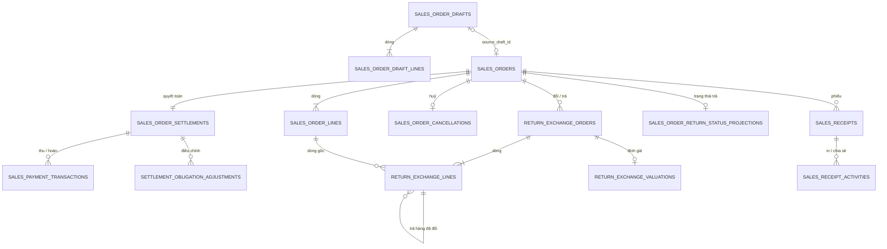

# TH-05 — Bán hàng & đơn hàng

> **Vai trò:** **đặc tả chuẩn (source of truth)** cho app sau refactor. Theme đã hoàn thành: **code hiện tại là phạm vi chuẩn**. Mọi quy tắc mặc định = hành vi code hiện tại (SCOPE: giữ 100% chức năng, giữ RPC). Gắn 🔧 = code hiện tại **sai**, phải sửa khi refactor. Gắn 🆕 = **chưa có code** nhưng nghiệp vụ bắt buộc, làm trong refactor. Làm theo tài liệu, không chép lỗi của code cũ.
> **Phiên bản:** 3.1 · **Ngày:** 2026-11-08 · **Branch đối chiếu:** `refactor/simple-arch` @ `47b4cb188`
> **Thay thế:** `Theme 5_ Đơn hàng.md` (v1). Tính năng v1 không có trong code được liệt kê ở [mục 8](#8-ngoài-phạm-vi-so-với-spec-v1).
> **Nguồn đối chiếu:**
> - DB: `20260830005`…`20260830015`, `20260904001` (schema `sales`); `20260830002`, `20260831001` (tìm sản phẩm bán được); `20260830003` (giá khi bán, TH-04).
> - App: `apps/erp/lib/features/sales/{data,logic,presentation}` (presentation: 17 trang, 13 cubit, 229 file).
>
> **Cách đọc:** mục 1–3 là mô hình chung và dữ liệu; mục 4 chia theo epic → user story (bối cảnh, FR, BR, AC, EC, kịch bản Gherkin); mục 5 đặc tả từng màn hình (trạng thái, thành phần, phác thảo); mục 6 RPC và thông điệp lỗi; mục 7 phân quyền và vấn đề đã biết; mục 8 ngoài phạm vi; mục 9 kế hoạch refactor và kiểm thử.

---

## Mục lục

1. [Tổng quan](#1-tổng-quan)
2. [Mô hình nghiệp vụ](#2-mô-hình-nghiệp-vụ)
3. [Dữ liệu](#3-dữ-liệu)
4. [Epic và user story](#4-epic-và-user-story)
5. [Đặc tả màn hình](#5-đặc-tả-màn-hình)
6. [Kỹ thuật: RPC, phụ thuộc, lỗi](#6-kỹ-thuật-rpc-phụ-thuộc-lỗi)
7. [Phân quyền & vấn đề đã biết](#7-phân-quyền--vấn-đề-đã-biết)
8. [Ngoài phạm vi (so với spec v1)](#8-ngoài-phạm-vi-so-với-spec-v1)
9. [Thay đổi khi refactor & kiểm thử](#9-thay-đổi-khi-refactor--kiểm-thử)

---

## 1. Tổng quan

### 1.1 Mục đích

TH-05 là nghiệp vụ bán hàng tại quầy của cửa hàng thú y, từ lúc nhân viên bắt đầu soạn đơn đến các xử lý sau bán. Theme trả lời bốn nhóm câu hỏi:

1. **Bán:** khách mua gì, đơn vị nào, giá nào, thanh toán bằng gì, còn nợ bao nhiêu, hẹn trả khi nào?
2. **Chứng từ:** đơn đã ghi nhận chính xác những gì tại thời điểm bán, phiếu bán hàng đưa khách có nội dung gì?
3. **Tra cứu:** đơn nào đã bán, đơn nào còn phải thu, đơn nào đã đổi trả hoặc huỷ, ai làm gì lúc nào?
4. **Sau bán:** huỷ đơn tạo nhầm, đổi hàng / trả hàng và quyết toán chênh lệch, thu nốt tiền còn nợ.

Dữ liệu TH-05 tạo ra là đầu vào của hoá đơn điện tử (TH-08), lịch sử giao dịch đối tác (TH-03), và sau này kho (Theme 7) và công nợ (Theme 6).

### 1.2 Bối cảnh nghiệp vụ

Nhân viên bán hàng tại quầy cần thao tác nhanh trong lúc khách chờ. Một giao dịch điển hình:

1. Bấm "Tạo đơn" → mặc định **Khách lẻ**; nếu là khách quen thì tìm theo tên/SĐT hoặc tạo nhanh.
2. Tìm hoặc quét mã sản phẩm, chọn đơn vị bán (viên, vỉ, hộp…), nhập số lượng.
3. Hệ thống tự áp giá: giá riêng của khách (TH-04) nếu có, nếu không thì giá niêm yết. Nhân viên có thể giảm giá dòng; giá dưới sàn phải xác nhận.
4. Bấm "Thanh toán": khách trả tiền mặt, chuyển khoản, hoặc cả hai; khách quen có thể nợ một phần với ngày hẹn trả.
5. Hoàn tất → nhận mã đơn `DH…`, in hoặc gửi phiếu bán hàng cho khách.

Giao dịch có thể bị gián đoạn (khách đi lấy thêm hàng, có khách khác đến) → **lưu nháp** để quay lại sau.

Sau bán:

- **Huỷ đơn** khi đơn tạo nhầm hoặc trùng **và chưa thu tiền**. Đơn đã thu tiền thì không huỷ được mà phải dùng đổi/trả, để dòng tiền luôn có chứng từ.
- **Đổi/trả** khi khách mang hàng quay lại: trả một phần hoặc toàn bộ, đổi sang hàng khác. Hệ thống tính chênh lệch: khách trả thêm, cửa hàng hoàn tiền, hoặc giảm số nợ của đơn.
- **Thu tiền sau bán** khi khách quay lại trả nợ.

Nguyên tắc xuyên suốt: **đơn gốc không bao giờ bị sửa**. Mọi thay đổi sau bán được ghi bằng bản ghi riêng (phiếu huỷ, phiếu đổi/trả, giao dịch tiền), nên luôn truy vết được.

### 1.3 Ý tưởng chủ đạo

| Khái niệm | Ý nghĩa | Trong code |
|---|---|---|
| **Nháp ≠ đơn** | Nháp chỉ lưu nội dung đang soạn. Chỉ hoàn tất (checkout) mới sinh đơn, tiền, công nợ | `sales_order_drafts` vs `sales_orders` |
| **Snapshot bất biến** | Đơn lưu tên/SĐT/MST khách, tên/SKU sản phẩm, tên đơn vị, tỷ lệ quy đổi, đơn giá tại lúc bán. Sửa dữ liệu gốc sau đó không làm đổi đơn | `sales_context_snapshot`, `product_snapshot`, `product_unit_snapshot` |
| **Tiền tách khỏi đơn** | Mỗi đơn có đúng 1 bảng quyết toán (settlement). Thu/hoàn là giao dịch append-only. Đã thu, còn phải thu, trạng thái thanh toán luôn được **tính lại** từ giao dịch | `sales_order_settlements`, `sales_payment_transactions`, `_recompute_sales_settlement` |
| **Nghĩa vụ gốc ≠ nghĩa vụ hiện tại** | Huỷ, đổi/trả không sửa tiền gốc của đơn; chúng ghi một dòng điều chỉnh nghĩa vụ có dấu | `settlement_obligation_adjustments`; `current_payable = original + Σ điều chỉnh` |
| **Ba trục trạng thái độc lập** | Vòng đời đơn (Hoàn tất / Đã huỷ), thanh toán (Chưa thu / Một phần / Đã thanh toán / …), trả hàng (Chưa / Một phần / Toàn bộ). Không gộp thành một nhãn | `lifecycle_status`, `payment_status`, `return_status` |
| **Chống tạo trùng** | Mọi lệnh ghi có `idempotency_key`; gửi lại cùng nội dung → trả kết quả cũ, không tạo thêm | `sales.idempotency_records` |
| **Version chống ghi đè** | Nháp, đơn, settlement, phiếu đổi/trả có `version`; lệnh ghi kiểm version người dùng đang thấy | `STALE_DATA`, `STALE_VERSION` |
| **Số nguyên** | Tiền `*_minor` (VND, không phần thập phân), số lượng `*_micros` (× 1.000.000) | cột `bigint` |

### 1.4 Trong phạm vi

| Epic | Nội dung | Code |
|---|---|---|
| EP-01 Lập đơn & lưu nháp | Khách lẻ / chọn / tạo nhanh khách; tìm, quét sản phẩm; đơn vị, số lượng; giá tự động; điều chỉnh giá dòng; lưu thành giá riêng; ghi chú; lưu, mở, xoá nháp | Có |
| EP-02 Thanh toán & hoàn tất | Tiền mặt / chuyển khoản / kết hợp; tiền thừa; công nợ + ngày hẹn; kiểm tra trước; hoàn tất chống trùng; màn kết quả; phiếu bán hàng | Có (🔧 vài chỗ) |
| EP-03 Tra cứu & theo dõi | Danh sách, tìm kiếm, nhóm nhanh, bộ lọc; chi tiết đơn; thanh toán & công nợ; phiếu đổi/trả của đơn; lịch sử; xem / in / chia sẻ phiếu | Có |
| EP-04 Thu tiền công nợ của đơn | Thu một khoản cho đơn còn phải thu | RPC có, màn SG-11 (8-B3) |
| EP-05 Huỷ đơn | Kiểm tra điều kiện, xác nhận huỷ có lý do | Có |
| EP-06 Đổi/trả & quyết toán | Chọn hàng trả, hàng đổi; định giá; kế hoạch quyết toán; xác nhận; kết quả; chi tiết & phiếu đổi/trả | Có |

### 1.5 Ngoài phạm vi theme

| Nội dung | Thuộc |
|---|---|
| Hồ sơ sản phẩm, đơn vị, giá niêm yết / giá sàn, tìm sản phẩm bán được | TH-02 |
| Hồ sơ khách hàng, kiểm tra trùng khi tạo nhanh | TH-03 |
| Giá riêng, thứ tự áp giá, kiểm tra giá thủ công | TH-04 |
| Trừ / hoàn tồn kho khi bán, huỷ, đổi trả; khả dụng; lô | Theme 7 (spec `specs/themes/theme-07`, P11) — xem KI-01 |
| Sổ công nợ theo khách, thu gộp nhiều đơn | Theme 6 (chưa làm) |
| Phát hành, gửi hoá đơn điện tử (khối "Chứng từ & hoá đơn" trong chi tiết đơn) | TH-08 |

### 1.6 Tác nhân

| Tác nhân | Việc làm |
|---|---|
| Nhân viên bán hàng | Soạn đơn, thanh toán, in phiếu, tra cứu, đổi/trả, thu tiền |
| Chủ cửa hàng | Mọi việc của nhân viên; thêm quyền quản trị tổ chức (TH-01) |
| Hệ thống | Đánh mã đơn, tính settlement, ghi sự kiện cho HĐĐT tự động |

Mọi tác nhân là thành viên **đang hoạt động**, làm việc trong **cửa hàng đang chọn** (`active_store_id`, TH-01). Phạm vi dữ liệu theo cửa hàng (`iam.can_access_store`).

### 1.7 Liên hệ với các theme khác

```mermaid
flowchart LR
    T02["TH-02<br/>Sản phẩm, đơn vị,<br/>giá niêm yết/sàn"] -->|tìm SP bán được, snapshot| T05
    T03["TH-03<br/>Khách hàng"] -->|chọn / tạo nhanh khách| T05
    T04["TH-04<br/>Giá riêng, áp giá"] -->|giá dòng, kiểm giá thủ công| T05
    T05["TH-05<br/>Bán hàng & đơn"] -->|lưu làm giá riêng| T04
    T05 -->|sales_order_finalized.v1| T08["TH-08<br/>HĐĐT"]
    T05 -->|trigger lịch sử giao dịch| T03
    T05 -.->|xuất/nhập kho (P11)| T07["Theme 7<br/>Kho"]
```

---

## 2. Mô hình nghiệp vụ

### 2.1 Khái niệm

| Khái niệm | Định nghĩa |
|---|---|
| Đơn nháp | `sales_order_drafts` + dòng. Lưu khách (kèm snapshot hiển thị), ghi chú, từng dòng: sản phẩm, đơn vị, số lượng, giá nhập tay, kết quả giá lúc lưu. Không phải chứng từ |
| Đơn hàng | `sales_orders` + `sales_order_lines`. Chỉ sinh khi hoàn tất. Mã `DH<yyyymmdd><4 số>` theo cửa hàng, theo ngày giờ Việt Nam, tối đa 9.999 đơn/ngày/cửa hàng |
| Khách lẻ | Đơn không có `customer_partner_id`. Không bao giờ được nợ |
| Dòng đơn | Một sản phẩm + một đơn vị bán + số lượng + đơn giá + giảm giá dòng. Cùng sản phẩm + cùng đơn vị chỉ có một dòng |
| Số lượng cơ sở | `số lượng × tỷ lệ quy đổi` của đơn vị bán; phải là số nguyên (bán nguyên đơn vị cơ sở) |
| Quyết toán (settlement) | `sales_order_settlements`, 1–1 với đơn: nghĩa vụ gốc, điều chỉnh, nghĩa vụ hiện tại, đã thu, đã hoàn, thu ròng, còn phải thu, trạng thái |
| Giao dịch tiền | `sales_payment_transactions`: `collection` (thu, chiều vào) hoặc `refund` (hoàn, chiều ra). Số tiền > 0. Không sửa, không xoá |
| Nguồn giao dịch | `checkout` (lúc bán), `additional_collection` (thu sau bán), `return_exchange` (quyết toán đổi trả), `manual_correction` (hoàn thủ công, không dùng) |
| Điều chỉnh nghĩa vụ | `settlement_obligation_adjustments`: mỗi nguồn (một phiếu huỷ, một phiếu đổi trả) tối đa 1 dòng, số tiền có dấu |
| Phiếu huỷ | `sales_order_cancellations`, mỗi đơn tối đa 1 |
| Phiếu đổi/trả | `return_exchange_orders` + dòng (`returned` = hàng khách trả, `exchange` = hàng khách nhận) + định giá |
| Phiếu bán hàng | `sales_receipts` (có `receipt_version`) + hoạt động in / chia sẻ. **Không phải hoá đơn điện tử** |
| Phương thức thanh toán | `cash` (Tiền mặt), `manual_bank_transfer` (Chuyển khoản, kèm mã giao dịch tuỳ chọn) |

### 2.2 Công thức tiền

**Dòng đơn**

```text
gross_amount  = unit_price × quantity
line_total    = gross_amount − discount_amount + tax_amount        (tax = 0)
0 ≤ discount_amount ≤ gross_amount
```

**Đơn**

```text
subtotal      = Σ gross_amount
discount      = Σ discount_amount
payable       = subtotal − discount + tax + rounding               (tax = 0, rounding = 0)
```

**Quyết toán**

```text
current_payable   = original_payable + Σ obligation_adjustments
collected         = Σ collection đã xác nhận
refunded          = Σ refund đã xác nhận
net_collected     = collected − refunded
outstanding       = max(current_payable − net_collected, 0)
```

**Đổi/trả**

```text
return_value      = Σ (line_total dòng gốc × số trả / số bán)            (giá sau giảm)
                  + Σ (đơn giá lúc đổi × số trả)                         (trả hàng đã nhận đổi)
exchange_value    = Σ (giá hiện hành × số đổi)
net_difference    = exchange_value − return_value
  > 0  → khách trả thêm: thu ngay một phần/hết, phần còn lại thành nợ (cần ngày hẹn)
  < 0  → khách được hưởng |net|: hoàn tối đa = net_collected, phần còn lại giảm nợ
  = 0  → không phát sinh tiền
điều chỉnh nghĩa vụ của phiếu = net_difference
```

**Huỷ đơn**

```text
điều chỉnh nghĩa vụ của phiếu huỷ = −current_payable    (còn phải thu về 0)
```

### 2.3 Vòng đời

**Đơn nháp**

```text
           lưu nháp              hoàn tất đơn
  (mới) ─────────────▶ active ────────────────▶ converted
                          │
                          │ xoá nháp
                          ▼
                      cancelled                 (expired: có trong DB, không dùng)
```

**Đơn hàng**

```text
  (hoàn tất) ──▶ completed ──(huỷ)──▶ cancelled     không mở lại được
```

**Trạng thái thanh toán** (tính lại sau mỗi giao dịch / điều chỉnh)

| Giá trị | Nhãn | Điều kiện (theo thứ tự kiểm) |
|---|---|---|
| `no_balance` | Không phát sinh | `current_payable ≤ 0` và chưa có giao dịch nào |
| `refunded` | Đã hoàn tiền | `net_collected ≤ 0` và đã từng hoàn |
| `unpaid` | Chưa thanh toán | `net_collected ≤ 0` |
| `partially_refunded` | Hoàn một phần | đã từng hoàn và `outstanding > 0` |
| `paid` | Đã thanh toán | `outstanding = 0` |
| `partially_paid` | Thanh toán một phần | còn lại |

Danh sách đơn gộp `unpaid` + `partially_paid` thành "Còn phải thu".

**Trạng thái trả hàng** (chỉ tính phiếu đã hoàn tất, theo từng dòng gốc)

| Giá trị | Nhãn | Điều kiện |
|---|---|---|
| `none` | — | Chưa dòng nào trả |
| `partially_returned` | Đã trả một phần | Có dòng đã trả, chưa đủ mọi dòng |
| `fully_returned` | Đã trả toàn bộ | Mọi dòng gốc đã trả đủ số lượng |

`fully_returned` **không phải** `cancelled`: đơn vẫn "Hoàn tất", có lịch sử tiền và phiếu đổi/trả.

**Phiếu đổi/trả**

```text
  bắt đầu ──▶ draft ──(xác nhận)──▶ confirmed ─▶ completed      (cùng 1 transaction)
                │
                └──(bỏ thay đổi)──▶ cancelled
  blocked / failed / processing: có trong DB, luồng hiện tại không để lại
```

**Phiếu huỷ:** tạo thẳng ở trạng thái `confirmed`; các trạng thái khác có trong DB nhưng không dùng.

**Phiếu bán hàng:** mỗi lần nội dung thay đổi (thanh toán thêm, đổi trả) tạo phiên bản mới `generated`; bản cũ thành `superseded`.

### 2.4 Quy tắc nghiệp vụ tổng hợp

Bảng đầy đủ. Các user story ở mục 4 dẫn lại mã này. Mã giữ ổn định giữa các phiên bản tài liệu.

**Phạm vi, chống trùng, đồng thời**

| Mã | Quy tắc | Ở đâu |
|---|---|---|
| BR-01 | Mọi lệnh kiểm: người gọi = người đăng nhập; có quyền; được truy cập cửa hàng của đối tượng (`DATA_SCOPE_DENIED`) | `_assert_sales_actor` |
| BR-02 | Lệnh ghi có `idempotency_key`. Cùng key + cùng nội dung → trả kết quả cũ; khác nội dung → `IDEMPOTENCY_CONFLICT`; đang chạy → `IDEMPOTENCY_CONFLICT` / `IN_PROGRESS`. Với hoàn tất đơn, server tự băm nội dung, không tin hash client | `_begin_sales_idempotency` |
| BR-03 | Sửa / xoá nháp, hoàn tất từ nháp, huỷ đơn, đổi/trả kiểm `version`; lệch → `STALE_DATA` / `STALE_VERSION`, không ghi gì | các RPC ghi |

**Đơn nháp**

| Mã | Quy tắc | Ở đâu |
|---|---|---|
| BR-04 | Chỉ lưu nháp khi có ≥ 1 dòng; mỗi dòng có sản phẩm, SKU, tên, đơn vị, số lượng > 0, đơn giá, thành tiền. Lưu lại thay toàn bộ dòng | `_write_draft_lines` |
| BR-05 | Danh sách nháp: mọi nháp `active` **của cửa hàng đang chọn**, mới tạo trước, 25/trang. Lọc "Đơn của tôi / Tất cả đơn nháp" và tìm theo khách, SĐT, ghi chú làm trên app | `list_sales_order_drafts` |
| BR-06 | Mở nháp chỉ khi còn `active`. Nháp đã bị xoá/đổi ở nơi khác → báo "Đơn nháp này đã bị xoá hoặc thay đổi ở nơi khác" | `get_sales_order_draft_for_restore` |
| BR-07 | Xoá nháp = chuyển `cancelled`, không xoá cứng. Hỏi xác nhận | `cancel_sales_order_draft` |
| BR-08 | Rời màn soạn khi có thay đổi chưa lưu: hỏi "Lưu nháp và đóng / Bỏ thay đổi và đóng / Tiếp tục soạn đơn" | compose leave sheet |
| BR-09 | Nháp không tự hết hạn | — |

**Soạn đơn**

| Mã | Quy tắc | Ở đâu |
|---|---|---|
| BR-10 | Mặc định Khách lẻ. Chỉ chọn được khách **đang hoạt động** có vai trò customer. Tạo nhanh khách: tên bắt buộc; SĐT, loại (cá nhân / tổ chức), MST, địa chỉ tuỳ chọn; trùng SĐT → gợi ý "Chọn khách hàng này" hoặc "Vẫn tạo mới" (TH-03) | customer sheets |
| BR-11 | Khách tổ chức chưa có MST: vẫn bán, cảnh báo "chưa thể phát hành hoá đơn điện tử" | compose |
| BR-12 | Chỉ thêm sản phẩm **sẵn sàng bán**, đơn vị đang hoạt động (TH-02). Tìm theo tên, SKU, barcode. Cùng sản phẩm + cùng đơn vị → cộng dồn số lượng | `search_sellable_products`, `addOrIncrementLine` |
| BR-13 | Số lượng là số nguyên dương theo đơn vị bán, không vượt tồn hiển thị của đơn vị đó ("Vượt tồn kho. Chỉ còn N <đv>"). Đây là kiểm tra trên app với tồn cơ bản (TH-02); server chưa kiểm tồn (KI-01) | compose cubit |
| BR-14 | Giá dòng do TH-04 tính lại mỗi khi đổi khách, sản phẩm, đơn vị, số lượng. Đổi khách → làm mới giá cả đơn ("Đã đổi khách — đang làm mới giá") | `preview_sales_working_state_pricing` |
| BR-15 | Điều chỉnh giá dòng: Đơn giá mới / Giảm tiền / Giảm %, áp cho 1 đơn vị. Giá dưới sàn phải xác nhận ("Xác nhận giá dưới sàn?"). Giảm không làm thành tiền âm | `evaluate_sales_manual_price` |
| BR-16 | "Lưu làm giá riêng" (cần đã chọn khách): tạo giá riêng thủ công hiệu lực từ hôm nay, không giới hạn; nếu đã có giá riêng cùng khách–sản phẩm–đơn vị thì hỏi "Ghi đè giá riêng hiện có?" và cập nhật giá đó. Dòng có giá riêng thì giá riêng luôn thắng (TH-04 KI-09), nên muốn đổi giá dòng đó phải lưu làm giá riêng | `SalesManualPriceOrchestrator` |
| BR-17 | Ghi chú đơn tuỳ chọn; lưu vào nháp và vào đơn. Sau hoàn tất **không sửa được** | `internal_note` |

**Thanh toán & hoàn tất**

| Mã | Quy tắc | Ở đâu |
|---|---|---|
| BR-18 | Phương thức: Tiền mặt, Chuyển khoản, Kết hợp. Tiền mặt mặc định bằng tổng đơn; khách đưa nhiều hơn → hiện tiền thừa (không ghi nhận). Chuyển khoản có mã giao dịch tuỳ chọn. Mỗi khoản > 0 | checkout |
| BR-19 | Tổng đã trả không vượt tổng đơn ("Số tiền thanh toán không được vượt quá tổng cần trả") | precheck + finalize |
| BR-20 | Còn phải thu > 0: Khách lẻ bị chặn (`WALK_IN_RECEIVABLE_NOT_ALLOWED`); khách có hồ sơ phải chọn ngày hẹn (`RECEIVABLE_DUE_DATE_REQUIRED`). Server kiểm ngày hẹn ≥ hôm nay (giờ VN): `RECEIVABLE_DUE_DATE_INVALID` (precheck, finalize); đổi/trả dùng `RETURN_EXCHANGE_BLOCKED` | precheck + finalize + `confirm_return_exchange` |
| BR-21 | Bấm "Thanh toán" ở màn soạn: chạy kiểm tra trước (`precheck`) với giả định trả đủ tiền mặt; có blocker → báo, ở lại màn soạn | `SalesCheckoutOrchestrator` |
| BR-22 | Hoàn tất kiểm lại toàn bộ trên server trong 1 transaction: sản phẩm/đơn vị còn bán được (`PRODUCT_NOT_SELLABLE`), số lượng cơ sở nguyên (`INVALID_QUANTITY`), snapshot khớp dòng (`CHECKOUT_BLOCKED`), giảm giá hợp lệ (`COMMERCIAL_TOTAL_MISMATCH`), nháp nguồn đúng version (`STALE_VERSION`) | `finalize_sales_order` |
| BR-23 | Server tính lại giá: mỗi dòng gửi kèm giá nhập tay (nếu có); server gọi lại `preview_sales_working_state_pricing` và so đơn giá; lệch → `PRICE_CHANGED`, app làm mới giá (đã có ở `finalize_sales_order`, 20261031017) | KI-02 |
| BR-24 | Server kiểm khách còn hoạt động, có vai trò customer (`CUSTOMER_INVALID`) | KI-03 |
| BR-25 | Hoàn tất đơn **chưa** trừ tồn kho. Khi làm Theme 7 (P11), checkout phải xuất kho nguyên tử theo `BC-IO-04` | KI-01 |
| BR-26 | Kết quả hoàn tất: đơn `completed`, dòng đơn kèm snapshot, settlement, mỗi khoản thu thành 1 giao dịch `collection` nguồn `checkout`; nháp nguồn → `converted`; ghi sự kiện `sales_order_finalized.v1` | finalize |
| BR-27 | Mất kết nối khi hoàn tất: tra kết quả bằng chính `idempotency_key` (`get_checkout_result`); **không cho thanh toán lại**. Kết quả bị chặn / lỗi cũng được lưu để tra lại | `get_checkout_result` |
| BR-28 | Sau hoàn tất tạo phiếu bán hàng. Lỗi tạo phiếu không ảnh hưởng đơn; có "Tạo lại phiếu bán hàng" | result page |
| BR-29 | Sau hoàn tất, phát hành HĐĐT tự động nếu tổ chức bật (TH-08 BR-32) | chưa nối (messaging bỏ ở 8-C); sau 7-4: trigger → `einvoice.internal_commands` |

**Thu tiền sau bán** 🆕

| Mã | Quy tắc | Ở đâu |
|---|---|---|
| BR-30 | 🆕 Đơn `completed` còn phải thu > 0: chi tiết đơn có "Thu tiền": số tiền ≤ còn phải thu (`OVERPAYMENT_NOT_ALLOWED`), phương thức, mã giao dịch. Ghi `collection` nguồn `additional_collection`, tính lại settlement, sinh phiếu bán hàng phiên bản mới | `record_sales_payment` |
| BR-31 | Đơn đã huỷ không thu thêm (`ORDER_CANCELLED`) | như trên |

**Tra cứu**

| Mã | Quy tắc | Ở đâu |
|---|---|---|
| BR-32 | Danh sách chỉ có đơn chính thức, mới nhất trước, phân trang cursor 50 dòng, có "Tải thêm". Thẻ: mã đơn, thời gian, khách ("Khách Lẻ" nếu không có), SĐT, tổng, trạng thái đơn, thanh toán, có đổi/trả, HĐĐT | `list_sales_orders` |
| BR-33 | Tìm theo mã đơn, tên khách, SĐT **trong snapshot** của đơn. Bỏ dấu, không phân biệt hoa thường (`unaccent_immutable` + `ilike`) | `search_sales_orders` |
| BR-34 | Nhóm nhanh (kèm đếm): Tất cả / Còn phải thu / Chưa phát hành HĐĐT. Bộ lọc: Thời gian (Tất cả / Hôm nay / 7 ngày / 30 ngày), Trạng thái đơn (Hoàn tất / Đã huỷ), Thanh toán (Đã thanh toán / Còn phải thu / Chưa thu), Sau bán (Có đổi/trả), HĐĐT (Đã / Chưa phát hành). Lọc ở server; "Đặt lại" xoá hết | list cubit, `list_sales_orders` |
| BR-35 | Chi tiết đơn gồm các khối tải độc lập: thông tin đơn; sản phẩm (bản **Đơn gốc** và **Sau đổi/trả**); thanh toán & công nợ; phiếu đổi/trả; lịch sử; chứng từ & hoá đơn; lý do huỷ (đơn đã huỷ). Khối nào lỗi báo khối đó, có "Thử lại" | `get_sales_order_detail` + RPC con |
| BR-36 | Lịch sử đơn tổng hợp từ sự kiện của đơn, giao dịch tiền, huỷ, đổi/trả, phiếu; mỗi mục có loại, người làm, thời gian, mới nhất trước | `get_sales_order_timeline` |
| BR-37 | Nút "Thao tác" hiện theo server (`get_available_post_sale_actions`): Hủy đơn, Đổi/trả hàng. Đơn đã thu tiền: "Hủy đơn" bị vô hiệu kèm "Đơn đã có thanh toán, vui lòng đổi/trả" | detail page |

**Phiếu bán hàng**

| Mã | Quy tắc | Ở đâu |
|---|---|---|
| BR-38 | Phiếu dựng từ snapshot đơn + giao dịch tiền hiện tại (gộp theo phương thức) + các điều chỉnh nghĩa vụ. Số phiếu `PBH-<yyyymmdd>-<8 ký tự>`. Nội dung đổi thì tạo phiên bản mới, bản cũ `superseded` | `generate_sales_receipt` |
| BR-39 | Xem / in / chia sẻ phiếu: PDF dựng trên máy; in qua hộp thoại máy in hệ thống (chọn máy in, số bản); chia sẻ qua ứng dụng khác. Mỗi lần in / chia sẻ ghi 1 hoạt động. Có bản "phiếu gốc" lúc bán | `record_sales_receipt_activity`, `get_sales_order_original_receipt` |

**Huỷ đơn**

| Mã | Quy tắc | Ở đâu |
|---|---|---|
| BR-40 | Chỉ huỷ đơn `completed` **chưa thu tiền ròng** (`net_collected = 0`). Đã thu → `PAYMENT_ALREADY_COLLECTED`, hướng sang đổi/trả | precheck / confirm cancellation |
| BR-41 | Chặn khi: đã có phiếu huỷ (`COMPETING_CANCELLATION`), có phiếu đổi/trả đã xác nhận (`RETURN_EXCHANGE_CONFLICT`), đang có phiếu đổi/trả nháp (`DRAFT_RETURN_ACTIVE`), đơn đã huỷ (`ORDER_ALREADY_CANCELLED`) | như trên |
| BR-42 | Sheet "Hủy đơn hàng?" hiện điều chỉnh dự kiến (công nợ giảm; tồn kho: xem KI-01), lý do tuỳ chọn (danh mục: Khách yêu cầu huỷ, Tạo trùng đơn, Lý do khác), cảnh báo "sẽ chuyển sang Đã hủy và không thể mở lại" | cancel sheet |
| BR-43 | Xác nhận: đơn → `cancelled`, `version + 1`; điều chỉnh nghĩa vụ = −nghĩa vụ hiện tại; giữ nguyên snapshot, giao dịch, phiếu. Ghi `sales_order_cancelled.v1`. Hoàn nguyên tồn kho làm ở Theme 7 (`BC-IO-13`) | confirm cancellation |

**Đổi/trả**

| Mã | Quy tắc | Ở đâu |
|---|---|---|
| BR-44 | Chỉ đổi/trả đơn `completed`, không có phiếu huỷ, còn số lượng có thể trả | `precheck_return_exchange` |
| BR-45 | Có thể trả của dòng = số bán − tổng đã trả ở các phiếu đã xác nhận. Hàng đã nhận đổi ở phiếu trước cũng là một "dòng có thể trả" | `get_returnable_order_lines` |
| BR-46 | Dòng trả tham chiếu đúng 1 nguồn (dòng gốc **hoặc** dòng đã đổi), cùng sản phẩm và đơn vị với nguồn, không vượt số có thể trả (`RETURN_QUANTITY_EXCEEDED`). Phiếu phải có ≥ 1 dòng trả | start / update |
| BR-47 | Hàng đổi: sản phẩm bán được bất kỳ, giá do TH-04 tính theo khách của đơn **tại lúc đổi**; khi lưu, định giá, xác nhận mà giá đã khác → `PRICE_CHANGED` | `_assert_exchange_price` |
| BR-48 | Định giá theo công thức 2.2 | `evaluate_return_exchange_valuation` |
| BR-49 | Kế hoạch quyết toán do server lập theo công thức 2.2. Khách lẻ không được nợ / giảm nợ | như trên + confirm |
| BR-50 | Màn quyết toán: phương thức thu/hoàn (Tiền mặt / Chuyển khoản), số khách trả ngay (khi khách trả thêm), ngày hẹn cho phần nợ; sheet "Xác nhận đổi/trả?" tóm tắt thu / hoàn / ghi nợ / giảm nợ | settlement page |
| BR-51 | Xác nhận trong 1 transaction: kiểm lại version đơn, settlement, phiếu, giá; ghi giao dịch thu / hoàn; ghi điều chỉnh nghĩa vụ = chênh lệch; phiếu → `completed`; cập nhật trạng thái trả hàng; `version` đơn + 1. Ngày hẹn của phần nợ mới lưu vào `sales_orders.payment_due_date` | `confirm_return_exchange`, KI-05 |
| BR-52 | Xác nhận đổi/trả **chưa** ghi tồn kho. Nhận hàng trả / xuất hàng đổi làm ở Theme 7 (`BC-IO-07`, `BC-IO-04`) | KI-01 |
| BR-53 | Rời màn đổi/trả khi có thay đổi: hỏi "Bỏ thay đổi?"; bỏ thì huỷ phiếu nháp (`cancel_return_exchange`). Không có danh sách phiếu đổi/trả nháp | discard dialog |
| BR-54 | Phiếu đã xác nhận không sửa, không xoá. Xem chi tiết, in / chia sẻ phiếu đổi/trả (PDF) | `get_return_exchange_detail` |

---

## 3. Dữ liệu

### 3.1 Sơ đồ quan hệ



Không có khoá ngoại sang `catalog`, `partner`, `iam`; tham chiếu được kiểm trong RPC. Khoá ngoại nội bộ dùng cặp `(tenant_id, id)` để không thể trỏ chéo tổ chức. Mọi bảng bật RLS; client không ghi trực tiếp, mọi thao tác đi qua RPC `security definer`.

### 3.2 Bảng đơn nháp

**`sales_order_drafts`**

| Cột | Kiểu | Bắt buộc | Ghi chú |
|---|---|---|---|
| `id` | uuid | ✓ | PK |
| `tenant_id`, `store_id` | uuid | ✓ | |
| `created_by_user_id`, `updated_by_user_id` | uuid | ✓ | người tạo / lưu gần nhất |
| `customer_partner_id` | uuid | | null = Khách lẻ |
| `customer_snapshot` | jsonb | | `customer_id`, `display_name`, `phone_number`, `tax_code` (chỉ để hiển thị) |
| `status` | text | ✓ | `active` / `converted` / `cancelled` / `expired` |
| `currency_code` | char(3) | ✓ | `VND` |
| `note` | text | | ghi chú đơn |
| `pricing_preview_token`, `needs_revalidation` | | | kết quả giá lúc lưu |
| `version` | bigint | ✓ | bắt đầu 1 |
| `created_at`, `updated_at` | timestamptz | ✓ | |

**`sales_order_draft_lines`**

| Cột | Kiểu | Bắt buộc | Ghi chú |
|---|---|---|---|
| `id`, `tenant_id`, `sales_order_draft_id` | uuid | ✓ | FK cascade về nháp |
| `line_sequence` | int | ✓ | duy nhất trong nháp |
| `product_id`, `product_unit_id` | uuid | ✓ | |
| `quantity_micros` | bigint | ✓ | > 0 |
| `manual_unit_price_input_minor`, `manual_discount_amount_input_minor`, `manual_discount_basis_points` | | | giá nhập tay |
| `line_note` | text | | |
| `pricing_preview` | jsonb | ✓ | SKU, tên, đơn vị, đơn giá áp dụng, thành tiền, giá niêm yết, nguồn giá, mã cảnh báo / chặn |

### 3.3 Bảng đơn hàng

**`sales_orders`**

| Cột | Kiểu | Bắt buộc | Ghi chú |
|---|---|---|---|
| `id`, `tenant_id`, `store_id` | uuid | ✓ | |
| `source_draft_id` | uuid | | duy nhất khi có |
| `order_code` | varchar(50) | ✓ | `DH<yyyymmdd><4 số>`, duy nhất trong tổ chức |
| `seller_user_id` | uuid | ✓ | |
| `customer_partner_id` | uuid | | null = Khách lẻ |
| `channel_code` | varchar | ✓ | `pos` |
| `currency_code` | char(3) | ✓ | |
| `lifecycle_status` | text | ✓ | `completed` / `cancelled` |
| `lock_status` | text | ✓ | `unlocked` (không dùng `locked`) |
| `version` | bigint | ✓ | tăng khi huỷ, khi đổi/trả |
| `internal_note` | text | | ghi chú đơn |
| `subtotal_amount_minor`, `discount_amount_minor`, `tax_amount_minor`, `rounding_amount_minor`, `payable_amount_minor` | bigint | ✓ | CHECK công thức 2.2 |
| `sales_context_snapshot` | jsonb | ✓ | `store {storeId, storeCode, displayName}`, `seller {actorId, displayName}`, `customer {customerId, displayName, phoneNumber, taxCode}` |
| `buyer_tax_snapshot` | jsonb | | do TH-08 ghi |
| `payment_due_date` | date | | ngày hẹn thanh toán |
| `completed_at`, `cancelled_at`, `created_at`, `updated_at` | timestamptz | | |

**`sales_order_lines`**

| Cột | Kiểu | Bắt buộc | Ghi chú |
|---|---|---|---|
| `id`, `tenant_id`, `sales_order_id` | uuid | ✓ | |
| `line_sequence` | int | ✓ | |
| `product_id`, `product_unit_id` | uuid | ✓ | |
| `quantity_micros`, `base_quantity_micros` | bigint | ✓ | > 0; cơ sở = số lượng × tỷ lệ |
| `unit_price_minor`, `gross_amount_minor`, `discount_amount_minor`, `tax_amount_minor`, `line_total_minor` | bigint | ✓ | CHECK công thức dòng |
| `product_snapshot` | jsonb | ✓ | `productId`, `sku`, `displayName` |
| `product_unit_snapshot` | jsonb | ✓ | `productUnitId`, `unitCode`, `unitName`, `conversionRateToBase` |
| `pricing_snapshot` | jsonb | ✓ | nguồn giá lúc chốt (tra cứu) |
| `line_note` | text | | |

**`sales_order_return_status_projections`**: `(tenant_id, sales_order_id)` PK, `return_status`, `updated_at`.

**`sales_order_number_counters`**: `(tenant_id, store_id, period_key yyyymmdd)` PK, `next_value`.

### 3.4 Bảng tiền

**`sales_order_settlements`** (1–1 với đơn)

| Cột | Ghi chú |
|---|---|
| `original_payable_amount_minor` | = `payable` của đơn, không đổi |
| `post_sale_adjustment_amount_minor` | Σ điều chỉnh, có dấu |
| `current_payable_amount_minor` | CHECK = gốc + điều chỉnh |
| `collected_amount_minor`, `refunded_amount_minor`, `net_collected_amount_minor` | CHECK net = thu − hoàn |
| `outstanding_amount_minor` | còn phải thu |
| `payment_status` | bảng 2.3 |
| `settled_at` | lúc trả đủ; xoá khi không còn đủ |
| `version` | tăng mỗi lần tính lại |

**`sales_payment_transactions`**

| Cột | Ghi chú |
|---|---|
| `transaction_type` / `direction` | `collection`/`inflow` hoặc `refund`/`outflow` |
| `amount_minor` | > 0 |
| `payment_method_code`, `payment_method_snapshot` | `cash`, `manual_bank_transfer` |
| `status` | `confirmed` (`pending`, `failed` không dùng) |
| `source_context`, `source_type`, `source_id` | nguồn (2.1) |
| `related_transaction_id` | khoản thu được hoàn (hoàn thủ công) |
| `initiated_by_user_id` | người ghi |
| `reason_code`, `reason`, `external_reference` | mã giao dịch chuyển khoản |
| `occurred_at` | |

**`settlement_obligation_adjustments`**: `source_kind` (`cancellation` / `return_exchange`), `source_id`, `amount_minor` (có dấu); duy nhất theo nguồn.

### 3.5 Bảng sau bán

**`sales_order_cancellations`**: `sales_order_id` (duy nhất), `status`, `source_order_version`, `requested_by_user_id`, `reason`, `precheck_snapshot` (thu ròng, version, lý do, `impacts`), `confirmed_at`.

**`return_exchange_orders`**

| Cột | Ghi chú |
|---|---|
| `sales_order_id`, `status`, `version`, `source_order_version`, `source_settlement_version` | |
| `entry_source` | `standard` / `full_return_from_cancel_attempt` |
| `reference_number` | số phiếu hiển thị |
| `reason` | ghi chú phiên |
| `created_by_user_id`, `confirmed_by_user_id`, `completed_by_user_id`, `confirmed_at`, `completed_at` | |
| `confirmation_decision_snapshot` | version nguồn, `impacts` |

**`return_exchange_lines`**: `line_role` (`returned` / `exchange`), `original_sales_order_line_id` **xor** `source_exchange_line_id` (dòng trả), `product_id`, `product_unit_id`, `quantity_micros`, `base_quantity_micros`, `unit_value_minor` (đơn giá trả / giá đổi), `return_reason_code`, `return_condition_code` (không dùng, KI-10), snapshot sản phẩm & đơn vị.

**`return_exchange_valuations`**: `return_value_minor`, `exchange_value_minor`, `net_difference_minor` (CHECK = đổi − trả), `status` (`calculated` / `confirmed`), `valuation_details.settlement_plan` (`collect_amount`, `refund_amount`, `receivable_create_amount`, `receivable_reverse_amount`, version nguồn).

### 3.6 Bảng chứng từ & kỹ thuật

**`sales_receipts`**: `sales_order_id`, `receipt_version` (duy nhất theo đơn), `status`, `content_hash`, `receipt_snapshot` (số phiếu, số đơn, thời gian, cửa hàng, người bán, khách, dòng, tổng, giảm, đã trả theo phương thức, điều chỉnh, còn phải thu, hạn).

**`sales_receipt_activities`**: `sales_receipt_id`, `actor_user_id`, `activity_type` (`printed` / `shared` / `archived`), `occurred_at`.

**`idempotency_records`**: `(tenant_id, command_scope, idempotency_key)` PK, `payload_hash`, `status` (`in_progress` / `succeeded` / `failed`), `result_snapshot`.

**`outbox_messages`**: Nhật ký sự kiện của đơn (5 cột `id`, `tenant_id`, `event_type`, `payload`, `occurred_at`), đọc bởi `get_sales_order_timeline` (BR-36) và chống ghi trùng quyết toán. Không còn hàng đợi messaging / người tiêu thụ (8-C); HĐĐT tự động: trigger, TH-08 KI-20. Sự kiện: `sales_order_finalized.v1`, `sales_payment_recorded.v1`, `sales_refund_recorded.v1`, `sales_settlement_changed.v1`, `sales_order_cancellation_confirmed.v1`, `sales_order_cancelled.v1`, `return_exchange_confirmed.v1`, `return_exchange_completed.v1`.

### 3.7 Bất biến kiểm tra được

Dùng làm truy vấn kiểm thử sau mỗi kịch bản:

1. `sales_orders.payable = subtotal − discount + tax + rounding`; `line_total = gross − discount + tax`.
2. `settlement.original_payable = order.payable_amount`.
3. `settlement.current_payable = original + Σ obligation_adjustments`.
4. `collected = Σ collection`, `refunded = Σ refund`, `outstanding = max(current − (collected − refunded), 0)`.
5. Mỗi đơn có đúng 1 settlement; mỗi nháp `converted` có đúng 1 đơn trỏ về.
6. Tổng số trả của mỗi dòng gốc (phiếu đã hoàn tất) ≤ số bán.
7. `net_difference = exchange_value − return_value` và = điều chỉnh nghĩa vụ của phiếu.

---

## 4. Epic và user story

### 4.1 Bản đồ

| Epic | User story | Màn hình |
|---|---|---|
| EP-01 Lập đơn & lưu nháp | US-01.1 Khởi tạo đơn mới | SG-02 |
| | US-01.2 Xác định khách hàng | SG-02, SG-04 |
| | US-01.3 Thêm và quản lý dòng hàng | SG-02, SG-03 |
| | US-01.4 Xem và điều chỉnh giá dòng | SG-02, SG-05 |
| | US-01.5 Lưu giá thoả thuận thành giá riêng | SG-05 |
| | US-01.6 Lưu đơn nháp | SG-02 |
| | US-01.7 Danh sách, mở lại, xoá đơn nháp | SG-01 |
| EP-02 Thanh toán & hoàn tất | US-02.1 Kiểm tra điều kiện trước khi thanh toán | SG-02 |
| | US-02.2 Nhập thanh toán (tiền mặt / chuyển khoản / kết hợp) | SG-06 |
| | US-02.3 Bán nợ cho khách có hồ sơ | SG-06 |
| | US-02.4 Hoàn tất đơn an toàn | SG-06 |
| | US-02.5 Xem kết quả bán hàng | SG-07 |
| | US-02.6 Xem, in, chia sẻ phiếu bán hàng | SG-07, SG-16 |
| EP-03 Tra cứu & theo dõi | US-03.1 Danh sách, tìm kiếm, lọc đơn | SG-08 |
| | US-03.2 Xem chi tiết đơn | SG-09 |
| | US-03.3 Xem thanh toán & công nợ của đơn | SG-09b |
| | US-03.4 Xem lịch sử đơn | SG-09c |
| | US-03.5 Xem các phiếu đổi/trả của đơn | SG-09d |
| | US-03.6 Xem lại, in lại phiếu bán hàng | SG-16 |
| EP-04 Thu tiền công nợ | US-04.1 Thu tiền cho đơn còn phải thu | SG-11 |
| EP-05 Huỷ đơn | US-05.1 Kiểm tra điều kiện huỷ | SG-09, SG-10 |
| | US-05.2 Xác nhận huỷ đơn | SG-10 |
| EP-06 Đổi/trả & quyết toán | US-06.1 Bắt đầu đổi/trả từ đơn gốc | SG-12 |
| | US-06.2 Chọn hàng khách trả | SG-12 |
| | US-06.3 Chọn hàng khách nhận đổi | SG-12 |
| | US-06.4 Bỏ phiếu đang lập | SG-12 |
| | US-06.5 Xem định giá và chênh lệch | SG-13 |
| | US-06.6 Quyết toán chênh lệch và xác nhận | SG-13 |
| | US-06.7 Xem kết quả, chi tiết và phiếu đổi/trả | SG-14, SG-15, SG-16 |

---

### 4.2 EP-01 — Lập đơn & lưu nháp

**Tổng quan.** Epic bao từ lúc nhân viên mở màn bán hàng đến khi đơn sẵn sàng thanh toán hoặc được lưu nháp. Ở giai đoạn này **chưa có** đơn, tiền, công nợ hay phiếu; mọi thứ chỉ nằm trên màn hình (working state) hoặc trong nháp.

**Điểm vào:** tab Bán hàng / nút "Tạo đơn" ở trang chủ → `/sales/compose`; danh sách nháp → `/sales/compose?draftId=…`; quay lại từ màn thanh toán.

**Kết thúc khi:** bấm "Thanh toán" thành công (sang EP-02), lưu nháp, hoặc rời màn (bỏ thay đổi).

#### US-01.1 — Khởi tạo đơn mới

**Bối cảnh.** Nhân viên phải bắt đầu phục vụ khách ngay. Đơn mới là màn trống gắn với cửa hàng đang chọn; chưa ghi gì xuống DB cho tới khi lưu nháp hoặc hoàn tất.

| Là | Tôi muốn | Để |
|---|---|---|
| Nhân viên bán hàng | mở một đơn mới trong đúng cửa hàng đang làm việc | phục vụ khách ngay mà chưa tạo chứng từ |

**Yêu cầu chức năng**

- FR-01: "Tạo đơn" mở màn soạn đơn trống (SG-02), tiêu đề "Tạo đơn hàng", khách = Khách lẻ.
- FR-02: Header có nút "Đơn nháp (N)" hiện số nháp đang có của cửa hàng ("Đang tải số đơn nháp" khi đang tải).
- FR-03: Mở với `draftId` → tải nháp (US-01.7); nháp không còn → báo "Đơn nháp không còn" và chuyển sang đơn mới.
- FR-04: Đơn trống: "Chưa có sản phẩm trong đơn — Tìm hoặc quét mã để thêm sản phẩm."; nút "Thanh toán" vô hiệu.
- FR-05: Rời màn khi đã có thay đổi → BR-08.

**Quy tắc:** BR-01, BR-08, BR-09.

**Tiêu chí nghiệm thu**

- AC-01: Mở "Tạo đơn" không tạo bản ghi nào trong `sales`.
- AC-02: Đơn mới luôn là Khách lẻ, không dòng, tổng 0.
- AC-03: Người không truy cập được cửa hàng đang chọn → màn báo "Anh/chị không có quyền truy cập khu vực bán hàng."
- AC-04: Rời màn đơn trống không hỏi gì; rời màn đã có dòng thì hỏi theo BR-08.

**Trường hợp biên**

- EC-01: Chưa chọn cửa hàng (TH-01) → không vào được khu bán hàng.
- EC-02: Đổi cửa hàng khi đang soạn → nháp và danh sách nháp theo cửa hàng mới; dữ liệu chưa lưu phải được hỏi lưu/bỏ trước.

**Kịch bản**

```gherkin
Feature: Khởi tạo đơn mới

Scenario: SC-01 — Mở đơn mới
  Given tôi là thành viên của cửa hàng "Cơ sở 1"
  When tôi bấm "Tạo đơn"
  Then màn "Tạo đơn hàng" mở với khách "Khách lẻ" và không có dòng nào
  And nút "Thanh toán" bị vô hiệu
  And không có bản ghi nào được tạo trong DB

Scenario: SC-02 — Rời đơn đã có dữ liệu
  Given đơn đang soạn có 1 dòng chưa lưu
  When tôi bấm quay lại
  Then tôi thấy "Đơn có thay đổi chưa lưu" với 3 lựa chọn
    | Lưu nháp và đóng | Bỏ thay đổi và đóng | Tiếp tục soạn đơn |
```

#### US-01.2 — Xác định khách hàng

**Bối cảnh.** Khách hàng quyết định giá riêng (TH-04), khả năng bán nợ (EP-02) và thông tin hoá đơn (TH-08). Phần lớn giao dịch tại quầy là Khách lẻ; khách quen cần tìm nhanh theo SĐT.

| Là | Tôi muốn | Để |
|---|---|---|
| Nhân viên bán hàng | chọn Khách lẻ, chọn khách có sẵn, hoặc tạo nhanh khách mới | đơn dùng đúng giá và đúng điều kiện bán nợ |

**Yêu cầu chức năng**

- FR-01: Thẻ khách trên SG-02: Khách lẻ ("Không bắt buộc thông tin", nút "Chọn KH" / "Tạo KH") hoặc tên + SĐT ("Chưa có số điện thoại" nếu không có), nút "Đổi KH".
- FR-02: "Chọn KH" mở SG-04: ô tìm, danh sách khách, mục "Khách lẻ — Không phát sinh công nợ", nút "Tạo nhanh khách hàng".
- FR-03: Khách không còn hoạt động hiện mờ, chạm → "Không thể chọn — Khách hàng không còn hoạt động."
- FR-04: "Tạo nhanh khách hàng": Loại khách (Cá nhân / Tổ chức), Tên (bắt buộc), SĐT, MST, Địa chỉ; "Tạo & chọn khách hàng". Trùng SĐT → "Có thể khách hàng đã tồn tại — <SĐT> trùng với <tên>." với "Chọn khách hàng này" / "Vẫn tạo mới". Rời form khi đã nhập → "Bỏ thay đổi chưa lưu?".
- FR-05: Chọn / tạo xong → quay về SG-02, giữ nguyên các dòng, làm mới giá cả đơn.
- FR-06: Khách tổ chức chưa MST → banner "Khách tổ chức chưa có mã số thuế — Vẫn có thể bán hàng nhưng chưa thể phát hành hóa đơn điện tử."

**Quy tắc:** BR-10, BR-11, BR-14; TH-03 (tìm, tạo nhanh, kiểm trùng).

**Tiêu chí nghiệm thu**

- AC-01: Đổi từ Khách lẻ sang khách có giá riêng → đơn giá dòng tương ứng đổi sang giá riêng, nguồn giá "Giá riêng".
- AC-02: Đổi khách không làm mất dòng, số lượng, ghi chú.
- AC-03: Tạo nhanh khách thành công → khách mới có trong TH-03 với vai trò customer và được gắn vào đơn.
- AC-04: Không tạo được khách (mất mạng) → "Không thể tạo khách hàng — Không thể kết nối để tạo khách hàng. Vui lòng thử lại.", form giữ dữ liệu.

**Trường hợp biên**

- EC-01: Đổi khách đúng lúc đang làm mới giá → kết quả giá cũ bị bỏ, chỉ áp kết quả của khách mới.
- EC-02: Khách bị ngừng hoạt động sau khi đã chọn → hoàn tất bị chặn `CUSTOMER_INVALID` (BR-24).
- EC-03: Đơn có dòng đã "Lưu làm giá riêng" cho khách A, rồi đổi sang khách B → giá dòng tính lại theo B; giá riêng của A không bị xoá.

**Kịch bản**

```gherkin
Scenario: SC-01 — Chọn khách có giá riêng
  Given đơn có 2 hộp "Amoxicillin" giá niêm yết 120.000
  And khách "Đại lý An Bình" có giá riêng 100.000/hộp
  When tôi chọn khách "Đại lý An Bình"
  Then đơn giá dòng thành 100.000 và tổng là 200.000

Scenario: SC-02 — Tạo nhanh khách trùng SĐT
  When tôi tạo nhanh khách "Nguyễn Bình" với SĐT "0988123456"
  And SĐT này đã thuộc khách "Nguyễn Văn Bình"
  Then tôi thấy "Có thể khách hàng đã tồn tại"
  When tôi chọn "Chọn khách hàng này"
  Then đơn gắn khách "Nguyễn Văn Bình" và không tạo khách mới
```

#### US-01.3 — Thêm và quản lý dòng hàng

**Bối cảnh.** Sản phẩm thú y thường bán nhiều đơn vị (viên / vỉ / hộp). Mỗi dòng phải xác định đúng sản phẩm + đơn vị + số lượng.

| Là | Tôi muốn | Để |
|---|---|---|
| Nhân viên bán hàng | tìm hoặc quét sản phẩm, chọn đơn vị và số lượng | lập đúng danh sách hàng khách mua |

**Yêu cầu chức năng**

- FR-01: Ô "Tìm tên, SKU hoặc barcode" trên SG-02; gợi ý chỉ gồm sản phẩm sẵn sàng bán. Không thấy → "Không tìm thấy sản phẩm — Thử tên, SKU hoặc barcode khác."; lỗi mạng → "Không thể tìm sản phẩm — Kiểm tra kết nối và thử lại." + "Thử lại".
- FR-02: Quét barcode khớp đúng một sản phẩm–đơn vị → thêm ngay; khớp nhiều → cho chọn.
- FR-03: Sản phẩm nhiều đơn vị → sheet "Chọn đơn vị bán" (SG-03), mỗi đơn vị hiện "<giá> · Tồn <N>"; "Xác nhận".
- FR-04: Thêm lại cùng sản phẩm–đơn vị → cộng 1 vào dòng có sẵn.
- FR-05: Mỗi dòng: tên, "Đơn vị: <đv>" (chạm để đổi đơn vị), đơn giá, ô số lượng (bàn phím số "Nhập số lượng"), "Thành tiền", nút "Giảm giá", nút xoá.
- FR-06: Đổi số lượng / đơn vị → làm mới giá dòng, cập nhật "Tóm tắt thanh toán": "Tổng tiền hàng (N sản phẩm)", giảm giá, "Khách phải trả".
- FR-07: Số lượng vượt tồn hiển thị → không nhận, toast "Số lượng vượt quá tồn khả dụng" (BR-13).

**Quy tắc:** BR-12, BR-13, BR-14.

**Tiêu chí nghiệm thu**

- AC-01: Thêm 2 lần cùng "Amoxicillin — Hộp" → 1 dòng số lượng 2.
- AC-02: "Amoxicillin — Hộp" và "Amoxicillin — Vỉ" → 2 dòng.
- AC-03: Sản phẩm ngừng bán không xuất hiện trong gợi ý; nếu đã nằm trong nháp cũ thì dòng báo "Sản phẩm không còn bán được." và hoàn tất bị chặn `PRODUCT_NOT_SELLABLE`.
- AC-04: Xoá dòng cuối → đơn quay về trạng thái trống, "Thanh toán" vô hiệu.

**Trường hợp biên**

- EC-01: Đổi sang đơn vị đã có dòng khác → gộp vào dòng đó (không tạo hai dòng cùng sản phẩm–đơn vị).
- EC-02: Sản phẩm không có đơn vị bán nào hoạt động → "Không có đơn vị bán — Chọn sản phẩm khác."
- EC-03: Tải đơn vị lỗi → "Không thể tải đơn vị bán".
- EC-04: Hai dòng cùng sản phẩm khác đơn vị, tổng quy đổi vượt tồn → app không chặn (kiểm từng dòng); server hiện không kiểm tồn (KI-01).

**Kịch bản**

```gherkin
Scenario: SC-01 — Quét barcode
  Given barcode "8930001" là "Vitamin ADE 100ml — Chai"
  When tôi quét "8930001" hai lần
  Then đơn có 1 dòng "Vitamin ADE 100ml", 2 chai

Scenario: SC-02 — Vượt tồn
  Given "Vitamin ADE 100ml — Chai" còn 3
  When tôi nhập số lượng 5
  Then số lượng không đổi và tôi thấy "Số lượng vượt quá tồn khả dụng"
```

#### US-01.4 — Xem và điều chỉnh giá dòng

**Bối cảnh.** Giá áp dụng do TH-04 quyết định (giá riêng > giá nhập tay > giá niêm yết). Nhân viên cần giảm giá cho khách trong giới hạn, và được cảnh báo khi bán dưới giá sàn.

| Là | Tôi muốn | Để |
|---|---|---|
| Nhân viên bán hàng | thấy giá đang áp và giảm giá một dòng khi cần | bán đúng chính sách, kiểm soát được bán dưới sàn |

**Yêu cầu chức năng**

- FR-01: Dòng hiện đơn giá đang áp; dòng dùng giá riêng có banner giá riêng.
- FR-02: "Giảm giá" mở SG-05 "Điều chỉnh giá": "Giá niêm yết", "Giá riêng áp dụng" (nếu có), "Giá sàn hiện tại" (nếu được xem), "Cách điều chỉnh": Đơn giá / Giảm tiền / Giảm %; ô nhập; "Áp dụng cho 1 <đv>"; tuỳ chọn "Lưu làm giá riêng" (US-01.5).
- FR-03: "Áp dụng" → server kiểm (`evaluate_sales_manual_price`). Dưới sàn → hộp thoại "Xác nhận giá dưới sàn?" ("Giá này cần quyền ghi đè và sẽ được lưu kèm cảnh báo."), "Xác nhận áp dụng" / "Quay lại".
- FR-04: Thành công → toast "Đã áp dụng điều chỉnh giá", tổng cập nhật. Không hợp lệ → "Giá không hợp lệ" / "Vui lòng nhập giá trị hợp lệ."; bị từ chối → "Không thể áp dụng giá".
- FR-05: Trong lúc làm mới giá, thanh tổng hiện "Đang làm mới giá" và chặn "Thanh toán".

**Quy tắc:** BR-14, BR-15, BR-16 (giá riêng luôn thắng); TH-04 mục 4.9.

**Tiêu chí nghiệm thu**

- AC-01: Giảm 10% một dòng 120.000 → đơn giá 108.000.
- AC-02: Đơn giá thấp hơn giá sàn → phải xác nhận; huỷ xác nhận thì giá không đổi.
- AC-03: Dòng có giá riêng: điều chỉnh mà không chọn "Lưu làm giá riêng" thì giá riêng vẫn được áp (BR-16).
- AC-04: Giảm vượt đơn giá → bị từ chối (thành tiền không âm).

**Trường hợp biên**

- EC-01: Đổi số lượng sau khi đã giảm giá → giá nhập tay giữ nguyên, thành tiền tính lại.
- EC-02: Đổi đơn vị → giá nhập tay của đơn vị cũ không mang sang.
- EC-03: Giá niêm yết đổi sau khi nháp được lưu → mở lại nháp sẽ làm mới giá; nếu khác thì hiển thị giá mới.

**Kịch bản**

```gherkin
Scenario: SC-01 — Giảm giá dưới sàn
  Given dòng "Amoxicillin — Hộp" giá 120.000, giá sàn 100.000
  When tôi chọn "Đơn giá" và nhập 95.000 rồi bấm "Áp dụng"
  Then tôi thấy "Xác nhận giá dưới sàn?"
  When tôi bấm "Xác nhận áp dụng"
  Then đơn giá dòng là 95.000 và dòng có cảnh báo dưới sàn
```

#### US-01.5 — Lưu giá thoả thuận thành giá riêng

**Bối cảnh.** Khi chốt giá với khách quen, cửa hàng muốn lần sau tự áp giá đó. Thao tác này tạo/cập nhật dữ liệu của TH-04 ngay từ màn bán.

| Là | Tôi muốn | Để |
|---|---|---|
| Nhân viên bán hàng | lưu giá vừa thoả thuận thành giá riêng của khách | lần sau không phải sửa giá tay |

**Yêu cầu chức năng**

- FR-01: Trong SG-05, công tắc "Lưu làm giá riêng — Lưu ngay làm giá riêng cho khách hàng này."; Khách lẻ → vô hiệu, "Chọn khách hàng để lưu giá riêng."
- FR-02: Bấm áp dụng → kiểm giá (US-01.4) → tìm giá riêng đang áp dụng cho khách–sản phẩm–đơn vị (`resolve_applicable_customer_price_rule`).
- FR-03: Chưa có → tạo giá riêng nguồn thủ công, hiệu lực từ hôm nay, không giới hạn (`create_customer_price_rule`).
- FR-04: Đã có → "Ghi đè giá riêng hiện có? — Giá riêng đang áp dụng sẽ được cập nhật ngay." ("Ghi đè và áp dụng" / "Hủy") → cập nhật giá đó (`update_customer_price_rule`).
- FR-05: Thành công → toast "Đã lưu và áp dụng giá riêng"; dòng dùng giá riêng mới. Giá riêng đổi giữa chừng → "Giá riêng đã thay đổi. Vui lòng thử lại."

**Quy tắc:** BR-16; TH-04 BR-04…BR-15 (dưới sàn, trùng hiệu lực).

**Tiêu chí nghiệm thu**

- AC-01: Lưu giá 95.000 cho khách A → TH-04 có giá riêng 95.000, nguồn "Tạo thủ công", từ hôm nay; đơn tiếp theo cho A tự áp 95.000.
- AC-02: Gửi lại cùng thao tác (mất mạng) không tạo 2 giá riêng (khoá idempotency theo phiên soạn + dòng + giá).
- AC-03: Huỷ ở hộp thoại ghi đè → không đổi giá riêng, không áp giá mới.

**Kịch bản**

```gherkin
Scenario: SC-01 — Ghi đè giá riêng cũ
  Given khách A đang có giá riêng 100.000 cho "Amoxicillin — Hộp"
  When tôi đặt đơn giá 95.000, bật "Lưu làm giá riêng" và áp dụng
  Then tôi thấy "Ghi đè giá riêng hiện có?"
  When tôi chọn "Ghi đè và áp dụng"
  Then giá riêng của A là 95.000 và dòng dùng giá 95.000
```

#### US-01.6 — Lưu đơn nháp

| Là | Tôi muốn | Để |
|---|---|---|
| Nhân viên bán hàng | lưu đơn đang soạn để làm tiếp sau | phục vụ khách khác mà không mất dữ liệu |

**Yêu cầu chức năng**

- FR-01: Nút "Lưu nháp" ở thanh dưới. Đơn trống → "Thêm ít nhất một sản phẩm trước khi lưu nháp."
- FR-02: Lần đầu → `save_sales_order_draft` (tạo nháp, version 1); các lần sau → `update_sales_order_draft` kèm version.
- FR-03: Lưu: khách + snapshot hiển thị, ghi chú, từng dòng (sản phẩm, đơn vị, số lượng, giá nhập tay, kết quả giá).
- FR-04: Thành công → "Đã lưu đơn nháp."; thất bại → "Chưa lưu được", giữ dữ liệu trên màn.
- FR-05: Nháp bị sửa / xoá ở máy khác (`STALE_DATA`) → "Đơn nháp này đã bị xoá hoặc thay đổi ở nơi khác."

**Quy tắc:** BR-02, BR-03, BR-04.

**Tiêu chí nghiệm thu**

- AC-01: Lưu nháp không tạo đơn, không tạo settlement hay giao dịch.
- AC-02: Bấm "Lưu nháp" hai lần nhanh → 1 nháp (idempotency).
- AC-03: Mở lại nháp → đúng khách, dòng, số lượng, giá nhập tay, ghi chú.
- AC-04: Hai máy cùng mở một nháp; máy A lưu trước; máy B lưu sau → B bị báo nháp đã thay đổi, không ghi đè.

**Kịch bản**

```gherkin
Scenario: SC-01 — Lưu và mở lại
  Given đơn đang soạn cho khách A có 2 dòng và ghi chú "Giao trước 16:00"
  When tôi bấm "Lưu nháp"
  Then tôi thấy "Đã lưu đơn nháp."
  And danh sách nháp có 1 nháp của khách A, 2 mặt hàng
```

#### US-01.7 — Danh sách, mở lại, xoá đơn nháp

| Là | Tôi muốn | Để |
|---|---|---|
| Nhân viên bán hàng | thấy các nháp đang dở của cửa hàng, mở tiếp hoặc xoá | không bỏ sót đơn và dọn nháp thừa |

**Yêu cầu chức năng**

- FR-01: SG-01 `/sales/drafts`: ô "Tìm theo khách hàng, SĐT, ghi chú"; "Phạm vi đơn nháp": "Đơn của tôi" (nháp do tôi tạo) / "Tất cả đơn nháp"; nút "Tạo đơn mới".
- FR-02: Thẻ nháp: khách, "<SĐT> · Tạo bởi: <người tạo>", "<N> mặt hàng · <tổng>", thời gian ("Hôm qua"…).
- FR-03: Chạm thẻ → mở SG-02 với nháp (`get_sales_order_draft_for_restore`).
- FR-04: Xoá → "Xóa đơn nháp? — Đơn nháp của <khách> sẽ bị xóa và không thể khôi phục." → "Đã xóa đơn nháp". Lỗi → "Không xóa được đơn nháp"; đã đổi → "Đơn nháp đã thay đổi. Vui lòng tải lại danh sách."
- FR-05: Trạng thái: đang tải (skeleton), rỗng ("Chưa có đơn nháp — Các đơn được lưu nháp sẽ xuất hiện tại đây."), không kết quả ("Không tìm thấy đơn nháp" + "Xóa tìm kiếm"), lỗi ("Không thể tải đơn nháp" + "Thử lại").

**Quy tắc:** BR-05, BR-06, BR-07.

**Tiêu chí nghiệm thu**

- AC-01: Chỉ thấy nháp `active` của cửa hàng đang chọn.
- AC-02: Nháp đã hoàn tất thành đơn không còn trong danh sách.
- AC-03: Xoá nháp → `status = cancelled`, bản ghi vẫn còn.
- AC-04: "Đơn của tôi" chỉ hiện nháp tôi tạo.

**Trường hợp biên**

- EC-01: Nháp bị người khác hoàn tất trong lúc danh sách đang mở → chạm vào báo nháp không còn, danh sách tải lại.
- EC-02: Hơn 25 nháp → tải thêm khi cuộn.

---

### 4.3 EP-02 — Thanh toán & hoàn tất

**Tổng quan.** Epic biến đơn đang soạn thành **đơn chính thức**: chốt snapshot, ghi tiền đã thu, xác định công nợ, đánh mã đơn, sinh phiếu bán hàng. Đây là thao tác rủi ro nhất của theme: một lần bấm tạo ra chứng từ có giá trị tiền, nên phải chống tạo trùng và khôi phục được khi mất kết nối.

**Điểm vào:** "Thanh toán" trên SG-02 → `/sales/checkout` (nhận toàn bộ đơn đang soạn qua tham số; mở thẳng URL không có dữ liệu → trang "không hợp lệ").

**Kết thúc khi:** hoàn tất thành công (sang SG-07 `/sales/result/:orderId`), bị chặn (quay lại sửa đơn), hoặc người dùng quay lại SG-02.

#### US-02.1 — Kiểm tra điều kiện trước khi thanh toán

**Bối cảnh.** Dữ liệu trên màn soạn có thể đã cũ (sản phẩm vừa ngừng bán, khách lẻ đang để nợ…). Kiểm tra sớm giúp nhân viên sửa trước khi khách đưa tiền.

| Là | Tôi muốn | Để |
|---|---|---|
| Nhân viên bán hàng | biết ngay đơn có thanh toán được không khi bấm "Thanh toán" | không mất thời gian nhập tiền cho một đơn sẽ bị chặn |

**Yêu cầu chức năng**

- FR-01: "Thanh toán" trên SG-02 → lấy ngữ cảnh cửa hàng (mã, tên) và tên người bán (họ tên, hoặc email) → gọi `precheck_sales_order_checkout` với giả định trả đủ tiền mặt.
- FR-02: Có blocker → toast "Chưa thể thanh toán" kèm thông điệp blocker đầu tiên; ở lại SG-02.
- FR-03: Lỗi xác thực / mạng → "Không thể xác thực hoặc kiểm tra điều kiện thanh toán. Vui lòng thử lại."
- FR-04: Hợp lệ → mở SG-06. Trên SG-06, mỗi lần đổi khoản thanh toán / ngày hẹn và trước khi hoàn tất đều chạy lại precheck với dữ liệu thật.

**Quy tắc:** BR-19, BR-20, BR-21; precheck không ghi gì.

**Tiêu chí nghiệm thu**

- AC-01: Đơn có sản phẩm vừa ngừng bán → "Sản phẩm đã ngừng bán. Vui lòng quay lại đơn."
- AC-02: Precheck không tạo bản ghi nào.
- AC-03: Thay đổi đơn khi precheck đang chạy → kết quả cũ bị bỏ (chỉ áp kết quả mới nhất).

#### US-02.2 — Nhập thanh toán

**Bối cảnh.** Khách trả tiền mặt, chuyển khoản, hoặc cả hai. Tiền mặt hay đưa chẵn nên cần tính tiền thừa.

| Là | Tôi muốn | Để |
|---|---|---|
| Nhân viên bán hàng | ghi đúng số tiền khách trả theo từng phương thức | tiền thu khớp thực tế, biết phải thối lại bao nhiêu |

**Yêu cầu chức năng**

- FR-01: SG-06 hiện tóm tắt khách (tên, SĐT; Khách lẻ "Không bắt buộc thông tin"), "Khách phải trả".
- FR-02: Chọn "Phương thức": Tiền mặt / Chuyển khoản / Kết hợp.
  - Tiền mặt: "Số tiền mặt", mặc định = tổng ("Tự động bằng tổng đơn."), sửa được ("Có thể nhập số tiền khác.").
  - Chuyển khoản: "Số tiền chuyển khoản", "Mã giao dịch" ("Nhập mã giao dịch", "Không bắt buộc.").
  - Kết hợp: cả hai ô ("Nhập phần khách trả bằng tiền mặt." / "Nhập phần khách trả bằng chuyển khoản.").
- FR-03: Tiền mặt vượt phần còn lại → "Tiền thừa" = phần vượt; khoản ghi nhận chỉ bằng phần cần thu.
- FR-04: Tổng ghi nhận vượt tổng đơn → "Số tiền thanh toán không được vượt quá tổng cần trả.", chặn hoàn tất.
- FR-05: Mỗi khoản thành một giao dịch `collection` nguồn `checkout` khi hoàn tất; khoản 0 không ghi.

**Quy tắc:** BR-18, BR-19.

**Tiêu chí nghiệm thu**

- AC-01: Đơn 450.000, khách đưa 500.000 tiền mặt → tiền thừa 50.000; giao dịch ghi 450.000; trạng thái "Đã thanh toán".
- AC-02: Kết hợp 200.000 tiền mặt + 250.000 chuyển khoản mã "FT123" → 2 giao dịch; phiếu bán hàng hiện hai phương thức.
- AC-03: Đơn 0 đồng (giảm hết) → không có giao dịch; trạng thái "Không phát sinh".

**Trường hợp biên**

- EC-01: Đổi phương thức giữa chừng → số đã nhập của phương thức bị bỏ được xoá.
- EC-02: Mã giao dịch có khoảng trắng đầu/cuối → được cắt.

**Kịch bản**

```gherkin
Scenario: SC-01 — Tiền mặt có tiền thừa
  Given đơn phải trả 450.000
  When tôi chọn "Tiền mặt" và nhập 500.000
  Then "Tiền thừa" hiện 50.000
  When tôi hoàn tất đơn
  Then đơn có 1 giao dịch thu 450.000 tiền mặt và trạng thái "Đã thanh toán"
```

#### US-02.3 — Bán nợ cho khách có hồ sơ

**Bối cảnh.** Khách quen / đại lý thường lấy hàng trước trả sau. Công nợ chỉ được phép khi biết khách là ai và hẹn ngày trả.

| Là | Tôi muốn | Để |
|---|---|---|
| Nhân viên bán hàng | hoàn tất đơn khi khách chưa trả đủ, kèm ngày hẹn | theo dõi được khoản còn phải thu |

**Yêu cầu chức năng**

- FR-01: Thẻ "Công nợ phát sinh" hiện số còn lại khi tổng đã trả < tổng đơn; "Không phát sinh công nợ." khi trả đủ.
- FR-02: Có công nợ → "Ngày hẹn thanh toán" bắt buộc ("Bắt buộc khi phát sinh công nợ."), chọn từ hôm nay tới 5 năm sau.
- FR-03: Khách lẻ có công nợ → blocker `WALK_IN_RECEIVABLE_NOT_ALLOWED`, chặn hoàn tất.
- FR-04: Hoàn tất → `payment_due_date` lưu trên đơn; trạng thái `unpaid` (chưa trả gì) hoặc `partially_paid`.

**Quy tắc:** BR-20 (server kiểm ngày ≥ hôm nay), BR-26.

**Tiêu chí nghiệm thu**

- AC-01: Khách A, đơn 1.000.000, trả 400.000, hẹn 15/10 → đơn "Thanh toán một phần", còn phải thu 600.000, hẹn 15/10.
- AC-02: Khách lẻ trả thiếu → không hoàn tất được.
- AC-03: Có công nợ mà chưa chọn ngày → không hoàn tất được, lỗi "Ngày hẹn thanh toán là bắt buộc khi phát sinh công nợ."
- AC-04: Gọi RPC trực tiếp với ngày hẹn hôm qua → bị từ chối.

**Kịch bản**

```gherkin
Scenario: SC-01 — Bán nợ một phần
  Given đơn cho khách "Đại lý An Bình" phải trả 1.000.000
  When tôi nhập tiền mặt 400.000 và chọn ngày hẹn "15/10/2026"
  And tôi hoàn tất đơn
  Then đơn có trạng thái thanh toán "Thanh toán một phần"
  And còn phải thu 600.000, hẹn thanh toán 15/10/2026

Scenario: SC-02 — Khách lẻ không được nợ
  Given đơn Khách lẻ phải trả 300.000
  When tôi nhập tiền mặt 200.000
  Then không thể hoàn tất đơn
```

#### US-02.4 — Hoàn tất đơn an toàn

**Bối cảnh.** Mạng tại quầy có thể chập chờn; nhân viên có thể bấm hai lần. Một yêu cầu hoàn tất chỉ được sinh **tối đa một đơn**, và khi chưa rõ kết quả thì không được để nhân viên thu tiền lần nữa.

| Là | Tôi muốn | Để |
|---|---|---|
| Nhân viên bán hàng | bấm hoàn tất và nhận đúng một đơn, kể cả khi mất mạng | không tạo đơn trùng, không thu tiền khách hai lần |

**Yêu cầu chức năng**

- FR-01: "Tiếp tục" → sheet "Hoàn tất đơn?" ("Hệ thống sẽ ghi nhận các khoản đã thu, công nợ phát sinh nếu có và hoàn tất đơn. Vui lòng kiểm tra lại trước khi xác nhận.") → "Xác nhận hoàn tất đơn" / "Quay lại".
- FR-02: Xác nhận → precheck lần cuối → `finalize_sales_order` với `idempotency_key`, `command_id`, `correlation_id` mới cho yêu cầu này, snapshot thương mại (cửa hàng, người bán, khách, từng dòng: sản phẩm, đơn vị, số lượng, đơn giá, giảm giá, thành tiền), các khoản thanh toán, ngày hẹn, nháp nguồn + version.
- FR-03: Kết quả:
  - `succeeded` → sang SG-07.
  - `blocked` → "Đơn bị chặn khi hoàn tất" + lý do; quay lại sửa đơn.
  - `IDEMPOTENCY_CONFLICT` → "Yêu cầu bị xung đột".
  - Mất kết nối / `processing` → **khôi phục**: tra `get_checkout_result` bằng cùng key theo lịch lùi dần; vẫn chưa rõ → "Chưa xác định được kết quả. Hãy kiểm tra lại hoặc thử lại cùng yêu cầu." với "Kiểm tra lại" và "Thử lại" (cùng key).
- FR-04: Trong lúc gửi / khôi phục: khoá mọi nút, không cho đổi khoản thanh toán.

**Quy tắc:** BR-02, BR-03, BR-22, BR-23, BR-24, BR-25, BR-26, BR-27.

**Tiêu chí nghiệm thu**

- AC-01: Bấm "Xác nhận" hai lần → 1 đơn.
- AC-02: Mất mạng sau khi server đã ghi → "Thử lại" trả về đúng đơn đã tạo, không tạo đơn thứ hai, không thêm giao dịch.
- AC-03: Hoàn tất từ nháp → nháp thành `converted`; nháp bị máy khác sửa trước đó → `STALE_VERSION`, không tạo đơn.
- AC-04: Đơn có mã `DH<ngày VN><số thứ tự 4 chữ số>`; đơn thứ 3 trong ngày 06/10/2026 của cửa hàng là `DH202610060003`.
- AC-05: Tổng trên đơn, dòng, settlement khớp bất biến mục 3.7.
- AC-06: Gửi đơn giá khác giá server tính (khi không có giá nhập tay) → `PRICE_CHANGED`, không tạo đơn.

**Trường hợp biên**

- EC-01: Giữa precheck và finalize có người ngừng bán sản phẩm → `PRODUCT_NOT_SELLABLE`, không tạo gì.
- EC-02: Số lượng quy đổi ra đơn vị cơ sở bị lẻ (ví dụ tỷ lệ 0,5) → `INVALID_QUANTITY`.
- EC-03: Cửa hàng đã đủ 9.999 đơn trong ngày → `CHECKOUT_BLOCKED`.
- EC-04: Mất quyền bán giữa chừng → `PERMISSION_DENIED` ("Bạn không còn quyền hoàn tất đơn."), không ghi vào kết quả idempotency.

**Kịch bản**

```gherkin
Scenario: SC-01 — Mất kết nối sau khi server đã ghi
  Given tôi đã bấm "Xác nhận hoàn tất đơn"
  And server đã tạo đơn DH202610060003 nhưng phản hồi bị mất
  When ứng dụng khôi phục bằng cùng idempotency key
  Then màn kết quả hiện đơn DH202610060003
  And chỉ có 1 đơn và 1 bộ giao dịch thanh toán

Scenario: SC-02 — Nháp bị sửa ở máy khác
  Given tôi mở thanh toán từ nháp version 2
  And máy khác đã lưu nháp lên version 3
  When tôi hoàn tất đơn
  Then tôi thấy đơn bị chặn vì nháp đã thay đổi
  And không có đơn nào được tạo
```

#### US-02.5 — Xem kết quả bán hàng

| Là | Tôi muốn | Để |
|---|---|---|
| Nhân viên bán hàng | thấy rõ đơn đã xong, đã thu bao nhiêu, còn nợ bao nhiêu | báo lại khách và làm đơn tiếp theo |

**Yêu cầu chức năng**

- FR-01: SG-07 "Kết quả bán hàng": header "Đã hoàn tất đơn", "Đơn <mã>", phương thức ("Tiền mặt" / "Chuyển khoản" / "Tiền mặt + chuyển khoản" / "Chưa thanh toán"), "Xem chi tiết đơn".
- FR-02: Thẻ khách; "Tóm tắt thanh toán": Tổng đơn, Đã thanh toán, Tiền thừa (nếu có), Còn phải thu, Hẹn thanh toán.
- FR-03: Khối "Chứng từ & hóa đơn": "Phiếu bán hàng — Xem, in hoặc gửi phiếu cho khách"; khối HĐĐT (TH-08).
- FR-04: Nút "Tạo đơn mới", "Về trang chủ".
- FR-05: Một phần dữ liệu chưa tải được → banner "Một số dữ liệu liên quan đang chờ đồng bộ. Đơn hàng vẫn đã hoàn tất."; lỗi tải toàn bộ → "Không tải được chi tiết kết quả" + "Thử tải lại", kèm "Đơn đã được tạo. Thử tải lại và không thanh toán lại."
- FR-06: Mở lại `/sales/result/:orderId` không có dữ liệu hợp lệ → trang "không hợp lệ".

**Quy tắc:** BR-27, BR-28.

**Tiêu chí nghiệm thu**

- AC-01: Kết quả hiển thị số liệu khớp settlement của đơn.
- AC-02: "Tạo đơn mới" mở SG-02 trống; không quay lại được màn thanh toán của đơn vừa xong.

#### US-02.6 — Xem, in, chia sẻ phiếu bán hàng

**Bối cảnh.** Khách cần tờ phiếu ghi hàng đã mua và số tiền. Phiếu này là chứng từ nội bộ, khác hoá đơn điện tử.

| Là | Tôi muốn | Để |
|---|---|---|
| Nhân viên bán hàng | in hoặc gửi phiếu bán hàng cho khách | khách có chứng từ mua hàng |

**Yêu cầu chức năng**

- FR-01: Sau hoàn tất, màn kết quả tự tạo phiếu (`generate_sales_receipt`): "Đang tạo phiếu bán hàng"; lỗi → "Không thể tạo phiếu, hãy thử lại" + "Tạo lại phiếu bán hàng".
- FR-02: Chạm thẻ phiếu → sheet "Phiếu bán hàng — Kiểm tra phiếu trước khi in hoặc gửi": "Xem phiếu", "In phiếu" ("Chọn máy in và số bản cần in"), "Chia sẻ phiếu" ("Gửi qua ứng dụng khác").
- FR-03: PDF dựng trên máy từ `receipt_snapshot`. "Xem phiếu" mở SG-16. In → hộp thoại in hệ thống; chia sẻ → share sheet hệ thống.
- FR-04: In / chia sẻ xong → ghi hoạt động (`record_sales_receipt_activity`). Ghi hoạt động lỗi → "Đã xử lý trên thiết bị, cần đồng bộ hoạt động"; PDF lỗi → "Thao tác PDF thất bại".
- FR-05: Nội dung phiếu: số phiếu, số đơn, thời gian bán, cửa hàng, người bán, khách (hoặc Khách lẻ), từng dòng (tên, đơn vị, số lượng, đơn giá, giảm, thành tiền), tạm tính, giảm giá, tổng, đã trả theo phương thức, còn phải thu và hạn (nếu có).

**Quy tắc:** BR-38, BR-39.

**Tiêu chí nghiệm thu**

- AC-01: Tạo phiếu hai lần cho cùng nội dung → 1 phiên bản (cùng `content_hash`).
- AC-02: Sau khi thu thêm tiền / đổi trả → lần mở phiếu tiếp theo tạo phiên bản mới, bản cũ `superseded`.
- AC-03: Đổi tên sản phẩm sau khi bán → phiếu vẫn dùng tên lúc bán.

---

### 4.4 EP-03 — Tra cứu & theo dõi

**Tổng quan.** Epic chỉ đọc. Mọi số liệu lấy từ bản ghi gốc (đơn, settlement, giao dịch, phiếu), không có bảng tổng hợp riêng nên không có độ trễ đồng bộ. Từ chi tiết đơn, người dùng đi tiếp sang các nghiệp vụ sau bán (EP-04, EP-05, EP-06).

**Điểm vào:** tab "Đơn hàng" → `/orders`; "Xem chi tiết đơn" từ kết quả bán hàng; liên kết từ lịch sử giao dịch khách hàng (TH-03); liên kết từ HĐĐT (TH-08).

#### US-03.1 — Danh sách, tìm kiếm, lọc đơn

| Là | Tôi muốn | Để |
|---|---|---|
| Chủ cửa hàng / nhân viên | tìm nhanh một đơn và lọc theo tình trạng | tra lại giao dịch, theo dõi đơn còn nợ |

**Yêu cầu chức năng**

- FR-01: SG-08 "Đơn hàng": dòng "<N> đơn hàng"; ô "Tìm đơn hàng, khách hàng, SĐT"; nhóm nhanh kèm đếm: Tất cả / Còn phải thu / Chưa phát hành HĐĐT; nút bộ lọc; nút "Tạo đơn bán hàng".
- FR-02: Bộ lọc (sheet): Thời gian (Tất cả, Hôm nay, 7 ngày, 30 ngày), Trạng thái đơn (Tất cả, Hoàn tất, Đã hủy), Thanh toán (Tất cả, Đã thanh toán, Còn phải thu, Chưa thu), Sau bán (Tất cả, Có đổi/trả), Hóa đơn điện tử (Tất cả, Đã phát hành, Chưa phát hành); "Áp dụng", "Đặt lại".
- FR-03: Thẻ đơn: mã, thời gian hoàn tất, khách + SĐT, tổng, nhãn trạng thái đơn, thanh toán, có đổi/trả, HĐĐT.
- FR-04: Cuộn cuối danh sách → tải thêm 50; lỗi tải thêm hiện tại chỗ, không xoá danh sách đã có; không lặp đơn.
- FR-05: Trạng thái: đang tải; rỗng ("Chưa có đơn hàng — Đơn hàng hoàn tất sẽ xuất hiện tại đây." + "Tạo đơn bán hàng"); không kết quả ("Không tìm thấy đơn hàng — Không có đơn phù hợp với “<từ khoá>” trong phạm vi hiện tại." + "Xóa tìm kiếm"); lỗi ("Không thể tải danh sách" + "Thử lại"); không quyền ("Không có quyền xem đơn hàng").

**Quy tắc:** BR-32, BR-33 🔧, BR-34.

**Tiêu chí nghiệm thu**

- AC-01: Tìm "an binh" thấy đơn của "Đại lý An Bình" (bỏ dấu).
- AC-02: Tìm theo 4 số cuối SĐT thấy đơn của khách đó.
- AC-03: Đổi tên khách trong TH-03 sau khi bán → tìm theo tên **cũ** vẫn thấy đơn (tìm trên snapshot).
- AC-04: "Còn phải thu" chỉ gồm đơn `completed` có `outstanding > 0`.
- AC-05: Chỉ thấy đơn của các cửa hàng mình được truy cập.

**Trường hợp biên**

- EC-01: Có đơn mới trong lúc đang cuộn → không làm lặp hay mất đơn ở trang sau (cursor theo thời điểm + id).
- EC-02: Lọc "Hôm nay" tính theo ngày trên thiết bị.

#### US-03.2 — Xem chi tiết đơn

| Là | Tôi muốn | Để |
|---|---|---|
| Chủ cửa hàng / nhân viên | xem toàn bộ thông tin một đơn | giải đáp khách, kiểm tra giao dịch, chọn thao tác tiếp theo |

**Yêu cầu chức năng**

- FR-01: SG-09 "Chi tiết đơn hàng": header (mã, nhãn Hoàn tất / Đã hủy, khách, SĐT hoặc "Không có số điện thoại", "Tổng đơn").
- FR-02: Khối "Sản phẩm" có công tắc "Phiên bản đơn hàng": "Đơn gốc" (dòng lúc bán) / "Sau đổi/trả" (số lượng còn lại sau các phiếu đã hoàn tất).
- FR-03: Khối "Thanh toán & công nợ" (tóm tắt "Đã thanh toán …", "Còn phải thu …") → trang SG-09b.
- FR-04: Khối "Phiếu đổi/trả" ("<N> phiếu · Mới nhất <ngày>") → SG-09d.
- FR-05: Khối "Lịch sử — Xem thanh toán và các hoạt động của đơn" → SG-09c.
- FR-06: Khối "Chứng từ & hóa đơn — Thanh toán, chứng từ và nghiệp vụ sau bán": phiếu bán hàng (US-03.6), HĐĐT ([TH-08](TH-08-hoa-don-dien-tu.md) HD-06: Chưa phát hành / Đang xử lý / Đã phát hành / Phát hành lỗi, phụ đề "Quản lý HĐĐT").
- FR-07: Đơn đã huỷ: khối "Lý do hủy".
- FR-08: Nút "Thao tác" → sheet: "Đổi/trả hàng — Chọn hàng khách trả hoặc đổi", "Hủy đơn — Kiểm tra điều kiện và tác động trước khi hủy" (BR-37); "Thu tiền" khi còn phải thu (EP-04).
- FR-09: Mỗi khối tải riêng: "Đang tải …", lỗi "Không tải được …" + "Thử lại", không quyền "Bạn không có quyền xem …", chưa sẵn sàng "… đang đồng bộ. Thử lại sau." (`PROJECTION_PENDING`).
- FR-10: Toàn trang: không tìm thấy ("Đơn hàng không tồn tại hoặc đã bị xóa."), không quyền ("Tài khoản của bạn không có quyền xem đơn hàng này."), lỗi ("Không thể tải chi tiết đơn hàng"), đơn đang cập nhật ("Dữ liệu đơn hàng chưa sẵn sàng. Vui lòng thử lại.").

**Quy tắc:** BR-35, BR-37.

**Tiêu chí nghiệm thu**

- AC-01: Đơn trả 1/3 hộp: "Đơn gốc" hiện 3, "Sau đổi/trả" hiện 2.
- AC-02: Đơn đã huỷ không có thao tác nào trong sheet; hiện lý do huỷ.
- AC-03: Thao tác dựa trên dữ liệu cũ (đơn vừa bị huỷ ở máy khác) → "Đơn hàng đã thay đổi. Hãy tải lại chi tiết rồi thử lại."

#### US-03.3 — Xem thanh toán & công nợ của đơn

| Là | Tôi muốn | Để |
|---|---|---|
| Chủ cửa hàng | biết đơn đã thu bao nhiêu, bằng gì, còn nợ bao nhiêu, từ đâu ra | đối chiếu tiền và nhắc khách trả |

**Yêu cầu chức năng**

- FR-01: SG-09b "Thanh toán & công nợ": "Tình trạng hiện tại" (Tổng đơn, Đã thanh toán, Còn phải thu, Hẹn thanh toán, Trạng thái).
- FR-02: "Từ đơn hàng gốc": tổng gốc, "Đã thanh toán (TM)", "Đã thanh toán (CK)".
- FR-03: Mỗi phiếu đổi/trả: "Từ phiếu đổi/trả #<số>": "Khách trả thêm" / hoàn / giảm nợ, "Đã thu thêm (TM/CK)".
- FR-04: "Giao dịch": danh sách thu / hoàn (loại, phương thức, số tiền, thời gian, mã giao dịch).
- FR-05: Bỏ thẻ "Xem công nợ — Mở sổ công nợ của khách hàng" (hiện chỉ hiện toast, không có sổ công nợ — KI-07).

**Quy tắc:** công thức 2.2; BR-30.

**Tiêu chí nghiệm thu**

- AC-01: Tổng các giao dịch thu − hoàn = "Đã thanh toán".
- AC-02: Đơn 1.000.000, trả 400.000, sau đó trả hàng trị giá 200.000 → còn phải thu 400.000, có mục "Từ phiếu đổi/trả" giảm nợ 200.000.

#### US-03.4 — Xem lịch sử đơn

| Là | Tôi muốn | Để |
|---|---|---|
| Chủ cửa hàng | xem mọi việc đã xảy ra với đơn theo thời gian | biết ai đã làm gì, khi nào |

**Yêu cầu chức năng**

- FR-01: SG-09c "Lịch sử": mới nhất trước; mỗi mục: tên hoạt động, người làm ("Nhân viên" + tên), thời gian.
- FR-02: Tên hoạt động: Tạo đơn hàng, Hoàn tất đơn hàng, Ghi nhận thanh toán tiền mặt / chuyển khoản, Ghi nhận hoàn tiền, Cập nhật quyết toán, Tạo / In / Chia sẻ / Lưu trữ phiếu bán hàng, Xác nhận hủy đơn hàng, Hủy đơn hàng, Xác nhận đổi/trả, Hoàn tất đổi/trả; không nhận ra → "Không rõ".

**Quy tắc:** BR-36.

**Tiêu chí nghiệm thu**

- AC-01: Đơn bán nợ rồi thu sau rồi đổi hàng: lịch sử có đủ hoàn tất, thu lúc bán, thu sau bán, xác nhận đổi/trả, theo đúng thứ tự.

#### US-03.5 — Xem các phiếu đổi/trả của đơn

- FR-01: SG-09d "Phiếu đổi/trả": "Đơn <mã> · <khách>", "Các lần đổi/trả (N)"; mỗi phiếu: số phiếu, thời gian, trạng thái, chênh lệch; chạm → SG-15.
- AC-01: Chỉ hiện phiếu đã xác nhận / hoàn tất; phiếu nháp đã bỏ không hiện.

#### US-03.6 — Xem lại, in lại phiếu bán hàng

- FR-01: Từ khối chứng từ ở SG-09: xem / in / chia sẻ như US-02.6; thiếu quyền → "Bạn không có quyền thao tác phiếu bán hàng."; dịch vụ lỗi → "Dịch vụ phiếu tạm thời không khả dụng. Vui lòng thử lại."
- FR-02: "Phiếu gốc" (`get_sales_order_original_receipt`): nội dung đúng lúc bán, không tính các thay đổi sau bán.
- AC-01: Phiếu hiện hành sau đổi trả có dòng điều chỉnh; phiếu gốc thì không.

---

### 4.5 EP-04 — Thu tiền công nợ của đơn

**Bối cảnh.** Khách nợ quay lại trả tiền. RPC `record_sales_payment` đã có và đã chống trùng, nhưng app chưa có màn nào gọi. PLAN P8 cần kịch bản "bán nợ rồi thu sau", nên phải có màn này. Sổ công nợ theo khách (thu gộp nhiều đơn) thuộc Theme 6, chưa làm.

#### US-04.1 — Thu tiền cho đơn còn phải thu

| Là | Tôi muốn | Để |
|---|---|---|
| Nhân viên bán hàng | ghi nhận khoản khách trả thêm cho một đơn còn nợ | số còn phải thu của đơn đúng |

**Yêu cầu chức năng**

- FR-01: Sheet "Thao tác" ở SG-09 có "Thu tiền" khi đơn `completed` và `outstanding > 0`.
- FR-02: SG-11 "Thu tiền": "Còn phải thu <số>", hẹn thanh toán; "Số tiền" (mặc định = còn phải thu); "Phương thức" Tiền mặt / Chuyển khoản; "Mã giao dịch" (chuyển khoản, tuỳ chọn); "Xác nhận thu tiền".
- FR-03: Gọi `record_sales_payment` (nguồn `additional_collection`, `idempotency_key` mới cho mỗi lần mở sheet, giữ nguyên khi thử lại).
- FR-04: Thành công → toast "Đã ghi nhận <số>", SG-09 tải lại; phiếu bán hàng lần sau sinh phiên bản mới.
- FR-05: Lỗi: vượt số còn phải thu (`OVERPAYMENT_NOT_ALLOWED`) → "Số tiền vượt quá số còn phải thu."; đơn đã huỷ (`ORDER_CANCELLED`) → "Đơn đã hủy, không thể thu thêm."; mất mạng → giữ sheet, "Thử lại" cùng key.

**Quy tắc:** BR-02, BR-30, BR-31.

**Tiêu chí nghiệm thu**

- AC-01: Đơn còn phải thu 600.000, thu 600.000 → trạng thái "Đã thanh toán", còn phải thu 0, có thêm 1 giao dịch nguồn `additional_collection`.
- AC-02: Thu 200.000 → "Thanh toán một phần", còn 400.000.
- AC-03: Bấm xác nhận hai lần / thử lại sau mất mạng → chỉ 1 giao dịch.
- AC-04: Đơn không còn nợ → không có mục "Thu tiền".

**Kịch bản**

```gherkin
Scenario: SC-01 — Khách trả nốt nợ
  Given đơn DH202610060003 còn phải thu 600.000
  When tôi chọn "Thu tiền", nhập 600.000 tiền mặt và xác nhận
  Then đơn có trạng thái thanh toán "Đã thanh toán"
  And lịch sử có "Ghi nhận thanh toán tiền mặt" 600.000

Scenario: SC-02 — Thu quá số nợ
  Given đơn còn phải thu 100.000
  When tôi nhập 150.000 và xác nhận
  Then tôi thấy "Số tiền vượt quá số còn phải thu."
  And không có giao dịch mới
```

---

### 4.6 EP-05 — Huỷ đơn

**Tổng quan.** Huỷ dùng cho đơn tạo nhầm / trùng **khi chưa thu tiền ròng**. Huỷ không xoá đơn: đơn chuyển "Đã hủy", nghĩa vụ về 0, giữ nguyên mọi bản ghi. Đơn đã có tiền thì phải dùng đổi/trả để dòng tiền hoàn lại có chứng từ.

#### US-05.1 — Kiểm tra điều kiện huỷ

| Là | Tôi muốn | Để |
|---|---|---|
| Chủ cửa hàng / nhân viên | biết đơn có huỷ được không trước khi xác nhận | không huỷ nhầm đơn đã có tiền |

**Yêu cầu chức năng**

- FR-01: "Thao tác" → "Hủy đơn". Đơn đã thu tiền: mục bị vô hiệu với "Đơn đã có thanh toán, vui lòng đổi/trả".
- FR-02: Chọn "Hủy đơn" → `precheck_sales_order_cancellation`. Có blocker → hộp thoại "Không thể huỷ đơn" + lý do (bảng 6.4); đơn đã đổi → "Đơn hàng đã thay đổi. Hãy tải lại chi tiết rồi thử lại."
- FR-03: Hợp lệ → mở SG-10; lý do nhập dạng chữ, không bắt buộc (KI-12).

**Quy tắc:** BR-40, BR-41.

**Tiêu chí nghiệm thu**

- AC-01: Đơn bán nợ 100% (chưa trả đồng nào) → huỷ được.
- AC-02: Đơn đã thu 1 đồng → không huỷ được.
- AC-03: Đơn đã có phiếu đổi/trả → không huỷ được (`RETURN_EXCHANGE_CONFLICT`).
- AC-04: Đơn đang có phiếu đổi/trả nháp (máy khác đang lập) → `DRAFT_RETURN_ACTIVE`.

#### US-05.2 — Xác nhận huỷ đơn

**Yêu cầu chức năng**

- FR-01: SG-10 "Hủy đơn hàng?": "Đơn <mã> sẽ chuyển sang Đã hủy và không thể mở lại."; "Điều chỉnh dự kiến": "Công nợ — Giảm <còn phải thu>", "Tồn kho — Hoàn lại N mặt hàng" (chỉ hiện khi Theme 7 có, KI-01); "Lý do hủy" (chip danh mục, "Khách hủy"… + ô "Nhập lý do nếu cần", "Không bắt buộc"); "Hủy đơn hàng" / "Quay lại".
- FR-02: Xác nhận → `confirm_sales_order_cancellation` kèm version đơn, version settlement, lý do (nhãn danh mục + ghi chú), `idempotency_key`. Nút hiện "Đang hủy...".
- FR-03: Thành công → SG-09 tải lại ở trạng thái "Đã hủy", khối "Lý do hủy".
- FR-04: Thất bại → "Không thể huỷ đơn" + lý do; version lệch → yêu cầu tải lại.

**Quy tắc:** BR-02, BR-03, BR-42, BR-43.

**Tiêu chí nghiệm thu**

- AC-01: Sau huỷ: `lifecycle = cancelled`, `cancelled_at` có giá trị, settlement `current_payable = 0`, `outstanding = 0`; giao dịch cũ (nếu có thu rồi hoàn về 0) giữ nguyên.
- AC-02: Đơn huỷ vẫn hiện trong danh sách (lọc "Đã hủy") và vẫn xem được phiếu.
- AC-03: Bấm huỷ hai lần → 1 phiếu huỷ.
- AC-04: Không thu tiền / không đổi trả được đơn đã huỷ.

**Kịch bản**

```gherkin
Scenario: SC-01 — Huỷ đơn tạo trùng chưa thu tiền
  Given đơn DH202610060004 bán nợ 300.000 cho khách A, chưa thu đồng nào
  When tôi chọn "Hủy đơn", lý do "Tạo trùng đơn" và xác nhận
  Then đơn có trạng thái "Đã hủy"
  And còn phải thu là 0

Scenario: SC-02 — Đơn đã thu tiền
  Given đơn đã thu 200.000
  When tôi mở "Thao tác"
  Then mục "Hủy đơn" bị vô hiệu với "Đơn đã có thanh toán, vui lòng đổi/trả"
```

---

### 4.7 EP-06 — Đổi/trả & quyết toán chênh lệch

**Tổng quan.** Khách mang hàng quay lại: trả bớt, trả hết, hoặc đổi sang hàng khác. Mỗi lần là một **phiếu đổi/trả** gắn với đơn gốc. Đơn gốc không bị sửa; phiếu ghi hàng trả, hàng nhận, định giá, rồi quyết toán tiền theo công thức 2.2. Một đơn có thể có nhiều phiếu.

**Luồng 3 bước:** Lập phiếu (SG-12) → Quyết toán (SG-13) → Kết quả (SG-14).

**Điểm vào:** SG-09 → "Thao tác" → "Đổi/trả hàng" → `/sales/orders/:orderId/returns/new`. Chế độ "trả toàn bộ từ yêu cầu huỷ" (`full_return_from_cancel_attempt`) có trong RPC nhưng app luôn dùng `standard` (KI-19).

#### US-06.1 — Bắt đầu đổi/trả từ đơn gốc

| Là | Tôi muốn | Để |
|---|---|---|
| Nhân viên bán hàng | mở phiếu đổi/trả từ đúng đơn khách đã mua | chỉ trả được hàng thật sự đã bán |

**Yêu cầu chức năng**

- FR-01: Mở SG-12 "Đổi/trả hàng" → tải song song: chi tiết đơn, `precheck_return_exchange`, `get_returnable_order_lines`.
- FR-02: Thẻ đơn nguồn: "Đơn hàng nguồn <mã>", khách (Khách lẻ nếu không có), nhãn "Đã trả một phần" nếu đã từng trả.
- FR-03: Precheck chặn → "Không thể đổi/trả đơn <mã>" + lý do (đơn đã huỷ, có phiếu huỷ, hết hàng có thể trả).
- FR-04: Lỗi tải → "Không thể tải phiên đổi/trả" + "Tải lại".

**Quy tắc:** BR-44, BR-45.

**Tiêu chí nghiệm thu**

- AC-01: Đơn đã huỷ → không vào được bước chọn hàng.
- AC-02: Đơn đã trả hết mọi dòng → "không còn hàng có thể trả".
- AC-03: Mở màn chưa tạo phiếu nào (phiếu chỉ tạo khi bấm "Tiếp tục").

#### US-06.2 — Chọn hàng khách trả

| Là | Tôi muốn | Để |
|---|---|---|
| Nhân viên bán hàng | chọn dòng và số lượng khách trả | phiếu ghi đúng hàng nhận lại |

**Yêu cầu chức năng**

- FR-01: Danh sách "Chọn hàng trả và số lượng.": mỗi dòng có thể trả: tên, đơn vị, "<giá>/<đv>" (giá **sau giảm** lúc bán), số đã bán, bộ chỉnh số lượng trả (0 → số có thể trả).
- FR-02: Gồm cả hàng đã nhận đổi ở phiếu trước (giá = giá lúc đổi).
- FR-03: Dòng có thể trả = 0 không hiện.
- FR-04: Tóm tắt dự kiến cập nhật theo lựa chọn.

**Quy tắc:** BR-45, BR-46, BR-48.

**Tiêu chí nghiệm thu**

- AC-01: Dòng bán 3 hộp, phiếu trước đã trả 1 → tối đa trả 2.
- AC-02: Dòng bán 3 hộp giá 100.000, giảm 30.000 cả dòng (thành tiền 270.000) → trả 1 hộp được tính 90.000.
- AC-03: Không chọn dòng trả nào → không qua được bước quyết toán ("Chọn hàng trả và số lượng.").

**Trường hợp biên**

- EC-01: Máy khác vừa xác nhận phiếu trả cùng dòng → khi lưu bị `RETURN_QUANTITY_EXCEEDED`, danh sách tải lại số có thể trả mới.

#### US-06.3 — Chọn hàng khách nhận đổi

| Là | Tôi muốn | Để |
|---|---|---|
| Nhân viên bán hàng | thêm hàng khách lấy thay thế | đổi hàng trong cùng một phiếu |

**Yêu cầu chức năng**

- FR-01: "Chọn hàng đổi" → sheet tìm sản phẩm ("Tìm tên, SKU hoặc barcode", "Chạm sản phẩm để thêm vào phiếu.", "Còn <N>").
- FR-02: Giá hàng đổi lấy theo TH-04 tại lúc đổi (`preview_return_exchange_pricing`), theo khách của đơn gốc; hiện "<giá>/<đv>".
- FR-03: Chỉnh số lượng hàng đổi; 0 thì bỏ dòng.
- FR-04: Hàng đổi có thể là sản phẩm bất kỳ đang bán được, kể cả chính sản phẩm đang trả.
- FR-05: Không tải được giá → giữ dòng; lưu / xác nhận vẫn tính lại giá trên server.

**Quy tắc:** BR-47.

**Tiêu chí nghiệm thu**

- AC-01: Khách A có giá riêng cho sản phẩm đổi → giá hàng đổi là giá riêng.
- AC-02: Giá đổi thay đổi sau khi đã lưu phiếu → bước quyết toán báo giá thay đổi và yêu cầu quay lại (`PRICE_CHANGED`).

#### US-06.4 — Bỏ phiếu đang lập

**Yêu cầu chức năng**

- FR-01: "Tiếp tục" → lưu phiếu (`start_return_exchange` lần đầu, `update_return_exchange` các lần sau, kèm version) → sang SG-13. Nút hiện "Đang lưu...".
- FR-02: Quay lại / đóng khi có thay đổi → "Bỏ thay đổi? — Hàng trả và hàng đổi vừa chọn chưa được lưu." ("Tiếp tục đổi/trả" / "Bỏ thay đổi").
- FR-03: "Bỏ thay đổi" khi phiếu đã được lưu → `cancel_return_exchange` (phiếu `cancelled`).

**Quy tắc:** BR-53.

**Tiêu chí nghiệm thu**

- AC-01: Bỏ phiếu đã lưu → phiếu `cancelled`; đơn không bị khoá huỷ (`DRAFT_RETURN_ACTIVE` không còn).
- AC-02: Phiếu nháp không hiện trong danh sách phiếu đổi/trả của đơn.

#### US-06.5 — Xem định giá và chênh lệch

| Là | Tôi muốn | Để |
|---|---|---|
| Nhân viên bán hàng | thấy giá trị hàng trả, hàng đổi và chênh lệch | nói đúng với khách ai phải trả ai bao nhiêu |

**Yêu cầu chức năng**

- FR-01: SG-13 "Quyết toán đổi/trả" → `evaluate_return_exchange_valuation`: giá trị hàng trả, giá trị hàng đổi, "Chênh lệch <±số>".
- FR-02: Tiêu đề kết luận: "Phải thu thêm" / "Cần hoàn tiền" / "Không chênh lệch" ("Không cần thu thêm, hoàn tiền hoặc ghi nhận công nợ.").
- FR-03: Lỗi: giá đổi đã thay đổi → báo và yêu cầu quay lại bước 1; bị chặn → "Không thể quyết toán" + lý do; khác → "Không tải được quyết toán".

**Quy tắc:** BR-48, BR-49.

**Tiêu chí nghiệm thu**

- AC-01: Trả 1 hộp (90.000), đổi 1 chai giá 120.000 → chênh lệch +30.000, "Phải thu thêm".
- AC-02: Trả 2 hộp (180.000), không đổi → −180.000, "Cần hoàn tiền".

#### US-06.6 — Quyết toán chênh lệch và xác nhận

**Bối cảnh.** Kế hoạch quyết toán do server lập để không ai thu/hoàn sai: hoàn tiền không vượt số khách đã trả; phần khách được hưởng vượt số đã trả thì trừ vào nợ của đơn.

| Là | Tôi muốn | Để |
|---|---|---|
| Nhân viên bán hàng | thu thêm / hoàn tiền / ghi nợ đúng kế hoạch rồi xác nhận | tiền và công nợ của đơn đúng sau đổi/trả |

**Yêu cầu chức năng**

- FR-01: **Khách trả thêm** (chênh lệch > 0): "Phương thức thu" (Tiền mặt / Chuyển khoản; mặc định Tiền mặt), "Khách thanh toán ngay" (0 → toàn bộ). Trả thiếu → "Công nợ phát sinh" + "Ngày hẹn thanh toán" (từ hôm nay đến 2 năm), bắt buộc. Trả đủ → "Thu đủ, không phát sinh công nợ." Khách lẻ không được trả thiếu.
- FR-02: **Khách được hưởng** (chênh lệch < 0): "Phương thức hoàn"; số hoàn = min(|chênh lệch|, đã thu ròng); phần còn lại "Giảm nợ đơn này" ("Phần khách chưa thanh toán cho hàng trả được trừ khỏi nợ của đơn, không hoàn tiền.").
- FR-03: Bỏ lựa chọn "Cấn trừ công nợ hiện tại" đang bị khoá ("Sẽ áp dụng khi có module công nợ.") và khối QR mẫu ("QR cửa hàng · ACB", "Nguyễn Văn A", "Số tiền trên QR") — KI-08. Chuyển khoản chỉ cần chọn phương thức.
- FR-04: "Xác nhận đổi/trả" → sheet "Xác nhận đổi/trả?" tóm tắt: "Thu thêm <số> từ khách", "Hoàn <số> cho khách", "ghi nhận công nợ <số>", "ghi giảm công nợ <số>", hoặc "Xác nhận đổi/trả hàng không phát sinh chênh lệch." ("Xác nhận" / "Quay lại").
- FR-05: Xác nhận → `confirm_return_exchange` kèm version phiếu, số trả ngay, phương thức, ngày hẹn, `idempotency_key`. Nút hiện "Đang xử lý...".
- FR-06: Thành công → SG-14.

**Quy tắc:** BR-02, BR-49, BR-50, BR-51 (lưu ngày hẹn), BR-52.

**Tiêu chí nghiệm thu**

- AC-01: Đơn 1.000.000 đã trả đủ; trả hàng trị giá 300.000 → hoàn 300.000; đơn: nghĩa vụ 700.000, đã thu ròng 700.000, "Đã thanh toán".
- AC-02: Đơn 1.000.000 đã trả 400.000; trả hàng 600.000 → hoàn 400.000, giảm nợ 200.000; đơn: nghĩa vụ 400.000, thu ròng 0, còn phải thu 400.000.
- AC-03: Chênh lệch +30.000, khách trả ngay 10.000, hẹn 20/10 → giao dịch thu 10.000; còn phải thu tăng 20.000; `payment_due_date = 20/10`.
- AC-04: Khách lẻ, chênh lệch +30.000, trả ngay 0 → không xác nhận được.
- AC-05: Xác nhận hai lần → 1 phiếu, không trùng giao dịch.
- AC-06: Sau xác nhận, trạng thái trả hàng của đơn cập nhật; `version` đơn tăng 1.

**Trường hợp biên**

- EC-01: Trong lúc quyết toán có người thu tiền / phiếu khác xác nhận (settlement đổi version) → `STALE_VERSION`, yêu cầu tải lại quyết toán.
- EC-02: Đơn bị huỷ trong lúc lập phiếu → bị chặn.

**Kịch bản**

```gherkin
Scenario: SC-01 — Đổi hàng khách trả thêm
  Given đơn DH202610060001 đã thanh toán đủ
  When tôi trả 1 hộp "Amoxicillin" trị giá 90.000 và đổi 1 chai "Vitamin ADE" giá 120.000
  Then quyết toán hiện "Phải thu thêm" 30.000
  When tôi chọn "Tiền mặt", khách thanh toán ngay 30.000 và xác nhận
  Then phiếu đổi/trả hoàn tất
  And đơn có thêm giao dịch thu 30.000 và vẫn "Đã thanh toán"

Scenario: SC-02 — Trả hàng của đơn còn nợ
  Given đơn 1.000.000 đã thu 400.000
  When tôi trả hàng trị giá 600.000
  Then quyết toán hoàn 400.000 và giảm nợ 200.000
  And sau xác nhận đơn còn phải thu 400.000
```

#### US-06.7 — Xem kết quả, chi tiết và phiếu đổi/trả

**Yêu cầu chức năng**

- FR-01: SG-14 "Kết quả đổi/trả": "Đã hoàn tất đổi/trả", "Phiếu #<số>", các dòng: "Thu thêm từ khách", "Hoàn cho khách", "Ghi nợ khách", "Giảm nợ khách", hoặc "Không phát sinh thu hoặc hoàn tiền" / "Không phát sinh công nợ"; nút "Xem phiếu đổi/trả", "Xem chi tiết đơn", "Về trang chủ".
- FR-02: Trạng thái khác của phiếu (nháp / huỷ / bị chặn / thất bại) hiện nhãn tương ứng; bỏ nút "Hoàn tất phiếu" vì xác nhận đã hoàn tất ngay (KI-17).
- FR-03: SG-15 "Chi tiết phiếu đổi/trả": header (số phiếu, trạng thái, "Khách trả thêm" / "Hoàn trả khách"), "Hàng trả", "Hàng đổi", "Tóm tắt đổi/trả" (giá trị hàng trả, giá trị hàng đổi, chênh lệch); "Thao tác" → xem / in / chia sẻ phiếu (SG-16). Thiếu dữ liệu → "Không thể in/chia sẻ khi thiếu chi tiết."
- FR-04: Phiếu đổi/trả PDF dựng trên máy từ chi tiết phiếu.

**Quy tắc:** BR-54.

**Tiêu chí nghiệm thu**

- AC-01: Kết quả khớp kế hoạch quyết toán và giao dịch thực ghi.
- AC-02: Không có nút sửa / xoá phiếu đã hoàn tất.

---

## 5. Đặc tả màn hình

### 5.1 Danh sách màn hình

| SG | Tên | Loại | Route / điểm vào | Story |
|---|---|---|---|---|
| SG-01 | Đơn nháp | Màn | `/sales/drafts` | US-01.7 |
| SG-02 | Soạn đơn | Màn | `/sales/compose?draftId=` | US-01.1…01.6, US-02.1 |
| SG-03 | Chọn đơn vị bán | Bottom sheet | từ SG-02 | US-01.3 |
| SG-04 | Chọn / tạo nhanh khách | Bottom sheet | từ SG-02 | US-01.2 |
| SG-05 | Điều chỉnh giá | Bottom sheet | từ SG-02 | US-01.4, 01.5 |
| SG-06 | Thanh toán | Màn | `/sales/checkout` | US-02.2…02.4 |
| SG-07 | Kết quả bán hàng | Màn | `/sales/result/:orderId` | US-02.5, 02.6 |
| SG-08 | Đơn hàng | Tab | `/orders` | US-03.1 |
| SG-09 | Chi tiết đơn hàng | Màn | `/sales/orders/:orderId` | US-03.2 |
| SG-09b | Thanh toán & công nợ | Màn con | từ SG-09 | US-03.3 |
| SG-09c | Lịch sử | Màn con | từ SG-09 | US-03.4 |
| SG-09d | Phiếu đổi/trả của đơn | Màn con | từ SG-09 | US-03.5 |
| SG-10 | Huỷ đơn | Bottom sheet | từ SG-09 | US-05.1, 05.2 |
| SG-11 | Thu tiền | Bottom sheet | từ SG-09 | US-04.1 |
| SG-12 | Lập phiếu đổi/trả | Màn | `/sales/orders/:orderId/returns/new` | US-06.1…06.4 |
| SG-13 | Quyết toán đổi/trả | Màn | `…/returns/:id/settle` | US-06.5, 06.6 |
| SG-14 | Kết quả đổi/trả | Màn | `…/returns/:id/result` | US-06.7 |
| SG-15 | Chi tiết phiếu đổi/trả | Màn | `…/returns/:id/detail` | US-06.7 |
| SG-16 | Xem trước phiếu (PDF) | Màn | `/sales/orders/:orderId/preview`, `…/returns/:id/preview` | US-02.6, 03.6, 06.7 |

Mọi màn dùng `vet45_design_system` (`VAppBar`, `VCard`, `VButton`, `VChip`, `VToast`, `VBanner`, `VBottomSheet`, `VEmptyState`, `VSkeleton`, bàn phím số `showVNumericKeypadSheet`). Quy ước chung:

- Tiền hiển thị `1.250.000 ₫`; số âm có dấu `−`.
- Thao tác đang chạy: nút chính chuyển trạng thái đang xử lý và khoá bấm lặp.
- Lỗi theo khối: lỗi ở khối nào hiện ngay tại khối đó, có "Thử lại"; không làm trống cả màn.
- Không quyền: không render dữ liệu được bảo vệ.

### 5.2 SG-01 — Đơn nháp

| Trạng thái | Khi nào | Nội dung |
|---|---|---|
| D-01 Đang tải | mở màn | skeleton thẻ |
| D-02 Có dữ liệu | ≥ 1 nháp | danh sách thẻ |
| D-03 Rỗng | 0 nháp | "Chưa có đơn nháp" + "Tải lại" |
| D-04 Không kết quả | tìm không thấy | "Không tìm thấy đơn nháp" + "Xóa tìm kiếm" |
| D-05 Lỗi | lỗi tải | "Không thể tải đơn nháp — Kiểm tra kết nối và thử lại danh sách." + "Thử lại" |
| D-06 Không quyền | không vào được cửa hàng | "Anh/chị không có quyền truy cập khu vực bán hàng." |

| ID | Thành phần | Hành vi |
|---|---|---|
| SG01-E01 | App bar "Đơn nháp" | Back |
| SG01-E02 | Ô tìm "Tìm theo khách hàng, SĐT, ghi chú" | lọc trên app |
| SG01-E03 | "Phạm vi đơn nháp": Đơn của tôi / Tất cả đơn nháp | lọc trên app |
| SG01-E04 | Thẻ nháp | chạm → SG-02 |
| SG01-E05 | Nút xoá trên thẻ | hộp thoại "Xóa đơn nháp?" |
| SG01-E06 | "Tạo đơn mới" | SG-02 trống |

```text
┌──────────────────────────────────┐
│ ←  Đơn nháp                      │
├──────────────────────────────────┤
│ 🔎 Tìm theo khách hàng, SĐT, ghi chú│
│ [● Đơn của tôi] [ Tất cả đơn nháp]│
│ ┌──────────────────────────────┐ │
│ │ Đại lý An Bình            🗑 │ │
│ │ 0912 345 678 · Tạo bởi: Lan  │ │
│ │ 3 mặt hàng · 1.250.000 ₫     │ │
│ │ 14:05 hôm nay                │ │
│ └──────────────────────────────┘ │
│ ┌──────────────────────────────┐ │
│ │ Khách lẻ                  🗑 │ │
│ │ Tạo bởi: Minh                │ │
│ │ 1 mặt hàng · 85.000 ₫ · Hôm qua│
│ └──────────────────────────────┘ │
├──────────────────────────────────┤
│ [          Tạo đơn mới         ] │
└──────────────────────────────────┘
```

### 5.3 SG-02 — Soạn đơn

| Trạng thái | Khi nào | Nội dung / hành vi |
|---|---|---|
| D-01 Đơn trống | chưa có dòng | "Chưa có sản phẩm trong đơn"; "Thanh toán", "Lưu nháp" vô hiệu |
| D-02 Có dòng | ≥ 1 dòng | danh sách dòng + tóm tắt |
| D-03 Đang làm mới giá | đổi khách / dòng | thanh dưới "Đang làm mới giá"; chặn Thanh toán |
| D-04 Đang lưu nháp | bấm Lưu nháp | nút khoá |
| D-05 Đang kiểm tra thanh toán | bấm Thanh toán | nút khoá |
| D-06 Đang tải nháp | mở với `draftId` | skeleton |
| D-07 Nháp không còn | `STALE_DATA` khi mở / lưu | toast + chuyển sang đơn mới |
| D-08 Rời màn có thay đổi | back | sheet "Đơn có thay đổi chưa lưu" |

| ID | Thành phần | Nội dung | Hành vi |
|---|---|---|---|
| SG02-E01 | App bar | "Tạo đơn hàng"; nút "Đơn nháp (N)" | mở SG-01 |
| SG02-E02 | Thẻ khách | Khách lẻ / tên + SĐT; "Chọn KH", "Tạo KH", "Đổi KH" | mở SG-04 |
| SG02-E03 | Banner MST | "Khách tổ chức chưa có mã số thuế…" | khi khách tổ chức không MST |
| SG02-E04 | Ô tìm sản phẩm | "Tìm tên, SKU hoặc barcode" + nút quét | gợi ý → thêm dòng / SG-03 |
| SG02-E05 | Dòng hàng | tên, "Đơn vị: …", đơn giá, số lượng, "Thành tiền", "Giảm giá", xoá; banner giá riêng | chạm tên → SG-03; "Giảm giá" → SG-05 |
| SG02-E06 | Ghi chú đơn | "Ghi chú đơn hàng" / "Chưa có ghi chú"; gợi ý "VD: Giao trước 16:00" | sửa inline |
| SG02-E07 | Tóm tắt thanh toán | "Tổng tiền hàng (N sản phẩm)", giảm giá, "Khách phải trả" | — |
| SG02-E08 | Thanh dưới | "Khách phải trả", "Lưu nháp", "Thanh toán" | US-01.6, US-02.1 |
| SG02-E09 | Sheet rời màn | "Lưu nháp và đóng — Lưu thay đổi rồi thoát", "Bỏ thay đổi và đóng — Không lưu các thay đổi", "Tiếp tục soạn đơn — Giữ nguyên dữ liệu và quay lại đơn" | BR-08 |

```text
┌──────────────────────────────────┐
│ ←  Tạo đơn hàng     [Đơn nháp (2)]│
├──────────────────────────────────┤
│ ┌──────────────────────────────┐ │
│ │ 👤 Đại lý An Bình    [Đổi KH]│ │
│ │    0912 345 678              │ │
│ └──────────────────────────────┘ │
│ 🔎 Tìm tên, SKU hoặc barcode  [▣]│
│ ┌──────────────────────────────┐ │
│ │ Amoxicillin 500mg          ✕ │ │
│ │ Đơn vị: Hộp ▾   ★ Giá riêng  │ │
│ │ 100.000 ₫   [ − ]  2  [ + ]  │ │
│ │ Thành tiền         200.000 ₫ │ │
│ │ [Giảm giá]                   │ │
│ ├──────────────────────────────┤ │
│ │ Vitamin ADE 100ml          ✕ │ │
│ │ Đơn vị: Chai ▾               │ │
│ │ 120.000 ₫   [ − ]  1  [ + ]  │ │
│ │ Thành tiền         120.000 ₫ │ │
│ └──────────────────────────────┘ │
│ Ghi chú đơn hàng                 │
│ Giao trước 16:00               › │
│ TÓM TẮT THANH TOÁN               │
│ Tổng tiền hàng (3 sản phẩm) 320.000│
│ Giảm giá                       0 │
├──────────────────────────────────┤
│ Khách phải trả        320.000 ₫  │
│ [ Lưu nháp ]     [ Thanh toán  ] │
└──────────────────────────────────┘
```

### 5.4 SG-03 — Chọn đơn vị bán

```text
┌──────────────────────────────────┐
│ Chọn đơn vị bán                  │
│ ○ Viên    1.200 ₫ · Tồn 250      │
│ ○ Vỉ     11.000 ₫ · Tồn 25       │
│ ● Hộp   100.000 ₫ · Tồn 2        │
│ [ Hủy ]            [ Xác nhận ]  │
└──────────────────────────────────┘
```

Lỗi: "Không thể tải đơn vị bán"; không có đơn vị: "Không có đơn vị bán — Chọn sản phẩm khác."

### 5.5 SG-04 — Chọn / tạo nhanh khách

| Trạng thái | Nội dung |
|---|---|
| Đang tải | skeleton |
| Có kết quả | mục "Khách lẻ — Không phát sinh công nợ" + danh sách khách |
| Không kết quả | trạng thái không kết quả + "Tạo nhanh khách hàng" |
| Lỗi | trạng thái lỗi + thử lại |
| Form tạo nhanh | "Tạo nhanh khách hàng — Chỉ nhập thông tin cần thiết để tiếp tục bán hàng." |
| Trùng SĐT | "Có thể khách hàng đã tồn tại" + "Chọn khách hàng này" / "Vẫn tạo mới" |

```text
┌──────────────────────────────────┐
│ Chọn khách hàng                  │
│ 🔎 Tên, SĐT                      │
│ 👤 Khách lẻ                      │
│    Không phát sinh công nợ       │
│ ──────────────────────────────── │
│ Đại lý An Bình · 0912 345 678    │
│ Nguyễn Văn Bình · 0988 123 456   │
│ Phòng khám Thú Y Hoà (mờ)        │
│   Khách hàng không còn hoạt động │
│ [ + Tạo nhanh khách hàng ]       │
└──────────────────────────────────┘

┌──────────────────────────────────┐
│ Tạo nhanh khách hàng             │
│ Loại khách hàng [●Cá nhân][Tổ chức]│
│ Tên khách hàng *                 │
│ [ Ví dụ: Nguyễn Văn Bình       ] │
│ Số điện thoại (Không bắt buộc)   │
│ [ Ví dụ: 0988123456            ] │
│ Mã số thuế (Không bắt buộc)      │
│ Địa chỉ (Không bắt buộc)         │
│ [   Tạo & chọn khách hàng      ] │
└──────────────────────────────────┘
```

### 5.6 SG-05 — Điều chỉnh giá

| ID | Thành phần | Nội dung |
|---|---|---|
| SG05-E01 | Thông tin giá | "Giá niêm yết: …", "Giá riêng áp dụng: …" (nếu có), "Giá sàn hiện tại: …/<đv>" (nếu được xem) |
| SG05-E02 | Cách điều chỉnh | chip "Đơn giá" / "Giảm tiền" / "Giảm %" |
| SG05-E03 | Ô nhập | "Nhập số tiền" / "Nhập số tiền giảm" / "Nhập phần trăm"; đơn vị "VND" / "%"; "Áp dụng cho 1 <đv>" |
| SG05-E04 | Lưu làm giá riêng | công tắc; Khách lẻ → vô hiệu "Chọn khách hàng để lưu giá riêng." |
| SG05-E05 | Nút | "Hủy" / "Áp dụng" |
| SG05-E06 | Hộp thoại dưới sàn | "Xác nhận giá dưới sàn?" → "Xác nhận áp dụng" / "Quay lại" |
| SG05-E07 | Hộp thoại ghi đè | "Ghi đè giá riêng hiện có?" → "Ghi đè và áp dụng" / "Hủy" |

```text
┌──────────────────────────────────┐
│ Điều chỉnh giá                   │
│ Amoxicillin 500mg · Hộp          │
│ Giá niêm yết: 120.000 ₫          │
│ Giá riêng áp dụng: 100.000 ₫     │
│ Giá sàn hiện tại: 90.000 ₫/Hộp   │
│ Cách điều chỉnh                  │
│ [●Đơn giá] [Giảm tiền] [Giảm %]  │
│ [ 95.000                  ] VND  │
│ Áp dụng cho 1 Hộp                │
│ [◉] Lưu làm giá riêng            │
│     Lưu ngay làm giá riêng cho   │
│     khách hàng này.              │
│ [ Hủy ]              [ Áp dụng ] │
└──────────────────────────────────┘
```

### 5.7 SG-06 — Thanh toán

| Trạng thái | Khi nào | Nội dung |
|---|---|---|
| D-01 Sẵn sàng | precheck đạt | nhập tiền, nút "Tiếp tục" |
| D-02 Đang kiểm tra | precheck chạy | nút khoá |
| D-03 Bị chặn | precheck có blocker | banner lỗi "Chưa đủ điều kiện thanh toán" + lý do |
| D-04 Lỗi kiểm tra | lỗi mạng | "Không kiểm tra được thanh toán" + thử lại |
| D-05 Xác nhận | bấm Tiếp tục | sheet "Hoàn tất đơn?" |
| D-06 Đang hoàn tất | gửi finalize | khoá toàn màn |
| D-07 Đang khôi phục | mất kết nối / processing | "Đang kiểm tra kết quả…" |
| D-08 Chưa xác định | khôi phục hết lượt | "Chưa xác định được kết quả…" + "Kiểm tra lại" / "Thử lại" |
| D-09 Bị chặn khi hoàn tất | `blocked` | "Đơn bị chặn khi hoàn tất" + lý do + quay lại đơn |
| D-10 Vào không hợp lệ | mở URL thiếu dữ liệu | trang không hợp lệ |

| ID | Thành phần | Nội dung |
|---|---|---|
| SG06-E01 | Tóm tắt | khách (Khách lẻ / tên + SĐT), "Khách phải trả" |
| SG06-E02 | Phương thức | chip "Tiền mặt" / "Chuyển khoản" / "Kết hợp" |
| SG06-E03 | Số tiền mặt | "Tự động bằng tổng đơn." / "Có thể nhập số tiền khác." |
| SG06-E04 | Số tiền chuyển khoản + Mã giao dịch | "Nhập mã giao dịch", "Không bắt buộc." |
| SG06-E05 | Tiền thừa | khi tiền mặt vượt |
| SG06-E06 | Thẻ công nợ | "Công nợ phát sinh <số>" + "Ngày hẹn thanh toán" ("Chọn ngày hẹn", "Bắt buộc khi phát sinh công nợ.") / "Không phát sinh công nợ." |
| SG06-E07 | Lỗi vượt tổng | "Số tiền thanh toán không được vượt quá tổng cần trả." |
| SG06-E08 | Nút "Tiếp tục" | → D-05 |
| SG06-E09 | Sheet "Hoàn tất đơn?" | "Xác nhận hoàn tất đơn" / "Quay lại" |

```text
┌──────────────────────────────────┐
│ ←  Thanh toán                    │
├──────────────────────────────────┤
│ Đại lý An Bình · 0912 345 678    │
│ Khách phải trả      1.000.000 ₫  │
│ Phương thức                      │
│ [Tiền mặt] [Chuyển khoản] [●Kết hợp]│
│ Số tiền mặt                      │
│ [ 300.000                 ] đ    │
│ Nhập phần khách trả bằng tiền mặt.│
│ Số tiền chuyển khoản             │
│ [ 100.000                 ] đ    │
│ Mã giao dịch (Không bắt buộc.)   │
│ [ FT26100612345           ]      │
│ ┌──────────────────────────────┐ │
│ │ Công nợ phát sinh  600.000 ₫ │ │
│ │ Ngày hẹn thanh toán *        │ │
│ │ [ 15/10/2026            📅 ] │ │
│ └──────────────────────────────┘ │
├──────────────────────────────────┤
│ [           Tiếp tục           ] │
└──────────────────────────────────┘
```

### 5.8 SG-07 — Kết quả bán hàng

| Trạng thái | Nội dung |
|---|---|
| Đang tải | "Đang tải kết quả bán hàng..." |
| Thành công | header, khách, tóm tắt, chứng từ |
| Một phần | banner "Một số dữ liệu liên quan đang chờ đồng bộ. Đơn hàng vẫn đã hoàn tất." |
| Lỗi | "Không tải được chi tiết kết quả" + "Thử tải lại"; nhắc "Đơn đã được tạo. Thử tải lại và không thanh toán lại." |
| Phiếu lỗi | "Không thể tạo phiếu, hãy thử lại" + "Tạo lại phiếu bán hàng" |

```text
┌──────────────────────────────────┐
│ Kết quả bán hàng                 │
├──────────────────────────────────┤
│        ✓ Đã hoàn tất đơn         │
│   Đơn DH202610060003 · Kết hợp   │
│        [Xem chi tiết đơn]        │
│ Đại lý An Bình · 0912 345 678    │
│ TÓM TẮT THANH TOÁN               │
│ Tổng đơn            1.000.000 ₫  │
│ Đã thanh toán         400.000 ₫  │
│ Còn phải thu          600.000 ₫  │
│ Hẹn thanh toán        15/10/2026 │
│ CHỨNG TỪ & HÓA ĐƠN               │
│ 🧾 Phiếu bán hàng              › │
│    Xem, in hoặc gửi phiếu cho khách│
│ 📄 Hóa đơn điện tử (TH-08)     › │
├──────────────────────────────────┤
│ [ Về trang chủ ] [ Tạo đơn mới ] │
└──────────────────────────────────┘
```

Sheet phiếu: "Phiếu bán hàng — Kiểm tra phiếu trước khi in hoặc gửi": "Xem phiếu", "In phiếu — Chọn máy in và số bản cần in", "Chia sẻ phiếu — Gửi qua ứng dụng khác".

### 5.9 SG-08 — Đơn hàng

| Trạng thái | Nội dung |
|---|---|
| Đang tải | "Đang tải…" + skeleton |
| Có dữ liệu | "<N> đơn hàng" + danh sách |
| Rỗng | "Chưa có đơn hàng — Đơn hàng hoàn tất sẽ xuất hiện tại đây." + "Tạo đơn bán hàng" |
| Không kết quả | "Không tìm thấy đơn hàng" + "Xóa tìm kiếm" |
| Lỗi | "Không thể tải danh sách" + "Thử lại" |
| Không quyền | "Không có quyền xem đơn hàng — Tài khoản của bạn không có quyền truy cập danh sách đơn hàng trong phạm vi này." + "Quay lại" |

```text
┌──────────────────────────────────┐
│ Đơn hàng                128 đơn hàng│
├──────────────────────────────────┤
│ 🔎 Tìm đơn hàng, khách hàng, SĐT  [⚙]│
│ [●Tất cả 128] [Còn phải thu 7]   │
│ [Chưa phát hành HĐĐT 12]         │
│ ┌──────────────────────────────┐ │
│ │ DH202610060003    14:05 06/10│ │
│ │ Đại lý An Bình · 0912 345 678│ │
│ │ 1.000.000 ₫                  │ │
│ │ [Hoàn tất] [Còn phải thu]    │ │
│ ├──────────────────────────────┤ │
│ │ DH202610060002    11:20 06/10│ │
│ │ Khách Lẻ                     │ │
│ │ 85.000 ₫                     │ │
│ │ [Đã hủy]                     │ │
│ └──────────────────────────────┘ │
│        [ Tạo đơn bán hàng ]      │
└──────────────────────────────────┘

Bộ lọc (sheet)
  Thời gian      [Tất cả][Hôm nay][7 ngày][30 ngày]
  Trạng thái đơn [Tất cả][Hoàn tất][Đã hủy]
  Thanh toán     [Tất cả][Đã thanh toán][Còn phải thu][Chưa thu]
  Sau bán        [Tất cả][Có đổi/trả]
  Hóa đơn điện tử[Tất cả][Đã phát hành][Chưa phát hành]
  [ Đặt lại ]                     [ Áp dụng ]
```

### 5.10 SG-09 — Chi tiết đơn hàng

| Khối | Nội dung | Trạng thái riêng |
|---|---|---|
| Header | mã, nhãn Hoàn tất / Đã hủy, khách, SĐT, "Tổng đơn" | — |
| Sản phẩm | "Phiên bản đơn hàng": Đơn gốc / Sau đổi/trả; mỗi dòng: tên, đơn vị, số lượng, đơn giá, thành tiền | — |
| Thanh toán & công nợ | "Đã thanh toán …", "Còn phải thu …" → SG-09b | đang tải / lỗi / không quyền / đang đồng bộ |
| Phiếu đổi/trả | "<N> phiếu · Mới nhất <ngày>" → SG-09d | như trên |
| Lịch sử | "Xem thanh toán và các hoạt động của đơn" → SG-09c | như trên |
| Chứng từ & hóa đơn | phiếu bán hàng; HĐĐT (TH-08) | — |
| Lý do hủy | khi đã huỷ: lý do, người, thời gian | "Đang cập nhật kết quả hủy đơn..." / lỗi / không quyền |
| Thanh dưới | "Thao tác" | sheet: "Thu tiền" 🆕, "Đổi/trả hàng", "Hủy đơn" |

```text
┌──────────────────────────────────┐
│ ←  Chi tiết đơn hàng             │
├──────────────────────────────────┤
│ DH202610060003          [Hoàn tất]│
│ Đại lý An Bình · 0912 345 678    │
│ Tổng đơn             1.000.000 ₫ │
│ SẢN PHẨM   [●Đơn gốc][Sau đổi/trả]│
│ Amoxicillin 500mg · Hộp          │
│   3 × 100.000            300.000 │
│ Vitamin ADE 100ml · Chai         │
│   5 × 140.000            700.000 │
│ 💰 Thanh toán & công nợ        › │
│    Đã thanh toán 400.000 ₫       │
│    Còn phải thu 600.000 ₫        │
│ ↺ Phiếu đổi/trả                › │
│    1 phiếu · Mới nhất 07/10      │
│ 🕑 Lịch sử                     › │
│ 🧾 Chứng từ & hóa đơn          › │
├──────────────────────────────────┤
│ [            Thao tác          ] │
└──────────────────────────────────┘

Sheet "Thao tác"
  💵 Thu tiền                              (🆕, khi còn phải thu)
  ↺ Đổi/trả hàng — Chọn hàng khách trả hoặc đổi
  ⊘ Hủy đơn — Kiểm tra điều kiện và tác động trước khi hủy
     (vô hiệu: "Đơn đã có thanh toán, vui lòng đổi/trả")
```

**SG-09b Thanh toán & công nợ**

```text
┌──────────────────────────────────┐
│ ←  Thanh toán & công nợ          │
├──────────────────────────────────┤
│ TÌNH TRẠNG HIỆN TẠI              │
│ Tổng đơn             1.000.000 ₫ │
│ Đã thanh toán          400.000 ₫ │
│ Còn phải thu           400.000 ₫ │
│ Hẹn thanh toán        15/10/2026 │
│ Trạng thái    Thanh toán một phần│
│ TỪ ĐƠN HÀNG GỐC                  │
│ Đã thanh toán (TM)     300.000 ₫ │
│ Đã thanh toán (CK)     100.000 ₫ │
│ TỪ PHIẾU ĐỔI/TRẢ #DT0001         │
│ Giảm nợ                −200.000 ₫│
│ GIAO DỊCH                        │
│ Thu · Tiền mặt  300.000 · 06/10  │
│ Thu · CK FT2610 100.000 · 06/10  │
└──────────────────────────────────┘
```

**SG-09c Lịch sử**: danh sách mục "<hoạt động> · <người> · <thời gian>", mới nhất trước.

**SG-09d Phiếu đổi/trả**: "Đơn <mã> · <khách>", "Các lần đổi/trả (N)", thẻ phiếu → SG-15.

### 5.11 SG-10 — Huỷ đơn

```text
┌──────────────────────────────────┐
│ Hủy đơn hàng?                    │
│ Đơn DH202610060004 sẽ chuyển sang│
│ Đã hủy và không thể mở lại.      │
│ ĐIỀU CHỈNH DỰ KIẾN               │
│ Công nợ          Giảm 300.000 ₫  │
│ Lý do hủy                        │
│ [Khách yêu cầu huỷ][●Tạo trùng đơn]│
│ [Lý do khác]                     │
│ [ Nhập lý do nếu cần           ] │
│   Không bắt buộc                 │
│ [ Quay lại ]   [ Hủy đơn hàng ]  │
└──────────────────────────────────┘
```

Dòng "Tồn kho — Hoàn lại N mặt hàng" chỉ hiện khi Theme 7 đã làm (KI-01). Đang gửi: "Đang hủy...". Bị chặn: hộp thoại "Không thể huỷ đơn" + lý do.

### 5.12 SG-11 — Thu tiền

```text
┌──────────────────────────────────┐
│ Thu tiền                         │
│ Đơn DH202610060003               │
│ Còn phải thu           600.000 ₫ │
│ Hẹn thanh toán        15/10/2026 │
│ Số tiền                          │
│ [ 600.000                 ] đ    │
│ Phương thức [●Tiền mặt][Chuyển khoản]│
│ Mã giao dịch (Không bắt buộc)    │
│ [ Quay lại ] [ Xác nhận thu tiền ]│
└──────────────────────────────────┘
```

| Trạng thái | Nội dung |
|---|---|
| Nhập | số tiền mặc định = còn phải thu |
| Lỗi nhập | "Số tiền vượt quá số còn phải thu." / số ≤ 0 |
| Đang gửi | nút khoá |
| Lỗi gửi | thông điệp + "Thử lại" (cùng key) |
| Thành công | đóng sheet, toast "Đã ghi nhận <số>", SG-09 tải lại |

### 5.13 SG-12 — Lập phiếu đổi/trả

| Trạng thái | Nội dung |
|---|---|
| Đang tải | skeleton |
| Sẵn sàng | thẻ đơn nguồn, hàng trả, hàng đổi, tóm tắt dự kiến |
| Bị chặn | "Không thể đổi/trả đơn <mã>" + lý do |
| Lỗi | "Không thể tải phiên đổi/trả" + "Tải lại" |
| Đang lưu | "Đang lưu..." |
| Rời màn có thay đổi | "Bỏ thay đổi?" |

```text
┌──────────────────────────────────┐
│ ←  Đổi/trả hàng                  │
├──────────────────────────────────┤
│ Đơn hàng nguồn DH202610060003    │
│ Đại lý An Bình   [Đã trả một phần]│
│ HÀNG TRẢ                         │
│ Chọn hàng trả và số lượng.       │
│ Amoxicillin 500mg · Hộp          │
│   90.000/Hộp · còn trả 2         │
│                 [ − ]  1  [ + ]  │
│ Vitamin ADE 100ml · Chai         │
│   140.000/Chai · còn trả 5       │
│                 [ − ]  0  [ + ]  │
│ HÀNG ĐỔI                         │
│ Men tiêu hoá Bio · Gói           │
│   120.000/Gói   [ − ]  1  [ + ]  │
│ [ + Chọn hàng đổi ]              │
│ TÓM TẮT DỰ KIẾN                  │
│ Hàng trả                90.000 ₫ │
│ Hàng đổi               120.000 ₫ │
│ Chênh lệch             +30.000 ₫ │
├──────────────────────────────────┤
│ [           Tiếp tục           ] │
└──────────────────────────────────┘
```

### 5.14 SG-13 — Quyết toán đổi/trả

| Trạng thái | Nội dung |
|---|---|
| Đang tải | skeleton |
| Phải thu thêm | phương thức thu, khách thanh toán ngay, công nợ + ngày hẹn |
| Cần hoàn tiền | phương thức hoàn, số hoàn, "Giảm nợ đơn này" (nếu có) |
| Không chênh lệch | "Không phát sinh chênh lệch — Không cần thu thêm, hoàn tiền hoặc ghi nhận công nợ." |
| Giá đã đổi | thông báo + quay lại SG-12 |
| Bị chặn | "Không thể quyết toán" + lý do |
| Lỗi | "Không tải được quyết toán" + thử lại |
| Đang xác nhận | "Đang xử lý..." |

```text
┌──────────────────────────────────┐
│ ←  Quyết toán đổi/trả            │
├──────────────────────────────────┤
│ Phải thu thêm                    │
│ Chênh lệch +30.000 ₫             │
│ Hàng trả 90.000 · Hàng đổi 120.000│
│ Phương thức thu                  │
│ [●Tiền mặt] [Chuyển khoản]       │
│ Khách thanh toán ngay            │
│ [ 10.000                  ] đ    │
│ ┌──────────────────────────────┐ │
│ │ Công nợ phát sinh   20.000 ₫ │ │
│ │ Ngày hẹn thanh toán *        │ │
│ │ [ 20/10/2026            📅 ] │ │
│ └──────────────────────────────┘ │
├──────────────────────────────────┤
│ [       Xác nhận đổi/trả       ] │
└──────────────────────────────────┘

Trường hợp hoàn tiền
│ Cần hoàn tiền                    │
│ Chênh lệch −600.000 ₫            │
│ Phương thức hoàn [●Tiền mặt][CK] │
│ Hoàn cho khách         400.000 ₫ │
│ Giảm nợ đơn này        200.000 ₫ │
│ Phần khách chưa thanh toán cho   │
│ hàng trả được trừ khỏi nợ của    │
│ đơn, không hoàn tiền.            │
```

### 5.15 SG-14 — Kết quả đổi/trả

```text
┌──────────────────────────────────┐
│ Kết quả đổi/trả                  │
├──────────────────────────────────┤
│      ✓ Đã hoàn tất đổi/trả       │
│          Phiếu #DT0001           │
│ Thu thêm từ khách:     10.000 ₫  │
│ Ghi nợ khách:          20.000 ₫  │
│ [ Xem phiếu đổi/trả ]            │
├──────────────────────────────────┤
│ [ Về trang chủ ] [Xem chi tiết đơn]│
└──────────────────────────────────┘
```

Trạng thái khác: "Đang xử lý đổi/trả", "Phiếu nháp đổi/trả", "Phiếu đổi/trả đã hủy", "Phiếu đổi/trả bị chặn", "Phiếu đổi/trả thất bại", "Không tìm thấy phiếu đổi/trả", "Không tải được kết quả đổi/trả", "Đang đồng bộ dữ liệu".

### 5.16 SG-15 — Chi tiết phiếu đổi/trả

```text
┌──────────────────────────────────┐
│ ←  Chi tiết phiếu đổi/trả        │
├──────────────────────────────────┤
│ Phiếu #DT0001          [Hoàn tất]│
│ Khách trả thêm 30.000 ₫          │
│ HÀNG TRẢ                         │
│ Amoxicillin 500mg · 1 Hộp  90.000│
│ HÀNG ĐỔI                         │
│ Men tiêu hoá Bio · 1 Gói  120.000│
│ TÓM TẮT ĐỔI/TRẢ                  │
│ Giá trị hàng trả        90.000 ₫ │
│ Giá trị hàng đổi       120.000 ₫ │
│ Chênh lệch             +30.000 ₫ │
├──────────────────────────────────┤
│ [            Thao tác          ] │
└──────────────────────────────────┘
```

### 5.17 SG-16 — Xem trước phiếu (PDF)

- Tải dữ liệu phiếu → dựng PDF trên máy ("Đang tạo bản xem trước PDF...") → hiển thị; thanh dưới: In, Chia sẻ.
- Lỗi dữ liệu: "Thiếu dữ liệu phiếu bán hàng hợp lệ để xem trước." / "Không tải được phiếu đổi/trả để xem trước." + "Thử lại"; lỗi PDF: "Xuất PDF thất bại — Không thể sinh file PDF".
- Phiếu ghi rõ là **phiếu bán hàng nội bộ**, không phải hoá đơn điện tử.

```text
┌──────────────────────────────────┐
│ ←  Phiếu bán hàng                │
├──────────────────────────────────┤
│ ┌──────────────────────────────┐ │
│ │      CỬA HÀNG THÚ Y AN PHÚ   │ │
│ │   PHIẾU BÁN HÀNG             │ │
│ │ Số: PBH-20261006-3F2A9C10    │ │
│ │ Đơn: DH202610060003          │ │
│ │ 14:05 06/10/2026 · NV: Lan   │ │
│ │ KH: Đại lý An Bình           │ │
│ │ ─────────────────────────── │ │
│ │ Amoxicillin 500mg (Hộp)      │ │
│ │  3 × 100.000        300.000  │ │
│ │ Vitamin ADE 100ml (Chai)     │ │
│ │  5 × 140.000        700.000  │ │
│ │ ─────────────────────────── │ │
│ │ Tổng cộng         1.000.000  │ │
│ │ Tiền mặt            300.000  │ │
│ │ Chuyển khoản        100.000  │ │
│ │ Còn phải thu        600.000  │ │
│ │ Hẹn thanh toán   15/10/2026  │ │
│ └──────────────────────────────┘ │
├──────────────────────────────────┤
│ [ 🖨 In ]          [ ↗ Chia sẻ ] │
└──────────────────────────────────┘
```

### 5.18 Khả năng tiếp cận và đáp ứng

- Số tiền và trạng thái có nhãn đọc màn hình đầy đủ; trạng thái không chỉ phân biệt bằng màu.
- Vùng chạm ≥ 44 px; ô số lượng và tiền dùng bàn phím số.
- Thanh dưới cố định không che nội dung khi bàn phím mở.
- Thiết bị (2026-10-20, [LUONG-UNG-DUNG 1.1](LUONG-UNG-DUNG.md); từ 2026-10-22 áp cho mọi theme): bán hàng **iPhone và web ngang nhau** — thiết kế đủ hai bố cục. Web: SG-02 chia hai cột (dòng hàng | tóm tắt), SG-08 + SG-09 dạng danh sách–chi tiết, quét mã bằng máy quét USB vào ô tìm; quy tắc không đổi. Không làm tablet.

---

## 6. Kỹ thuật: RPC, phụ thuộc, lỗi

### 6.1 Đường đi hiện tại

```text
Page ─▶ Cubit ─▶ Sales*Repository / ReturnExchangeRepository ─▶ SupabaseRpc ─▶ schema('sales').rpc(...)
Giá / sản phẩm / khách: lookups SalesPricingRepository, ProductRepository, PartnerRepository
PDF phiếu: dựng trên máy (sales_receipt_pdf_generator, sales_slip_pdf_generator)
```

### 6.2 Danh mục RPC (schema `sales`)

| Nhóm | RPC | Quyền | Ghi / đọc |
|---|---|---|---|
| Nháp | `save_sales_order_draft` | `sales.draft.create` | ghi, idempotent |
| | `update_sales_order_draft` | `sales.draft.update` | ghi, version |
| | `cancel_sales_order_draft` | `sales.draft.delete` | ghi, version |
| | `list_sales_order_drafts` | `sales.draft.restore` | đọc, offset 25 |
| | `get_sales_order_draft_for_restore` | `sales.draft.restore` | đọc |
| Thanh toán | `precheck_sales_order_checkout` | `sales.checkout.create` (+ `sales.payment.record` nếu có khoản thu) | đọc |
| | `finalize_sales_order` | như trên | ghi, idempotent, 1 transaction |
| | `get_checkout_result` | `sales.order.view` | đọc theo idempotency key |
| Tiền | `record_sales_payment` | `sales.payment.record` | ghi, idempotent |
| | `record_sales_refund` | `sales.payment.refund` | ghi (app không dùng) |
| Tra cứu | `list_sales_orders`, `search_sales_orders` | `sales.order.view` | đọc, cursor |
| | `get_sales_order`, `get_sales_order_detail` | `sales.order.view` | đọc |
| | `get_sales_order_settlement`, `get_sales_order_payment_transactions`, `get_sales_order_payment_summary` | `sales.payment.view` | đọc |
| | `get_sales_order_timeline` | `sales.order.history.view` | đọc |
| | `get_sales_order_return_summary` | `sales.return_exchange.view` | đọc |
| | `get_order_integration_status` | `sales.integration.view_sync_status` | đọc (app không dùng) |
| Phiếu | `generate_sales_receipt` | `sales.receipt.generate` | ghi, idempotent |
| | `get_sales_receipt`, `get_sales_order_original_receipt` | `sales.receipt.view` | đọc |
| | `record_sales_receipt_activity` | `sales.receipt.print` / `.share` / `.archive` | ghi |
| Huỷ | `get_available_post_sale_actions` | `sales.order.view` | đọc |
| | `precheck_sales_order_cancellation` | `sales.order.cancel` | đọc |
| | `list_sales_order_cancellation_reasons` | `sales.order.cancel` | đọc (app không dùng, giữ trong DB) |
| | `confirm_sales_order_cancellation` | `sales.order.cancel` | ghi, idempotent, version |
| | `get_sales_order_cancellation` | `sales.order.view` | đọc |
| Đổi/trả | `precheck_return_exchange`, `get_returnable_order_lines`, `preview_return_exchange_pricing` | `sales.return_exchange.create` | đọc |
| | `get_return_exchange_form_policy` | `sales.return_exchange.create` | đọc (app không dùng, giữ trong DB) |
| | `start_return_exchange` | `sales.return_exchange.create` | ghi, idempotent |
| | `update_return_exchange` | `sales.return_exchange.update` | ghi, version |
| | `cancel_return_exchange` | `sales.return_exchange.cancel` | ghi |
| | `evaluate_return_exchange_valuation` | `sales.return_exchange.view` | ghi định giá |
| | `confirm_return_exchange` | `sales.return_exchange.confirm` | ghi, idempotent, 1 transaction |
| | `get_return_exchange_detail` | `sales.return_exchange.view` | đọc |
| | `settle_return_exchange_difference` | nội bộ | gọi trong confirm (app không gọi) |
| | `complete_return_exchange` | nội bộ | app không gọi, giữ trong DB |
| Kiểm tra | `audit_sales_review_invariants` | nội bộ | chỉ đọc, kiểm bất biến; không ai gọi, giữ trong DB |

### 6.3 Phụ thuộc sang module khác

| Hàm | Theme | Mục đích |
|---|---|---|
| `catalog.search_sellable_products`, `resolve_sellable_barcode`, `…lookup_by_ids` | TH-02 | Tìm sản phẩm bán được, đơn vị, tồn hiển thị |
| `catalog.products`, `product_units` (đọc trong RPC) | TH-02 | Kiểm bán được, tỷ lệ quy đổi |
| `pricing.preview_sales_working_state_pricing` | TH-04 | Giá dòng, giá hàng đổi |
| `pricing.evaluate_sales_manual_price` | TH-04 | Kiểm giá nhập tay, giá sàn |
| `pricing.resolve_applicable_customer_price_rule`, `create_/update_customer_price_rule` | TH-04 | Lưu làm giá riêng |
| `partner.*` (tìm, tạo nhanh, kiểm trùng) | TH-03 | Khách hàng |
| `iam.get_active_store_context`, hồ sơ người dùng | TH-01 | Snapshot cửa hàng, người bán |
| Đơn Hoàn tất → `einvoice.internal_commands` (hiện chưa nối: messaging bỏ ở 8-C) | TH-08 | HĐĐT tự động |

### 6.4 Mã lỗi và thông điệp app

| Mã | Khi nào | Thông điệp |
|---|---|---|
| `PERMISSION_DENIED` | thiếu quyền / sai người gọi | "Bạn không có quyền thực hiện thao tác này." (checkout: "Bạn không còn quyền hoàn tất đơn.") |
| `DATA_SCOPE_DENIED` | ngoài cửa hàng | "Cửa hàng hiện tại không còn khả dụng." |
| `CONTEXT_INVALID`, `FIELD_NOT_ALLOWED` | dữ liệu gửi sai | "Ngữ cảnh thanh toán không hợp lệ." / "Dữ liệu không hợp lệ." |
| `IDEMPOTENCY_CONFLICT`, `IN_PROGRESS` | trùng khoá / đang chạy | "Yêu cầu bị xung đột" / "Yêu cầu đang được xử lý, vui lòng chờ." |
| `STALE_DATA` | nháp đã đổi / không còn | "Đơn nháp này đã bị xoá hoặc thay đổi ở nơi khác." |
| `STALE_VERSION` | đơn / settlement / phiếu đã đổi | "Đơn hàng đã thay đổi. Hãy tải lại chi tiết rồi thử lại." |
| `NOT_FOUND`, `REFERENCE_UNAVAILABLE` | không tìm thấy | "Đơn hàng không tồn tại hoặc đã bị xóa." |
| `PROJECTION_PENDING` | settlement chưa sẵn sàng | "… đang đồng bộ. Thử lại sau." |
| `PRODUCT_NOT_SELLABLE` | sản phẩm ngừng bán | "Sản phẩm đã ngừng bán. Vui lòng quay lại đơn." |
| `INVALID_QUANTITY` | số lượng cơ sở lẻ | "Số lượng không hợp lệ với đơn vị bán." |
| `COMMERCIAL_TOTAL_MISMATCH` | giảm giá sai | "Giảm giá không hợp lệ." |
| `CHECKOUT_BLOCKED` | snapshot lệch, vượt tổng, Khách lẻ nợ, hết số đơn | "Đơn chưa đủ điều kiện thanh toán." (lý do cụ thể lấy từ `blockers` của precheck nếu có) |
| `WALK_IN_RECEIVABLE_NOT_ALLOWED` | Khách lẻ trả thiếu | "Khách lẻ phải thanh toán đủ." |
| `RECEIVABLE_DUE_DATE_REQUIRED` | thiếu ngày hẹn | "Ngày hẹn thanh toán là bắt buộc khi phát sinh công nợ." |
| `CHECKOUT_RESULT_NOT_FOUND` | chưa có kết quả | tiếp tục khôi phục; hết lượt → "Chưa xác định được kết quả…" |
| `OVERPAYMENT_NOT_ALLOWED` | thu vượt | "Số tiền vượt quá số còn phải thu." |
| `REFUND_EXCEEDS_COLLECTED` | hoàn vượt | "Số tiền hoàn vượt số đã thu." |
| `ORDER_CANCELLED` | thu đơn đã huỷ | "Đơn đã hủy, không thể thu thêm." |
| `CANCELLATION_BLOCKED` + `PAYMENT_ALREADY_COLLECTED` | đã thu tiền | "Đơn đã có thanh toán, vui lòng đổi/trả" |
| … + `COMPETING_CANCELLATION` / `ORDER_ALREADY_CANCELLED` | đã huỷ | "Đơn đã được hủy." |
| … + `RETURN_EXCHANGE_CONFLICT` | đã đổi/trả | "Đơn đã có phiếu đổi/trả, không thể hủy." |
| … + `DRAFT_RETURN_ACTIVE` | có phiếu đang lập | "Đơn đang có phiếu đổi/trả chưa hoàn tất." |
| `RETURN_EXCHANGE_BLOCKED` | đơn huỷ / hết hàng trả / Khách lẻ nợ / thiếu ngày hẹn | "Không thể đổi/trả" + lý do |
| `RETURN_QUANTITY_EXCEEDED` | trả vượt | "Số lượng trả vượt số còn có thể trả." |
| `PRICE_CHANGED` | giá hàng đổi / giá dòng đổi | "Giá đã thay đổi. Vui lòng quay lại kiểm tra." |
| `PRICING_BLOCKED` | sản phẩm đổi không có giá | "Sản phẩm này chưa có giá bán." |
| `CUSTOMER_INVALID` | khách ngừng hoạt động | "Khách hàng không còn hoạt động." |
| `RECEIVABLE_DUE_DATE_INVALID` | ngày hẹn trước hôm nay | "Ngày hẹn thanh toán không được trước hôm nay." |

---

## 7. Phân quyền & vấn đề đã biết

### 7.1 Mã quyền có trong code

`sales.draft.{create, update, delete, restore}`, `sales.checkout.create`, `sales.order.{view, cancel, history.view}`, `sales.payment.{record, refund, view}`, `sales.receipt.{generate, view, print, share, archive}`, `sales.return_exchange.{create, update, view, confirm, complete, cancel}`, `sales.integration.view_sync_status`.

### 7.2 Phân quyền

**Quyết định đã chốt (mọi theme):** chủ cửa hàng toàn quyền; thành viên khác bị chặn `tenant.*`, `iam.*` và **làm được mọi thao tác bán hàng**, kể cả bán nợ, huỷ đơn, đổi/trả, sửa giá dòng, thu tiền. Phạm vi dữ liệu theo **cửa hàng** (`iam.can_access_store`) vẫn giữ. RPC vẫn gọi `iam.has_permission` với các mã ở 7.1, để sau này phân quyền chi tiết không phải sửa RPC.

### 7.3 Vấn đề đã biết và quyết định

| Mã | Vấn đề | Quyết định | Phase |
|---|---|---|---|
| KI-01 | Bán, huỷ, đổi/trả **không đụng tồn kho** | **Làm ở Theme 7** theo spec `specs/themes/theme-07` (`BC-IO-04`, `BC-IO-07`, `BC-IO-13`), không làm trong P8. Xem [TH-07](TH-07-kho.md) | P11 |
| KI-02 | `finalize_sales_order` tin đơn giá client | Đã có ở `finalize` (20261031017); 8-B1 thêm test | P8 |
| KI-03 | Hoàn tất không kiểm khách còn hoạt động | Đã sửa 8-B1 (BR-24) | P8 |
| KI-04 | Ngày hẹn thanh toán chỉ app chặn quá khứ | Đã sửa 8-B1 (BR-20: precheck, finalize, confirm đổi/trả) | P8 |
| KI-05 | Đổi hàng phát sinh nợ: bắt nhập ngày hẹn nhưng không lưu | Đã sửa 8-B1 (BR-51) | P8 |
| KI-06 | Không có màn thu tiền sau bán (RPC có) | Đã làm 8-B3 (EP-04, SG-11) | P8 |
| KI-07 | Thẻ "Xem công nợ" chỉ hiện toast; "Nợ cũ" ở thanh toán luôn 0 | Đã sửa 8-B2: bỏ cả hai | P8 |
| KI-08 | Quyết toán đổi/trả có QR mẫu cứng ("QR cửa hàng · ACB", "Nguyễn Văn A") và lựa chọn "Cấn trừ công nợ hiện tại" bị khoá | Đã sửa 8-B2: bỏ QR mẫu và lựa chọn cấn trừ công nợ | P8 |
| KI-09 | Tìm đơn phân biệt dấu | Đã sửa 8-B1 (BR-33: `unaccent`, như TH-03) | P8 |
| KI-10 | Lý do / tình trạng hàng trả: RPC chính sách trả rỗng, app luôn trống, còn trạng thái "Chưa cấu hình chính sách đổi/trả" | Đã sửa 8-B2: bỏ code chết lý do / tình trạng | P8 |
| KI-11 | Nháp không bao giờ `expired` | **Giữ nguyên** (BR-09) | — |
| KI-12 | Lý do huỷ không bắt buộc, lưu dạng chữ | **Giữ nguyên** | — |
| KI-13 | `record_sales_refund` (hoàn thủ công) không có UI | **Giữ nguyên**: hoàn tiền chỉ qua đổi/trả | — |
| KI-14 | `get_order_integration_status` và `impacts` chỉ trả `not_required` | **Giữ trong DB, không dùng**; trạng thái HĐĐT lấy từ TH-08 | — |
| KI-15 | TH-04 từng ghi `resolve_applicable_customer_price_rule` không dùng | **Đã sửa TH-04** (TH-04 BR-35, US-06.3) | — |
| KI-16 | PLAN P8 từng ghi gọi "nhớ giá từ đơn" sau checkout | **Đã sửa PLAN** | — |
| KI-17 | Màn kết quả đổi/trả còn nút "Hoàn tất phiếu" dù xác nhận đã hoàn tất ngay | Đã sửa 8-B2: bỏ nút | P8 |
| KI-18 | Phương thức mặc định khác nhau: thanh toán = Tiền mặt, quyết toán đổi/trả = Chuyển khoản | Đã sửa 8-B2: mặc định Tiền mặt ở cả hai | P8 |
| KI-19 | Chế độ "trả toàn bộ từ yêu cầu huỷ" có trong RPC, app không dùng | **Giữ trong DB, không dùng**; đơn đã thu tiền thì người dùng tự mở đổi/trả | — |
| KI-20 | Lọc "Hôm nay / 7 ngày / 30 ngày" tính theo giờ thiết bị, mã đơn theo giờ VN | **Giữ nguyên** (thiết bị đặt giờ VN) | — |
| KI-21 | SG-01 chỉ tải 1 trang 50 nháp, bỏ `has_more` ⇒ nháp thứ 51 trở đi không hiện (US-01.7 EC-02) | Đã sửa 8-B2: tải thêm khi cuộn theo `next_cursor` | P8 |
| KI-22 | SG-01 không có "Tạo bởi" cho nháp của người khác: app chỉ tra được tên của chính mình, UUID bị `creatorLabel` loại (US-01.7 FR-02) | Đã sửa 8-B2: RPC trả `created_by_name`, app hiển thị đúng | P8 |
| KI-23 | SG-06 có thẻ QR mẫu cứng ('VET45 · ACB', số tài khoản giả) khi chọn Chuyển khoản / Kết hợp | Đã sửa 8-B2 R1: bỏ thẻ QR mẫu | P8 |

---

## 8. Ngoài phạm vi (so với spec v1)

App **không có** các phần dưới đây: không màn, không nút, không trạng thái.

| Nội dung v1 | Thay bằng trong app |
|---|---|
| Kiến trúc 4 domain, outbox/inbox, `integration_commands`, `*_impact_request`, retry/đối soát downstream, màn trạng thái tích hợp | Một schema `sales`; bỏ hàng đợi messaging (giữ `sales.outbox_messages` làm nhật ký, 8-C); HĐĐT tự động nhận việc qua trigger (TH-08 KI-20) |
| `CheckoutAttempt` với trạng thái received / validating / processing… | `idempotency_records` + `get_checkout_result` |
| Ca bán (`sales_shifts`), mở / đóng ca | Không có |
| Khoá / mở khoá đơn | Không có (`lock_status` luôn `unlocked`) |
| EP-04 v1: sửa ghi chú đơn sau bán (`OrderAdjustment`) | Ghi chú chỉ nhập lúc soạn; sau bán không sửa |
| Huỷ nhiều bước (requested → validating → confirmed → processing → completed) | Huỷ một bước, chỉ khi chưa thu tiền |
| Huỷ kèm hoàn tiền | Đã thu tiền → đổi/trả |
| Hoàn tiền / void giao dịch độc lập | Không có UI (KI-13) |
| Đổi/trả có lý do, tình trạng hàng, chọn kho nhập lại | Không có (KI-10); kho: Theme 7 |
| Phiếu đổi/trả nháp lưu lại, danh sách nháp đổi/trả, khôi phục | Bỏ thay đổi khi rời màn (BR-53) |
| Tách bước xác nhận / hoàn tất đổi/trả, `processing` chờ downstream | Một bước, hoàn tất ngay |
| Quick flow "Trả toàn bộ & hoàn tiền" từ màn huỷ | Không có (KI-19) |
| Đặt chỗ hàng, kiểm khả dụng theo lô khi bán | Theme 7 |
| Sổ công nợ khách, cấn trừ công nợ giữa các đơn, thu nợ gộp | Theme 6 (chưa làm); thu theo từng đơn (EP-04) |
| Payment gateway, ví, QR động, đối soát ngân hàng | Tiền mặt, chuyển khoản nhập tay |
| Thuế, làm tròn theo cấu hình, đa tiền tệ | Thuế = 0, làm tròn = 0, chỉ VND |
| Mã khuyến mại, chương trình ưu đãi | Không có (TH-04) |
| Nhớ giá tự động từ đơn | Không có (TH-04 KI-02); chỉ "Lưu làm giá riêng" chủ động |
| Bán đa kênh, giao hàng, fulfillment | Chỉ bán tại quầy (`channel_code = pos`) |
| Phê duyệt nhiều cấp cho huỷ / đổi / trả / bán nợ | Không có |
| Phân quyền chi tiết theo vai trò | Không làm (7.2) |

---

## 9. Thay đổi khi refactor & kiểm thử

### 9.1 Kiến trúc

| Hiện tại | Sau refactor (P8) |
|---|---|
| `Page → Cubit → orchestrator → ISalesModule → Handler → Gateway → RPC` | `Page → Cubit → SalesDraftRepository / SalesCheckoutRepository / SalesOrderRepository / SalesPaymentRepository / SalesReceiptRepository / SalesCancellationRepository / ReturnExchangeRepository → RPC` (xong 8-C) |
| Lookups gọi `IPricingModule`, `ICatalogModule`, `IPartnerModule` | Dùng lại `SalesPricingRepository` (P6), `ProductRepository` (P5), `PartnerRepository` (P4) |
| Rule Aggregate trong `modules/sales/domain` | Hàm thuần (tính tổng, cộng dồn dòng, kiểm vượt tổng, tiền thừa), giữ test cũ |
| Sự kiện `sales_order_finalized.v1` → messaging worker phát HĐĐT | outbox giữ làm nhật ký (8-C); trigger ở 7-4: trên `sales.sales_orders` khi đơn Hoàn tất ghi việc vào `einvoice.internal_commands`; Edge Function `einvoice-processor` xử lý (TH-08 KI-19, KI-20) |
| Trigger lịch sử giao dịch đối tác | Trigger trên `sales.sales_orders` gọi `partner.upsert_partner_history` (PLAN 4.3, TH-03 KI-02) |

### 9.2 Theo PR của P8

| PR | Nội dung | Mục |
|---|---|---|
| 8.1 | Soạn đơn + nháp; bỏ "Nợ cũ" | EP-01, KI-07 |
| 8.2 | Thanh toán + hoàn tất; sửa `finalize_sales_order`, `precheck_sales_order_checkout` (giá, khách, ngày hẹn) | EP-02, KI-02/03/04 |
| 8.3 | Tra cứu + chi tiết; `search_sales_orders` bỏ dấu; bỏ "Xem công nợ"; **thêm Thu tiền** (làm ở 8-B3) | EP-03, EP-04, KI-06/07/09 |
| 8.4 | Phiếu bán hàng / phiếu đổi trả (PDF, in, chia sẻ) | US-02.6, 03.6, 06.7 |
| 8.5 | Huỷ + đổi/trả; sửa `confirm_return_exchange` (ngày hẹn); bỏ QR mẫu, nút "Hoàn tất phiếu", code chính sách trống; mặc định Tiền mặt | EP-05, EP-06, KI-05/08/10/17/18 |

### 9.3 Kiểm thử bắt buộc

**6 kịch bản đầu–cuối (điều kiện xong P8).** Sau mỗi kịch bản chạy các bất biến mục 3.7.

| # | Kịch bản | Kỳ vọng chính |
|---|---|---|
| 1 | Bán thường: Khách lẻ, 2 dòng, tiền mặt có tiền thừa | `paid`; 1 giao dịch = tổng đơn; phiếu có tiền mặt |
| 2 | Bán nợ rồi thu sau: khách A trả 40%, hẹn ngày; sau đó "Thu tiền" phần còn lại | `partially_paid` → `paid`; `payment_due_date` lưu; 2 giao dịch |
| 3 | Hoàn tiền: đơn đã trả đủ, trả 1 dòng | giao dịch `refund`; `current_payable` giảm; vẫn `paid` |
| 4 | Huỷ đơn: bán nợ 100%, huỷ | `cancelled`; `current_payable = 0`; không thu thêm được |
| 5 | Đổi hàng: trả 1, đổi sang hàng đắt hơn, khách trả một phần | thu thêm + nợ mới + ngày hẹn lưu |
| 6 | Trả hàng của đơn còn nợ | hoàn tối đa = đã thu; phần còn lại giảm nợ |

**SQL / RPC test**

- Hoàn tất cùng `idempotency_key` 2 lần → 1 đơn; khác nội dung → `IDEMPOTENCY_CONFLICT`.
- Hoàn tất từ nháp version cũ → `STALE_VERSION`, không tạo đơn.
- Đơn giá khác giá server (không nhập tay) → `PRICE_CHANGED`.
- Khách ngừng hoạt động → `CUSTOMER_INVALID`; ngày hẹn quá khứ → `RECEIVABLE_DUE_DATE_INVALID`.
- `record_sales_payment` vượt nợ → `OVERPAYMENT_NOT_ALLOWED`; đơn huỷ → `ORDER_CANCELLED`.
- Huỷ đơn đã thu → `PAYMENT_ALREADY_COLLECTED`; huỷ đơn có phiếu đổi/trả → `RETURN_EXCHANGE_CONFLICT`.
- Hai phiếu trả cùng dòng vượt số bán → phiếu sau `RETURN_QUANTITY_EXCEEDED`.
- Đổi hàng có nợ → `payment_due_date` được cập nhật.
- `search_sales_orders('an binh')` thấy "An Bình".

**Widget / cubit test**

- SG-02: cộng dồn dòng, vượt tồn, làm mới giá khi đổi khách, sheet rời màn.
- SG-06: tiền thừa, vượt tổng, công nợ bắt buộc ngày hẹn, Khách lẻ không nợ, khôi phục sau mất kết nối (không cho thanh toán lại).
- SG-09: từng khối lỗi độc lập; "Hủy đơn" vô hiệu khi đã thu; "Thu tiền" chỉ hiện khi còn nợ.
- SG-13: ba trường hợp chênh lệch, khách trả thiếu bắt buộc ngày hẹn.

### 9.4 Giữ nguyên

Idempotency, settlement và các công thức tiền, đánh mã đơn, snapshot, cấu trúc bảng và các RPC không nằm trong danh sách sửa.
