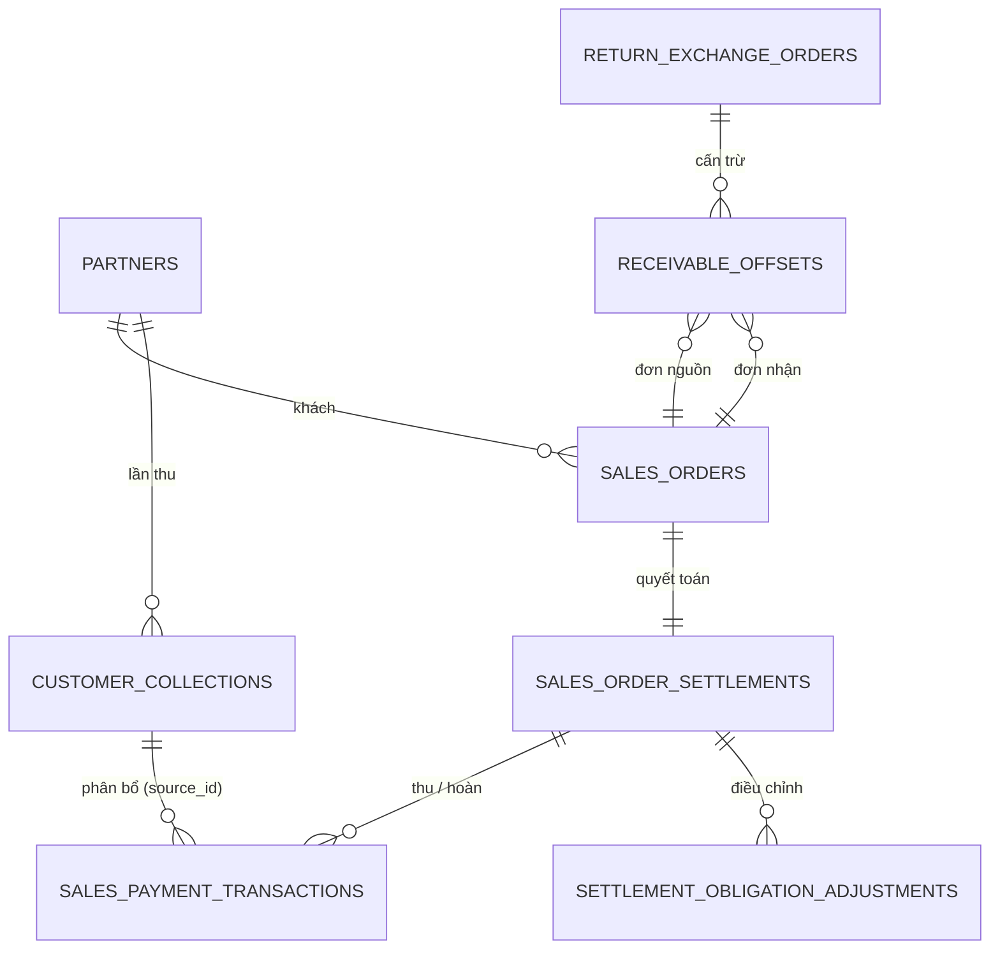

# TH-06 — Công nợ phải thu

> **Vai trò:** **đặc tả chuẩn (source of truth)** cho Theme 6. Theme **chưa có code**: mọi mục là 🆕 trừ khi ghi khác. Gắn 🔧 = sửa hành vi đang có của theme khác (TH-05, TH-03), là **đổi có chủ đích** đã được người dùng chốt.
> **Phiên bản:** 1.0 · **Ngày:** 2026-11-18 · **Trạng thái:** người dùng duyệt 2026-11-18 · **Branch đối chiếu:** `refactor/simple-arch`
> **Nguồn:** bàn trong chat 2026-11-18 (người dùng trả lời từng câu, mục 1.8); PLAN.md mục "Theme 6" (phạm vi 2026-10-27); bản nháp BA `specs/themes/theme-06` v2.1.3 (đã xoá ở `5db3c62d9`, chỉ tham khảo khái niệm "cấn trừ khác chênh lệch", KB-005).
> **Đầu vào kỹ thuật:** TH-05 (đơn, đổi/trả, huỷ), TH-03 (hồ sơ khách PT-07), TH-01 (quyền: vai trò chỉ là nhãn).
> **Sở hữu dữ liệu tiền (chốt 2026-11-18, Q12):** mọi bảng / cột **lưu tiền** của đơn (quyết toán, giao dịch thu / hoàn, điều chỉnh nghĩa vụ, ngày hẹn) được **mô tả ở TH-06** (mục 2.1, 2.2, 3.2), TH-05 chỉ trỏ sang. **DB chuyển theo (cách A):** 3 bảng tiền chuyển từ schema `sales` sang schema mới **`receivable`** (giữ tên bảng); bảng / RPC mới của Theme 6 cũng ở `receivable`; RPC cũ của TH-05 ở lại `sales`, được tạo lại để trỏ bảng mới — app không đổi (mục 3.6).
>
> **Cách đọc:** mục 1–3 là mô hình và dữ liệu; mục 4 chia theo epic → user story (FR, AC, EC, Gherkin); mục 5 đặc tả màn; mục 6 RPC và lỗi; mục 7 quyền, sửa theme khác; mục 8 ngoài phạm vi; mục 9 kiểm thử.

---

## Mục lục

1. [Tổng quan](#1-tổng-quan)
2. [Mô hình nghiệp vụ](#2-mô-hình-nghiệp-vụ)
3. [Dữ liệu](#3-dữ-liệu)
4. [Epic và user story](#4-epic-và-user-story)
5. [Đặc tả màn hình](#5-đặc-tả-màn-hình)
6. [Kỹ thuật: RPC, lỗi](#6-kỹ-thuật-rpc-lỗi)
7. [Phân quyền & sửa theme khác](#7-phân-quyền--sửa-theme-khác)
8. [Ngoài phạm vi](#8-ngoài-phạm-vi)
9. [Kiểm thử](#9-kiểm-thử)

---

## 1. Tổng quan

### 1.1 Mục đích

Cửa hàng thuốc thú y bán nợ cho khách quen (đại lý, trại). Đến nay mỗi đơn tự biết mình còn nợ bao nhiêu (TH-05), nhưng chủ cửa hàng không trả lời được ba câu:

1. **Ai đang nợ, nợ bao nhiêu?** Tổng phải thu của cửa hàng, của từng khách.
2. **Khoản nào trễ hẹn?** Đơn nào đã qua ngày hẹn trả mà còn nợ.
3. **Khách trả một cục cho nhiều đơn thì ghi thế nào?** Hiện phải mở từng đơn, thu từng phần.

Thêm một tình huống: khách mang trả hàng của một đơn đã trả đủ, trong khi đang nợ đơn khác. Hiện cửa hàng phải hoàn tiền mặt cho khách rồi thu lại ngay chính số tiền đó. Theme 6 cho **cấn trừ**: trừ thẳng số tiền khách được hoàn vào nợ của đơn khác.

### 1.2 Bối cảnh nghiệp vụ

Một ngày ở cửa hàng:

- Sáng, chủ cửa hàng mở **Công nợ phải thu**: tổng 45.200.000đ, 12 khách; lọc **Quá hạn** thấy 3 khách, gọi điện nhắc (ngoài app).
- Trưa, anh Tuấn (đại lý) ghé trả 10.000.000đ. Nhân viên mở công nợ của anh Tuấn, bấm **Thu tiền**, nhập 10.000.000đ. App chia vào các đơn còn nợ, **đơn cũ trước**: trả hết DH-001 (4tr), trả 6tr cho DH-002.
- Chiều, anh Tuấn mang trả 2 hộp thuốc của DH-001 (đã trả đủ) trị giá 500.000đ. Ở bước quyết toán đổi/trả, app đề xuất **cấn trừ 500.000đ vào DH-002** còn nợ. Không có tiền mặt đi ra; DH-002 giảm nợ 500.000đ.

### 1.3 Ý tưởng chủ đạo

| Ý tưởng | Nội dung | Ở đâu |
|---|---|---|
| **Công nợ đọc từ sổ đơn** | Không có bảng số dư riêng. Nợ của khách = Σ `outstanding` các đơn `completed` của khách. Không bao giờ lệch với đơn | RPC đọc, mục 2.2 |
| **Mọi tiền vẫn đi qua quyết toán đơn** | Thu theo khách = nhiều giao dịch `collection`, mỗi đơn một giao dịch. Cấn trừ = một `refund` ở đơn nguồn + một `collection` ở đơn nhận. Quyết toán từng đơn tự tính lại như TH-05 | `_recompute_sales_settlement` (TH-05) |
| **App không giữ tiền của khách** | Không có tiền trả trước, số dư có, tiền thừa treo. Thu không vượt tổng nợ; khoản khách được hưởng không cấn trừ hết thì hoàn | BR-03, BR-12 |
| **Cấn trừ ≠ chênh lệch** | Cấn trừ là một nghiệp vụ có bản ghi (đơn nào sang đơn nào, bao nhiêu, ai, lúc nào), không phải phép trừ hiển thị | `receivable_offsets` |
| **Sai thì sửa ở DB** | Không huỷ, không sửa khoản thu / cấn trừ trên app. Ghi nhầm → bên kỹ thuật sửa DB | BR-07 |

### 1.4 Trong phạm vi

| Epic | Nội dung |
|---|---|
| EP-01 Tra cứu công nợ | Danh sách khách còn nợ (tổng, lọc quá hạn, tìm), công nợ của một khách (đơn còn nợ, lịch sử thu / cấn trừ) |
| EP-02 Thu tiền theo khách | Một khoản thu chia vào nhiều đơn, cũ trước |
| EP-03 Cấn trừ khi đổi/trả | Khoản khách được hưởng khi trả hàng: giảm nợ đơn đó → cấn trừ đơn khác → còn thừa mới hoàn |
| EP-04 Lối vào | Menu Thêm, hồ sơ khách (TH-03), chi tiết đơn (TH-05) |

### 1.5 Ngoài phạm vi theme

Xem [mục 8](#8-ngoài-phạm-vi). Tóm tắt: không phải trả nhà cung cấp, không hạn mức nợ, không nhắc nợ, không giữ tiền / số dư khách, không phiếu thu riêng, không huỷ / sửa khoản thu, không số dư đầu kỳ, không đối chiếu, không phê duyệt.

### 1.6 Tác nhân

| Tác nhân | Làm gì |
|---|---|
| Chủ cửa hàng | Xem tổng phải thu, quá hạn; thu tiền; cấn trừ |
| Nhân viên (mọi vai trò) | Như chủ cửa hàng (TH-01 BR-52: vai trò chỉ là nhãn) |
| Bên kỹ thuật | Sửa DB khi ghi nhầm (ngoài app) |

### 1.7 Liên hệ với các theme khác

| Theme | Liên hệ |
|---|---|
| TH-05 Bán hàng | Nguồn duy nhất của công nợ: đơn `completed` có khách, `outstanding > 0`, `payment_due_date`. Theme 6 **thêm** RPC thu theo khách và **sửa** quyết toán đổi/trả (mục 7.3) |
| TH-03 Đối tác | Khách = `partner.partners` vai trò khách hàng. Hồ sơ PT-07 thêm khối "Công nợ" (mục 7.3) |
| TH-01 IAM | Quyền `receivable.*`; phạm vi cửa hàng `iam.can_access_store` |
| TH-08 HĐĐT | Không đụng. Thu tiền / cấn trừ không phát hành lại hoá đơn |
| Tích hợp AI | Sau Theme 6 làm phần AI đang hoãn: công cụ `cong_no_phai_thu`, câu thử 15–17, bước demo 4, ô Trang chủ "Phải thu" — thuộc [AI-0](../refactor/plans/AI/AI-0-yeu-cau.md), **không** thuộc TH-06. RPC đọc ở mục 6.2 dùng lại được cho công cụ này |

### 1.8 Quyết định đã chốt (2026-11-18, người dùng)

| # | Câu hỏi | Chốt |
|---|---|---|
| Q1 | Giới hạn của TH-05 (không thu vượt, trả hàng hoàn tiền ngay) | Là tạm vì chưa có Theme 6; Theme 6 được sửa luồng TH-05 |
| Q2 | App có giữ tiền của khách (trả trước, số dư có) không | **Không** |
| Q3 | Cấn trừ là gì | Chỉ khi xác nhận đổi/trả: khoản khách được hưởng giảm nợ chính đơn → cấn trừ vào đơn khác còn nợ của cùng khách (cũ trước, bỏ chọn được) → còn thừa thì hoàn |
| Q4 | Khách trả hàng mà không còn nợ đơn nào | App vẫn ghi **hoàn tiền** như TH-05 (tiền mặt / chuyển khoản, có giao dịch `refund`, phiếu ghi "Hoàn cho khách"); việc đưa tiền thật hai bên tự làm |
| Q5 | Hạn mức nợ | **Không có**. Ngày hẹn vẫn chọn tay lúc bán, không có "hạn trả mặc định" |
| Q6 | Quá hạn | **Chỉ đánh dấu** "Quá hạn N ngày" + lọc Quá hạn. Không nhắc nợ |
| Q7 | Ghi nhầm khoản thu | **Không huỷ, không sửa** trên app; bên kỹ thuật sửa DB |
| Q8 | Lối vào, nội dung danh sách | Menu Thêm → "Công nợ phải thu"; khối Công nợ ở hồ sơ khách; dòng "Xem công nợ của khách" ở chi tiết đơn. Danh sách: ô "Quá hạn" (tiền quá hạn), tổng, tìm, khẩn nhất trước (quá hạn lâu nhất, rồi nợ nhiều; đổi 2026-11-18, thay "nợ nhiều nhất trước") |
| Q9 | Phiếu thu riêng | **Không**. Mỗi đơn được thu sinh phiếu bán hàng phiên bản mới như TH-05 |
| Q10 | Cách xây | Dựa trên sổ đơn TH-05 (không sổ công nợ riêng) |
| Q11 | Phân quyền | Không hỏi: theo TH-01 BR-52, mọi thành viên làm được |
| Q12 | Bảng / cột lưu tiền thuộc theme nào | **Chuyển sang TH-06, cả tài liệu lẫn DB** — cách **A**: chuyển 3 bảng sang schema `receivable`, tạo lại các hàm `sales` đang dùng chúng; RPC TH-05 ở lại `sales`, app không đổi. (Không chọn B: chuyển cả RPC tiền sang `receivable`, sửa app, thêm ~0,5 ngày) |
| Q13 | Rà hết schema `sales`, còn gì của công nợ (R1–R5) | **R1** `sales_orders.payment_due_date` → cột `payment_due_date` của `receivable.sales_order_settlements`, xoá khỏi `sales_orders`. **R2** `valuation_details.settlement_plan` (jsonb) → bảng `receivable.return_exchange_settlement_plans`; định giá hàng ở lại `sales`. **R3** RPC Theme 6 dùng `receivable.idempotency_records` riêng. **R4** `sales.outbox_messages` ở lại (dòng thời gian chung của đơn). **R5** mã quyền `sales.payment.*` giữ tên. Phần còn lại của `sales` (giá trị hàng của đơn, dòng, nháp, phiếu huỷ, phiếu đổi/trả, phiếu bán hàng, bộ đếm) là bán hàng, không chuyển |

**Đề xuất của người viết (chưa hỏi riêng, sửa được khi duyệt):**

| # | Đề xuất | Lý do |
|---|---|---|
| D1 | "Cũ trước" = theo `completed_at` của đơn, cùng thời điểm thì theo `order_code` | Đúng chữ PLAN "cũ trước"; ổn định, dễ kiểm |
| D2 | Công nợ của khách gồm đơn ở mọi cửa hàng người dùng truy cập được (`iam.can_access_store`), không tách theo cửa hàng | Giống danh sách đơn TH-05; app hiện một cửa hàng |
| D3 | Khách đã **ngừng hoạt động** vẫn xem và thu nợ được | Khách ngừng mua vẫn phải trả nợ cũ |
| D4 | Đơn còn nợ không có ngày hẹn (dữ liệu cũ) → hiện "Không có hẹn", không tính quá hạn | Không đoán ngày |
| D5 | Thu theo khách không sửa ngày hẹn của đơn còn lại nợ | Không có câu hỏi về hẹn lại; giữ ngày cũ |

---

## 2. Mô hình nghiệp vụ

### 2.1 Khái niệm

| Khái niệm | Định nghĩa |
|---|---|
| Quyết toán (settlement) | `sales_order_settlements`, 1–1 với đơn: nghĩa vụ gốc, điều chỉnh, nghĩa vụ hiện tại, đã thu, đã hoàn, thu ròng, còn phải thu, trạng thái thanh toán. Sinh lúc hoàn tất đơn (TH-05), **tính lại** sau mỗi giao dịch / điều chỉnh (`_recompute_sales_settlement`) |
| Giao dịch tiền | `sales_payment_transactions`: `collection` (thu, chiều vào) hoặc `refund` (hoàn, chiều ra). Số tiền > 0. Không sửa, không xoá |
| Nguồn giao dịch | `checkout` (lúc bán), `additional_collection` (thu một đơn sau bán, SG-11; **không còn trên giao diện** từ 2026-11-18, giữ để đọc dữ liệu cũ), `receivable_collection` 🆕 (thu theo khách), `return_exchange` (quyết toán đổi/trả, gồm cấn trừ), `cancellation` (không dùng), `manual_correction` (hoàn thủ công, không dùng) |
| Điều chỉnh nghĩa vụ | `settlement_obligation_adjustments`: mỗi nguồn (một phiếu huỷ, một phiếu đổi/trả) tối đa 1 dòng, số tiền có dấu |
| Phương thức thanh toán | `cash` (Tiền mặt), `manualBankTransfer` (Chuyển khoản, kèm mã giao dịch tuỳ chọn), `offset` 🆕 (Cấn trừ, chỉ nội bộ) |
| Đơn còn nợ | Đơn `sales_orders` `lifecycle_status = completed`, có `customer_partner_id`, settlement `outstanding_amount_minor > 0` |
| Khách còn nợ | Khách có ≥ 1 đơn còn nợ |
| Công nợ của khách | Σ `outstanding` các đơn còn nợ của khách. **Tính khi đọc**, không lưu |
| Ngày hẹn | `receivable.sales_order_settlements.payment_due_date` của từng đơn (trước Q13 R1 ở `sales_orders`); ghi lúc bán (TH-05 BR-20) và khi đổi/trả phát sinh nợ (TH-05 BR-51) |
| Đơn quá hạn | Đơn còn nợ có ngày hẹn **trước** hôm nay (giờ Việt Nam) |
| Số ngày quá hạn | Hôm nay − ngày hẹn (ngày). Của khách = số lớn nhất trong các đơn quá hạn |
| Lần thu theo khách | Bản ghi `customer_collections`: một khoản khách trả, chia vào ≥ 1 đơn. **Không phải phiếu thu** (không in, không số phiếu hiển thị cho khách) |
| Phân bổ | Một giao dịch `collection` ở một đơn, thuộc một lần thu theo khách |
| Cấn trừ | Bản ghi `receivable_offsets`: khi xác nhận một phiếu đổi/trả, chuyển X đồng khách được hưởng ở **đơn nguồn** sang trả nợ **đơn nhận** của cùng khách. Không có tiền thật đi ra / vào |
| Phương thức "Cấn trừ" | Mã `offset`. Chỉ dùng nội bộ cho hai giao dịch của một cấn trừ; người dùng không chọn được ở màn thu tiền |

### 2.2 Công thức

**Quyết toán một đơn** (chuyển từ TH-05 2.2, không đổi)

```text
current_payable   = original_payable + Σ obligation_adjustments
collected         = Σ collection đã xác nhận
refunded          = Σ refund đã xác nhận
net_collected     = collected − refunded
outstanding       = max(current_payable − net_collected, 0)
```

`original_payable` = `sales_orders.payable_amount_minor` (TH-05). Huỷ đơn: điều chỉnh = −`current_payable` (TH-05). Đổi/trả: điều chỉnh = `net_difference` (TH-05).

**Trạng thái thanh toán** (chuyển từ TH-05 2.3, không đổi; tính lại sau mỗi giao dịch / điều chỉnh)

| Giá trị | Nhãn | Điều kiện (theo thứ tự kiểm) |
|---|---|---|
| `no_balance` | Không phát sinh | `current_payable ≤ 0` và chưa có giao dịch nào |
| `refunded` | Đã hoàn tiền | `net_collected ≤ 0` và đã từng hoàn |
| `unpaid` | Chưa thanh toán | `net_collected ≤ 0` |
| `partially_refunded` | Hoàn một phần | đã từng hoàn và `outstanding > 0` |
| `paid` | Đã thanh toán | `outstanding = 0` |
| `partially_paid` | Thanh toán một phần | còn lại |

Danh sách đơn (TH-05) gộp `unpaid` + `partially_paid` thành "Còn phải thu". Giao dịch `offset` tính như mọi giao dịch: đơn nguồn cấn trừ có thể thành "Hoàn một phần" / "Đã hoàn tiền".

**Công nợ**

```text
cong_no_khach        = Σ outstanding (đơn completed, cùng khách, outstanding > 0)
tong_phai_thu        = Σ cong_no_khach (mọi khách còn nợ)
qua_han(đơn)         = outstanding > 0 và payment_due_date < hôm_nay_VN
so_ngay_qua_han(đơn) = hôm_nay_VN − payment_due_date
so_ngay_qua_han(khách) = max(so_ngay_qua_han(đơn quá hạn))
```

**Thu theo khách** (D1)

```text
đơn_áp_dụng = các đơn người dùng chọn; không chọn (chế độ "Tự động") = mọi đơn còn nợ của khách
0 < số_thu ≤ Σ outstanding(đơn_áp_dụng)
đơn_áp_dụng xếp theo (completed_at, order_code) tăng dần
còn = số_thu
với mỗi đơn:  phân_bổ = min(còn, outstanding_đơn);  còn −= phân_bổ;  dừng khi còn = 0
```

**Quyết toán đổi/trả khi khách được hưởng** (net_difference < 0) 🔧 thay công thức TH-05 2.2

```text
được_hưởng   = |net_difference|
giảm_nợ      = min(được_hưởng, outstanding_đơn_nguồn)                (giảm nợ chính đơn — trước tiên)
còn_lại      = được_hưởng − giảm_nợ                                  (≤ net_collected đơn nguồn)
cấn_trừ      = Σ trên các đơn nhận được chọn, cũ trước:
                 min(còn_lại chưa dùng, outstanding_đơn_nhận)
hoàn         = còn_lại − cấn_trừ                                     (tiền mặt / chuyển khoản)
```

> TH-05 hiện tại làm ngược: **hoàn trước** (tối đa đã thu ròng), phần dư mới giảm nợ. Ví dụ TH-05 US-06.6 AC-02: đơn 1.000.000 đã trả 400.000, trả hàng 600.000 → hoàn 400.000 + giảm nợ 200.000, khách vẫn nợ 400.000. Theo TH-06: giảm nợ 600.000, không hoàn, khách hết nợ. Đổi có chủ đích (Q1, Q3).

**Ghi sổ một cấn trừ X từ đơn nguồn A sang đơn nhận B**

```text
A: giao dịch refund   X, phương thức offset, nguồn return_exchange  → net_collected(A) −X
B: giao dịch collection X, phương thức offset, nguồn return_exchange → net_collected(B) +X, outstanding(B) −X
receivable_offsets: (phiếu đổi/trả, A, B, X, id hai giao dịch)
```

Điều chỉnh nghĩa vụ của phiếu ở đơn A vẫn = `net_difference` (TH-05 2.2, bất biến 7 giữ nguyên). Tổng tiền thật của cửa hàng không đổi (refund và collection cùng X, cùng phương thức `offset`).

### 2.3 Ví dụ số

Khách Anh Tuấn, ba đơn:

| Đơn | Hoàn tất | Tổng | Đã thu | Còn nợ | Hẹn |
|---|---|---:|---:|---:|---|
| DH-001 | 01/11 | 4.000.000 | 0 | 4.000.000 | 10/11 |
| DH-002 | 05/11 | 10.000.000 | 2.000.000 | 8.000.000 | 15/11 |
| DH-003 | 12/11 | 6.000.000 | 0 | 6.000.000 | 30/11 |

Hôm nay 18/11. Công nợ = 18.000.000; quá hạn: DH-001 (8 ngày), DH-002 (3 ngày) → khách "Quá hạn 8 ngày".

1. **Thu 10.000.000 tiền mặt** → DH-001 +4.000.000 (hết nợ), DH-002 +6.000.000 (còn 2.000.000). Công nợ 8.000.000.
2. **Trả hàng của DH-001**, trị giá 500.000 (DH-001 đã trả đủ, net_collected 4.000.000). Được hưởng 500.000; giảm nợ DH-001 = 0; còn lại 500.000. Đề xuất cấn trừ: DH-002 (cũ nhất còn nợ) 500.000. Hoàn 0. → DH-002 còn 1.500.000. Công nợ 7.500.000.
3. **Trả hàng của DH-003**, trị giá 1.000.000 (DH-003 còn nợ 6.000.000). Giảm nợ DH-003 1.000.000; còn lại 0; không cấn trừ, không hoàn. Công nợ 6.500.000.

### 2.4 Quy tắc nghiệp vụ tổng hợp

**Tra cứu**

| Mã | Quy tắc | Ở đâu |
|---|---|---|
| BR-01 | Chỉ khách có hồ sơ. Đơn Khách lẻ không bao giờ có nợ (TH-05 BR-20), không xuất hiện | RPC đọc |
| BR-02 | Phạm vi: đơn ở cửa hàng người gọi truy cập được (D2). Khách có đơn ở cửa hàng khác không thấy phần đó | `iam.can_access_store` |
| BR-10 | Danh sách khách còn nợ: mặc định xếp theo **mức khẩn**: khách quá hạn (quá hạn lâu nhất trước) → đến hạn hôm nay → hẹn gần nhất → không có ngày hẹn; cùng mức thì công nợ giảm dần, bằng nhau thì tên tăng dần. Lọc quá hạn bằng cách bấm khối "Quá hạn" ở đầu trang. Tìm theo tên, SĐT (bỏ dấu, như TH-03). Phân trang cursor 50 | `list_customer_receivables` |
| BR-11 | Đầu danh sách có hai số, đều tính trên **toàn bộ** phạm vi, không theo ô tìm và không theo bộ lọc: (1) "Quá hạn" = Σ `outstanding` của các đơn đã quá hạn (không phải tổng nợ của khách quá hạn), số khách quá hạn, số ngày quá hạn lâu nhất; (2) "Tổng còn phải thu" = Σ công nợ mọi khách, số khách | như trên |
| BR-12 | Công nợ một khách: đơn còn nợ xếp **cũ trước** (D1) — cùng thứ tự app dùng để chia tiền; lịch sử thu / cấn trừ mới nhất trước | `get_customer_receivable` |

**Thu tiền theo khách**

| Mã | Quy tắc | Ở đâu |
|---|---|---|
| BR-03 | `0 < số thu ≤ Σ còn nợ các đơn áp dụng` (không chọn đơn = công nợ cả khách). Vượt → `OVERPAYMENT_NOT_ALLOWED`; ≤ 0 → `AMOUNT_INVALID` | app + `record_customer_collection` |
| BR-04 | Phương thức: Tiền mặt (`cash`) / Chuyển khoản (`manualBankTransfer`, mã giao dịch tuỳ chọn). Không có "Kết hợp": khách trả hai cách thì ghi hai lần thu | app + RPC |
| BR-05 | Sau khi đơn **hoàn tất**, mọi khoản thu đều đi qua công nợ (CN-03); chi tiết đơn không còn nút "Thu tiền" (đổi 2026-11-18, bỏ SG-11 sau bán). Thanh toán riêng từng đơn chỉ có lúc bán (checkout). CN-03 chỉ có **một cách chọn**: danh sách đơn còn nợ có ô tick, đầu danh sách có ô tick **"Tất cả đơn · trả hết"**; không còn chế độ Tự động / Chọn đơn và không còn nút "Trả hết". Tick đơn nào thì số tiền tự điền = Σ còn nợ các đơn đã tick; người dùng sửa số nhỏ hơn thì chia **cũ trước** trong các đơn đã tick (tick cả khách rồi sửa số = chia cũ trước như trước đây). Không gõ số riêng từng đơn. RPC nhận `p_order_ids` (**bắt buộc, ≥ 1 đơn**); `p_expected_outstanding_minor` = Σ còn nợ các đơn đã chọn | RPC |
| BR-06 | Một transaction: khoá settlement các đơn còn nợ của khách (theo `id`), so Σ còn nợ **các đơn đã chọn** với số app đã thấy (`p_expected_outstanding_minor`, như BR-05); khác → `RECEIVABLE_CHANGED`, không ghi gì. Ghi 1 `customer_collections` + N giao dịch `collection` (`source_context = receivable_collection`, `source_type = customer_collection`, `source_id` = id lần thu); tính lại settlement từng đơn; sinh phiếu bán hàng phiên bản mới cho từng đơn; ghi `sales_payment_recorded.v1` cho từng đơn | `record_customer_collection` |
| BR-07 | Lần thu, giao dịch, cấn trừ **không sửa, không xoá, không huỷ** trên app (Q7). Ghi nhầm → bên kỹ thuật sửa DB | — |
| BR-08 | Chống trùng: `idempotency_key` mới cho mỗi lần mở màn thu, giữ nguyên khi thử lại; cùng key + cùng nội dung → trả kết quả cũ; khác nội dung → `IDEMPOTENCY_CONFLICT` | `receivable.idempotency_records` (Q13 R3), scope `customer_collection` |
| BR-09 | Thu không đổi ngày hẹn của đơn (D5). Khách ngừng hoạt động vẫn thu được (D3) | RPC |

**Cấn trừ khi đổi/trả** 🔧 sửa TH-05 BR-48…BR-51

| Mã | Quy tắc | Ở đâu |
|---|---|---|
| BR-20 | Chỉ khi phiếu đổi/trả có `net_difference < 0` và đơn nguồn có khách. Khách lẻ: không cấn trừ (vẫn hoàn như TH-05) | `evaluate_return_exchange_valuation`, `confirm_return_exchange` |
| BR-21 | Thứ tự: giảm nợ chính đơn nguồn → cấn trừ → hoàn (công thức 2.2) | như trên |
| BR-22 | Đơn nhận cấn trừ: đơn còn nợ khác của cùng khách, trong phạm vi BR-02, xếp cũ trước. Kế hoạch quyết toán trả danh sách đề xuất (`offset_candidates`) kèm số cấn trừ mỗi đơn | `evaluate_return_exchange_valuation` |
| BR-23 | Mặc định chọn **mọi** đơn đề xuất. Người dùng bỏ chọn được từng đơn; số cấn trừ tính lại theo các đơn còn chọn (cũ trước), phần không cấn trừ chuyển sang "Hoàn cho khách" | SG-13 (TH-05) |
| BR-24 | Xác nhận gửi danh sách đơn nhận được chọn (`offset_target_order_ids`). Server tính lại cấn trừ; đơn nhận nào đã hết nợ hoặc đổi version settlement → `STALE_VERSION` (người dùng tải lại quyết toán) | `confirm_return_exchange` |
| BR-25 | Mỗi cấn trừ ghi 2 giao dịch (công thức 2.2) + 1 dòng `receivable_offsets`; tính lại settlement đơn nguồn và các đơn nhận; sinh phiếu bán hàng mới cho các đơn nhận; ghi `receivable_offset_recorded.v1` vào outbox của **cả hai** đơn | `confirm_return_exchange` |
| BR-26 | Không còn đơn nào để cấn trừ, hoặc bỏ chọn hết → hoàn toàn bộ `còn_lại` bằng tiền mặt / chuyển khoản như TH-05 (Q4) | như trên |
| BR-27 | Hoàn tiền vẫn ≤ `net_collected` đơn nguồn (TH-05). Theo công thức 2.2 luôn đúng vì `còn_lại ≤ net_collected` | như trên |

**Hiển thị quá hạn**

| Mã | Quy tắc | Ở đâu |
|---|---|---|
| BR-30 | "Quá hạn N ngày" (đỏ, kèm biểu tượng, không chỉ màu); "Hẹn dd/MM" (thường) khi chưa tới hạn; "Đến hạn hôm nay" khi ngày hẹn = hôm nay; "Không có hẹn" khi thiếu ngày (D4) | CN-01, CN-02 |
| BR-31 | "Hôm nay" tính theo giờ Việt Nam ở **server** (`now() at time zone 'Asia/Ho_Chi_Minh'`), app chỉ hiển thị số ngày server trả | RPC đọc |

---

## 3. Dữ liệu

### 3.1 Sơ đồ quan hệ



Bảng tiền và bảng mới ở schema **`receivable`** (Q12, Q13, mục 3.6); `sales_orders`, phiếu đổi/trả, phiếu huỷ ở lại `sales`. Không có bảng số dư theo khách: công nợ khách cộng từ `outstanding` khi đọc.

**Dữ liệu công nợ lấy từ đâu**

| Cần biết | Bảng / cột | Schema | Mô tả ở |
|---|---|---|---|
| Khách là ai | `partners` | `partner` | TH-03 |
| Đơn của khách nào, hoàn tất lúc nào, đã huỷ chưa, giá trị hàng | `sales_orders` (`customer_partner_id`, `completed_at`, `lifecycle_status`, `order_code`, `payable_amount_minor`) | `sales` | TH-05 |
| Mỗi đơn phải trả / đã thu / còn nợ / **hẹn trả** | `sales_order_settlements` | `receivable` | **TH-06** 3.2 |
| Từng lần thu / hoàn / cấn trừ | `sales_payment_transactions` | `receivable` | **TH-06** 3.2 |
| Giảm nợ do trả hàng / huỷ | `settlement_obligation_adjustments` | `receivable` | **TH-06** 3.2 |
| Kế hoạch tiền của phiếu đổi/trả (thu / hoàn / ghi nợ / giảm nợ / cấn trừ) | `return_exchange_settlement_plans` 🆕 | `receivable` | **TH-06** 3.3 |
| Một lần thu chia vào nhiều đơn | `customer_collections` 🆕 | `receivable` | **TH-06** 3.3 |
| Cấn trừ đơn nào sang đơn nào | `receivable_offsets` 🆕 | `receivable` | **TH-06** 3.3 |
| Chống bấm trùng lệnh của Theme 6 | `idempotency_records` 🆕 | `receivable` | **TH-06** 3.3 |
| Dòng thời gian của đơn (gồm sự kiện tiền) | `outbox_messages` | `sales` (R4) | TH-05 3.6 |

**Ở lại `sales`, không phải công nợ (Q13):** giá trị hàng của đơn (`subtotal…payable_amount_minor`), dòng đơn (giá, `cogs_*` của Theme 7), nháp, phiếu huỷ, phiếu đổi/trả + dòng + định giá hàng (`return_value`, `exchange_value`, `net_difference`), phiếu bán hàng (chỉ chụp số tiền lúc in), bộ đếm mã đơn, trạng thái trả hàng. Mã quyền `sales.payment.*` giữ tên (R5).

### 3.2 Bảng tiền của đơn (chuyển từ TH-05 3.4, đã có trong DB)

Tạo ở `20260830005_sales_rebuild_schema.sql` trong schema `sales`; T6-1a chuyển sang `receivable` (mục 3.6). Tên bảng, cột, ràng buộc giữ nguyên; TH-06 chỉ **thêm** (đánh 🆕).

**`receivable.sales_order_settlements`** — quyết toán, 1–1 với đơn

| Cột | Kiểu | Bắt buộc | Ghi chú |
|---|---|---|---|
| `id`, `tenant_id` | uuid | ✓ | |
| `sales_order_id` | uuid | ✓ | duy nhất (1–1) |
| `currency_code` | char(3) | ✓ | `VND` |
| `original_payable_amount_minor` | bigint | ✓ | = `payable` của đơn, không đổi |
| `post_sale_adjustment_amount_minor` | bigint | ✓ | Σ điều chỉnh, có dấu, mặc định 0 |
| `current_payable_amount_minor` | bigint | ✓ | CHECK = gốc + điều chỉnh |
| `collected_amount_minor`, `refunded_amount_minor` | bigint | ✓ | Σ thu, Σ hoàn (gồm `offset`) |
| `net_collected_amount_minor` | bigint | ✓ | CHECK = thu − hoàn |
| `outstanding_amount_minor` | bigint | ✓ | còn phải thu (công thức 2.2). **Nguồn duy nhất của công nợ** |
| `payment_status` | text | ✓ | bảng 2.2 |
| `version` | bigint | ✓ | tăng mỗi lần tính lại; dùng chống ghi đè (BR-24) |
| `settled_at` | timestamptz | | lúc trả đủ; xoá khi không còn đủ |
| `payment_due_date` 🆕 | date | | **Chuyển từ `sales.sales_orders.payment_due_date` (Q13 R1)**, T6-1a chép dữ liệu rồi xoá cột cũ. Ngày hẹn trả phần còn nợ. Ghi lúc hoàn tất đơn (TH-05 BR-20) và khi đổi/trả phát sinh nợ mới (TH-05 BR-51). Thu tiền không đổi (D5). Dùng tính quá hạn (BR-30) |
| `created_at`, `updated_at` | timestamptz | ✓ | |

**`receivable.sales_payment_transactions`** — giao dịch tiền

| Cột | Kiểu | Bắt buộc | Ghi chú |
|---|---|---|---|
| `id`, `tenant_id` | uuid | ✓ | |
| `sales_order_settlement_id` | uuid | ✓ | quyết toán của đơn |
| `transaction_type` / `direction` | text | ✓ | `collection`/`inflow` hoặc `refund`/`outflow` |
| `amount_minor` | bigint | ✓ | > 0 |
| `currency_code` | char(3) | ✓ | |
| `payment_method_code` | varchar(50) | ✓ | `cash`, `manualBankTransfer`, `offset` 🆕 |
| `payment_method_snapshot` | jsonb | | nhãn phương thức lúc ghi |
| `status` | text | ✓ | `confirmed` (`pending`, `failed` không dùng) |
| `source_context` | text | ✓ | nguồn (2.1); `receivable_collection` có trong CHECK từ đầu, TH-06 mới dùng |
| `source_type`, `source_id` | varchar / uuid | | 🆕 `customer_collection` + id lần thu; `receivable_offset` + id cấn trừ |
| `related_transaction_id` | uuid | | khoản thu được hoàn (hoàn thủ công) |
| `initiated_by_user_id` | uuid | ✓ | người ghi |
| `reason_code`, `reason` | varchar / text | | |
| `external_reference` | varchar(150) | | mã giao dịch chuyển khoản |
| `occurred_at`, `created_at` | timestamptz | ✓ | |

**`receivable.settlement_obligation_adjustments`** — điều chỉnh nghĩa vụ

| Cột | Kiểu | Bắt buộc | Ghi chú |
|---|---|---|---|
| `id`, `tenant_id` | uuid | ✓ | |
| `sales_order_settlement_id` | uuid | ✓ | |
| `source_kind` | text | ✓ | `cancellation` / `return_exchange` |
| `source_id` | uuid | ✓ | phiếu huỷ / phiếu đổi/trả; duy nhất theo (`tenant_id`, `source_kind`, `source_id`) |
| `amount_minor` | bigint | ✓ | có dấu (âm = giảm nợ) |
| `created_at` | timestamptz | ✓ | |

Cấn trừ **không** ghi điều chỉnh nghĩa vụ ở đơn nhận (nghĩa vụ không đổi, chỉ có thêm `collection`).

### 3.3 Bảng mới

Đều ở schema `receivable`. `return_exchange_settlement_plans` và `idempotency_records` làm ở T6-1b (cùng lúc viết lại định giá / xác nhận đổi/trả và RPC mới).

**`receivable.customer_collections`** — một lần thu theo khách

| Cột | Kiểu | Bắt buộc | Ghi chú |
|---|---|---|---|
| `id`, `tenant_id` | uuid | ✓ | |
| `customer_partner_id` | uuid | ✓ | |
| `amount_minor` | bigint | ✓ | > 0; = Σ phân bổ |
| `currency_code` | char(3) | ✓ | `VND` |
| `payment_method_code` | varchar(50) | ✓ | `cash` / `manualBankTransfer` |
| `external_reference` | varchar(150) | | mã giao dịch chuyển khoản |
| `customer_outstanding_before_minor`, `customer_outstanding_after_minor` | bigint | ✓ | để hiện lịch sử, không phải nguồn tính |
| `allocation_snapshot` | jsonb | ✓ | `[{salesOrderId, orderCode, amountMinor, outstandingAfterMinor}]` |
| `collected_by_user_id` | uuid | ✓ | |
| `occurred_at`, `created_at` | timestamptz | ✓ | |

Ràng buộc: `amount_minor > 0`; `before − amount = after`. RLS bật, không policy (chỉ đọc qua RPC `security definer`), như các bảng `sales`.

**`receivable.receivable_offsets`** — một cấn trừ (một cặp đơn nguồn → đơn nhận)

| Cột | Kiểu | Bắt buộc | Ghi chú |
|---|---|---|---|
| `id`, `tenant_id` | uuid | ✓ | |
| `customer_partner_id` | uuid | ✓ | |
| `return_exchange_order_id` | uuid | ✓ | phiếu sinh ra cấn trừ |
| `source_sales_order_id`, `target_sales_order_id` | uuid | ✓ | khác nhau, cùng khách |
| `amount_minor` | bigint | ✓ | > 0 |
| `source_refund_transaction_id`, `target_collection_transaction_id` | uuid | ✓ | hai giao dịch `offset` |
| `created_by_user_id` | uuid | ✓ | |
| `occurred_at`, `created_at` | timestamptz | ✓ | |

Duy nhất theo (`tenant_id`, `return_exchange_order_id`, `target_sales_order_id`).

**`receivable.return_exchange_settlement_plans`** — kế hoạch tiền của một phiếu đổi/trả (Q13 R2; thay `sales.return_exchange_valuations.valuation_details.settlement_plan`)

| Cột | Kiểu | Bắt buộc | Ghi chú |
|---|---|---|---|
| `id`, `tenant_id` | uuid | ✓ | |
| `return_exchange_order_id` | uuid | ✓ | duy nhất (1–1 với phiếu, khoá ngoại sang `sales.return_exchange_orders`) |
| `sales_order_id` | uuid | ✓ | đơn nguồn |
| `net_difference_minor` | bigint | ✓ | chép từ định giá lúc lập kế hoạch (có dấu) |
| `collect_amount_minor` | bigint | ✓ | khách trả thêm ngay (≥ 0) |
| `receivable_create_amount_minor` | bigint | ✓ | phần khách trả thêm thành nợ (≥ 0) |
| `receivable_reverse_amount_minor` | bigint | ✓ | giảm nợ chính đơn nguồn (≥ 0), tính **trước** (công thức 2.2) |
| `offset_amount_minor` 🆕 | bigint | ✓ | tổng cấn trừ sang đơn khác khi chọn hết đề xuất (≥ 0) |
| `refund_amount_minor` | bigint | ✓ | hoàn tiền khi chọn hết đề xuất (≥ 0) |
| `offset_candidates` 🆕 | jsonb | ✓ | `[{salesOrderId, orderCode, completedAt, outstandingMinor, offsetAmountMinor, dueDate, overdueDays, settlementVersion}]`, cũ trước; `[]` khi không có (Khách lẻ, hoặc không còn gì để cấn trừ sau khi giảm nợ) |
| `source_order_version`, `source_settlement_version` | bigint | ✓ | phát hiện thay đổi khi xác nhận |
| `source_session_version`, `pricing_source_version`, `inventory_source_version`, `correlation_id` | bigint / integer / integer / text | | cột kỹ thuật (T6-1b) thay các khoá cùng tên trong jsonb cũ, để xác nhận kiểm phiên bản không đọc jsonb |
| `status` | text | ✓ | `calculated` / `confirmed` (theo định giá) |
| `calculated_at`, `created_at` | timestamptz | ✓ | |

CHECK: `net < 0` ⇒ `collect = receivable_create = 0` và `|net| = receivable_reverse + offset + refund`; `net > 0` ⇒ `receivable_reverse = offset = refund = 0` và `net = collect + receivable_create`; `net = 0` ⇒ mọi số = 0. RPC TH-05 (`evaluate_return_exchange_valuation`, `get_return_exchange_detail`) **vẫn trả khối `settlement_plan` cùng hình dạng JSON** (đọc từ bảng này) để app không vỡ; T6-2 thêm trường cấn trừ phía app.

**`receivable.idempotency_records`** — chống trùng cho RPC của Theme 6 (Q13 R3)

Cùng cấu trúc `sales.idempotency_records` (TH-05 3.6): khoá (`tenant_id`, `command_scope`, `idempotency_key`), `payload_hash`, `status` (`in_progress` / `succeeded` / `failed`), `result_snapshot`, `created_at`. Scope: `customer_collection`. Lệnh TH-05 (kể cả `confirm_return_exchange`) giữ bảng của `sales`.

### 3.4 Sửa bảng có sẵn

| Bảng | Sửa |
|---|---|
| `receivable.sales_payment_transactions` | CHECK mới: `payment_method_code = 'offset'` chỉ đi với `source_context = return_exchange` và `source_type = receivable_offset` (3.2) |
| `receivable.sales_order_settlements` | thêm `payment_due_date` (R1, T6-1a) |
| `sales.sales_orders` | **xoá** `payment_due_date` sau khi chép sang quyết toán (R1, T6-1a) |
| `sales.return_exchange_valuations.valuation_details` | **bỏ** khoá `settlement_plan` sau khi chép sang `return_exchange_settlement_plans` (R2, T6-1b); giữ phần định giá hàng |
| `sales.outbox_messages` | ở lại `sales` (R4); sự kiện mới `receivable_offset_recorded.v1`; `sales_payment_recorded.v1` có thêm `customerCollectionId` khi nguồn là thu theo khách |
| `sales.sales_receipts.receipt_snapshot` | khối "đã trả theo phương thức" thêm dòng "Cấn trừ" khi có giao dịch `offset` |

Index: `sales.sales_orders (tenant_id, customer_partner_id) where lifecycle_status = 'completed'`; `receivable.sales_order_settlements (tenant_id, sales_order_id) where outstanding_amount_minor > 0`; `receivable.sales_order_settlements (tenant_id, payment_due_date) where outstanding_amount_minor > 0`.

### 3.5 Bất biến kiểm tra được

Chạy sau mỗi kịch bản (cùng với TH-05 3.7):

0. (chuyển từ TH-05 3.7 mục 2–4) `settlement.original_payable = order.payable_amount`; `current_payable = original + Σ obligation_adjustments`; `collected = Σ collection`, `refunded = Σ refund`, `outstanding = max(current − (collected − refunded), 0)`; mỗi đơn có đúng 1 settlement.
1. Công nợ khách (RPC đọc) = Σ `outstanding` các đơn `completed` của khách.
2. Mỗi `customer_collections`: `amount = Σ amount` các giao dịch `source_type = customer_collection, source_id = id`; mọi giao dịch đó cùng khách, cùng phương thức.
3. Mỗi `receivable_offsets`: có đúng 1 `refund` `offset` ở đơn nguồn và 1 `collection` `offset` ở đơn nhận, cùng số tiền.
4. Σ `amount` giao dịch `offset` chiều vào = Σ chiều ra (toàn tổ chức).
5. Không giao dịch nào làm `outstanding < 0` hoặc `net_collected` vượt `current_payable` (TH-05).
6. Không có giao dịch `offset` nào ngoài cặp của một `receivable_offsets`.

### 3.6 Chuyển bảng tiền sang schema `receivable` (Q12, cách A; Q13 R1)

**Làm gì:** một migration mới (T6-1a), không sửa migration cũ. R2, R3 làm ở T6-1b (mục 3.3).

1. `create schema receivable`; cấp `usage` cho `authenticated` như các schema nghiệp vụ khác; thêm `receivable` vào `schemas` của `supabase/config.toml` (API) để app gọi được `schema('receivable')`.
2. `alter table sales.<bảng> set schema receivable` cho `sales_order_settlements`, `sales_payment_transactions`, `settlement_obligation_adjustments`. Dữ liệu, khoá chính, khoá ngoại (kể cả khoá tới `sales.sales_orders`), CHECK, index, RLS đi theo bảng; **tên bảng giữ nguyên**.
2b. (R1) `alter table receivable.sales_order_settlements add column payment_due_date date`; chép `update … set payment_due_date = o.payment_due_date from sales.sales_orders o where o.id = sales_order_id`; rồi `alter table sales.sales_orders drop column payment_due_date` (sau bước 3, khi mọi hàm đã đọc / ghi cột mới).
3. Tạo lại (`create or replace`, lấy **bản mới nhất** của từng hàm) mọi hàm đang ghi tên bảng đầy đủ `sales.<bảng>` hoặc đọc / ghi `sales_orders.payment_due_date` — do chúng ghi tên đầy đủ `sales.<bảng>` (`search_path` thật là `sales, …`, không có tham chiếu trần) nên chúng hỏng ngay sau bước 2. Danh sách đo ngày 2026-11-18 (ký hiệu **[R1]** = có dùng `payment_due_date`):

| Migration gốc (bản mới nhất) | Hàm |
|---|---|
| `20260830006` | `sales._apply_settlement_obligation_adjustment`, `_emit_sales_settlement_changed`, `_recompute_sales_settlement`, `audit_sales_review_invariants` |
| `20260830008`, `20261031017` | `sales.finalize_sales_order` [R1] (`precheck_sales_order_checkout` chỉ dùng tham số `p_payment_due_date`, không phải sửa) |
| `20260830009`, `20260904001` | `sales._settlement_id_for_order`, `_settlement_mutation_snapshot`, `record_sales_payment`, `record_sales_refund` |
| `20260830010`, `20261031021` | `sales.generate_sales_receipt` [R1], `get_sales_order_detail`, `get_sales_order_original_receipt` [R1], `get_sales_order_payment_summary` [R1], `get_sales_order_payment_transactions`, `get_sales_order_settlement`, `get_sales_order_timeline`, `list_sales_orders`, `search_sales_orders` |
| `20260830011`, `20260904001` | `sales.precheck_sales_order_cancellation`, `confirm_sales_order_cancellation` |
| `20260830012` | `sales._get_return_exchange_context`, `start_return_exchange` |
| `20260830013` | `sales.evaluate_return_exchange_valuation`, `settle_return_exchange_difference` |
| `20260830014`, `20260904001` | `sales.confirm_return_exchange` [R1] |
| `20261122001` | view `ai_read.don_ban` [R1] (đọc cho trợ lý AI; tự theo bảng khi đổi schema nhưng chặn `drop column` nếu chưa sửa) |

   Trước khi viết migration phải quét lại (`grep -E "sales\.(sales_order_settlements|sales_payment_transactions|settlement_obligation_adjustments)|payment_due_date"` trên `supabase/migrations`, `supabase/tests`) vì có thể có migration mới sau ngày đo, và chạy `impact` GitNexus cho từng hàm (CLAUDE.md).
4. Test SQL đang đọc thẳng bảng (`sales_th05`, `sales_stats`, `inventory_reports`, `inventory_purchase_forecast`, `inventory_issue_multi_line`, `inventory_sales_link`, `ai_read_views`, `ai_run_query` — 8 test; `einvoice_th08` chỉ truyền tham số nên không sửa) đổi `sales.<bảng>` → `receivable.<bảng>` và đọc / ghi `payment_due_date` ở quyết toán thay vì đơn.
5. Cập nhật `supabase/migrations/REGISTRY.yaml`.

**Không làm:** không đổi tên bảng / cột; không chuyển RPC TH-05 sang `receivable` (cách B, không chọn); không sửa app — RPC trả `paymentDueDate` cùng tên trường như cũ (`sales_checkout_json.dart` đọc từ JSON RPC, không đọc bảng).

**Xong khi:** `db reset` local chạy hết migration; toàn bộ test SQL cũ xanh **không sửa kỳ vọng** (chỉ đổi tên schema / chỗ đọc ngày hẹn trong truy vấn); `sales.sales_orders` không còn cột `payment_due_date`; kịch bản đầu–cuối TH-05 9.3 chạy tay qua trên app như trước. Lệnh DB do người dùng chạy local.

---

## 4. Epic và user story

### 4.1 Bản đồ

| Epic | User story | Màn |
|---|---|---|
| EP-01 Tra cứu công nợ | US-01.1 Xem danh sách khách còn nợ | CN-01 |
| | US-01.2 Lọc quá hạn, tìm khách | CN-01 |
| | US-01.3 Xem công nợ của một khách | CN-02 |
| EP-02 Thu tiền theo khách | US-02.1 Thu một khoản chia vào nhiều đơn | CN-03 |
| EP-03 Cấn trừ khi đổi/trả | US-03.1 Xem đề xuất cấn trừ ở quyết toán | SG-13 (TH-05) |
| | US-03.2 Xác nhận đổi/trả có cấn trừ | SG-13, SG-14 (TH-05) |
| | US-03.3 Xem cấn trừ ở đơn và ở công nợ khách | SG-09b (TH-05), CN-02 |
| EP-04 Lối vào | US-04.1 Từ menu Thêm, hồ sơ khách, chi tiết đơn | Thêm, PT-07, SG-09 |

### 4.2 EP-01 — Tra cứu công nợ

**Điểm vào:** Thêm → "Công nợ phải thu" (`/more/receivables`); khối "Công nợ" ở PT-07; dòng "Xem công nợ của khách" ở SG-09.

#### US-01.1 — Xem danh sách khách còn nợ

| Là | Tôi muốn | Để |
|---|---|---|
| Chủ cửa hàng | thấy ngay bao nhiêu tiền đang quá hạn, ai cần đòi trước, và tổng tiền khách đang nợ | biết tiền đang nằm ở đâu, gọi ai trước |

**Yêu cầu chức năng**

- FR-01: CN-01 đầu trang, theo thứ tự: khối "Quá hạn <số tiền>" · "<n> khách · lâu nhất <N> ngày" (to nhất, màu cảnh báo, BR-11); rồi "Tổng còn phải thu <số>" · "<n> khách" (nhỏ hơn).
- FR-06: Bấm khối "Quá hạn" = chỉ xem khách quá hạn (không có nút lọc riêng). Khi đang lọc, khối có viền đậm và chữ "Xem tất cả"; bấm lại để bỏ lọc. Không có khoản quá hạn → khối đổi thành "Không có khoản nào quá hạn" / "Tất cả khách đang nợ còn trong hạn hẹn.", không bấm được.
- FR-02: Mỗi dòng: tên khách, SĐT, công nợ, "<n> đơn", nhãn hạn (BR-30: quá hạn lâu nhất của khách, hoặc hẹn gần nhất). Chạm → CN-02.
- FR-03: Xếp theo mức khẩn (BR-10). Cuộn tới cuối tải thêm (cursor).
- FR-04: Kéo xuống để tải lại.
- FR-05: Không có khách nào nợ → trạng thái trống "Không có khách nào đang nợ — Đơn bán nợ sẽ hiện ở đây." (không nút).

**Quy tắc:** BR-01, BR-02, BR-10, BR-11, BR-30, BR-31.

**Tiêu chí nghiệm thu**

- AC-01: Dữ liệu ví dụ 2.3 trước bước 1: Anh Tuấn 18.000.000, "3 đơn", "Quá hạn 8 ngày".
- AC-02: Tổng ở đầu trang = Σ công nợ mọi dòng (khi đã tải hết).
- AC-03: Đơn đã huỷ, đơn đã trả đủ, đơn Khách lẻ không góp vào số nào.
- AC-04: Cùng mức khẩn (cùng không quá hạn, cùng có hẹn gần nhất…): khách A 5.000.000, khách B 9.000.000 → B trên A.
- AC-05: Khách quá hạn nằm trên khách chưa quá hạn dù nợ ít hơn: Anh Bình nợ 850.000 quá hạn 21 ngày trên Cửa hàng Minh Châu nợ 14.200.000 hẹn 28/11. Hai khách cùng quá hạn: quá hạn lâu hơn lên trên.
- AC-06: Ví dụ 2.3 trước bước 1: khối "Quá hạn 12.000.000 ₫ · 1 khách · lâu nhất 8 ngày" (chỉ DH-001 4.000.000 + DH-002 8.000.000 đã quá hạn, không tính DH-003 hẹn 30/11); "Tổng còn phải thu 26.500.000 ₫ · 3 khách"; thứ tự Anh Tuấn → Trại Hưng Phát (đến hạn hôm nay) → Chị Lan (hẹn 25/11).
- AC-07: Khối "Quá hạn" và tổng không đổi khi bật lọc hay gõ tìm.

**Trường hợp biên**

- EC-01: Lỗi tải → "Không tải được công nợ" + "Thử lại"; giữ dữ liệu cũ nếu có.
- EC-02: Khách ngừng hoạt động vẫn hiện, có nhãn "Ngừng hoạt động" (D3).

#### US-01.2 — Lọc quá hạn, tìm khách

| Là | Tôi muốn | Để |
|---|---|---|
| Chủ cửa hàng | chỉ xem khách trễ hẹn, hoặc tìm nhanh một khách | gọi nhắc đúng người |

**Yêu cầu chức năng**

- FR-01: Lọc khách quá hạn bằng khối "Quá hạn" ở đầu CN-01 (US-01.1 FR-06); không có nút chọn riêng. Khi danh sách đang lọc hoặc tìm và ít hơn tổng, hiện dòng "Đang hiển thị <n> / <N> khách" (N = số khách còn nợ trong phạm vi).
- FR-02: Ô "Tìm tên, SĐT" (gõ xong 300 ms mới tìm), bỏ dấu.
- FR-03: Lọc + tìm cùng lúc được. Không có kết quả → "Không tìm thấy khách phù hợp." + "Xoá tìm kiếm".
- FR-04: Ở chế độ "Quá hạn", dòng hiện "Quá hạn N ngày · <số tiền quá hạn>" (Σ outstanding các đơn quá hạn), vẫn xếp theo mức khẩn.

**Tiêu chí nghiệm thu**

- AC-01: Ví dụ 2.3: khối "Quá hạn 12.000.000 ₫ · 1 khách"; bấm khối → chỉ Anh Tuấn, "Quá hạn 8 ngày · 12.000.000".
- AC-02: Tìm "tuan" thấy "Anh Tuấn".
- AC-03: Đơn hẹn đúng hôm nay không tính quá hạn ("Đến hạn hôm nay").

```gherkin
Scenario: SC-01 — Lọc khách quá hạn
  Given hôm nay là 18/11/2026
  And khách "Anh Tuấn" có đơn DH-001 còn nợ 4.000.000 hẹn 10/11
  And khách "Chị Lan" có đơn còn nợ 6.000.000 hẹn 25/11
  When tôi mở "Công nợ phải thu" và chọn "Quá hạn"
  Then tôi chỉ thấy "Anh Tuấn" với "Quá hạn 8 ngày"
```

#### US-01.3 — Xem công nợ của một khách

| Là | Tôi muốn | Để |
|---|---|---|
| Nhân viên | biết khách nợ những đơn nào, bao nhiêu, đã trả / cấn trừ những gì | trả lời khách và thu đúng |

**Yêu cầu chức năng**

- FR-01: CN-02 đầu trang: tên khách, SĐT, "Còn nợ <số>", "<n> đơn · <m> quá hạn".
- FR-02: Khối "Đơn còn nợ" (cũ trước, BR-12): mã đơn, ngày bán, tổng đơn, "Còn nợ <số>", nhãn hạn. Chạm → SG-09 (TH-05).
- FR-03: Khối "Lịch sử thu & cấn trừ" (mới nhất trước, 20 dòng, "Xem thêm"):
  - Lần thu: "Thu <số> · Tiền mặt|Chuyển khoản <mã>" · thời gian · người thu · "Vào: DH-001 4.000.000, DH-002 6.000.000".
  - Thu ở một đơn (lúc bán, hoặc dữ liệu cũ từ SG-11): "Thu <số> · đơn DH-…" (lấy từ giao dịch `additional_collection` / `checkout`).
  - Cấn trừ: "Cấn trừ <số> · từ trả hàng đơn DH-001 (phiếu #DT…) sang đơn DH-002".
  - Hoàn tiền (đổi/trả): "Hoàn <số> · đơn DH-…".
- FR-04: Nút dưới "Thu tiền" (khi công nợ > 0) → CN-03.
- FR-05: Khách hết nợ (vào từ PT-07 hoặc vừa thu xong) → "Không còn nợ", ẩn "Thu tiền", vẫn hiện lịch sử.
- FR-06: Mỗi khối tải lỗi riêng có "Thử lại" (như TH-05 BR-35).

**Tiêu chí nghiệm thu**

- AC-01: Σ "Còn nợ" các đơn = "Còn nợ" đầu trang.
- AC-02: Sau bước 2 ví dụ 2.3, lịch sử có dòng cấn trừ 500.000 từ DH-001 sang DH-002.
- AC-03: Đơn trả đủ biến mất khỏi "Đơn còn nợ" nhưng lần thu vẫn ở lịch sử.

### 4.3 EP-02 — Thu tiền theo khách

#### US-02.1 — Thu một khoản chia vào nhiều đơn

| Là | Tôi muốn | Để |
|---|---|---|
| Nhân viên | ghi một khoản khách trả: để app tự chia vào các đơn, hoặc chọn đúng những đơn khách muốn trả | không phải mở từng đơn, không chia sai |

**Yêu cầu chức năng**

- FR-01: CN-03 "Thu tiền": "Anh Tuấn · Còn nợ 18.000.000"; danh sách đơn có ô tick (FR-10); ô "Số tiền" (bàn phím số, định dạng nghìn; tự điền theo các đơn đã tick, sửa được); "Phương thức" Tiền mặt (mặc định) / Chuyển khoản; "Mã giao dịch (Không bắt buộc)" khi Chuyển khoản. Không có nút "Trả hết" (thay bằng ô tick "Tất cả đơn · trả hết").
- FR-02: Danh sách đơn là phần chính của màn: mỗi đơn một dòng "DH-001 · còn nợ 4.000.000" + nhãn hạn. Khi số hợp lệ, **kết quả chia hiện ngay trong từng dòng đơn** (công thức 2.2, tính **trên máy** từ danh sách đơn của CN-02): "Trừ 4.000.000 → hết nợ", "Trừ 6.000.000 → còn 2.000.000"; đơn đã tick chưa nhận tiền ghi "Chưa nhận"; đơn không tick ghi "Không thu". Dòng "Khách còn nợ sau khi thu <số>" nằm trên nút xác nhận. Sheet xác nhận (FR-04) vẫn có khối "Sẽ trừ vào".
- FR-03: Lỗi nhập ngay dưới ô: > công nợ → "Số tiền vượt quá tổng còn nợ của khách."; = 0 → nút khoá.
- FR-04: "Xác nhận thu" → sheet "Xác nhận thu tiền?": "Thu <số> <phương thức> từ <khách>", danh sách "Sẽ trừ vào", ("Quay lại" / "Xác nhận").
- FR-05: Gọi `record_customer_collection` với `p_expected_outstanding_minor` = công nợ đang hiện, `idempotency_key` sinh khi mở CN-03 (BR-08). Nút "Đang ghi nhận...".
- FR-06: Thành công → đóng CN-03, toast "Đã thu <số> từ <khách>", CN-02 và CN-01 tải lại.
- FR-07: `RECEIVABLE_CHANGED` → hộp "Công nợ của khách vừa thay đổi. Hãy tải lại rồi thử lại." ("Tải lại": về CN-02 tải lại, giữ số đã nhập nếu vẫn hợp lệ).
- FR-08: Mất mạng / lỗi máy chủ → giữ màn, "Không ghi nhận được. Thử lại?" — "Thử lại" dùng **cùng** key.
- FR-09: Rời màn khi đã nhập số → "Bỏ khoản thu đang nhập?".
- FR-10: Hiện mọi đơn còn nợ của khách (cũ trước), mỗi đơn một ô tick: "DH-002 · còn nợ 8.000.000 · Quá hạn 3 ngày". Mặc định **chưa tick đơn nào**, ô số trống, nút "Xác nhận thu" khoá, gợi ý "Chọn ít nhất một đơn để thu.". Ô tick đầu danh sách "Tất cả đơn · trả hết" (tổng 18.000.000) tick / bỏ tick mọi đơn; trạng thái "một phần" khi chỉ tick vài đơn. Mỗi lần tick / bỏ tick, số tiền được điền lại = Σ còn nợ các đơn đã tick (ghi đè số đã nhập) và "Sẽ trừ vào" tính lại.
- FR-11: Số nhập vượt Σ còn nợ các đơn đã tick → "Số tiền vượt quá tổng còn nợ của các đơn đã chọn." dưới ô; nút khoá. (Câu "…của khách" ở FR-03 không còn dùng vì luôn có đơn đã chọn.)

**Quy tắc:** BR-03…BR-09.

**Tiêu chí nghiệm thu**

- AC-01: Ví dụ 2.3 bước 1: thu 10.000.000 tiền mặt → 2 giao dịch `collection` (DH-001 4.000.000, DH-002 6.000.000), cùng `source_id`; DH-001 "Đã thanh toán", DH-002 "Thanh toán một phần" còn 2.000.000; công nợ 8.000.000.
- AC-02: Tick "Tất cả đơn · trả hết" → số tiền tự điền 18.000.000; thu → cả 3 đơn "Đã thanh toán"; khách biến khỏi CN-01.
- AC-03: Nhập 18.000.001 → không gửi được.
- AC-04: Bấm "Xác nhận" hai lần / thử lại sau mất mạng → 1 `customer_collections`, không trùng giao dịch.
- AC-05: Mỗi đơn được thu có phiếu bán hàng phiên bản mới; ngày hẹn các đơn không đổi.
- AC-06: Lịch sử SG-09c của DH-002 có "Ghi nhận thanh toán tiền mặt" 6.000.000.
- AC-07: Ví dụ 2.3 bước 1, tick chỉ DH-002 → số tiền tự điền 8.000.000; thu → DH-002 "Đã thanh toán", DH-001 và DH-003 không đổi; công nợ khách 10.000.000.
- AC-08: Tick DH-001 và DH-003, sửa số thành 5.000.000 → DH-001 hết nợ (4.000.000), DH-003 còn 5.000.000 (cũ trước trong số đã tick); DH-002 không đổi. Tick cả 3 đơn rồi nhập 10.000.000 → như AC-01 (cũ trước).
- AC-09: Chưa tick đơn nào → nút khoá, thấy gợi ý FR-10; chỉ tick DH-002 rồi nhập 8.000.001 → thấy câu FR-11.
- AC-10: Chi tiết đơn đã hoàn tất không còn nút "Thu tiền"; chỉ có "Xem công nợ của khách".

**Trường hợp biên**

- EC-01: Giữa lúc nhập, người khác thu (ở CN-03 trên máy khác) cho DH-001 → `RECEIVABLE_CHANGED`, không ghi gì.
- EC-02: Giữa lúc nhập, một đơn bị đổi/trả làm giảm nợ → như EC-01.
- EC-03: Khách ngừng hoạt động → vẫn thu được (D3).
- EC-04: Khách lẻ không có công nợ: bán cho khách lẻ phải thanh toán đủ 100% lúc bán (TH-05), nên không có đường vào CN-03.
- EC-05: Một đơn đã chọn bị thu / đổi trả làm hết nợ trong lúc nhập → `RECEIVABLE_CHANGED` (như EC-01).

```gherkin
Scenario: SC-01 — Thu gộp nhiều đơn, cũ trước
  Given khách "Anh Tuấn" nợ DH-001 4.000.000 (bán 01/11) và DH-002 8.000.000 (bán 05/11)
  When tôi mở công nợ "Anh Tuấn", chọn "Thu tiền", nhập 10.000.000 tiền mặt và xác nhận
  Then DH-001 còn nợ 0 và DH-002 còn nợ 2.000.000
  And công nợ của "Anh Tuấn" là 2.000.000

Scenario: SC-04 — Thu đúng một đơn đã chọn
  Given khách "Anh Tuấn" nợ DH-001 4.000.000, DH-002 8.000.000, DH-003 6.000.000
  When tôi mở CN-03, tick DH-002 (số tiền tự điền 8.000.000) và xác nhận
  Then DH-002 còn nợ 0
  And DH-001 và DH-003 không đổi
  And công nợ của "Anh Tuấn" là 10.000.000

Scenario: SC-02 — Thu vượt tổng nợ
  Given khách "Chị Lan" nợ tổng 6.000.000
  When tôi nhập 7.000.000
  Then tôi thấy "Số tiền vượt quá tổng còn nợ của khách."
  And nút "Xác nhận thu" bị khoá

Scenario: SC-03 — Công nợ đổi trong lúc thu
  Given tôi đang ở màn thu tiền của "Anh Tuấn" với công nợ 12.000.000
  And một người khác vừa thu 1.000.000 cho DH-001
  When tôi xác nhận thu 5.000.000
  Then tôi thấy "Công nợ của khách vừa thay đổi. Hãy tải lại rồi thử lại."
  And không có giao dịch mới từ lần bấm của tôi
```

### 4.4 EP-03 — Cấn trừ khi đổi/trả

**Bối cảnh.** Sửa US-06.5…US-06.7 của TH-05 cho trường hợp "khách được hưởng". Trường hợp khách trả thêm và không chênh lệch giữ nguyên TH-05.

#### US-03.1 — Xem đề xuất cấn trừ ở quyết toán

| Là | Tôi muốn | Để |
|---|---|---|
| Nhân viên | thấy tiền khách được hưởng sẽ trừ vào nợ nào trước khi xác nhận | không hoàn tiền mặt rồi lại thu chính số đó |

**Yêu cầu chức năng**

- FR-01: SG-13 trường hợp "Khách được hưởng" (đổi 2026-11-18, bố cục "Dòng tiền"): đầu màn là số "Khách được hưởng <số>" cỡ lớn kèm "Chênh lệch … · Hàng trả … · Hàng đổi …"; rồi một thẻ chia tiền có thanh tỉ lệ và các dòng theo thứ tự công thức 2.2: "Giảm nợ đơn này <số>" (nếu > 0) → "Cấn trừ vào đơn khác <số>" (nếu có đơn đề xuất) → "Hoàn cho khách <số>" + "Phương thức hoàn" (nếu > 0); dưới thẻ là khối "Cấn trừ vào đơn khác" liệt kê các đơn có ô tick (FR-02). Bỏ / chọn đơn thì thẻ chia tiền và thanh tính lại.
- FR-02: Khối "Cấn trừ vào đơn khác": mỗi đơn đề xuất một dòng có ô chọn: "DH-002 · còn nợ 2.000.000 · Quá hạn 3 ngày" và "Trừ 500.000"; mặc định chọn hết (BR-23). Chữ giải thích: "Trừ vào nợ đơn khác của khách thay vì hoàn tiền."
- FR-03: Bỏ / chọn lại một đơn → tính lại trên máy: số trừ từng đơn (cũ trước) và "Hoàn cho khách".
- FR-04: Liệt kê **mọi** đơn còn nợ khác của khách (cũ trước), kể cả đơn chưa được dùng tới (hiện "Trừ 0", chữ mờ). Lý do: bỏ chọn đơn đầu thì đơn sau được dùng.
- FR-05: Khách lẻ / không có đơn khác còn nợ → không có khối cấn trừ; giao diện như TH-05.

**Tiêu chí nghiệm thu**

- AC-01: Ví dụ 2.3 bước 2: SG-13 hiện "Cấn trừ vào đơn khác: DH-002 · Trừ 500.000", "Hoàn cho khách 0" (ẩn phương thức hoàn).
- AC-02: Bỏ chọn DH-002 → "Hoàn cho khách 500.000", hiện phương thức hoàn.
- AC-03: Đơn 1.000.000 đã thu 400.000, trả hàng 600.000 → "Giảm nợ đơn này 600.000", không cấn trừ, không hoàn (🔧 khác TH-05 US-06.6 AC-02).

#### US-03.2 — Xác nhận đổi/trả có cấn trừ

**Yêu cầu chức năng**

- FR-01: Sheet "Xác nhận đổi/trả?" thêm dòng "Cấn trừ <số> vào đơn <mã>" cho từng đơn được chọn.
- FR-02: `confirm_return_exchange` thêm tham số `offset_target_order_ids` (mảng, có thể rỗng) (BR-24).
- FR-03: SG-14 "Kết quả đổi/trả" thêm dòng "Cấn trừ vào DH-002 <số>"; nút "Xem công nợ của khách" khi có cấn trừ.
- FR-04: `STALE_VERSION` do đơn nhận đổi → "Công nợ của khách vừa thay đổi. Hãy tải lại quyết toán." + "Tải lại" (gọi lại định giá).

**Quy tắc:** BR-20…BR-27.

**Tiêu chí nghiệm thu**

- AC-01: Ví dụ 2.3 bước 2 sau xác nhận: DH-001 có `refund` 500.000 `offset`; DH-002 có `collection` 500.000 `offset`, còn nợ 1.500.000; 1 dòng `receivable_offsets`.
- AC-02: Đơn nguồn đã trả đủ 4.000.000, trả hàng 3.000.000, khách nợ DH-002 2.000.000 → cấn trừ 2.000.000, hoàn 1.000.000 (một `refund` `offset` 2.000.000 + một `refund` tiền mặt 1.000.000 ở đơn nguồn).
- AC-03: Xác nhận hai lần → 1 phiếu, 1 bộ giao dịch (idempotent như TH-05).
- AC-04: Khách không còn đơn nào khác nợ → hoàn như TH-05 (Q4).

**Trường hợp biên**

- EC-01: Giữa lúc quyết toán, DH-002 được thu hết ở chỗ khác → `STALE_VERSION`; tải lại thì DH-002 không còn trong đề xuất.
- EC-02: Đơn nhận và đơn nguồn ở hai cửa hàng, người dùng chỉ truy cập một → đơn kia không có trong đề xuất (BR-02).

```gherkin
Scenario: SC-01 — Trả hàng đơn đã trả đủ, cấn trừ vào đơn đang nợ
  Given khách "Anh Tuấn" có DH-001 đã thanh toán đủ và DH-002 còn nợ 2.000.000
  When tôi trả 2 hộp thuốc của DH-001 trị giá 500.000
  Then màn quyết toán đề xuất "Cấn trừ vào đơn khác: DH-002 · Trừ 500.000"
  And "Hoàn cho khách" là 0
  When tôi xác nhận đổi/trả
  Then DH-002 còn nợ 1.500.000
  And công nợ "Anh Tuấn" có dòng "Cấn trừ 500.000 · từ trả hàng đơn DH-001 sang đơn DH-002"

Scenario: SC-02 — Khách muốn nhận tiền mặt
  Given như SC-01
  When tôi bỏ chọn DH-002 ở "Cấn trừ vào đơn khác"
  Then "Hoàn cho khách" là 500.000
  When tôi chọn "Tiền mặt" và xác nhận
  Then DH-002 vẫn còn nợ 2.000.000
  And DH-001 có giao dịch hoàn 500.000 tiền mặt

Scenario: SC-03 — Trả hàng của chính đơn còn nợ
  Given đơn DH-010 tổng 1.000.000, đã thu 400.000
  When tôi trả hàng trị giá 600.000
  Then màn quyết toán hiện "Giảm nợ đơn này 600.000" và không có hoàn tiền
  And sau xác nhận DH-010 còn nợ 0
```

#### US-03.3 — Xem cấn trừ ở đơn và ở công nợ khách

- FR-01: SG-09b (TH-05) "Giao dịch": dòng `offset` hiện "Cấn trừ · sang DH-002" (đơn nguồn) / "Cấn trừ · từ DH-001" (đơn nhận); chạm → mở đơn kia.
- FR-02: SG-09b "Từ đơn hàng gốc" / "Đã thanh toán (TM)/(CK)" **không** cộng giao dịch `offset`; thêm dòng "Đã cấn trừ" khi có.
- FR-03: SG-09c (lịch sử đơn) thêm tên hoạt động "Cấn trừ công nợ" (sự kiện `receivable_offset_recorded.v1`) và "Ghi nhận thu nợ theo khách" (`sales_payment_recorded.v1` có `customerCollectionId`).
- FR-04: Phiếu bán hàng phiên bản mới có dòng "Cấn trừ <số>" trong phần đã trả.
- AC-01: Tổng "Đã thanh toán" của đơn nhận vẫn = Σ thu − Σ hoàn (gồm `offset`), như TH-05 US-03.3 AC-01.

### 4.5 EP-04 — Lối vào

#### US-04.1 — Vào công nợ từ menu Thêm, hồ sơ khách, chi tiết đơn

- FR-01: Thêm: mục "Công nợ phải thu" — phụ đề "Khách đang nợ, quá hạn, thu tiền" — ngay dưới "Khách hàng & NCC" → CN-01. Web: mục con của "Thêm" trên thanh bên (LUONG-UNG-DUNG 1.1).
- FR-02: PT-07 (TH-03) khi đối tác có vai trò khách hàng: khối "Công nợ": "Còn nợ <số> · <n> đơn" + nhãn quá hạn, hoặc "Không còn nợ"; chạm → CN-02. Đối tác chỉ là NCC: không có khối.
- FR-03: SG-09 (TH-05) khi đơn có khách: trong khối "Thanh toán & công nợ" thêm dòng "Xem công nợ của khách ›" → CN-02.
- FR-04: Mục 'Báo cáo' của menu Thêm có phụ đề "Doanh thu, tồn kho, công nợ" — **giữ nguyên**, không nối vào TH-06.
- AC-01: Từ PT-07 của "Anh Tuấn" chạm khối Công nợ → CN-02 đúng khách; quay lại về PT-07.

---

## 5. Đặc tả màn hình

### 5.1 Danh sách màn hình

| Mã | Màn | Route | Ghi chú |
|---|---|---|---|
| CN-01 | Công nợ phải thu (danh sách khách) | `/more/receivables` | web: cột trái của danh sách – chi tiết |
| CN-02 | Công nợ của khách | `/more/receivables/:customerId` | web: cột phải |
| CN-03 | Thu tiền theo khách | sheet trên CN-02 (`showVAdaptiveSheet`: iPhone sheet đáy toàn cao, web hộp thoại) | |
| SG-13 🔧 | Quyết toán đổi/trả — khối cấn trừ | (TH-05) | mục 5.5 |
| SG-09 / 09b / 09c / 14 🔧 | dòng mới | (TH-05) | US-03.3, US-04.1 |
| PT-07 🔧 | khối Công nợ | (TH-03) | US-04.1 |

🔧 SG-09 (TH-05): đơn đã hoàn tất không còn nút "Thu tiền" (SG-11 bỏ khỏi giao diện); khối "Thanh toán & công nợ" chỉ giữ dòng "Xem công nợ của khách ›". Thanh toán riêng từng đơn chỉ có lúc bán.

Mở từ PT-07 / SG-09 trên iPhone: đẩy CN-02 lên ngăn hiện tại. Trên web: đi tới `/more/receivables/:customerId` (cột trái hiện danh sách, chọn sẵn khách).

### 5.2 CN-01 — Công nợ phải thu

| Trạng thái | Nội dung |
|---|---|
| Đang tải | skeleton khối quá hạn, ô tìm và 6 dòng |
| Có dữ liệu | khối quá hạn, tổng, nút lọc, ô tìm, danh sách |
| Không có khoản quá hạn | khối "Không có khoản nào quá hạn" / "Tất cả khách đang nợ còn trong hạn hẹn." (nền xanh nhạt, không bấm) |
| Đang lọc quá hạn | khối "Quá hạn" viền đậm + "Xem tất cả"; dòng "Đang hiển thị <n> / <N> khách"; mỗi dòng thêm " · <số tiền quá hạn>" |
| Trống (không ai nợ) | "Không có khách nào đang nợ" / "Đơn bán nợ sẽ hiện ở đây." |
| Không kết quả lọc / tìm | "Không tìm thấy khách phù hợp." + "Xoá tìm kiếm" |
| Lỗi | "Không tải được công nợ" + "Thử lại" |
| Tải thêm | spinner cuối danh sách |

```text
┌────────────────────────────────────────┐
│ ←  Công nợ phải thu                    │
├────────────────────────────────────────┤
│ ┌────────────────────────────────────┐ │
│ │ ⚠ Quá hạn                       › │ │
│ │ 12.000.000 ₫                       │ │
│ │ 1 khách · lâu nhất 8 ngày          │ │
│ └────────────────────────────────────┘ │
│ Tổng còn phải thu                      │
│ 26.500.000 ₫                   3 khách │
│ 🔍 Tìm tên, SĐT                        │
├────────────────────────────────────────┤
│ Anh Tuấn                  18.000.000 ₫ │
│ 0901 234 567 · 3 đơn ⚠ Quá hạn 8 ngày │
├────────────────────────────────────────┤
│ Trại Hưng Phát             2.500.000 ₫ │
│ 0987 … · 2 đơn         Đến hạn hôm nay │
├────────────────────────────────────────┤
│ Chị Lan                    6.000.000 ₫ │
│ 0912 345 678 · 1 đơn         Hẹn 25/11 │
└────────────────────────────────────────┘
```

Web (≥ ngưỡng W-1): hai cột, trái CN-01 (rộng ~380), phải CN-02 của khách đang chọn; chưa chọn → "Chọn một khách để xem công nợ". Khối quá hạn và ô tổng nằm trên cột trái. Dòng khách trên web gọn hơn (mật độ compact), không có mũi tên › vì cột phải đã là chi tiết.

### 5.3 CN-02 — Công nợ của khách

| Khối | Nội dung | Trạng thái riêng |
|---|---|---|
| Header | tên, SĐT, nhãn "Ngừng hoạt động" (nếu có), "Còn nợ <số>", "<n> đơn · <m> quá hạn" | — |
| Đơn còn nợ | danh sách cũ trước; mỗi dòng → SG-09 | tải / lỗi / "Không còn đơn nào nợ" |
| Lịch sử thu & cấn trừ | mới nhất trước, 20 dòng + "Xem thêm" | tải / lỗi / "Chưa có lần thu nào" |
| Thanh dưới | "Thu tiền" (ẩn khi hết nợ) | — |

```text
┌──────────────────────────────────┐
│ ←  Công nợ khách hàng            │
├──────────────────────────────────┤
│ Anh Tuấn · 0901 234 567          │
│ Còn nợ             18.000.000 ₫  │
│ 3 đơn · 2 quá hạn                │
│ ĐƠN CÒN NỢ (cũ trước)            │
│ DH-001 · 01/11      Tổng 4.000.000│
│   Còn nợ 4.000.000 ⚠ Quá hạn 8 ngày│
│ DH-002 · 05/11     Tổng 10.000.000│
│   Còn nợ 8.000.000 ⚠ Quá hạn 3 ngày│
│ DH-003 · 12/11      Tổng 6.000.000│
│   Còn nợ 6.000.000   Hẹn 30/11   │
│ LỊCH SỬ THU & CẤN TRỪ            │
│ Thu 2.000.000 · Tiền mặt         │
│   06/11 14:20 · Nguyễn An        │
│   Vào: DH-002 2.000.000          │
├──────────────────────────────────┤
│ [           Thu tiền           ] │
└──────────────────────────────────┘
```

### 5.4 CN-03 — Thu tiền theo khách

| Trạng thái | Nội dung |
|---|---|
| Mới mở | chưa tick đơn nào; ô số trống; nút xác nhận khoá; gợi ý "Chọn ít nhất một đơn để thu." |
| Có đơn tick | ô số tự điền = Σ còn nợ các đơn đã tick; kết quả chia trong từng dòng đơn + "Khách còn nợ sau khi thu" (tính trên cả khách) |
| Tick "Tất cả đơn · trả hết" | số tiền = tổng nợ khách; mọi đơn "→ hết nợ" |
| Lỗi nhập | "Số tiền vượt quá tổng còn nợ của các đơn đã chọn." dưới ô; nút khoá |
| Đang gửi | nút "Đang ghi nhận...", khoá màn |
| Lỗi gửi | "Không ghi nhận được. Thử lại?" + "Thử lại" (cùng key) |
| Công nợ đã đổi | hộp thoại `RECEIVABLE_CHANGED` |
| Thành công | đóng, toast "Đã thu <số> từ <khách>" |

```text
┌────────────────────────────────────────┐
│ Thu tiền                             ✕ │
│ Anh Tuấn · Còn nợ 18.000.000 ₫         │
│ [☑] Tất cả đơn · trả hết    18.000.000 │
│ ┌────────────────────────────────────┐ │
│ │ [☑] DH-001           Còn nợ 4.000.000│ │
│ │ ⚠ Quá hạn 8 ngày   Trừ 4.000.000 → hết nợ│ │
│ ├────────────────────────────────────┤ │
│ │ [☑] DH-002           Còn nợ 8.000.000│ │
│ │ ⚠ Quá hạn 3 ngày   Trừ 6.000.000 → còn 2.000.000│ │
│ ├────────────────────────────────────┤ │
│ │ [☑] DH-003           Còn nợ 6.000.000│ │
│ │ Hẹn 30/11                 Chưa nhận │ │
│ └────────────────────────────────────┘ │
│ Số tiền                                │
│ [ 10.000.000                      ] đ  │
│ Phương thức  [●Tiền mặt] [Chuyển khoản]│
│ Khách còn nợ sau khi thu    8.000.000 ₫│
│ [ Quay lại ]        [ Xác nhận thu ]   │
└────────────────────────────────────────┘
```
Ví dụ trên: tick cả 3 đơn rồi sửa số thành 10.000.000 (chia cũ trước). Đơn không tick ghi "Không thu".

### 5.5 SG-13 🔧 — Quyết toán đổi/trả, trường hợp khách được hưởng

```text
┌──────────────────────────────────┐
│ ←  Quyết toán đổi/trả            │
├──────────────────────────────────┤
│ Khách được hưởng                 │
│ Chênh lệch −500.000 ₫            │
│ Hàng trả 500.000 · Hàng đổi 0    │
│ CẤN TRỪ VÀO ĐƠN KHÁC             │
│ Trừ vào nợ đơn khác của khách    │
│ thay vì hoàn tiền.               │
│ [✓] DH-002 · còn nợ 2.000.000    │
│     ⚠ Quá hạn 3 ngày  Trừ 500.000│
│ [✓] DH-003 · còn nợ 6.000.000    │
│     Hẹn 30/11           Trừ 0    │
│ Hoàn cho khách               0 ₫ │
├──────────────────────────────────┤
│ [       Xác nhận đổi/trả       ] │
└──────────────────────────────────┘

Bỏ chọn DH-002 và DH-003
│ Hoàn cho khách         500.000 ₫ │
│ Phương thức hoàn [●Tiền mặt][CK] │

Đơn nguồn còn nợ (SC-03)
│ Giảm nợ đơn này        600.000 ₫ │
│ Phần khách được hưởng được trừ   │
│ vào nợ của chính đơn này.        │
```

### 5.6 Khả năng tiếp cận và đáp ứng

- Quá hạn có biểu tượng ⚠ và chữ, không chỉ màu đỏ; nhãn đọc màn hình đọc đủ "Quá hạn 8 ngày".
- Số tiền canh phải, chữ số đều (tabular); ô tiền bàn phím số.
- Vùng chạm ≥ 44 px (ô chọn cấn trừ, dòng danh sách).
- iPhone và web ngang nhau (LUONG-UNG-DUNG 1.1); web: CN-01 + CN-02 danh sách – chi tiết, CN-03 hộp thoại; đi được bằng bàn phím (Tab, Enter để xác nhận).
- UI Flutter dựng theo prototype (PLAN "UI Flutter: trích nguyên code prototype"); prototype CN-01…CN-03 và SG-13 **đã chốt 2026-11-18** (`specs/themes/theme-06/03.design/prototype/html/`, dùng nền chung `specs/prototype/shared/`, token khớp `packages/vet45_design_system`; 90 ảnh đích trong `tools/proto-final/`).

---

## 6. Kỹ thuật: RPC, lỗi

### 6.1 Đường đi

```text
Page ─▶ Cubit ─▶ ReceivableRepository ─▶ SupabaseRpc ─▶ schema('receivable').rpc(...)
Đổi/trả: ReturnExchangeRepository (TH-05) — thêm trường cấn trừ vào kế hoạch quyết toán và lệnh xác nhận
```

Feature mới `apps/erp/lib/features/receivable/{data,logic,presentation}`. Hàm thuần dùng chung app + test: `allocateOldestFirst(orders, amount)` (công thức 2.2) cho xem trước CN-03 và SG-13.

### 6.2 Danh mục RPC

RPC 🆕 ở schema `receivable`; RPC 🔧 là của TH-05, ở lại `sales`.

| RPC | Quyền | Ghi / đọc | Vào / ra chính |
|---|---|---|---|
| `list_customer_receivables` 🆕 | `receivable.view` | đọc, cursor 50 | vào: `p_filter` (`all`/`overdue`), `p_search`, `p_cursor`; ra: `summary {totalOutstandingMinor, customerCount, overdueCustomerCount, overdueAmountMinor, maxOverdueDays}` (`overdueAmountMinor` = Σ `outstanding` các đơn quá hạn của mọi khách, BR-11), `items [{customerId, displayName, phone, isActive, outstandingMinor, openOrderCount, overdueOrderCount, overdueAmountMinor, maxOverdueDays, nextDueDate}]`, `nextCursor` |
| `get_customer_receivable` 🆕 | `receivable.view` | đọc | vào: `p_customer_partner_id`; ra: header, `openOrders [{salesOrderId, orderCode, completedAt, payableMinor, outstandingMinor, dueDate, overdueDays, settlementVersion}]` (cũ trước) |
| `list_customer_receivable_history` 🆕 | `receivable.view` | đọc, cursor 20 | dòng lịch sử FR-03 US-01.3 (gộp lần thu theo khách, thu từng đơn, cấn trừ, hoàn) |
| `get_customer_receivable_summary` 🆕 | `receivable.view` | đọc | cho PT-07: `outstandingMinor`, `openOrderCount`, `maxOverdueDays` |
| `record_customer_collection` 🆕 | `receivable.collect` (+ `sales.payment.record`) | ghi, idempotent, 1 transaction | vào: `p_customer_partner_id`, `p_amount_minor`, `p_payment_method_code`, `p_external_reference`, `p_order_ids` (mảng **bắt buộc ≥ 1 đơn**, BR-05), `p_expected_outstanding_minor` (= Σ còn nợ các đơn đã chọn), `p_idempotency_key`; ra: `collectionId`, `allocations`, `outstandingAfterMinor` |
| `evaluate_return_exchange_valuation` 🔧 | (TH-05) | | ghi kế hoạch vào `receivable.return_exchange_settlement_plans` (R2); khối JSON `settlement_plan` trả về giữ hình dạng cũ + thêm `offset_candidates`, `offset_amount`; thứ tự giảm nợ → cấn trừ → hoàn |
| `confirm_return_exchange` 🔧 | (TH-05) | | thêm `offset_target_order_ids uuid[]`; ghi cấn trừ (BR-24, BR-25); sau khi ghi, cập nhật kế hoạch theo cách chia thật |
| `settle_return_exchange_difference` | — | | **đã xoá (T6-1b)**: `confirm_return_exchange` ghi giao dịch trực tiếp qua `receivable._post_money_transaction` |
| `get_sales_order_payment_transactions`, `get_sales_order_payment_summary`, `get_sales_order_timeline`, `generate_sales_receipt` 🔧 | (TH-05) | | nhận phương thức `offset`, nguồn `receivable_collection`, sự kiện mới |

**Khoá JSON thật của 4 RPC đọc (T6-1b)**

| RPC | Ra |
|---|---|
| `list_customer_receivables` (`p_filter` `all`/`overdue`) | `{summary {totalOutstandingMinor, customerCount, overdueCustomerCount, overdueAmountMinor, maxOverdueDays}, items [{customerId, displayName, phone, isActive, outstandingMinor, openOrderCount, overdueOrderCount, overdueAmountMinor, maxOverdueDays, nextDueDate}], nextCursor}` |
| `get_customer_receivable` | `{customer {customerId, displayName, phone, isActive}, outstandingMinor, openOrderCount, overdueOrderCount, maxOverdueDays, openOrders [{salesOrderId, orderCode, completedAt, payableMinor, outstandingMinor, dueDate, overdueDays, settlementVersion}]}` |
| `list_customer_receivable_history` | `{items [{kind, occurredAt, amountMinor, paymentMethodCode, externalReference, actorId, actorDisplayName, salesOrderId, orderCode, allocations, sourceOrderCode, targetOrderCode, returnExchangeReference}], nextCursor}`; `kind` ∈ `customer_collection` / `order_collection` / `offset` / `refund` |
| `get_customer_receivable_summary` | `{outstandingMinor, openOrderCount, maxOverdueDays}` |

`offset_target_order_ids` rỗng hoặc không gửi = không cấn trừ (giảm nợ rồi hoàn). `confirm_return_exchange` ghi giao dịch tiền trước, điều chỉnh nghĩa vụ sau.

Mọi RPC mới: `security definer`, `set search_path = ''`, kiểm `iam.has_permission` + `iam.can_access_store` từng đơn, như TH-05.

### 6.3 Mã lỗi và thông điệp app

| Mã | Khi nào | Thông điệp |
|---|---|---|
| `PERMISSION_DENIED` | thiếu quyền | "Bạn không có quyền thực hiện thao tác này." |
| `NOT_FOUND` | khách không có / khác tổ chức | "Không tìm thấy khách hàng." |
| `AMOUNT_INVALID` | số thu ≤ 0 | "Số tiền phải lớn hơn 0." |
| `NO_OUTSTANDING` | khách không còn nợ | "Khách không còn khoản phải thu." |
| `OVERPAYMENT_NOT_ALLOWED` | thu > công nợ | "Số tiền vượt quá tổng còn nợ của khách." |
| `RECEIVABLE_CHANGED` | công nợ khác số app gửi | "Công nợ của khách vừa thay đổi. Hãy tải lại rồi thử lại." |
| `PAYMENT_METHOD_INVALID` | phương thức ngoài `cash` / `manualBankTransfer` (gồm `offset`) | "Phương thức thanh toán không hợp lệ." |
| `IDEMPOTENCY_CONFLICT`, `IN_PROGRESS` | như TH-05 | như TH-05 |
| `STALE_VERSION` | đổi/trả: đơn nhận cấn trừ đã đổi | "Công nợ của khách vừa thay đổi. Hãy tải lại quyết toán." |
| `OFFSET_TARGET_INVALID` | đơn nhận không cùng khách / đã huỷ / không truy cập được | "Đơn được chọn để cấn trừ không hợp lệ." |

---

## 7. Phân quyền & sửa theme khác

### 7.1 Mã quyền

`receivable.view`, `receivable.collect`. Không cần thêm vào danh mục quyền: `iam.has_permission` trả `true` cho mọi mã ngoài `tenant.*` / `iam.*` (TH-01), nên RPC chỉ việc gọi đúng mã. Cấn trừ dùng quyền đổi/trả có sẵn `sales.return_exchange.confirm` (cấn trừ chỉ xảy ra trong lệnh xác nhận đổi/trả).

### 7.2 Phân quyền

Theo TH-01 BR-52 / TH-05 7.2: chủ cửa hàng toàn quyền; thành viên khác làm được mọi thao tác công nợ. RPC vẫn gọi `has_permission` với các mã trên để sau này phân quyền không phải sửa RPC.

### 7.3 Sửa theme khác (đổi có chủ đích, 2026-11-18)

| Theme | Chỗ | Sửa | Lý do |
|---|---|---|---|
| TH-05 | 2.2 công thức đổi/trả khi `net < 0`; BR-49; US-06.6 FR-02, AC-02, SC-02; 9.3 kịch bản 6 | Giảm nợ chính đơn **trước**, rồi cấn trừ, rồi hoàn (mục 2.2 TH-06) | Q1, Q3 |
| TH-05 | SG-13, sheet xác nhận, SG-14 | Khối "Cấn trừ vào đơn khác", dòng tóm tắt cấn trừ | EP-03 |
| TH-05 | SG-09b, SG-09c, phiếu bán hàng | Hiện giao dịch `offset`, sự kiện mới | US-03.3 |
| TH-05 | SG-09 khối "Thanh toán & công nợ" | Dòng "Xem công nợ của khách ›" | US-04.1 |
| TH-05 | KI-08 ("bỏ lựa chọn Cấn trừ công nợ hiện tại") | Thay bằng khối cấn trừ thật của TH-06 | EP-03 |
| TH-05 | 1.5, mục 8 dòng "Sổ công nợ khách, cấn trừ…, thu nợ gộp" | Ghi "Theme 6 — TH-06" | — |
| TH-03 | PT-07 | Khối "Công nợ" (vai trò khách hàng) | US-04.1 |
| TH-03 | 1.5 / 8 dòng "Hạn mức công nợ, điều khoản thanh toán theo đối tác" | Ghi "Không làm (TH-06 Q5)" | Q5 |
| Menu Thêm | `more_entries.dart` | Mục "Công nợ phải thu" | US-04.1 |

TH-05 / TH-03 sửa chữ ở T6-1 / T6-2 cùng lúc với code, kèm link về TH-06.

---

## 8. Ngoài phạm vi

App **không có** các phần dưới đây: không màn, không nút, không trạng thái.

| Nội dung | Thay bằng |
|---|---|
| Phải trả nhà cung cấp, cấn trừ phải thu – phải trả | Không có (PLAN 2026-10-27) |
| Giữ tiền của khách: trả trước, đặt cọc, số dư có, tiền thừa treo | Không có (Q2). Thu ≤ nợ; khoản được hưởng không cấn trừ thì hoàn |
| Hạn mức nợ, chặn / cảnh báo bán vượt hạn mức, hạn trả mặc định theo khách | Không có (Q5). Ngày hẹn nhập tay lúc bán |
| Nhắc nợ: tin nhắn, Zalo, SMS, thông báo đẩy | Không có (Q6). Chỉ nhãn + lọc quá hạn |
| Phiếu thu riêng (số phiếu, in, PDF) | Không có (Q9). Phiếu bán hàng phiên bản mới của từng đơn |
| Huỷ / sửa / đảo khoản thu, cấn trừ | Không có (Q7). Sửa DB |
| Người dùng tự gõ số cho từng đơn khi thu theo khách | Không có. Chọn đơn bằng ô tick (kể cả "Tất cả đơn · trả hết"); số vẫn chia cũ trước trong các đơn đã tick (BR-05). Thu một đơn sau bán qua SG-11: bỏ |
| Cấn trừ ngoài đổi/trả (chủ động chọn hai đơn bất kỳ) | Không có (Q3) |
| Phương thức "Kết hợp" trong một lần thu | Không có (BR-04); ghi hai lần thu |
| Số dư đầu kỳ, đối chiếu công nợ với khách, chính sách phê duyệt | Không có (bản nháp BA BJ-01, 02, 05) |
| Lãi / phạt chậm trả, xoá nợ, nợ khó đòi | Không có |
| Báo cáo tuổi nợ (0–30 / 31–60 / …), xuất Excel | Không có; "Báo cáo" làm ở mục Báo cáo của PLAN nếu còn thời gian |
| Công nợ của Khách lẻ | Không có (TH-05 BR-20) |

---

## 9. Kiểm thử

### 9.1 Kịch bản đầu–cuối (điều kiện xong Theme 6, iPhone và web)

Sau mỗi bước chạy bất biến 3.5 và TH-05 3.7.

| # | Kịch bản | Kỳ vọng chính |
|---|---|---|
| 1 | Bán nợ 3 đơn cho Anh Tuấn (ví dụ 2.3, ngày hẹn lùi để có quá hạn) | CN-01 hiện 18.000.000, "Quá hạn 8 ngày"; lọc Quá hạn thấy khách |
| 2 | Thu gộp 10.000.000 tiền mặt | DH-001 hết nợ, DH-002 còn 2.000.000; 1 lần thu, 2 giao dịch; công nợ 8.000.000 |
| 3 | Trả hàng 500.000 của DH-001, giữ cấn trừ | DH-002 còn 1.500.000; 1 `receivable_offsets`; không có tiền mặt ra |
| 4 | Trả hàng 1.000.000 của DH-003 (đơn còn nợ) | giảm nợ DH-003 1.000.000, không hoàn; công nợ 6.500.000 |
| 5 | Trả hàng của đơn đã trả đủ, bỏ chọn cấn trừ | hoàn tiền mặt như TH-05; nợ đơn khác không đổi |
| 6 | Thu bằng ô tick "Tất cả đơn · trả hết" | khách biến khỏi CN-01; PT-07 hiện "Không còn nợ" |

Ở mọi bước: công nợ khách trên CN-01, CN-02, PT-07 bằng nhau và bằng Σ `outstanding` các đơn.

### 9.2 SQL / RPC test (pgTAP, `supabase/tests/receivable_th06.sql`)

- `list_customer_receivables`: chỉ khách có đơn `completed` còn nợ; bỏ Khách lẻ, đơn huỷ; thứ tự mức khẩn (BR-10: quá hạn lâu nhất → đến hạn hôm nay → hẹn gần nhất → không hẹn; cùng mức nợ giảm dần, rồi tên), cursor theo đúng khoá đó; `summary.overdueAmountMinor` chỉ cộng đơn đã quá hạn và không đổi theo `p_filter` / `p_search`; lọc `overdue` theo giờ VN (đơn hẹn hôm nay không quá hạn); tìm bỏ dấu; ngoài cửa hàng truy cập được không thấy.
- `record_customer_collection`: chia cũ trước đúng ví dụ 2.3; `p_order_ids` chỉ ghi vào các đơn đã chọn, đơn không chọn không đổi, rỗng → `AMOUNT_INVALID`, đơn chọn đã hết nợ / không thuộc khách → `RECEIVABLE_CHANGED`, vượt Σ các đơn chọn → `OVERPAYMENT_NOT_ALLOWED`; thu = công nợ → mọi đơn `paid`; vượt → `OVERPAYMENT_NOT_ALLOWED`; ≤ 0 → `AMOUNT_INVALID`; `p_expected_outstanding_minor` lệch → `RECEIVABLE_CHANGED` và không ghi gì; cùng key 2 lần → 1 lần thu; cùng key khác số → `IDEMPOTENCY_CONFLICT`; phương thức `offset` → `PAYMENT_METHOD_INVALID`; phiếu bán hàng mới cho từng đơn; ngày hẹn không đổi.
- `confirm_return_exchange`: thứ tự giảm nợ → cấn trừ → hoàn (SC-03, AC-02 US-03.2); `offset_target_order_ids` rỗng → hoàn như TH-05; đơn nhận khác khách → `OFFSET_TARGET_INVALID`; đơn nhận đã hết nợ → `STALE_VERSION`; Khách lẻ không cấn trừ; bất biến 3.5 (3), (4).
- Cập nhật test TH-05 bị đổi: US-06.6 AC-02 và kịch bản 6 (9.3 TH-05) theo thứ tự mới.

### 9.3 Widget / cubit test

- Hàm `allocateOldestFirst`: trùng kết quả RPC trên bộ ví dụ 2.3; số = 0, = tổng, > tổng; nhận danh sách đơn áp dụng (AC-07, AC-08).
- CN-01: khối quá hạn và tổng (AC-06, AC-07), thứ tự mức khẩn (AC-04, AC-05), lọc quá hạn, tìm, trống, không có khoản quá hạn, lỗi, tải thêm.
- CN-02: khối lỗi độc lập; ẩn "Thu tiền" khi hết nợ; chạm đơn → SG-09.
- CN-03: tick đơn điền lại số tiền = Σ các đơn đã tick; tick "Tất cả" = trả hết; sửa số nhỏ hơn chia cũ trước trong đơn đã tick; xem trước chia ngay trong từng dòng; chưa tick đơn khoá nút; vượt Σ đơn đã tick khoá nút; `RECEIVABLE_CHANGED`; thử lại cùng key; hỏi khi rời màn.
- SG-13: có / không đơn đề xuất; bỏ chọn → tính lại "Hoàn cho khách"; đơn nguồn còn nợ chỉ "Giảm nợ đơn này".
- PT-07: khối Công nợ chỉ với vai trò khách hàng.

### 9.4 Chia việc (theo PLAN)

| Plan | Nội dung |
|---|---|
| T6-1a | DB: chuyển 3 bảng tiền sang schema `receivable`, chuyển `payment_due_date` vào quyết toán (R1), tạo lại các hàm phụ thuộc (mục 3.6); chạy lại toàn bộ test SQL cũ. Làm trước |
| T6-1b | DB: 4 bảng mới (`customer_collections`, `receivable_offsets`, `return_exchange_settlement_plans` — R2, `idempotency_records` — R3), CHECK `offset`, quyền `receivable.*`, 5 RPC mới, sửa định giá / xác nhận / quyết toán đổi/trả, RPC đọc TH-05 nhận `offset`; test 9.2; sửa chữ TH-05 / TH-03 phần dữ liệu |
| T6-2a | Prototype CN-01…03 + SG-13 (iPhone + web) |
| T6-2b | Flutter feature `receivable`: CN-01, CN-02, CN-03, route `/more/receivables`, menu Thêm; test 9.3 phần CN |
| T6-2c | Sửa SG-09 / 09b / 09c / 13 / 14, PT-07; `/impeccable audit`; kịch bản 9.1 |
