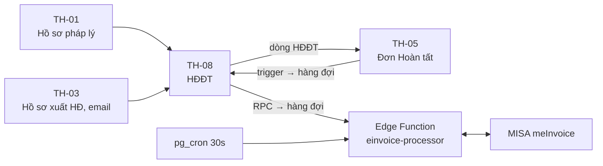
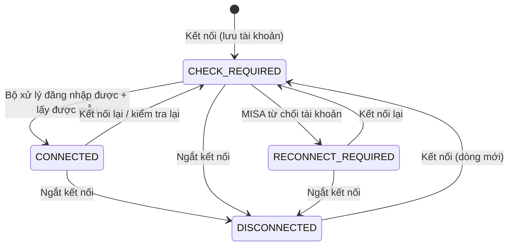
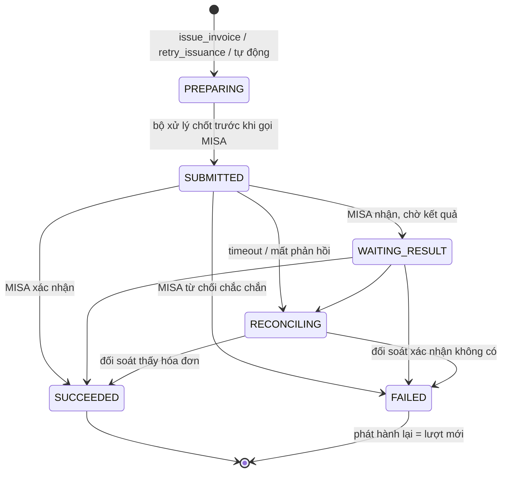
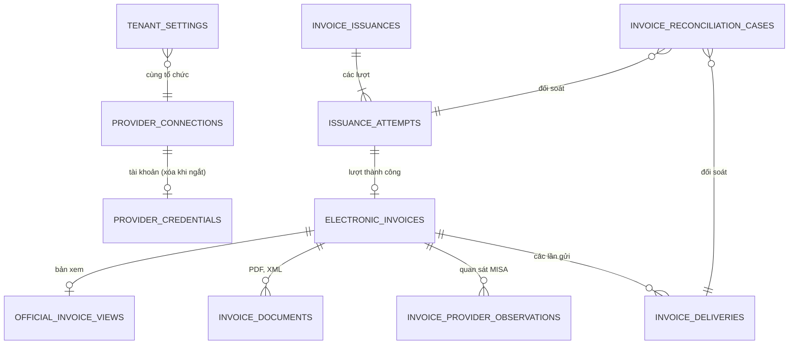
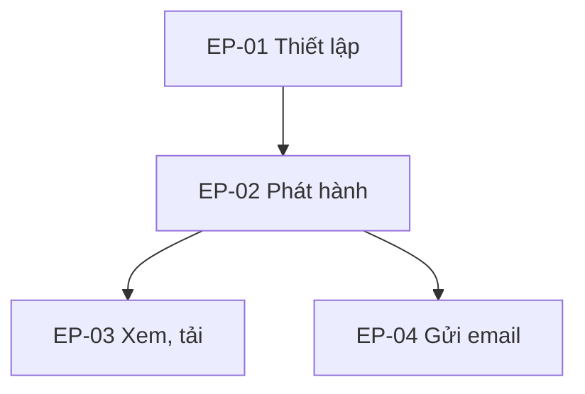
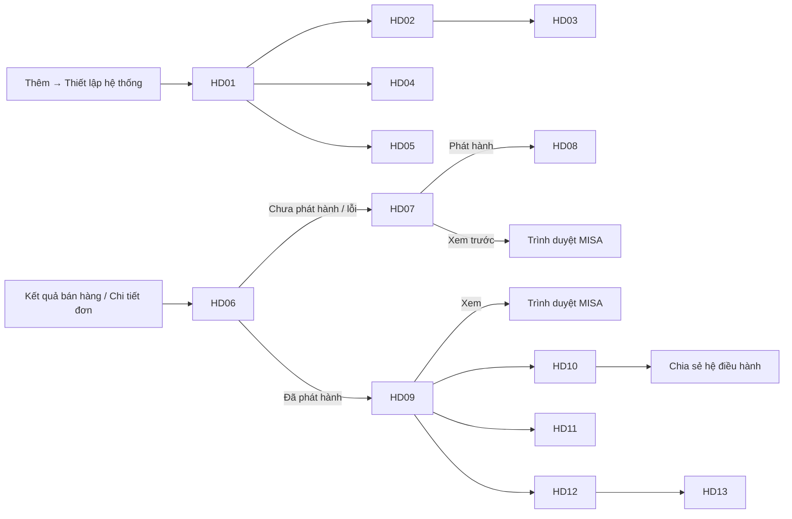

# TH-08 — Hóa đơn điện tử

> **Vai trò:** **đặc tả chuẩn (source of truth)** cho app sau refactor. Theme đã hoàn thành: **code hiện tại là phạm vi chuẩn**. Mọi quy tắc mặc định = hành vi code hiện tại (SCOPE: giữ 100% chức năng, giữ RPC). Gắn 🔧 = code hiện tại **sai**, phải sửa khi refactor. Gắn 🆕 = chưa có code, phải làm. Làm theo tài liệu, không chép lỗi của code cũ.
> **Phiên bản:** 1.1 · **Ngày:** 2026-10-07 · **Branch đối chiếu:** `refactor/simple-arch` @ `47b4cb188`
> **Thay thế:** `docs/themes/TH-08-e-invoice/Theme-8-e-invoice.md` (spec v1, 4 epic) cho mục đích làm app. Spec v1 và harness (`docs/themes/TH-08-e-invoice/harness/`) giữ lại làm tài liệu tham khảo kỹ thuật. Chỗ spec v1 khác code: **code thắng** (quyết định 2026-10-07), ghi ở [mục 7.3](#73-vấn-đề-đã-biết-và-quyết-định) và [mục 8](#8-ngoài-phạm-vi-so-với-spec-v1).
> **Nguồn đối chiếu:**
> - DB: schema `einvoice`, `supabase/migrations/20261031001…023` (đã promote 2026-11-02, `8b08bb01c`), cùng `sales.get_einvoice_source_snapshot`, `sales.can_access_sales_order` (draft 018), `partner.get_einvoice_buyer_profile` (023), `partner.get_einvoice_recipient_snapshot` (016).
> - App: `apps/erp/lib/features/einvoice/presentation/` (4 trang thiết lập), `apps/erp/lib/features/sales/presentation/` (khối HĐĐT trên đơn: `OrderEInvoiceSection`, `OrderEInvoiceCubit`, `OrderInvoiceDeliveryCubit`, 6 sheet/trang), module `modules/einvoice/` (domain, application, infrastructure, presentation).
> - Bộ xử lý: `apps/messaging_worker` (Dart) **đã xoá 2026-10-11**; hiện chưa có gì chạy lệnh MISA (`packages/vet45_misa` còn là nguồn để port). **Sau refactor thay bằng Edge Function `einvoice-processor` + `pg_cron`** (quyết định 2026-10-07, xem [9.1](#91-kiến-trúc) và KI-20). Trong tài liệu, "**bộ xử lý**" là nơi chạy mọi lệnh gọi MISA, không phụ thuộc nó là bộ xử lý hay Edge Function.
>
> **Cách đọc:** mục 1–3 là mô hình chung và dữ liệu; mục 4 chia theo epic → user story (bối cảnh, FR, BR, AC, EC, kịch bản Gherkin); mục 5 đặc tả từng màn hình (trạng thái, thành phần, phác thảo); mục 6 RPC và thông điệp lỗi; mục 7 phân quyền và vấn đề đã biết; mục 8 ngoài phạm vi; mục 9 kế hoạch refactor và kiểm thử.

---

## Mục lục

1. [Tổng quan](#1-tổng-quan)
2. [Mô hình nghiệp vụ](#2-mô-hình-nghiệp-vụ)
3. [Dữ liệu](#3-dữ-liệu)
4. [Epic và user story](#4-epic-và-user-story)
5. [Đặc tả màn hình](#5-đặc-tả-màn-hình)
6. [Kỹ thuật: RPC, bộ xử lý, lỗi](#6-kỹ-thuật-rpc-bộ-xử-lý-lỗi)
7. [Phân quyền & vấn đề đã biết](#7-phân-quyền--vấn-đề-đã-biết)
8. [Ngoài phạm vi (so với spec v1)](#8-ngoài-phạm-vi-so-với-spec-v1)
9. [Thay đổi khi refactor & kiểm thử](#9-thay-đổi-khi-refactor--kiểm-thử)

---

## 1. Tổng quan

### 1.1 Mục đích

TH-08 cho cửa hàng phát hành **hóa đơn điện tử (HĐĐT)** qua **MISA meInvoice** từ đơn hàng đã Hoàn tất (TH-05), rồi xem, tải và gửi hóa đơn cho khách. Theme trả lời bốn câu hỏi:

1. Tổ chức đã đủ điều kiện phát hành chưa (kết nối MISA, mẫu hóa đơn mặc định)?
2. Đơn này phát hành được chưa, nội dung hóa đơn trông thế nào?
3. Hóa đơn đã phát hành chưa, nếu lỗi thì vì sao?
4. Hóa đơn đã gửi cho khách chưa, gửi đến email nào, lúc nào?

### 1.2 Bối cảnh nghiệp vụ

- Đơn hàng (TH-05) và hóa đơn điện tử là hai chứng từ riêng. Lỗi phát hành **không** đổi trạng thái Hoàn tất hay số liệu của đơn.
- Bên bán lấy từ **hồ sơ pháp lý** của tổ chức (TH-01). Bên mua lấy từ **ảnh chụp khách trên đơn** (TH-05), thiếu trường nào thì lấy từ **hồ sơ xuất hóa đơn** của đối tác (TH-03).
- Mọi lệnh gọi MISA (đăng nhập, xem trước, phát hành, xem bản chính thức, tải PDF/XML, gửi email) chạy ở **bộ xử lý** phía server. App chỉ gọi RPC Supabase: RPC ghi yêu cầu vào hàng đợi `einvoice.internal_commands`; bộ xử lý lấy việc từ hàng đợi, gọi MISA rồi ghi kết quả; app hỏi lại kết quả theo chu kỳ. Sau refactor bộ xử lý là Edge Function `einvoice-processor`, được app gọi ngay sau thao tác và được `pg_cron` gọi mỗi 30 giây (mục 6.1).
- Phase 1 chỉ hỗ trợ **thuế KCT** (không chịu thuế): mọi dòng thuế = 0, tên thuế `KCT`. Đơn có thuế khác 0 bị chặn (`UNSUPPORTED_TAX_DATA`).
- Đơn có đổi/trả: hóa đơn phát hành theo **hàng khách còn giữ** (dòng hiện tại của đơn). Đơn trả hết hàng thì không phát hành.

### 1.3 Ý tưởng chủ đạo

- **Không có danh sách HĐĐT riêng.** Mọi thao tác hóa đơn bắt đầu từ dòng "Hóa đơn điện tử" trên **Kết quả bán hàng** hoặc **Chi tiết đơn hàng**. Danh sách đơn (TH-05) chỉ có bộ lọc "HĐĐT: Đã / Chưa phát hành".
- **Một đơn tối đa một hóa đơn gốc.** Mỗi lần bấm phát hành là một *lượt phát hành*; lượt lỗi chắc chắn mới cho phát hành lại.
- **Kết quả chưa rõ không phải lỗi.** Mất kết nối sau khi đã gửi MISA thì đơn ở "Đang xử lý" và hệ thống tự đối soát; không cho phát hành chồng.
- **Tài liệu do MISA cung cấp.** Bản xem trước, bản chính thức, PDF, XML đều lấy từ MISA; VET45 không tự dựng hóa đơn.
- **Ba chiều trạng thái tách nhau:** phát hành, tài liệu, gửi email. Lỗi tải PDF hay gửi email không làm mất "Đã phát hành".

### 1.4 Trong phạm vi

| Nhóm | Nội dung |
|---|---|
| Thiết lập | Kết nối / kết nối lại / ngắt kết nối MISA; chọn mẫu hóa đơn mặc định (hình thức ký suy từ mẫu); bật/tắt phát hành tự động và gửi email tự động; tổng quan mức sẵn sàng |
| Trước phát hành | Kiểm tra điều kiện của đơn; xem trước bản nháp từ MISA |
| Phát hành | Phát hành thủ công có xác nhận; phát hành lại sau lỗi; phát hành tự động khi đơn Hoàn tất; đối soát kết quả chưa rõ (nền, bộ xử lý) |
| Sau phát hành | Mở bản chính thức từ MISA; lưu PDF / XML qua chia sẻ của hệ điều hành |
| Gửi | Gửi email tự động sau phát hành; gửi / gửi lại thủ công; lịch sử gửi |

### 1.5 Ngoài phạm vi theme

Sửa, điều chỉnh, thay thế, hủy hóa đơn đã phát hành; hóa đơn cho đơn chưa Hoàn tất hoặc không có đơn; tách / gộp hóa đơn; nhà cung cấp khác MISA; nhiều hồ sơ pháp lý hoặc nhiều kết nối; danh sách HĐĐT riêng; thuế khác KCT; chia sẻ qua Zalo/Messenger. Chi tiết ở [mục 8](#8-ngoài-phạm-vi-so-với-spec-v1).

### 1.6 Tác nhân

| Tác nhân | Việc làm trong theme |
|---|---|
| Thành viên tổ chức (Owner, Chủ cửa hàng, Nhân viên, Kế toán, Thủ kho) | Mọi thao tác: thiết lập, phát hành, xem, tải, gửi (vai trò chỉ là nhãn, xem [7.2](#72-phân-quyền)) |
| Bộ xử lý (Edge Function `einvoice-processor` + `pg_cron`, làm ở 7-E*; worker cũ đã xoá 2026-10-11) | Gọi MISA; ghi kết quả; đối soát kết quả chưa rõ; phát hành và gửi tự động |
| MISA meInvoice | Xác thực, cung cấp mẫu, xem trước, phát hành, bản chính thức, PDF/XML, gửi email |
| Hệ điều hành | Mở trình duyệt xem hóa đơn; chia sẻ / lưu tệp PDF, XML |

### 1.7 Liên hệ với các theme khác

| Theme | Cho TH-08 | Nhận từ TH-08 |
|---|---|---|
| TH-01 Tổ chức | Hồ sơ pháp lý (MST dùng đăng nhập MISA; tên, địa chỉ bên bán); quyền; tổ chức hiện hành | — |
| TH-03 Đối tác | Hồ sơ xuất hóa đơn (tên, MST, địa chỉ) bù trường còn trống; email nhận hóa đơn | Liên kết "Cập nhật thông tin khách hàng" mở `/partner/<id>/edit` |
| TH-05 Bán hàng | Đơn Hoàn tất: dòng hàng hiện tại, tổng tiền, ảnh chụp khách, phiên bản đơn; tín hiệu đơn Hoàn tất; quyền truy cập đơn | Dòng "Hóa đơn điện tử" trên 2 màn; bộ lọc HĐĐT trong danh sách đơn |



---

## 2. Mô hình nghiệp vụ

### 2.1 Khái niệm

| Khái niệm | Nghĩa | Bảng |
|---|---|---|
| Kết nối MISA | Tài khoản MISA của tổ chức (một kết nối đang dùng / tổ chức) | `provider_connections`, `provider_credentials` |
| Năng lực MISA | Ảnh chụp những gì MISA cho dùng: danh sách mẫu, có xem trước, có gửi email, loại tài liệu | `provider_connections.capabilities_snapshot` |
| Mẫu hóa đơn mặc định | Mẫu + ký hiệu (`InvSeries`) dùng cho mọi lượt phát hành mới | `tenant_settings.default_template_id`, `default_invoice_series` |
| Hình thức ký | Suy từ ký hiệu: ký tự thứ 5 là `M` → hóa đơn máy tính tiền, **không ký** (`SignType=5`); còn lại → **ký HSM** (`SignType=2`) | — |
| Chính sách tự động | Hai cờ độc lập: phát hành tự động, gửi email tự động | `tenant_settings.auto_issue_enabled`, `auto_send_enabled` |
| Thông tin người mua hiệu lực | Ảnh chụp khách trên đơn, đè bởi dữ liệu bổ sung đã lưu, trường còn trống lấy từ hồ sơ đối tác | tính lúc đọc (`_effective_buyer_snapshot`) |
| Dữ liệu bổ sung người mua | Trường trống của ảnh chụp đơn được chép từ hồ sơ đối tác **lúc bắt đầu phát hành** | `buyer_invoice_completions` |
| Phát hành (neo) | Một dòng / đơn, loại `ORIGINAL` | `invoice_issuances` |
| Lượt phát hành | Một lần gửi MISA phát hành; giữ ảnh chụp dữ liệu bất biến | `issuance_attempts` |
| Hóa đơn điện tử | Hóa đơn MISA đã xác nhận và VET45 đã ghi nhận; bất biến | `electronic_invoices` |
| Bản xem chính thức | Link MISA ngắn hạn để xem hóa đơn đã phát hành; một dòng / hóa đơn | `official_invoice_views` |
| Tài liệu | PDF hoặc XML từ MISA; một dòng / (hóa đơn, loại) | `invoice_documents` |
| Lần gửi | Một ý định gửi email (đầu tiên hoặc gửi lại); email chụp bất biến | `invoice_deliveries` |
| Hồ sơ đối soát | Theo dõi một lượt phát hành / lần gửi có kết quả chưa rõ | `invoice_reconciliation_cases` |

### 2.2 Vòng đời

**Kết nối MISA**



**Lượt phát hành** (trạng thái DB → hiển thị)



| Trạng thái lượt mới nhất | Hiển thị trên đơn |
|---|---|
| Chưa có lượt nào, chưa có hóa đơn | **Chưa phát hành** |
| `PREPARING` / `SUBMITTED` / `WAITING_RESULT` / `RECONCILING` (kể cả hồ sơ đối soát `UNRESOLVED`), hoặc MISA đã xác nhận nhưng VET45 chưa ghi xong hóa đơn | **Đang xử lý** |
| Đã có hóa đơn điện tử | **Đã phát hành** |
| `FAILED`, không còn lượt đang chạy | **Phát hành lỗi** |

**Lần gửi** (DB → công khai): `QUEUED`, `SUBMITTED` → `PROCESSING`; `SUCCEEDED`; `FAILED`; `UNKNOWN`. Hệ thống tự thử lại tối đa 3 lần gọi MISA trên cùng một lần gửi (`retry_count` 0–2). `UNKNOWN` là kết quả cuối: MISA hiện **không có API** kiểm kết quả gửi email nên hồ sơ đối soát chuyển ngay `UNRESOLVED`.

**Tài liệu và bản xem chính thức:** `PENDING` → `AVAILABLE` | `FAILED` | `CHECK_REQUIRED` (hết lượt thử). Yêu cầu mới ghi đè dòng hiện hành với `request_id` mới; kết quả muộn của yêu cầu cũ bị bỏ qua.

### 2.3 Trạng thái hiển thị

**Phát hành** (badge trên dòng HĐĐT):

| Hiển thị | Màu | Bấm dòng |
|---|---|---|
| Chưa phát hành | trung tính | Mở sheet trước phát hành (khi đã tải xong điều kiện) |
| Đang xử lý | primary | **Không bấm được** |
| Đã phát hành | success | Mở sheet sau phát hành |
| Phát hành lỗi | danger | Mở sheet trước phát hành, có banner lỗi |

**Gửi email** (badge trên mục "Gửi hóa đơn" của sheet sau phát hành):

| Hiển thị | Khi nào |
|---|---|
| Chưa gửi | Chưa có lần gửi thành công, không có lần đang gửi |
| Đang gửi | Chưa từng gửi thành công, có lần đang gửi |
| Đã gửi | Đã có ít nhất một lần thành công (giữ nguyên dù lần gửi lại sau lỗi) |
| Gửi lỗi | Chưa từng thành công, lần gần nhất lỗi chắc chắn |
| Không xác định kết quả | Chưa từng thành công, lần gần nhất `UNKNOWN` |

Đã từng gửi thành công mà lần gửi lại sau đó lỗi / không xác định: badge vẫn "Đã gửi", dòng phụ đổi thành "Lần gửi gần nhất cần được kiểm tra trong lịch sử gửi."

### 2.4 Thông tin người mua hiệu lực

| Loại khách | Nguồn | Bắt buộc để phát hành |
|---|---|---|
| Khách lẻ (đơn không gắn khách) | Cố định "Bán cho người tiêu dùng" | Không gì thêm |
| Khách cá nhân | Ảnh chụp đơn → dữ liệu bổ sung → hồ sơ đối tác | Tên |
| Khách tổ chức | như trên | Tên, **MST**, **địa chỉ** |

Thứ tự ghép từng trường (tên, MST, email, địa chỉ):

```text
Đơn CHƯA có hóa đơn và có khách (tên, MST, địa chỉ):
1. Ảnh chụp khách trên đơn (TH-05 buyer_tax_snapshot / sales_context_snapshot.customer), nếu không rỗng
2. Hồ sơ xuất hóa đơn đối tác hiện hành (person_profiles / organization_profiles: invoice_name, tax_code, invoice_address)
3. Dữ liệu đã chép (buyer_invoice_completions) — chỉ dùng khi (1) và (2) đều trống

Email: dữ liệu bổ sung (buyer_invoice_completions) đè ảnh chụp đơn. Đơn không gắn khách (bán lẻ) và đơn ĐÃ có hóa đơn: ảnh chụp đơn rồi dữ liệu bổ sung đè lên, không đọc hồ sơ khách.
```

Lúc bắt đầu một lượt phát hành do người dùng (không phải lượt tự động), các trường mà ảnh chụp đơn để trống được **chép lại** từ hồ sơ khách hiện hành vào `buyer_invoice_completions` (ghi đè giá trị đã chép) để lượt đó dùng đúng giá trị ấy. Hệ quả: giá trị nhập qua `complete_buyer_invoice_data` (app không gọi RPC này) bị hồ sơ khách che khi hồ sơ có giá trị. Từ khi đơn có hóa đơn, hồ sơ khách không được đọc nữa (KI-06).

### 2.5 Quy tắc nghiệp vụ tổng hợp

**Thiết lập**

| Mã | Quy tắc | Nguồn |
|---|---|---|
| BR-01 | Mỗi tổ chức tối đa một kết nối MISA khác `DISCONNECTED` | `provider_connections` |
| BR-02 | Kết nối nhận tài khoản + mật khẩu MISA; **MST lấy từ hồ sơ pháp lý**, không nhập. AppID và token do bộ xử lý quản lý, không hiện trên UI | `connect_provider`, `read_provider_credentials` |
| BR-03 | Lưu tài khoản → trạng thái `CHECK_REQUIRED` ngay; bộ xử lý đăng nhập và lấy mẫu: được → `CONNECTED`; bị từ chối → `RECONNECT_REQUIRED`; MISA không phản hồi → giữ `CHECK_REQUIRED`, hàng đợi thử lại | `connect_provider`, `SyncProviderCapabilitiesCommandHandler` |
| BR-04 | Mật khẩu mã hóa trong `provider_credentials`; không bao giờ trả về app. Màn chỉ hiện tài khoản đã che (`ab***@x.vn`) | `connect_provider` |
| BR-05 | Kết nối lại chỉ áp dụng cho kết nối chưa ngắt; ngắt kết nối cần xác nhận, xóa dòng tài khoản, **giữ** mọi hóa đơn và lịch sử | `reconnect_provider`, `disconnect_provider` |
| BR-06 | Mẫu hóa đơn chỉ chọn từ danh sách MISA trả về (mẫu `is_available`); không nhập tay mẫu số, ký hiệu, `SignType` | `list_provider_templates` |
| BR-07 | Hình thức ký không do người dùng chọn: mẫu máy tính tiền → không ký (`SignType=5`); mẫu khác → HSM (`SignType=2`). Không dùng `SignType` 1, 3, 4, 6 | `set_default_issuance_configuration` |
| BR-08 | Lưu mẫu kiểm tra mẫu còn trong năng lực MISA và có ký hiệu, nếu không → `TEMPLATE_NOT_AVAILABLE`; tăng `profile_version`, sai phiên bản → `STATE_CHANGED` | như trên |
| BR-09 | Phát hành tự động và gửi tự động là hai cờ độc lập; lưu tăng `policy_version`, sai phiên bản → `STATE_CHANGED` | `update_automation_policy` |
| BR-10 | Tổ chức **sẵn sàng** khi kết nối `CONNECTED` **và** đã có mẫu mặc định. Thiếu một trong hai → "Chưa sẵn sàng phát hành" | `get_configuration_readiness` |
| BR-11 | Thay đổi cấu hình chỉ áp dụng cho lượt phát hành bắt đầu sau đó; lượt đã bắt đầu giữ ảnh chụp cũ | `attempt_snapshot` |

**Điều kiện phát hành của đơn**

| Mã | Quy tắc | Nguồn |
|---|---|---|
| BR-12 | Chỉ đơn **Hoàn tất** (`lifecycle_status = completed`) mới phát hành. Đơn huỷ / chưa hoàn tất → `ORDER_NOT_COMPLETED` | `get_einvoice_source_snapshot`, evaluator |
| BR-13 | Đơn đã trả hết hàng (không còn dòng) → `ORDER_FULLY_RETURNED`: không phát hành, không xem trước | như trên |
| BR-14 | Đơn đã có hóa đơn → `ALREADY_ISSUED`; đơn có lượt đang chạy → `OPERATION_IN_PROGRESS` | evaluator |
| BR-15 | Tổ chức chưa sẵn sàng (BR-10) → `CONFIG_NOT_READY` / `PROVIDER_NOT_CONNECTED` | evaluator |
| BR-16 | Khách tổ chức thiếu MST → `BUYER_TAX_CODE_REQUIRED` (chặn phát hành); có MST thiếu địa chỉ → `BUYER_ADDRESS_REQUIRED`; khách cá nhân/tổ chức thiếu tên → `BUYER_DATA_INCOMPLETE`. **Khách cá nhân/tổ chức không bao giờ bị đổi thành Khách lẻ** | evaluator, `EffectiveBuyerInvoiceData` |
| BR-17 | Dữ liệu dòng hàng không ánh xạ được (không có dòng nào) → `VALIDATION_ERROR` | evaluator |
| BR-18 | Thuế: Phase 1 chỉ KCT. Thuế dòng / tổng ≠ 0 hoặc có ảnh chụp thuế → `UNSUPPORTED_TAX_DATA` | bộ xử lý (`build_canonical_invoice`) |
| BR-19 | MISA không hỗ trợ xem trước → `PREVIEW_UNSUPPORTED` (chặn xem trước, không chặn phát hành) | evaluator |
| BR-20 | Mức điều kiện: có blocker → **Chưa sẵn sàng**; không blocker, có cảnh báo → **Sẵn sàng có cảnh báo**; còn lại **Sẵn sàng**. Hiện chưa có loại cảnh báo nào được sinh ra | evaluator |

**Phát hành**

| Mã | Quy tắc | Nguồn |
|---|---|---|
| BR-21 | Mỗi lượt có **khóa chống trùng** (UUID tạo ở app, gửi MISA làm `RefID`). Cùng khóa + cùng ý định → trả lượt cũ; cùng khóa khác ý định → `IDEMPOTENCY_CONFLICT` | `issue_invoice` |
| BR-22 | Lượt phát hành kiểm lại **phiên bản đơn** (`source_version`): đơn vừa đổi/trả sau khi mở màn → `SOURCE_VERSION_MISMATCH` | `issue_invoice` |
| BR-23 | Ảnh chụp lượt (bên bán, người mua hiệu lực, dòng, tổng, mẫu, ký hiệu, `SignType`, chính sách) được ghi **trước** khi gọi MISA và không đổi suốt lượt, kể cả khi bộ xử lý thử lại | `_start_issuance_attempt` |
| BR-24 | Bộ xử lý chuyển lượt sang `SUBMITTED` **trước** khi gọi MISA; lượt đã `SUBMITTED` không bao giờ gọi phát hành lại, chỉ đối soát | `prepare_issuance_publish` |
| BR-25 | Mỗi ký hiệu chỉ một lượt gọi phát hành tại một thời điểm trên toàn hệ thống (khóa thuê theo `InvSeries`); bận thì hẹn lại, không tính là lỗi | `publish_series_leases` |
| BR-26 | MISA từ chối chắc chắn → `FAILED`, lưu thông điệp MISA (vd "Mã số thuế người mua không hợp lệ"). Mã `InvoiceNumberNotCotinuous` → thử lại ≤ 3 lần cùng `RefID`; `InvoiceDuplicated` / `DuplicateInvoiceRefID` → đối soát trước | bộ xử lý, draft 020, 022 |
| BR-27 | Timeout / 5xx / mất phản hồi sau khi gửi → `RECONCILING` + hồ sơ đối soát; **không** coi là lỗi, không cho phát hành lại | `record_issuance_undetermined` |
| BR-28 | Đối soát tự động hỏi MISA theo lịch **30 giây, 2 phút, 10 phút, 30 phút, 2 giờ** (5 lần). Hết 5 lần vẫn chưa rõ → hồ sơ `UNRESOLVED`, đơn vẫn "Đang xử lý" và vẫn khóa phát hành. Kết quả MISA đến muộn vẫn được áp dụng | bộ xử lý, `invoice_reconciliation_cases` |
| BR-29 | MISA xác nhận nhưng ghi hóa đơn ở VET45 lỗi → chỉ ghi lại phần nội bộ, **không** gọi MISA phát hành lại | `recover_internal_finalization` |
| BR-30 | Phát hành lại chỉ khi lượt mới nhất `FAILED` và chưa có hóa đơn; tạo **lượt mới** với ảnh chụp mới, giữ nguyên lượt cũ | `retry_issuance` |
| BR-31 | Lỗi phát hành không đổi trạng thái hay số liệu đơn hàng | — |

**Phát hành tự động**

| Mã | Quy tắc | Nguồn |
|---|---|---|
| BR-32 | Đơn chuyển Hoàn tất → hàng đợi HĐĐT nhận việc phát hành tự động → bộ xử lý gọi `start_auto_issuance`. Hiện tại tín hiệu đi qua outbox `sales_order_finalized.v1` + bộ xử lý; 🆕 sau refactor là **trigger** trên `sales.sales_orders` (khi `lifecycle_status` thành `completed`) ghi thẳng việc `einvoice.start_auto_issuance` vào `einvoice.internal_commands` (KI-20, 7-E3). Mỗi đơn một dòng theo dõi (`auto_issuance_processes`); tín hiệu lặp dùng lại dòng cũ | draft 008 |
| BR-33 | Chính sách tắt → `SKIPPED` (`AUTOMATION_POLICY_DISABLED`). Đơn đã có hóa đơn / đang có lượt → `SKIPPED`. Đơn trả hết → `SKIPPED` | `start_auto_issuance` |
| BR-34 | Chưa có kết nối / mẫu, hoặc nguồn đơn chưa đọc được → `PENDING_REEVALUATION` kèm mã chặn; khi hồ sơ đối tác của khách cập nhật thì đánh giá lại các dòng đang chờ của đúng khách đó, không tạo dòng mới. Hiện qua sự kiện `partner.partner.profile_updated`; 🆕 sau refactor là trigger trên hồ sơ đối tác (`partner.partners` khi đổi `version`) ghi việc `reevaluate_auto_issuance` vào hàng đợi (7-E3) | `start_auto_issuance`, `reevaluate_auto_issuance` |
| BR-35 | Phát hành tự động dùng cùng ảnh chụp, khóa chống trùng (`RefID` = UUIDv5 của tổ chức + đơn + phiên bản) và xử lý kết quả như thủ công | draft 008 |

**Xem và tài liệu**

| Mã | Quy tắc | Nguồn |
|---|---|---|
| BR-36 | Bản xem chính thức, PDF, XML chỉ có khi đã có hóa đơn; đều do bộ xử lý lấy từ MISA | drafts 010, 011 |
| BR-37 | Link xem / tải là link ký ngắn hạn (5 phút); chỉ trả khi trạng thái `AVAILABLE`, kiểm quyền mỗi lần đọc. Link MISA chỉ nhận `https` trên `*.meinvoice.vn` | như trên |
| BR-38 | PDF và XML là hai yêu cầu độc lập; xử lý PDF không khóa XML và ngược lại | `invoice_documents` |
| BR-39 | Tệp tải về được kiểm **SHA-256** trước khi giao cho chia sẻ của hệ điều hành; thiếu checksum → không giao | `IInvoiceDocumentExporter` |
| BR-40 | Lỗi xem / tải không đổi "Đã phát hành" | — |

**Gửi email**

| Mã | Quy tắc | Nguồn |
|---|---|---|
| BR-41 | Chỉ gửi được khi đã có hóa đơn và MISA hỗ trợ gửi email (`supports_email_delivery`), nếu không → `DELIVERY_NOT_SUPPORTED` | `send_electronic_invoice` |
| BR-42 | Mỗi lần gửi / gửi lại là một dòng `invoice_deliveries` riêng. Loại (đầu tiên / gửi lại) do **server** quyết: chưa có lần `INITIAL_SEND` → đầu tiên, có rồi → `RESEND`. Mỗi hóa đơn tối đa một lần gửi đầu tiên | như trên |
| BR-43 | Email chụp vào lần gửi, bất biến; không cập nhật hồ sơ đối tác, đơn hay hóa đơn | `recipient_snapshot` |
| BR-44 | Có lần gửi đang `PROCESSING` → chặn gửi mới (`OPERATION_IN_PROGRESS`). `UNKNOWN` **không** chặn, người dùng gửi lại được | `send_electronic_invoice` |
| BR-45 | Email gợi ý — gửi đầu tiên: email hồ sơ đối tác hiện hành → email lần gửi thành công gần nhất **cùng khách** (trong tổ chức). Gửi lại: email lần gửi gần nhất của hóa đơn này. Không có → để trống. Không có khách → không tra cứu | `get_send_invoice_sheet_context` |
| BR-46 | Gửi tự động (khi bật): sau khi hóa đơn được ghi nhận, bộ xử lý lấy email hồ sơ đối tác hiện hành → email trong ảnh chụp người mua của lượt thành công. Không có email hợp lệ → **không** tạo lần gửi (`INVALID_OR_MISSING_EMAIL`); gửi thủ công thắng trước → bỏ qua | `start_auto_delivery` |
| BR-47 | Kết quả gửi: MISA xác nhận → `SUCCEEDED`; từ chối chắc chắn → `FAILED`; 429 trước khi MISA nhận → tự thử lại (≤ 3 lần); timeout / 5xx sau khi gửi → `UNKNOWN`. Không suy kết quả gửi từ trạng thái hóa đơn | bộ xử lý, draft 014 |
| BR-48 | Lỗi gửi không đổi trạng thái phát hành | — |

---

## 3. Dữ liệu

### 3.1 Sơ đồ quan hệ



Ngoài sơ đồ: `buyer_invoice_completions` và `invoice_previews` (một dòng / đơn), `auto_issuance_processes` (một dòng / đơn), `publish_series_leases` (khóa theo ký hiệu). Mọi bảng có `tenant_id`; tham chiếu sang `sales`, `partner`, `iam` chỉ là id, không khóa ngoại xuyên schema.

### 3.2 Bảng chính (schema `einvoice`)

| Bảng | Cột chính | Ràng buộc |
|---|---|---|
| `provider_connections` | `status` (`DISCONNECTED`/`CONNECTED`/`CHECK_REQUIRED`/`RECONNECT_REQUIRED`), `capabilities_snapshot` (mẫu, `supports_preview`, `supports_email_delivery`, `supported_document_types`, `supports_delivery_result_observation`), `last_verified_at`, `connection_version` | Tối đa 1 dòng khác `DISCONNECTED` / tổ chức |
| `provider_credentials` | `connection_id`, `username`, `password_ciphertext` | Không cấp quyền cho `authenticated`; xóa khi ngắt |
| `tenant_settings` | `default_template_id`, `default_invoice_series` (khớp `^[1256][CK].{2}[TM]`), `profile_version`, `auto_issue_enabled`, `auto_send_enabled`, `policy_version` | Một dòng / tổ chức |
| `buyer_invoice_completions` | `sales_order_id`, `sales_order_version`, `buyer_name`, `buyer_tax_code`, `buyer_email`, `buyer_address`, `completed_by_user_id`, `completed_at` | PK (tổ chức, đơn) |
| `invoice_previews` | `request_id`, `status` (`PENDING`/`READY`/`FAILED`), `viewer_ref`, `failure_*`, `expires_at` (+15 phút) | PK (tổ chức, đơn) |
| `invoice_issuances` | `sales_order_id`, `issuance_type` = `ORIGINAL` | Unique (tổ chức, đơn, loại) |
| `issuance_attempts` | `attempt_no`, `status`, `invoice_series`, `idempotency_key` (= MISA `RefID`), `intent_hash`, `attempt_snapshot` (11 thành phần), `canonical_payload_hash`, `provider_invoice_reference`, `provider_result_snapshot`, `failure_code`, `failure_message`, `failure_source` (`PROVIDER`/`INTERNAL`), `internal_finalization_state`, `retry_count`, `initiated_by_actor_*`, `submitted_at`, `completed_at` | Unique (tổ chức, khóa chống trùng); tối đa 1 lượt chưa kết thúc / phát hành |
| `electronic_invoices` | `successful_attempt_id`, `sales_order_id`, `provider_invoice_reference`, `invoice_number`, `invoice_series`, `issued_at` | Unique (tổ chức, đơn); **bất biến**, không hàm nào cập nhật |
| `official_invoice_views` | `electronic_invoice_id`, `request_id`, `status`, `failure_code` | Một dòng / hóa đơn |
| `invoice_documents` | `electronic_invoice_id`, `document_type` (`PDF`/`XML`), `request_id`, `status`, `storage_reference`, `checksum`, `failure_code` | Một dòng / (hóa đơn, loại) |
| `invoice_provider_observations` | `provider_state_code`, `observed_at`, `deduplication_key`, `correlation_id` | Chỉ ghi thêm |
| `invoice_deliveries` | `delivery_no`, `delivery_intent` (`INITIAL_SEND`/`RESEND`), `recipient_snapshot` (`toEmail`, tên, nguồn), `idempotency_key`, `status`, `retry_count` 0–2, `failure_*`, `initiated_by_actor_type` (`SYSTEM`/`USER`), `version` | Tối đa 1 `INITIAL_SEND` / hóa đơn; tối đa 1 lần `QUEUED`/`SUBMITTED` / hóa đơn |
| `invoice_reconciliation_cases` | `target_type` (`ISSUANCE_ATTEMPT`/`INVOICE_DELIVERY`), `target_id`, `status` (`PENDING`/`RESOLVED`/`UNRESOLVED`), `check_count`, `next_check_at` | Tối đa 1 hồ sơ đang mở / đối tượng |
| `auto_issuance_processes` | `sales_order_id`, `sales_order_version`, `buyer_partner_id`, `trigger_key`, `provider_idempotency_key`, `status` (`PENDING_REEVALUATION`/`ATTEMPT_STARTED`/`SKIPPED`), `blocker_code` | Một dòng / đơn |
| `publish_series_leases` | (`tenant_id`, `invoice_series`), `owner_token`, `lease_version`, `leased_until` | Khóa thuê theo ký hiệu |

Hàng đợi `internal_commands`, `outbox_messages`, `inbox_messages` của schema `einvoice` do `platform.install_module_messaging('einvoice')` tạo (draft 002). Sau refactor chỉ còn dùng `internal_commands` (hàng đợi của bộ xử lý); outbox/inbox bỏ ở P9 (KI-20).

**Ảnh chụp lượt phát hành** (`attempt_snapshot`, bất biến): `source_order` (đơn, phiên bản, trạng thái), `seller`, `buyer` (người mua hiệu lực), `buyer_lineage` (ảnh chụp gốc của đơn, `buyerPartnerId`, `buyerCompletedAt`), `invoice_context` (mẫu, ký hiệu, `SignType`, có/không mã), `lines`, `totals`, `payment_information`, `automation_policy`, `readiness_result`, `mapping_schema_version`.

### 3.3 Bất biến kiểm tra được

| # | Bất biến | Kiểm bằng |
|---|---|---|
| I-01 | Một đơn ≤ 1 hóa đơn gốc | unique `electronic_invoices (tenant_id, sales_order_id)` |
| I-02 | Một tổ chức ≤ 1 kết nối đang dùng | partial unique index |
| I-03 | Một phát hành ≤ 1 lượt chưa kết thúc | kiểm trong `_start_issuance_attempt` / `retry_issuance` |
| I-04 | Lượt đã `SUBMITTED` không bao giờ gọi MISA phát hành lần nữa | `prepare_issuance_publish` trả `reconcileOnly` |
| I-05 | `attempt_snapshot` không đổi sau khi lượt rời `PREPARING`; hóa đơn không đổi sau khi ghi | không có RPC cập nhật |
| I-06 | ≤ 1 `INITIAL_SEND` và ≤ 1 lần gửi đang chạy / hóa đơn | 2 partial unique index |
| I-07 | `SUCCEEDED` (phát hành, gửi) không bao giờ đảo ngược; kết quả trùng / đến muộn là no-op | RPC ghi kết quả |
| I-08 | Ngắt kết nối không xóa hóa đơn, lượt, tài liệu, lần gửi | `disconnect_provider` chỉ xóa `provider_credentials` |

---

## 4. Epic và user story

### 4.1 Bản đồ

| Epic | User story | Màn |
|---|---|---|
| EP-01 Thiết lập | US-01.1 Kết nối và duy trì kết nối MISA · US-01.2 Chọn mẫu hóa đơn mặc định · US-01.3 Thiết lập tự động · US-01.4 Xem mức sẵn sàng | HD-01 … HD-05 |
| EP-02 Phát hành | US-02.1 Kiểm tra điều kiện và xem trước · US-02.2 Phát hành thủ công · US-02.3 Phát hành tự động · US-02.4 Xác lập kết quả và đối soát · US-02.5 Phát hành lại sau lỗi | HD-06 … HD-08 |
| EP-03 Sau phát hành | US-03.1 Xem hóa đơn chính thức · US-03.2 Lưu PDF / XML · US-03.3 Ghi nhận trạng thái MISA (chỉ bộ xử lý) | HD-09, HD-10 |
| EP-04 Gửi hóa đơn | US-04.1 Gửi email tự động · US-04.2 Gửi và gửi lại thủ công · US-04.3 Kết quả gửi và lịch sử | HD-09, HD-11 … HD-13 |



### 4.2 EP-01 — Thiết lập

**Điểm vào:** Thêm → Thiết lập hệ thống → "Hóa đơn điện tử" (`/more/einvoice`). Ba màn con: `/more/einvoice/connection`, `/more/einvoice/issuance`, `/more/einvoice/automation`.

#### US-01.1 — Kết nối và duy trì kết nối MISA

**Bối cảnh.** Để phát hành, tổ chức cần tài khoản MISA meInvoice. MISA đăng nhập bằng MST + tài khoản + mật khẩu; MST đã có trong hồ sơ pháp lý (TH-01) nên người dùng chỉ nhập tài khoản và mật khẩu. Đăng nhập thật do bộ xử lý làm, nên màn hiện "Chờ kết nối" rồi tự cập nhật.

**Câu chuyện.** Là người quản lý cửa hàng, tôi muốn kết nối tài khoản MISA của cửa hàng để phát hành hóa đơn điện tử từ VET45.

**FR**
- FR-01: Màn "Kết nối MISA" hiện nhà cung cấp "MISA meInvoice" và "Mã số thuế đơn vị phát hành" (chỉ đọc, từ hồ sơ pháp lý), chú thích "Mã số thuế được lấy từ Hồ sơ pháp lý của Tổ chức."
- FR-02: Chưa kết nối: form "Tài khoản MISA", "Mật khẩu MISA" (chú thích "Mật khẩu được bảo mật và không hiển thị lại sau khi kết nối."), nút "Hủy" / "Kết nối".
- FR-03: Bấm "Kết nối": kiểm hai ô bắt buộc, gọi `connect_provider`; thành công thì màn chuyển "Chờ kết nối" (banner "Đang chờ kết nối — Hệ thống đang tự động hoàn tất kết nối với MISA meInvoice.") và tự hỏi lại trạng thái mỗi 2 giây.
- FR-04: Đã kết nối: thẻ thông tin gồm Trạng thái "Đã kết nối", Nhà cung cấp, Tài khoản (đã che), MST đơn vị phát hành, dòng "Cập nhật gần nhất: HH:mm, dd/MM/yyyy"; nút "Ngắt kết nối".
- FR-05: Lỗi kết nối (`RECONNECT_REQUIRED`): Trạng thái "Lỗi kết nối", banner lỗi "Không thể kết nối với MISA meInvoice — Hãy kết nối lại để hệ thống thử lại bằng thông tin hiện có."; hai nút "Ngắt kết nối" / "Kết nối lại". "Kết nối lại" mở lại form; nút gửi là "Kết nối lại".
- FR-06: "Ngắt kết nối" mở sheet xác nhận (HD-03).

**BR áp dụng:** BR-01 … BR-05.

**AC**
- AC-01: Nhập đủ tài khoản, mật khẩu, bấm "Kết nối" → màn "Chờ kết nối"; bộ xử lý đăng nhập được → tự chuyển "Đã kết nối", tài khoản hiện dạng che.
- AC-02: Bỏ trống tài khoản → lỗi dưới ô "Vui lòng nhập tài khoản MISA"; bỏ trống mật khẩu → "Vui lòng nhập mật khẩu MISA"; không gọi RPC.
- AC-03: MISA từ chối tài khoản → màn chuyển "Lỗi kết nối" với banner lỗi và nút "Kết nối lại".
- AC-04: Ngắt kết nối → trạng thái về "Chưa kết nối", form trống; hóa đơn đã phát hành vẫn xem được.
- AC-05: Mật khẩu không bao giờ hiện lại; app không nhận được mật khẩu từ bất kỳ RPC nào.

**EC**
- EC-01: Hai người cùng kết nối → người sau nhận `STATE_CHANGED` ("Không thực hiện được — Có lỗi xảy ra, vui lòng thử lại."), tải lại màn.
- EC-02: MISA không phản hồi → kết nối ở "Chờ kết nối", hàng đợi thử lại; không kết luận tài khoản sai.
- EC-03: Hồ sơ pháp lý chưa có MST → bộ xử lý đăng nhập thất bại → "Lỗi kết nối". Người dùng phải bổ sung MST ở TH-01 rồi "Kết nối lại".
- EC-04: Người dùng rời màn khi đang "Chờ kết nối" → bộ xử lý vẫn chạy; mở lại màn thấy trạng thái mới.

**Kịch bản**

```gherkin
Feature: Kết nối MISA meInvoice

  Background:
    Given tôi đang ở tổ chức "Thú y An Phát" có hồ sơ pháp lý MST "0312345678"
    And tổ chức chưa kết nối MISA

  Scenario: Kết nối thành công
    When tôi mở "Kết nối MISA"
    Then tôi thấy "Mã số thuế đơn vị phát hành" là "0312345678" và không sửa được
    When tôi nhập tài khoản "ketoan@anphat.vn", mật khẩu hợp lệ và bấm "Kết nối"
    Then tôi thấy banner "Đang chờ kết nối"
    When bộ xử lý đăng nhập MISA thành công và lấy được danh sách mẫu
    Then màn tự chuyển trạng thái "Đã kết nối"
    And tài khoản hiện là "ke***@anphat.vn"

  Scenario: Sai mật khẩu
    When tôi kết nối với mật khẩu sai
    And bộ xử lý bị MISA từ chối đăng nhập
    Then trạng thái là "Lỗi kết nối"
    And tôi thấy nút "Kết nối lại" và "Ngắt kết nối"

  Scenario: Ngắt kết nối giữ lịch sử
    Given tổ chức đã kết nối và có 3 hóa đơn đã phát hành
    When tôi bấm "Ngắt kết nối" và xác nhận "Ngắt kết nối"
    Then trạng thái là "Chưa kết nối"
    And 3 hóa đơn vẫn có trạng thái "Đã phát hành" trên đơn hàng
```

#### US-01.2 — Chọn mẫu hóa đơn mặc định

**Bối cảnh.** MISA cấp cho đơn vị một hoặc nhiều mẫu (mẫu số, ký hiệu). VET45 dùng **một** mẫu mặc định cho mọi lượt phát hành. Hình thức ký suy từ mẫu, người dùng không chọn.

**Câu chuyện.** Là người quản lý, tôi muốn chọn mẫu hóa đơn mặc định để hóa đơn phát hành đúng mẫu đã đăng ký với cơ quan thuế.

**FR**
- FR-01: Màn "Cấu hình phát hành": dòng giới thiệu "Chọn mẫu hóa đơn và hình thức ký số mặc định khi phát hành hóa đơn điện tử."; ô chọn "Mẫu hóa đơn" (gợi ý "Chọn mẫu hóa đơn") liệt kê mẫu từ `list_provider_templates`.
- FR-02: Chọn mẫu → thẻ "Thông tin mẫu" hiện "Ký hiệu", "Cấp mã" ("Có mã của cơ quan thuế" …), "Loại hóa đơn".
- FR-03: Nút "Hủy" / "Lưu". Lưu: chưa chọn mẫu → lỗi "Vui lòng chọn mẫu hóa đơn"; chọn rồi → gọi `set_default_issuance_configuration` với hình thức ký suy từ mẫu (`sign-nosign` cho mẫu máy tính tiền, `sign-hsm` cho mẫu khác).
- FR-04: Kết quả: thành công → toast "Đã lưu cấu hình phát hành — Mẫu hóa đơn mặc định đã được cập nhật."; mẫu không tương thích → "Mẫu không tương thích — Mẫu hóa đơn không tương thích với cấu hình ký hiện tại."; chưa kết nối → "Chưa kết nối MISA — Cần kết nối MISA trước khi lưu mẫu hóa đơn mặc định."; lỗi khác → "Không lưu được — Có lỗi xảy ra, vui lòng thử lại."
- FR-05: Dòng phụ dưới ô mẫu hiện "Đồng bộ gần nhất: HH:mm, dd/MM/yyyy" theo `last_verified_at` của kết nối (giờ máy); đọc kết nối lỗi hoặc chưa có giờ → không có dòng (KI-01, ✅ 7-B2).

**BR áp dụng:** BR-06, BR-07, BR-08, BR-11.

**AC**
- AC-01: Danh sách chỉ có mẫu MISA trả về còn dùng được; không có ô nhập tay mẫu số, ký hiệu, hình thức ký.
- AC-02: Lưu mẫu ký hiệu `1C26TAA` → `SignType=2`; lưu mẫu ký hiệu `1C26MAA` → `SignType=5`.
- AC-03: Đổi mẫu mặc định khi có lượt đang chạy → lượt đó vẫn dùng mẫu cũ trong ảnh chụp.

**EC**
- EC-01: Chưa kết nối → không tải được danh sách (`PROVIDER_NOT_CONNECTED`); lưu báo "Chưa kết nối MISA".
- EC-02: Mẫu đã chọn bị MISA ngừng → lưu báo `TEMPLATE_NOT_AVAILABLE`; mẫu cũ không tự đổi sang mẫu khác.
- EC-03: Hai người cùng lưu → người sau `STATE_CHANGED` (hiện "Không lưu được").

```gherkin
Feature: Mẫu hóa đơn mặc định

  Scenario: Lưu mẫu ký HSM
    Given tổ chức đã kết nối MISA và MISA trả 2 mẫu "1C26TAA", "1C26MAA"
    When tôi mở "Cấu hình phát hành" và chọn mẫu ký hiệu "1C26TAA"
    And tôi bấm "Lưu"
    Then tôi thấy toast "Đã lưu cấu hình phát hành"
    And tổ chức có mẫu mặc định "1C26TAA" với hình thức ký HSM

  Scenario: Chưa chọn mẫu
    When tôi bấm "Lưu" khi chưa chọn mẫu
    Then tôi thấy lỗi "Vui lòng chọn mẫu hóa đơn"
```

#### US-01.3 — Thiết lập phát hành và gửi tự động

**Bối cảnh.** Cửa hàng bán nhiều đơn mỗi ngày muốn hóa đơn tự phát hành khi đơn Hoàn tất và tự gửi email cho khách.

**Câu chuyện.** Là người quản lý, tôi muốn bật phát hành tự động và gửi email tự động để không phải thao tác từng đơn.

**FR**
- FR-01: Màn "Tự động hóa", nhóm "Quy tắc tự động" có hai công tắc:
  - "Tự động phát hành" — "Khi bật, hệ thống phát hành hóa đơn điện tử khi đơn hàng Hoàn tất và đủ điều kiện."
  - "Tự động gửi email" — "Khi bật, hệ thống gửi hóa đơn điện tử đến email khách hàng sau khi phát hành thành công (chỉ áp dụng với khách hàng có email hợp lệ trong hồ sơ khách hàng)."
- FR-02: Nút "Hủy" / "Lưu" → `update_automation_policy` với `policy_version` đang có.
- FR-03: Kết quả: "Đã lưu chính sách tự động — Quy tắc phát hành và gửi email đã được cập nhật."; sai phiên bản → "Thiết lập đã thay đổi — Chính sách tự động đã được cập nhật ở nơi khác. Hãy tải lại rồi lưu lại."; chưa sẵn sàng → "Chưa đủ điều kiện — Cần hoàn tất thiết lập hóa đơn điện tử trước khi bật phát hành tự động."; lỗi khác → "Không lưu được".
- FR-04: Bật mới `auto_issue_enabled` (đang tắt, gửi bật) khi tổ chức chưa sẵn sàng (BR-10) → RPC ném `CONFIG_NOT_READY`. Đang bật sẵn thì lưu được dù mất kết nối; tắt luôn được (KI-02, đã sửa 7-B1).

**BR áp dụng:** BR-09, BR-10, BR-11, BR-32 … BR-35, BR-46.

**AC**
- AC-01: Hai công tắc lưu độc lập; tắt một cái không đổi cái kia.
- AC-02: Tắt phát hành tự động khi đơn đang có lượt tự động chạy → lượt đó vẫn chạy hết; đơn Hoàn tất sau đó không tự phát hành.
- AC-03: Tổ chức chưa có mẫu mặc định, bật "Tự động phát hành", bấm "Lưu" → toast "Chưa đủ điều kiện", cờ vẫn tắt.

**EC**
- EC-01: Bật gửi tự động khi MISA không hỗ trợ gửi email → lưu được; bộ xử lý bỏ qua lần gửi (`DELIVERY_NOT_SUPPORTED`). Giữ nguyên (KI-10).
- EC-02: Hai người cùng lưu → `STATE_CHANGED`.

```gherkin
Feature: Chính sách tự động

  Scenario: Bật cả hai
    Given tổ chức đã sẵn sàng phát hành
    When tôi bật "Tự động phát hành" và "Tự động gửi email" rồi bấm "Lưu"
    Then tôi thấy "Đã lưu chính sách tự động"
    And tổng quan "Tự động hóa" hiện "Phát hành tự động · Gửi email tự động"

  Scenario: Bật khi chưa sẵn sàng (sau khi sửa KI-02)
    Given tổ chức chưa chọn mẫu hóa đơn mặc định
    When tôi bật "Tự động phát hành" và bấm "Lưu"
    Then tôi thấy "Chưa đủ điều kiện"
    And "Tự động phát hành" vẫn tắt sau khi tải lại
```

#### US-01.4 — Xem mức sẵn sàng

**Bối cảnh.** Người dùng cần biết ngay cửa hàng đã phát hành được chưa và còn thiếu gì.

**Câu chuyện.** Là người quản lý, tôi muốn xem tổng quan thiết lập HĐĐT để biết còn bước nào phải làm.

**FR**
- FR-01: Màn "Hóa đơn điện tử" (HD-01) tải song song: mức sẵn sàng, kết nối, mẫu mặc định, danh sách mẫu (khi đã kết nối), chính sách.
- FR-02: Khối mức sẵn sàng: sẵn sàng → "Sẵn sàng phát hành — Đã đủ điều kiện phát hành hóa đơn điện tử từ đơn hàng Hoàn tất."; chưa → nhãn "Cần hoàn tất", "Chưa sẵn sàng phát hành — Còn N điều kiện cần hoàn tất trước khi có thể phát hành hóa đơn điện tử.", nút "Xem và hoàn tất" (mở mục cần làm đầu tiên).
- FR-03: Ba mục điều hướng: "Kết nối MISA" (phụ đề theo trạng thái: "Chưa kết nối MISA meInvoice" / "MISA meInvoice · Đã kết nối" / "Cần kiểm tra lại" / "Cần kết nối lại"); "Cấu hình phát hành" ("Chưa chọn mẫu hóa đơn mặc định" hoặc "<ký hiệu> · Có mã của cơ quan thuế"); "Tự động hóa" (chưa sẵn sàng: "Phát hành hóa đơn và gửi email tự động."; sẵn sàng: "Phát hành tự động|thủ công · Gửi email tự động|thủ công").
- FR-04: Quay lại từ màn con → tải lại tổng quan.
- FR-05: Không có quyền → trạng thái "Không có quyền truy cập — Bạn không có quyền xem hoặc thay đổi thiết lập hóa đơn điện tử của Tổ chức này.", nút "Quay lại". Lỗi tải → "Không thể tải dữ liệu — Không thể tải thiết lập hóa đơn điện tử. Hãy thử lại để kiểm tra mức sẵn sàng.", nút "Thử lại".

**BR áp dụng:** BR-10.

**AC**
- AC-01: Chưa kết nối → "Chưa sẵn sàng phát hành", "Còn 1 điều kiện…", mục "Kết nối MISA" hiện "Chưa kết nối MISA meInvoice".
- AC-02: Đã kết nối, chưa chọn mẫu → "Còn 1 điều kiện…", mục "Cấu hình phát hành" hiện "Chưa chọn mẫu hóa đơn mặc định".
- AC-03: Kết nối + mẫu đủ → "Sẵn sàng phát hành".

**EC**
- EC-01: Kết nối `CHECK_REQUIRED` hoặc `RECONNECT_REQUIRED` → tính là chưa kết nối.
- EC-02: Mức sẵn sàng chỉ trả **một** blocker đầu tiên (kết nối trước, mẫu sau), nên "Còn N điều kiện" luôn là 1 khi chưa sẵn sàng. Giữ nguyên (KI-03).

```gherkin
Feature: Tổng quan thiết lập HĐĐT

  Scenario: Tổ chức mới
    Given tổ chức chưa kết nối MISA
    When tôi mở Thêm → Thiết lập hệ thống → "Hóa đơn điện tử"
    Then tôi thấy "Chưa sẵn sàng phát hành"
    And mục "Kết nối MISA" hiện "Chưa kết nối MISA meInvoice"
    When tôi bấm "Xem và hoàn tất"
    Then tôi đến màn "Kết nối MISA"
```

### 4.3 EP-02 — Phát hành hóa đơn từ đơn hàng

**Điểm vào:** dòng "Hóa đơn điện tử" trong khối "Chứng từ & hóa đơn" của **Kết quả bán hàng** (sau khi tạo đơn) và **Chi tiết đơn hàng** (TH-05). Khối HĐĐT tự hỏi lại trạng thái mỗi 5 giây khi đơn chưa ở trạng thái cuối (xem [5.6](#56-hd-06--dòng-hóa-đơn-điện-tử-trên-đơn)).

#### US-02.1 — Kiểm tra điều kiện và xem trước

**Bối cảnh.** Trước khi phát hành, người bán muốn biết đơn có phát hành được không và hóa đơn trông thế nào. Bản xem trước do MISA dựng từ dữ liệu dự kiến, chưa có số hóa đơn, không tạo lượt phát hành.

**Câu chuyện.** Là nhân viên bán hàng, tôi muốn xem trước hóa đơn của đơn vừa bán để kiểm thông tin khách và số tiền trước khi phát hành.

**FR**
- FR-01: Khi khối HĐĐT tải, app đọc `get_order_invoice_projection` và `get_issuance_readiness`. Dòng HĐĐT chỉ bấm được khi đã có điều kiện (readiness).
- FR-02: Người mua thiếu thông tin (`BUYER_TAX_CODE_REQUIRED`, `BUYER_DATA_INCOMPLETE`, `BUYER_SOURCE_UNAVAILABLE`) → dòng HĐĐT có phụ đề cam "Chưa đủ thông tin" (bình thường là "Quản lý HĐĐT").
- FR-03: Bấm dòng (Chưa phát hành / Phát hành lỗi) → sheet trước phát hành (HD-07) với 3 mục: "Phát hành hóa đơn điện tử" ("Gửi phát hành qua MISA"), "Kiểm tra & xem trước" ("Kiểm tra và mở bản xem trước từ MISA"), "Gửi hóa đơn" (luôn mờ, badge "Chưa gửi").
- FR-04: Người mua thiếu thông tin → sheet có banner cảnh báo "Chưa đủ thông tin để phát hành — Khách hàng còn thiếu thông tin bắt buộc để phát hành hóa đơn." và (khi đơn có khách) liên kết "Cập nhật thông tin khách hàng" mở `/partner/<id>/edit`. Mục phát hành mờ, phụ đề "Cần bổ sung đủ thông tin"; mục xem trước cũng mờ.
- FR-05: Chưa kết nối MISA (`PROVIDER_NOT_CONNECTED` trong điều kiện) → mục phát hành mờ.
- FR-06: Bấm "Kiểm tra & xem trước": sheet **giữ mở**, mục xem trước hiện vòng xoay (tiêu đề và phụ đề giữ nguyên), mục phát hành mờ. App gọi `request_invoice_preview`, rồi hỏi `get_invoice_preview` mỗi 1 → 2 giây, tối đa 45 lần. Có link → mở trình duyệt hệ thống.
- FR-07: Hết lượt hỏi chưa có link → toast "Xem trước hóa đơn chưa sẵn sàng. Vui lòng thử lại sau ít giây." và đóng sheet. Lỗi khác → toast thông điệp ở [6.4](#64-mã-lỗi-và-thông-điệp-app) và đóng sheet.
- FR-08: Đóng sheet khi đang xem trước → huỷ chờ phía app (yêu cầu ở server vẫn chạy, không hại).

**BR áp dụng:** BR-12 … BR-20.

**AC**
- AC-01: Đơn Hoàn tất, khách lẻ, tổ chức sẵn sàng → bấm "Kiểm tra & xem trước" mở được trang xem trước MISA; trạng thái đơn vẫn "Chưa phát hành"; không có dòng mới trong `issuance_attempts`.
- AC-02: Khách tổ chức thiếu MST → phụ đề dòng "Chưa đủ thông tin"; trong sheet, phát hành và xem trước đều mờ.
- AC-03: Bản xem trước lấy hồ sơ xuất hóa đơn của khách cho trường đơn còn trống (BR, mục 2.4).
- AC-04: Đơn đã trả hết hàng → không phát hành, không xem trước.

**EC**
- EC-01: MISA tạo xem trước lỗi → toast, trạng thái phát hành không đổi; không tự dựng bản xem thay.
- EC-02: Đơn đổi/trả trong lúc xem → lượt phát hành sau đó kiểm lại phiên bản (BR-22).
- EC-03: Bản xem trước còn hạn 15 phút; quá hạn thì yêu cầu mới.
- EC-04: Khách tổ chức thiếu MST: spec v1 cho xem trước nhưng code khóa xem trước. **Giữ code** (KI-05).

```gherkin
Feature: Kiểm tra và xem trước hóa đơn

  Background:
    Given tổ chức đã kết nối MISA và có mẫu mặc định "1C26TAA"
    And đơn "DH-000129" đã Hoàn tất, tổng 4.445.238đ

  Scenario: Xem trước đơn khách lẻ
    Given đơn "DH-000129" là khách lẻ
    When tôi mở Chi tiết đơn và bấm dòng "Hóa đơn điện tử"
    And tôi bấm "Kiểm tra & xem trước"
    Then mục "Kiểm tra & xem trước" hiện vòng xoay, sheet vẫn mở
    When MISA trả bản xem trước
    Then trình duyệt mở bản xem trước
    And dòng "Hóa đơn điện tử" vẫn là "Chưa phát hành"

  Scenario: Khách tổ chức thiếu MST
    Given đơn "DH-000130" của khách tổ chức "Công ty Bình Minh" chưa có MST ở đơn lẫn hồ sơ
    When tôi mở Chi tiết đơn "DH-000130"
    Then dòng "Hóa đơn điện tử" có phụ đề "Chưa đủ thông tin"
    When tôi bấm dòng
    Then tôi thấy "Chưa đủ thông tin để phát hành"
    And "Phát hành hóa đơn điện tử" mờ với phụ đề "Cần bổ sung đủ thông tin"
    When tôi bấm "Cập nhật thông tin khách hàng"
    Then tôi đến màn sửa đối tác "Công ty Bình Minh"

  Scenario: Hồ sơ khách bổ sung trường còn trống
    Given ảnh chụp khách trên đơn "DH-000131" không có địa chỉ
    And hồ sơ xuất hóa đơn của khách có địa chỉ "12 Lê Lợi, Q1"
    When điều kiện phát hành của đơn được tải
    Then người mua hiệu lực có địa chỉ "12 Lê Lợi, Q1"
```

#### US-02.2 — Phát hành thủ công

**Bối cảnh.** Phát hành là thao tác pháp lý, không hoàn tác được trong VET45, nên cần một bước xác nhận. MISA có thể mất vài giây đến vài phút; app không chờ mà chuyển đơn sang "Đang xử lý" và hỏi lại trạng thái.

**Câu chuyện.** Là nhân viên bán hàng, tôi muốn phát hành hóa đơn cho đơn vừa bán sau khi xác nhận mẫu và số tiền.

**FR**
- FR-01: Bấm "Phát hành hóa đơn điện tử" trong sheet trước phát hành → app đọc mẫu mặc định (`get_issuance_profile`, `list_provider_templates`). Chưa có mẫu → toast "Chưa chọn mẫu hóa đơn. Vui lòng cập nhật cấu hình phát hành.", dừng.
- FR-02: Sheet xác nhận (HD-08): tiêu đề "Phát hành hóa đơn điện tử?"; dòng 1 "Đơn hàng <mã> · Tổng tiền <số tiền>"; dòng 2 "Mẫu <mẫu số> · Ký hiệu <ký hiệu> · <Có mã CQT | Máy tính tiền | Không ký>"; nút "Phát hành hóa đơn điện tử" (chính) và "Hủy".
- FR-03: Tổng tiền trên sheet là **số khách còn phải trả sau đổi/trả** (không phải tổng ban đầu khi đã có đổi/trả).
- FR-04: Xác nhận → app tạo khóa chống trùng (UUID v4) và gọi `issue_invoice(..., source_version = phiên bản đơn, idempotency_key)`. Thành công → dòng HĐĐT chuyển ngay "Đang xử lý", không bấm được; khối HĐĐT hỏi lại mỗi 5 giây.
- FR-05: Bộ xử lý chạy lượt: kiểm hợp đồng dữ liệu (`validateCanonical`), lấy khóa ký hiệu, chuyển `SUBMITTED`, gọi MISA, ghi kết quả.
- FR-06: MISA xác nhận và VET45 ghi xong hóa đơn → dòng chuyển "Đã phát hành". MISA từ chối → "Phát hành lỗi".
- FR-07: Lỗi khi gọi `issue_invoice` → toast "Hóa đơn điện tử — <thông điệp>" (bảng 6.4), dòng giữ trạng thái cũ.

**BR áp dụng:** BR-12 … BR-18, BR-21 … BR-27, BR-29, BR-31.

**AC**
- AC-01: Xác nhận phát hành đơn đủ điều kiện → có 1 dòng `invoice_issuances`, 1 lượt `PREPARING` với `attempt_snapshot` đủ 11 thành phần; dòng HĐĐT "Đang xử lý".
- AC-02: Bấm "Hủy" → không có lượt nào.
- AC-03: Gửi lại cùng khóa (mạng chập chờn) → trả lượt cũ, không tạo lượt thứ hai.
- AC-04: Đơn vừa đổi/trả sau khi mở màn → lỗi "Đơn hàng vừa thay đổi (đổi/trả). Vui lòng tải lại rồi phát hành."
- AC-05: MISA từ chối "Mã số thuế người mua không hợp lệ" → dòng "Phát hành lỗi"; mở lại sheet thấy banner với đúng câu này.
- AC-06: Khách tổ chức thiếu MST nhưng gọi `issue_invoice` trực tiếp (bỏ qua UI) → server ném `ISSUANCE_NOT_READY` với `BUYER_TAX_CODE_REQUIRED`, không tạo lượt (KI-04).

**EC**
- EC-01: Hai người cùng xác nhận → một người tạo lượt, người kia nhận `OPERATION_IN_PROGRESS` ("Yêu cầu đang được xử lý, vui lòng chờ giây lát.").
- EC-02: Kết nối bị ngắt giữa lúc mở sheet và xác nhận → `ISSUANCE_NOT_READY` (`NO_ACTIVE_PROVIDER_CONNECTION`).
- EC-03: Đơn có thuế ≠ 0 → bộ xử lý chặn `UNSUPPORTED_TAX_DATA`, lượt `FAILED`, banner "Dữ liệu đơn hàng hoặc cấu hình không khớp. Vui lòng kiểm tra lại." (mã `COMMAND_INTEGRITY`).
- EC-04: Ký hiệu đang có lượt khác gọi MISA → lượt này chờ, không lỗi (BR-25).
- EC-05: App bị tắt khi đang "Đang xử lý" → bộ xử lý vẫn chạy; mở lại đơn thấy trạng thái mới; không gửi yêu cầu mới.

```gherkin
Feature: Phát hành thủ công

  Background:
    Given tổ chức sẵn sàng phát hành với mẫu "1/001" ký hiệu "C26TAA" ký HSM
    And đơn "DH-000129" Hoàn tất, khách lẻ, tổng 4.445.238đ

  Scenario: Phát hành thành công
    When tôi bấm dòng "Hóa đơn điện tử" rồi "Phát hành hóa đơn điện tử"
    Then tôi thấy sheet "Phát hành hóa đơn điện tử?"
    And tôi thấy "Đơn hàng DH-000129 · Tổng tiền 4.445.238đ"
    And tôi thấy "Mẫu 1/001 · Ký hiệu C26TAA · Có mã CQT"
    When tôi bấm "Phát hành hóa đơn điện tử"
    Then dòng "Hóa đơn điện tử" là "Đang xử lý" và không bấm được
    When MISA xác nhận phát hành số 0000123
    Then trong vòng 5 giây dòng chuyển "Đã phát hành"

  Scenario: MISA từ chối
    When tôi phát hành và MISA trả lỗi "Mã số thuế người mua không hợp lệ"
    Then dòng là "Phát hành lỗi"
    When tôi bấm dòng
    Then tôi thấy banner "Phát hành hóa đơn điện tử không thành công" với nội dung "Mã số thuế người mua không hợp lệ"
    And đơn "DH-000129" vẫn Hoàn tất, số tiền không đổi

  Scenario: Mất phản hồi sau khi gửi MISA
    When tôi phát hành và bộ xử lý gọi MISA bị timeout
    Then dòng vẫn là "Đang xử lý"
    And có hồ sơ đối soát kiểm lại sau 30 giây
    And tôi không thể phát hành lại đơn này
```

#### US-02.3 — Phát hành tự động

**Bối cảnh.** Khi bật "Tự động phát hành", mỗi đơn Hoàn tất được phát hành mà không ai bấm. Đơn chưa đủ điều kiện thì chờ, không lỗi.

**Câu chuyện.** Là chủ cửa hàng, tôi muốn đơn Hoàn tất tự có hóa đơn để nhân viên không quên phát hành.

**FR**
- FR-01: Đơn chuyển Hoàn tất → trigger trên `sales.sales_orders` xếp việc phát hành tự động `einvoice.start_auto_issuance` vào hàng đợi HĐĐT (BR-32, 7-E3) → bộ xử lý gọi `start_auto_issuance(trigger_key, idempotency_key)`.
- FR-02: Kết quả theo dòng `auto_issuance_processes`: `ATTEMPT_STARTED` (đã tạo lượt), `SKIPPED` (chính sách tắt, đã có hóa đơn, đang có lượt, đơn trả hết), `PENDING_REEVALUATION` (chưa kết nối, chưa có mẫu, nguồn đơn chưa đọc được).
- FR-03: Hồ sơ đối tác đổi version → trigger tìm các đơn `PENDING_REEVALUATION` của đúng khách đó và xếp việc `reevaluate_auto_issuance` (BR-34, 7-E3).
- FR-04: Trên UI, phát hành tự động trông như thủ công: dòng HĐĐT "Đang xử lý" → "Đã phát hành" / "Phát hành lỗi". Không có sheet xác nhận.

**BR áp dụng:** BR-32 … BR-35, BR-21 … BR-29.

**AC**
- AC-01: Chính sách bật, tổ chức sẵn sàng, khách lẻ → đơn Hoàn tất có lượt `AUTOMATIC` trong vài giây.
- AC-02: Sự kiện đến 2 lần → vẫn một dòng `auto_issuance_processes`, một lượt.
- AC-03: Chính sách tắt → `SKIPPED`, đơn "Chưa phát hành", người dùng vẫn phát hành tay được.
- AC-04: Người dùng đã phát hành tay trước khi bộ xử lý xử lý sự kiện → `SKIPPED` (`OPERATION_IN_PROGRESS` / `ALREADY_ISSUED`).
- AC-05: Khách tổ chức thiếu MST → `PENDING_REEVALUATION` (`BUYER_TAX_CODE_REQUIRED`), không gọi MISA; cập nhật MST trong hồ sơ khách → tự đánh giá lại và phát hành (KI-04).

**EC**
- EC-01: Tổ chức chưa kết nối khi đơn Hoàn tất → `PENDING_REEVALUATION` (`NO_ACTIVE_PROVIDER_CONNECTION`). Kết nối xong **không** tự đánh giá lại; chỉ cập nhật hồ sơ khách mới kích hoạt. Người dùng phát hành tay. Giữ nguyên (KI-11).
- EC-02: Tắt chính sách khi sự kiện đang chờ trong hàng đợi → bộ xử lý đọc chính sách lúc xử lý → `SKIPPED`.

```gherkin
Feature: Phát hành tự động

  Scenario: Đơn khách lẻ tự phát hành
    Given "Tự động phát hành" đang bật và tổ chức sẵn sàng
    When tôi hoàn tất đơn "DH-000140" cho khách lẻ
    Then trên Kết quả bán hàng dòng "Hóa đơn điện tử" chuyển "Đang xử lý"
    And sau khi MISA xác nhận, dòng chuyển "Đã phát hành"

  Scenario: Chính sách tắt
    Given "Tự động phát hành" đang tắt
    When tôi hoàn tất đơn "DH-000141"
    Then dòng "Hóa đơn điện tử" là "Chưa phát hành"
```

#### US-02.4 — Xác lập kết quả và đối soát

**Bối cảnh.** MISA có thể đã phát hành nhưng VET45 không nhận được phản hồi. Phát hành lại sẽ tạo hóa đơn trùng, nên hệ thống phải tự hỏi MISA cho đến khi chắc chắn. Việc này chạy nền, người dùng chỉ thấy "Đang xử lý".

**Câu chuyện.** Là chủ cửa hàng, tôi muốn hệ thống tự xác định kết quả khi mạng lỗi, để không bao giờ có hai hóa đơn cho một đơn.

**FR** (chỉ bộ xử lý, không có màn)
- FR-01: Kết quả chưa rõ → `record_issuance_undetermined`: lượt `RECONCILING`, mở hồ sơ đối soát `PENDING`, `next_check_at = +30 giây`.
- FR-02: Bộ xử lý hỏi MISA bằng `RefID` theo lịch 30 giây → 2 phút → 10 phút → 30 phút → 2 giờ. Thấy hóa đơn → `record_issuance_success`; MISA xác nhận không có → `record_issuance_failure`; vẫn chưa rõ → lần sau.
- FR-03: Hết 5 lần → hồ sơ `UNRESOLVED`; lượt vẫn `RECONCILING`, đơn vẫn "Đang xử lý", vẫn khóa phát hành.
- FR-04: MISA xác nhận nhưng ghi `electronic_invoices` lỗi → `internal_finalization_state = UNRESOLVED`, bộ xử lý chạy `recover_internal_finalization` chỉ ghi phần nội bộ.
- FR-05: Thành công → hóa đơn được ghi vào `einvoice.electronic_invoices`; trigger `after insert` trên `electronic_invoices` ghi việc `einvoice.start_auto_delivery` vào `internal_commands` (KI-26, 7-E3).

**BR áp dụng:** BR-24, BR-26 … BR-29.

**AC**
- AC-01: Lượt timeout, lần hỏi thứ 2 MISA trả đã phát hành → có đúng 1 hóa đơn, đơn "Đã phát hành", MISA chỉ nhận 1 yêu cầu phát hành.
- AC-02: Kết quả thành công đến hai lần (trả lời + đối soát) → vẫn 1 hóa đơn.
- AC-03: Kết quả lỗi đến sau khi đã thành công → không đổi.
- AC-04: Trong lúc đối soát, bấm dòng HĐĐT không mở gì; gọi `retry_issuance` → `OPERATION_IN_PROGRESS`.

**EC**
- EC-01: Hồ sơ `UNRESOLVED` kéo dài: không có màn hay nút nào cho người dùng thường gỡ; cần hỗ trợ kỹ thuật kiểm trên cổng MISA. Giữ nguyên (KI-12).
- EC-02: `InvoiceDuplicated` từ MISA → đối soát trước; chỉ thử phát hành lại khi đối soát xác nhận MISA không có dữ liệu.

```gherkin
Feature: Đối soát kết quả phát hành

  Scenario: MISA đã phát hành nhưng mất phản hồi
    Given đơn "DH-000150" có lượt phát hành bị timeout
    Then đơn "DH-000150" hiện "Đang xử lý"
    When sau 2 phút bộ xử lý hỏi MISA và MISA trả hóa đơn số 0000124
    Then đơn "DH-000150" hiện "Đã phát hành"
    And MISA chỉ nhận một yêu cầu phát hành cho đơn này
```

#### US-02.5 — Phát hành lại sau lỗi

**Bối cảnh.** Sau khi sửa nguyên nhân (MST khách, cấu hình), người dùng phát hành lại bằng chính nút "Phát hành hóa đơn điện tử", không có nút "Thử lại" riêng.

**Câu chuyện.** Là nhân viên bán hàng, tôi muốn xem lý do lỗi và phát hành lại sau khi sửa.

**FR**
- FR-01: Đơn "Phát hành lỗi" → app đọc thêm `get_issuance_attempt_status` (mã lỗi, thông điệp MISA).
- FR-02: Sheet trước phát hành có banner đỏ "Phát hành hóa đơn điện tử không thành công" với nội dung:
  - mã `COMMAND_INTEGRITY` → "Dữ liệu đơn hàng hoặc cấu hình không khớp. Vui lòng kiểm tra lại."
  - có thông điệp MISA → nguyên văn thông điệp đó
  - mã `PROVIDER_REJECTED` → "Nhà cung cấp từ chối phát hành hóa đơn điện tử."
  - còn lại → "Đã xảy ra lỗi khi phát hành hóa đơn điện tử. Vui lòng kiểm tra và thử lại."
- FR-03: Bấm "Phát hành hóa đơn điện tử" → cùng sheet xác nhận như US-02.2 → `retry_issuance(expected_order_version, idempotency_key)` tạo lượt mới.

**BR áp dụng:** BR-30, BR-21 … BR-27.

**AC**
- AC-01: Lượt 1 `FAILED`; phát hành lại → lượt 2 với `attempt_no = 2` và ảnh chụp mới; lượt 1 giữ nguyên.
- AC-02: Gọi phát hành lại khi lượt mới nhất đang chạy → `OPERATION_IN_PROGRESS`; khi đã có hóa đơn → `ALREADY_ISSUED`; khi lượt mới nhất không phải `FAILED` → `INVALID_STATUS`.
- AC-03: Đơn đổi/trả sau lần lỗi → `STATE_CHANGED` ("Trạng thái đơn hàng đã thay đổi. Vui lòng tải lại trang.").
- AC-04: Lượt 1 lấy MST từ hồ sơ khách và bị MISA từ chối; người dùng sửa MST trong hồ sơ khách; phát hành lại → lượt 2 dùng **MST mới** (readiness cũng thấy giá trị mới ngay) (KI-06, đã sửa 7-B1).

**EC**
- EC-01: Trường lấy từ **ảnh chụp khách trên đơn** (TH-05) sai thì không sửa được trong TH-08: ảnh chụp đơn luôn ưu tiên và đơn Hoàn tất không sửa khách. Giữ nguyên (KI-07).
- EC-02: Sau khi sửa KI-06: khi lượt mới nhất `FAILED`, lượt mới chép lại từ hồ sơ khách hiện hành các trường mà ảnh chụp đơn để trống (ghi đè giá trị đã chép trước đó).

```gherkin
Feature: Phát hành lại

  Scenario: Sửa MST rồi phát hành lại
    Given ảnh chụp khách trên đơn "DH-000160" không có MST
    And lượt 1 lấy MST "0100000000" từ hồ sơ khách và bị MISA từ chối "Mã số thuế người mua không hợp lệ"
    And tôi đã sửa MST trong hồ sơ khách thành "0109876543"
    When tôi bấm dòng "Hóa đơn điện tử"
    Then tôi thấy banner "Phát hành hóa đơn điện tử không thành công"
    When tôi bấm "Phát hành hóa đơn điện tử" và xác nhận
    Then dòng là "Đang xử lý"
    And đơn có 2 lượt phát hành, lượt 1 vẫn "lỗi"
    And ảnh chụp lượt 2 có MST người mua "0109876543"
```

### 4.4 EP-03 — Hóa đơn đã phát hành

**Điểm vào:** bấm dòng "Hóa đơn điện tử" khi "Đã phát hành" → sheet sau phát hành (HD-09) với 3 mục: "Xem hóa đơn điện tử", "Tài liệu XML & PDF", "Gửi hóa đơn".

#### US-03.1 — Xem hóa đơn chính thức

**Bối cảnh.** Người bán cần mở đúng bản hóa đơn MISA đã phát hành để kiểm tra hoặc cho khách xem. VET45 không tự dựng hóa đơn; link MISA ngắn hạn nên phải xin mới mỗi lần.

**Câu chuyện.** Là nhân viên, tôi muốn mở hóa đơn chính thức từ đơn hàng để kiểm tra nội dung đã phát hành.

**FR**
- FR-01: Bấm "Xem hóa đơn điện tử" ("Mở hóa đơn chính thức từ MISA"): sheet **giữ mở**, mục này hiện vòng xoay, hai mục còn lại mờ.
- FR-02: App gọi `request_official_invoice_view` (ghi yêu cầu mới, bộ xử lý lấy link MISA), rồi hỏi `get_electronic_invoice_detail` tối đa 12 lần, cách 1,5 giây tăng dần đến 5 giây, chỉ nhận kết quả có cùng `operationId`.
- FR-03: Có link → mở trình duyệt hệ thống. Không mở được → toast "Không thể mở liên kết xem hóa đơn trên thiết bị."
- FR-04: Yêu cầu `FAILED` / `CHECK_REQUIRED` → toast "Không thể mở bản thể hiện hóa đơn lúc này. Vui lòng thử lại."; hết lượt hỏi → "Đang tải bản thể hiện hóa đơn. Vui lòng thử lại sau giây lát."

**BR áp dụng:** BR-36, BR-37, BR-40.

**AC**
- AC-01: Đơn đã phát hành → bấm xem mở được trang MISA trong ≤ 1 phút.
- AC-02: Lỗi xem không đổi "Đã phát hành".
- AC-03: Người không truy cập được đơn (`sales.can_access_sales_order` = false) → `NOT_FOUND`, không lộ link.

**EC**
- EC-01: Bấm xem hai lần liên tiếp → lần hai bị bỏ qua khi lần một đang chạy.
- EC-02: Link hết hạn (5 phút) → xem lại tạo yêu cầu mới.

```gherkin
Feature: Xem hóa đơn chính thức

  Scenario: Mở hóa đơn
    Given đơn "DH-000129" đã phát hành hóa đơn số 0000123
    When tôi bấm dòng "Hóa đơn điện tử" rồi "Xem hóa đơn điện tử"
    Then mục "Xem hóa đơn điện tử" hiện vòng xoay và các mục khác mờ
    When bộ xử lý lấy được link MISA
    Then trình duyệt mở hóa đơn số 0000123
```

#### US-03.2 — Lưu PDF / XML

**Bối cảnh.** Kế toán cần lưu bản PDF hoặc XML chính thức để lưu trữ, đối chiếu. Hệ điều hành lo việc chọn nơi lưu.

**Câu chuyện.** Là kế toán, tôi muốn lưu PDF hoặc XML của hóa đơn vào máy.

**FR**
- FR-01: "Tài liệu XML & PDF" ("Lưu bản PDF hoặc tệp XML") → sheet "Tài liệu hóa đơn điện tử" (HD-10) với "Lưu bản PDF" ("Lưu hóa đơn dạng PDF vào thiết bị") và "Lưu tệp XML" ("Lưu dữ liệu hóa đơn điện tử dạng XML").
- FR-02: Chọn một loại → mục đó hiện vòng xoay (chữ giữ nguyên); app gọi `request_invoice_document(type)` rồi hỏi `get_invoice_documents` tối đa 15 lần (1,5 → 5 giây), chỉ nhận cùng `operationId`.
- FR-03: Có link và checksum → app tải tệp `invoice_<mã đơn nội bộ>.pdf|xml`, kiểm SHA-256, mở chia sẻ hệ điều hành.
- FR-04: Lỗi: yêu cầu `FAILED`/`CHECK_REQUIRED` hoặc có link mà thiếu checksum → "Không thể tải tài liệu hóa đơn lúc này. Vui lòng thử lại."; lưu tệp lỗi / sai checksum → "Không thể lưu tài liệu hóa đơn trên thiết bị. Vui lòng thử lại."; hết lượt hỏi → "Đang chuẩn bị tài liệu hóa đơn. Vui lòng thử lại sau giây lát."
- FR-05: MISA không hỗ trợ loại tài liệu (`supported_document_types`) → `DOCUMENT_UNAVAILABLE` ("Tài liệu hóa đơn chưa sẵn sàng. Vui lòng thử lại sau."), không tạo yêu cầu.

**BR áp dụng:** BR-36 … BR-40.

**AC**
- AC-01: Chọn PDF → chia sẻ hệ điều hành nhận tệp PDF đúng checksum.
- AC-02: Đang tải PDF, mục XML không đổi chữ.
- AC-03: Người dùng hủy chia sẻ → không báo lỗi, trạng thái hóa đơn không đổi.

**EC**
- EC-01: Tên tệp dùng id nội bộ của đơn, không phải số hóa đơn. Giữ nguyên (KI-13).
- EC-02: Đang tải một loại thì không bắt đầu loại thứ hai (app chặn khi đang có tải).

```gherkin
Feature: Lưu tài liệu hóa đơn

  Scenario: Lưu PDF
    Given đơn "DH-000129" đã phát hành
    When tôi mở "Tài liệu XML & PDF" và bấm "Lưu bản PDF"
    Then mục "Lưu bản PDF" hiện vòng xoay
    When bộ xử lý tải xong PDF từ MISA
    Then tôi thấy bảng chia sẻ của hệ điều hành với tệp PDF
```

#### US-03.3 — Ghi nhận trạng thái tại MISA (chỉ bộ xử lý)

**Bối cảnh.** Bộ phận hỗ trợ có thể cần biết trạng thái hiện tại của hóa đơn bên MISA (ví dụ đã bị xử lý ngoài VET45).

**FR**
- FR-01: `request_provider_observation_refresh` (chỉ `service_role`, có `trigger_id`) → bộ xử lý hỏi MISA `getStatus` → `record_provider_observation` ghi thêm một dòng `invoice_provider_observations`.
- FR-02: `get_latest_provider_observation` trả quan sát mới nhất. App **không** có màn hay nút nào gọi chức năng này. Hiện chưa có nơi nào gọi `request_provider_observation_refresh` (không có nút, không có lịch) ⇒ bộ xử lý có handler nhưng chưa nhận việc.
- FR-03: Quan sát không đổi hóa đơn hay trạng thái "Đã phát hành"; sai lệch phát sự kiện `einvoice.provider_observation_attention_required`.

**AC**
- AC-01: Gọi lại cùng `trigger_id` → một lệnh duy nhất.
- AC-02: MISA không phản hồi → không ghi quan sát giả.

### 4.5 EP-04 — Gửi hóa đơn

#### US-04.1 — Gửi email tự động

**Bối cảnh.** Khi bật "Tự động gửi email", khách có email nhận hóa đơn ngay sau khi phát hành.

**Câu chuyện.** Là chủ cửa hàng, tôi muốn hóa đơn tự gửi cho khách để khỏi gửi tay.

**FR**
- FR-01: Hóa đơn được ghi nhận vào `einvoice.electronic_invoices` → trigger `after insert` xếp việc `einvoice.start_auto_delivery` vào `internal_commands` (US-02.4 FR-05, KI-26, 7-E3) → bộ xử lý gọi `start_auto_delivery` với khóa `UUIDv5(<tổ chức>|<hóa đơn>|auto_initial)`.
- FR-02: Kiểm lúc xử lý: chính sách còn bật (nếu không → bỏ qua `POLICY_OFF`); MISA hỗ trợ gửi email (nếu không → `DELIVERY_NOT_SUPPORTED`); email hợp lệ theo BR-46 (nếu không → bỏ qua `INVALID_OR_MISSING_EMAIL`); chưa có lần gửi đầu tiên (nếu có → bỏ qua).
- FR-03: Đủ điều kiện → tạo lần gửi `INITIAL_SEND`, `initiated_by_actor_type = SYSTEM`, bộ xử lý gọi MISA `sendEmail`.

**BR áp dụng:** BR-41 … BR-48.

**AC**
- AC-01: Chính sách bật, khách có email trong hồ sơ → sau phát hành có 1 lần gửi "Tự động"; badge gửi thành "Đã gửi" khi MISA xác nhận.
- AC-02: Khách lẻ / không email → không có lần gửi; badge "Chưa gửi".
- AC-03: Sự kiện lặp → vẫn 1 lần gửi.

**EC**
- EC-01: Người dùng gửi tay trước khi bộ xử lý chạy → lần tự động bị bỏ qua (gửi tay đã là lần đầu tiên).

```gherkin
Feature: Gửi email tự động

  Scenario: Khách có email
    Given "Tự động gửi email" đang bật
    And khách "Công ty Bình Minh" có email hóa đơn "ketoan@binhminh.vn"
    When hóa đơn của đơn "DH-000170" được phát hành
    Then có một lần gửi tự động đến "ketoan@binhminh.vn"
    And lịch sử gửi ghi người gửi là "Tự động"
```

#### US-04.2 — Gửi và gửi lại thủ công

**Bối cảnh.** Khách xin hóa đơn qua email, hoặc cần gửi lại sang địa chỉ khác. Email nhập chỉ dùng cho lần gửi đó.

**Câu chuyện.** Là nhân viên, tôi muốn gửi hóa đơn đến email khách nhập tại quầy và gửi lại khi khách chưa nhận.

**FR**
- FR-01: "Gửi hóa đơn" trong sheet sau phát hành ("Gửi qua email", badge trạng thái gửi). Mờ khi đang mở bản xem hoặc khi có lần gửi đang chạy.
- FR-02: Bấm → app đọc `get_send_invoice_sheet_context`. Chưa có lần gửi nào → sheet "Gửi hóa đơn điện tử" (HD-11); đã có → sheet "Gửi lại hóa đơn điện tử" (HD-12). Lỗi đọc → snackbar thông điệp ở 6.4.
- FR-03: Ô "Email người nhận" (bắt buộc, gợi ý "Nhập email") điền sẵn email gợi ý (BR-45) và nhãn nguồn: "Hồ sơ khách hàng", "Email đã dùng gần nhất cho khách hàng này", "Thông tin người mua trên hóa đơn", "Lần gửi gần nhất của hóa đơn này".
- FR-04: Dòng trợ giúp "Email chỉ áp dụng cho lần gửi này."; email sai dạng → "Email không đúng định dạng." và nút gửi mờ.
- FR-05: Sheet gửi lại có thêm dòng "Đã gửi gần nhất đến <email> · dd/MM/yyyy, HH:mm" và liên kết "Xem lịch sử gửi" (HD-13).
- FR-06: Nút "Gửi hóa đơn" (cả hai sheet) → `send_electronic_invoice(email, idempotency_key)`; khóa giữ nguyên nếu người dùng bấm lại cùng email. Đang gửi: ô khóa, nút vòng xoay, nút "Hủy" mờ.
- FR-07: Server nhận (`PROCESSING`) → đóng sheet, tải lại khối HĐĐT. Lỗi → snackbar, sheet giữ mở.

**BR áp dụng:** BR-41 … BR-45, BR-48.

**AC**
- AC-01: Lần gửi đầu tiên, khách có email hồ sơ → sheet "Gửi hóa đơn điện tử", email điền sẵn, nhãn "Hồ sơ khách hàng".
- AC-02: Sửa email thành "khac@x.vn" và gửi → lần gửi lưu "khac@x.vn"; hồ sơ khách không đổi.
- AC-03: Đã có lần gửi → sheet "Gửi lại hóa đơn điện tử", email gợi ý là email lần gửi gần nhất, có "Xem lịch sử gửi".
- AC-04: Lần gửi trước đang chạy → nút mờ; gọi thẳng RPC → `OPERATION_IN_PROGRESS` ("Yêu cầu gửi trước đang được xử lý. Vui lòng chờ kết quả.").
- AC-05: Lần trước `UNKNOWN` → vẫn gửi lại được.
- AC-06: Dòng tóm tắt "Đã gửi gần nhất đến…" lấy lần gửi **thành công** gần nhất; chưa có lần thành công thì ẩn dòng (KI-08, ✅ 7-B2).

**EC**
- EC-01: Email có dấu cách đầu/cuối → được cắt trước khi gửi.
- EC-02: Server chỉ kiểm có "@" (app kiểm chặt hơn bằng biểu thức `x@y.z`). Giữ nguyên.
- EC-03: Khách lẻ, chưa từng gửi → ô email trống, không nhãn nguồn.

```gherkin
Feature: Gửi hóa đơn thủ công

  Background:
    Given đơn "DH-000129" đã phát hành và chưa gửi lần nào

  Scenario: Gửi lần đầu với email nhập tay
    When tôi mở sheet sau phát hành và bấm "Gửi hóa đơn"
    Then tôi thấy "Gửi hóa đơn điện tử" với ô "Email người nhận" trống
    When tôi nhập "abc" 
    Then tôi thấy "Email không đúng định dạng." và nút "Gửi hóa đơn" mờ
    When tôi nhập "khach@gmail.com" và bấm "Gửi hóa đơn"
    Then sheet đóng
    And badge gửi là "Đang gửi"

  Scenario: Gửi lại
    Given đơn "DH-000129" đã gửi thành công đến "khach@gmail.com"
    When tôi bấm "Gửi hóa đơn"
    Then tôi thấy "Gửi lại hóa đơn điện tử" với email "khach@gmail.com"
    And tôi thấy liên kết "Xem lịch sử gửi"
```

#### US-04.3 — Kết quả gửi và lịch sử

**Bối cảnh.** Người bán cần biết từng lần gửi đi đâu, lúc nào, ai gửi, kết quả ra sao.

**Câu chuyện.** Là nhân viên, tôi muốn xem lịch sử gửi hóa đơn để trả lời khách "đã gửi chưa".

**FR**
- FR-01: Bộ xử lý ghi kết quả qua `record_delivery_result` (thành công / lỗi chắc chắn / thử lại / chưa rõ). Chưa rõ → `UNKNOWN` + hồ sơ đối soát; vì MISA không có API kiểm kết quả gửi, lần kiểm đầu ghi `DELIVERY_RESULT_OBSERVATION_UNSUPPORTED`, hồ sơ chuyển `UNRESOLVED` và phát `einvoice.delivery.attention_required`.
- FR-02: Màn "Lịch sử gửi hóa đơn" (HD-13), nhóm "Các lần gửi": mỗi dòng "<trạng thái> · <email>", dòng phụ "dd/MM/yyyy · HH:mm · <Tự động | Người dùng>", badge trạng thái (Đang gửi / Đã gửi / Gửi lỗi / Không xác định kết quả).
- FR-03: Trạng thái rỗng "Chưa có lịch sử gửi hóa đơn."; lỗi tải "Không thể tải lịch sử gửi hóa đơn." + nút "Thử lại".
- FR-04: Badge gửi trong sheet sau phát hành theo bảng [2.3](#23-trạng-thái-hiển-thị); khối HĐĐT tiếp tục hỏi lại mỗi 5 giây khi có lần gửi đang chạy.

**BR áp dụng:** BR-44, BR-47, BR-48.

**AC**
- AC-01: Gửi thành công rồi gửi lại lỗi → badge vẫn "Đã gửi", dòng phụ "Lần gửi gần nhất cần được kiểm tra trong lịch sử gửi."; lịch sử có 2 dòng riêng.
- AC-02: Lỗi gửi không đổi "Đã phát hành".
- AC-03: Lịch sử xếp theo thứ tự gửi (`delivery_no` tăng dần — lần cũ nhất ở trên). Giữ nguyên (KI-09).

**EC**
- EC-01: Người gửi hiển thị "Người dùng", không có tên. Giữ nguyên (KI-09).
- EC-02: Kết quả trùng / đến muộn không đổi lần gửi đã `SUCCEEDED`.

```gherkin
Feature: Lịch sử gửi

  Scenario: Thành công rồi gửi lại lỗi
    Given hóa đơn đã gửi thành công đến "a@x.vn" lúc 09:00
    And lần gửi lại đến "b@x.vn" lúc 10:00 bị MISA từ chối
    When tôi mở sheet sau phát hành
    Then badge gửi là "Đã gửi"
    And tôi thấy "Lần gửi gần nhất cần được kiểm tra trong lịch sử gửi."
    When tôi mở "Gửi hóa đơn" rồi "Xem lịch sử gửi"
    Then tôi thấy dòng "Đã gửi · a@x.vn" và dòng "Gửi lỗi · b@x.vn"
```

---

## 5. Đặc tả màn hình

### 5.1 Danh sách màn hình

| Mã | Màn | Loại | Đường dẫn / chủ | User story |
|---|---|---|---|---|
| HD-01 | Hóa đơn điện tử (tổng quan thiết lập) | Trang | `/more/einvoice` | US-01.4 |
| HD-02 | Kết nối MISA | Trang | `/more/einvoice/connection` | US-01.1 |
| HD-03 | Xác nhận ngắt kết nối | Bottom sheet | trên HD-02 | US-01.1 |
| HD-04 | Cấu hình phát hành | Trang | `/more/einvoice/issuance` | US-01.2 |
| HD-05 | Tự động hóa | Trang | `/more/einvoice/automation` | US-01.3 |
| HD-06 | Dòng "Hóa đơn điện tử" | Thẻ trong khối "Chứng từ & hóa đơn" | Kết quả bán hàng, Chi tiết đơn (TH-05) | US-02.x |
| HD-07 | Sheet trước phát hành | Bottom sheet | trên HD-06 | US-02.1, US-02.5 |
| HD-08 | Xác nhận phát hành | Bottom sheet | trên HD-06 | US-02.2, US-02.5 |
| HD-09 | Sheet sau phát hành | Bottom sheet | trên HD-06 | US-03.1, US-04.2 |
| HD-10 | Tài liệu hóa đơn điện tử | Bottom sheet | sau HD-09 | US-03.2 |
| HD-11 | Gửi hóa đơn điện tử | Bottom sheet | sau HD-09 | US-04.2 |
| HD-12 | Gửi lại hóa đơn điện tử | Bottom sheet | sau HD-09 | US-04.2 |
| HD-13 | Lịch sử gửi hóa đơn | Trang (đẩy từ HD-12) | — | US-04.3 |

Không có: danh sách HĐĐT, màn chi tiết hóa đơn do VET45 dựng, màn đối soát, màn quan sát MISA.



### 5.2 HD-01 — Hóa đơn điện tử (tổng quan)

| Trạng thái | Hiển thị |
|---|---|
| Đang tải | Vòng xoay giữa trang |
| Không có quyền | "Không có quyền truy cập" + mô tả + nút "Quay lại" (kiểm `einvoice.manage_configuration` ở router và RPC) |
| Lỗi tải | "Không thể tải dữ liệu" + mô tả + nút "Thử lại" |
| Chưa sẵn sàng | Khối cảnh báo: nhãn "Cần hoàn tất", tiêu đề "Chưa sẵn sàng phát hành", "Còn N điều kiện…", liên kết "Xem và hoàn tất" |
| Sẵn sàng | Khối thành công: "Sẵn sàng phát hành", mô tả |

| Thành phần | Nội dung |
|---|---|
| Tiêu đề | "Hóa đơn điện tử", nút quay lại |
| Khối sẵn sàng | như bảng trên |
| Mục "Kết nối MISA" | Phụ đề theo trạng thái kết nối; › mở HD-02 |
| Mục "Cấu hình phát hành" | "Chưa chọn mẫu hóa đơn mặc định" hoặc "<ký hiệu> · Có mã của cơ quan thuế"; › mở HD-04 |
| Mục "Tự động hóa" | xem US-01.4 FR-03; › mở HD-05 |

```text
┌──────────────────────────────────┐
│ ‹  Hóa đơn điện tử               │
├──────────────────────────────────┤
│ ┌──────────────────────────────┐ │
│ │ CẦN HOÀN TẤT                 │ │
│ │ Chưa sẵn sàng phát hành      │ │
│ │ Còn 1 điều kiện cần hoàn tất │ │
│ │ trước khi có thể phát hành…  │ │
│ │ Xem và hoàn tất  ›           │ │
│ └──────────────────────────────┘ │
│ 🔗 Kết nối MISA               ›  │
│    Chưa kết nối MISA meInvoice   │
│ 🧾 Cấu hình phát hành         ›  │
│    Chưa chọn mẫu hóa đơn mặc định│
│ ⚙  Tự động hóa                ›  │
│    Phát hành hóa đơn và gửi…     │
└──────────────────────────────────┘
```

### 5.3 HD-02 — Kết nối MISA (và HD-03)

| Trạng thái kết nối | Thân trang | Thanh dưới |
|---|---|---|
| `DISCONNECTED` (hoặc bấm "Kết nối lại") | Nhóm "Thông tin kết nối": Nhà cung cấp, MST đơn vị phát hành (chỉ đọc) + chú thích; ô "Tài khoản MISA", "Mật khẩu MISA" + chú thích | "Hủy" · "Kết nối" (hoặc "Kết nối lại") |
| `CHECK_REQUIRED` | Thẻ: Trạng thái "Chờ kết nối" (kèm vòng xoay), Nhà cung cấp, Tài khoản (che), MST; banner xanh "Đang chờ kết nối"; "Cập nhật gần nhất…" | "Ngắt kết nối" (đỏ) |
| `CONNECTED` | Thẻ: Trạng thái "Đã kết nối" (xanh lá) …; "Cập nhật gần nhất…" | "Ngắt kết nối" (đỏ) |
| `RECONNECT_REQUIRED` | Thẻ: Trạng thái "Lỗi kết nối" (đỏ) …; banner đỏ "Không thể kết nối với MISA meInvoice" | "Ngắt kết nối" · "Kết nối lại" |
| Đang gửi | Ô nhập khóa; nút chính vòng xoay | — |

Khi `CHECK_REQUIRED`, trang hỏi lại `get_provider_connection_screen` mỗi 2 giây và tự cập nhật khi trạng thái đổi.

Toast sau thao tác: "Đã kết nối MISA — Kết nối MISA meInvoice thành công." · "Đã kết nối lại — Tài khoản kết nối MISA đã được cập nhật." · "Không kết nối được — Tài khoản hoặc mật khẩu không đúng. Hãy kiểm tra lại." · "Không thực hiện được — Có lỗi xảy ra, vui lòng thử lại." Kết nối vừa lưu (`CHECK_REQUIRED`) không hiện toast, chỉ chuyển sang banner chờ.

**HD-03 — Xác nhận ngắt kết nối:** tiêu đề "Ngắt kết nối MISA?"; nội dung "Sau khi ngắt kết nối, không thể phát hành hóa đơn điện tử mới. Hóa đơn và lịch sử đã phát sinh vẫn được giữ nguyên."; nút "Ngắt kết nối" (đỏ) và "Giữ kết nối".

```text
┌──────────────────────────────────┐      ┌──────────────────────────────────┐
│ ‹  Kết nối MISA                  │      │ ‹  Kết nối MISA                  │
├──────────────────────────────────┤      ├──────────────────────────────────┤
│ THÔNG TIN KẾT NỐI                │      │ THÔNG TIN KẾT NỐI                │
│ Nhà cung cấp     MISA meInvoice  │      │ Trạng thái          ● Đã kết nối │
│ Mã số thuế đơn vị phát hành      │      │ Nhà cung cấp     MISA meInvoice  │
│                      0312345678  │      │ Tài khoản       ke***@anphat.vn  │
│ Mã số thuế được lấy từ Hồ sơ…    │      │ MST đơn vị phát hành 0312345678  │
│ Tài khoản MISA *                 │      │ Cập nhật gần nhất: 09:12,        │
│ [Nhập tài khoản MISA          ]  │      │ 07/10/2026                       │
│ Mật khẩu MISA *                  │      │                                  │
│ [••••••••                     ]  │      │                                  │
│ Mật khẩu được bảo mật và không…  │      │                                  │
├──────────────────────────────────┤      ├──────────────────────────────────┤
│ [  Hủy  ]          [  Kết nối  ] │      │ [         Ngắt kết nối         ] │
└──────────────────────────────────┘      └──────────────────────────────────┘
```

### 5.4 HD-04 — Cấu hình phát hành

| Trạng thái | Hiển thị |
|---|---|
| Đang tải / không quyền / lỗi tải | như HD-01 |
| Đã tải, chưa chọn mẫu | Ô "Mẫu hóa đơn" trống |
| Đã chọn mẫu | Thẻ "Thông tin mẫu": Ký hiệu, Cấp mã, Loại hóa đơn |
| Lỗi kiểm | "Vui lòng chọn mẫu hóa đơn" dưới ô |
| Đang lưu | Ô khóa, nút "Lưu" vòng xoay |

| Thành phần | Nội dung |
|---|---|
| Giới thiệu | "Chọn mẫu hóa đơn và hình thức ký số mặc định khi phát hành hóa đơn điện tử." |
| Ô "Mẫu hóa đơn" * | Danh sách từ `list_provider_templates`; dòng phụ "Đồng bộ gần nhất: …" (KI-01 ✅) |
| Thẻ "Thông tin mẫu" | Ký hiệu; Cấp mã; Loại hóa đơn |
| Thanh dưới | "Hủy" · "Lưu" |

```text
┌──────────────────────────────────┐
│ ‹  Cấu hình phát hành            │
├──────────────────────────────────┤
│ Chọn mẫu hóa đơn và hình thức ký │
│ số mặc định khi phát hành…       │
│ Mẫu hóa đơn *                    │
│ [1C26TAA                     ▾]  │
│ Đồng bộ gần nhất: …              │
│ ┌ Thông tin mẫu ───────────────┐ │
│ │ Ký hiệu            1C26TAA   │ │
│ │ Cấp mã   Có mã của cơ quan thuế│
│ │ Loại hóa đơn      …          │ │
│ └──────────────────────────────┘ │
├──────────────────────────────────┤
│ [  Hủy  ]              [  Lưu  ] │
└──────────────────────────────────┘
```

### 5.5 HD-05 — Tự động hóa

| Thành phần | Nội dung |
|---|---|
| Nhóm "Quy tắc tự động" | Công tắc "Tự động phát hành" + mô tả; công tắc "Tự động gửi email" + mô tả (US-01.3 FR-01) |
| Thanh dưới | "Hủy" · "Lưu"; đang lưu → công tắc khóa, nút vòng xoay |
| Trạng thái khác | Đang tải / không quyền / lỗi tải như HD-01 |

```text
┌──────────────────────────────────┐
│ ‹  Tự động hóa                   │
├──────────────────────────────────┤
│ QUY TẮC TỰ ĐỘNG                  │
│ Tự động phát hành          [ ●] │
│ Khi bật, hệ thống phát hành hóa  │
│ đơn điện tử khi đơn hàng Hoàn tất│
│ Tự động gửi email          [● ] │
│ Khi bật, hệ thống gửi hóa đơn…   │
├──────────────────────────────────┤
│ [  Hủy  ]              [  Lưu  ] │
└──────────────────────────────────┘
```

### 5.6 HD-06 — Dòng "Hóa đơn điện tử" trên đơn

| Trạng thái | Phụ đề | Badge | Bấm |
|---|---|---|---|
| Đang tải lần đầu | "Quản lý HĐĐT" | theo dữ liệu tạm | Không |
| Chưa phát hành, người mua đủ | "Quản lý HĐĐT" | Chưa phát hành | HD-07 |
| Chưa phát hành, người mua thiếu | "Chưa đủ thông tin" (cam) | Chưa phát hành | HD-07 (có cảnh báo) |
| Đang xử lý | "Quản lý HĐĐT" | Đang xử lý | Không |
| Đã phát hành | "Quản lý HĐĐT" | Đã phát hành | HD-09 |
| Phát hành lỗi | như trên | Phát hành lỗi | HD-07 (có banner lỗi) |

**Hỏi lại trạng thái:** mỗi 5 giây khi (chưa tải xong) hoặc (phát hành chưa ở trạng thái cuối) hoặc (có lần gửi đang chạy); chỉ khi màn đang hiển thị (kể cả dưới bottom sheet) và app ở tiền cảnh. Lỗi đọc tạm thời giữ dữ liệu cũ, không báo.

**Lỗi thao tác:** mọi lỗi của khối HĐĐT hiện toast đỏ tiêu đề "Hóa đơn điện tử" với thông điệp ở [6.4](#64-mã-lỗi-và-thông-điệp-app).

```text
│ CHỨNG TỪ & HÓA ĐƠN                    │
│ ┌────────────────────────────────────┐│
│ │ 🧾 Hóa đơn điện tử  [Đang xử lý] › ││
│ │    Quản lý HĐĐT                    ││
│ └────────────────────────────────────┘│
```

### 5.7 HD-07 — Sheet trước phát hành

| Thành phần | Điều kiện | Nội dung |
|---|---|---|
| Tiêu đề | — | "Hóa đơn điện tử" |
| Banner lỗi (đỏ) | Phát hành lỗi | "Phát hành hóa đơn điện tử không thành công" + thông điệp (US-02.5 FR-02) |
| Banner cảnh báo (cam) | Người mua thiếu | "Chưa đủ thông tin để phát hành — Khách hàng còn thiếu thông tin bắt buộc…" + liên kết "Cập nhật thông tin khách hàng" (khi đơn có khách) |
| "Phát hành hóa đơn điện tử" | Bật khi đã kết nối, người mua đủ, không đang xem trước | Phụ đề "Gửi phát hành qua MISA" (thiếu: "Cần bổ sung đủ thông tin") → HD-08 |
| "Kiểm tra & xem trước" | Bật khi người mua đủ và MISA hỗ trợ xem trước | "Kiểm tra và mở bản xem trước từ MISA"; đang xem → vòng xoay |
| "Gửi hóa đơn" | Luôn mờ | "Gửi qua email", badge "Chưa gửi" |

```text
┌──────────────────────────────────┐
│ Hóa đơn điện tử                  │
│ ┌ ⚠ Chưa đủ thông tin để phát hành│
│ │ Khách hàng còn thiếu thông tin…│
│ └────────────────────────────────┘
│ Cập nhật thông tin khách hàng    │
│ 🧾 Phát hành hóa đơn điện tử     │ (mờ)
│    Cần bổ sung đủ thông tin      │
│ 👁 Kiểm tra & xem trước          │ (mờ)
│    Kiểm tra và mở bản xem trước… │
│ ✉ Gửi hóa đơn       [Chưa gửi]  │ (mờ)
│    Gửi qua email                 │
└──────────────────────────────────┘
```

### 5.8 HD-08 — Xác nhận phát hành

| Thành phần | Nội dung |
|---|---|
| Tiêu đề | "Phát hành hóa đơn điện tử?" |
| Dòng 1 | "Đơn hàng <mã> · Tổng tiền <khách còn phải trả>" |
| Dòng 2 | "Mẫu <mẫu số> · Ký hiệu <ký hiệu> · <Có mã CQT / Máy tính tiền / Không ký>" ("—" khi không đọc được) |
| Nút chính | "Phát hành hóa đơn điện tử" |
| Nút phụ | "Hủy" (đóng, không tạo lượt) |

Sheet không hiện tên người mua và cảnh báo (spec v1 SG03-O01-B). Giữ nguyên (KI-14).

```text
┌──────────────────────────────────┐
│ Phát hành hóa đơn điện tử?       │
│ Đơn hàng DH-000129 · Tổng tiền   │
│ 4.445.238đ                       │
│ Mẫu 1/001 · Ký hiệu C26TAA ·     │
│ Có mã CQT                        │
│ [  Phát hành hóa đơn điện tử   ] │
│ [             Hủy              ] │
└──────────────────────────────────┘
```

### 5.9 HD-09 — Sheet sau phát hành

| Mục | Bật khi | Nội dung |
|---|---|---|
| "Xem hóa đơn điện tử" | Luôn | "Mở hóa đơn chính thức từ MISA"; đang mở → vòng xoay, sheet giữ mở |
| "Tài liệu XML & PDF" | Không đang mở bản xem | "Lưu bản PDF hoặc tệp XML" → HD-10 |
| "Gửi hóa đơn" | Không đang mở bản xem, không có lần gửi đang chạy | Phụ đề "Gửi qua email" (hoặc "Lần gửi gần nhất cần được kiểm tra trong lịch sử gửi." khi có cảnh báo phụ); badge trạng thái gửi → HD-11 / HD-12 |

```text
┌──────────────────────────────────┐
│ Hóa đơn điện tử                  │
│ 👁 Xem hóa đơn điện tử         ◌ │
│    Mở hóa đơn chính thức từ MISA │
│ 📄 Tài liệu XML & PDF            │ (mờ khi đang mở)
│    Lưu bản PDF hoặc tệp XML      │
│ ✉ Gửi hóa đơn        [Đã gửi]   │
│    Gửi qua email                 │
└──────────────────────────────────┘
```

### 5.10 HD-10 — Tài liệu hóa đơn điện tử

| Trạng thái | Lưu bản PDF | Lưu tệp XML |
|---|---|---|
| Rảnh | bấm được | bấm được |
| Đang chuẩn bị PDF | vòng xoay, chữ giữ nguyên | chữ giữ nguyên |
| Đang chuẩn bị XML | chữ giữ nguyên | vòng xoay |

Xong → chia sẻ hệ điều hành; lỗi → toast "Hóa đơn điện tử — …".

### 5.11 HD-11, HD-12 — Gửi / Gửi lại hóa đơn điện tử

| Thành phần | HD-11 Gửi | HD-12 Gửi lại |
|---|---|---|
| Tiêu đề | "Gửi hóa đơn điện tử" | "Gửi lại hóa đơn điện tử" |
| Ô "Email người nhận" * | gợi ý BR-45 (lần đầu) | email lần gửi gần nhất |
| Nhãn nguồn | khi có gợi ý | khi có gợi ý |
| Trợ giúp / lỗi | "Email chỉ áp dụng cho lần gửi này." / "Email không đúng định dạng." | như trái |
| Dòng tóm tắt | — | "Đã gửi gần nhất đến <email> · <ngày giờ>" — lần gửi thành công gần nhất, nằm dưới ô email và trên "Xem lịch sử gửi"; không có thì ẩn (KI-08 ✅) |
| Liên kết | — | "Xem lịch sử gửi" (mờ khi đang gửi) |
| Nút | "Gửi hóa đơn" · "Hủy" | như trái |

| Trạng thái | Hiển thị |
|---|---|
| Rảnh, email hợp lệ | Nút "Gửi hóa đơn" bật |
| Email trống / sai | Nút mờ (sai dạng thì có lỗi dưới ô) |
| Đang gửi | Ô khóa, nút vòng xoay, "Hủy" mờ |
| Đang có lần gửi khác (`operationLocked` hoặc nhận `OPERATION_IN_PROGRESS`) | Ô khóa, nút mờ |
| Lỗi | Snackbar thông điệp; sheet giữ mở |

```text
┌──────────────────────────────────┐
│ Gửi lại hóa đơn điện tử          │
│ Email người nhận *               │
│ [khach@gmail.com              ]  │
│ Email chỉ áp dụng cho lần gửi này│
│ Lần gửi gần nhất của hóa đơn này │
│ Đã gửi gần nhất đến khach@gmail. │
│ com · 07/10/2026, 10:15          │
│ Xem lịch sử gửi                  │
│ [         Gửi hóa đơn          ] │
│ [             Hủy              ] │
└──────────────────────────────────┘
```

### 5.12 HD-13 — Lịch sử gửi hóa đơn

| Trạng thái | Hiển thị |
|---|---|
| Đang tải | Vòng xoay |
| Lỗi | "Không thể tải lịch sử gửi hóa đơn." + "Thử lại" |
| Rỗng | "Chưa có lịch sử gửi hóa đơn." |
| Có dữ liệu | Nhóm "Các lần gửi", mỗi dòng: "<Trạng thái> · <email>", "dd/MM/yyyy · HH:mm · Tự động|Người dùng", badge |

```text
┌──────────────────────────────────┐
│ ‹  Lịch sử gửi hóa đơn           │
├──────────────────────────────────┤
│ CÁC LẦN GỬI                      │
│ Đã gửi · a@x.vn       [Đã gửi]   │
│ 07/10/2026 · 09:00 · Tự động     │
│ ──────────────────────────────── │
│ Gửi lỗi · b@x.vn      [Gửi lỗi]  │
│ 07/10/2026 · 10:00 · Người dùng  │
└──────────────────────────────────┘
```

### 5.13 Khả năng tiếp cận và đáp ứng

- Vùng chạm ≥ 44×44; lề ngang 16; tôn trọng safe area đáy.
- Trạng thái luôn có chữ (badge, nhãn), không chỉ dựa vào màu; vòng xoay có nhãn trợ năng.
- Khi tải, chữ của nút / mục **không đổi**, chỉ khóa và thêm vòng xoay.
- Bàn phím không che nút "Gửi hóa đơn" (sheet cuộn được).
- Web: HD-01 … HD-05, HD-13 nằm trong cột 720; HD-03, HD-07 … HD-12 là hộp thoại (rộng 480) có tiêu đề + nút "Đóng", Esc đóng; iPhone là bottom sheet có tiêu đề ở header.
- Hai thiết bị đều là thiết bị chính ([LUONG-UNG-DUNG 1.1](LUONG-UNG-DUNG.md), sửa 2026-10-22): mỗi màn có bố cục iPhone và bố cục web thiết kế đủ như nhau — web không phải cột iPhone đặt giữa hay kéo giãn. Web dùng bố cục chung: danh sách – chi tiết hai cột, bảng khi nhiều cột số, sheet thành hộp thoại, đi được bằng bàn phím; bố cục từng màn chốt trong plan của theme. Ý nghĩa, thứ tự và chữ giữ nguyên giữa hai bố cục.

---

## 6. Kỹ thuật: RPC, bộ xử lý, lỗi

### 6.1 Đường đi

**Hiện tại**

```text
Page/Widget ─▶ Cubit ─▶ IModuleMediator / IEInvoiceModule ─▶ Command/Query handler
            ─▶ Gateway (infrastructure) ─▶ supabase.schema('einvoice').rpc(...)
RPC ghi dữ liệu + internal_commands ─▶ messaging_worker (Dart, chạy liên tục) claim ─▶ handler ─▶ packages/vet45_misa ─▶ MISA
Bộ xử lý ghi kết quả bằng RPC service_role ─▶ app hỏi lại (async_query refetchInterval / vòng lặp trong cubit)
```

**Sau refactor** 🆕 (KI-20, KI-26, 7-E3)

```text
Page ─▶ Cubit ─▶ EInvoiceConfigurationRepository / EInvoiceRepository ─▶ supabase.schema('einvoice').rpc(...)   (ghi yêu cầu + internal_commands)
                                                                      └─▶ supabase.functions.invoke('einvoice-processor', {tenant})   (gọi ngay, không chờ kết quả)
Đơn Hoàn tất / Khách đổi version / Hoá đơn mới ─▶ 3 Trigger ─▶ einvoice.internal_commands   (tự động xếp việc)
pg_cron mỗi 30 giây ─▶ pg_net POST /functions/v1/einvoice-processor   (quét mọi tổ chức có việc đến hạn)
einvoice-processor (Deno/TypeScript, service_role):
  claim internal_commands đến hạn ─▶ client MISA (TypeScript) ─▶ RPC record_* ─▶ complete / fail
App hỏi lại kết quả như hiện tại (Timer trong cubit)
```

- Hai đường kích hoạt cùng lấy việc từ một hàng đợi; RPC `claim_*` khóa từng việc nên chạy song song không xử lý trùng.
- Mỗi lần gọi Edge Function xử lý tối đa một số việc giới hạn (để dưới hạn thời gian chạy của Edge Function); việc còn lại để lần sau.
- Mật khẩu MISA giải mã qua `read_provider_credentials` (service_role); token MISA giữ theo tổ chức trong lúc chạy, không lưu DB.
- Secret của Edge Function: `MISA_MEINVOICE_APP_ID`, `MISA_MEINVOICE_BASE_URL` (bắt buộc), `MISA_MEINVOICE_EMAIL_DELIVERY_ENABLED` (`true` / `1` để bật gửi email; chỉ có hiệu lực với host `api.meinvoice.vn`).
- Việc hẹn giờ (đối soát 30 giây → 2 giờ, thử lại, khóa ký hiệu bận) dùng `next_check_at` / thời điểm đến hạn của `internal_commands`; `pg_cron` bảo đảm được quét dù không ai mở app.

UI thiết lập nằm ở `modules/einvoice/presentation` (dùng lại trong 4 trang mỏng của `apps/erp/lib/features/einvoice`); UI trên đơn nằm ở `apps/erp/lib/features/sales/presentation` (một phần widget dùng từ module, một phần bản sao trong app).

### 6.2 Danh mục RPC (schema `einvoice`)

**App gọi (`authenticated`, kiểm `auth.uid() = p_actor_id`)**

| Nhóm | RPC | Quyền | Ghi chú |
|---|---|---|---|
| Kết nối | `get_provider_connection_screen` | `manage_configuration` | Hồ sơ pháp lý (tên, MST) + kết nối |
| | `connect_provider(username, password, expected_version?)` | như trên | Mã hóa mật khẩu, `CHECK_REQUIRED`, xếp `einvoice.sync_capabilities` |
| | `reconnect_provider(connection_id, …)` | như trên | Không cho khi `DISCONNECTED` |
| | `verify_provider_connection(connection_id)` | như trên | Xếp lại kiểm tra (app chưa dùng) |
| | `disconnect_provider(connection_id, confirm)` | như trên | `DISCONNECTED`, xóa tài khoản |
| Cấu hình | `list_provider_templates(invoice_with_code?, year?)` | như trên | Đọc từ ảnh chụp năng lực |
| | `get_issuance_profile`, `set_default_issuance_configuration(template_id, signing_config_id, expected_version)` | như trên | BR-07, BR-08 |
| | `get_automation_policy`, `update_automation_policy(auto_issue?, auto_send?, expected_version)` | như trên | BR-09 |
| | `get_configuration_readiness(purpose?)` | như trên | BR-10 |
| Đơn | `get_issuance_readiness(sales_order_id)` | `view` + truy cập đơn | Dữ liệu cho evaluator (Dart) |
| | `get_order_invoice_projection(sales_order_id)` | như trên | Trạng thái hiển thị phát hành + gửi, `delivery_pending`, `has_secondary_attention`, `actions` |
| | `request_invoice_preview`, `get_invoice_preview` | `issue`/`view` + truy cập đơn | Bản xem trước (+15 phút) |
| | `complete_buyer_invoice_data` | `issue` | Có RPC; app hiện không gọi |
| | `issue_invoice(source_version, idempotency_key, acknowledge_warnings)` | `issue` + truy cập đơn | US-02.2 |
| | `retry_issuance(expected_order_version, idempotency_key)` | như trên | US-02.5 |
| | `get_issuance_attempt_status` | `issue` + truy cập đơn | Mã lỗi + thông điệp MISA (draft 022) |
| Sau phát hành | `request_official_invoice_view`, `get_electronic_invoice_detail` | `view` | US-03.1 |
| | `request_invoice_document(type)`, `get_invoice_documents` | `download_document` | US-03.2 |
| Gửi | `get_send_invoice_sheet_context`, `send_electronic_invoice(email, idempotency_key)`, `get_invoice_delivery_history` | `send` | US-04.2, US-04.3 |

**Bộ xử lý gọi (`service_role`)**: `record_connection_verified`, `read_provider_credentials`, `store_preview_result`, `prepare_issuance_publish`, `mark_issuance_provider_call_started`, `record_issuance_success` / `_failure` / `_undetermined` / `_command_integrity_failure`, `record_retryable_provider_publish_rejection`, `claim_issuance_reconciliation_case`, `resolve_reconciliation_case`, `recover_internal_finalization`, `start_auto_issuance`, `reevaluate_auto_issuance`, `record_official_invoice_view_result`, `record_invoice_document_result`, `request_provider_observation_refresh`, `record_provider_observation`, `start_auto_delivery`, `load_delivery_attempt_context`, `prepare_delivery_provider_call`, `record_delivery_result`, `record_delivery_command_dead_letter`, `record_delivery_reconciliation_check`; khóa thuê ký hiệu (draft 019); hàng đợi `claim_*` / `complete_*` / `fail_*` (draft 002); `list_tenants_with_due_commands` (tổ chức có việc đến hạn, 7-E1). Cũng chỉ `service_role`: `start_auto_issuance`, `reevaluate_auto_issuance`, `list_open_auto_issuance_processes`, `build_canonical_invoice` và hàm nội bộ `_buyer_issuance_blocker` (KI-21).

**Lệnh nội bộ cho bộ xử lý** (`internal_commands.command_type`, giữ nguyên tên khi chuyển sang Edge Function): `einvoice.sync_capabilities`, `einvoice.preview_invoice`, `einvoice.publish_invoice`, `einvoice.poll_issuance_status`, `einvoice.fetch_official_view` (tối đa 2 lượt thử), `einvoice.download_invoice_document` (3), `einvoice.poll_provider_observation`, `einvoice.send_invoice_email`, `einvoice.reconcile_invoice_delivery`, `einvoice.start_auto_issuance` (trigger xếp, 7-E3), `einvoice.reevaluate_auto_issuance` (trigger xếp, 7-E3), `einvoice.start_auto_delivery` (trigger xếp, 7-E3).

### 6.3 Phụ thuộc

| Phụ thuộc | Dùng cho | Nguồn |
|---|---|---|
| `iam.has_permission`, `iam.tenant_legal_profiles` | Quyền; MST, tên bên bán | TH-01 |
| `sales.get_einvoice_source_snapshot(tenant, order)` | Đơn Hoàn tất?, phiên bản, dòng hiện tại (sau đổi/trả, thuế = 0), tổng, ảnh chụp khách, chặn | draft 018 (TH-05) |
| `sales.can_access_sales_order(tenant, actor, order)` | Phạm vi cửa hàng | draft 018 |
| `partner.get_einvoice_buyer_profile`, `partner.get_einvoice_recipient_snapshot` | Bù trường người mua; email gợi ý / gửi tự động | drafts 023, 016 (TH-03) |
| Đơn Hoàn tất: hiện outbox `sales_order_finalized.v1`; 🆕 trigger trên `sales.sales_orders` | Phát hành tự động | TH-05 |
| Hồ sơ đối tác cập nhật: hiện sự kiện `partner.partner.profile_updated`; 🆕 trigger trên hồ sơ đối tác | Đánh giá lại phát hành tự động | TH-03 |
| Client MISA: hiện `packages/vet45_misa` (Dart); 🆕 viết lại bằng TypeScript trong Edge Function | Token theo tổ chức, `RefID`, phân loại lỗi | bộ xử lý |
| `pg_cron`, `pg_net` 🆕 | Gọi `einvoice-processor` mỗi 30 giây | Supabase |
| `url_launcher`, chia sẻ tệp hệ điều hành | Mở link, lưu PDF/XML | app |

### 6.4 Mã lỗi và thông điệp app

**Khối HĐĐT trên đơn** (`OrderEInvoiceErrorMessage`, toast tiêu đề "Hóa đơn điện tử"):

| Mã / tình huống | Thông điệp |
|---|---|
| `NO_PERMISSION` | Bạn không có quyền thực hiện thao tác này. |
| `STATE_CHANGED` | Trạng thái đơn hàng đã thay đổi. Vui lòng tải lại trang. |
| `TEMPLATE_NOT_AVAILABLE` | Mẫu hóa đơn đã chọn không còn khả dụng. Vui lòng cập nhật cấu hình phát hành. |
| `SIGNING_CONFIGURATION_NOT_AVAILABLE` | Hình thức ký không hợp lệ với mẫu hóa đơn. Vui lòng cập nhật cấu hình phát hành. |
| `UNSUPPORTED_TAX_DATA` | Dữ liệu thuế trên đơn hàng không hợp lệ để phát hành hóa đơn. Vui lòng liên hệ hỗ trợ. |
| `BUYER_ADDRESS_REQUIRED` | Khách tổ chức có mã số thuế nhưng thiếu địa chỉ xuất hóa đơn. Vui lòng bổ sung thông tin người mua. |
| `ORDER_FULLY_RETURNED` | Đơn hàng đã trả hết hàng, không cần xuất hóa đơn. |
| `SOURCE_VERSION_MISMATCH` | Đơn hàng vừa thay đổi (đổi/trả). Vui lòng tải lại rồi phát hành. |
| `CONFIG_NOT_READY` | Chưa chọn mẫu hóa đơn. Vui lòng cập nhật cấu hình phát hành. |
| `ISSUANCE_NOT_READY` (khác) | Đơn hàng chưa đủ điều kiện phát hành hóa đơn. Kiểm tra thiết lập hóa đơn điện tử và thông tin người mua. |
| `VALIDATION_ERROR` | Dữ liệu đơn hàng chưa hợp lệ để lập hóa đơn. Vui lòng kiểm tra lại thông tin đơn. |
| `STALE_VERSION` | Đơn hàng vừa được cập nhật. Vui lòng tải lại rồi thử lại. |
| `DELIVERY_NOT_SUPPORTED` | Cổng kết nối hóa đơn chưa hỗ trợ tính năng gửi email. |
| `OPERATION_IN_PROGRESS` | Yêu cầu đang được xử lý, vui lòng chờ giây lát. |
| `NOT_FOUND` | Không tìm thấy hóa đơn điện tử của đơn hàng này. |
| `PROVIDER_UNAVAILABLE` | Cổng kết nối hóa đơn tạm thời không khả dụng. Vui lòng thử lại. |
| `DOCUMENT_UNAVAILABLE` | Tài liệu hóa đơn chưa sẵn sàng. Vui lòng thử lại sau. |
| Mất mạng / timeout | Không kết nối được dịch vụ hóa đơn điện tử. Vui lòng thử lại. |
| Không mở được link | Không thể mở liên kết xem hóa đơn trên thiết bị. Vui lòng kiểm tra trình duyệt. |
| Khác | Không thể thực hiện thao tác hóa đơn điện tử. Vui lòng thử lại. |

Thứ tự so khớp như bảng (dòng trên thắng). Lỗi có thông điệp sẵn (`EInvoiceBlockedException.message`) thì dùng thông điệp đó. Không bao giờ hiện mã RPC, chi tiết Postgres hay nội dung thô của MISA — **trừ** thông điệp từ chối của MISA trên banner phát hành lỗi (draft 022).

**Gửi email** (`OrderInvoiceDeliveryErrorMessage`, snackbar):

| Mã | Thông điệp |
|---|---|
| `NO_PERMISSION` | Bạn không có quyền gửi hóa đơn điện tử. |
| `DELIVERY_NOT_SUPPORTED` | Cổng kết nối hóa đơn chưa hỗ trợ tính năng gửi email. |
| `OPERATION_IN_PROGRESS` | Yêu cầu gửi trước đang được xử lý. Vui lòng chờ kết quả. |
| `VALIDATION_ERROR` | Email người nhận không hợp lệ. Vui lòng kiểm tra lại. |
| `NOT_FOUND` | Không tìm thấy hóa đơn điện tử của đơn hàng này. |
| Mất mạng / `PROVIDER_UNAVAILABLE` | Không kết nối được dịch vụ gửi hóa đơn. Vui lòng thử lại. |
| Khác / server không trả `PROCESSING` | Không thể gửi hóa đơn lúc này. Vui lòng thử lại. |

**Màn thiết lập:** xem toast ở US-01.1 … US-01.3 và HD-02.

**Mã chặn trong `ISSUANCE_NOT_READY.details.blockers[]`** (không phải mã lỗi riêng): `SOURCE_SNAPSHOT_UNAVAILABLE`, `SOURCE_VERSION_MISMATCH`, `SALES_ORDER_NOT_COMPLETED`, `ORDER_NOT_COMPLETED`, `ORDER_FULLY_RETURNED`, `ORDER_NOT_FOUND`, `NO_ACTIVE_PROVIDER_CONNECTION`, `NO_ACTIVE_ISSUANCE_PROFILE`; và `BUYER_DATA_INCOMPLETE`, `BUYER_TAX_CODE_REQUIRED`, `BUYER_ADDRESS_REQUIRED` (KI-04, đã sửa 7-B1; kiểm sau mọi mã trên).

---

## 7. Phân quyền & vấn đề đã biết

### 7.1 Mã quyền có trong code

`einvoice.manage_configuration` (thiết lập), `einvoice.issue` (xem trước, phát hành, phát hành lại; `einvoice.manage_issuance` cũng được nhận), `einvoice.view` (điều kiện, trạng thái, bản xem chính thức), `einvoice.download_document` (PDF/XML), `einvoice.send` (gửi, lịch sử gửi).

### 7.2 Phân quyền

Theo `iam.has_permission` chung (TH-01): Owner toàn quyền; thành viên khác được mọi mã `einvoice.*` (chỉ bị chặn `tenant.*`, `iam.*`); thành viên tạm ngừng không có quyền; tổ chức tạm ngừng / đóng → `TENANT_SUSPENDED` / `TENANT_CLOSED`. Vai trò (Chủ cửa hàng, Kế toán, Nhân viên, Thủ kho) chỉ là nhãn.

Thêm một lớp **phạm vi đơn**: các RPC trên đơn kiểm `sales.can_access_sales_order` (cửa hàng của đơn nằm trong phạm vi người dùng). Ngoài phạm vi → `NO_PERMISSION` / `NOT_FOUND`, không lộ hóa đơn.

Router chỉ kiểm `einvoice.manage_configuration` ở `/more/einvoice`; ba màn con dựa vào RPC trả `NO_PERMISSION`.

### 7.3 Vấn đề đã biết và quyết định

| Mã | Vấn đề | Quyết định | Phase |
|---|---|---|---|
| KI-01 | 🔧 HD-04 hiện "Đồng bộ gần nhất: 10:38, 05/08/2026" là chuỗi cố định (`EInvoiceConfigurationDisplay.lastSyncedLabel`) | Hiện `last_verified_at` của kết nối; không có thì bỏ dòng | ✅ 7-B2 (2026-11-08) |
| KI-02 | `update_automation_policy` từng không kiểm sẵn sàng khi bật phát hành tự động | Bật **mới** `auto_issue_enabled` khi BR-10 chưa đạt → `CONFIG_NOT_READY`. Tắt luôn được; đang bật sẵn thì lưu được. App map mã này ở 7-A1 | Đã sửa 7-B1 |
| KI-03 | `get_configuration_readiness` chỉ kiểm kết nối và mẫu, trả tối đa 1 blocker, mã chữ thường (`provider_not_connected`, `template_unavailable`); không kiểm hồ sơ pháp lý (MST được kiểm gián tiếp khi bộ xử lý đăng nhập MISA) | **Giữ nguyên** | — |
| KI-04 | Server từng không kiểm thông tin người mua khi phát hành: `issue_invoice`, `retry_issuance`, `start_auto_issuance`, `reevaluate_auto_issuance` để khách tổ chức thiếu MST / địa chỉ đi tới MISA rồi mới lỗi. Chỉ UI chặn | Bốn RPC kiểm người mua hiệu lực như evaluator (hàm chung `einvoice._buyer_issuance_blocker`): thiếu → `ISSUANCE_NOT_READY` với `BUYER_*` trong `details.blockers`; tự động → `PENDING_REEVALUATION` (`blocker_code = BUYER_TAX_CODE_REQUIRED` …) để cập nhật hồ sơ khách kích hoạt đánh giá lại | Đã sửa 7-B1 |
| KI-05 | Spec v1 cho xem trước khi khách tổ chức thiếu MST; code khóa cả xem trước khi người mua thiếu | **Giữ code** | — |
| KI-06 | Lượt phát hành từng chép trường người mua từ hồ sơ khách vào `buyer_invoice_completions` bằng `coalesce(cũ, mới)`: sửa MST / địa chỉ trong hồ sơ khách sau một lượt lỗi **không** có tác dụng, đơn không bao giờ phát hành được | Khi chưa có hóa đơn, mỗi lượt mới chép lại từ hồ sơ khách hiện hành các trường mà ảnh chụp đơn để trống (ghi đè giá trị đã chép); readiness cũng ưu tiên hồ sơ hiện hành. Không đụng trường của ảnh chụp đơn | Đã sửa 7-B1 |
| KI-07 | Trường người mua lấy từ **ảnh chụp đơn** (TH-05) sai thì không có cách sửa trong TH-08 | **Giữ nguyên**; sửa dữ liệu khách trên đơn là việc của TH-05 (ngoài phạm vi) | — |
| KI-08 | 🔧 HD-12 dòng "Đã gửi gần nhất đến …" lấy lần gửi cuối bất kể trạng thái | Lấy lần **thành công** gần nhất; chưa có lần thành công thì ẩn dòng | ✅ 7-B2 (2026-11-08) |
| KI-09 | Lịch sử gửi xếp cũ → mới; người gửi chỉ hiện "Người dùng" (spec v1 muốn mới → cũ và tên người gửi) | **Giữ nguyên** | — |
| KI-10 | Bật "Tự động gửi email" khi MISA không hỗ trợ gửi email vẫn lưu được; bộ xử lý bỏ qua từng hóa đơn | **Giữ nguyên** (MISA hiện luôn hỗ trợ) | — |
| KI-11 | Đơn chờ phát hành tự động (`PENDING_REEVALUATION`) vì chưa kết nối / chưa có mẫu không tự chạy lại khi thiết lập xong; chỉ cập nhật hồ sơ khách kích hoạt | **Giữ nguyên**; người dùng phát hành tay | — |
| KI-12 | Hồ sơ đối soát `UNRESOLVED` giữ đơn "Đang xử lý" vô thời hạn; không có màn / nút cho người dùng thường | **Giữ nguyên** (đúng spec: không mở khóa mù); hỗ trợ kỹ thuật xử lý bằng SQL | — |
| KI-13 | Tệp tải về tên `invoice_<id nội bộ đơn>.pdf|xml` | **Giữ nguyên** | — |
| KI-14 | HD-08 không hiện tên người mua và cảnh báo (spec SG03-O01-B) | **Giữ nguyên** | — |
| KI-15 | `ConfigurationBlockerResult`, `OrderDataBlockerResult` (màn "Chưa thể tiếp tục", "Chưa đủ thông tin phát hành") và nút "Kiểm tra lại" kết nối (`recheck`, `verify_provider_connection`) có code nhưng không màn nào dùng | Xóa khi refactor; giữ RPC `verify_provider_connection` | phần thiết lập ✅ 7-A2a (2026-11-08); `OrderDataBlockerResult` không vào app |
| KI-16 | Trang kết nối hỏi lại bằng khóa truy vấn cố định `'current-tenant'` thay vì id tổ chức | Đưa việc hỏi lại vào cubit, khóa theo tổ chức | ✅ 7-A2a (2026-11-08) |
| KI-17 | UI HĐĐT bị tách đôi: một phần ở `modules/einvoice/presentation`, một phần là **bản sao** trong `apps/erp/.../sales/presentation/widgets/einvoice` (post-issue, tài liệu, gửi, gửi lại, lịch sử) | Gộp về `apps/erp/lib/features/einvoice/presentation`, xóa bản trùng | ✅ 7-A2a (thiết lập) + 7-A2b (trên đơn) (2026-11-08); bản trùng module xoá ở 7-C |
| KI-18 | 23 file SQL của theme từng ở `_drafts` | Promote theo thứ tự 001 → 023 | Đã promote `8b08bb01c` (2026-11-02) |
| KI-19 | TH-05 / PLAN P8 từng ghi "`SalesCheckoutCubit` gọi `EInvoiceRepository.autoIssueIfEnabled`". Phát hành tự động phải chạy cả khi app tắt và qua cùng hàng đợi với đối soát | Không dùng `autoIssueIfEnabled`; dùng trigger khi đơn Hoàn tất (KI-20) | P7 |
| KI-20 | 🆕 Bỏ `apps/messaging_worker` (cần máy chủ chạy liên tục). Thay bằng Edge Function `einvoice-processor` (TypeScript) xử lý `einvoice.internal_commands`, kích hoạt bởi app (ngay sau thao tác) và `pg_cron` + `pg_net` (mỗi 30 giây). Tín hiệu đơn Hoàn tất / hồ sơ khách đổi chuyển từ outbox/inbox sang trigger ghi thẳng `internal_commands`; trigger trên `electronic_invoices` xếp việc gửi tự động (KI-26). Hành vi (BR-21 … BR-48) giữ nguyên | Quyết định 2026-10-07 | P7 PR 7.4, 7.5, 7-E3 |
| KI-21 | 4 hàm của bộ xử lý (`start_auto_issuance`, `reevaluate_auto_issuance`, `list_open_auto_issuance_processes`, `build_canonical_invoice`) từng `grant` cho `authenticated` mà không kiểm quyền: ai đăng nhập cũng gọi được | Chỉ `service_role` gọi được; `_buyer_issuance_blocker` cũng chỉ `service_role` | Đã sửa 7-B1 |
| KI-22 | `reschedule_internal_command` ghi `updated_at` nhưng `einvoice.internal_commands` không có cột này ⇒ gọi là lỗi `column "updated_at" does not exist` | Bỏ dòng ghi `updated_at` | Đã sửa 7-E1 |
| KI-23 | 7 câu `insert into einvoice.internal_commands` (mở / xếp / seed việc đối soát phát hành `…009`, xếp đối soát gửi `…014`, `…015`) ghi cột `created_at` không có ⇒ phát hành "chưa xác định" hoặc gửi cần đối soát là lỗi; `seed` lỗi chặn mọi việc của cửa hàng trong bộ xử lý | Bỏ cột `created_at` ở cả 7 câu | Đã sửa 7-E1 (R1-1) |
| KI-24 | Bucket `einvoice-documents` không nhận `application/zip` trong khi MISA có thể trả XML nén ZIP ⇒ tải XML lỗi, hết 3 lượt thành `CHECK_REQUIRED` | Thêm `application/zip` vào `allowed_mime_types` (`…011`) | Đã sửa 7-E2b |
| KI-25 | Việc `reconcile_invoice_delivery` do SQL xếp với payload camelCase (`…014`, `…015`) nhưng dead-letter Dart chỉ đọc `reconciliation_case_id` ⇒ hết 3 lượt thì hồ sơ đối soát gửi kẹt `PENDING`, không `UNRESOLVED`, không cảnh báo | Dead-letter Edge Function đọc cả hai kiểu khoá | Đã sửa 7-E2c |
| KI-26 | Hoá đơn được ghi ở 2 hàm (`record_issuance_success`, `recover_internal_finalization`); PLAN / TH-08 từng ghi chỉ `record_issuance_success` tự xếp gửi tự động ⇒ hoá đơn ra từ đối soát sẽ không bao giờ gửi tự động | Trigger `after insert on einvoice.electronic_invoices` xếp `einvoice.start_auto_delivery` | Đã sửa 7-E3 |
| KI-27 | HD-02 / HD-04 hiện giờ UTC (`EInvoiceDateTimeCopy` không gọi `toLocal`) ⇒ lệch 7 giờ ở Việt Nam | Định dạng theo giờ máy | ✅ 7-B2 (2026-11-08) |

---

## 8. Ngoài phạm vi (so với spec v1)

| Spec v1 | Hiện trạng / lý do |
|---|---|
| Hóa đơn điều chỉnh, thay thế, hủy, xử lý sai sót | Không làm (spec v1 cũng ngoài MVP) |
| Phát hành một phần, tách / gộp hóa đơn, hóa đơn không có đơn | Không làm |
| Tác động hóa đơn khi đổi/trả/hủy **sau** phát hành | Không làm. Đổi/trả **trước** phát hành: hóa đơn theo hàng còn giữ (BR-13, mục 1.2) |
| Chọn hình thức ký (HSM / USB / eSign / không ký) | Không chọn: suy từ mẫu (BR-07). USB, eSign không hỗ trợ |
| Kiểm khớp thông tin đơn vị MISA với hồ sơ pháp lý (`legal_mismatch`) | Không làm; MST hồ sơ pháp lý dùng để đăng nhập nên sai MST thì đăng nhập thất bại |
| Mức "Sẵn sàng có cảnh báo" với cảnh báo cụ thể | Khung có, chưa sinh cảnh báo nào |
| `BuyerInvoiceCompletion` có trạng thái `OPEN` / `LOCKED`, khóa khi lần đầu đủ dữ liệu | Không có vòng đời; trường được chép lúc bắt đầu phát hành, bù từ hồ sơ khách đến khi có hóa đơn (mục 2.4, KI-06) |
| Xem trước khi khách tổ chức thiếu MST | Không cho (KI-05) |
| Thuế VAT các mức | Chỉ KCT (BR-18) |
| Kiểm kết quả gửi email với MISA | MISA không có API; `UNKNOWN` → `UNRESOLVED` ngay |
| Màn quan sát trạng thái MISA, nút "Kiểm tra trạng thái" | Không có màn; chỉ bộ xử lý (US-03.3) |
| CC/BCC, nhiều người nhận, chia sẻ Zalo/Messenger | Không làm |
| Danh sách HĐĐT riêng, màn chi tiết hóa đơn do VET45 dựng | Không làm; thay bằng bộ lọc HĐĐT ở danh sách đơn (TH-05) |
| Nhiều kết nối / nhiều hồ sơ pháp lý / nhà cung cấp khác | Không làm |
| Cảnh báo Theme 11 | Chỉ phát sự kiện `einvoice.delivery.attention_required`, `einvoice.provider_observation_attention_required`; chưa ai nhận |

---

## 9. Thay đổi khi refactor & kiểm thử

### 9.1 Kiến trúc

| Hiện tại | Sau refactor |
|---|---|
| Module `modules/einvoice` (domain / application / infrastructure / presentation / integration_events), mediator, CQRS handler | `apps/erp/lib/features/einvoice/`: `data/einvoice_configuration_repository.dart` và `data/einvoice_repository.dart` gọi `supabase.schema('einvoice').rpc(...)`; cubit gọi repository |
| UI tách đôi module + bản sao trong `features/sales` (KI-17) | Một chỗ `features/einvoice/presentation`; `features/sales` chỉ nhúng `OrderEInvoiceSection` |
| `vet45_async_query` (`QueryClient`, `refetchInterval`) để hỏi lại | **Giữ hành vi hỏi lại** (5 giây trên đơn, 2 giây ở kết nối, vòng lặp xem trước / xem / tải) nhưng viết bằng `Timer` trong cubit; bỏ phụ thuộc `async_query` |
| Bộ xử lý `apps/messaging_worker` (Dart, chạy liên tục, cần hosting) dùng handler trong `modules/einvoice/application` + `packages/vet45_misa` | 🆕 Edge Function `supabase/functions/einvoice-processor` (TypeScript): client MISA + handler phát hành, đối soát, xem, tải, gửi; kích hoạt bởi app và `pg_cron` mỗi 30 giây. Giữ nguyên hàng đợi `internal_commands`, khóa ký hiệu, lịch đối soát, RPC `record_*` (KI-20); khoá ký hiệu không gia hạn (khoá 300 giây > giới hạn 150 giây của Edge Function). Xóa bộ xử lý ở P9 |
| Outbox `sales_order_finalized.v1`, sự kiện `partner.partner.profile_updated`, `einvoice.electronic_invoice.registered` | 3 trigger tự động (`sales_orders`, `partners`, `electronic_invoices`) ghi thẳng `einvoice.internal_commands` (KI-19, KI-20, KI-26, 7-E3) |
| Tìm tổ chức có việc: `platform.list_tenants_with_pending_messaging` (gộp cả outbox / inbox) | `pg_cron` quét tổ chức qua `einvoice.list_tenants_with_due_commands` (chỉ `internal_commands` đến hạn). Không có `tenant_id` chỉ `service_role` gọi được; có `tenant_id` mọi người đăng nhập gọi được (7-E1 Q2). Loại lệnh chưa có handler được dời 300 giây, không tính lượt thử. Edge Function trả CORS (`OPTIONS` → 204) để app web gọi được |
| RPC | **Giữ nguyên chữ ký**; chỉ sửa thân theo KI-02, KI-04, KI-06 |

### 9.2 Chia PR của P7

| PR | Nội dung | KI |
|---|---|---|
| 7.1 | **DB**: promote drafts 001 → 023 thành migration chính thức + `REGISTRY.yaml`; sửa `update_automation_policy` (KI-02), kiểm người mua trong `issue_invoice` / `retry_issuance` / `start_auto_issuance` (KI-04), chép lại trường người mua mỗi lượt (KI-06); test SQL | KI-02, 04, 06, 18 |
| 7.2 | **Thiết lập**: chuyển HD-01 … HD-05 vào `features/einvoice/presentation`, `EInvoiceRepository` (kết nối, mẫu, chính sách, sẵn sàng); bỏ chuỗi cố định, bỏ màn chết, sửa khóa hỏi lại | KI-01, 15, 16, 17 |
| 7.3 | **Trên đơn**: `OrderEInvoiceSection` + `OrderEInvoiceCubit` + `OrderInvoiceDeliveryCubit` dùng repository; gộp HD-06 … HD-13 về một chỗ; sửa dòng tóm tắt gửi lại | KI-08, 17 |
| 7.4 | 🆕 **Edge Function `einvoice-processor`** (7-E1 / 7-E2a / 7-E2b / 7-E2c): client MISA TypeScript (đăng nhập + token theo tổ chức, lấy mẫu, xem trước, phát hành, `getStatus`, tải, gửi email; phân loại lỗi như `vet45_misa`), handler cho 9 loại lệnh ở 6.2, giới hạn số việc mỗi lần gọi; chép kịch bản test của `vet45_misa` (62 test, một số chạy nhiều bộ dữ liệu) sang Deno test | KI-20 |
| 7.5 | 🆕 **Kích hoạt**: `pg_cron` + `pg_net` gọi `einvoice-processor` mỗi 30 giây; app gọi `functions.invoke` sau mỗi RPC ghi yêu cầu; 3 trigger tự động (đơn Hoàn tất, hồ sơ khách đổi, hoá đơn được ghi) ghi `internal_commands` (KI-26). Checklist MISA sandbox (`S1-MISA-SANDBOX-CHECKLIST.md`) phần server hoàn tất ở 7-E3; phần UI `DEV-LIVE-ACCEPTANCE-CHECKLIST.md` chạy sau 7-A2 | KI-19, KI-20, KI-26 |

### 9.3 Kiểm thử bắt buộc

**SQL (pgTAP hoặc script)**
- Một tổ chức hai kết nối khác `DISCONNECTED` → vi phạm unique.
- `set_default_issuance_configuration`: mẫu `…T…` → `SignType 2`; `…M…` + `sign-hsm` → `SIGNING_CONFIGURATION_NOT_AVAILABLE`; mẫu không có trong năng lực → `TEMPLATE_NOT_AVAILABLE`; sai phiên bản → `STATE_CHANGED`.
- `update_automation_policy` bật tự động khi chưa sẵn sàng → `CONFIG_NOT_READY` (KI-02).
- `issue_invoice`: cùng khóa cùng ý định → trả lượt cũ; cùng khóa khác phiên bản → `IDEMPOTENCY_CONFLICT`; phiên bản đơn lệch → `SOURCE_VERSION_MISMATCH`; đơn chưa hoàn tất / trả hết; khách tổ chức thiếu MST → `ISSUANCE_NOT_READY` + `BUYER_TAX_CODE_REQUIRED` (KI-04).
- `retry_issuance`: lượt mới nhất đang chạy → `OPERATION_IN_PROGRESS`; `SUCCEEDED` → `ALREADY_ISSUED` / `INVALID_STATUS`; sau khi sửa MST hồ sơ khách, lượt mới có MST mới (KI-06).
- `record_issuance_success` gọi hai lần → một hóa đơn; `record_issuance_failure` sau thành công → không đổi.
- `send_electronic_invoice`: lần đầu → `INITIAL_SEND`, lần hai → `RESEND`; có lần `QUEUED` → `OPERATION_IN_PROGRESS`; lần trước `UNKNOWN` → cho gửi; cùng khóa khác email → `IDEMPOTENCY_CONFLICT`.
- `start_auto_delivery`: chính sách tắt / không email / đã có lần đầu → không tạo dòng.
- Mọi RPC đơn với người dùng ngoài phạm vi cửa hàng → không trả dữ liệu.

**Dart (unit/widget)**
- `IssuanceReadinessEvaluator`: từng blocker ở BR-12 … BR-19; khách cá nhân thiếu MST vẫn sẵn sàng; khách tổ chức thiếu địa chỉ khóa xem trước.
- `OrderEInvoiceCubit`: phát hành → "Đang xử lý" ngay; hỏi lại dừng khi trạng thái cuối và không có lần gửi chạy; lỗi đọc tạm thời giữ dữ liệu cũ; xem trước hết lượt → thông điệp; tài liệu thiếu checksum → không xuất tệp; kết quả `operationId` cũ bị bỏ qua.
- HD-06: "Đang xử lý" không bấm được; phụ đề "Chưa đủ thông tin" khi thiếu người mua.
- HD-07: thiếu người mua → phát hành và xem trước mờ, có "Cập nhật thông tin khách hàng"; chưa kết nối → phát hành mờ; lỗi → banner với thông điệp MISA.
- HD-09/HD-10: đang mở bản xem khóa hai mục còn lại; đang tải PDF không đổi chữ XML.
- HD-11/HD-12: email sai dạng → lỗi + nút mờ; đang gửi → ô khóa; dòng tóm tắt chỉ lấy lần thành công (KI-08).
- `OrderEInvoiceErrorMessage` / `OrderInvoiceDeliveryErrorMessage`: mỗi mã ở 6.4 cho đúng câu; không lộ mã thô.

**E2E (MISA sandbox, theo checklist harness)**
- Kết nối → chọn mẫu → bán đơn khách lẻ → phát hành → xem → lưu PDF → gửi email → gửi lại.
- Bật tự động phát hành + gửi email → hoàn tất đơn khách có email → hóa đơn và email tự đến.
- Giả lập MISA timeout ngay sau khi nhận yêu cầu phát hành → đơn "Đang xử lý" → `pg_cron` đối soát ra "Đã phát hành", MISA chỉ có một hóa đơn.
- Đóng app ngay sau khi bấm phát hành / đơn Hoàn tất khi bật tự động → `pg_cron` vẫn xử lý xong, mở lại app thấy kết quả.
- App và `pg_cron` cùng gọi `einvoice-processor` một lúc → mỗi việc chỉ xử lý một lần.

### 9.4 Giữ nguyên

- Chữ ký mọi RPC ở 6.2 và tên lệnh nội bộ trong `internal_commands`.
- Mọi lệnh gọi MISA chỉ ở bộ xử lý phía server; app không gọi `*.meinvoice.vn`.
- Ba chiều trạng thái tách nhau; "Đang xử lý" gom mọi trạng thái kỹ thuật; không có nút "Thử lại" hay "Kiểm tra kết quả" cho người dùng thường.
- Thông điệp tiếng Việt ở 6.4 và các màn.
