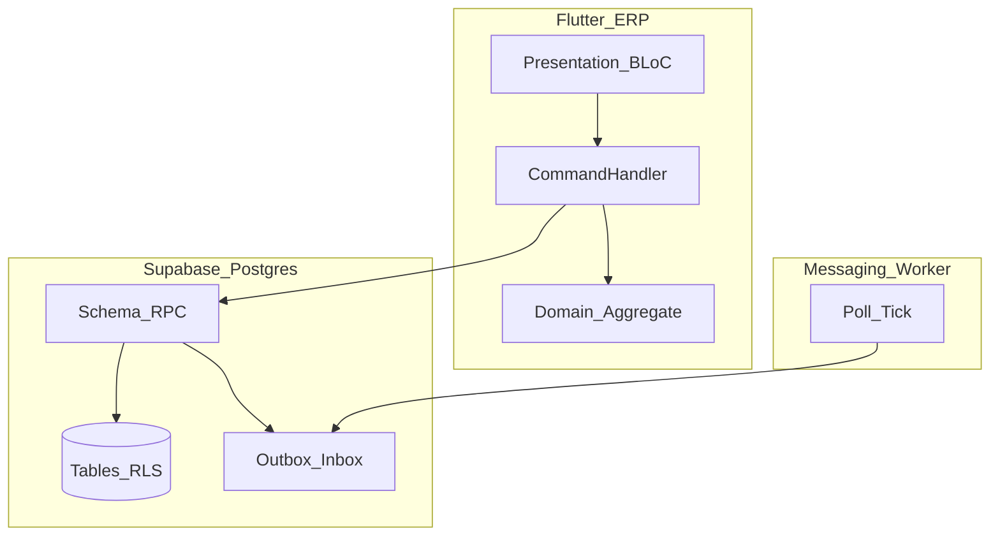

# Kiểu kiến trúc: Modular Monolith

## Lựa chọn: Client Modular Monolith

| Đặc điểm | Vet45 |
| -------- | ----- |
| Deployable | Một app Flutter (`apps/erp`) + worker (`apps/messaging_worker`) |
| Module boundary | Package Dart + Postgres schema (`catalog.*`, `sales.*`, `iam.*`) |
| Giao tiếp liên module | Integration events, public ports, snapshot DTO — không import `src/` |
| Persistence writes | **RPC-first** qua Supabase |
| Reads | Query handler + read gateway / view |

### Vì sao không microservices sớm?

- Team size và scope MVP phù hợp monolith có ranh giới rõ.
- Transaction nghiệp vụ (checkout, stock) cần consistency — RPC + outbox trong một Postgres đơn giản hơn distributed saga.
- Có thể tách worker/messaging khi cần scale async — không cần tách từng bounded context ngay.

## Tactical DDD trong mỗi module

```text
Aggregate → enforce invariant
Command handler → orchestrate use case
Command gateway (port) → persist qua RPC
Domain event → map integration event (sau gateway success)
```

Domain giữ **intent và rule**; RPC là **defense in depth** (permission, RLS, constraint DB).

## CQRS nhẹ

- **CommandBus** / **QueryBus** (`vet45_shared_infrastructure`)
- Command: mutation, có thể emit integration event
- Query: chỉ DTO, không trả aggregate

Handler đăng ký trong `MediationModule` của từng module infrastructure.

Hai loại command (business vs internal): [09-application-commands.md](09-application-commands.md).

## Luồng request (mutation)



## So sánh các hướng đã loại

| Hướng | Lý do không chọn (hiện tại) |
| ----- | --------------------------- |
| Microservices per module | Chi phí vận hành, chưa cần scale độc lập |
| Anemic + CRUD trực tiếp từ UI | Khó test rule, duplicate logic client/server |
| Direct PostgREST write từ app | Thiếu tập trung permission và invariant |

## Liên kết

- [05-layered-module-structure.md](05-layered-module-structure.md)
- [diagrams/request-lifecycle.mmd](diagrams/request-lifecycle.mmd)
