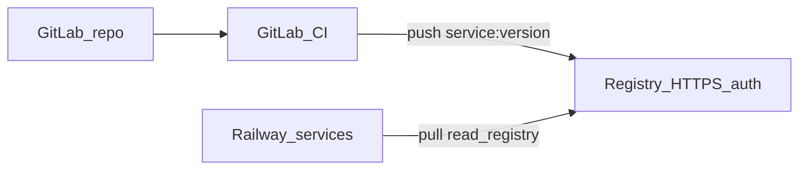

# ADR 12 — Nguồn image service trên Railway

> **Lỗi thời (06/10/2026):** Hạ tầng GitLab registry + Railway + CircleCI của dự án cũ đã gỡ khỏi repo (`.railway/`, `.circleci/` không còn). Giữ tài liệu này để tham khảo khi dựng lại deploy.

**Status:** Accepted  
**Ngày:** 2026-09-08  
**Accepted:** 2026-09-09

Quyết định về **mọi service Railway** (worker, API, job, …) — không gắn một app cụ thể. Instance đầu tiên là `messaging-worker`; service sau thêm vào cùng quy tắc.

Hướng đích là **phương án B**: GitLab (hoặc máy build) push image, Railway chỉ pull. [`.railway/railway.ts`](../../.railway/railway.ts) của `messaging-worker` đã `source: image(...)`. `railway up` không còn là chuẩn cho service đã chuyển sang image.

Playbook instance đầu: [railway_messaging_worker.md](../operations/railway_messaging_worker.md).

## Context

Railway host các process Dart/container của platform. Client Flutter (ERP, Admin) **không** deploy lên Railway.

Mỗi service tách ba lớp:

| Lớp | Việc | Lệnh hiện tại |
| --- | --- | --- |
| Infra | Service, healthcheck, knobs, replicas | `railway config apply` |
| Secrets | Biến runtime (`preserve()`) | script inject per-service — không commit |
| Artifact | Image / source | `railway up` (upload archive, Railway build Dockerfile) |

`apply` chỉ đồng bộ **graph** (service, Dockerfile path, biến). [`.railway/railway.ts`](../../.railway/railway.ts) **không** gắn GitHub hay registry, nên Railway không có gì để build cho đến khi CLI upload archive. Upload monorepo lớn dễ 502/404. Nhiều service thì upload lặp N lần.

`staging` và `production` trên Railway là **instance riêng**. `apply` trên một environment không tạo service trên environment kia — `railway up` env trống trả 404.

Doanh nghiệp muốn GitLab nội bộ + container registry private. Railway cloud **không pull** registry chỉ LAN/VPN. Artifact phải reach được từ internet (HTTPS + auth), hoặc service đó không chạy trên Railway (phương án A).

## Options

### A — GitLab + cluster nội bộ

GitLab CI build image, push registry trong mạng công ty, deploy Kubernetes/VM cùng VPC. Artifact không ra internet. Railway không tham gia production.

Phù hợp khi code/image không được rời mạng.

### B — GitLab build/push, Railway pull (accepted)

GitLab CI sở hữu artifact. Railway **chỉ chạy** image đã push. Mỗi service một image, một Dockerfile, cùng pattern tag.

1. Runner clone monorepo. Build context theo Dockerfile của service (hôm nay worker cần context **root** vì `COPY . .` — service sau không mặc định thu hẹp context nếu import package chung).
2. `docker build --platform linux/amd64` (Railway không chạy arm64) rồi push image **dưới project monorepo**, không phải project GitLab riêng tên service.
3. Tag bất biến = version ship (`0.1.1`, khớp `pubspec.yaml` / `messaging_worker-vX.Y.Z`) — không dùng git SHA, không `:latest`. Pointer `:staging` / `:production` chỉ là con trỏ retag, không phải identity.
4. `railway redeploy --service <service> --environment <env> --from-source` — pull lại image đã cấu hình, không upload source.
5. IaC đổi `source` sang `image(...)` theo environment; bỏ builder Dockerfile trên Railway cho service đó.
6. Credential registry trên Railway: Deploy Token GitLab **`read_registry` only** (username `gitlab+deploy-token-…`). **Không** dùng CI Job Token — token đó hết khi job xong, Railway không pull lâu dài được. Một token read có thể dùng chung các service cùng project registry.
7. Secrets runtime vẫn `preserve()` + inject per-service. Không bake secret vào image. Knobs vẫn IaC, không set lúc deploy image.
8. Promotion: production chỉ nhận SHA đã chạy staging **của đúng service đó**.

`apply` **không** đẩy image. Lần đầu: push tag lên registry **trước** (hoặc cùng lúc) `apply` / `redeploy`, nếu không pull fail.

Ví dụ image (instance đầu), suffix là tên image không phải GitLab project:

```text
registry.gitlab.hamsa.co/vet45/vet45/messaging-worker:0.1.1
# $CI_REGISTRY_IMAGE/<service>:<version>
```

Service mới: `$CI_REGISTRY_IMAGE/<service>:<version>`. Không push `registry…/<service>/…` như repo tách.

### C — Giữ `railway up` (không chọn)

CI hoặc máy local gọi `railway up` từng service. Railway tự build Dockerfile. Registry không tham gia. Chấp nhận upload archive và tách “apply ≠ ship code”.

## Decision

**Accepted: B** cho mọi service trên project Railway khi runtime vẫn là Railway. Không dùng `railway up` trên service đã `source: image`.

Lý do: không upload monorepo; một image version deploy được sang nhiều environment bằng retag + `redeploy --from-source`. Rollback = trỏ lại version đã push (không ghi đè tag đã chạy).

Instance `messaging-worker` hôm nay: image `registry.gitlab.hamsa.co/vet45/vet45/messaging-worker`, tag trong IaC = tên environment Railway (`:staging` / `:production`) như pointer. Identity vẫn là version khi build/push. Credential registry (deploy token `read_registry`) gắn trên service Railway, không commit vào `railway.ts`.

### Luồng B



### Jobs (mô tả, không phải YAML)

| Job | Việc |
| --- | --- |
| Build | `--platform linux/amd64`, push `$CI_REGISTRY_IMAGE/<service>:<version>` |
| Deploy staging | Retag version đó → pointer env nếu IaC dùng `:staging`, rồi `redeploy --from-source` |
| Deploy production | Chỉ version đã chạy staging; retag / đổi tag IaC rồi `redeploy` env `production` |

### Biến

| Biến | Nơi | Ghi chú |
| --- | --- | --- |
| `RAILWAY_TOKEN` | GitLab CI protected | Project token; `redeploy` mọi service |
| `CI_REGISTRY*` | GitLab | Push image; runner `write_registry` |
| Deploy token `read_registry` | Railway (không commit) | Pull; tách với token CI; có thể dùng chung các service |
| Secrets runtime từng service | inject `preserve()` một lần / khi đổi key | Không vào image; knobs vẫn IaC |

Registry instance: `registry.gitlab.hamsa.co` (project `vet45/vet45`), HTTPS public-auth.

## Đã làm / chưa làm

Đã làm (`messaging-worker`):

- [`.railway/railway.ts`](../../.railway/railway.ts) dùng `source: image(...)`, không còn `builder: DOCKERFILE`.
- Pull từ GitLab registry với deploy token trên Railway (không nằm trong git).

Chưa làm:

- Pipeline GitLab (build / push / `redeploy`) — `.gitlab-ci.yml` không có trên branch này. Hôm nay build/push tay.
- Không `railway up` service đã chuyển image.

## Consequences

- Registry phải HTTPS public-auth. Registry chỉ LAN → Railway pull fail; lúc đó chọn A, không “vá” VPN.
- Không chạy song song `railway up` và `source: image` trên cùng service — lệch nguồn.
- `apply` trên `production` không tạo instance `staging` (và ngược lại) — đúng với mọi service.
- Job Token GitLab không thay Deploy Token trên Railway.
- Thêm service = thêm Dockerfile + image name + `redeploy` trong cùng pipeline, không thêm lần upload monorepo.

## Liên kết

- [03-technology-stack.md](03-technology-stack.md)
- [railway_messaging_worker.md](../operations/railway_messaging_worker.md) — instance đầu (`messaging-worker`)
- [`.railway/README.md`](../../.railway/README.md)
- [`apps/messaging_worker/README.md`](../../apps/messaging_worker/README.md)
