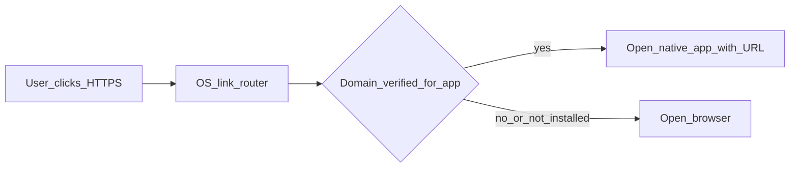
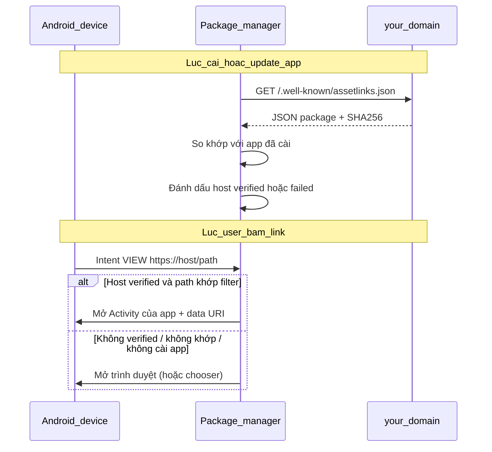

# App Link in Depth

Tài liệu kỹ thuật về cơ chế **App Link** (Android) / **Universal Link** (iOS): cách OS thiết lập verified association giữa website và native app, và cách một HTTPS URL được handoff vào app lúc runtime.

## Mục đích & phạm vi

| | |
| --- | --- |
| **Chủ đề** | HTTPS verified association: OS xác minh domain đã ủy quyền cho app rồi mở app trực tiếp thay vì trình duyệt |
| **Nền tảng** | Android **App Links** (`autoVerify` + Digital Asset Links) và iOS **Universal Links** (Associated Domains + AASA) |
| **Trong scope** | Mô hình verify/handoff, file association, ràng buộc hosting, hành vi fallback, troubleshooting |
| **Ngoài scope** | Product path cụ thể (`/i/{opaque}`, email CTA), routing trong Flutter, wire `APP_LINK_BASE_URL`/TH-01, custom scheme (chỉ nêu để so sánh) |

## Thuật ngữ

| Thuật ngữ | Định nghĩa | Ai sở hữu URL |
| --- | --- | --- |
| Deep link | URL mang ngữ cảnh để app mở đúng màn hình sâu (không chỉ splash → home) | — (khái niệm chung) |
| Custom URL scheme | `myapp://invite/abc` — app tự đăng ký scheme | Không verify được ownership; app nào cũng có thể claim |
| App Links (Android) | HTTPS link được verify qua `assetlinks.json` | Domain + chữ ký app |
| Universal Links (iOS) | HTTPS link được verify qua AASA | Domain + App ID |
| Digital Asset Links | File `assetlinks.json` khai báo app nào được ủy quyền cho domain (Android) | Domain owner |
| AASA | File `apple-app-site-association` khai báo App ID + path (iOS) | Domain owner |

**So với custom scheme:** App Link / Universal Link dùng URL web thật (HTTPS). Cùng một URL phục vụ được cả người chưa cài app (mở browser/landing) lẫn người đã cài (mở native app khi verified). Custom scheme không chứng minh ownership và thường lỗi khi app chưa cài.

Trong tài liệu này, "App Link" dùng theo nghĩa rộng — *HTTPS verified association giữa website và native app* — và tách nền tảng khi cần.

## Mô hình

App Link được cấu thành từ ba mảnh và vận hành qua hai pha.

**Ba mảnh (association hai chiều):**

```text
HTTPS URL trên domain bạn kiểm soát
  + file association trên server (assetlinks.json / AASA)
  + khai báo phía app (intent-filter autoVerify / Associated Domains)
```

- App khai báo: "muốn xử lý domain X".
- Website công khai: "ủy quyền cho app A (chữ ký / App ID cụ thể)".
- Chỉ khi hai bên khớp, OS mới coi link là *verified* và mở app trực tiếp (không disambiguation dialog).

**Hai pha:**

| Pha | Thời điểm | Việc của OS |
| --- | --- | --- |
| **Verify** | Lúc cài / update app (và re-verify theo policy) | Fetch file association, so khớp với app đã cài, lưu trạng thái verified/failed |
| **Handoff** | Lúc user bấm URL | Dựa trên trạng thái đã verify: mở app kèm URL, hoặc fallback browser |



OS chỉ trả lời câu hỏi *URL này có thuộc tập path/domain đã ủy quyền cho app đang cài không?* Parse path, login, gọi API là trách nhiệm của app (xem [Trách nhiệm phía app](#trách-nhiệm-phía-app)).

> **Lịch sử:** Trước cơ chế verify, app khai báo intent-filter cho HTTPS thường dẫn tới disambiguation dialog ("Mở bằng…?") vì OS thấy nhiều handler. Nếu OS mở app cho mọi HTTPS mà không xác minh, app độc hại có thể cướp traffic của website. Verified association loại bỏ cả hai vấn đề.

## Android App Links

### Khai báo phía app

Trong `AndroidManifest.xml`, Activity nhận link khai báo intent-filter cho scheme `https`, host, và (thường) path prefix. Điểm phân biệt App Links với deep link HTTPS thường là thuộc tính:

```xml
android:autoVerify="true"
```

Khi có ít nhất một intent-filter `autoVerify`, lúc cài/update trên Android 6+ hệ thống tự verify các host trong filter.

### File Digital Asset Links

Với mỗi hostname, Android GET file tại vị trí cố định:

```text
https://<hostname>/.well-known/assetlinks.json
```

Nội dung tối thiểu:

- `package_name` — application id
- `sha256_cert_fingerprints` — fingerprint chứng chỉ ký app
- `relation` — `delegate_permission/common.handle_all_urls`

**Ràng buộc hosting (verify fail thầm lặng nếu vi phạm):**

| Ràng buộc | Chi tiết |
| --- | --- |
| HTTPS | Bắt buộc, kể cả khi intent-filter khai báo scheme khác |
| Không redirect | 301/302 làm verify fail |
| Content-Type | `application/json` |
| Fingerprint đúng key | Khớp key **thực sự** ký bản build trên máy user. Với **Play App Signing**, fingerprint trên thiết bị là của Google, không phải upload key local |

### Verify và handoff



Lúc click, OS **không** tải lại `assetlinks.json` mỗi lần — quyết định dựa trên trạng thái verify đã lưu.

**Khác biệt theo phiên bản:**

- Android 12+: cho phép force re-verify khi debug.
- Android 15+: re-verify định kỳ ở background, và (tùy chọn) dynamic rules định nghĩa trên server. Dynamic rules **không** mở rộng scope vượt quá khai báo trong manifest.
- Android 14-: chỉ verify lúc cài/update, bỏ qua dynamic rules.

## iOS Universal Links

Cùng mô hình, khác cơ chế khai báo.

### Khai báo phía app

Bật capability **Associated Domains**, thêm entry:

```text
applinks:example.com
```

Entitlement **không** chứa path — path nằm trong file trên server. Wildcard subdomain (`applinks:*.example.com`) không tự khớp apex `example.com`; khai báo cả hai nếu cần.

### File apple-app-site-association (AASA)

Host tại (khuyến nghị hiện đại):

```text
https://example.com/.well-known/apple-app-site-association
```

Lưu ý URL **không** có đuôi `.json`. File JSON liệt kê `appID` = `TeamID.BundleID` và các path / components app được phép mở.

**Ràng buộc hosting:**

| Ràng buộc | Chi tiết |
| --- | --- |
| HTTPS | Chứng chỉ TLS hợp lệ, publicly trusted |
| Không redirect | iOS từ chối AASA phục vụ qua 301/302 |
| Content-Type | `application/json` |
| Kích thước | Trong giới hạn Apple quy định |
| CDN cache | Apple thường fetch qua CDN — đổi AASA không phản ánh ngay trên mọi thiết bị. Khi debug, entitlement có thể ghi `applinks:example.com?mode=developer` để lấy theo chế độ developer thay vì bản cache |

### Handoff lúc click

Khi Universal Link khớp, hệ thống mở app và giao `NSUserActivity` kiểu browsing web (hoặc scene equivalent) với `webpageURL` là URL đầy đủ; app tự parse.

**Đặc thù UX iOS:**

- User từng chọn **Open in Safari** cho domain → hành vi có thể "dính" mở browser cho tới khi mở lại bằng app (long-press / banner).
- Tap link **cùng domain đang xem trong Safari** có thể tiếp tục ở Safari (tôn trọng intent đang duyệt web).
- Smart App Banner và Universal Links liên quan nhưng không thay thế nhau.

## Trách nhiệm phía app

Verified link chỉ trả lời *có được mở app không?* — không giải quyết: user đã login chưa, token còn hạn không, navigate tới màn nào.

Luồng điển hình:

1. Nhận URL từ OS (`https://app.example.com/i/opaqueToken`).
2. Parse path / query.
3. Nếu cần auth → login / restore session, giữ nguyên destination.
4. Gọi API nghiệp vụ (accept, activate, …) với dữ liệu cần thiết.

**Ba lớp tách biệt:**

| Lớp | Việc của ai | Ví dụ |
| --- | --- | --- |
| Verified entry | OS + association file | Mở app với full URL |
| Session / auth | App | Redirect login rồi quay lại deep link |
| Business action | App + backend | POST accept; token trong body |

> **Bảo mật:** Đặt secret dài hạn trên query string của URL công khai (bị email forward, proxy, analytics thu lại) là anti-pattern. Nên dùng opaque id trên path và đổi lấy / gửi secret qua kênh đã authenticated — nhưng đây là quyết định product/security, nằm trên cơ chế App Link.

## Fallback và điều kiện thất bại

| Tình huống | Hành vi | Ghi chú |
| --- | --- | --- |
| App chưa cài | Mở browser | URL vẫn hợp lệ; landing có thể deep-link sang store hoặc render web. Lợi thế so với custom scheme |
| Verify fail | Mở browser / chooser | `assetlinks.json` sai fingerprint, AASA 404, redirect, hoặc CDN chặn bot OS. Link *trông* như App Link nhưng không verified |
| Path ngoài allow-list | Mở browser | Association/intent-filter chỉ cover `/i/*` thì `/blog/hello` đi browser — đúng thiết kế |
| Desktop | Mở browser | App Link không "bắn" sang điện thoại; cần lớp khác (QR, continuity) |
| In-app WebView / email client | Không handoff native | Một số WebView/mail client rewrite/wrap URL hoặc mở trong webview nội bộ. Test trên Gmail, Outlook, Slack, Safari, Chrome |
| Nhiều môi trường | Nguồn bug fingerprint | Staging/production thường là hai domain, hai file, hai build. Trộn fingerprint debug vào `assetlinks.json` production (hoặc ngược lại) gây fail |

## Troubleshooting

### Android

| Việc | Lệnh |
| --- | --- |
| Xem trạng thái verify | `adb shell pm get-app-links <package>` |
| Force re-verify (Android 12+) | `adb shell pm verify-app-links --re-verify <package>` |
| Mở thử URL | `adb shell am start -a android.intent.action.VIEW -d "https://example.com/i/test"` |
| Kiểm tra file | Mở `https://host/.well-known/assetlinks.json` — JSON, không redirect |
| Kiểm tra fingerprint | So với key thực sự ký APK/AAB (Play Console nếu Play App Signing) |

### iOS

- Validate AASA (tool Apple / validator cộng đồng): trả 200, JSON, path đúng.
- Xem device Console lúc cài app: lỗi fetch / parse association.
- Long-press link → Open in App nếu đã "dính" Safari.
- Nhớ CDN cache: đổi AASA rồi chờ, hoặc dùng `?mode=developer` khi debug.

### Checklist (kiểm tra trước khi nghi router/Flutter)

1. URL là `https` trên đúng host đã khai báo?
2. Path nằm trong intent-filter / AASA components?
3. Association file reachable, không redirect, đúng content-type?
4. `package_name` / `TeamID.BundleID` / SHA-256 khớp build đang cài?
5. Máy test đã cài đúng bản (không nhầm flavor)?
6. Click từ context nào (Safari, Gmail, Slack, WebView)?
7. Android: host đã `verified` trong `pm get-app-links`?

Nếu 7 mục đều đạt mà app vẫn về home → điều tra navigator / cold start / intent chưa forward vào framework UI.

## Tóm tắt

App Link / Universal Link là hợp đồng ba bên:

1. **Domain owner** kiểm soát domain và publish file ủy quyền.
2. **App** khai báo muốn nhận HTTPS của domain đó.
3. **OS** verify association, rồi lúc click quyết định mở app kèm URL hoặc để browser xử lý.

Tách đúng hai pha *verify* (association / hosting) và *handoff* (routing trong app) giúp khoanh vùng lỗi chính xác. Cơ chế cốt lõi: **HTTPS + chứng minh ownership + OS đưa nguyên URL vào app.**

## Tham chiếu

- [Android — Verify App Links](https://developer.android.com/training/app-links/verify-applinks)
- [Android — Configure website associations (`assetlinks.json`)](https://developer.android.com/training/app-links/configure-assetlinks)
- [Android — Troubleshoot App Links](https://developer.android.com/training/app-links/troubleshoot)
- [Apple — Supporting associated domains](https://developer.apple.com/documentation/xcode/supporting-associated-domains)
- [Apple — Supporting universal links in your app](https://developer.apple.com/documentation/xcode/supporting-universal-links-in-your-app)
