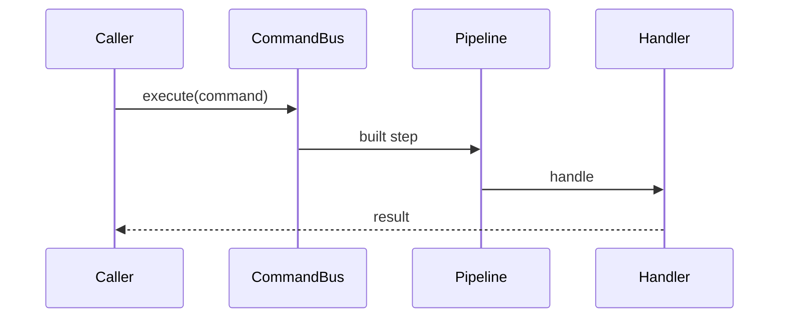

# Vet45 shared toolkit

The shared toolkit provides reusable DDD and CQRS mechanics for ERP modules, Flutter apps, and workers. It intentionally excludes business domain models and Vet45-specific infrastructure adapters.

## Packages

| Package | Path | Responsibility |
|---------|------|----------------|
| `vet45_shared_domain` | `packages/vet45_shared/domain` | Entities, value objects, domain events, business rules |
| `vet45_shared_application` | `packages/vet45_shared/application` | Commands, queries, handlers, validators, execution context |
| `vet45_shared_infrastructure` | `packages/vet45_shared/infrastructure` | Buses, pipelines, decorators, logging, integration-event primitives |
| `vet45_shared_testing` | `packages/vet45_shared/testing` | Test doubles and pipeline harness |
| `vet45_adapters` | `packages/vet45_adapters` | Supabase RPC, messaging worker, outbox/inbox |
| `vet45_annotations` | `packages/vet45_annotations` | Codegen metadata (`@CommandHandlerFor`, `@RequiresPermission`, `@ModuleManifest`, …) |
| `vet45_generator` | `packages/vet45_generator` | `build_runner` registration codegen |

## Command flow



Default business pipeline order (outer → inner):

1. Logging (`LoggingCommandHandlerDecorator`)
2. Authorization / tenant guards — when `IAccessMetadataRegistry` + checkers are passed to `DefaultCommandPipeline`
3. Validation (`ValidationCommandHandlerDecorator`) — when a validator is registered
4. Handler

Internal commands dùng cùng `CommandBus` nhưng pipeline riêng và lưu durable trước khi chạy — [09-application-commands.md](09-application-commands.md).

## Codegen (optional)

Runtime buses work without annotations. See:

- [Codegen migration guide](codegen-migration.md)
- [`packages/vet45_annotations/README.md`](../../packages/vet45_annotations/README.md)
- [`packages/vet45_generator/README.md`](../../packages/vet45_generator/README.md)

## What belongs here vs modules

| In shared toolkit | In modules / adapters |
|-------------------|----------------------|
| `ICommand`, `CommandBus` | `CreateSalesOrderCommand` |
| `IPermissionChecker` interface | Permission codes and IAM rules |
| `IRpcClient` interface | Supabase RPC function names |
| `Entity`, `ValueObject` base types | `Product`, `Customer`, `Money` (accounting domain) |

## Testing

Use `vet45_shared_testing` for handler tests:

- `InMemoryCommandBus` / `RecordingQueryBus`
- `FakeExecutionContext`, `FakePermissionChecker`, `FakeTenantAccessChecker`
- `PipelineTestHarness` for isolated decorator tests

Run package tests:

```bash
dart test packages/vet45_shared/domain
dart test packages/vet45_shared/application
dart test packages/vet45_shared/infrastructure
dart test packages/vet45_shared/testing
dart test packages/vet45_adapters
dart test packages/vet45_generator
```

## See also

- [Codegen migration guide](codegen-migration.md)
- [Repository layout](04-repository-layout.md)
- [Layered module structure](05-layered-module-structure.md)
- [`packages/vet45_shared/README.md`](../../packages/vet45_shared/README.md)
