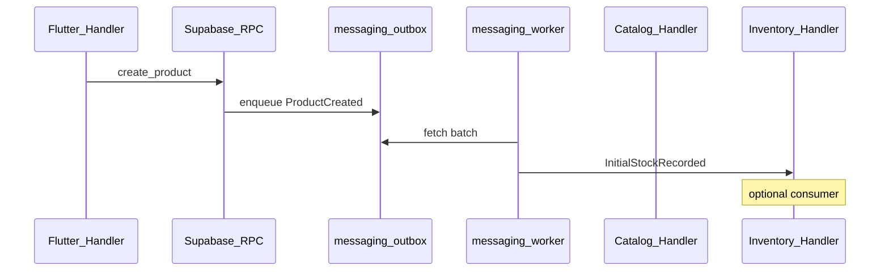

# Integration event flow

> Tài liệu chi tiết luồng integration event. Tổng quan kiến trúc: [architecture/07-integration-and-messaging.md](architecture/07-integration-and-messaging.md)

## Nguyên tắc

1. **Domain event** không publish trực tiếp ra module khác.
2. **Integration event** = **business fact đã xảy ra** ở publisher (past tense). Không dùng outbox để gửi “yêu cầu làm việc”.
3. **Command handler / RPC** sau khi mutation thành công:
   - map sang **integration event (fact)** trên outbox khi cần thông báo liên module;
   - ghi **integration_commands** (+ bảng intent) khi cần nhờ module khác thực thi.
4. **Outbox** ghi cùng transaction với mutation (Postgres) — worker deliver **events**.
5. **Consumer** implement integration event handler trong module đích (application layer) → enqueue internal command; không coi outbox như RPC.
6. **Cấm** đặt tên / contract IE dạng `*.requested`, apply/retry/reconcile/reverse làm event — xem [vet45-integration-events rule](../.cursor/rules/vet45-integration-events.mdc) và [architecture/07-integration-and-messaging.md](architecture/07-integration-and-messaging.md).

## Luồng end-to-end

## Trách nhiệm từng phần

| Thành phần | Vai trò |
| ---------- | ------- |
| `integration_events` package | Định nghĩa type + JSON schema + `{Module}IntegrationEventRegistry` (deserialize) |
| Consumer handler (**application layer**) | `IIntegrationEventNotificationHandler` — map event → internal command, **enqueue** qua `ICommandScheduler` (idempotent) |
| Infrastructure outbox writer | Insert row (trong RPC hoặc adapter) |
| Infrastructure inbox/internal processors | `ProcessInboxCommand` / `ProcessInternalCommandsCommand` (`IRecurringCommand`) chạy qua `CommandBus` + pipeline; inbox deserialize + drain; internal pump claim → `CommandsExecutor` |
| `messaging_worker` | Poll tenant, gọi `processMessagingOnce` (delegate về module `CommandBus`) |

## Theme liên quan

| Theme | Events chính |
| ----- | ------------ |
| TH-01 | TenantCreated, UserAccountCreated, TenantMemberRoleChanged |
| TH-02 | ProductCreated, AvailableStockChanged, CostPriceRecalculated |
| Sales module | SalesOrderCheckedOut (planned) |
| TH-06 | Stock movement events (consumer) |

## Checklist triển khai event mới

- [ ] Type là **fact** (đã xảy ra) — không phải request/command đội lốt event
- [ ] Type trong `modules/{publisher}/integration_events` (+ entry trong `{Module}IntegrationEventRegistry`)
- [ ] Handoff sang module khác (nếu cần) dùng `integration_commands` / intent table — **không** thêm `*.requested` outbox
- [ ] Consumer handler ở **application layer** (`IIntegrationEventNotificationHandler`) — map event → internal command
- [ ] Dispatcher registry entry (codegen `cqrs_integration_event_registry`)
- [ ] Command chạy qua `CommandBus` + pipeline (không gọi handler trực tiếp)
- [ ] **Idempotency consume:** Inbox dedup theo `event.id`; enqueue internal command idempotent theo `(tenant_id, source_event_id, command_type)` — truyền `sourceEventId: event.id`
- [ ] Side effect của internal command vẫn an toàn nếu worker retry (không nhân đôi receivable / stock / email) — xem [architecture/13-idempotency-and-message-processing.md](architecture/13-idempotency-and-message-processing.md)
- [ ] Test consumer handler với fake `ICommandScheduler`
- [ ] E2E: [messaging_e2e_checklist.md](messaging_e2e_checklist.md)

## Liên kết theo theme

- [TH-02 architecture and flows](themes/TH-02-product-pricing/harness/03-architecture-and-flows.md)
- [TH-04 Pricing module map](themes/TH-04-pricing-promotions/harness/02-module-map.md) · [integration & messaging](architecture/07-integration-and-messaging.md)
- [Idempotency & message processing](architecture/13-idempotency-and-message-processing.md) · rule [.cursor/rules/vet45-idempotency-and-commands.mdc](../.cursor/rules/vet45-idempotency-and-commands.mdc)
