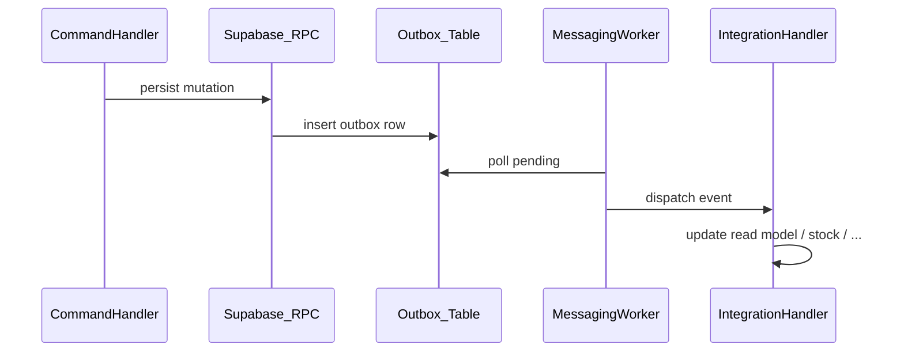

# Integration và messaging

> Nội dung chi tiết luồng event: [integration_event_flow.md](../integration_event_flow.md)

## Mô hình

| Loại | Mục đích | Nơi chạy |
| ---- | -------- | -------- |
| **Integration event** | Contract liên module (JSON, versioned type) | Package `integration_events` |
| **Domain event** | Nội bộ aggregate | Domain layer — map ra integration ở handler |
| **Outbox/Inbox** | Durable delivery | Postgres + `messaging_worker` |
| **App event bus** | UI refresh local | Flutter — không thay outbox |

## Luồng publish (target)



## Package integration events

```text
modules/{name}/integration_events/lib/src/events/
```

Registry deserialize: `IamIntegrationEventRegistry`, tương tự catalog/sales.

## Messaging worker

- `apps/messaging_worker` — self-loop tick, service role Supabase
- Module handlers đăng ký trong worker bootstrap
- **Không** khuyến nghị client POST `/tick` — xem playbook deploy

## ERP client messaging

- `MessagingOrchestrator` — đăng ký module messaging adapters
- `MessagingPollPolicy` — có thể disable client poll (`MESSAGING_POLL_ENABLED=false`)
- Flush sau mutation: optional UX; backbone là worker

## Ví dụ event theo theme

| Theme | Event ví dụ |
| ----- | ----------- |
| TH-02 | `ProductCreated`, `AvailableStockChanged` |
| TH-04 | `SalesOrderCheckedOut` |
| TH-01 | `TenantCreated`, `TenantMemberRoleChanged` |
| TH-06 | `StockAdjusted` (consumer) |

## Liên kết

- [integration_event_flow.md](../integration_event_flow.md)
- [messaging_e2e_checklist.md](../messaging_e2e_checklist.md)
