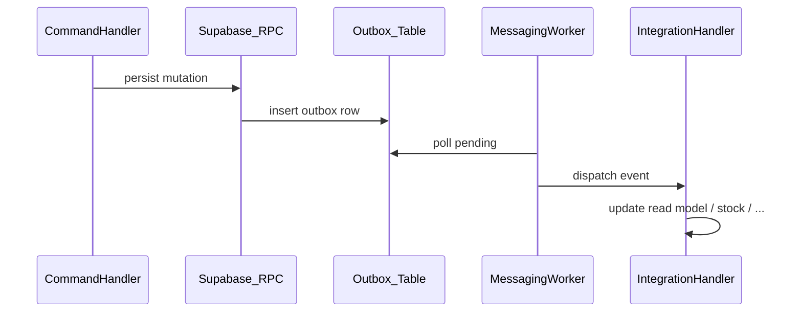
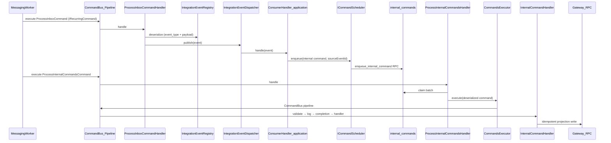

# Integration và messaging

> Nội dung chi tiết luồng event: [integration_event_flow.md](../integration_event_flow.md)
>
> **Agent rule (mandatory):** [.cursor/rules/vet45-integration-events.mdc](../../.cursor/rules/vet45-integration-events.mdc) — outbox = facts only; never disguise commands as integration events.

## Mô hình

| Loại | Mục đích | Nơi chạy |
| ---- | -------- | -------- |
| **Integration event** | Contract liên module — **business fact đã xảy ra** (JSON, versioned type) | Package `integration_events` + `{module}.outbox_messages` |
| **Domain event** | Nội bộ aggregate | Domain layer — map ra integration fact ở boundary sau commit |
| **Integration command** | Yêu cầu module khác (hoặc async cùng module) **thực hiện việc** | `{module}.integration_commands` (+ bảng intent nếu có, vd. impact requests) |
| **Internal command** | Việc trì hoãn trong cùng module | `{module}.internal_commands` + `ICommandScheduler` |
| **Outbox/Inbox** | Durable delivery của **events (facts)** | Postgres + `messaging_worker` |
| **App event bus** | UI refresh local | Flutter — không thay outbox |

## Fact vs command (không được trộn)

Integration event và outbox **không** phải RPC giả. Tên và semantics phải là **past fact**.

| Được phép trên outbox / `integration_events` | Cấm (đưa sang `integration_commands`) |
| --- | --- |
| `sales_order_finalized.v1` | `*.requested` / `*_requested` |
| `sales_payment_recorded.v1` | `*.apply_*` / retry / reconcile / reverse làm “event” |
| `return_exchange_completed.v1` | Mọi payload chủ yếu là “hãy làm X giúp tôi” |

**Luồng đúng khi Sales cần Kho / Công nợ (platform target):**

```text
Mutation Sales (cùng transaction)
  → đổi state Sales + emit lifecycle FACT trên outbox (nếu có consumer)
  → ghi intent (vd. inventory_impact_requests) + integration_commands (imperative command_name)
  → KHÔNG insert outbox kiểu inventory_impact.requested
```

Owner (TH-06/TH-07) consume **command/intent**, không bị bắt buộc hiểu “request event” đội lốt fact.

**TH-05 current phase (option B — reactive, 2026-09):** Sales **chỉ** emit lifecycle outbox facts trong phase hiện tại — **không** sở hữu `*_impact_requests`, `integration_commands`, apply/retry enqueue. TH-06/07/08 consume Sales facts qua inbox handlers khi owner modules sẵn sàng. Integration status UI (EP-03/US-06) giữ SQL stub `notRequired`; thin outcome projection = future slice. Luồng command/intent ở trên vẫn là platform pattern cho modules **owner** hoặc cho Sales khi/h nếu durable handoff được reopen — không phải deliverable TH-05 hiện tại.

Naming gợi ý:

- Fact: `{context}_{aggregate}_{past_participle}.v1`
- Command: `{context}.{owner}.{imperative}.v1`

## Luồng publish (target)



## Luồng consume (target)

Consumer **luôn** là handler ở **application layer** (`IIntegrationEventNotificationHandler`), và inbox/internal-command được xử lý **qua `CommandBus` + `DefaultCommandPipeline`** bằng `IRecurringCommand` — không gọi command handler trực tiếp từ infrastructure.



- **Deserialize** (`{Module}IntegrationEventRegistry`) + inbox draining là concern của infrastructure.
- **Mapping event → command** là concern của application (consumer handler), không đặt ở infrastructure.
- Consumer handler **chỉ enqueue** qua `ICommandScheduler`; execution thuộc `ProcessInternalCommandsCommandHandler` + `CommandsExecutor`.
- Dispatcher wiring do codegen sinh (`createGenerated{Module}IntegrationEventDispatcher`).
- Internal-command serialize/deserialize: `ISerializableInternalCommand` + `InternalCommandSerializer` (`vet45_shared`) + codegen `cqrs_internal_registry`.
- Golden layout: `modules/sales/` (`SalesStartup.processMessagingOnce`, `Process{Outbox,Inbox,InternalCommands}`, `SupabaseSalesCommandScheduler`); inbox projection ví dụ: `modules/partner/`.

## Package integration events

```text
modules/{name}/integration_events/lib/src/events/
```

Registry deserialize: `IamIntegrationEventRegistry`, tương tự catalog/sales.

## Messaging worker

- `apps/messaging_worker` — self-loop tick, service role Supabase
- **P1 (triển khai):** module binding registry (`MessagingModuleBinding` + `IMessagingCommandFactory`) và pool song song theo partition key `(tenant_id, module_schema, queue_type)` với `WORKER_CONCURRENCY`
- Discovery RPC `platform.list_tenants_with_pending_messaging(p_limit, p_modules)` — worker truyền `p_modules` từ danh sách module đã bind
- **P3 (chưa triển khai):** replica shard theo `hashtext(tenant_id) % replica_count`; xem [operations/messaging_worker_scaling.md](../operations/messaging_worker_scaling.md)
- **Không** khuyến nghị client POST `/tick` — xem playbook deploy

## Trạng thái module (2026-07)

| Module | Messaging Dart hôm nay | Ghi chú |
| ------ | ---------------------- | ------- |
| **Target (golden)** | `ProcessOutbox` → `ProcessInbox` → `ProcessInternalCommands` qua `CommandBus` + `ICommandScheduler`; folder `configuration/processing/{outbox,inbox,internal_commands}` | Golden = `modules/sales/infrastructure` (`SalesStartup.processMessagingOnce` + `Process{Outbox,Inbox,InternalCommands}` + `SupabaseSalesCommandScheduler`); catalog/partner cùng pattern; sequence “Luồng consume (target)” ở trên |
| **IAM (S-NOTIFY)** | Consume: `ProcessOutbox` → `ProcessInbox` (self-consume) → `ProcessInternalCommands` qua `IamStartup.processMessagingOnce`. Publish: **mutation RPC** `enqueue_outbox_message` (không Dart client). Folder `configuration/processing/{outbox,inbox,internal_commands}`; adapters `src/adapters/notification/` | `IIamOutboxClient` chỉ claim/complete/fail; event `iam.email.delivery_requested` → `SendEmailDeliveryCommand` qua `ICommandScheduler` |
| Partner (working tree) | Greenfield / reboot TH-03 | Rebuild theo golden khi implement |

Reference code IAM: `EmailDeliveryRequestedIntegrationEvent`, `ICommandScheduler`, `SendEmailDeliveryCommand`, `IamStartup.processMessagingOnce`, `IamMessagingCommandFactory` (worker binding).

## ERP client messaging

- `MessagingOrchestrator` — đăng ký module messaging adapters
- `MessagingPollPolicy` — có thể disable client poll (`MESSAGING_POLL_ENABLED=false`)
- Flush sau mutation: optional UX; backbone là worker

## Ví dụ event theo theme

| Theme | Event ví dụ |
| ----- | ----------- |
| TH-02 | `ProductCreated`, `AvailableStockChanged` |
| TH-04 | `SalesOrderCheckedOut` |
| TH-01 | `TenantCreated`, `TenantMemberRoleChanged` |
| TH-06 | `StockAdjusted` (consumer) |

## Liên kết

- [integration_event_flow.md](../integration_event_flow.md)
- [messaging_e2e_checklist.md](../messaging_e2e_checklist.md)
- [operations/messaging_schema.md](../operations/messaging_schema.md) — Postgres migrations + RPC reference
- [operations/messaging_worker_scaling.md](../operations/messaging_worker_scaling.md) — worker concurrency (P1) và replica shard playbook (P3)
