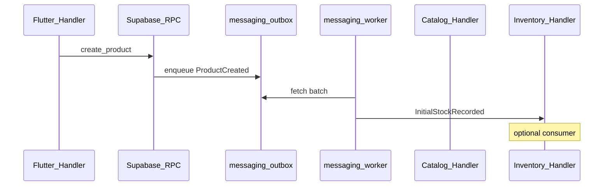

# Integration event flow

> Tài liệu chi tiết luồng integration event. Tổng quan kiến trúc: [architecture/07-integration-and-messaging.md](architecture/07-integration-and-messaging.md)

## Nguyên tắc

1. **Domain event** không publish trực tiếp ra module khác.
2. **Command handler** map domain event → integration event **sau khi** gateway/RPC thành công.
3. **Outbox** ghi cùng transaction với mutation (Postgres) — worker deliver.
4. **Consumer** implement integration event handler trong module đích (application layer).

## Luồng end-to-end

## Trách nhiệm từng phần

| Thành phần | Vai trò |
| ---------- | ------- |
| `integration_events` package | Định nghĩa type + JSON schema |
| Application mapper | `XxxIntegrationEventMapper` |
| Infrastructure outbox writer | Insert row (trong RPC hoặc adapter) |
| `messaging_worker` | Poll, deserialize, dispatch |
| Consumer handler | Idempotent side effect |

## Theme liên quan

| Theme | Events chính |
| ----- | ------------ |
| TH-01 | TenantCreated, UserAccountCreated, TenantMemberRoleChanged |
| TH-02 | ProductCreated, AvailableStockChanged, CostPriceRecalculated |
| TH-04 | SalesOrderCheckedOut (planned) |
| TH-06 | Stock movement events (consumer) |

## Checklist triển khai event mới

- [ ] Type trong `modules/{publisher}/integration_events`
- [ ] Mapper trong application handler
- [ ] Consumer handler trong module subscriber
- [ ] Registry entry (codegen hoặc manual)
- [ ] Test handler với fake gateway
- [ ] E2E: [messaging_e2e_checklist.md](messaging_e2e_checklist.md)

## Liên kết theo theme

- [TH-02/03-architecture-and-flows.md](themes/TH-02-catalog-and-pricing/03-architecture-and-flows.md)
- [TH-04/03-architecture-and-flows.md](themes/TH-04-sales-and-orders/03-architecture-and-flows.md)
