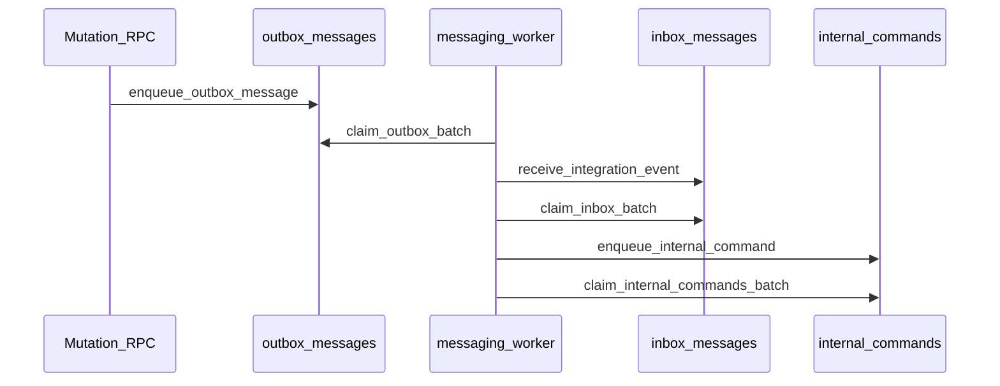

# Messaging schema (Postgres)

Tài liệu vận hành cho migrations messaging foundation. Kiến trúc luồng: [architecture/07-integration-and-messaging.md](../architecture/07-integration-and-messaging.md).

## Migrations

| File | Mục đích |
| ---- | -------- |
| `supabase/migrations/20260623000001_platform_messaging_foundation.sql` | Schema `platform`, `install_module_messaging`, discovery RPC, backlog view |
| `supabase/migrations/20260623000002_install_module_messaging_modules.sql` | Cài messaging cho 8 module Phase 1 |
| `_drafts/002_einvoice_s1_install_module_messaging.sql` | TH-08: whitelist + `install_module_messaging('einvoice')` (chưa promote) |

## Module được cài (Phase 1)

`iam`, `catalog`, `partner`, `sales`, `inventory`, `costing`, `accounting`, `dashboard`, `einvoice` (einvoice: draft installer, chưa promote)

Mỗi schema có:

- `{module}.outbox_messages`
- `{module}.inbox_messages`
- `{module}.internal_commands`

## Bảng messaging (chuẩn chung)

### Outbox / Inbox

| Cột | Kiểu | Ghi chú |
| --- | ---- | ------- |
| `id` | `uuid` PK | Inbox PK = `IntegrationEvent.id` |
| `tenant_id` | `uuid` NOT NULL | Worker poll theo tenant |
| `event_type` | `text` | `module.entity.past_tense` |
| `payload` | `jsonb` | Event body |
| `occurred_at` | `timestamptz` | Thời điểm sự kiện |
| `processed_at` | `timestamptz` | Hoàn thành xử lý |
| `failed_at` | `timestamptz` | Lỗi vĩnh viễn / retry |
| `error` | `text` | Message lỗi |
| `retry_count` | `int` | Số lần fail |
| `claimed_at` | `timestamptz` | Claim worker |
| `claim_token` | `uuid` | Token xác thực complete/fail |

### Internal commands

| Cột | Kiểu | Ghi chú |
| --- | ---- | ------- |
| `id` | `uuid` PK | Row id (không nằm trong payload JSON) |
| `tenant_id` | `uuid` NOT NULL | |
| `command_type` | `text` | `module.action_name` |
| `payload` | `jsonb` | `toJson()` từ application |
| `source_event_id` | `uuid` NULL | Dedup khi enqueue từ inbox |
| `enqueued_at` | `timestamptz` | |
| `processed_at` / `failed_at` / `error` / `retry_count` | | Giống outbox |
| `claimed_at` / `claim_token` | | Claim worker |

**Dedup:** unique partial index `(tenant_id, source_event_id, command_type) WHERE source_event_id IS NOT NULL`.

## RPC mỗi module

| RPC | Vai trò |
| --- | ------- |
| `enqueue_outbox_message` | Helper gọi từ mutation RPC (cùng transaction) |
| `claim_outbox_batch` / `complete_outbox_message` / `fail_outbox_message` | Worker outbox |
| `receive_integration_event` | Ghi inbox idempotent (`ON CONFLICT DO NOTHING`) |
| `claim_inbox_batch` / `complete_inbox_message` / `fail_inbox_message` | Worker inbox |
| `enqueue_internal_command` | Enqueue + dedup |
| `claim_internal_commands_batch` / `complete_internal_command` / `fail_internal_command` | Worker internal |

Tất cả RPC worker: `SECURITY DEFINER`, grant `EXECUTE` cho `service_role` only. Bảng messaging: **không** grant trực tiếp cho `anon` / `authenticated`.

## Platform schema

| Object | Vai trò |
| ------ | ------- |
| `platform.messaging_module_registry` | Danh sách module đã cài |
| `platform.install_module_messaging(text)` | DRY installer (whitelist: 8 Phase 1 + `einvoice` khi promote TH-08) |
| `platform.messaging_backlog_stats` | View observability (rebuild sau mỗi install) |
| `platform.list_tenants_with_pending_messaging(int, text[])` | Discovery cho `messaging_worker` — `p_modules` lọc module đã bind (draft `001_platform_list_pending_messaging_queues.sql`) |

## Luồng (tóm tắt)



## Verify local

```bash
# Cần Supabase CLI + psql + Docker
chmod +x scripts/supabase/verify_messaging_migrations.sh
./scripts/supabase/verify_messaging_migrations.sh
```

Smoke test riêng (sau `supabase db reset`):

```bash
./scripts/supabase/run_messaging_smoke_test.sh
```

## Verify staging / remote

```bash
export SUPABASE_URL=...
export SUPABASE_SERVICE_ROLE_KEY=...
apps/messaging_worker/scripts/verify_supabase.sh
```

## Module mới

1. Thêm schema vào whitelist trong `platform.install_module_messaging`
2. `SELECT platform.install_module_messaging('new_module');` trong migration mới
3. Cập nhật `supabase/config.toml` `schemas` + `extra_search_path`
4. Triển khai Dart infra clients theo RPC names cố định ở trên

## Liên kết

- [infrastructure_layer_skill.md](../infrastructure_layer_skill.md) §7
- [MODULES_IMPLEMENTATION_TEMPLATE.md](../MODULES_IMPLEMENTATION_TEMPLATE.md) §12
- [integration_event_flow.md](../integration_event_flow.md)
- [messaging_worker_scaling.md](messaging_worker_scaling.md) — concurrency (P1) và replica shard (P3)
