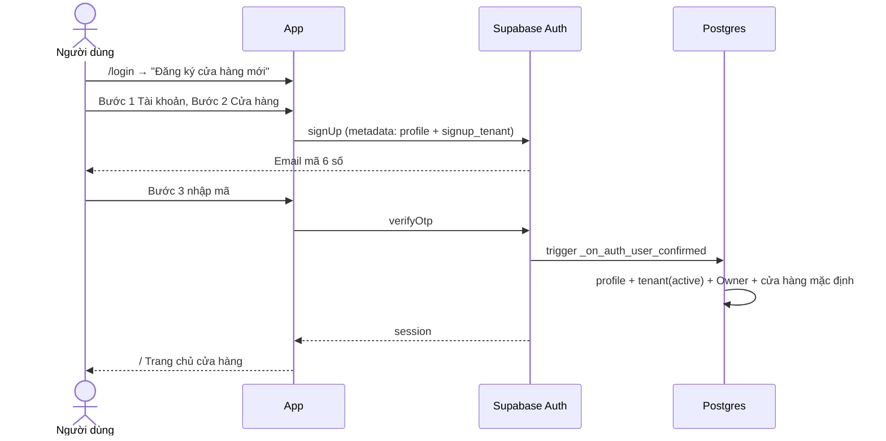

# Scope: Đơn giản hoá kiến trúc Vet45

> Trạng thái: **đã chốt (2026-10-06)** · Ngày lập: 2026-10-06 · Branch đề xuất: `refactor/simple-arch`

## 1. Mục tiêu

Chuyển Vet45 từ **Modular Monolith + DDD + CQRS + Outbox/Worker** sang kiến trúc **Flutter feature-first 3 tầng + Supabase**, để:

- dễ hiểu, dễ trình bày và bảo vệ trong đồ án;
- giảm số package / file / thành phần phải deploy;
- **giữ nguyên toàn bộ chức năng nghiệp vụ hiện có** (không thêm, không bớt tính năng).

Nguyên tắc vàng: **đổi cách tổ chức code, không đổi hành vi người dùng thấy.**

## 2. Phạm vi chức năng (giữ nguyên 100%)

> **Ngoại lệ duy nhất:** luồng khởi tạo tổ chức (TH-01 / Epic-01) được thiết kế lại. Xem 3.5.

Đây là danh sách nghiệm thu: sau refactor, mọi mục dưới đây phải chạy được như trước.

### 2.1 Module đã có nghiệp vụ

| Module | Theme | Nhóm chức năng giữ nguyên | Màn hình |
|---|---|---|---|
| **iam / auth** | TH-01 | Đăng nhập/đăng xuất; quên/đặt lại mật khẩu; hồ sơ cá nhân; tổ chức (profile, hồ sơ pháp lý); **tự đăng ký & tự tạo tổ chức (thiết kế lại, xem 3.5)**; thành viên & vai trò (gán role, vô hiệu/kích hoạt lại); lời mời (tạo, gửi lại, thu hồi, chấp nhận, đăng ký từ lời mời); audit log; chuyển tenant/store | ~23 (ERP) |
| **catalog** | TH-02 | Sản phẩm (tạo nhanh/guided, sửa, ảnh, vô hiệu/khôi phục/xoá, kiểm tra trùng mã, readiness, lịch sử thay đổi); đơn vị tính & quy đổi; barcode / tìm kiếm SP bán được; trường tuỳ chỉnh (nhóm, field, giá trị); giá: giá gốc thủ công, khung giá theo đơn vị, quy tắc giá cửa hàng + lịch sử; tồn kho cơ bản (điều chỉnh, lịch sử tồn) | ~23 |
| **partner** | TH-03 | Khách hàng/NCC: tạo, sửa, chuyển cá nhân → tổ chức, liên hệ tổ chức, vô hiệu/kích hoạt/xoá mềm, kiểm tra trùng, validate MST, lịch sử thay đổi & lịch sử giao dịch | 8 |
| **pricing** | TH-04 | Giá riêng theo khách (CRUD, tắt/bật lại, lịch sử), nhớ giá từ đơn, áp giá khi bán, import Excel (template, preview, xác nhận/huỷ) | 9 |
| **sales** | TH-05 | Lập đơn, đơn nháp (lưu/khôi phục/huỷ), checkout & thanh toán, công nợ đơn, hoàn tiền, phiếu/biên lai (tạo, in, chia sẻ), danh sách/tìm/chi tiết/timeline đơn, huỷ đơn có lý do, đổi/trả hàng (tạo, định giá, xác nhận, hoàn tất, huỷ) | ~20 |
| **einvoice** | TH-08 | Kết nối nhà cung cấp MISA (kết nối/xác minh/ngắt), cấu hình phát hành mặc định & chính sách tự động; xem trước, phát hành, retry, tra trạng thái; tải/xem bản chính thức; gửi HĐ qua email + lịch sử gửi; xử lý đối soát | 4 + màn trong sales |

### 2.2 Module hiện chỉ là khung (8–9 file, chưa có nghiệp vụ)

| Module | Xử lý trong refactor |
|---|---|
| **inventory** | Tạo `features/inventory/`, **chuyển tồn kho cơ bản** (đang nằm trong catalog) sang đây. Không thêm tính năng mới. Theme 7 đầy đủ (spec `specs/themes/theme-07`) làm ở phase P11 sau refactor. |
| **dashboard** | Giữ `dashboard_page` hiện có trong `features/dashboard/`. |
| **costing**, **accounting** | Chỉ tạo thư mục feature rỗng + ghi chú "planned". Không phát triển trong đợt này. |

### 2.3 Ngoài phạm vi (không làm trong đợt refactor)

- Tính năng mới của TH-06 (công nợ đầy đủ), TH-07 (kiểm kê, giá vốn), TH-09, TH-10 (báo cáo), TH-11, TH-12.
- Thiết kế lại UI/UX. Màn hình giữ nguyên, chỉ đổi phần logic/data phía sau.
- Đổi nhà cung cấp hoá đơn điện tử hoặc đổi backend khỏi Supabase.

## 3. Phạm vi kỹ thuật

### 3.1 Kiến trúc đích

```text
UI (Page/Widget) → Cubit/Bloc → Repository → Supabase (table / view / RPC / Edge Function) → Postgres
```

```text
apps/erp/lib/
├── main.dart
├── core/            # supabase client, router, session, DI, errors, formatting, design system
└── features/
    └── <feature>/
        ├── data/          # models (fromJson/toJson) + <feature>_repository.dart
        ├── logic/         # cubit/bloc + state; rule nghiệp vụ phía client
        └── presentation/  # pages + widgets (giữ từ code hiện tại)
```

**Quy tắc phụ thuộc** (chỉ 3 luật, dùng khi review):

1. `presentation` → `logic` → `data`. Không đi ngược chiều, không bỏ tầng.
2. Feature A cần dữ liệu của feature B thì **gọi repository của B**. Không import `logic`/`presentation` của B.
3. Thao tác cần **transaction** (checkout, trừ kho, đổi trả, thanh toán) phải đi qua **RPC Postgres**. Thao tác CRUD đơn giản thì gọi table/view trực tiếp.

### 3.2 Bỏ / giữ / chuyển

| Thành phần hiện tại | Quyết định |
|---|---|
| Melos + `modules/*/{domain,application,infrastructure,integration_events}` | **Bỏ.** Logic gộp vào `features/*/{data,logic}` |
| CommandBus / QueryBus, handler, gateway, aggregate | **Bỏ.** Thay bằng Cubit gọi Repository |
| Integration events, Outbox/Inbox, internal commands | **Bỏ.** Xem bảng thay thế ở mục 4 |
| `apps/messaging_worker` | **Bỏ** |
| `vet45_generator`, `vet45_annotations`, `vet45_adapters` | **Bỏ** |
| `vet45_shared`, `vet45_async_query` | **Gộp** phần còn dùng vào `core/`, bỏ phần CQRS |
| `vet45_design_system` | **Giữ** (chuyển thành `packages/design_system` hoặc `core/design_system`) |
| `vet45_misa` | **Bỏ ở P9**: client MISA viết lại bằng TypeScript trong Edge Function `einvoice-processor` (TH-08 KI-20, quyết định 2026-10-07) |
| `vet45_resend` | **Chuyển** sang Edge Function `send-email` (API key nằm ở server) |
| `vet45_lints` | Giữ thành `analysis_options.yaml` |
| BLoC | **Giữ.** Ưu tiên Cubit cho màn đơn giản |
| Multi-tenant + RLS | **Giữ** (phạm vi hiện tại có tenant/store) |
| 2 app `erp` + `admin` | **Gộp thành 1 app** (`apps/erp`). Không còn Platform Admin (3-E, 2026-10-12). Xoá `apps/admin` |

### 3.3 Database

- **Giữ** các schema nghiệp vụ: `iam`, `catalog`, `partner`, `pricing`, `sales`, `einvoice`.
- **Bỏ** bảng hạ tầng messaging: `platform.messaging_module_registry`, `partner.outbox_messages`, các bảng outbox/inbox/internal command, và `*.idempotency_records` khi RPC không còn cần.
- **Gộp 166 migration** thành baseline mới (~5 file): `00_schemas`, `01_tables`, `02_functions_rpc`, `03_rls`, `04_triggers`, cùng `seed.sql`.
- Giữ chữ ký RPC đang dùng cho checkout / đổi trả / thanh toán để UI không phải đổi.

### 3.4 Một app

- **Một màn đăng nhập.** Sau khi đăng nhập, app chỉ phân biệt Owner và thành viên.
- **Cập nhật 2026-10-12 (3-E):** bỏ hẳn Platform Admin. Không còn nhóm "Quản trị nền tảng", không tạm ngừng / đóng tổ chức, không tạm ngừng tài khoản, không chuyển Owner.
- **Định tuyến:** người có tổ chức vào `/`; người không còn tổ chức vào `/no-organization`.
- **Guard ở router** chỉ chặn chưa đăng nhập và chưa có tổ chức. RPC vẫn kiểm tra quyền phía DB.
- Các màn IAM chỉ giữ một bản trong `features/iam/`.
- Bỏ cấu hình build và deploy riêng của admin.

### 3.5 Luồng khởi tạo tổ chức: người dùng tự đăng ký, tự tạo (thiết kế lại)

> **Quyết định:** phần này **được phép đổi luồng nghiệp vụ** (khác các module còn lại vốn giữ nguyên).
> Bỏ luồng cũ "Platform Admin tạo tenant, mời owner qua mã, owner chấp nhận, readiness, kích hoạt". Thay bằng **tự phục vụ**: người dùng tự đăng ký, tự tạo tổ chức và trở thành Owner ngay. Không còn vai trò giám sát trên app (3-E, 2026-10-12).

#### Vì sao chọn hướng này: đối chiếu với ERP/POS trên thị trường

| Tiêu chí | Sản phẩm phổ biến (KiotViet, Sapo, MISA eShop, Odoo, Shopify) | Luồng cũ Vet45 | Luồng mới |
|---|---|---|---|
| Ai tạo cửa hàng/tổ chức | **Khách tự đăng ký** ("Dùng thử miễn phí") | Platform Admin tạo hộ | Khách tự tạo |
| Số bước tới khi dùng được | 1 form đăng ký → vào app ngay | 5 bước, qua 2 app, phải chờ email mời | Từ màn đăng nhập: Tài khoản → Cửa hàng → xác minh email → vào app |
| Trang quản trị của nhà cung cấp | Back-office nội bộ để giám sát, khoá tài khoản, hỗ trợ | Nơi tạo tenant | Giám sát (`/admin`) |
| Nhân viên vào cửa hàng | Chủ cửa hàng mời hoặc tạo tài khoản | Mời bằng mã | **Giữ** mời bằng mã |

**Với mức đồ án tốt nghiệp:** luồng mới ngắn và dễ demo (bắt đầu từ màn đăng ký trống là có ngay một cửa hàng). Nó cũng đúng thực tế thị trường nên dễ bảo vệ khi bị hỏi "vì sao thiết kế như vậy". Ngoài ra luồng mới bỏ được phần phức tạp nhất của IAM: user tạm, trigger rebind, nhánh hybrid owner, readiness và kích hoạt.

#### Luồng cũ (để đối chiếu, sẽ bỏ)

```text
[Admin app] Platform Admin → wizard → create_tenant_onboarding
   → tenant(provisioning) + profile tạm(pending) + owner membership + lời mời owner + email mã
[ERP] Owner nhập mã → đăng ký → accept_invitation → readiness → activate_tenant → tenant(active)
```

Luồng cũ dài 5 bước, cần 2 app, cần user tạm và trigger rebind, và phải có platform admin thì mới có tổ chức đầu tiên.

#### Tác nhân (mới)

| Tác nhân | Làm gì |
|---|---|
| **Người dùng** | Từ màn đăng nhập chọn **Đăng ký cửa hàng mới**: tạo tài khoản và tổ chức trong cùng một luồng, sau đó là **Owner** |
| **Nhân viên** | Được Owner mời bằng mã lời mời. **Giữ nguyên** luồng lời mời (Epic-03) |

#### Trạng thái (mới, bỏ `provisioning` và `pending_activation`)

```text
Tenant:        luôn hoạt động (không có trạng thái chặn)
User profile:  luôn hoạt động (không có cột status)
Invitation:    pending ─▶ accepted | declined | revoked | expired   (chỉ cho nhân viên)
Membership:    active ⇄ inactive ──▶ removed
```

#### Nguyên tắc

> **Tổ chức chỉ được tạo trong luồng "Đăng ký cửa hàng" bắt đầu từ màn đăng nhập.** Khi đã đăng nhập và vào app, **không có chỗ nào để tạo tổ chức**. Trong app chỉ còn các luồng vận hành: bán hàng, quản lý, mời nhân viên…
> Hệ quả: **1 lần đăng ký = 1 tài khoản Owner + 1 tổ chức.** Đây cũng là cách đảm bảo giới hạn "mỗi user 1 tổ chức".

#### Màn đăng nhập (`/login`): 3 lối vào

```text
┌──────────────────────────────┐
│  Email / Mật khẩu   [Đăng nhập] │  → luồng vận hành (bảng định tuyến bên dưới)
│  Quên mật khẩu?                 │
│  ───────────────────────────── │
│  [Đăng ký cửa hàng mới]         │  → luồng B (duy nhất tạo được tổ chức)
│  [Tôi có mã lời mời]            │  → luồng lời mời nhân viên hiện có (/invitation)
└──────────────────────────────┘
```

#### Luồng B: Đăng ký cửa hàng (`/signup`, wizard 3 bước, **trước khi có phiên đăng nhập**)

**Bước 1. Tài khoản:** họ, tên, email, SĐT (tuỳ chọn), mật khẩu.

**Bước 2. Cửa hàng:**
- **Bắt buộc:** tên cửa hàng, SĐT liên hệ, địa chỉ (tỉnh/xã + chi tiết).
- **Tự điền sẵn:** email liên hệ = email tài khoản; tên hiển thị = tên cửa hàng.
- Hồ sơ pháp lý / MST **không hỏi ở đây**. Owner bổ sung sau trong app (Hồ sơ tổ chức), vì chỉ cần khi phát hành HĐĐT.

Bấm **"Tạo cửa hàng"** → `supabase.auth.signUp(email, password, data: { profile, signup_tenant: {...thông tin cửa hàng} })`. Thông tin cửa hàng được **lưu tạm trong metadata của tài khoản**, chưa tạo tổ chức.

**Bước 3. Xác minh email:** nhập mã 6 số gửi qua email (`verifyOtp`, type `signup`), có nút gửi lại mã.

→ Khi email được xác minh, **trigger `iam._on_auth_user_confirmed`** chạy trong cùng transaction:
1. Tạo `platform_user_profiles` (status `active`).
2. Nếu metadata có `signup_tenant` **và** user chưa sở hữu tổ chức nào, thì gọi `iam._create_tenant_for_owner`:
   - tạo tenant **`active`**;
   - tạo membership **Owner** (`store_owner`, `is_owner = true`);
   - tạo cửa hàng mặc định;
   - ghi `last_selected_tenant_id` và audit `iam.tenant.created`;
   - sau đó xoá `signup_tenant` khỏi metadata.

→ App có phiên đăng nhập và vào thẳng `/` (trang chủ cửa hàng).

**Vì sao tạo tổ chức bằng trigger lúc xác minh, mà không để app gọi RPC sau khi xác minh?**
Nếu để app gọi, người dùng có thể đóng app giữa "xác minh xong" và "tạo tổ chức". Khi đó họ có tài khoản mà không có tổ chức, và **không còn chỗ nào trong app để tạo**. Trigger biến "xác minh email" và "có cửa hàng" thành **một bước nguyên tử**. Nếu người dùng bỏ dở ở bước 3, lần đăng nhập sau sẽ được đưa về `/verify-email`. Xác minh xong thì cửa hàng vẫn được tạo từ metadata đã lưu.

**Trường hợp đặc biệt:**

| Tình huống | Xử lý |
|---|---|
| Email đã có tài khoản | Báo "Email đã được đăng ký", có nút Đăng nhập / Quên mật khẩu |
| Bỏ dở ở bước 3 rồi đăng nhập | Supabase trả `email_not_confirmed` → `/verify-email` (gửi lại mã) |
| Dữ liệu cửa hàng không hợp lệ ở trigger | Validate trên client trước khi `signUp`. Trigger cũng kiểm tra lại; nếu lỗi thì xác minh thất bại và hiện thông báo |
| Owner muốn có thêm tổ chức thứ 2 | **Không hỗ trợ** (mỗi user 1 tổ chức) |

#### Tạo người dùng: 3 loại tài khoản, 3 cách tạo

| Loại | Ai tạo | Cách tạo | Ở đâu |
|---|---|---|---|
| **Owner** | Chính người đó | "Đăng ký cửa hàng mới" (luồng B ở trên) | Màn đăng nhập |
| **Nhân viên** | Owner hoặc người có quyền `member.invite` | **Mời bằng email + mã** (giữ nguyên luồng hiện có) | Trong app: *Thêm → Người dùng → Mời* (`/more/users/invite`) |

**Luồng tạo nhân viên** (giữ nguyên Epic-03, chỉ đổi đường gửi email):

1. Owner mở *Mời thành viên* và nhập email, họ tên, SĐT (tuỳ chọn), chọn **vai trò** → `create_invitation`.
2. Hệ thống gửi email chứa **mã lời mời 8 ký tự** (hạn 7 ngày) qua Edge Function `send-email`.
3. Nhân viên mở app → màn đăng nhập → **"Tôi có mã lời mời"** → `/invitation` → nhập mã (`inspect_invitation_token`):
   - **Chưa có tài khoản:** đăng ký gồm họ tên, mật khẩu (email lấy từ lời mời, **không có bước Cửa hàng**).
   - **Đã có tài khoản:** đăng nhập. Email phải trùng email được mời.
4. `accept_invitation` → tạo membership với vai trò đã chọn → nhân viên vào thẳng tổ chức.
5. Owner quản lý tiếp trong *Người dùng*:
   - lời mời: gửi lại, thu hồi;
   - thành viên: đổi vai trò, vô hiệu/kích hoạt lại, gỡ khỏi tổ chức.

**Nguyên tắc:** Owner **không đặt và không biết mật khẩu** của nhân viên. Mỗi người tự đặt mật khẩu khi nhận lời mời.

> **Phương án khác (đã cân nhắc, không chọn, 2026-10-06):** giống KiotViet/Sapo, Owner tự tạo tài khoản nhân viên bằng tên đăng nhập/SĐT và mật khẩu, không cần email. Cách này cần Edge Function dùng service_role để tạo user hộ, cơ chế bắt đổi mật khẩu lần đầu, và cách đăng nhập không dùng email. Nghĩa là phải viết lại luồng lời mời đang chạy, nên **không làm trong đợt refactor**.

#### Sau khi vào app

- Nếu chưa có hồ sơ pháp lý thì hiện **banner nhắc** ở trang chủ và Hồ sơ tổ chức (không chặn).
- Owner mời nhân viên theo luồng lời mời hiện có.
- Màn chọn tổ chức vẫn giữ, vì một user có thể là nhân viên ở tổ chức khác. Màn này **không có nút "Tạo tổ chức"**.



#### Định tuyến sau đăng nhập

| Tình trạng của user | Đi tới |
|---|---|
| Email chưa xác minh (`email_not_confirmed`) | `/verify-email` |
| Không có membership (ví dụ nhân viên đã bị gỡ khỏi tổ chức) | `/no-organization`: "Bạn chưa thuộc tổ chức nào" + **Nhập mã lời mời** + Đăng xuất. **Không có tạo tổ chức** |
| Có tổ chức | `/` |

Guard: `/signup` chỉ mở khi **chưa đăng nhập**. Route cửa hàng cần người dùng còn là thành viên của tổ chức đang chọn. **Mọi RPC và trigger vẫn tự kiểm tra quyền.**

Không còn khu `/admin` và không còn quản trị nền tảng (3-E, 2026-10-12).

#### Thay đổi về code và DB

| Hạng mục | Xử lý |
|---|---|
| Hàm/trigger mới | `iam._create_tenant_for_owner` (nội bộ, không cấp quyền gọi từ client) + trigger `iam._on_auth_user_confirmed` trên `auth.users` |
| Màn mới | `/signup` (wizard 3 bước), `/verify-email`, `/no-organization`; thêm 2 nút trên `/login` |
| Màn bỏ | `platform_onboarding_page`, `tenant_readiness_page` (ERP + admin) |
| RPC bỏ | `create_tenant_onboarding`, `reinvite_provisioning_owner`, `send_activation_invitation`, `get_tenant_readiness`, `activate_tenant`, `_unwind_provisioning_owner_membership` |
| Trigger bỏ | `_cleanup_pending_profile_on_auth_user` (không còn user tạm) |
| Bảng bỏ | `iam.onboarding_operations`, `iam.owner_activations` |
| Sửa | `accept_invitation` / `decline_invitation`: bỏ nhánh "hybrid owner" (`is_owner` invitation). `memberships.user_id`: **thêm lại FK** tới `auth.users`. Bỏ giá trị `provisioning` và `pending_activation` khỏi enum/check |
| Giữ nguyên | Lời mời nhân viên, vai trò/quyền, thành viên, chuyển owner, tạm ngưng/khôi phục/đóng tổ chức, audit, quên mật khẩu |

## 4. Thay thế cơ chế bất đồng bộ

| Luồng hiện tại (event → handler) | Cách làm mới |
|---|---|
| `SalesOrderFinalized` → einvoice tự phát hành | Sau khi RPC checkout thành công, `SalesCheckoutCubit` gọi `EInvoiceRepository.autoIssueIfEnabled(orderId)` |
| `Partner*` events → lịch sử/nhật ký đối tác | **Postgres trigger** ghi `partner_action_logs` / `partner_history_views` |
| `PartnerProfileUpdated` → cập nhật dữ liệu người mua trên HĐ | Đọc thông tin partner **tại thời điểm phát hành**, không đồng bộ trước |
| `EmailDeliveryRequested` (mời, reset mật khẩu) | RPC ghi `iam.email_jobs`, sau đó Database Webhook gọi Edge Function `send-email` (Resend). Mã bí mật không đi qua client (xem 3.5) |
| Gửi HĐĐT qua email | Repository gọi trực tiếp Edge Function `send-email` (nội dung không chứa bí mật) |
| `MembershipDeactivated` → dọn quyền/session | Xử lý luôn trong RPC `deactivate_membership` |
| `ProviderIssuanceResult*`, poll trạng thái MISA **Bỏ cập nhật nền tự động.** App hỏi MISA khi mở màn chi tiết HĐ, cộng với nút **"Cập nhật trạng thái"**. Không dùng `pg_cron` |
| `Delivery*AttentionRequired`, `ConfigurationReadinessChanged` | Tính khi đọc (query/view), không cần event |

## 5. Lộ trình

| Giai đoạn | Nội dung | Phụ thuộc |
|---|---|---|
| **0. Chốt mốc** | Tag `v-legacy-arch` trên `main`; tạo branch `refactor/simple-arch`; chụp danh sách màn hình làm checklist nghiệm thu | — |
| **1. Nền** | Bỏ Melos; dựng `core/` (supabase, router có guard theo vai trò, session, DI, design system, errors) | 0 |
| **2. iam / auth** | Đăng nhập chung, **đăng ký cửa hàng (wizard 3 bước) + xác minh email, trigger tạo tổ chức, `/no-organization`**, session, tenant/store, thành viên, lời mời nhân viên (hợp nhất màn IAM trùng của 2 app); Edge Function `send-email` | 1 |
| **3. catalog + inventory** | Sản phẩm, ĐVT, trường tuỳ chỉnh, giá cửa hàng; tách tồn kho sang inventory | 2 |
| **4. partner** | Đối tác + trigger lịch sử | 2 |
| **5. pricing** | Giá riêng, import | 3, 4 |
| **6. sales** | Đơn, nháp, checkout, thanh toán, biên lai, huỷ, đổi trả | 3, 4, 5 |
| **7. einvoice** | Cấu hình MISA, phát hành, gửi, đối soát | 6 |
| **8. Bỏ Platform Admin** | Xoá vai trò, trạng thái chặn tổ chức / tài khoản, chuyển Owner (3-E) | 2 |
| **9. Dọn dẹp** | Xoá `apps/admin`, `modules/`, package thừa, worker; gộp migration; cập nhật `docs/architecture`, README | 1–8 |

Mỗi giai đoạn chỉ tính là xong khi các màn hình của nó trong mục 2 chạy end-to-end trên Supabase local.

## 6. Tiêu chí hoàn thành (Definition of Done)

- [ ] Toàn bộ chức năng ở mục 2.1 hoạt động như bản legacy (đối chiếu checklist màn hình).
- [ ] Chỉ còn **một app** `apps/erp`. Không còn Platform Admin và không còn route `/admin` hay `/more/platform/**`.
- [ ] Chạy trọn luồng 3.5 trên môi trường sạch: `db reset` → đăng ký user mới → xác minh mã email → tạo tổ chức → vào trang chủ có cửa hàng mặc định → mời 1 nhân viên, nhân viên nhận mã và tham gia. Platform admin (tạo bằng script) thấy tổ chức mới và tạm ngưng/khôi phục được. Mọi dòng của bảng định tuyến đều đúng.
- [ ] Trong app (sau đăng nhập) không có màn/nút nào tạo tổ chức; trigger không tạo tổ chức thứ 2 cho user đã là Owner; bỏ dở ở bước xác minh rồi đăng nhập lại vẫn hoàn tất và có cửa hàng; user chưa xác minh email không tạo được tổ chức.
- [ ] Không còn `apps/admin`, `modules/`, `apps/messaging_worker`, Melos, CommandBus/QueryBus, outbox/inbox.
- [ ] `flutter analyze` sạch cho `apps/erp` và `packages/*`.
- [ ] Test cho repository và cubit của các luồng chính: đăng nhập, tạo SP, tạo đối tác, checkout, đổi trả, phát hành HĐĐT.
- [ ] `supabase db reset` chạy được từ baseline migration mới + seed.
- [ ] `docs/architecture` còn 1–2 file mô tả kiến trúc mới (sơ đồ 3 tầng + ERD).

## 7. Rủi ro & cách giảm

| Rủi ro | Giảm thiểu |
|---|---|
| Mất hành vi khi gộp domain logic vào Cubit | Port rule từ aggregate sang thành hàm thuần trong `logic/` và giữ unit test cũ của domain nếu chuyển được |
| Bỏ outbox làm mất email/HĐ khi mạng lỗi | Hiển thị lỗi rõ ràng và có nút "thử lại". Chấp nhận được ở phạm vi đồ án |
| Gộp migration làm lệch dữ liệu | Dump schema từ DB hiện tại làm baseline, `db reset` và chạy lại checklist |
| Khối lượng lớn (~3.200 file) | Làm theo thứ tự giai đoạn, mỗi feature 1 PR. Feature chưa chuyển vẫn chạy code cũ cho tới giai đoạn 9 |

## 8. Quyết định đã chốt

| # | Quyết định | Chốt |
|---|---|---|
| 1 | Cách làm | **Refactor tại chỗ** trên branch `refactor/simple-arch`, chuyển từng feature, code cũ chạy song song tới giai đoạn 9 |
| 2 | Số app | **Gộp thành 1 app** (mục 3.4) |
| 3 | Cập nhật trạng thái HĐĐT | **Không có cập nhật nền tự động.** Chỉ khi mở màn chi tiết và nút "Cập nhật trạng thái" |
| 4 | Số tổ chức mỗi user được tạo | **1** |
| 5 | Trạng thái tổ chức sau khi tạo | **`active` ngay**, bỏ readiness / kích hoạt |
| 6 | Khởi tạo tổ chức | **Chỉ qua "Đăng ký cửa hàng mới" ở màn đăng nhập.** Tài khoản và tổ chức được tạo cùng lúc khi xác minh email; trong app không có chỗ tạo tổ chức (mục 3.5) |
| 7 | Tạo nhân viên | **Giữ nguyên luồng mời bằng email + mã** (Epic-03). Chỉ đổi đường gửi email sang Edge Function `send-email` |
