# 10-8b Trang chủ "Bảng giá chợ" về Flutter — Implementation Plan

> **For agentic workers:** REQUIRED SUB-SKILL: Use superpowers:subagent-driven-development (recommended) or superpowers:executing-plans to implement this plan task-by-task. Steps use checkbox (`- [ ]`) syntax for tracking.

**Goal:** Thay Trang chủ APP-01 bằng giao diện "Bảng giá chợ" đúng prototype `specs/prototype/home/html/`, số liệu thật từ RPC mới `sales.get_home_summary`, và khung chat nổi "Hỏi Mosaic Retail" trả lời ngay tại chỗ (web cửa sổ nổi, iPhone toàn màn).

**Architecture:** `HomeTabPage → HomeCubit → HomeRepository → sales.get_home_summary` (một lần gọi trả cả màn). Hàm thuần định dạng (lời chào, dòng ngày, triệu, ▲/▼) ở `dashboard/logic/home_format.dart`. Khung chat: `assistant/presentation` thêm `AssistantChatPanel` (không Scaffold, đọc `AskAssistantCubit` từ context); `app_router.dart` (core, được import mọi feature) truyền vào `HomeTabPage` hai builder: `askScope` (bọc `BlocProvider<AskAssistantCubit>` sống cùng Trang chủ) và `askPanel` — nên `dashboard` không import `assistant`. ⤢ đẩy `/ask` với `extra: cubit` để giữ cuộc trò chuyện.

**Tech Stack:** Postgres plpgsql (Supabase), Flutter, flutter_bloc, go_router, `c45_design_system` 1.8.0 (sau 10-8a).

**Spec:** bản thiết kế "10-8 bước 4: Chuyển khung chung về Flutter" duyệt trong chat 2026-11-23, mục 10-8b (chép ở dưới). Nguồn hình: `specs/prototype/home/html/README.md` mục "Đề xuất đã chốt 'Bảng giá chợ'". **Làm sau 10-8a** (khung đã thôi bó 1120 ở `/`; dùng `VColors.neutral150` / `surfaceHoverStrong`).

## Thiết kế đã duyệt (mục 10-8b)

- **RPC** `sales.get_home_summary(p_tenant_id uuid) returns jsonb`, `security definer`; **mọi thành viên đang hoạt động của tenant** xem được (không kiểm quyền theo hộp — người dùng chọn 2026-11-23); ngày theo `Asia/Ho_Chi_Minh`. Khoá: `revenue_today`, `revenue_yesterday`, `revenue_week[]` (đủ 7, ngày không bán = 0), `orders_today`, `orders_yesterday`, `orders_by_payment {cash, bank, debt}`, `orders_uninvoiced` (`null` khi chưa thiết lập HĐĐT → UI ẩn ô), `cash_in_today {total, cash, bank}` (thu lúc bán + khách trả nợ TH-06), `receivable_total`, `receivable_overdue_count` (số **đơn** quá hạn theo TH-06). Doanh thu **cùng công thức** `get_sales_stats` metric `revenue`.
- **Data / logic:** `HomeRepository` + `HomeSummary`; `HomeCubit` tải khi mở và khi đổi tổ chức; iPhone kéo xuống để tải lại; web tải lại khi quay về tab Trang chủ. Đang tải: khung xương đúng hình các hộp; lỗi: thẻ lỗi + "Thử lại", không hiện số; hôm qua = 0 → ẩn phần ▲ %.
- **Màn:** đầu trang (lời chào theo giờ, ngày, tên tổ chức bấm mở APP-04); doanh thu số lớn + cột 7 ngày; ba hộp (web một hàng Đơn → Tiền đã thu → Công nợ; iPhone dọc Đơn → Công nợ → Tiền đã thu); số lật một lần khi mở, tắt khi giảm chuyển động. Xoá `home_header`, `dashboard_header`, `legal_profile_home_banner`, `revenue_*`, `metric_*`, `task_item`, `todo_item`, `quick_action_button`, `activity_item` và test của chúng. Sửa TH-01 BR-14 / FR-01: bỏ banner hồ sơ pháp lý ở Trang chủ (vẫn còn ở Hồ sơ tổ chức).
- **Hỏi Mosaic Retail nổi:** tách thân `/ask` thành thành phần dùng chung; nút nổi 56 góc dưới phải; web cửa sổ ≤ 1120, cách đỉnh 64, dải đầu xanh, nội dung cột 720, gợi ý 2 cột, nút nổi thành ✕; iPhone toàn màn, ẩn thanh dưới, gợi ý 1 cột; Esc / ✕ đóng; ⤢ mở `/ask` giữ nguyên cuộc trò chuyện (cùng cubit qua `extra`, `/ask` dùng `BlocProvider.value` khi có); đóng rồi mở lại vẫn còn cuộc trò chuyện tới khi rời Trang chủ.

## Global Constraints

- Không đổi màu / font Mosaic. Màu qua `context.vColors` / `VColors`, khoảng cách `VSpacing`, bo `VRadius`, chữ `VTypography` (`copyWith` cỡ / độ đậm theo CSS).
- `Page → Cubit → Repository → RPC`; repository ném `AppException`, UI hiện `e.userMessage()`. `dashboard` không import `assistant/*`; kiểm `dart run tool/check_feature_imports.dart`.
- Migration mới `supabase/migrations/20261127001_sales_home_summary.sql` (sau `20261126001`), thêm vào `supabase/migrations/REGISTRY.yaml` (khoá `get_home_summary` + danh sách file). Không sửa migration cũ, không đổi chữ ký `get_sales_stats`.
- Kiểm DB: `tools/db_check.sh home_summary` (reset local + plpgsql_check + test SQL), xanh khi thoát 0.
- Chỉ chạy test phạm vi plan (liệt kê ở từng task); không chạy `flutter test` toàn app.
- Số tiền hiển thị bằng `MoneyFormatter.formatMinorPlain` (`8.420.000`) + đơn vị `₫` tách riêng như prototype.

## Quyết định

| # | Quyết định | Lý do |
|---|---|---|
| Q1 | **Kiểm thành viên:** `iam.memberships` có `user_id = auth.uid()` và `iam._membership_status_code(is_active, removed_at) = 'active'`; không thì `inventory._raise('PERMISSION_DENIED', 'Bạn không thuộc tổ chức này.')`. `store_id` lấy từ `inventory.store_warehouse_assignments` (`status = 'active'`) như `inventory._assert_actor`. | Người dùng chọn (b) mọi thành viên; `_assert_actor` bắt buộc một quyền nên không dùng được |
| Q2 | **Doanh thu:** hàm nội bộ mới `sales._daily_revenue(p_tenant_id uuid, p_store_id uuid, p_from date, p_to date) returns table(day date, revenue_minor bigint)` chép đúng 4 nhánh union của `get_sales_stats` (`20261120001_sales_stats.sql:51-104`: dòng đơn hoàn tất theo `completed_at`, dòng đổi `+`, dòng trả `−`, đơn huỷ `−` theo `cancelled_at`), nhóm theo ngày. `get_sales_stats` **không đổi**; test SQL ép hai bên bằng nhau. | Một nguồn số với báo cáo lãi gộp và câu trả lời AI, không đụng RPC đang chạy |
| Q3 | **Số đơn:** `lifecycle_status = 'completed'` và ngày `completed_at` = hôm nay (như `order_count` của `get_sales_stats`). | Khớp AI |
| Q4 | **Cách trả của đơn** (cùng tập đơn của Q3, nên `cash + bank + debt = orders_today`): tổng thu lúc bán = Σ `receivable.sales_payment_transactions.amount_minor` (nối `sales_order_settlement_id` → `receivable.sales_order_settlements.id`, lấy `sales_order_id`; hai bảng đã chuyển sang schema `receivable` ở `20261123001_receivable_move_money_tables.sql:14-15`) có `source_context = 'checkout'`, `transaction_type = 'collection'`, `status = 'confirmed'`. Nếu tổng < `payable_amount_minor` → `debt`. Còn lại: phương thức có tổng lớn nhất trong các giao dịch đó (`cash` → `cash`; mọi mã khác trừ `offset` — app gửi `manualBankTransfer`, dữ liệu cũ có `bankTransfer` — → `bank`; bằng nhau → `cash`); đơn `payable = 0` → `cash`. | Prototype tách 3 nhóm, một đơn một nhóm |
| Q5 | **Chưa xuất hoá đơn:** đơn hoàn tất hôm nay không có dòng `einvoice.electronic_invoices` (`sales_order_id`) — cùng định nghĩa "Chưa phát hành" của danh sách đơn (`20261031021_sales_list_einvoice_issuance_filter.sql:84-89`). **`null`** khi tenant không có `einvoice.provider_connections` với `status <> 'DISCONNECTED'`. | Cửa hàng chưa dùng HĐĐT không bị báo sai |
| Q6 | **Tiền đã thu hôm nay:** Σ `receivable.sales_payment_transactions.amount_minor` (nối settlement → `sales.sales_orders` để lọc `store_id` như Q4) có `transaction_type = 'collection'`, `status = 'confirmed'`, ngày `occurred_at` = hôm nay, mọi `source_context` (bán, thu thêm, khách trả nợ `receivable_collection`, bù tiền đổi trả); `payment_method_code = 'cash'` → `cash`, mọi mã khác → `bank` (app chỉ gửi `cash`, `manualBankTransfer`, `offset` — `SalesPaymentMethod` ở `sales_contract_enums.dart:28`; checkout không chặn mã lạ, `20261123001…sql:2428`, nên không để mã nào rơi mất); **bỏ `'offset'`** (cấn trừ không phải tiền). Không trừ tiền hoàn. `total = cash + bank`. | Prototype: "thu lúc bán + khách trả nợ" |
| Q7 | **Công nợ:** từ `receivable._open_orders(p_tenant_id, auth.uid())`: `receivable_total = Σ outstanding_minor`; `receivable_overdue_count = count(*) where due_date < hôm nay`. | Định nghĩa TH-06 BR-11; cùng hàm danh sách công nợ dùng |
| Q8 | **Hiển thị:** ▲ % doanh thu = `round((today − yesterday) / yesterday × 100)`; âm → `▼` màu `warning`; `yesterday = 0` → ẩn ▲ % và chữ "so với hôm qua". Số đơn: ▲ `n` khi tăng, ▼ `n` (`warning`) khi giảm, ẩn khi bằng. Cột 7 ngày: nhãn số triệu tối đa 2 chữ số thập phân, bỏ số 0 cuối, dấu phẩy (`8,42`, `6,1`, `0`); tổng tuần 1 chữ số (`52,7 triệu`); nhãn ngày `T2…T7`, `CN`, hôm nay `NAY`; cột cao theo tỉ lệ `v / max` (max = 0 → mọi cột 2px). Dòng ngày `Thứ Hai · 23/11` (`Chủ Nhật` cho CN). | Prototype chỉ có dữ liệu mẫu |
| Q9 | **Tên tổ chức:** `state.branchDisplayName ?? (state.isBlocked ? 'Chọn tổ chức' : 'Đang tải…')` — giữ quy tắc `dashboard_header.dart:19-20`. Bấm → `openTenantContextSelector(context)`. | Bảng "Đang làm gì" |
| Q10 | **Tải lại:** `HomeCubit.load()` khi tạo; `BlocListener<SessionController>` khi `current?.tenantId` đổi; nghe `GoRouter.of(context).routerDelegate` — đường dẫn đổi từ khác `'/'` sang `'/'` thì `load()` (trang nằm trong `StatefulShellRoute.indexedStack` nên không dựng lại khi quay về tab); iPhone thêm `RefreshIndicator`. Đang có số mà tải lại lỗi → giữ số cũ, hiện toast lỗi (không thay bằng thẻ lỗi). | Thiết kế: tải lại khi quay về tab |
| Q11 | **Khung chat:** `HomeTabPage({required HomeRepository repository, HomeAskScopeBuilder? askScope, HomeAskPanelBuilder? askPanel})`; `typedef HomeAskScopeBuilder = Widget Function(Widget child)`; `typedef HomeAskPanelBuilder = Widget Function(BuildContext homeContext, {required bool wide, required VoidCallback onClose})`. Thiếu `askPanel` → không có nút nổi (test). Trang vẽ `askScope(Builder(builder: (inner) => …thân trang…))` và **luôn truyền `inner`** (nằm dưới `BlocProvider` của scope) làm `homeContext` — truyền context của `build` sẽ ở trên provider và ném `ProviderNotFound`. Web: panel nằm trong `Stack` của trang (`Positioned` theo CSS). iPhone: `Navigator.of(inner, rootNavigator: true).push(PageRouteBuilder(opaque: true))` với widget `askPanel(inner, wide: false, onClose: pop)` → che thanh dưới; cubit lấy từ `inner` nên còn cuộc trò chuyện. | Giữ quy tắc import, giữ trạng thái |
| Q12 | **Banner pháp lý:** xoá `LegalProfileHomeBanner`, `SessionState.legalProfileBannerDismissed`, `SessionController.dismissLegalProfileBanner` (chỉ Trang chủ dùng). Banner ở Hồ sơ tổ chức giữ nguyên. **Đổi có chủ đích** (người dùng chốt 2026-11-23). | Không để code chết |
| Q13 | Các test đang dùng chữ `'Tổng quan hôm nay'` (`e2e_th01_s0_session_test.dart:80`, `default_pair_gate_test.dart:44…110`, `e2e_e05_u01_fr01_01_tenant_context_test.dart:73`, `wgt_e05_tenant_context_test.dart:319,331`) **và `find.byType(DashboardHeader)`** (`default_pair_gate_test.dart:38,45,65,73`, `wgt_e05_tenant_context_test.dart:317`; xoá cả import) làm dấu Trang chủ đổi sang `find.byKey(const Key('home_board'))` — ca `findsNothing` vẫn đúng vì `HomeTabPage` không dựng khi cổng đang giữ; `const HomeTabPage()` trong các test đó đổi thành `HomeTabPage(repository: FakeHomeRepository())`. | Chữ đó không còn |

## Bảng "Đang làm gì" (thay `HomeTabPage` cũ và widget của nó)

| Thứ bị thay | Đang làm gì | Sau khi sửa nằm ở đâu | Test giữ hành vi |
|---|---|---|---|
| `DashboardHeader` (`dashboard_header.dart`) | Tên chi nhánh: `branchDisplayName ?? (isBlocked ? 'Chọn tổ chức' : 'Đang tải…')` | `_HomeHead` (Q9) | T0: `home shows "Đang tải…" while branch name is null`; `home shows "Chọn tổ chức" when blocked` |
| | Bấm tên → `openTenantContextSelector(context)` | `_HomeHead` nút tên tổ chức | T0: `tap branch name opens tenant selector` (tìm theo chữ tên, giữ được sau khi đổi widget) |
| | Nền xanh `primary` + `SafeArea(bottom: false)` | bỏ — **đổi có chủ đích** (đầu trắng theo prototype); `SafeArea(bottom: false)` giữ ở `_HomeBoard` | golden `APP01-owner-390` |
| | Chuông, chấm thông báo, ô tìm `readOnly` | bỏ — **đổi có chủ đích** (README home "Đề xuất đã chốt") | — |
| `HomeHeader._greetingForHour` | 5–11 sáng, 12–17 chiều, còn lại tối; kèm " 👋" | `home_format.dart` `greetingForHour(int hour)`, cùng bảng giờ — **bỏ " 👋"** theo prototype | Không test được trên code cũ (hàm private, lấy giờ máy); Task 3 `greetingForHour` kiểm giờ 4, 5, 11, 12, 17, 18 |
| `LegalProfileHomeBanner` | Owner + chưa đóng → banner "Bổ sung hồ sơ pháp lý…", nút "Bổ sung" → `/more/organization-profile/legal`, nút × → `dismissLegalProfileBanner` | xoá — **đổi có chủ đích** (Q12); banner ở Hồ sơ tổ chức còn | T4: `home has no legal profile banner for owner` |
| Nút "Hỏi Mosaic Retail" | `context.push('/ask')` | nút nổi mở khung chat (Q11); ⤢ trong khung mở `/ask` | T5 |
| `RevenueSummaryCard`, `MetricTile` ×3, `TaskItem` ×2, `_SectionHeader` | Số / chữ ghi cứng, không bấm được | thay bằng `_Hero`, `_OrdersBox`, `_CashBox`, `_DebtBox` số thật | T4 |
| `presentation.dart` export `activity_item`, `home_header`, `metric_card`, `quick_action_button`, `revenue_card`, `todo_item` | Không nơi nào ngoài thư mục dùng (đã `grep -rlw` lib, test, packages) | xoá export và file | `dart analyze lib test` |
| `SessionState.legalProfileBannerDismissed`, `SessionController.dismissLegalProfileBanner`, `session_controller.dart:441` (đặt lại khi đổi tổ chức) | Chỉ banner dùng | xoá (Q12) | `flutter test test/core/session` xanh |

## Ảnh

Nguồn: `specs/prototype/home/html/tools/proto-final/` chụp lại 2026-11-23 qua `python3 specs/prototype/serve.py` (máy chủ riêng cổng 8768 không phục vụ `assistant/html/app/ask.js` nên ra trang trắng — chụp bằng `PROTO_URL=http://127.0.0.1:8760/prototype/home/html node tools/capture.mjs`). Cột Flutter: golden Task 4 / 5.

| Prototype | Flutter |
|---|---|
|  |  |
| 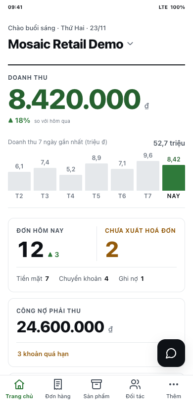 | 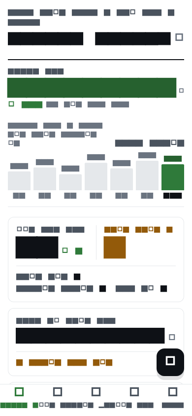 |
| 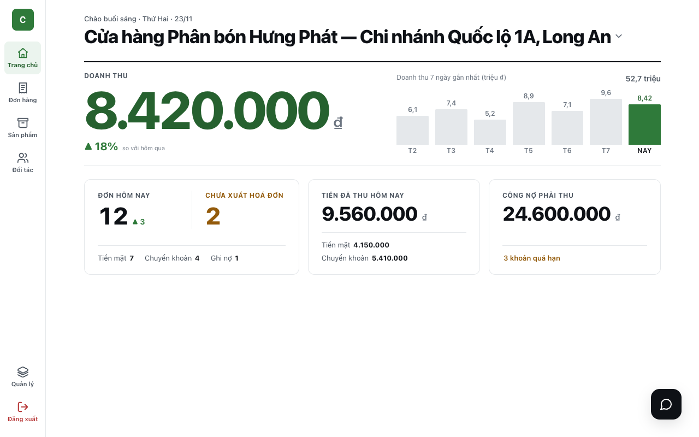 | 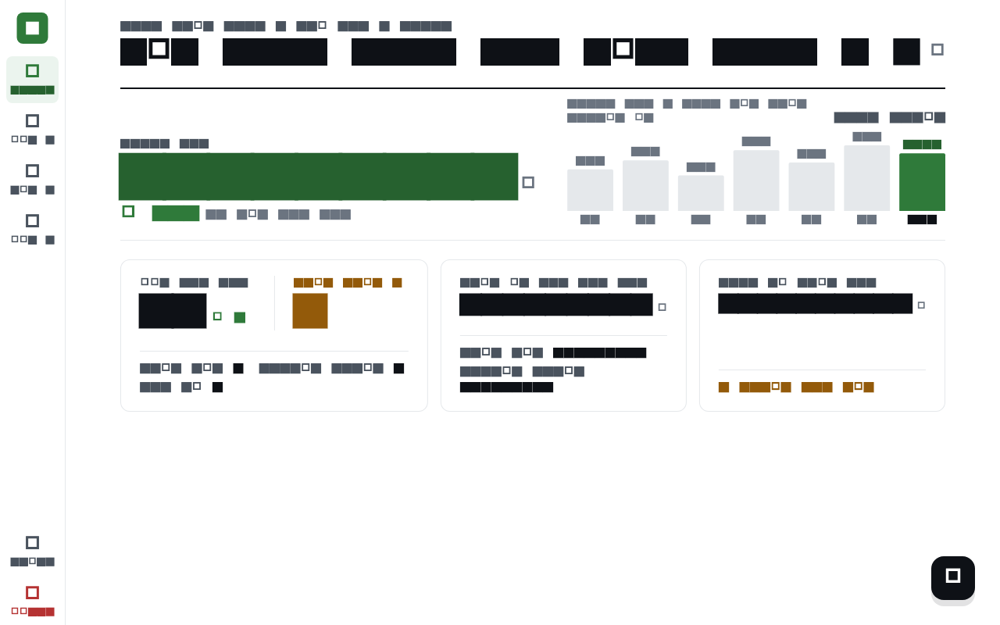 |
| 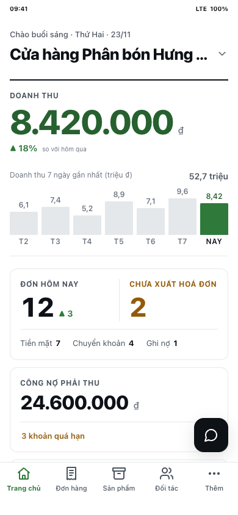 | 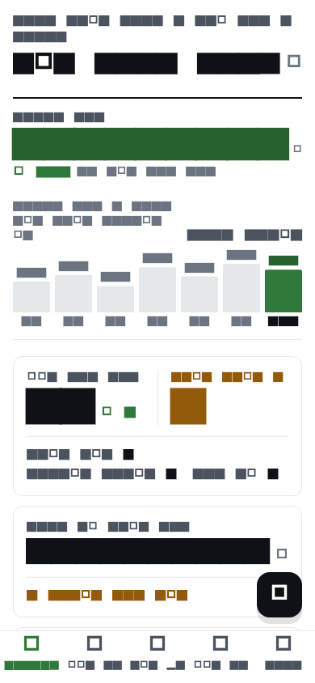 |
| 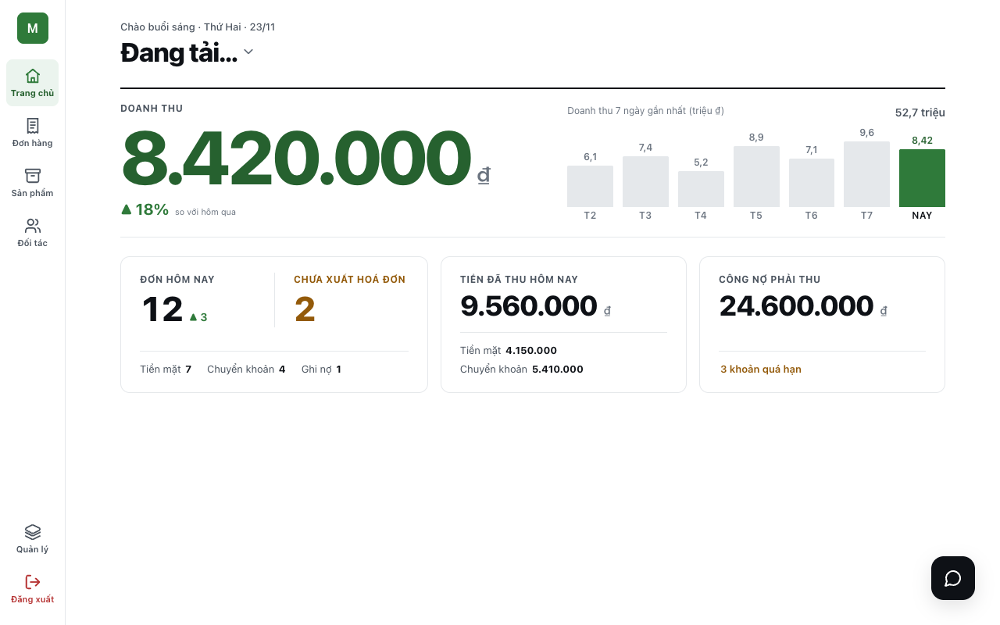 | 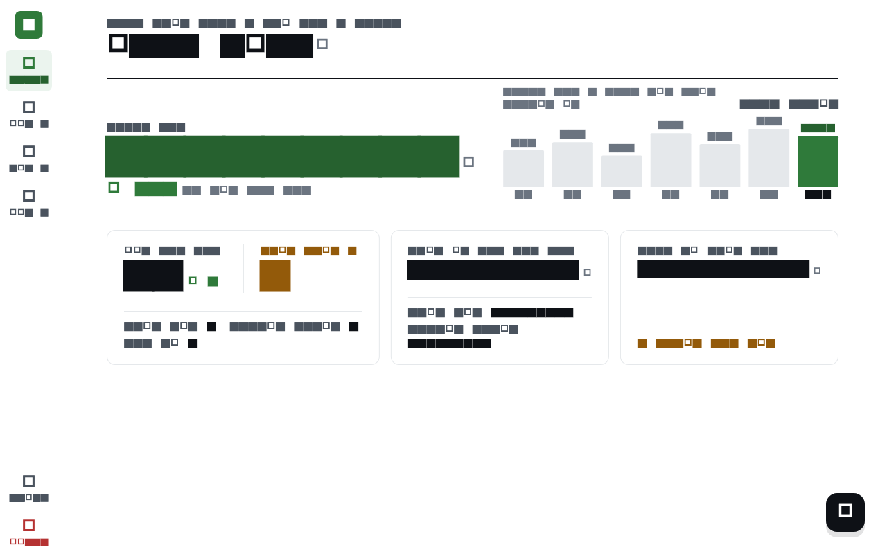 |
| 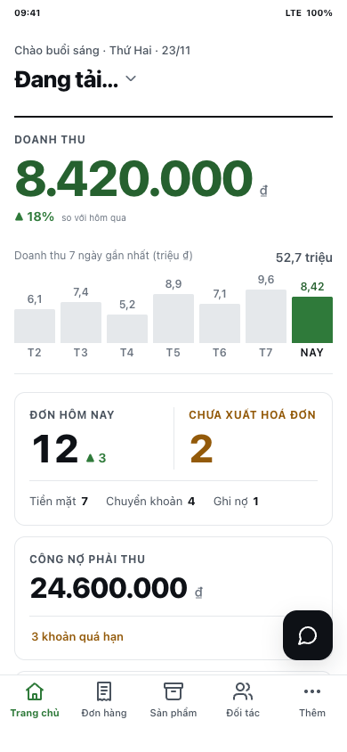 | 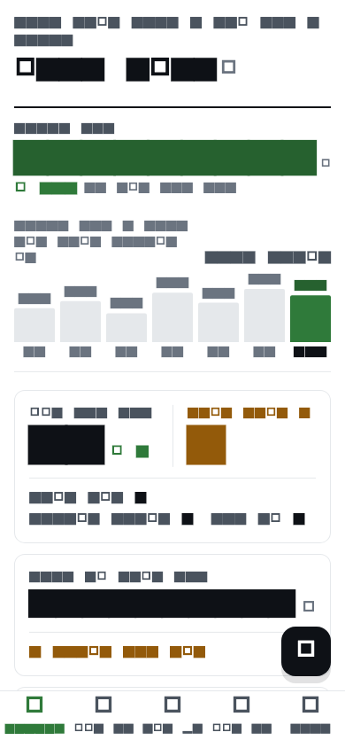 |
| 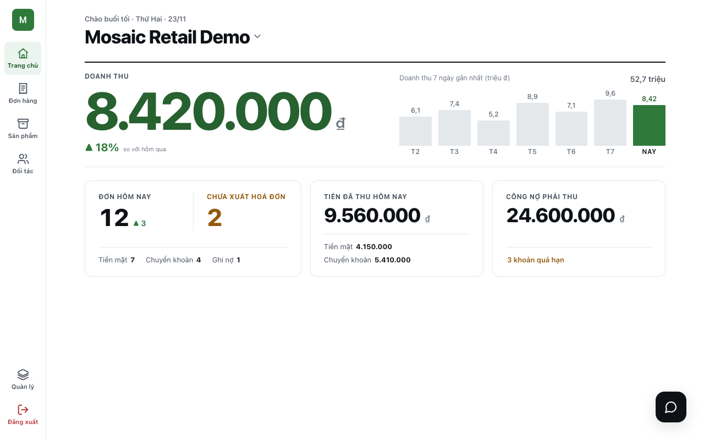 | 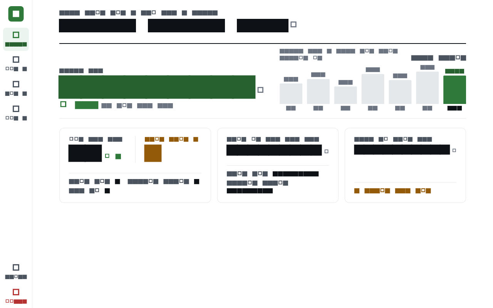 |
|  | 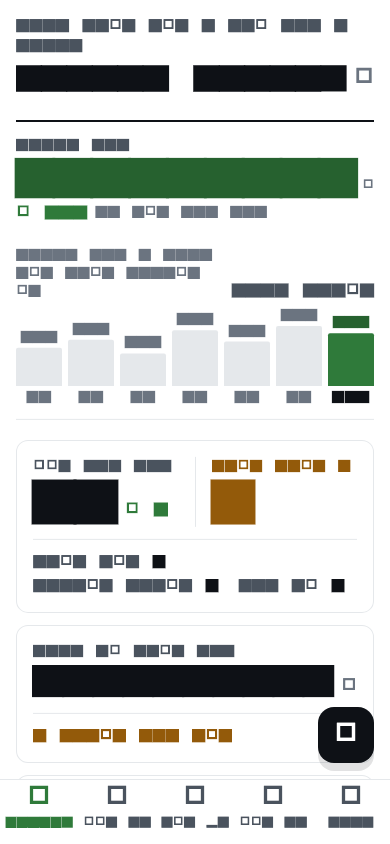 |
| 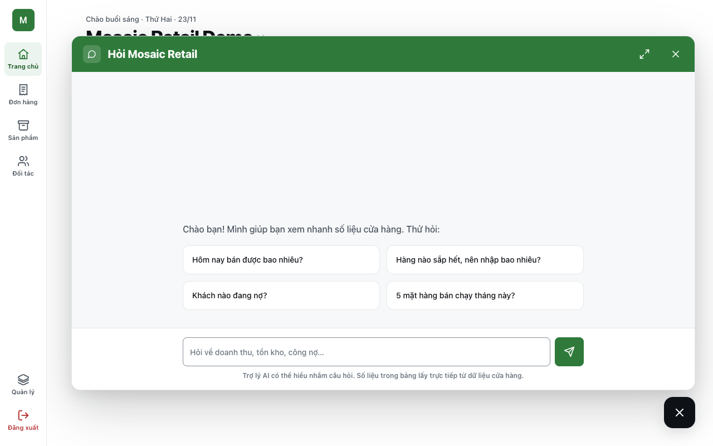 | 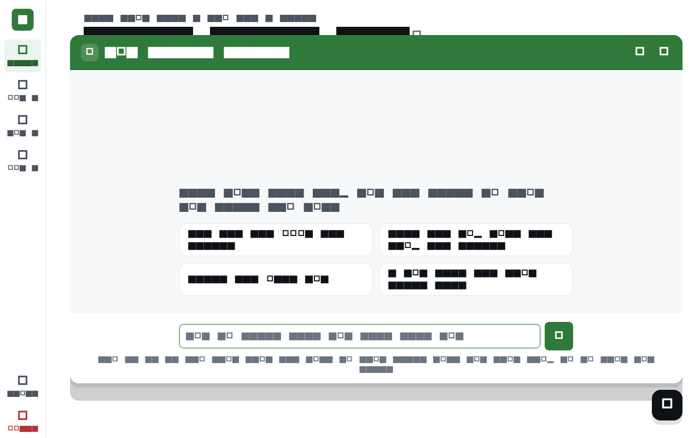 |
| 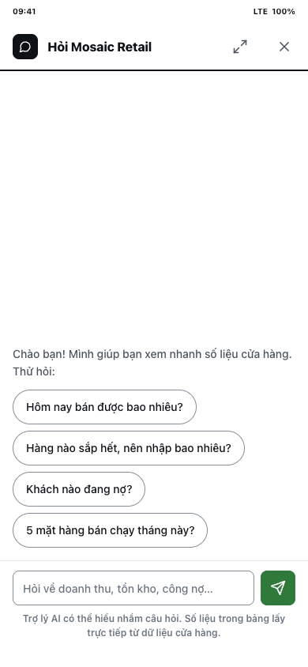 | 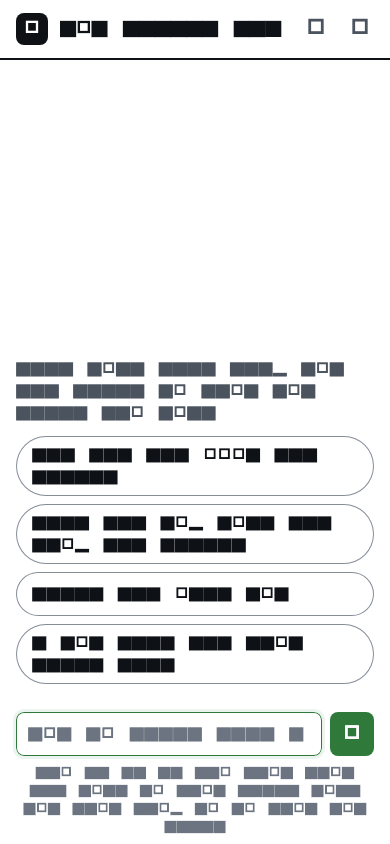 |

Không có ảnh prototype cho: đang tải số (khung xương), lỗi tải, ô "Chưa xuất hoá đơn" bị ẩn, khung chat đang có câu trả lời — golden Flutter thêm `flutter-APP01-{loading,error,no-einvoice,ask-answer}-{390,1280}.png`, người dùng xem ở review.

Golden dùng dữ liệu đúng `SAMPLE` của prototype (`board.js:14-35`): doanh thu 8.420.000, hôm qua 7.135.593 (▲ 18%), tuần `[6.1, 7.4, 5.2, 8.9, 7.1, 9.6, 8.42]` triệu, 12 đơn / hôm qua 9, cách trả 7 / 4 / 1, chưa xuất 2, đã thu 9.560.000 (4.150.000 / 5.410.000), phải thu 24.600.000, 3 quá hạn; ngày cố định thứ Hai 23/11/2026 9:00 (`HomeTabPage` nhận `DateTime Function() now` mặc định `DateTime.now`).

## Code prototype (chép nguyên văn)

`specs/prototype/home/html/app/board.js:39-138` (dữ liệu `SAMPLE` ở `:14-35`, chữ khung chat import từ `specs/prototype/assistant/html/app/ask.js:12-21` — trùng các hằng `assistantGreeting`, `assistantSuggestions`, `assistantHint`, `assistantFooterText` đã có trong Flutter):

```js
const deltaHtml = (r) => {
  if (r.dir === 'alert') return `<span class="bz-delta is-alert">●&nbsp;${esc(r.delta)}</span>`;
  // rise: tăng nhưng không phải tin tốt (nợ tăng) → màu trung tính
  return `<span class="bz-delta is-${r.dir}">${r.dir === 'down' ? '▼' : '▲'}&nbsp;${esc(r.delta)}</span>`;
};

/** Một dòng bảng: nhãn hẹp in hoa | số lớn | ▲/▼. i = thứ tự để số lật lên lần lượt. */
const boardRow = (r, i) => `<div class="bz-row bz-row--${r.key}${r.changed ? ' is-changed' : ''}" style="--i:${i}">
    <span class="bz-row__label">${esc(r.label)}</span>
    <span class="bz-row__value"><span class="bz-flip">${esc(r.value)}</span><small>${esc(r.unit)}</small></span>
    <span class="bz-row__meta">${deltaHtml(r)}<small>${esc(r.note)}</small></span>
  </div>`;

function weekChart() {
  const max = Math.max(...SAMPLE.week.map((w) => w.v));
  return `<figure class="bz-week" aria-label="Doanh thu 7 ngày, tổng ${SAMPLE.weekTotal}">
    <figcaption><span>Doanh thu 7 ngày gần nhất (triệu ₫)</span><b>${SAMPLE.weekTotal}</b></figcaption>
    <div class="bz-week__bars">${SAMPLE.week.map((w, i) => {
      const today = i === SAMPLE.week.length - 1;
      return `<div class="bz-week__col${today ? ' is-today' : ''}" title="${w.d}: ${String(w.v).replace('.', ',')} triệu"><span class="bz-week__num">${String(w.v).replace('.', ',')}</span><span class="bz-week__bar" style="--h:${(w.v / max).toFixed(3)}"></span><span class="bz-week__day">${w.d}</span></div>`;
    }).join('')}</div>
  </figure>`;
}

/** Một hộp "Đơn hôm nay": số đơn (▲ so với hôm qua) | số đơn chưa xuất hoá đơn; dòng cách trả bên dưới. */
function ordersBox() {
  const { list, yesterday } = SAMPLE.orders;
  const pending = SAMPLE.invoices.pending.length;
  const counts = SAMPLE.pay.map((p) => `<span>${p.label} <b>${list.filter((o) => o[2] === p.key).length}</b></span>`).join('');
  return `<section class="bz-box" aria-label="Đơn hôm nay">
      <div class="bz-box__figs">
        <div class="bz-fig"><span class="bz-tile__label">Đơn hôm nay</span><span class="bz-tile__num"><span class="bz-flip" style="--i:1">${list.length}</span><span class="bz-delta is-up">▲ ${list.length - yesterday}</span></span></div>
        <div class="bz-fig bz-fig--warn"><span class="bz-tile__label">Chưa xuất hoá đơn</span><span class="bz-tile__num"><span class="bz-flip" style="--i:2">${pending}</span></span></div>
      </div>
      <div class="bz-legend">${counts}</div>
    </section>`;
}

/** Hộp một con số: nhãn, số lớn (+ đơn vị), một dòng ngắn bên dưới. */
const figBox = ({ label, value, unit, line, warn, i }) => `<section class="bz-box" aria-label="${esc(label)}">
      <div class="bz-fig${warn ? ' bz-fig--warn' : ''}"><span class="bz-tile__label">${esc(label)}</span><span class="bz-tile__num"><span class="bz-flip" style="--i:${i}">${value}</span>${unit ? `<small>${unit}</small>` : ''}</span></div>
      <div class="bz-legend">${line}</div>
    </section>`;

function cashBox() {
  const c = SAMPLE.cashIn;
  return figBox({ label: 'Tiền đã thu hôm nay', value: c.total, unit: '₫', i: 3, line: `<span>Tiền mặt <b>${c.cash}</b></span><span>Chuyển khoản <b>${c.bank}</b></span>` });
}
function debtBox() {
  const r = SAMPLE.receivable;
  return figBox({ label: 'Công nợ phải thu', value: r.total, unit: '₫', i: 4, line: `<span class="is-warn"><b>${r.overdue}</b> khoản quá hạn</span>` });
}

const svg = (d, cls = '') => `<svg class="${cls}" viewBox="0 0 24 24" fill="none" stroke="currentColor" stroke-width="2" stroke-linecap="round" stroke-linejoin="round" aria-hidden="true">${d}</svg>`;
const CHAT = '<path d="M7.9 20A9 9 0 1 0 4 16.1L2 22Z"/>';
const EXPAND = '<path d="M15 3h6v6"/><path d="M9 21H3v-6"/><path d="m21 3-7 7"/><path d="m3 21 7-7"/>';

/** Khung chat nổi: đầu khung (tên + mở toàn màn + đóng), lời chào + 4 câu gợi ý, ô hỏi, câu nhắc. */
function chatPanel() {
  return `<section class="bz-chat" id="bz-chat" role="dialog" aria-label="Hỏi Mosaic Retail">
      <header class="bz-chat__head">
        <span class="bz-chat__badge">${svg(CHAT)}</span>
        <h2>Hỏi Mosaic Retail</h2>
        <button type="button" class="bz-chat__tool" data-ask-full aria-label="Mở toàn màn hình" title="Mở toàn màn hình">${svg(EXPAND)}</button>
        <button type="button" class="bz-chat__tool" data-ask-toggle aria-label="Đóng">${icon('close')}</button>
      </header>
      <div class="bz-chat__body">
        <p class="bz-chat__greet">${esc(GREETING)}</p>
        <div class="bz-chat__chips">${SUGGESTIONS.map((q) => `<button type="button" class="bz-chat__chip">${esc(q)}</button>`).join('')}</div>
      </div>
      <form class="bz-chat__composer" onsubmit="return false">
        <label class="bz-chat__input"><input type="text" placeholder="${esc(HINT)}" aria-label="Câu hỏi" /></label>
        <button type="submit" class="bz-chat__send" aria-label="Gửi">${icon('send')}</button>
      </form>
      <p class="bz-chat__foot">${esc(FOOTER)}</p>
    </section>`;
}

/** Nút nổi góc dưới phải; khi khung mở thì thành nút đóng (web) / ẩn dưới khung (iPhone). */
const askFab = (open) => `<button type="button" class="bz-fab" data-ask-toggle aria-controls="bz-chat" aria-expanded="${open}" aria-label="${open ? 'Đóng Hỏi Mosaic Retail' : 'Hỏi Mosaic Retail'}" title="Hỏi Mosaic Retail">${svg(CHAT, 'bz-fab__chat')}${icon('close', 'bz-fab__close')}</button>`;

export function boardPage(v, web) {
  const [rev] = SAMPLE.rows;
  const head = `<header class="bz-head">
      <div class="bz-head__left">
        <p class="bz-date">${esc(v.greeting)} · ${SAMPLE.date}</p>
        <button type="button" class="bz-org" data-home-branch aria-label="Đổi tổ chức, ${esc(v.branchName)}"><span>${esc(v.branchName)}</span>${icon('chevronDown')}</button>
      </div>
    </header>`;
  const hero = `<section class="bz-hero" aria-label="Doanh thu hôm nay">${boardRow(rev, 0)}${weekChart()}</section>`;
  // iPhone: Công nợ phải thu đứng ngay sau Đơn hôm nay (trong màn đầu), Tiền đã thu xuống cuối; web giữ thứ tự 3 cột.
  const secs = `<div class="bz-boxes">${ordersBox()}${web ? cashBox() + debtBox() : debtBox() + cashBox()}</div>`;
  return `<div class="hm-page bz${web ? ' is-web' : ''}${v.askOpen ? ' is-asking' : ''}">
    <div class="bz-scroll" data-home-body>
      ${head}
      ${hero}
      ${secs}
    </div>
    ${chatPanel()}
    ${askFab(!!v.askOpen)}
```

`specs/prototype/home/html/app/main.js:10-15` (lời chào), `:48-62` (bật / tắt khung, Esc, ⤢):

```js
/** HomeHeader._greetingForHour (giữ quy tắc lời chào theo giờ máy). */
export function greetingForHour(hour) {
  if (hour >= 5 && hour < 12) return 'Chào buổi sáng';
  if (hour >= 12 && hour < 18) return 'Chào buổi chiều';
  return 'Chào buổi tối';
}
// …
    // Nút nổi / nút đóng: bật tắt khung chat; ⤢ mở màn /ask đầy đủ (prototype AI-01).
    root.addEventListener('click', (e) => {
      if (e.target.closest('[data-ask-full]')) { location.href = '../../assistant/html/index.html'; return; }
      if (!e.target.closest('[data-ask-toggle]')) return;
      const page = root.querySelector('.bz');
      const open = page.classList.toggle('is-asking');
      const fab = root.querySelector('.bz-fab');
      fab.setAttribute('aria-expanded', String(open));
      fab.setAttribute('aria-label', open ? 'Đóng Hỏi Mosaic Retail' : 'Hỏi Mosaic Retail');
      (open ? root.querySelector('.bz-chat input') : fab).focus();
    });
    root.addEventListener('keydown', (e) => {
      const page = root.querySelector('.bz.is-asking');
      if (e.key === 'Escape' && page) root.querySelector('.bz-fab').click();
    });
```

`specs/prototype/home/html/styles/board.css` — các rule màn dùng (bỏ rule chết của bản trước: `.bz-sec*`, `.bz-meter`, `.bz-line*`, `.bz-dot`, `.is-changed`, `bz-glow`), số đầu dòng là dòng gốc, token thay bằng giá trị `tokens.css` (tên trong chú thích), `--sh-fs-*` thay bằng px; `--sh-col-max` = 1120 (khung web, `shell.css:22`):

```css
  1| /* Trang chủ APP-01 — giao diện "Bảng giá chợ" trên bảng màu Mosaic (app/board.js), tiền tố bz-.
  2|    Chỉ dùng token màu --c45-v2-* sẵn có; số lớn dùng Inter đậm, chữ khít. */
  3| .bz {
  4|   /* Bảng màu Mosaic sẵn có (tokens.css), không thêm màu mới */
  5|   --bz-ground: #FFFFFF /*surface-default*/;
  8|   --bz-ink: #0E1116 /*text-primary*/;
  9|   --bz-ink-2: #4A535E /*text-secondary*/;
 10|   --bz-ink-3: #6B7480 /*text-muted*/;
 11|   --bz-amber: #26612F /*text-brand*/;
 12|   --bz-accent-bar: #2F7A3A /*action-primary-default*/;
 13|   --bz-up: #2F7A3A /*text-success*/;
 14|   --bz-warn: #935A0A /*text-warning*/;
 15|   --bz-alert: #B53232 /*text-danger*/;
 16|   --bz-num: Inter,system-ui,-apple-system,BlinkMacSystemFont,"Segoe UI",sans-serif /*font-sans*/;
 17|   background: #FFFFFF /*surface-default*/;
 18|   color: #0E1116 /*text-primary*/;
 19| }
 20| .sh-main:has(.bz) { background: #FFFFFF /*surface-default*/; }
 25| .bz button:focus-visible { outline: 2px solid #2F7A3A /*focus-ring*/; outline-offset: 2px; }
 26| 
 27| .bz-scroll { flex: 1; min-height: 0; overflow-y: auto; display: flex; flex-direction: column; gap: 20px /*space-5*/; padding: 16px /*space-4*/ 16px /*space-4*/ 32px /*space-8*/; scrollbar-color: #D0D5DA /*border-strong*/ transparent; }
 28| .bz-scroll > * { flex-shrink: 0; }
 29| .bz.is-web .bz-scroll { gap: 24px /*space-6*/; padding: 24px /*space-6*/ max(32px /*space-8*/, calc((100% - var(--sh-col-max, 100%)) / 2 + 32px /*space-8*/)) 40px /*space-10*/; }
 30| 
 31| /* Đầu trang */
 32| .bz-head { display: flex; align-items: flex-end; justify-content: space-between; gap: 12px /*space-3*/; }
 33| .bz-head__left { min-width: 0; }
 34| .bz-date { font-size: 13px /*sh-fs-sm*/; line-height: 20px; font-weight: 500; color: #4A535E /*text-secondary*/; }
 35| .bz-org { display: flex; align-items: center; gap: 4px /*space-1*/; max-width: 100%; min-height: 44px /*touch-minimum*/; padding: 0; border: 0; background: transparent; cursor: pointer; font-size: 20px; }
 36| .bz-org span { min-width: 0; overflow: hidden; text-overflow: ellipsis; white-space: nowrap; font-family: Inter,system-ui,-apple-system,BlinkMacSystemFont,"Segoe UI",sans-serif /*font-sans*/; font-size: 26px; line-height: 34px; font-weight: 800; letter-spacing: -.6px; }
 37| .bz.is-web .bz-org span { font-size: 34px; line-height: 42px; letter-spacing: -1px; }
 38| .bz-org .icon { color: #6B7480 /*text-muted*/; }
 39| .bz-org:hover span { text-decoration: underline; text-decoration-thickness: 2px; text-underline-offset: 6px; text-decoration-color: #2F7A3A /*action-primary-default*/; }
 40| 
 41| /* Bố cục: doanh thu + 7 ngày ở trên; ba cột "con số + chi tiết của nó" bên dưới */
 42| .bz-hero { display: flex; flex-direction: column; border-top: 2px solid #0E1116 /*text-primary*/; }
 47| 
 48| /* Dòng số liệu: nhãn in hoa nhỏ, số lớn, ▲/▼ — xếp dọc */
 49| .bz-row { display: flex; flex-direction: column; gap: 2px; padding: 12px /*space-3*/ 0 12px /*space-3*/; }
 50| .bz-row__label { font-family: Inter,system-ui,-apple-system,BlinkMacSystemFont,"Segoe UI",sans-serif /*font-sans*/; font-size: 12px /*sh-fs-xs*/; line-height: 18px; font-weight: 700; letter-spacing: .6px; text-transform: uppercase; color: #4A535E /*text-secondary*/; }
 51| .bz-row__value { display: flex; align-items: baseline; gap: 8px /*space-2*/; min-width: 0; overflow: hidden; }
 52| .bz-flip { display: inline-block; font-family: Inter,system-ui,-apple-system,BlinkMacSystemFont,"Segoe UI",sans-serif /*font-sans*/; font-size: 40px; line-height: 46px; font-weight: 800; letter-spacing: -1.4px; font-variant-numeric: tabular-nums lining-nums; color: #0E1116 /*text-primary*/; }
 53| .bz-row__value small { font-size: 16px /*sh-fs-lg*/; font-weight: 500; color: #6B7480 /*text-muted*/; }
 54| .bz-row__meta { display: flex; align-items: baseline; gap: 8px /*space-2*/; font-size: 12px /*sh-fs-xs*/; color: #6B7480 /*text-muted*/; }
 55| .bz-delta { font-family: Inter,system-ui,-apple-system,BlinkMacSystemFont,"Segoe UI",sans-serif /*font-sans*/; font-size: 14px /*sh-fs-md*/; font-weight: 700; white-space: nowrap; }
 56| .bz-delta.is-up { color: #2F7A3A /*text-success*/; }
 57| .bz-delta.is-down { color: #935A0A /*text-warning*/; }
 58| .bz-delta.is-rise { color: #4A535E /*text-secondary*/; }
 59| .bz-delta.is-alert { color: #B53232 /*text-danger*/; }
 60| .bz-row--rev { padding-top: 16px /*space-4*/; }
 61| .bz-row--rev .bz-flip { font-size: 56px; line-height: 62px; letter-spacing: -2.5px; color: #26612F /*text-brand*/; }
 62| .bz.is-web .bz-row--rev .bz-flip { font-size: 96px; line-height: 100px; letter-spacing: -5px; }
 63| .bz.is-web .bz-row--rev .bz-row__value small { font-size: 32px; }
 64| .bz.is-web .bz-row--rev .bz-delta { font-size: 20px /*sh-fs-xl*/; }
 65| .bz.is-web .bz-row--rev .bz-row__meta { font-size: 13px /*sh-fs-sm*/; }
 66| 
 67| /* Chi tiết dưới mỗi con số */
 73| 
 74| /* Dòng vừa thay đổi: dải hổ phách giữ sáng tới khi đã xem */
 79| 
 80| /* Số lật lên một lần khi mở (nước đi đặc trưng). Giảm chuyển động: hiện ngay. */
 81| @media (prefers-reduced-motion: no-preference) {
 82|   .bz-flip { animation: bz-flip .7s cubic-bezier(.16, 1, .3, 1) both; animation-delay: calc(var(--i, 0) * 90ms + 120ms); transform-origin: 50% 0; }
 84| }
 85| @keyframes bz-flip { from { opacity: 0; transform: perspective(400px) rotateX(-80deg) translateY(-6px); } to { opacity: 1; transform: none; } }
 87| 
 88| /* 7 ngày: cột đúng tỉ lệ, không cắt trục */
 90| .bz.is-web .bz-week { padding-bottom: 12px /*space-3*/; border-bottom: 0; }
 91| .bz-week figcaption { display: flex; justify-content: space-between; font-size: 12px /*sh-fs-xs*/; color: #6B7480 /*text-muted*/; }
 92| .bz-week figcaption b { font-family: Inter,system-ui,-apple-system,BlinkMacSystemFont,"Segoe UI",sans-serif /*font-sans*/; font-size: 14px /*sh-fs-md*/; font-weight: 600; color: #4A535E /*text-secondary*/; }
 93| .bz-week__bars { display: flex; align-items: flex-end; gap: 6px; height: 96px; }
 94| .bz.is-web .bz-week__bars { height: 120px; gap: 12px /*space-3*/; }
 95| .bz-week__col { flex: 1; height: 100%; display: flex; flex-direction: column; justify-content: flex-end; align-items: stretch; gap: 4px; }
 96| .bz-week__bar { height: calc(var(--h) * (100% - 36px)); min-height: 2px; border-radius: 2px 2px 0 0; background: #E5E8EB /*neutral-200*/; }
 97| .bz-week__col.is-today .bz-week__bar { background: #2F7A3A /*action-primary-default*/; }
 98| .bz-week__num { font-family: Inter,system-ui,-apple-system,BlinkMacSystemFont,"Segoe UI",sans-serif /*font-sans*/; font-size: 12px /*sh-fs-xs*/; line-height: 14px; font-weight: 600; text-align: center; color: #6B7480 /*text-muted*/; }
 99| .bz-week__col.is-today .bz-week__num { color: #26612F /*text-brand*/; }
100| .bz-week__day { font-family: Inter,system-ui,-apple-system,BlinkMacSystemFont,"Segoe UI",sans-serif /*font-sans*/; font-size: 12px /*sh-fs-xs*/; line-height: 14px; font-weight: 600; letter-spacing: .6px; text-align: center; text-transform: uppercase; color: #6B7480 /*text-muted*/; }
101| .bz-week__col.is-today .bz-week__day { color: #0E1116 /*text-primary*/; }
102| 
103| /* Dòng chi tiết */
115| 
116| /* Hộp Đơn hôm nay: hai con số cạnh nhau, ngăn bằng kẻ dọc; dòng cách trả bên dưới */
118| .bz.is-web .bz-box { padding: 20px /*space-5*/ 24px /*space-6*/; }
119| .bz-boxes { display: flex; flex-direction: column; gap: 12px /*space-3*/; }
120| .bz.is-web .bz-boxes { display: grid; grid-template-columns: minmax(0, 1.25fr) minmax(0, 1fr) minmax(0, 1fr); gap: 16px /*space-4*/; align-items: stretch; }
121| .bz.is-web .bz-boxes .bz-legend { margin-top: auto; }
122| .bz-box .bz-tile__num small { font-size: 16px /*sh-fs-lg*/; font-weight: 500; color: #6B7480 /*text-muted*/; }
123| .bz-legend .is-warn, .bz-legend .is-warn b { color: #935A0A /*text-warning*/; font-weight: 600; }
124| .bz-box__figs { display: grid; grid-template-columns: repeat(2, minmax(0, 1fr)); }
125| .bz-fig { display: flex; flex-direction: column; gap: 2px; min-width: 0; }
127| .bz.is-web .bz-fig + .bz-fig { padding-left: 24px /*space-6*/; }
128| .bz-tile__label { font-size: 12px /*sh-fs-xs*/; line-height: 18px; font-weight: 700; letter-spacing: .6px; text-transform: uppercase; color: #4A535E /*text-secondary*/; }
129| .bz-tile__num { display: flex; align-items: baseline; gap: 8px /*space-2*/; }
130| .bz-box .bz-flip { font-size: 44px; line-height: 50px; font-weight: 800; letter-spacing: -2px; }
131| .bz.is-web .bz-box .bz-flip { font-size: 56px; line-height: 60px; letter-spacing: -2.5px; }
132| .bz-box .bz-delta { font-size: 14px /*sh-fs-md*/; }
133| .bz-fig--warn .bz-flip, .bz-fig--warn .bz-tile__label { color: #935A0A /*text-warning*/; }
135| .bz-legend b { margin-left: 2px; font-weight: 700; color: #0E1116 /*text-primary*/; }
136| 
137| /* Hộp số tiền: số dài nên nhỏ hơn số đơn */
138| .bz-box:not(:first-child) .bz-flip { font-size: 32px; line-height: 40px; letter-spacing: -1.2px; }
139| .bz.is-web .bz-box:not(:first-child) .bz-flip { font-size: 36px; line-height: 44px; letter-spacing: -1.4px; }
140| .bz.is-web .bz-box:first-child .bz-flip { font-size: 44px; line-height: 50px; letter-spacing: -2px; }
141| 
142| /* Lối vào trợ lý AI: nút nổi góc dưới phải + khung chat nổi (không còn nút ở đầu trang) */
143| .sh-main:has(.bz) { position: relative; }
144| .bz-scroll { padding-bottom: 96px; }
145| .bz.is-web .bz-scroll { padding-bottom: 112px; }
146| .bz-fab { position: absolute; z-index: 6; right: 16px /*space-4*/; bottom: 16px /*space-4*/; display: grid; place-items: center; width: 56px; height: 56px; padding: 0; border: 0; border-radius: 16px /*radius-5*/; background: #0E1116 /*text-primary*/; color: #FFFFFF /*text-inverse*/ !important; box-shadow: 0 8px 24px rgba(14, 17, 22, 0.12) /*shadow-3*/; cursor: pointer; transition: background-color .15s ease-out, transform .2s cubic-bezier(.16, 1, .3, 1); }
147| .bz.is-web .bz-fab { right: 32px /*space-8*/; bottom: 32px /*space-8*/; }
148| .bz-fab svg { grid-area: 1 / 1; width: 24px; height: 24px; font-size: 24px; transition: opacity .15s ease-out, transform .2s cubic-bezier(.16, 1, .3, 1); }
149| .bz-fab__close { opacity: 0; transform: rotate(-90deg) scale(.6); }
150| .bz-fab:hover { background: #2F3640 /*neutral-700*/; }
151| .bz-fab:active { transform: scale(.96); }
152| .bz.is-asking .bz-fab__chat { opacity: 0; transform: rotate(90deg) scale(.6); }
153| .bz.is-asking .bz-fab__close { opacity: 1; transform: none; }
154| .bz:not(.is-web).is-asking .bz-fab { display: none; }
155| 
156| .bz-chat { position: absolute; z-index: 5; display: none; flex-direction: column; overflow: hidden; background: #FFFFFF /*surface-default*/; }
157| .bz.is-asking .bz-chat { display: flex; }
158| /* iPhone: phủ hết vùng nội dung (thanh dưới vẫn còn) */
159| .bz:not(.is-web) .bz-chat { inset: 0; }
160| /* Web: cửa sổ lớn phủ gần hết vùng nội dung (như ảnh tham khảo), neo trên nút; thanh bên vẫn thấy */
161| .bz.is-web .bz-chat { top: 64px; right: 32px /*space-8*/; bottom: calc(32px /*space-8*/ + 56px + 12px /*space-3*/); width: min(1120px, calc(100% - 64px)); border: 1px solid #E5E8EB /*border-default*/; border-radius: 16px /*radius-5*/; box-shadow: 0 8px 24px rgb(14 17 22 / .10), 0 32px 80px rgb(14 17 22 / .20); transform-origin: 100% 100%; }
162| @media (prefers-reduced-motion: no-preference) {
163|   .bz.is-web.is-asking .bz-chat { animation: bz-chat-in .22s cubic-bezier(.16, 1, .3, 1) both; }
164|   .bz:not(.is-web).is-asking .bz-chat { animation: bz-sheet-in .26s cubic-bezier(.16, 1, .3, 1) both; }
165| }
166| @media (prefers-reduced-motion: reduce) { .bz-fab, .bz-fab svg { transition: none; } }
167| @keyframes bz-chat-in { from { opacity: 0; transform: translateY(8px) scale(.96); } to { opacity: 1; transform: none; } }
168| @keyframes bz-sheet-in { from { transform: translateY(24px); opacity: 0; } to { transform: none; opacity: 1; } }
169| 
170| .bz-chat__head { flex: 0 0 auto; display: flex; align-items: center; gap: 12px /*space-3*/; min-height: 60px; padding: 0 8px /*space-2*/ 0 16px /*space-4*/; border-bottom: 2px solid #0E1116 /*text-primary*/; }
171| .bz-chat__badge { display: grid; place-items: center; flex: 0 0 32px; width: 32px; height: 32px; border-radius: 8px /*radius-3*/; background: #0E1116 /*text-primary*/; color: #FFFFFF /*text-inverse*/; }
172| .bz-chat__badge svg { width: 16px; height: 16px; }
173| .bz-chat__head h2 { flex: 1; min-width: 0; font-size: 16px /*sh-fs-lg*/; line-height: 24px; font-weight: 800; letter-spacing: -.2px; }
174| .bz-chat__tool { display: grid; place-items: center; flex: 0 0 auto; width: 44px /*touch-minimum*/; height: 44px /*touch-minimum*/; padding: 0; border: 0; border-radius: 8px /*radius-3*/; background: transparent; color: #4A535E /*text-secondary*/ !important; font-size: 20px; cursor: pointer; }
175| .bz-chat__tool svg { width: 20px; height: 20px; }
176| .bz-chat__tool:hover { background: #F1F3F5 /*neutral-150*/; color: #0E1116 /*text-primary*/ !important; }
177| 
178| .bz-chat__body { flex: 1; min-height: 0; overflow-y: auto; display: flex; flex-direction: column; justify-content: flex-end; gap: 12px /*space-3*/; padding: 16px /*space-4*/; }
179| .bz-chat__greet { font-size: 14px /*sh-fs-md*/; line-height: 22px; font-weight: 500; color: #4A535E /*text-secondary*/; }
180| .bz-chat__chips { display: flex; flex-direction: column; align-items: flex-start; gap: 8px /*space-2*/; }
181| .bz-chat__chip { min-height: 44px /*touch-minimum*/; padding: 8px /*space-2*/ 16px /*space-4*/; border: 1px solid #868E98 /*border-input*/; border-radius: 999px /*radius-pill*/; background: #FFFFFF /*surface-default*/; font-size: 14px /*sh-fs-md*/; line-height: 22px; font-weight: 500; text-align: left; cursor: pointer; }
182| .bz-chat__chip:hover { border-color: #2F7A3A /*action-primary-default*/; background: #EBF4EE /*surface-brand*/; }
183| 
184| .bz-chat__composer { flex: 0 0 auto; display: flex; align-items: center; gap: 8px /*space-2*/; margin: 0; padding: 12px /*space-3*/ 16px /*space-4*/ 8px /*space-2*/; border-top: 1px solid #E5E8EB /*border-default*/; }
185| .bz-chat__input { flex: 1; min-width: 0; display: flex; align-items: center; height: 44px /*touch-minimum*/; padding: 0 12px /*space-3*/; border: 1px solid #868E98 /*border-input*/; border-radius: 8px /*radius-input*/; }
186| .bz-chat__input:focus-within { border-color: #2F7A3A /*action-primary-default*/; box-shadow: 0 0 0 3px #EBF4EE /*surface-success*/; }
187| .bz-chat__input input { flex: 1; min-width: 0; height: 100%; padding: 0; border: 0; outline: 0; background: transparent; font: inherit; font-size: 14px /*sh-fs-md*/; font-weight: 500; color: #0E1116 /*text-primary*/; }
188| .bz-chat__input input::placeholder { color: #6B7480 /*text-muted*/; opacity: 1; }
189| .bz-chat__send { display: grid; place-items: center; flex: 0 0 44px /*touch-minimum*/; width: 44px /*touch-minimum*/; height: 44px /*touch-minimum*/; padding: 0; border: 0; border-radius: 8px /*radius-button*/; background: #2F7A3A /*action-primary-default*/; color: #FFFFFF /*action-on-primary*/ !important; font-size: 20px; cursor: pointer; }
190| .bz-chat__send:hover { background: #26612F /*primary-700*/; }
191| .bz-chat__foot { flex: 0 0 auto; padding: 0 16px /*space-4*/ 12px /*space-3*/; font-size: 12px /*sh-fs-xs*/; line-height: 18px; font-weight: 600; text-align: center; color: #6B7480 /*text-muted*/; }
192| 
193| /* Web khung lớn: dải đầu xanh thương hiệu, nội dung + ô hỏi trong cột giữa 720 */
194| .bz.is-web .bz-chat__head { min-height: 64px; padding: 0 12px /*space-3*/ 0 20px /*space-5*/; border-bottom: 0; background: #2F7A3A /*action-primary-default*/; color: #FFFFFF /*action-on-primary*/; }
195| .bz.is-web .bz-chat__head h2 { font-size: 20px /*sh-fs-xl*/; line-height: 28px; color: #FFFFFF /*action-on-primary*/; }
196| .bz.is-web .bz-chat__badge { background: rgb(255 255 255 / .16); color: #FFFFFF /*action-on-primary*/; }
197| .bz.is-web .bz-chat__tool { color: #FFFFFF /*action-on-primary*/ !important; }
198| .bz.is-web .bz-chat__tool:hover { background: rgb(255 255 255 / .14); color: #FFFFFF /*action-on-primary*/ !important; }
199| .bz.is-web .bz-chat__tool:focus-visible { outline-color: #FFFFFF /*action-on-primary*/; }
200| .bz.is-web .bz-chat__body { background: #F6F8F9 /*surface-canvas*/; padding: 32px /*space-8*/ max(24px /*space-6*/, calc((100% - 720px) / 2)); gap: 16px /*space-4*/; }
201| .bz.is-web .bz-chat__greet { font-size: 16px /*sh-fs-lg*/; line-height: 26px; }
202| .bz.is-web .bz-chat__chips { display: grid; grid-template-columns: repeat(2, minmax(0, 1fr)); gap: 12px /*space-3*/; }
203| .bz.is-web .bz-chat__chip { min-height: 52px; border-radius: 12px /*radius-card*/; border-color: #E5E8EB /*border-default*/; }
204| .bz.is-web .bz-chat__composer { padding: 16px /*space-4*/ max(24px /*space-6*/, calc((100% - 720px) / 2)) 8px /*space-2*/; }
205| .bz.is-web .bz-chat__input, .bz.is-web .bz-chat__send { height: 52px; }
206| .bz.is-web .bz-chat__send { flex-basis: 52px; width: 52px; }
207| .bz.is-web .bz-chat__foot { padding-bottom: 16px /*space-4*/; }
208| 
209| /* iPhone: khung chat mở là màn toàn phần, ẩn thanh dưới; chừa vạch home 34 dưới câu nhắc */
210| .sh-app:has(.bz.is-asking:not(.is-web)) .sh-bottom { display: none; }
211| .sh-app[data-device="iphone"] .bz.is-asking .bz-chat__foot { padding-bottom: 34px; }
212| 
```

### Ánh xạ phần tử → Flutter

Ký hiệu: `w` = bề ngang trang (web 1196 sau 10-8a, iPhone 390). Web khi `w ≥ VBreakpoints.desktop` tính theo **cửa sổ** (`MediaQuery.sizeOf(context).width ≥ 1024`), cùng ngưỡng khung.

| Prototype | Flutter |
|---|---|
| `.bz` nền trắng, `Key('home_board')` | `ColoredBox(color: c.surface)` bọc toàn trang (mọi trạng thái: tải, lỗi, có số) |
| `.bz-scroll` iPhone: đệm 16 / 16 / **96**, khe 20 | `ListView` (`RefreshIndicator` ở iPhone), `EdgeInsets.fromLTRB(16, 16, 16, 96)`, khe `VSpacing.space5` |
| `.bz-scroll` web: đệm 24 / `max(32, (w − 1120)/2 + 32)` / **112**, khe 24 | `LayoutBuilder` tính đệm ngang; khe `VSpacing.space6` |
| `.bz-date` 13/20 500 `textSecondary`: `"<lời chào> · <Thứ …> · dd/MM"` | `VTypography.bodySmall.copyWith(height: 20/13)` |
| `.bz-org` ≥ 44, chữ 26/34 800 ls −0.6 (web 34/42 ls −1), 1 dòng `…`, `chevronDown` 20 `textMuted`, hover gạch chân 2 `primary` cách 6 | `Semantics(button, label: 'Đổi tổ chức, <tên>')` + `InkWell`; `Text(maxLines: 1, overflow: ellipsis, style: VTypography.bodyDefault.copyWith(fontSize: 26, height: 34/26, fontWeight: FontWeight.w800, letterSpacing: -.6))` (web 34 / 42 / −1); gạch chân khi hover (`TextDecoration.underline`, `decorationThickness: 2`, `decorationColor: c.primary`) |
| `.bz-hero` viền trên 2 `textPrimary`; web `Row` 1.1 : 1, khe 40, canh đáy, đệm dưới 8, viền dưới 1 `borderDefault` | `DecoratedBox(Border(top: BorderSide(c.textPrimary, 2)))`; web `Row(crossAxisAlignment: end)` `Expanded(flex: 11)` + `SizedBox(40)` + `Expanded(flex: 10)` |
| `.bz-row--rev` đệm 16 / 0 / 12, khe 2; nhãn `DOANH THU` 12/18 700 ls 0.6 `textSecondary` | `Text('DOANH THU', VTypography.caption.copyWith(height: 18/12, fontWeight: w700, letterSpacing: .6))` |
| số doanh thu 56/62 800 ls −2.5 `textBrand` (web 96/100 ls −5); `₫` 16 500 `textMuted` (web 32) | `FittedBox(fit: scaleDown, alignment: centerLeft)` quanh `Row(baseline)` số + `₫` (Review Focus 2) |
| `.bz-row__meta`: `▲ 18%` 14 700 `success` (web 20) + `so với hôm qua` 12 `textMuted` (web 13); ▼ `warning` | Q8 |
| `.bz-week` đệm 12 / 0 / 16 + viền dưới 1 (web đệm dưới 12, không viền); chú thích `Doanh thu 7 ngày gần nhất (triệu ₫)` 12 `textMuted` ↔ tổng 14 600 `textSecondary` | `Row(spaceBetween)` |
| `.bz-week__bars` cao 96 khe 6 (web 120 khe 12); cột: số 12/14 600 `textMuted` (nay `textBrand`), thanh cao `v/max × (H − 36)` tối thiểu 2, bo trên 2, `neutral200` (nay `primary`), ngày 12/14 600 ls 0.6 IN HOA `textMuted` (nay `textPrimary`); số / thanh / ngày cách 4 | `_WeekChart`: `SizedBox(height: H)` → `Row` 7 `Expanded` → `Column(mainAxisAlignment: end)`; `Semantics(label: 'Doanh thu 7 ngày, tổng <tổng>')` |
| `.bz-boxes` iPhone cột khe 12 (thứ tự Đơn → Công nợ → Tiền đã thu); web hàng 1.25 : 1 : 1 khe 16, cao bằng nhau, dòng chú thích dính đáy (Đơn → Tiền đã thu → Công nợ) | web `IntrinsicHeight(Row(stretch))` `Expanded(flex: 125 / 100 / 100)`; chú thích sau `Spacer` |
| `.bz-box` đệm 16 (web 20 / 24), viền 1 `borderDefault`, bo 12, khe 12 | `Container(decoration: BoxDecoration(border, borderRadius: VRadius.card))` |
| nhãn hộp 12/18 700 ls 0.6 IN HOA `textSecondary` | như nhãn doanh thu |
| số hộp đầu 44/50 800 ls −2 (cả web, `board.css:140` đè `:131`); hộp tiền 32/40 ls −1.2 (web 36/44 ls −1.4); `₫` 16 500 `textMuted`; ▲ 14 700 | `FittedBox(scaleDown)` cho số tiền |
| ô "Chưa xuất hoá đơn": nhãn + số `warning`; cách ô trái 16 (web 24) + kẻ dọc 1 | `orders_uninvoiced == null` → hộp Đơn chỉ còn một ô, không kẻ dọc |
| `.bz-legend` đệm trên 12, viền trên 1, `Wrap` khe 4 × 20, 13 `textSecondary`; số `b` 700 `textPrimary` cách 2; `is-warn` `warning` 600 | `Wrap(spacing: 20, runSpacing: 4)` |
| hộp Công nợ chú thích: `<n> khoản quá hạn` `warning`; `n = 0` → `Không có khoản quá hạn` `textSecondary` | (tôi chốt, prototype không có ca 0) |
| `.bz-flip` lật 0.7 s `cubic-bezier(.16,1,.3,1)`, trễ `i × 90 + 120` ms, `rotateX(−80°) → 0`, mờ → rõ; giảm chuyển động: hiện ngay | `_Flip(index: i)`: `TweenAnimationBuilder` + `Transform(Matrix4.identity()..setEntry(3, 2, 1/400)..rotateX(...))`; tắt khi `MediaQuery.disableAnimationsOf(context)`; chỉ chạy lần đầu có số (không lật lại khi tải lại) |
| `.bz-fab` 56, bo 16, nền `textPrimary`, icon 24 `textInverse`, bóng `shadow-3` (0 8 24 rgba .12), phải / dưới 16 (web 32); hover `neutral700`; mở: web đổi icon ✕ (xoay 90°), iPhone ẩn | `Positioned` trong `Stack`; `VIcons.messageCircle` / `close`; `Semantics(button, label: 'Hỏi Mosaic Retail' / 'Đóng Hỏi Mosaic Retail', expanded: mở)` |
| `.bz-chat` web: trên 64, phải 32, dưới 100, rộng `min(1120, w − 64)`, viền 1, bo 16, bóng `0 8 24 rgba .10, 0 32 80 rgba .20`; vào: 0.22 s mờ + dịch 8 + scale .96 | `Positioned(top: 64, right: 32, bottom: 100, width: …)` |
| `.bz-chat` iPhone: phủ toàn màn, vào trượt 24 + mờ 0.26 s | route `rootNavigator` (Q11) |
| Đầu khung iPhone: cao 60, đệm 0 8 0 16, viền dưới 2 `textPrimary`; huy hiệu 32 bo 8 nền `textPrimary` icon 16 `textInverse`; tiêu đề 16/24 800; nút 44 bo 8 icon 20 `textSecondary` (hover `neutral150`) | `AssistantChatPanel(wide: false)` |
| Đầu khung web: cao 64, đệm 0 12 0 20, nền `primary`, chữ `textInverse`, huy hiệu nền trắng 16%, tiêu đề 20/28, nút trắng (hover trắng 14%) | `AssistantChatPanel(wide: true)` |
| Thân khung: chưa hỏi → lời chào + gợi ý dồn **đáy**; iPhone đệm 16 khe 12, lời chào 14/22 500 `textSecondary`, gợi ý cột khe 8, viên thuốc ≥ 44 viền `borderInput` 14/22 500 đệm 8 / 16; web nền `background` (canvas), đệm 32 dọc × `max(24, (w − 720)/2)` ngang, khe 16, lời chào 16/26, gợi ý lưới 2 cột khe 12, ô ≥ 52 bo 12 viền `borderDefault`; hover viền `primary` nền `surfaceBrand` | đã hỏi → danh sách `AssistantMessageBubble` / `AssistantWaitingBubble` (dùng lại), cột 720 ở web |
| Ô hỏi: đệm 12 16 8 (web 16 × cột 720, 8), viền trên 1; ô nhập 44 (web 52); nút gửi vuông 44 (web 52) `primary` | `AssistantComposer` thêm tham số `double height = 44` |
| Chú thích 12/18 600 `textMuted` giữa, đệm 0 16 12 (web 0 16 16; iPhone cộng inset dưới) | `AssistantFooter` (dùng lại) |
| Bấm gợi ý / Gửi | `AskAssistantCubit.send` |
| ⤢ `Mở toàn màn hình` | Lấy trước `final router = GoRouter.of(context); final cubit = context.read<AskAssistantCubit>();` → gọi `onClose()` (iPhone pop route khung, context khung bị gỡ) → `router.push('/ask', extra: cubit)` |
| Esc / ✕ | đóng; web trả focus về nút nổi, mở thì focus ô nhập |

## Review Focus

1. **Đổi tổ chức khi đang tải** → kết quả của tổ chức cũ về sau ghi đè số tổ chức mới. `HomeCubit` đánh số mỗi lần `load()` và bỏ kết quả của lần gọi cũ hơn lần mới nhất. Test Task 3 `stale response from previous tenant is ignored`.
2. **Số rất lớn ở iPhone 390** (doanh thu `1.262.567.890`, phải thu `12.345.678.900`) → không tràn, co chữ. Test Task 4 `huge amounts do not overflow at 390`.
3. **Cửa hàng mới, mọi số 0** (tuần toàn 0, hôm qua 0) → không chia cho 0, cột 2px, ẩn ▲ %, số đơn không có ▲. Test Task 3 `format: all zero` và Task 4 `empty store renders zeros without delta`.
4. **Bấm ⤢ khi đang chờ trả lời** → `/ask` hiện bong bóng chờ, câu trả lời về đúng cuộc trò chuyện đó; quay lại Trang chủ mở khung vẫn thấy. Test Task 5 `expand while waiting keeps conversation`.
5. **iPhone bàn phím mở trong khung toàn màn** → ô hỏi nổi trên bàn phím, không bị che. Test Task 5 `composer stays visible with keyboard inset` (`MediaQuery.viewInsets.bottom = 300`).

---

### Task 0: Test giữ hành vi trên code cũ

**Files:**
- Create: `apps/erp/test/features/dashboard/presentation/home_tab_page_test.dart`

**Interfaces:**
- Produces: 3 test, xanh trên code cũ, còn xanh sau Task 4 (chỉ đổi cách dựng `HomeTabPage(repository: FakeHomeRepository())`).

- [ ] **Step 1: Viết test** (dựng `HomeTabPage` trong `BlocProvider<SessionController>` với `FakeSessionRepository`, khuôn `wgt_e05_tenant_context_test.dart:40-60`)

```dart
testWidgets('home shows "Đang tải…" while branch name is null', …)   // expect(find.text('Đang tải…'), findsOneWidget)
testWidgets('home shows "Chọn tổ chức" when blocked', …)
testWidgets('tap branch name opens tenant selector', …)             // tap find.text('Thú y Minh Phát') → thấy tiêu đề sheet chọn tổ chức
```

- [ ] **Step 2: Chạy → PASS** — `cd apps/erp && flutter test test/features/dashboard/presentation/home_tab_page_test.dart`
- [ ] **Step 3: Commit** `test(10-8b): test giữ hành vi đầu Trang chủ trước khi thay`

### Task 1: RPC `sales.get_home_summary`

**Files:**
- Create: `supabase/migrations/20261127001_sales_home_summary.sql` (đầu tệp theo khuôn `20261120001_sales_stats.sql:1-7`: Title / Kind / Intent / Context `10-8b` / Touches / Safety / Depends on)
- Modify: `supabase/migrations/REGISTRY.yaml` (khoá `get_home_summary`, `_daily_revenue`; thêm tệp vào danh sách)
- Create: `supabase/tests/home_summary.sql` (chép hàm dựng dữ liệu của `supabase/tests/sales_stats.sql`: `pg_temp.expect_err`, `rep_line`, `rep_pay`, cách tạo tenant / thành viên / đơn)

**Interfaces:**
- Produces: `sales.get_home_summary(p_tenant_id uuid) returns jsonb`, `stable`, `security definer`, `set search_path = sales, receivable, inventory, iam, einvoice, pg_temp`; `revoke all … from public, anon; grant execute … to authenticated`. JSON (số là `bigint`):

```json
{ "today": "2026-11-23",
  "revenue_today": 8420000, "revenue_yesterday": 7135593,
  "revenue_week": [ {"day": "2026-11-17", "revenue": 6100000}, … 7 phần tử, cũ → mới ],
  "orders_today": 12, "orders_yesterday": 9,
  "orders_by_payment": {"cash": 7, "bank": 4, "debt": 1},
  "orders_uninvoiced": 2,
  "cash_in_today": {"total": 9560000, "cash": 4150000, "bank": 5410000},
  "receivable_total": 24600000, "receivable_overdue_count": 3 }
```

- `sales._daily_revenue(p_tenant_id uuid, p_store_id uuid, p_from date, p_to date) returns table(day date, revenue_minor bigint)` — Q2; `revoke all … from public, anon, authenticated`.

- [ ] **Step 1: Viết test SQL** (mỗi ca `raise exception 'FAIL: …'` khi sai):

```sql
-- h1_empty_store: mọi số 0, revenue_week đủ 7 phần tử toàn 0, orders_uninvoiced null (chưa kết nối HĐĐT)
-- h2_revenue_matches_sales_stats: revenue_today = (get_sales_stats(t,'revenue','none',today,today)->>'total')::bigint; tương tự từng ngày của tuần với group_by 'day'
-- h3_payment_groups: đơn trả đủ tiền mặt → cash; đủ chuyển khoản → bank; trả thiếu (ghi nợ) → debt; tiền mặt 100k + CK 300k → bank; cash + bank + debt = orders_today
-- h4_cancelled_excluded_from_count: đơn huỷ hôm nay không vào orders_today
-- h5_uninvoiced: có provider_connections CONNECTED; 2 đơn, 1 có electronic_invoices → orders_uninvoiced = 1
-- h6_cash_in_includes_debt_collection: receivable.record_customer_collection 2.000.000 hôm nay → cash_in_today.total tăng 2.000.000; cấn trừ ('offset') không tính
-- h7_receivable: 2 đơn còn nợ, 1 hẹn hôm qua → receivable_total = tổng outstanding, receivable_overdue_count = 1
-- h8_staff_can_read: thành viên không phải chủ, không có quyền sales.order.view → đọc được
-- h9_non_member_denied: expect_err(..., 'PERMISSION_DENIED', 'h9')
-- h10_other_tenant_excluded: đơn tenant khác không vào số
```

- [ ] **Step 2: Viết migration** theo Interfaces + Q1–Q7.
- [ ] **Step 3: Kiểm** — `tools/db_check.sh home_summary`; đạt khi thoát 0 và mọi ca `h1…h10` không `FAIL`. Sửa lại thì `tools/db_check.sh --no-reset home_summary`.
- [ ] **Step 4: Commit** `feat(10-8b): RPC sales.get_home_summary cho Trang chủ`

### Task 2: `HomeSummary` + `HomeRepository`

**Files:**
- Create: `apps/erp/lib/features/dashboard/data/models/home_summary.dart`
- Create: `apps/erp/lib/features/dashboard/data/home_repository.dart`
- Modify: `apps/erp/lib/core/di/injection.dart` (cạnh `DefaultPairRepository`, dòng ~210: `registerLazySingleton<HomeRepository>(() => HomeRepository(rpc: getIt<SupabaseRpc>(), tenantId: () => getIt<SessionController>().requireTenantId()))`)
- Create: `apps/erp/test/features/dashboard/data/home_repository_test.dart`
- Create: `apps/erp/test/features/dashboard/support/fake_home_repository.dart`

**Interfaces:**
- Produces:

```dart
class HomeSummary {
  const HomeSummary({required this.today, required this.revenueToday, required this.revenueYesterday, required this.revenueWeek,
    required this.ordersToday, required this.ordersYesterday, required this.ordersCash, required this.ordersBank, required this.ordersDebt,
    required this.ordersUninvoiced, required this.cashInTotal, required this.cashInCash, required this.cashInBank,
    required this.receivableTotal, required this.receivableOverdueCount});
  final DateTime today; final int revenueToday, revenueYesterday; final List<DayRevenue> revenueWeek; // 7, cũ → mới
  final int ordersToday, ordersYesterday, ordersCash, ordersBank, ordersDebt; final int? ordersUninvoiced;
  final int cashInTotal, cashInCash, cashInBank, receivableTotal, receivableOverdueCount;
  factory HomeSummary.fromJson(Map<String, dynamic> json);
}
class DayRevenue { const DayRevenue(this.day, this.revenueMinor); final DateTime day; final int revenueMinor; }
class HomeRepository {
  HomeRepository({required SupabaseRpc rpc, required Future<String> Function() tenantId});
  Future<HomeSummary> fetch(); // _rpc.call('sales', 'get_home_summary', params: {'p_tenant_id': tenant})
}
class FakeHomeRepository implements HomeRepository { FakeHomeRepository({HomeSummary? summary, Object? error, Completer<HomeSummary>? gate, String tenant = 'org-001'}); }
HomeSummary sampleHomeSummary(); // số đúng SAMPLE prototype (mục Ảnh)
```

- [ ] **Step 1: Test** — `fromJson parses sample`, `fromJson keeps null orders_uninvoiced`, `fetch calls sales.get_home_summary with p_tenant_id` (khuôn `_Rpc extends SupabaseRpc` ở `default_pair_repository_test.dart:7`), `fetch wraps PostgrestException into AppException`.
- [ ] **Step 2: FAIL → Step 3: viết → Step 4: PASS** — `cd apps/erp && flutter test test/features/dashboard/data`
- [ ] **Step 5: Commit** `feat(10-8b): HomeRepository`

### Task 3: `home_format.dart` + `HomeCubit`

**Files:**
- Create: `apps/erp/lib/features/dashboard/logic/home_format.dart`
- Create: `apps/erp/lib/features/dashboard/logic/home_cubit.dart`, `home_state.dart`
- Create: `apps/erp/test/features/dashboard/logic/home_format_test.dart`, `home_cubit_test.dart`

**Interfaces:**
- Produces:

```dart
String greetingForHour(int hour);                 // 5–11 'Chào buổi sáng', 12–17 'Chào buổi chiều', còn lại 'Chào buổi tối'
String dateLine(DateTime d);                      // 'Thứ Hai · 23/11'; CN → 'Chủ Nhật · 29/11'
String weekdayShort(DateTime d, {required bool today}); // 'T2'…'T7', 'CN', today → 'NAY'
String millions(int minor);                       // 8420000 → '8,42'; 6100000 → '6,1'; 0 → '0'
String millionsTotal(int minor);                  // 52720000 → '52,7 triệu'
({String text, bool up})? percentDelta(int today, int yesterday); // yesterday 0 → null; 8420000 vs 7135593 → ('18%', true)
({String text, bool up})? countDelta(int today, int yesterday);   // bằng → null; 12 vs 9 → ('3', true)

enum HomeStatus { loading, ready, error }
class HomeState { final HomeStatus status; final HomeSummary? summary; final AppException? error; final AppException? refreshError; }
class HomeCubit extends Cubit<HomeState> {
  HomeCubit({required HomeRepository repository});
  Future<void> load(); // lần đầu: loading → ready / error; đã có số: giữ số, lỗi vào refreshError (UI toast)
}
```

- [ ] **Step 1: Test** — bảng giờ (4, 5, 11, 12, 17, 18), `dateLine` thứ Hai / Chủ Nhật, `millions` (8420000, 6100000, 0, 1050000 → `'1,05'`, 999 → `'0'`), `millionsTotal`, `percentDelta` (tăng, giảm `▼`, yesterday 0 → null), `countDelta` (tăng / giảm / bằng); cubit: `load success`, `load error`, `refresh error keeps summary`, **`stale response from previous tenant is ignored`** (hai `load()` nối nhau, lần đầu về sau lần hai → state giữ số lần hai), `format: all zero` (Review Focus 3).
- [ ] **Step 2: FAIL → Step 3: viết → Step 4: PASS** — `cd apps/erp && flutter test test/features/dashboard/logic`
- [ ] **Step 5: Commit** `feat(10-8b): HomeCubit và hàm định dạng Trang chủ`

### Task 4: Màn "Bảng giá chợ", xoá widget cũ

**Files:**
- Rewrite: `apps/erp/lib/features/dashboard/presentation/home_tab_page.dart` (trang + `BlocProvider(create: HomeCubit(repository)..load())`)
- Create: `apps/erp/lib/features/dashboard/presentation/widgets/home_board.dart` (`_HomeHead`, `_Hero`, `_WeekChart`, `_OrdersBox`, `_CashBox`, `_DebtBox`, `_Flip`, khung xương, thẻ lỗi)
- Delete: `widgets/{activity_item, dashboard_header, home_header, legal_profile_home_banner, metric_card, metric_tile, quick_action_button, revenue_card, revenue_summary_card, task_item, todo_item}.dart`
- Modify: `apps/erp/lib/features/dashboard/presentation.dart` (bỏ 6 export)
- Modify: `apps/erp/lib/core/session/session_state.dart`, `session_controller.dart` (Q12)
- Modify: `apps/erp/lib/core/router/app_router.dart:486` (`HomeTabPage(repository: getIt<HomeRepository>())` — Task 5 thêm builder chat)
- Modify (Q13): `test/features/auth/e2e_th01_s0_session_test.dart`, `test/features/dashboard/presentation/default_pair_gate_test.dart`, `test/features/tenant_context/presentation/e2e_e05_u01_fr01_01_tenant_context_test.dart`, `test/features/tenant_context/presentation/wgt_e05_tenant_context_test.dart`, `test/features/dashboard/presentation/store_shell_test.dart`, `home_tab_page_test.dart` (Task 0)
- Create: `apps/erp/test/features/dashboard/presentation/home_board_test.dart`, `home_golden_test.dart`

**Interfaces:**
- Consumes: Task 2 (`HomeRepository`, `FakeHomeRepository`, `sampleHomeSummary`), Task 3.
- Produces: `HomeTabPage({Key? key, required HomeRepository repository, DateTime Function() now = DateTime.now, HomeAskScopeBuilder? askScope, HomeAskPanelBuilder? askPanel})` (hai builder dùng ở Task 5, khai báo typedef ngay trong tệp này — Q11); khoá gốc `Key('home_board')`.

- [ ] **Step 1: Test** (`home_board_test.dart`, `useInventoryTestSurface`):

```dart
testWidgets('390: order of boxes is Đơn → Công nợ → Tiền đã thu', …)   // so dy của 'ĐƠN HÔM NAY' < 'CÔNG NỢ PHẢI THU' < 'TIỀN ĐÃ THU HÔM NAY'
testWidgets('1280: boxes in one row Đơn → Tiền đã thu → Công nợ', …)   // cùng dy, dx tăng dần
testWidgets('shows real numbers from summary', …)                       // '8.420.000', '▲ 18%', '12', 'Tiền mặt' '7', '2' (chưa xuất), '9.560.000', '24.600.000', '3 khoản quá hạn'
testWidgets('uninvoiced null hides "CHƯA XUẤT HOÁ ĐƠN"', …)
testWidgets('yesterday 0 hides delta and "so với hôm qua"', …)
testWidgets('empty store renders zeros without delta', …)
testWidgets('huge amounts do not overflow at 390', …)                   // revenue 1262567890, receivable 12345678900: tester.takeException() == null
testWidgets('loading shows skeleton, no numbers', …)                    // FakeHomeRepository(gate) chưa xong
testWidgets('error shows "Thử lại" and retry reloads', …)
testWidgets('refresh error keeps numbers and shows toast', …)
testWidgets('home has no legal profile banner for owner', …)
testWidgets('reduced motion: numbers visible on first frame', …)        // MediaQuery(disableAnimations: true): find.text('8.420.000') hiện sau pump() đầu
testWidgets('tenant change reloads', …)
```

- [ ] **Step 2: FAIL → Step 3: viết màn theo bảng ánh xạ, xoá file, sửa Q12 / Q13 → Step 4: PASS**

Run: `cd apps/erp && flutter test test/features/dashboard test/features/auth/e2e_th01_s0_session_test.dart test/features/tenant_context test/core/session`

- [ ] **Step 5: Golden** `home_golden_test.dart` (khuôn `receivable_golden_test.dart:110-136`; trang trong `StoreShell` như ảnh prototype có khung): `owner`, `long-name` (`'Cửa hàng Phân bón Hưng Phát — Chi nhánh Quốc lộ 1A, Long An'`), `loading-name` (`branchDisplayName` null), `evening` (`now` 20:00), `loading`, `error`, `no-einvoice` × {390, 1280} → `docs/refactor/plans/P10/img/10-8b/flutter-APP01-<ca>-<rộng>.png`. `--update-goldens` rồi chạy lại → PASS; so với cột Prototype, ghi lệch ở Kết quả.
- [ ] **Step 6:** `cd apps/erp && dart analyze lib test && dart run tool/check_feature_imports.dart`
- [ ] **Step 7: Commit** `feat(10-8b): Trang chủ "Bảng giá chợ" số thật, bỏ banner pháp lý`

### Task 5: Hỏi Mosaic Retail nổi

**Files:**
- Create: `apps/erp/lib/features/assistant/presentation/widgets/assistant_chat_panel.dart`
- Modify: `packages/c45_design_system/lib/src/foundations/icons/v_icons.dart` (`VIcons.messageCircle` = Lucide 57622, `VIcons.maximize` = Lucide `maximize2` 57619; cùng cách `VIcons.layers` của 10-8a) + `CHANGELOG.md` mục mới `[1.9.0]`, bump `1.8.0` → `1.9.0` bằng `scripts/bump_version.sh` (API mới sau 10-8a) — test `VIcon` vẽ được trong `packages/c45_design_system/test`
- Modify: `apps/erp/lib/features/assistant/presentation.dart` (export `assistant_chat_panel.dart`)
- Modify: `apps/erp/lib/features/assistant/presentation/widgets/assistant_composer.dart` (tham số `double height = 44`)
- Modify: `apps/erp/lib/core/router/app_router.dart:322-332` (`/ask`: `state.extra is AskAssistantCubit ? BlocProvider.value(value: extra, child: const AskAssistantPage()) : BlocProvider(create: …)` như cũ) và `:486` (truyền `askScope`, `askPanel`)
- Modify: `apps/erp/lib/features/dashboard/presentation/home_tab_page.dart` (nút nổi, `Stack`, route iPhone, Esc)
- Create: `apps/erp/test/features/assistant/presentation/assistant_chat_panel_test.dart`, `apps/erp/test/features/dashboard/presentation/home_ask_test.dart`

**Interfaces:**
- Consumes: `AskAssistantCubit` (`logic/ask_assistant_cubit.dart`), `AssistantSuggestions` hằng chữ, `AssistantMessageBubble`, `AssistantWaitingBubble`, `AssistantComposer`, `AssistantFooter`.
- Produces:

```dart
class AssistantChatPanel extends StatefulWidget { // đọc AskAssistantCubit từ context
  const AssistantChatPanel({super.key, required this.wide, required this.onClose});
  final bool wide; final VoidCallback onClose;
}
```

`app_router.dart`:

```dart
HomeTabPage(
  repository: getIt<HomeRepository>(),
  askScope: (child) => BlocProvider(create: (_) => AskAssistantCubit(repository: getIt<AssistantRepository>(), tenantId: () => getIt<SessionController>().requireTenantId()), child: child),
  askPanel: (homeContext, {required wide, required onClose}) => BlocProvider.value(value: homeContext.read<AskAssistantCubit>(), child: AssistantChatPanel(wide: wide, onClose: onClose)),
)
```

`BlocProvider` của `askScope` đặt trong `HomeTabPage` (trang nằm trong `indexedStack` nên cubit sống tới khi rời khung / đổi tổ chức — `askScope` bọc trong `KeyedSubtree(key: ValueKey(tenantId))` để đổi tổ chức thì bắt đầu cuộc trò chuyện mới).

- [ ] **Step 1: Test**

```dart
// assistant_chat_panel_test.dart
testWidgets('empty: greeting + 4 suggestions; wide uses 2-column grid', …)
testWidgets('tap suggestion sends question', …)                // cubit nhận send('Hôm nay bán được bao nhiêu?')
testWidgets('answer shows inside panel', …)                    // fake AssistantRepository trả lời → AssistantMessageBubble
testWidgets('expand pushes /ask with same cubit', …)           // GoRouter giả: extra identical cubit
testWidgets('composer stays visible with keyboard inset', …)   // viewInsets.bottom 300 ở 390
// home_ask_test.dart
testWidgets('1280: fab opens floating window, fab becomes close, Esc closes', …)
testWidgets('390: fab opens full-screen panel covering bottom bar', …) // trong StoreShell: find.byType(ErpBottomNavigation) không hitTestable
testWidgets('reopen keeps conversation', …)
testWidgets('expand while waiting keeps conversation', …)
testWidgets('390: expand from full-screen panel opens /ask with same cubit', …) // không ném lỗi context đã gỡ
testWidgets('/ask without extra still creates its own cubit', …)
testWidgets('no askPanel → no fab', …)
```

- [ ] **Step 2: FAIL → Step 3: viết → Step 4: PASS**

Run: `cd apps/erp && flutter test test/features/assistant test/features/dashboard/presentation`

- [ ] **Step 5: Golden** `ask-open` và `ask-answer` × {390, 1280} thêm vào `home_golden_test.dart`; so ảnh.
- [ ] **Step 6:** `cd apps/erp && dart analyze lib test && dart run tool/check_feature_imports.dart`
- [ ] **Step 7: Commit** `feat(10-8b): Hỏi Mosaic Retail nổi trên Trang chủ`

### Task 6: Tài liệu

**Files:**
- Modify: `docs/requirements/TH-01-to-chuc-va-nguoi-dung.md` — dòng 68 bỏ "trang chủ"; BR-14 (dòng 182) → "banner nhắc ở Hồ sơ tổ chức (không chặn)"; mục dòng 691-693: FR-01 "banner ở Hồ sơ tổ chức", FR-02 bỏ câu "Đóng banner ở trang chủ…", AC-01 giữ; kịch bản dòng 1273 "banner nhắc ở Hồ sơ tổ chức biến mất"; thêm dòng ghi thay đổi đầu tệp `2026-11-2x: 10-8b bỏ banner pháp lý ở Trang chủ`.
- Modify: `specs/prototype/home/html/README.md` (mục "Đề xuất đã chốt": "Đã có trong Flutter (10-8b)"; "Lệch tài liệu" → đã sửa TH-01)
- Modify: `docs/refactor/PLAN.md` (dòng "Trang chủ (dashboard)" cột Chuyển về Flutter ✅; bảng 10-8a/b/c cột Làm)
- Modify: `docs/refactor/CHECKLIST.md` (APP-01 cột "Mới" — sau khi người dùng kiểm tay trên Dev)

- [ ] **Step 1: Sửa 4 tệp → Step 2: Commit** `docs(10-8b): TH-01 bỏ banner pháp lý ở Trang chủ, cập nhật tiến độ`

## Kết quả

**Task 0 (code cũ, xanh trước khi sửa):** `home_tab_page_test.dart` 3/3 — `home shows "Đang tải…" while branch name is null`, `home shows "Chọn tổ chức" when blocked`, `tap branch name opens tenant selector`; còn xanh sau Task 4 (chỉ đổi cách dựng `HomeTabPage(repository: FakeHomeRepository())`).

**Task 1 (SQL):** `20261127001_sales_home_summary.sql` (`sales._daily_revenue`, `sales.get_home_summary`), `REGISTRY.yaml`, `supabase/tests/home_summary.sql` (h1…h10, thêm h8b thành viên đã nghỉ bị chặn). `tools/db_check.sh home_summary` (người dùng chạy 2026-11-24): lần 1 đỏ ở fixture h6 — ràng buộc `sales_payment_tx_offset_source_check` (offset chỉ đi với `return_exchange` / `receivable_offset`), sửa test giả lập đủ ba cột; lần 2 `--no-reset` **đạt** (`home_summary: OK`, plpgsql_check không lỗi mới, 2 nợ đã biết).

**Lệnh sau khi sửa:**
- `flutter test test/features/dashboard/data` 8/8; `test/features/dashboard/logic` 20/20.
- `flutter test test/features/assistant test/features/dashboard test/features/auth/e2e_th01_s0_session_test.dart test/features/tenant_context test/core/session` 203/203 (gồm `home_board_test` 14, `home_ask_test` 7, `assistant_chat_panel_test` 7, `home_golden_test` 18 chạy `--update-goldens` rồi chạy lại xanh).
- DS: `flutter test test/foundations test/theme` 33/33; `dart analyze lib test example` sạch; bump `1.8.0` → `1.9.0` (`--set 1.9.0`).
- ERP: `dart analyze lib test` không có lỗi / cảnh báo mới; `check_feature_imports` không có dòng `dashboard` / `assistant`.

**Rulings:**
- `HomeCubit.load({reset})`: đổi tổ chức bỏ số tổ chức cũ, hiện khung xương (Q10 chỉ nói giữ số khi tải lại cùng tổ chức).
- Chú thích trong hộp (`Tiền mặt 7`…) là một `Text.rich` để tự xuống dòng khi hộp hẹp (hàng `Row` tràn với font test).
- Cột 7 ngày dùng `colors.borderDefault` (= `neutral200` ở nền sáng) thay `VColors.neutral200` để có màu tối đúng.
- `VToast` chỉ hiện `message` → toast tải lại lỗi: "Chưa tải lại được số liệu. <lỗi>".
- `/ask`: hàm `buildAskAssistantRoutePage` ở `app_router.dart` (dùng `extra` nếu là cubit chưa đóng, không thì tạo mới).
- `AssistantComposer` thêm `height` (cạnh nút gửi), `autofocus`, `padding`; `VTextField` không nhận chiều cao nên ô nhập web vẫn ~44 (prototype 52).
- Khung iPhone là route riêng (không `Scaffold`) nên tự chừa `max(viewInsets, viewPadding)` đáy.
- Test `fetch wraps PostgrestException` đổi thành `fetch propagates AppException` (`SupabaseRpc.call` đã bọc lỗi).
- `e2e_e05_u01_fr01_01` tìm nút đổi tổ chức theo nhãn "Đổi tổ chức, …" (đầu trang mới không còn icon cửa hàng).

**Lệch ảnh:** golden dùng font Ahem nên chỉ so được hình học. Khớp prototype: đầu trang, dải doanh thu (web 1.1 : 1, cột 7 ngày, cột NAY xanh), ba hộp (web một hàng Đơn → Tiền đã thu → Công nợ; iPhone Đơn → Công nợ → Tiền đã thu), nút nổi 56 góc dưới phải, cửa sổ chat web (đỉnh 64, phải 32, dải đầu xanh, gợi ý 2 cột, nút nổi thành ✕), iPhone toàn màn che thanh dưới. Lệch: ô hỏi web cao ~44 (prototype 52) và đang có focus khi mở (prototype chụp không focus); dải xám phẳng dưới cửa sổ chat (lớp bóng trong môi trường test, như 10-8a). Chưa so màu chữ / số lật thật — người dùng kiểm tay APP-01.

## Review

_(phiên review ghi)_
