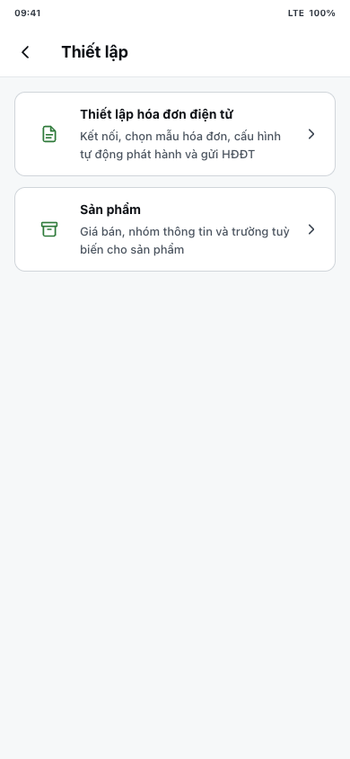
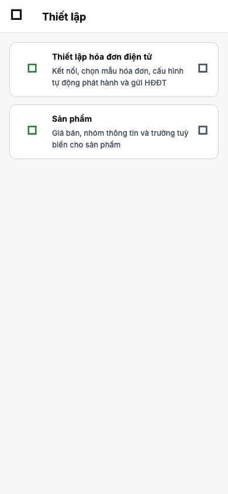
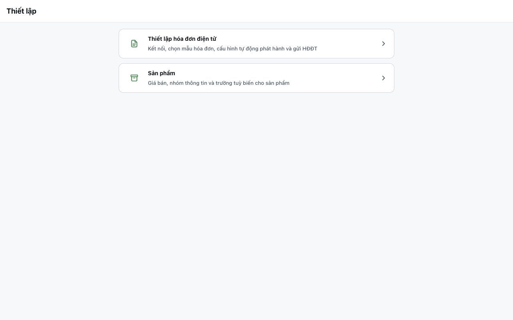
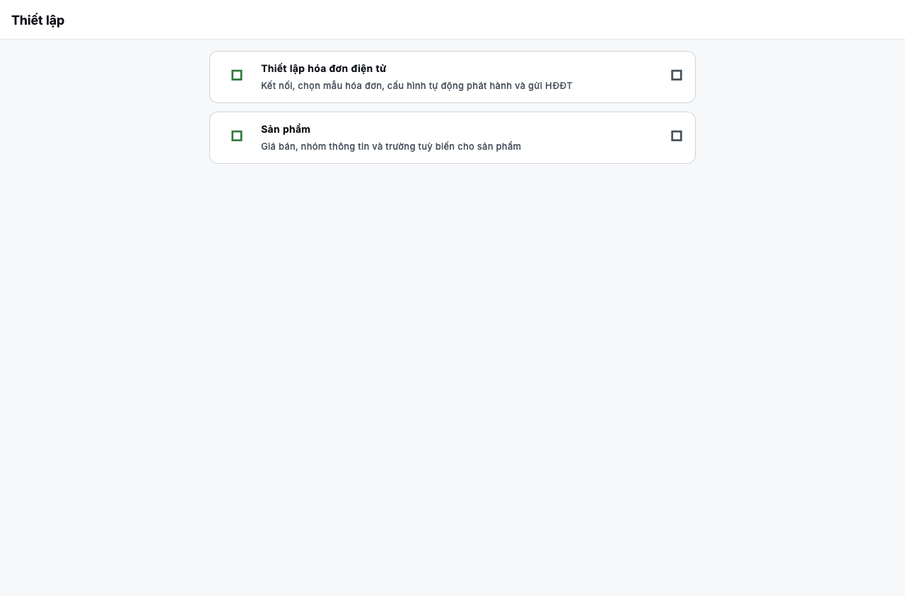
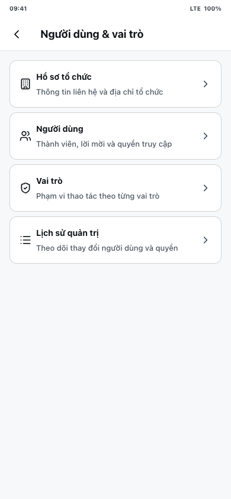
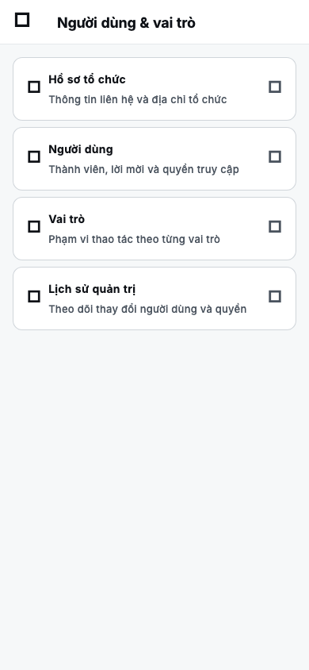
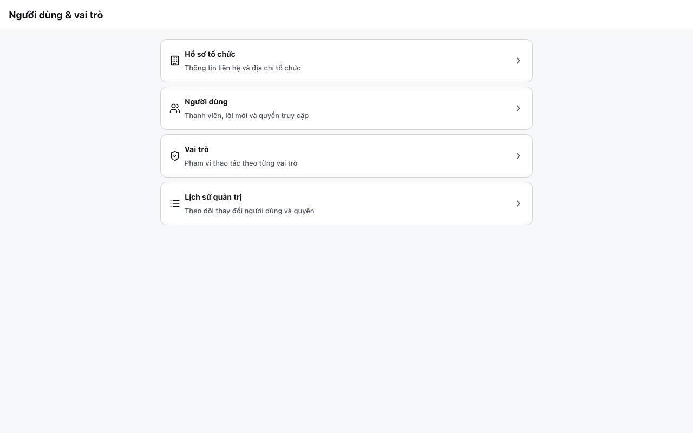
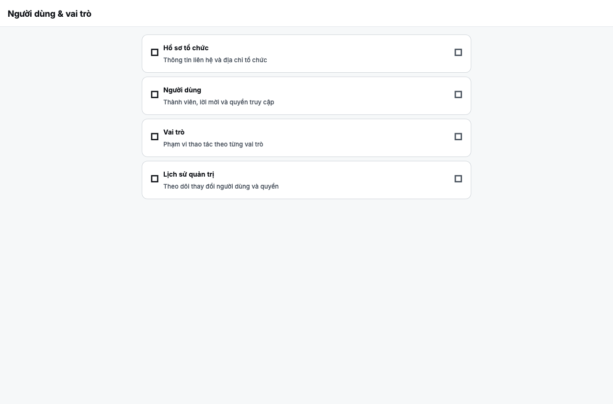
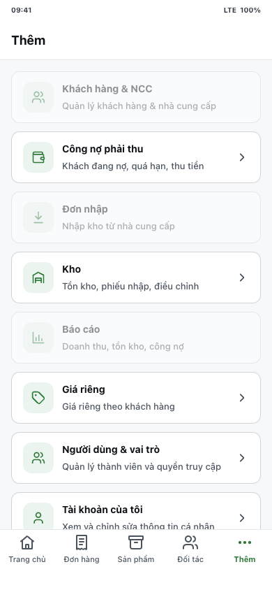
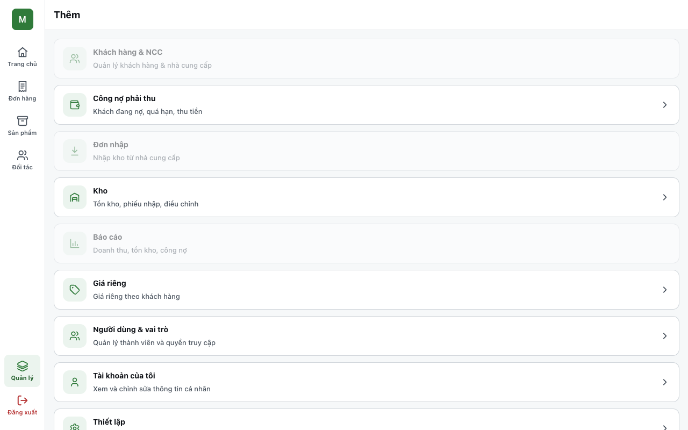

# 10-8c Menu Thêm về Flutter: nút quay lại theo khổ màn — Implementation Plan

> **For agentic workers:** REQUIRED SUB-SKILL: Use superpowers:subagent-driven-development (recommended) or superpowers:executing-plans to implement this plan task-by-task. Steps use checkbox (`- [ ]`) syntax for tracking.

**Goal:** Thiết lập (`/more/settings`) và Người dùng & vai trò (`/more/users-and-roles`) chỉ hiện nút ← khi cửa sổ < 1024. Trên web ≥ 1024 hai màn này là đích đến trực tiếp từ menu "Quản lý" (10-8a bỏ tab "Thêm" trên web) nên không có trang "Thêm" để quay về.

**Architecture:** Mỗi trang truyền `showBackButton: MediaQuery.sizeOf(context).width < VBreakpoints.desktop` cho `VPageScaffold`. Cùng ngưỡng với `StoreShell` (thanh biểu tượng ≥ 1024) và cùng cách Kho (`warehouse_hub_page.dart:66`, `inventoryIsWide`) và Công nợ (`receivable_list_page.dart:69`, `showBackButton: !split`) đang làm. `VAppBar` vẫn chỉ vẽ ← khi có navigator pop được (`v_app_bar.dart:94`), nên ở khổ hẹp hành vi giữ nguyên.

**Tech Stack:** Flutter, `c45_design_system` (`VPageScaffold`, `VBreakpoints`), go_router.

**Spec:** bản thiết kế "10-8 bước 4: Chuyển khung chung về Flutter" duyệt trong chat 2026-11-23, mục 10-8c. Nguồn hình: prototype `specs/prototype/more/html/app/main.js:103` (đổi ở commit `f65e2103c`: `back: true` → `back: width < DESKTOP`). **Làm sau 10-8a** (menu "Quản lý" thay tab "Thêm" trên web), sau 10-8b theo thứ tự a → b → c.

## Thiết kế đã duyệt (mục 10-8c)

- Thiết lập, Người dùng & vai trò: cửa sổ < 1024 (iPhone, web hẹp có thanh dưới, vào từ màn Thêm) → có ← như hiện nay; ≥ 1024 (web có thanh biểu tượng) → không có ←.
- Không đổi gì khác của ba màn APP-02 (thẻ, chữ, thứ tự). Các điểm hiện trạng 2–8 trong README prototype `more` để lần rà sau.

## Global Constraints

- Không đổi màu / font Mosaic; không đổi DS (không bump version).
- Không đổi `MorePage`, route `/more`, `more_entries.dart`, thanh dưới, thanh biểu tượng. Câu "khớp web không còn tab Thêm" là **lý do** ẩn ←, không phải yêu cầu chuyển hướng / thiết kế lại `/more`.
- Không đổi màn con (`/more/einvoice`, `/more/product-settings`, `/more/organization-profile`, `/more/users`, `/more/roles`, `/more/audit-logs`): chúng là trang đẩy từ hai màn này, giữ ←.
- Kiến trúc: chỉ sửa trong `features/more/presentation/pages/`; kiểm `dart run tool/check_feature_imports.dart`.
- Chỉ chạy test phạm vi plan (liệt kê ở từng task); **không** chạy `flutter test` toàn app.

## Quyết định

| # | Quyết định | Lý do |
|---|---|---|
| Q1 | Điều kiện là **bề ngang cửa sổ** (`MediaQuery.sizeOf(context).width`), không phải bề ngang vùng nội dung. | Thanh biểu tượng có hay không theo bề ngang cửa sổ (`StoreShell` dùng `constraints.maxWidth` của khung = cửa sổ); `VPageScaffold` cũng chọn cột 720 theo `MediaQuery.sizeOf`. Prototype: `(v.width ?? DEVICE[v.device].w) < DESKTOP` |
| Q2 | Ở < 1024 giữ quy tắc "chỉ vẽ ← khi pop được" của `VAppBar`. Không thêm `leading` riêng, không thêm `go('/more')` khi không pop được như Kho. | Prototype chỉ xét bề ngang vì màn trần luôn coi như được đẩy từ Thêm; trong app, mở thẳng `/more/settings` (gõ URL, khôi phục tab) thì không có trang để quay về — giữ như hiện nay. Đây là chủ ý, không phải sót |
| Q3 | Đang ở màn (đã đẩy từ Thêm ở khổ hẹp) rồi kéo cửa sổ ≥ 1024 → ← biến mất; thu lại < 1024 → ← hiện lại. Navigator vẫn giữ trang Thêm bên dưới. | `MediaQuery.sizeOf` dựng lại trang khi đổi khổ. Ở ≥ 1024 người dùng điều hướng bằng thanh biểu tượng |
| Q4 | Ảnh prototype web 1280 **không có thanh biểu tượng** vì `insideShell` trong `shared/shell.js:50-61` coi hai route này nằm ngoài khung (sai, đã ghi ở 10-8a Task 4, hàm giữ nguyên). App thật có thanh 84. So ảnh chỉ so thanh tiêu đề + thân. Golden Flutter dựng trang trần (không khung) để khớp ảnh prototype. | 10-8a quyết không đổi `insideShell` |
| Q5 | Giá riêng (`pricing_list_page.dart:70`) và Tài khoản của tôi (`my_account_page.dart:300,307,402`) cũng là mục trong menu "Quản lý" và vẫn hiện ← khi được đẩy ở khổ rộng. **Không** sửa ở đây; ghi vào ghi chú của theme sở hữu (Giá riêng — Theme 4; Tài khoản — Theme 1 ID-21) ở Task 2. | Ngoài APP-02; màn của theme khác rà cùng theme đó |

## Bảng "Đang làm gì"

| Thứ bị thay | Đang làm gì | Sau khi sửa | Test giữ hành vi |
|---|---|---|---|
| `SystemSettingsPage` `showBackButton: true` (`system_settings_page.dart:14`) | Có ← khi pop được, mọi khổ. Web: chỉ pop được khi đẩy từ `/more` (`more_page.dart:85` `context.push`); vào từ thanh bên (`context.go`) thì `/more/settings` là route cấp trên trong `ShellRoute(StoreShell)`, không pop được → vốn đã không có ← | `width < 1024` và pop được | T0: `settings at 390 pushed from /more: has back` (xanh trên code cũ), `settings at 390 opened directly: no back` |
| `UsersAndRolesPage` (không truyền → mặc định `true`, `users_and_roles_page.dart:85`) | như trên | như trên | T0: `users-and-roles at 390 pushed from /more: has back`, `… opened directly: no back` |
| Bấm ← | `poppableNav.maybePop()` → về `/more` | giữ nguyên ở < 1024 | T0: `tap back returns to /more` |
| `w2_behavior_preservation_test.dart:571` "H12" | Kiểm ← ở `/more/users/invite` (khổ mặc định 800) | không đổi (màn con, khổ hẹp) | chạy lại ở Task 1 |
| `users_and_roles_page_test.dart` (3 test, khổ 800) | Không kiểm ← | không đổi | chạy lại ở Task 1 |

## Ảnh

Nguồn: `specs/prototype/more/html/tools/proto-final/` chụp lại 2026-11-23 bằng `node tools/capture.mjs` (sau commit `f65e2103c`). Cột Flutter: golden Task 1.

| Prototype | Flutter |
|---|---|
|  |  |
|  |  |
|  |  |
|  |  |

Tham khảo, **không đổi** trong plan này (màn Thêm, `VAppBar('Thêm', showBackButton: false)`):  

Lệch đã biết, không sửa ở đây: ảnh 1280 prototype không có thanh biểu tượng (Q4); icon Lucide thay Material (README `more` "Khác biệt có chủ đích"); hộp icon Thiết lập trắng trùng nền thẻ (hiện trạng 3).

## Code prototype (chép nguyên văn)

`specs/prototype/more/html/app/main.js:56-62` (thanh tiêu đề)

```js
/** VAppBar: cao 56, nền surface, gạch dưới 1 borderDefault, tiêu đề headingH3 w700; nút ← chỉ khi route pop được. */
function appBar(title, { back = false } = {}) {
  return `<header class="mr-appbar">
    ${back ? `<button type="button" class="mr-appbar__back" aria-label="Quay lại">${icon('chevronLeft')}</button>` : ''}
    <h1 class="mr-appbar__title">${esc(title)}</h1>
  </header>`;
}
```

`specs/prototype/more/html/app/main.js:100-106` (khung trang Thiết lập / Người dùng & vai trò — dòng 103 là thay đổi của 10-8c)

```js
/** VPageScaffold: thân trong cột tối đa 720 (≥ 1024) / 640 (tablet), đệm hai bên = (rộng − 720) / 2. */
function pageScaffold(title, list, v) {
  return `<div class="mr-page mr-page--scaffold">
    ${appBar(title, { back: (v.width ?? DEVICE[v.device].w) < DESKTOP })}
    <div class="mr-body"><div class="mr-column" style="--mr-col:${columnMax(v.width)}">${list}</div></div>
  </div>`;
}
```

`specs/prototype/shared/shell.js:10`

```js
export const DESKTOP = 1024; // VBreakpoints.desktop: ≥ 1024 thanh bên, < 1024 thanh dưới
```

`specs/prototype/more/html/styles/more.css:13-18`, token thay bằng giá trị `tokens.css` (tên trong chú thích):

```css
/* VAppBar: cao 56 + gạch 1 borderDefault, nền surface, tiêu đề cách lề 16;
   có nút ← thì leading 56 (IconButton 48, icon 24 textPrimary) và tiêu đề bắt đầu ở 72. */
.mr-appbar { flex: 0 0 auto; display: flex; align-items: center; height: 56px; padding: 0 16px /*space-4*/; background: #FFFFFF /*surface-default*/; border-bottom: 1px solid #E5E8EB /*border-default*/; }
.mr-appbar__back { display: grid; place-items: center; flex: 0 0 48px; width: 48px; height: 48px; margin: 0 16px 0 calc(4px - 16px); padding: 0; border: 0; border-radius: 999px /*radius-pill*/; background: transparent; color: #0E1116 /*text-primary*/; font-size: 24px; cursor: pointer; }
.mr-appbar__back:hover { background: rgb(14 17 22 / .08); }
.mr-appbar__title { margin: 0; min-width: 0; overflow: hidden; text-overflow: ellipsis; white-space: nowrap; font-size: 18px /*sh-fs-h3*/; line-height: 26px; font-weight: 700; color: #0E1116 /*text-primary*/; }
```

### Ánh xạ phần tử → Flutter

| Prototype | Flutter |
|---|---|
| `back: width < DESKTOP` | `VPageScaffold(showBackButton: MediaQuery.sizeOf(context).width < VBreakpoints.desktop)` |
| `.mr-appbar` 56, gạch 1, nền surface | `VAppBar` (có sẵn, không đổi) |
| `.mr-appbar__back` 48, icon 24 `chevronLeft`, `aria-label="Quay lại"` | `VAppBar` `IconButton(tooltip: 'Quay lại', icon: VIcon(VIcons.chevronLeft))` (có sẵn, không đổi) — test tìm bằng `find.byTooltip('Quay lại')` |
| không có ← → tiêu đề cách lề 16 | `AppBar(leading: null, automaticallyImplyLeading: false)` → `titleSpacing` mặc định 16 (có sẵn) |
| `.mr-column` 720 / 640 / 100% | `VPageScaffold.defaultContentMaxWidth` (có sẵn, không đổi) |

## Review Focus

1. **Đẩy từ Thêm ở 900 rồi kéo cửa sổ lên 1280** → ← biến mất, không ném lỗi; kéo về 900 → ← hiện lại và bấm vẫn về `/more` (Q3). Test ở Task 1.
2. **Ranh giới 1023 / 1024** khớp đúng ngưỡng thanh biểu tượng của `StoreShell` (`>= VBreakpoints.desktop`): 1023 có ←, 1024 không. Test ở Task 1.
3. **Màn con vẫn có ←** ở 1280: Thiết lập → "Thiết lập hóa đơn điện tử" (`/more/einvoice`), Người dùng & vai trò → "Vai trò" (`/more/roles`) — không vô tình dùng chung điều kiện. Test ở Task 1 (một ca: đẩy `/more/roles` từ trang Người dùng & vai trò ở 1280, có ←).
4. **Vào thẳng ở < 1024** (không pop được) → không có ←, như cũ (Q2).

---

### Task 0: Test giữ hành vi trên code cũ

**Files:**
- Create: `apps/erp/test/features/more/presentation/pages/system_settings_page_test.dart`
- Modify: `apps/erp/test/features/more/presentation/pages/users_and_roles_page_test.dart`

**Interfaces:**
- Consumes: `IamFeatureAccessCubit`, `sessionFromSnapshot` (`test/features/iam/support/iam_test_session.dart`), `_owner` có sẵn trong `users_and_roles_page_test.dart`.
- Produces: hàm dựng dùng trong cả hai file (mỗi file tự khai báo, không tạo file support mới):

```dart
Future<GoRouter> pumpPushed(
  WidgetTester tester, {
  required Size size,
  required Widget page,           // SystemSettingsPage() hoặc UsersAndRolesPage(accessCubit: cubit)
  required String path,           // '/more/settings' | '/more/users-and-roles'
  bool push = true,               // false = initialLocation: path (vào thẳng)
}) async {
  tester.view.physicalSize = size;
  tester.view.devicePixelRatio = 1.0;
  addTearDown(tester.view.resetPhysicalSize);
  addTearDown(tester.view.resetDevicePixelRatio);
  final router = GoRouter(
    initialLocation: push ? '/more' : path,
    routes: [
      GoRoute(path: '/more', builder: (_, _) => const Scaffold(body: Text('MORE_PAGE'))),
      GoRoute(path: path, builder: (_, _) => page),
      // trang con để kiểm Review Focus 3
      GoRoute(path: '/more/einvoice', builder: (_, _) => const VPageScaffold(title: 'HĐĐT', body: SizedBox())),
      GoRoute(path: '/more/product-settings', builder: (_, _) => const SizedBox()),
      GoRoute(path: '/more/roles', builder: (_, _) => const VPageScaffold(title: 'ROLES', body: SizedBox())),
      GoRoute(path: '/more/organization-profile', builder: (_, _) => const SizedBox()),
      GoRoute(path: '/more/users', builder: (_, _) => const SizedBox()),
      GoRoute(path: '/more/audit-logs', builder: (_, _) => const SizedBox()),
    ],
  );
  addTearDown(router.dispose);
  await tester.pumpWidget(MaterialApp.router(theme: VTheme.lightTheme, routerConfig: router));
  await tester.pumpAndSettle();
  if (push) {
    router.push(path);
    await tester.pumpAndSettle();
  }
  return router;
}
```

- [ ] **Step 1: Viết test trên code cũ** (mỗi file 3 test; tên test theo trang)

```dart
testWidgets('settings at 390 pushed from /more: has back', …)
  // pumpPushed(size: Size(390, 844)) → expect(find.byTooltip('Quay lại'), findsOneWidget)
testWidgets('settings at 390 opened directly: no back', …)
  // push: false → findsNothing
testWidgets('settings: tap back returns to /more', …)
  // 390, pushed → tap byTooltip('Quay lại') → find.text('MORE_PAGE') findsOneWidget
```

`users_and_roles_page_test.dart` thêm 3 test tương tự (`users-and-roles at 390 …`), `page: UsersAndRolesPage(accessCubit: cubit)` với cubit `_owner` đã `load()`.

- [ ] **Step 2: Chạy, phải xanh trên code cũ**

Run: `cd apps/erp && flutter test test/features/more/presentation/pages`
Expected: PASS (3 test cũ + 6 test mới). Ghi tên 6 test vào mục Kết quả.

- [ ] **Step 3: Commit**

```bash
git add apps/erp/test/features/more/presentation/pages
git commit -m "test(10-8c): test giữ hành vi nút quay lại Thiết lập, Người dùng & vai trò"
```

### Task 1: Ẩn ← ở ≥ 1024 + golden

**Files:**
- Modify: `apps/erp/lib/features/more/presentation/pages/system_settings_page.dart:14`
- Modify: `apps/erp/lib/features/more/presentation/pages/users_and_roles_page.dart:85-86`
- Modify: `apps/erp/test/features/more/presentation/pages/system_settings_page_test.dart`
- Modify: `apps/erp/test/features/more/presentation/pages/users_and_roles_page_test.dart`
- Create: `apps/erp/test/features/more/presentation/pages/more_pages_golden_test.dart`
- Create (ảnh): `docs/refactor/plans/P10/img/10-8c/flutter-APP02-{settings-default,users-owner}-{390,1280}.png`

**Interfaces:**
- Consumes: `pumpPushed` (Task 0), `VBreakpoints.desktop` (DS, có sẵn).
- Produces: không có API mới.

- [ ] **Step 1: Thêm test hỏng** (mỗi file)

```dart
testWidgets('settings at 1280 pushed from /more: no back', …)       // findsNothing
testWidgets('settings at 1023 pushed: has back; at 1024: no back', …)
  // pumpPushed(Size(1023, 800)) → findsOneWidget; rồi tester.view.physicalSize = Size(1024, 800); pumpAndSettle → findsNothing
testWidgets('settings pushed at 900 then widened to 1280 and back to 900', …)
  // 900: findsOneWidget → 1280: findsNothing, tester.takeException() == null → 900: findsOneWidget; tap → 'MORE_PAGE'
testWidgets('settings at 1280: child /more/einvoice keeps back', …)
  // tap 'Thiết lập hóa đơn điện tử' → find.byTooltip('Quay lại') findsOneWidget
```

`users_and_roles_page_test.dart`: 4 test tương tự; ca màn con tap `'Vai trò'` → `/more/roles` có ←.

- [ ] **Step 2: Chạy → FAIL** ở `1280 … no back`, `1024: no back`, `widened to 1280`

Run: `cd apps/erp && flutter test test/features/more/presentation/pages`

- [ ] **Step 3: Sửa 2 file lib**

`system_settings_page.dart`:

```dart
    return VPageScaffold(
      title: 'Thiết lập',
      // Web ≥ 1024: mở từ menu "Quản lý" của thanh biểu tượng, không có trang Thêm để quay về (10-8c).
      showBackButton: MediaQuery.sizeOf(context).width < VBreakpoints.desktop,
```

`users_and_roles_page.dart` (trong `BlocBuilder`, dùng `context` của builder):

```dart
        return VPageScaffold(
          title: 'Người dùng & vai trò',
          // Web ≥ 1024: mở từ menu "Quản lý" của thanh biểu tượng, không có trang Thêm để quay về (10-8c).
          showBackButton: MediaQuery.sizeOf(context).width < VBreakpoints.desktop,
```

- [ ] **Step 4: Chạy → PASS** (Task 0 + Task 1 + 3 test cũ)

Run: `cd apps/erp && flutter test test/features/more/presentation test/features/iam/presentation_module/w2_behavior_preservation_test.dart`
Expected: PASS; H12 không đổi.

- [ ] **Step 5: Golden** — `more_pages_golden_test.dart` theo khuôn `test/features/receivable/presentation/receivable_golden_test.dart:105-136` (`useInventoryTestSurface(size)`, `RepaintBoundary`, `matchesGoldenFile`; `repoRoot()` import từ `test/features/receivable/presentation/receivable_test_harness.dart:60`), đường dẫn `${repoRoot()}/docs/refactor/plans/P10/img/10-8c/flutter-APP02-<ca>-<rộng>.png`. Router có `/more` (trang giả) và route trang; **đẩy** trang từ `/more` để ca 390 có ← như ảnh prototype. 4 ca: `settings-default` và `users-owner` (cubit `_owner`, đủ 3 quyền như ca `users__owner`) × 390 / 1280.

Run: `cd apps/erp && flutter test --update-goldens test/features/more/presentation/pages/more_pages_golden_test.dart` rồi chạy lại không `--update-goldens` → PASS. So từng cặp với cột Prototype (chỉ thanh tiêu đề + thân, Q4); lệch ghi ở mục Kết quả.

- [ ] **Step 6: Kiểm phạm vi**

Run: `cd apps/erp && dart analyze lib test && dart run tool/check_feature_imports.dart`
Expected: không lỗi mới; check imports OK.

- [ ] **Step 7: Commit** `feat(10-8c): Thiết lập, Người dùng & vai trò ẩn nút quay lại trên web ≥ 1024`

### Task 2: Tài liệu tiến độ

**Files:**
- Modify: `docs/refactor/PLAN.md` (bảng 10-8a/b/c: dòng 10-8c cột "Làm" ✅; bảng "Khung chung" dòng "Menu Thêm + Thiết lập hệ thống": cột "Chuyển về Flutter" ✅ ngày, Ghi chú thêm link plan; bảng Theme 1 / Theme 4 cột Ghi chú: thêm "Tài khoản của tôi" / "Giá riêng" còn ← khi được đẩy ở web ≥ 1024, sửa khi rà theme (Q5))
- Modify: `specs/prototype/more/html/README.md`:
  - thêm mục "Đề xuất đã chốt (2026-11-23)": Thiết lập, Người dùng & vai trò chỉ có ← khi < 1024 (`main.js:103`) — "Đã có trong Flutter (10-8c)";
  - sửa "Hiện trạng" mục 1: hai route nằm **trong** `ShellRoute(StoreShell)` (đóng ở `app_router.dart:1234`) nên web có thanh bên; chỉ iPhone mất thanh dưới vì không qua `ErpTabScaffold`; ảnh web prototype không có thanh là do `insideShell` (Q4);
  - mục 9 ("tiêu đề lặp") thêm: web ≥ 1024 không còn tab "Thêm" (10-8a) nên không còn lặp trên web.
- Modify: `docs/refactor/CHECKLIST.md` (tick "Mới" APP-02 nếu kiểm tay đạt — người dùng kiểm)

- [ ] **Step 1: Cập nhật 3 file**
- [ ] **Step 2: Commit** `docs(10-8c): cập nhật tiến độ Menu Thêm`

## Kết quả

**Task 0** (xanh trên code cũ, `flutter test test/features/more/presentation/pages` → 9 pass): `settings at 390 pushed from /more: has back`, `settings at 390 opened directly: no back`, `settings: tap back returns to /more`, `users-and-roles at 390 pushed from /more: has back`, `users-and-roles at 390 opened directly: no back`, `users-and-roles: tap back returns to /more`.

**Task 1:** 8 test mới (4 mỗi trang) đỏ trước khi sửa (6 fail: 1280, 1024, widen), xanh sau: `flutter test test/features/more/presentation` → 25 pass. 4 golden tạo và chạy lại không `--update-goldens` → pass. `check_feature_imports`: chỉ vi phạm có sẵn ở `features/pricing/data` (không thuộc phạm vi); `dart analyze lib test`: không cảnh báo mới ở `features/more`.

**Lệch đã biết:**
- `w2_behavior_preservation_test.dart` H12 **đỏ cả trước khi sửa** (`GetIt: HomeRepository is not registered`, do Trang chủ 10-8b) → không phải do 10-8c; chưa sửa (ngoài phạm vi).
- Golden Flutter hiện icon là ô vuông (font icon không nạp trong test), bố cục thanh tiêu đề + thân khớp prototype: 390 có ←, 1280 không có ←, cột 720 căn giữa. Thiết lập 1280 và Q4 như plan.
- Plan ghi `app_router.dart:1234`; dòng thật là 679.

## Review

_(phiên review ghi)_
