# 10-8d Nền cho Theme 1 về Flutter — Implementation Plan

> **For agentic workers:** REQUIRED SUB-SKILL: Use superpowers:subagent-driven-development (recommended) or superpowers:executing-plans to implement this plan task-by-task. Steps use checkbox (`- [ ]`) syntax for tracking.

**Goal:** Có sẵn mọi thứ dùng chung mà 10-8e…k cần: ô mã mới, thanh tiến độ, hộp xác nhận 440, icon app thay "V45", ngưỡng bố cục web, khung thôi bó 1120 ở màn Theme 1, tài liệu khớp prototype. Chưa đổi bố cục màn nào.

**Architecture:** DS thêm tham số `layout` cho `VVerificationCodeField`, widget mới `VStepProgress`, giới hạn bề ngang `VConfirmDialog` (bump 1.10.0). App thêm `isWideLayout(context)` (core) và `AppLogo` (core); `StoreShell` xét đường dẫn bằng `GoRouterState.uri.path`.

**Tech Stack:** Flutter 3.44.8, `c45_design_system`, go_router 17.5.0, `pdf`.

**Spec:** bản thiết kế "10-8: Theme 1 về Flutter" duyệt trong chat 2026-11-25 (chép phần chung bên dưới). Nguồn hình: `specs/themes/theme-01/03.design/prototype/html/`.

## Thiết kế đã duyệt (phần chung cho 10-8d…k)

- 19 màn khớp ảnh prototype ở 390 và 1280. Cách dựng: một trang giữ cubit, controller, lỗi, sheet, toast; bên trong hai widget `XNarrow` (← `app/*.js`) / `XWide` (← `app/web/*.js`).
- Ngưỡng web: rộng ≥ 840 **và** cao ≥ 480 (iPhone xoay ngang vẫn bố cục iPhone). Sheet giữ ngưỡng 1024 của DS.
- ≥ 1024 giữ thanh bên 84; bỏ bó 1120 cho Hồ sơ tổ chức, Người dùng, Vai trò, Lịch sử quản trị, Tài khoản.
- Người dùng, Vai trò, Lịch sử bỏ `VListDetailLayout` (bảng toàn màn), giữ ShellRoute + cubit; web `go`, hẹp `push`; chi tiết luôn có ←. Tài khoản của tôi ẩn ← ở ≥ 1024. Làm ở 10-8h, i, k.
- 15 lỗi sửa kèm, chia theo plan: d = 1; e = 2; f = 3, 4; g = 5, 6, 7, 8 (màn không quyền); h = 9, 10, 11, đổi vai trò một sheet; i = 8 (bộ lọc), 12, 13, 14; k = 15.
- Lỗi phải sửa thì sửa ca trong prototype và chụp lại trước, rồi mới làm Flutter.

## Global Constraints

- Không đổi màu / font Mosaic; màu qua `context.vColors`, khoảng cách `VSpacing`, bo `VRadius`, chữ `VTypography`.
- Không đổi chữ, RPC, cubit, repository, route. Không làm bố cục màn (10-8e…k).
- Mặc định của mọi tham số DS mới giữ hành vi cũ, trừ hai thay đổi đã duyệt: lỗi ô mã đỏ cả dãy; `VConfirmDialog` rộng tối đa 440.
- Chỉ chạy test liệt kê ở từng task; **không** chạy `flutter test` toàn app. Đụng sai thì so `docs/refactor/TEST-BASELINE.md`.
- Phụ thuộc feature: `cd apps/erp && dart run tool/check_feature_imports.dart` không thêm vi phạm.

## Quyết định

| # | Quyết định | Lý do |
|---|---|---|
| Q1 | `StoreShell` đổi `GoRouterState.of(context).matchedLocation == '/'` thành xét `GoRouterState.of(context).uri.path` | go_router 17.5 `match.dart:388-399`: sau `push`, `ShellRouteMatch.matchedLocation` vẫn là trang **gốc**, chỉ `uri` là trang được đẩy. Màn Người dùng mở bằng `push` từ Người dùng & vai trò sẽ vẫn bị bó 1120 nếu giữ cách cũ |
| Q2 | Hệ quả của Q1, **đổi có chủ đích**: route khác đẩy từ `/` (trước đây không bị bó vì `matchedLocation` còn là `/`) nay bó 1120 như khi vào thẳng | Đúng ý 10-8a Q1 |
| Q3 | So khớp theo đoạn đường dẫn (`path == p \|\| path.startsWith('$p/')`) | `/more/users` không được dính `/more/users-and-roles` (10-8c) |
| Q4 | Ngưỡng dùng bề ngang **cửa sổ** (`MediaQuery.sizeOf`), không dùng `viewInsets` | Bàn phím iPhone mở không làm `size` đổi, bố cục không nhảy khi đang gõ |
| Q5 | `fill`: ô cao 56, chữ 18; ô hẹp hơn 40 thì cao 48, chữ 14. `split4`: hai nhóm 4, khe ô 5, khe nhóm 18, ô cao 52, chữ 18; chỉ hợp lệ khi `length == 8` (assert) | `ds.js:57`. Không chép công thức `cellW < 48` theo bề ngang thật: prototype truyền `columnWidth` 358 cho ID-03 (`verify.js:37`) trong khi ô nằm trong thẻ, cột thật hẹp hơn (khoảng 326 ⇒ ô 47,7), nên ảnh đã duyệt vẫn là 56 / 18. Ngưỡng 40 cho ra đúng mọi ảnh 390 và 1280; máy 320 không có ảnh |
| Q6 | Vẽ con trỏ đứng yên 2 × 22 màu `primary` ở ô đang nhập còn trống, cho **mọi** layout | `ds.js` vẽ con trỏ; đứng yên để test không treo `pumpAndSettle` |
| Q7 | Lỗi (`VField.invalid` / `invalid` / `errorText`): **mọi** ô viền `danger`; vòng đỏ nhạt chỉ ở ô đang focus; chữ số giữ `textPrimary` | Lỗi 1. Ô có vòng là ô đang nhập |
| Q8 | `VStepProgress.variant`: `standard` (web), `mobile` (iPhone). Không tự suy theo bề ngang | Hai khung prototype khác token; trang `XNarrow` / `XWide` đã biết mình là khung nào |
| Q9 | `VConfirmDialog` đệm 24 khi cửa sổ ≥ 1024, còn lại 20 như cũ | `t1-web.css:6` |
| Q10 | Icon: chép `prototype/html/assets/app-icon.png` (256 × 256, 64 KB) thành `apps/erp/assets/icon/app_icon_256.png`; không khai `app_icon.png` (937 KB) vào bundle | Giữ app nhẹ |
| Q11 | Nạp icon PDF lỗi → in phiếu không có icon (bỏ cả ô 44), không ném lỗi | In phiếu quan trọng hơn logo |
| Q12 | Đăng nhập ở plan này chỉ thay ô "V45" bằng `AppLogo(size: 64)`; bố cục còn lại ở 10-8e | Một việc một plan |

## Ảnh prototype

| Phần | 390 | 1280 |
|---|---|---|
| Ô mã `fill` | 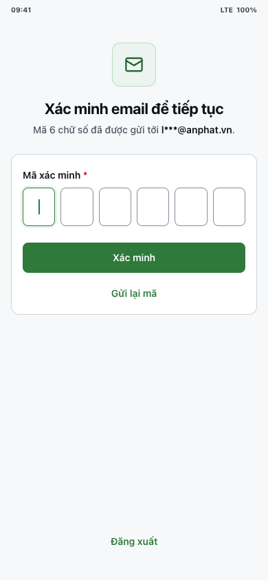 | 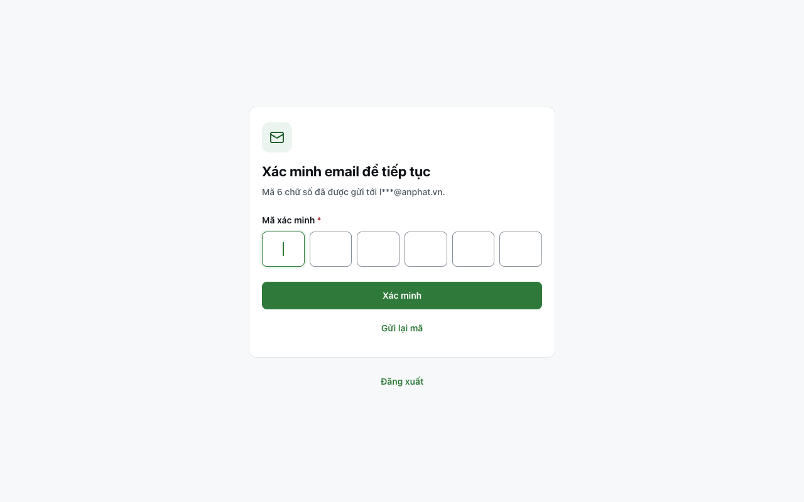 |
| Ô mã `split4` (iPhone) / `fill` 8 ô (web) | 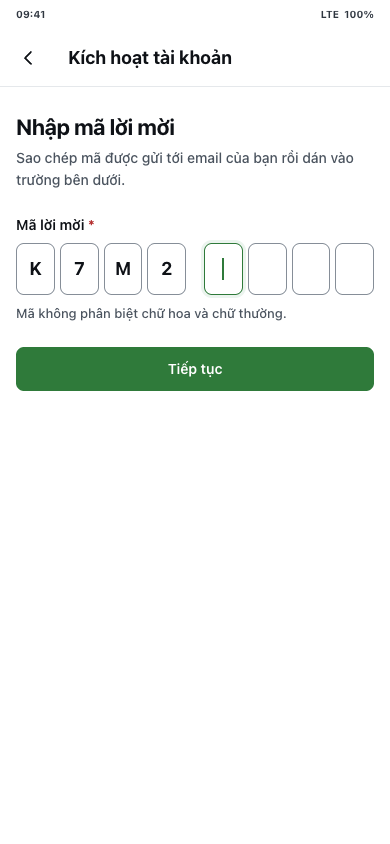 | 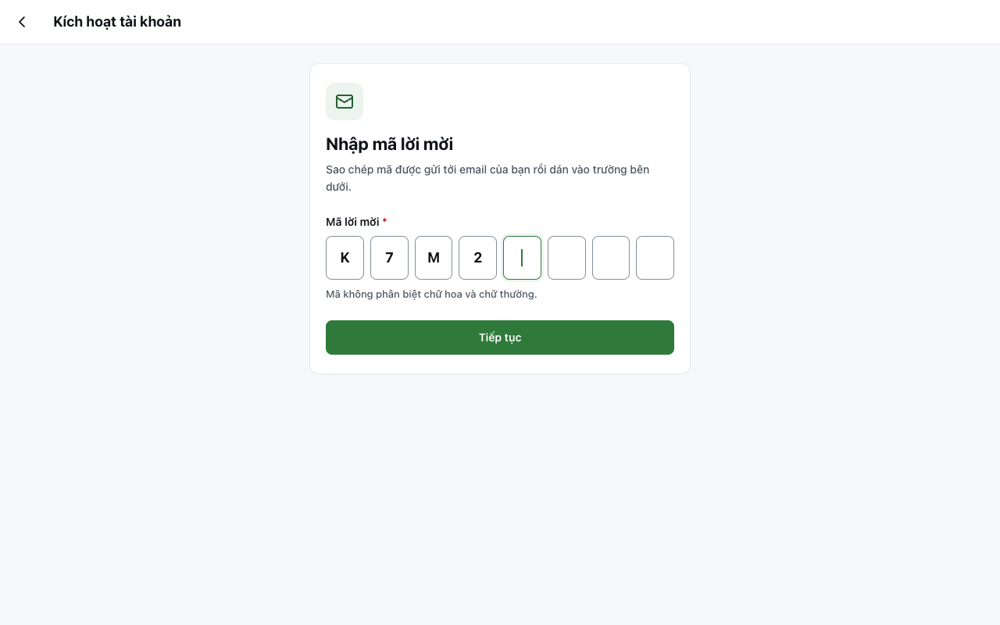 |
| Ô mã lỗi (chụp lại ở Task 1) | 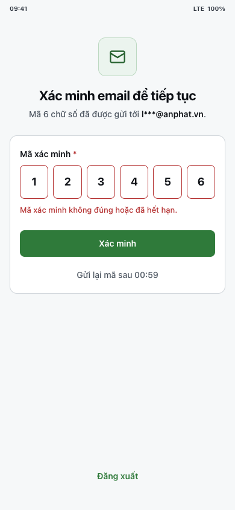 | 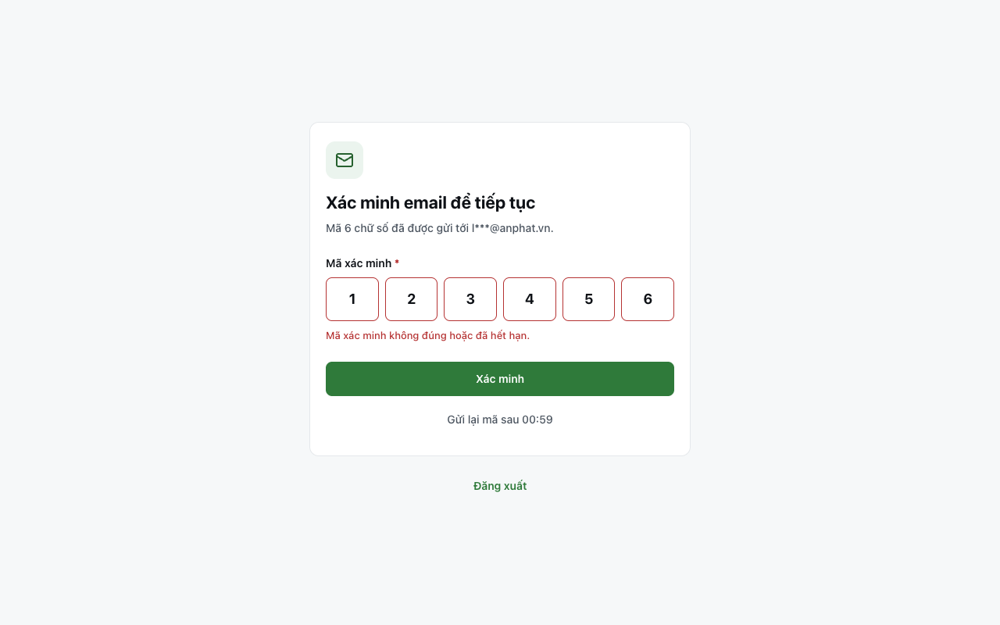 |
| Thanh tiến độ | 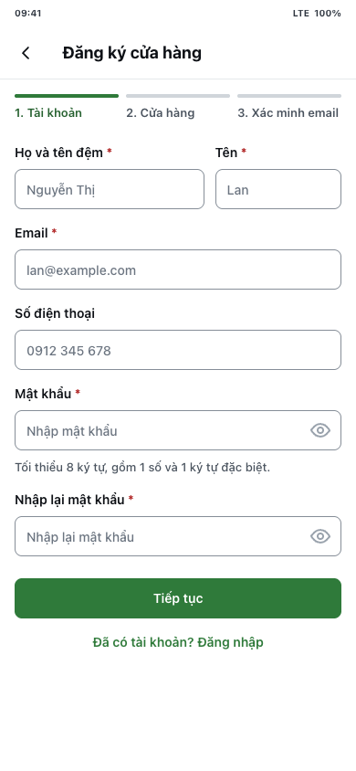 | 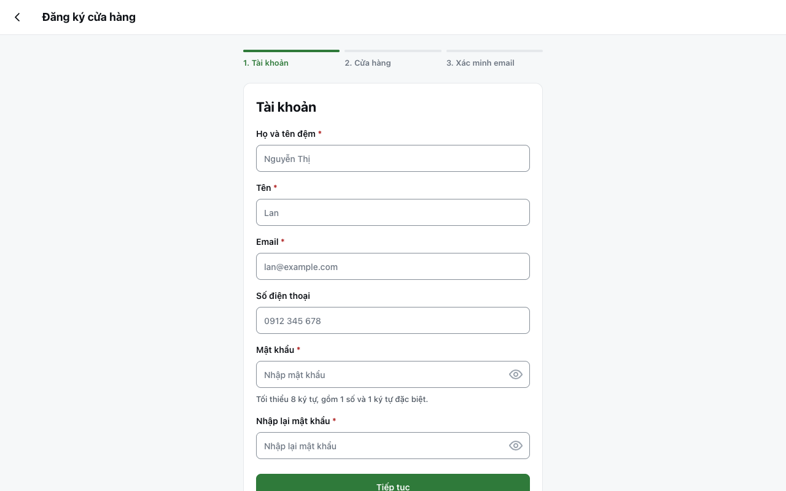 |
| Hộp xác nhận | 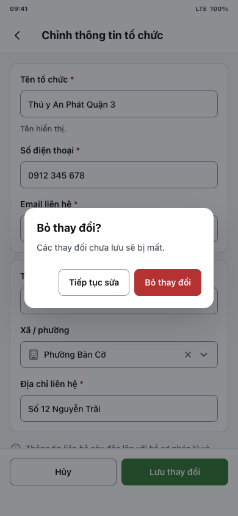 | 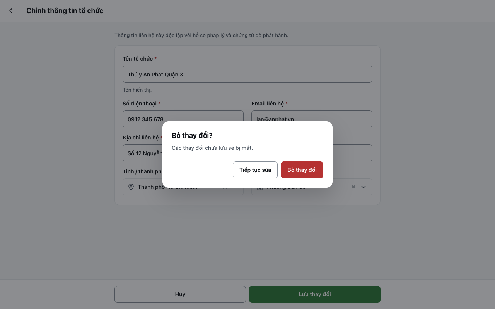 |
| Icon app | 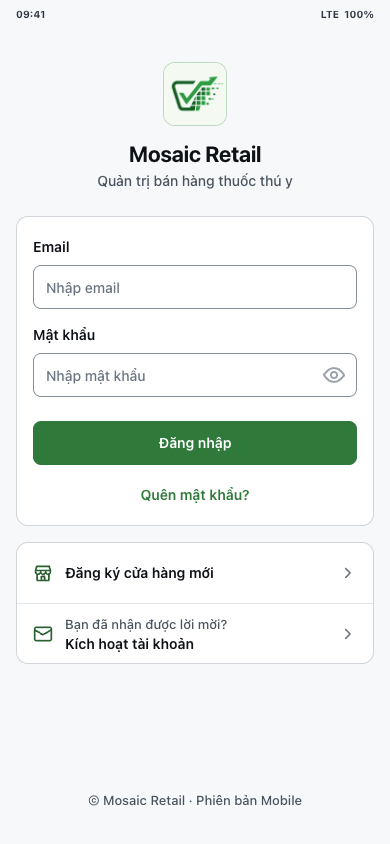 | 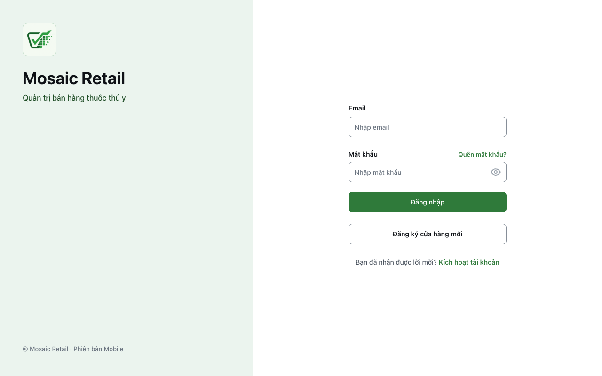 |

## Code prototype (chép nguyên văn)

`app/ds.js:57-71`

```js
export function codeField({ length = 6, value = '', columnWidth, invalid = false, disabled = false, focus = true, fill = false, split = false }) {
  const gap = 8;
  const share = (columnWidth - gap * (length - 1)) / length;
  const cellW = fill ? share : Math.min(48, share);
  const cellH = cellW < 48 ? Math.max(48, cellW + 8) : 56;
  const at = Math.min(value.length, length - 1);
  const size = split ? 'height:52px;font-size:18px' : `${fill ? '' : `width:${cellW}px;`}height:${cellH}px;font-size:${cellW < 48 ? 14 : 18}px`;
  const cells = Array.from({ length }, (_, i) => {
    const ch = value[i] || '';
    const isFocus = focus && !disabled && i === at;
    return `<span class="t1-code__cell${isFocus ? ' is-focus' : ''}${isFocus && invalid ? ' is-danger' : ''}" style="${size}">${esc(ch)}${isFocus && !ch ? '<i class="t1-code__caret"></i>' : ''}</span>`;
  }).join('');
  return `<div class="t1-code${fill ? ' t1-code--fill' : ''}${split ? ' t1-code--split' : ''}${disabled ? ' is-disabled' : ''}" role="group" aria-label="Mã ${length} ký tự">${cells}</div>`;
}
```

`app/ds.js:73-79`

```js
export function progressBar(titles, current) {
  return `<ol class="t1-progress" style="grid-template-columns:repeat(${titles.length},1fr)" aria-label="${esc(`${current + 1}/${titles.length} · ${titles[current]}`)}">${titles.map((t, i) => {
    const st = i < current ? 'done' : i === current ? 'active' : 'todo';
    return `<li class="t1-progress__seg is-${st}"${i === current ? ' aria-current="step"' : ''}><i></i><span>${i + 1}. ${esc(t)}</span></li>`;
  }).join('')}</ol>`;
}
```

`styles/t1.css:87-95, 169-181, 571-573`, `styles/t1-web.css:6`, token thay bằng giá trị `tokens.css`:

```css
.t1-code { display: flex; gap: 8px; }
.t1-code__cell { position: relative; display: grid; place-items: center; border: 1px solid #868E98 /*border-input*/; border-radius: 8px /*radius-input*/; background: #FFFFFF; font-weight: 700; line-height: 1; color: #0E1116 /*text-primary*/; }
.t1-code__cell.is-focus { border-color: #2F7A3A /*primary*/; box-shadow: 0 0 0 3px #EBF4EE /*surface-success*/; }
.t1-code__cell.is-focus.is-danger { border-color: #B53232 /*text-danger*/; box-shadow: 0 0 0 3px #F8ECEC /*surface-danger*/; }
.t1-code__caret { width: 2px; height: 22px; background: #2F7A3A; }
.t1-code--fill .t1-code__cell { flex: 1 1 0; min-width: 0; }
.t1-code--split { display: grid; grid-template-columns: repeat(4, minmax(0, 1fr)) 8px repeat(4, minmax(0, 1fr)); gap: 5px; }
.t1-code--split .t1-code__cell:nth-child(5) { grid-column: 6; }
.t1-code.is-disabled { opacity: var(--c45-v2-opacity-disabled); }

.t1-progress { display: grid; gap: 8px /*space-2*/; margin: 0; padding: 0; list-style: none; }
.t1-progress__seg { display: flex; flex-direction: column; gap: 8px; min-width: 0; }
.t1-progress__seg i { height: 4px; border-radius: 999px; background: #E5E8EB /*border-default*/; }
.t1-progress__seg span { overflow: hidden; text-overflow: ellipsis; white-space: nowrap; font-size: 13px; line-height: 18px; font-weight: 600; color: #6B7480 /*text-muted*/; }
.t1-progress__seg.is-done i, .t1-progress__seg.is-active i { background: #2F7A3A; }
.t1-progress__seg.is-done span { color: #4A535E /*text-secondary*/; }
.t1-progress__seg.is-active span { color: #2F7A3A; }
.sh-app[data-device="iphone"] .t1-progress__seg { gap: 6px; }
.sh-app[data-device="iphone"] .t1-progress__seg span { line-height: 20px; }
.sh-app[data-device="iphone"] .t1-progress__seg.is-todo i { background: #D0D5DA /*border-strong*/; }
.sh-app[data-device="iphone"] .t1-progress__seg:not(.is-active) span { color: #4A535E; }
.sh-app[data-device="iphone"] .t1-progress__seg.is-active span { color: #26612F /*text-brand*/; }

.t1-scrim-dialog { padding: 24px 40px; }
.t1-mdialog { width: 100%; padding: 20px; border-radius: 16px; background: #FFFFFF; }
.t1-mdialog__acts { display: flex; flex-wrap: wrap; justify-content: flex-end; gap: 8px; }
.sh-app[data-device="web"] .t1-mdialog { max-width: 440px; margin: 0 auto; padding: 24px; }

/* t1.css:146, t1-web.css:12, 30 — cỡ 64 (iPhone), 48 / 72 (web) */
.t1-login__logo { display: block; width: 64px; height: 64px; border: 1px solid #BDD9C2 /*border-brand*/; border-radius: 12px /*radius-4*/; }
```

### Ánh xạ phần tử → Flutter

| Prototype | Flutter |
|---|---|
| `.t1-code--fill` | `VVerificationCodeField(layout: VVerificationCodeLayout.fill)` |
| `.t1-code--split` | `VVerificationCodeField(layout: VVerificationCodeLayout.split4, length: 8)` |
| `.t1-code__cell` viền / nền / chữ | `borderInput` 1, `surface`, `VRadius.input`, `VTypography.headingH3` w700 `textPrimary` |
| `.is-focus`, `.is-danger` | `VTextFieldFocusRing` (có sẵn), viền `primary` / `danger` |
| `.t1-code__caret` | hộp 2 × 22 `primary` giữa ô |
| `.t1-progress*` | `VStepProgress` mới |
| nhãn bước | `VTypography.bodySmall` 13 w600, `height` 18/13 (`standard`) hoặc 20/13 (`mobile`), 1 dòng `…` |
| `.t1-mdialog` | `VConfirmDialog`, bề ngang tối đa 440 |
| `img.t1-login__logo` | `AppLogo(size:)`: `borderBrand` 1, `VRadius.r12` |

## Bảng "Đang làm gì"

| Thứ bị thay | Đang làm gì | Sau khi sửa | Test giữ hành vi |
|---|---|---|---|
| `VVerificationCodeField` không truyền `layout` | Ô rộng 48, co lại khi hẹp | Giữ nguyên (`compact`) | T1: `compact keeps 48x56 cells` |
| Ô mã `VField(invalid: true)` | Chỉ ô focus đỏ | Mọi ô đỏ (**đổi có chủ đích**, Q7) | T1 mới |
| Nhập, dán, tự gửi khi đủ ký tự, `_lastCompleted` | Gửi một lần mỗi mã | Giữ nguyên | test DS có sẵn + T1 `paste in split4 completes once` |
| `VConfirmDialog` ở 390 | Rộng 310, đệm 20 | Giữ nguyên | T2: `390: width 310` |
| `VConfirmDialog` ở 1280 | Rộng 1200 | Rộng 440 (**đổi có chủ đích**) | T2 mới |
| `StoreShell` ở `/` | Không bó | Giữ nguyên | có sẵn `1280 on /: content width 1196` |
| `StoreShell` ở `/orders` | Bó 1120 | Giữ nguyên | có sẵn `1280 on /orders` |
| `StoreShell` ở `/more/my-account` | Bó 1120 | Không bó (**đổi có chủ đích**) | có sẵn, đổi kỳ vọng |
| Ô "V45" trang Đăng nhập | 80 × 80, `ExcludeSemantics` | `AppLogo(size: 64)`, vẫn không có semantics | có sẵn `auth links satisfy labeled…` |
| Ô "V45" hai mẫu PDF | 44 × 44 nền xanh | ảnh 44 × 44 bo 8 | T4 |

## Review Focus

1. **Màn Người dùng mở bằng `push`** từ Người dùng & vai trò ở 1280: thân phải rộng 1196, không phải 1120 (Q1). Test ở Task 3.
2. **`/more/users-and-roles` ở 1280** vẫn bó 1120, không dính tiền tố `/more/users` (Q3). Test ở Task 3.
3. **iPhone xoay ngang 844 × 390** và 932 × 430: `isWideLayout` là `false`; trình duyệt 840 × 480 là `true`. Test ở Task 3.
4. **Máy 320 px, chữ phóng 2.0:** ô mã `fill`, `split4` và thanh tiến độ không tràn. Test ở Task 1, 2.
5. **Không nạp được icon khi in:** PDF vẫn tạo ra. Test ở Task 4.

---

### Task 1: Ô mã — kiểu trải ngang, nhóm 4 + 4, lỗi đỏ cả dãy

**Files:**
- Modify: `specs/themes/theme-01/03.design/prototype/html/app/ds.js:57-71`, `styles/t1.css:87-95`, `app/cases.js` (câu mô tả ca `signup/verify-error`, `verify/error`), `tests/t1.test.mjs`, `README.md` (mục 16: thêm "Đã sửa ở prototype + Flutter 10-8d")
- Modify: `packages/c45_design_system/lib/src/components/v_verification_code_field.dart`
- Test: `packages/c45_design_system/test/components/v_verification_code_field_test.dart`

**Interfaces:**
- Consumes: không.
- Produces:

```dart
enum VVerificationCodeLayout { compact, fill, split4 }
// VVerificationCodeField: final VVerificationCodeLayout layout; mặc định VVerificationCodeLayout.compact
// assert(layout != VVerificationCodeLayout.split4 || length == 8)
// Mỗi ô có Key('v-code-cell-$index') để test; con trỏ có Key('v-code-caret')
```

- [ ] **Step 1: Sửa prototype** — `codeField`: khi `invalid` thêm class `is-invalid` ở cuối danh sách class của thẻ ngoài; `t1.css`: `.t1-code.is-invalid .t1-code__cell { border-color: var(--c45-v2-text-danger); }`. Thêm test `node`: `codeField({ length: 6, columnWidth: 358, fill: true, invalid: true })` khớp `/class="t1-code t1-code--fill is-invalid"/`; không `invalid` thì không có `is-invalid`.

Run: `cd specs/themes/theme-01/03.design/prototype/html && node --test`
Expected: PASS

- [ ] **Step 2: Chụp lại ca lỗi** — chạy `python3 tools/serve.py &` rồi lần lượt `node tools/capture.mjs verify__`, `node tools/capture.mjs signup__verify`, `node tools/capture.mjs invitation__entry` (tham số là tiền tố tên ca). Chép `verify__error` của hai khung vào `docs/refactor/plans/P10/img/10-8d/proto-verify__error-{390,1280}.png`; nhìn ảnh: sáu ô đều viền đỏ.

- [ ] **Step 3: Viết test DS** (`wrap` có sẵn bọc đệm 16; đặt `tester.view.physicalSize`, `devicePixelRatio = 1`)

```dart
testWidgets('compact keeps 48x56 cells', …)
  // 390, length 6, không truyền layout → getSize(key 'v-code-cell-0') == Size(48, 56)
testWidgets('fill spreads cells over the column', …)
  // SizedBox(width: 358), fill, length 6 → rộng ô 53 (moreOrLessEquals(53, epsilon: .01)), cao 56
testWidgets('fill inside the 326 card keeps 56 / 18', …)
  // SizedBox(width: 326), fill, length 6 → cao ô 56, cỡ chữ số 18 (ảnh verify__default-390)
testWidgets('fill below 40 wide drops to 48 / 14', …)
  // SizedBox(width: 256), fill, length 6 (ô 36) → cao 48, cỡ chữ số 14
testWidgets('split4 groups 4 + 4', …)
  // SizedBox(width: 358), split4, length 8 → cao ô 52;
  // left(ô 1) − right(ô 0) == 5; left(ô 4) − right(ô 3) == 18; right(ô 7) == mép phải cột
testWidgets('invalid turns every cell border danger', …)
  // VField(invalid: true, child: VVerificationCodeField(autofocus: true)); pump;
  // với i = 0..5: DecoratedBox dưới key 'v-code-cell-$i' có màu viền == VColorScheme sáng .danger
testWidgets('valid: only focused cell is primary', …)
  // autofocus: ô 0 viền primary, ô 1..5 viền borderInput
testWidgets('caret shows only in the focused empty cell', …)
  // autofocus, chưa nhập → key 'v-code-caret' findsOneWidget, size 2x22; nhập đủ 6 → findsNothing; bỏ focus → findsNothing
testWidgets('paste in split4 completes once', …)
  // enterText 'k7m2p9qx' → onCompleted gọi đúng 1 lần với 'K7M2P9QX'
testWidgets('fill and split4 fit 320 at text scale 2.0', …)
  // 320 rộng, MediaQuery textScaler 2.0, cả hai layout → takeException() isNull; tổng bề ngang ≤ 288
```

- [ ] **Step 4: Chạy → FAIL**

Run: `cd packages/c45_design_system && flutter test test/components/v_verification_code_field_test.dart`
Expected: FAIL, `VVerificationCodeLayout` chưa có

- [ ] **Step 5: Thêm `layout` theo Q5, Q6, Q7** trong `v_verification_code_field.dart`. Giữ ô `TextField` ẩn phủ cả dãy (`Positioned.fill`) để bấm vào khe nhóm vẫn focus. Chữ trong ô bọc `MediaQuery.withClampedTextScaling(maxScaleFactor: 1.3)`.

- [ ] **Step 6: Chạy → PASS**, kèm hai màn đang dùng

Run: `cd packages/c45_design_system && flutter test test/components/v_verification_code_field_test.dart && cd ../../apps/erp && flutter test test/features/auth/presentation/invitation test/features/iam/presentation_module/widgets/reset_password_page_test.dart test/features/invitations`
Expected: PASS

- [ ] **Step 7: Commit** `feat(10-8d): ô mã kiểu trải ngang, nhóm 4 + 4, lỗi đỏ cả dãy`

### Task 2: `VStepProgress`, `VConfirmDialog` 440, bump DS

**Files:**
- Create: `packages/c45_design_system/lib/src/components/v_step_progress.dart`
- Create: `packages/c45_design_system/test/components/v_step_progress_test.dart`
- Modify: `packages/c45_design_system/lib/design_system.dart` (export cạnh `v_steps.dart`), `lib/src/components/v_modal.dart`, `test/components/v_modal_test.dart`, `pubspec.yaml` (1.9.0 → 1.10.0), `CHANGELOG.md`, `example/lib/preview/{components_tab,ui_audit_tab}.dart`, `lib/src/audit/v_component_audit_snapshot.dart`
- Create: `apps/erp/test/core/widgets/theme1_foundation_golden_test.dart`

**Interfaces:**
- Consumes: `VVerificationCodeLayout` (Task 1).
- Produces:

```dart
enum VStepProgressVariant { standard, mobile }

class VStepProgress extends StatelessWidget {
  const VStepProgress({
    super.key,
    required this.titles,        // List<String>, không rỗng (assert)
    required this.currentIndex,  // 0-based, 0 <= currentIndex < titles.length (assert)
    this.variant = VStepProgressVariant.standard,
    this.semanticLabel,          // mặc định '<currentIndex + 1>/<titles.length> · <titles[currentIndex]>'
  });
}
```

- [ ] **Step 1: Viết test**

```dart
testWidgets('labels are numbered and bars are 4 high', …)
  // titles ['Tài khoản','Cửa hàng','Xác minh email'], currentIndex 1
  // find.text('1. Tài khoản'), '2. Cửa hàng', '3. Xác minh email'; Key('v-step-bar-0') cao 4; khe giữa hai thanh 8
testWidgets('standard colors', …)
  // thanh 0, 1: primary; thanh 2: borderDefault; nhãn 0 textSecondary, 1 primary, 2 textMuted
testWidgets('mobile colors', …)
  // thanh 2: borderStrong; nhãn 0 và 2 textSecondary, 1 textBrand
testWidgets('exposes one semantics label', …)
  // find.bySemanticsLabel('2/3 · Cửa hàng') findsOneWidget
testWidgets('fits 288 at text scale 2.0', …)  // takeException() isNull; nhãn 1 dòng
```

`v_modal_test.dart`:

```dart
testWidgets('390: width 310, padding 20', …)
  // Key('v-confirm-dialog-body') rộng 310 (390 − 80)
testWidgets('1280: width 440, padding 24', …)
  // rộng 440; tâm ngang 640; left(tiêu đề) − left(body) == 24
```

- [ ] **Step 2: Chạy → FAIL**

Run: `cd packages/c45_design_system && flutter test test/components/v_step_progress_test.dart test/components/v_modal_test.dart`
Expected: FAIL

- [ ] **Step 3: Viết `VStepProgress`** theo CSS ở trên; `ExcludeSemantics` phần con, một nhãn `Semantics` ngoài; bọc `vInspectorHide` như `VSteps`.

- [ ] **Step 4: `VConfirmDialog`** — `Dialog(constraints: const BoxConstraints(minWidth: 280, maxWidth: 440))`; đệm theo Q9; `Key('v-confirm-dialog-body')` ở `Padding` trong cùng.

- [ ] **Step 5: Chạy → PASS**, kèm màn đang dùng hộp thoại

Run: `cd packages/c45_design_system && flutter test test/components && cd ../../apps/erp && flutter test test/features/pricing/presentation/pages/pricing_pages_test.dart test/features/iam/presentation_module/widgets/edit_my_account_page_test.dart test/features/iam/presentation_module/widgets/organization_edit_profile_page_test.dart test/features/iam/presentation_module/widgets/organization_legal_profile_form_page_test.dart`
Expected: PASS

- [ ] **Step 6: CHANGELOG `[1.10.0] - 2026-11-25`, bump, preview, audit** — Added: `VVerificationCodeLayout`, `VStepProgress`. Changed: `VConfirmDialog` rộng tối đa 440, đệm 24 ở ≥ 1024. Fixed: `VVerificationCodeField` lỗi thì cả dãy viền `danger`. Thêm mục `VStepProgress` vào `ui_audit_tab.dart` và `components_tab.dart` cạnh `VSteps`; chạy `dart run tool/component_audit.dart` nếu công cụ chạy được, không thì thêm mục vào snapshot cạnh mục `VSteps`.

- [ ] **Step 7: Golden** `theme1_foundation_golden_test.dart`: nạp `loadInterFont` (`receivable_test_harness.dart`); hai ảnh `docs/refactor/plans/P10/img/10-8d/flutter-foundation-{390,1280}.png`.
  - 390, cột 358: `VStepProgress` mobile bước 1; ô mã `fill` trống có focus; `fill` lỗi `123456`; `split4` với `K7M2`.
  - 1280, cột 446 giữa: `VStepProgress` standard bước 1; ô mã `fill` 6 trống có focus; `fill` 6 lỗi; `fill` 8 với `K7M2`.

Run: `cd apps/erp && flutter test --update-goldens test/core/widgets/theme1_foundation_golden_test.dart && flutter test test/core/widgets/theme1_foundation_golden_test.dart`
Expected: PASS; mở ảnh, so với ảnh prototype (cỡ ô, khe, màu, con trỏ), ghi lệch vào mục Kết quả.

- [ ] **Step 8: Commit** `feat(10-8d): VStepProgress, hộp xác nhận 440, DS 1.10.0`

### Task 3: Ngưỡng bố cục web + khung thôi bó 1120

**Files:**
- Create: `apps/erp/lib/core/config/wide_layout.dart`
- Create: `apps/erp/test/core/config/wide_layout_test.dart`
- Modify: `apps/erp/lib/features/dashboard/presentation/store_shell.dart` (hàm `_buildLayout`, doc comment lớp)
- Modify: `apps/erp/test/features/dashboard/presentation/store_shell_test.dart`

**Interfaces:**
- Consumes: không.
- Produces (10-8e…k dùng):

```dart
const double wideLayoutMinWidth = 840;
const double wideLayoutMinHeight = 480;
bool isWideSize(Size size);              // rộng ≥ 840 và cao ≥ 480
bool isWideLayout(BuildContext context); // isWideSize(MediaQuery.sizeOf(context))
```

`store_shell.dart`: `@visibleForTesting bool shellRouteIsUnbounded(String path)`.

- [ ] **Step 1: Viết test**

```dart
// wide_layout_test.dart
test('threshold', () {
  expect(isWideSize(const Size(839, 900)), isFalse);
  expect(isWideSize(const Size(840, 900)), isTrue);
  expect(isWideSize(const Size(840, 480)), isTrue);
  expect(isWideSize(const Size(1280, 479)), isFalse);
  expect(isWideSize(const Size(844, 390)), isFalse); // iPhone xoay ngang
  expect(isWideSize(const Size(932, 430)), isFalse);
});
testWidgets('keyboard does not change the layout', …)
  // MediaQueryData(size: Size(900, 600), viewInsets: EdgeInsets.only(bottom: 327)) → isWideLayout true

// store_shell_test.dart
test('shellRouteIsUnbounded', () {
  for (final p in ['/', '/more/organization-profile', '/more/organization-profile/legal', '/more/users',
      '/more/users/invite', '/more/users/members/m1', '/more/roles', '/more/roles/staff',
      '/more/audit-logs', '/more/audit-logs/a1', '/more/my-account', '/more/my-account/edit']) {
    expect(shellRouteIsUnbounded(p), isTrue, reason: p);
  }
  for (final p in ['/orders', '/more', '/more/users-and-roles', '/more/settings', '/more/receivables', '/warehouse']) {
    expect(shellRouteIsUnbounded(p), isFalse, reason: p);
  }
});
testWidgets('1280 on /more/my-account: content width 1196', …)         // thay ca '≤ 1120' có sẵn
testWidgets('1280 on /more/users-and-roles: content width ≤ 1120', …)
testWidgets('1280: /more/users pushed from /more/users-and-roles is not boxed', …)
  // go('/more/users-and-roles') → push('/more/users') → page-/more/users rộng 1196; pop → trang cũ lại ≤ 1120
  // trang /more/users-and-roles trong test là StatefulWidget có bộ đếm: tăng lên 1 trước khi push, pop về vẫn là 1 (không dựng lại State)
testWidgets('1280: /warehouse pushed from / is boxed', …)               // Q2
```

Thêm vào `createTestRouter`: `GoRoute('/more/users-and-roles')` và `ShellRoute(builder: (_, _, child) => child)` chứa `GoRoute('/more/users')` (giống cấu trúc lồng thật); mỗi trang có `SizedBox.expand(key: ValueKey('page-<path>'))`, `/warehouse` cũng vậy.

- [ ] **Step 2: Chạy → FAIL**

Run: `cd apps/erp && flutter test test/core/config/wide_layout_test.dart test/features/dashboard/presentation/store_shell_test.dart`
Expected: FAIL

- [ ] **Step 3: Cài đặt** — `wide_layout.dart`; `_buildLayout` dùng `shellRouteIsUnbounded(GoRouterState.of(context).uri.path)` với danh sách tiền tố ở test, so khớp theo Q3. Nếu ca bộ đếm đỏ thì giữ nguyên hình dạng cây: luôn bọc `VContentWidth`, chỉ đổi bề ngang tối đa. Ghi chú route Theme 1 tự bó cột trong trang.

- [ ] **Step 4: Chạy → PASS**, kèm test khung và màn Theme 1 hiện có

Run: `cd apps/erp && flutter test test/core/config test/features/dashboard/presentation test/features/iam/presentation_module/w2_wide_layout_test.dart test/features/iam/presentation_module/w2_behavior_preservation_test.dart && dart run tool/check_feature_imports.dart`
Expected: PASS; nếu ca nào đỏ sẵn thì đối chiếu bằng `git stash` và ghi vào Kết quả.

- [ ] **Step 5: Commit** `feat(10-8d): ngưỡng bố cục web, khung thôi bó 1120 ở màn Theme 1`

### Task 4: Icon app thay "V45"

**Files:**
- Create: `apps/erp/assets/icon/app_icon_256.png` (chép theo Q10), `apps/erp/lib/core/widgets/app_logo.dart`
- Create: `apps/erp/test/core/widgets/app_logo_test.dart`
- Modify: `apps/erp/pubspec.yaml` (mục `assets`), `apps/erp/lib/features/auth/presentation/pages/login_page.dart:235-257`, `apps/erp/lib/features/sales/presentation/support/sales_slip_pdf_generator.dart:281-297`, `…/sales_receipt_pdf_generator.dart:233-249`
- Test: `login_page_test.dart`, hai file `sales_*_pdf_generator_test.dart`

**Interfaces:**
- Produces:

```dart
// core/widgets/app_logo.dart
const String appIconAsset = 'assets/icon/app_icon_256.png';
class AppLogo extends StatelessWidget { const AppLogo({super.key, required this.size}); final double size; }
Future<Uint8List?> loadAppIconBytes({AssetBundle? bundle}); // lỗi → null
```

- [ ] **Step 1: Viết test**

```dart
// app_logo_test.dart
testWidgets('AppLogo renders at size, no semantics', …)  // getSize == Size(64, 64); tìm Image; ensureSemantics không có nhãn ảnh
test('icon bytes load', …)                               // loadAppIconBytes() isNotNull, isNotEmpty
test('missing asset returns null', …)                    // bundle giả ném FlutterError → null
// login_page_test.dart
testWidgets('login shows the app logo instead of V45', …) // find.byType(AppLogo) một, find.text('V45') không có
// hai file pdf: đọc nguồn Dart của generator, không chứa 'V45'; generate vẫn ra bytes > 100
```

- [ ] **Step 2: Chạy → FAIL**

Run: `cd apps/erp && flutter test test/core/widgets/app_logo_test.dart test/features/auth/presentation/pages/login_page_test.dart test/features/sales/presentation_module/support`
Expected: FAIL

- [ ] **Step 3: Cài đặt** — `AppLogo`: `ExcludeSemantics`, `Image.asset` bo `VRadius.r12`, viền `borderBrand` 1. PDF: nạp bytes cạnh `_loadFonts()`, `pw.ClipRRect` bo 8 quanh `pw.Image` 44 × 44; `null` thì bỏ cả ảnh và khe 8 (Q11).

- [ ] **Step 4: Chạy → PASS** (lệnh Step 2) và `cd apps/erp && dart analyze lib test` không lỗi mới.

- [ ] **Step 5: Commit** `feat(10-8d): icon app thay V45 ở Đăng nhập và hai mẫu PDF`

### Task 5: Tài liệu

**Files:**
- Modify: `docs/requirements/TH-01-to-chuc-va-nguoi-dung.md`, `docs/requirements/LUONG-UNG-DUNG.md`, `docs/refactor/CHECKLIST.md:57`, `docs/refactor/PLAN.md` (dòng Theme 1 bảng 10-8), `specs/themes/theme-01/03.design/prototype/html/README.md`, chú thích đầu `app/{org,roles,users,audit,account,main,cases,ds}.js`

- [ ] **Step 1: TH-01** (ghi 🔧 vì code theo ở 10-8e…k; thêm dòng nhật ký đầu file "2026-11-25: 10-8d …")
  - 5.12, thay hai gạch đầu dòng đầu của "Bố cục web & Chuỗi chung (W-2)":
    - "Màn công khai: web (cửa sổ rộng ≥ 840 và cao ≥ 480) theo prototype Theme 1 — Đăng nhập hai phần (thương hiệu 42% | form 400), Đăng ký, Xác minh email, Đặt lại mật khẩu, Lời mời một cột tối đa 520; Chưa thuộc tổ chức tối đa 560; cửa sổ hẹp hơn ngưỡng: tối đa 480."
    - "🔧 Người dùng, Vai trò, Lịch sử quản trị (web): bảng toàn màn; bấm dòng mở chi tiết toàn màn có ←, không còn hai cột."
  - 5.12: xoá ba câu "Chọn một … để xem chi tiết."; giữ "Không tìm thấy vai trò" và dòng sheet ≥ 1024.
  - US-06.5: FR-02 → "🔧 Bấm "Tiếp tục" mở một sheet xác nhận, không có màn "Xem trước thay đổi": tiêu đề "Đổi vai trò của `<tên>`?"; "Vai trò `<cũ>` → `<mới>`."; "Vai trò là nhãn công việc; quyền nghiệp vụ của thành viên không thay đổi." (BR-55)." FR-03 → ""Quay lại" (giữ lựa chọn) / "Xác nhận thay đổi" → `assign_member_role` → "Đã thay đổi vai trò thành công."" Bỏ câu "Quyền mới có hiệu lực ở yêu cầu tiếp theo."
  - BR-55: "màn xem trước đổi vai trò" → "sheet xác nhận đổi vai trò". Dòng 882 ID-18: "Chọn vai trò → xác nhận (sheet)", trang `organization_select_role_page`. 5.8: thay khung "Xem trước thay đổi" bằng sheet trên.
  - US-08.2 FR-01: ""Ảnh đại diện" chỉ hiển thị (chưa có tính năng thay ảnh)"; bỏ "Chạm để thay hoặc xóa ảnh".
- [ ] **Step 2: LUONG-UNG-DUNG 1.1** — "Bố cục web chung": thêm "Ngoại lệ: Người dùng, Vai trò, Lịch sử quản trị (TH-01 5.12) dùng bảng toàn màn, chi tiết mở toàn màn (10-8)."
- [ ] **Step 3: README prototype + chú thích** — sửa dòng 45, 68, mục 25, 31, 53 và các chú thích "ngoài StoreShell / ShellRoute": các route `/more/*` của Theme 1 nằm **trong** `ShellRoute(StoreShell)` (`app_router.dart:468`), web ≥ 1024 có thanh bên 84; ảnh không có thanh vì vẽ trang trần. Màn công khai vẫn ngoài khung.
- [ ] **Step 4: CHECKLIST** ID-18b → "⏭ bỏ (10-8h: gộp vào sheet xác nhận ID-18)". **PLAN** dòng Theme 1 cột "Plan chuyển Flutter" ghi link 10-8d và "10-8e…k: chờ viết".
- [ ] **Step 5: Kiểm** `grep -n "Chọn một thành viên hoặc\|Xem trước thay đổi" docs/requirements/TH-01-to-chuc-va-nguoi-dung.md` chỉ còn câu ở US-06.5 FR-02; `cd specs/themes/theme-01/03.design/prototype/html && node --test` PASS.
- [ ] **Step 6: Commit** `docs(10-8d): TH-01, LUONG-UNG-DUNG, README theo prototype Theme 1`

## Kiểm tay (người dùng)

- [ ] Web 1280: Quản lý → Người dùng & vai trò → Người dùng: thân trang rộng tới sát mép phải; quay lại thì trang Người dùng & vai trò như cũ.
- [ ] iPhone: nhập sai mã xác minh → cả sáu ô viền đỏ.
- [ ] In thử một phiếu bán: có icon app, không còn "V45".

## Kết quả

Làm xong 5 task (commit `79ab689e4`…, nhánh `dev`).

- Task 1: DS `VVerificationCodeLayout` + lỗi đỏ cả dãy + con trỏ; prototype sửa `is-invalid`, chụp lại `verify__error`. Test DS 14/14; màn dùng ô mã 51/51.
- Task 2: `VStepProgress`, `VConfirmDialog` 440, DS 1.10.0; test components 207/207. `pricing_pages_test` còn 6 ca đỏ đã có trong TEST-BASELINE. `component_audit` chạy lại và kéo theo ~340 dòng snapshot lệch sẵn từ trước.
- Golden `flutter-foundation-{390,1280}`: cỡ ô, khe, màu, con trỏ khớp prototype. **Lệch:** ở 390 nhãn bước 3 "3. Xác minh email" bị cắt `…` (cột 114 px; prototype vừa 111 px) — số đo Inter trong môi trường test; cần xem trên máy thật.
- Task 3: `isWideLayout`, `shellRouteIsUnbounded`; luôn bọc `VContentWidth` (chỉ đổi bề ngang) nên ca bộ đếm xanh. 10 ca `home_golden_test` đỏ trước và sau y hệt (đối chiếu `git stash`).
- Task 4: `AppLogo`, icon 256 vào bundle, hai PDF dùng icon (lỗi nạp → không icon). Test 82/82.
- Task 5: TH-01, LUONG-UNG-DUNG, CHECKLIST ID-18b, README + chú thích prototype. PLAN.md dòng Theme 1 đã có link 10-8d…k nên giữ nguyên.
- `check_feature_imports`: vi phạm R1 ở pricing có sẵn, không thêm mới.

## Review

Tự rà (không dùng subagent); chưa có review khác phiên.
