# 10-8g Hồ sơ tổ chức — Implementation Plan

> **For agentic workers:** REQUIRED SUB-SKILL: Use superpowers:subagent-driven-development (recommended) or superpowers:executing-plans to implement this plan task-by-task. Steps use checkbox (`- [ ]`) syntax for tracking.

**Goal:** ID-11 Hồ sơ tổ chức, ID-12 Chỉnh thông tin tổ chức, ID-13 Hồ sơ pháp lý có bố cục iPhone và web đúng prototype Theme 1; sửa lỗi 5, 6, 7 và phần "màn không quyền" của lỗi 8.

**Architecture:** Trang giữ cubit, controller, kiểm lỗi, toast, `PopScope`; `XNarrow` / `XWide` nhận widget ô nhập gắn `GlobalKey`. Khối dùng chung của khu quản trị (đầu trang, khối, dòng nhãn – giá trị) đặt ở `iam/presentation/shared/detail_layout.dart` để 10-8h, i, k dùng lại.

**Tech Stack:** Flutter, flutter_bloc, go_router, `c45_design_system` 1.10.0.

**Spec:** bản thiết kế "10-8: Theme 1 về Flutter" duyệt trong chat 2026-11-25, phần chung ở [10-8d](10-8d-nen-theme1-flutter.md#thiết-kế-đã-duyệt-phần-chung-cho-10-8dk). Nguồn hình: `specs/themes/theme-01/03.design/prototype/html/app/org.js`, `app/web/org.js`. **Làm sau 10-8d và 10-8e** (dùng `FlowCard`).

## Global Constraints

- Chữ, câu lỗi, RPC, route, cubit, `Key` đang có giữ nguyên, trừ điều ghi ở Quyết định. `OrganizationProfileCubit` không đổi.
- Trang vẫn dùng `VPageScaffold` (cột 720 ở ≥ 1024, 640 ở tablet), nền `background`.
- iPhone giữ "Thao tác" ở thanh dưới và sheet "Thao tác hồ sơ"; web không có nút / sheet "Thao tác" (TH-01 US-05.1 FR-02).
- Màu `context.vColors` / `VColors`, `VSpacing`, `VRadius`, `VTypography`.
- Chỉ chạy test liệt kê ở từng task; **không** chạy `flutter test` toàn app.

## Quyết định

| # | Quyết định | Lý do |
|---|---|---|
| Q1 | **Lỗi 5:** toast "Thiếu thông tin" chỉ hiện khi có ô bắt buộc **trống** (loại chủ thể, tên, MST). Chỉ sai dạng MST → lỗi dưới ô, không toast | TH-01 US-05.3 FR-02 gắn toast với "thiếu" |
| Q2 | **Lỗi 6:** web có `*` ở "Loại chủ thể" và mô tả MST "10 hoặc 12 chữ số; chi nhánh nhập đủ 13 số, dấu gạch tự thêm." (thay bằng câu lỗi khi lỗi). Sửa prototype web trước | TH-01 5.7; iPhone đã có |
| Q3 | **Lỗi 7:** `composeVnAddress` ghép "địa chỉ, xã, tỉnh"; bỏ phần trống; phần nào đã nằm trong chuỗi (không phân biệt hoa thường) thì không ghép lại. Áp cho "Địa chỉ" và "Địa chỉ đăng ký". Đang nạp / nạp lỗi danh mục → chỉ hiện địa chỉ. Cả ba trống → "—" (Địa chỉ) / ẩn dòng (Địa chỉ đăng ký, như hiện nay) | Form có hai ô này nhưng màn xem không hiện |
| Q4 | **Lỗi 8:** câu ở `OrganizationEmptyStateType.unauthorized` → "Liên hệ chủ cửa hàng để được cấp quyền quản lý tổ chức." | Bỏ chữ "nền tảng" |
| Q5 | **Sửa kèm:** "Vẫn lưu" xong thì đóng trang form bằng `Navigator.of(context).pop(true)` của trang (kiểm `context.mounted`), bỏ `Navigator.of(sheetContext).pop(true)`. Sheet đã tự đóng trước khi gọi (`tax_code_duplicate_warning_bottom_sheet.dart`), nên khi máy chủ trả lời chậm hơn hiệu ứng đóng thì `sheetContext` đã bị gỡ: form ở lại, rời đi lại hỏi "Bỏ thay đổi?" | Cùng hành vi với lưu thường |
| Q5b | **Sửa kèm:** ô "Tên pháp lý", "Mã số thuế" xoá lỗi của mình khi gõ (như màn Chỉnh thông tin) | Hiện lỗi đỏ còn tới lần bấm Lưu sau |
| Q5c | **Sửa kèm:** kiểm dạng MST cả khi chưa chọn loại chủ thể | Hiện nhánh `type == null` bỏ qua kiểm dạng, nên sửa xong loại chủ thể rồi Lưu mới báo MST sai |
| Q6 | Nhắc pháp lý nằm trong khối "Hồ sơ pháp lý" (BR-14): hẹp có hộp vàng + dòng "Bổ sung hồ sơ pháp lý để xuất hoá đơn điện tử." + link "Bổ sung" (`Key('legal_profile_org_banner_add')`); web có hộp vàng + nút "Thêm hồ sơ pháp lý" (cùng `Key`). Bỏ `Key('legal_profile_org_banner')` | `org.js:40-50`, `web/org.js:14-26` |
| Q7 | "Loại chủ thể": hẹp là hai nút liền "Hộ kinh doanh" \| "Doanh nghiệp" (`EntityTypeSegment`, vai trò radio, mũi tên trái / phải đổi lựa chọn); web giữ `VSelect` | `org.js:138`, `web/org.js:76` |
| Q8 | `AdministrativeUnitsFormSection` thêm `direction` (`Axis.vertical` mặc định; `horizontal` = hai ô cùng hàng khe 20) và `inputBorder` (mặc định `false`; `true` = viền `borderInput` khi bật). Đăng ký cửa hàng không đổi | `.t1-grid2`, `.t1-orgedit .t1-unit` |
| Q9 | Thứ tự ô ở hẹp: liên hệ (tên, SĐT, email) → địa chỉ (tỉnh, xã, địa chỉ); web: tên \| SĐT + email \| địa chỉ \| tỉnh + xã. Tab theo thứ tự nhìn thấy | hai khung prototype |
| Q10 | Đầu trang web ghi "email · điện thoại", phần trống thì bỏ cả dấu "·" | `web/org.js:22` |

## Ảnh

Nguồn: `tools/proto-final/`, chép 2026-11-25. Chụp lại ở Task 1: `org-profile__*`, `org-legal__add-*` (lỗi 5–8). Cột Flutter: golden `img/10-8g/flutter-<ca>-{390,1280}.png`.

| Ca | 390 | 1280 |
|---|---|---|
| org-profile__no-legal | 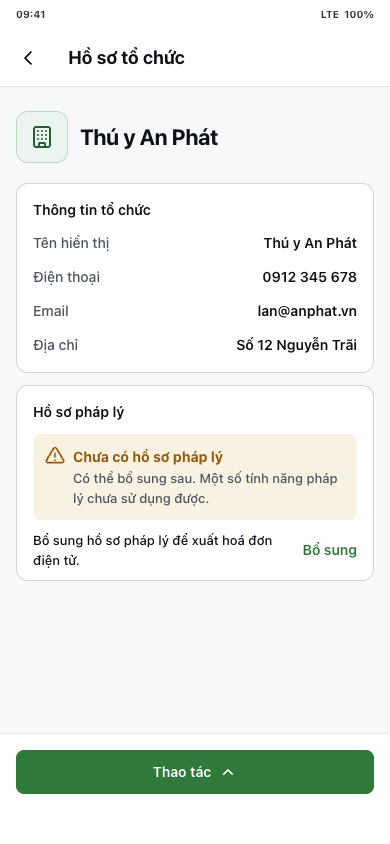 | 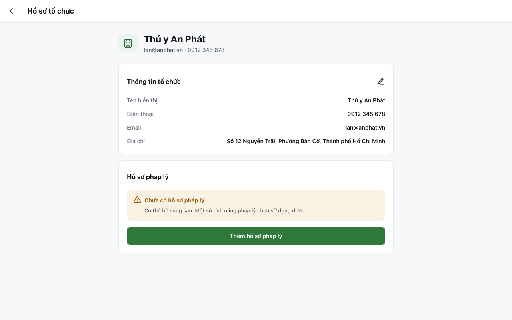 |
| org-profile__with-legal | 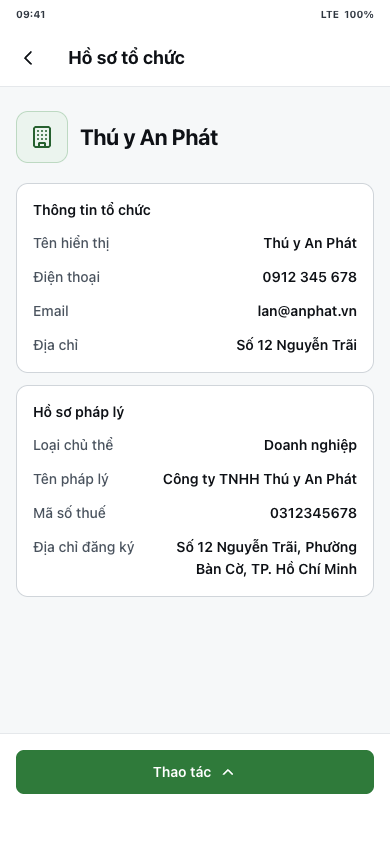 | 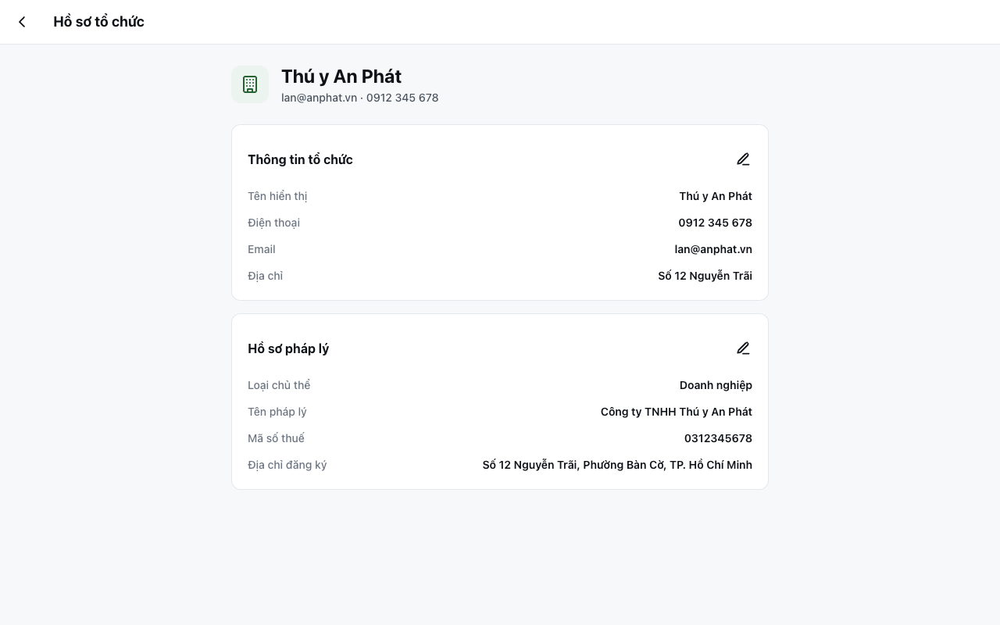 |
| org-profile__forbidden | 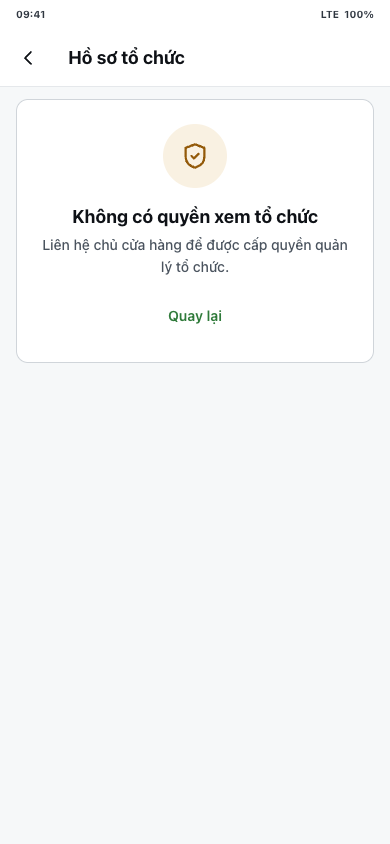 | 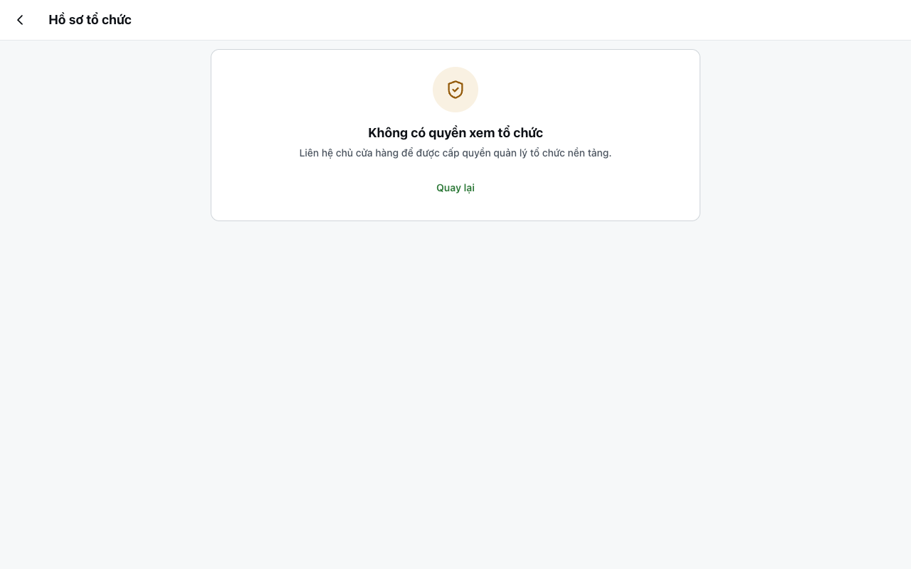 |
| org-edit__filled | 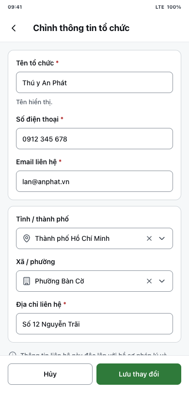 | 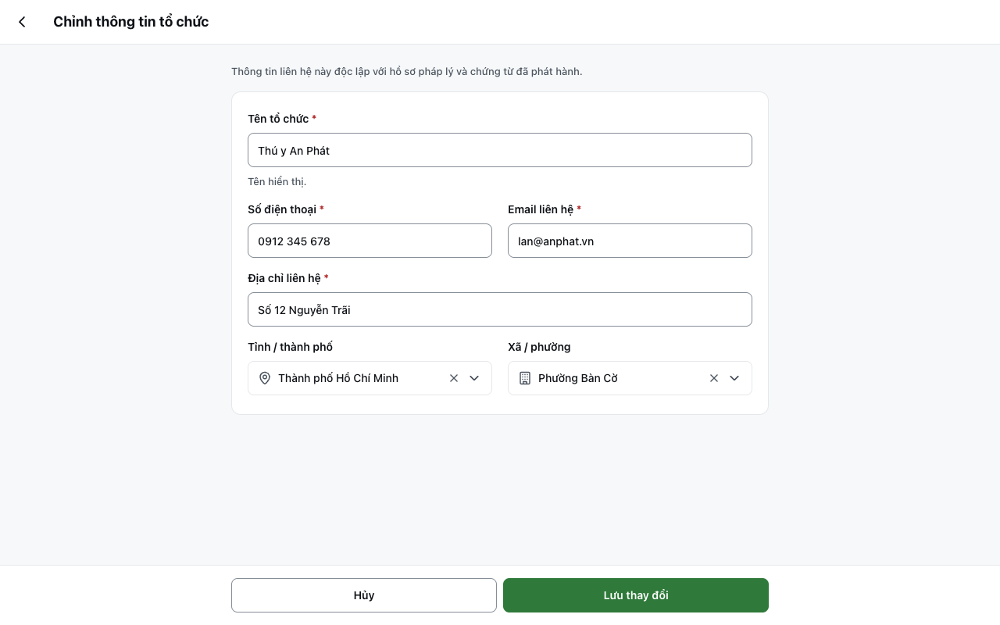 |
| org-edit__errors | 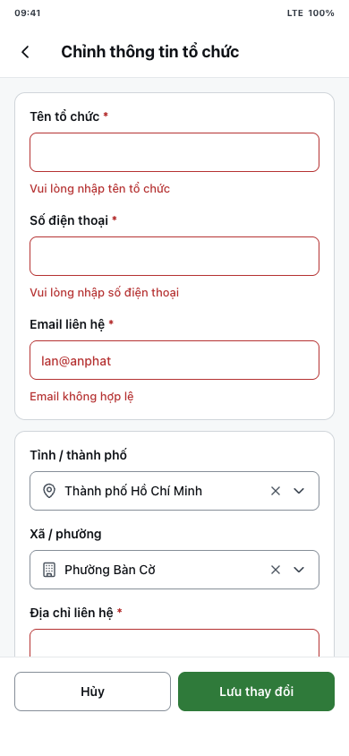 | 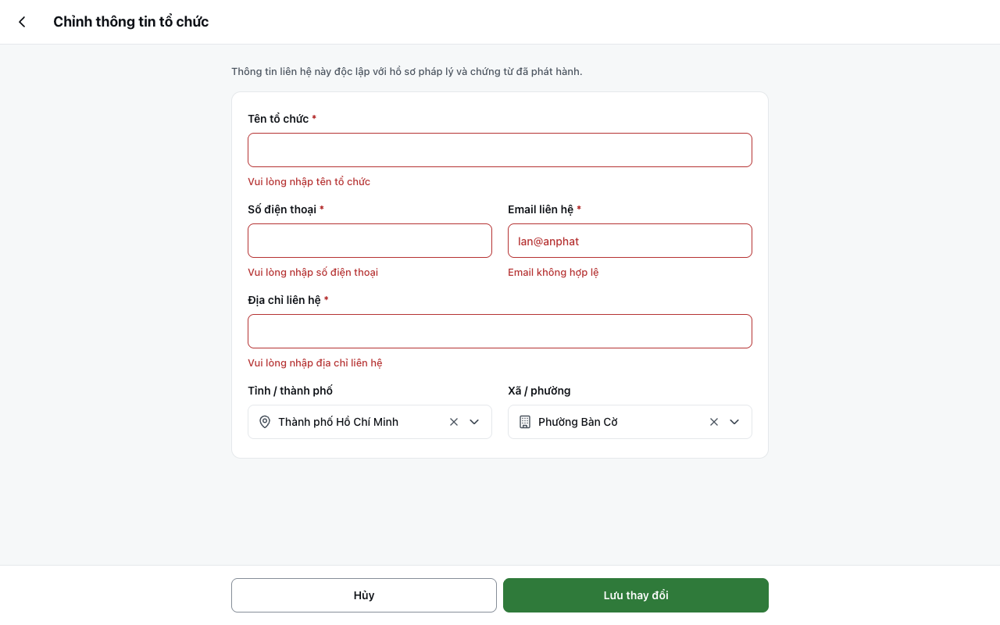 |
| org-edit__discard | 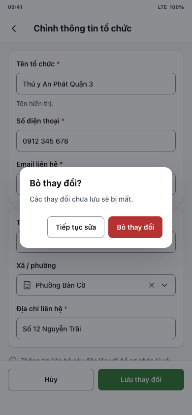 | 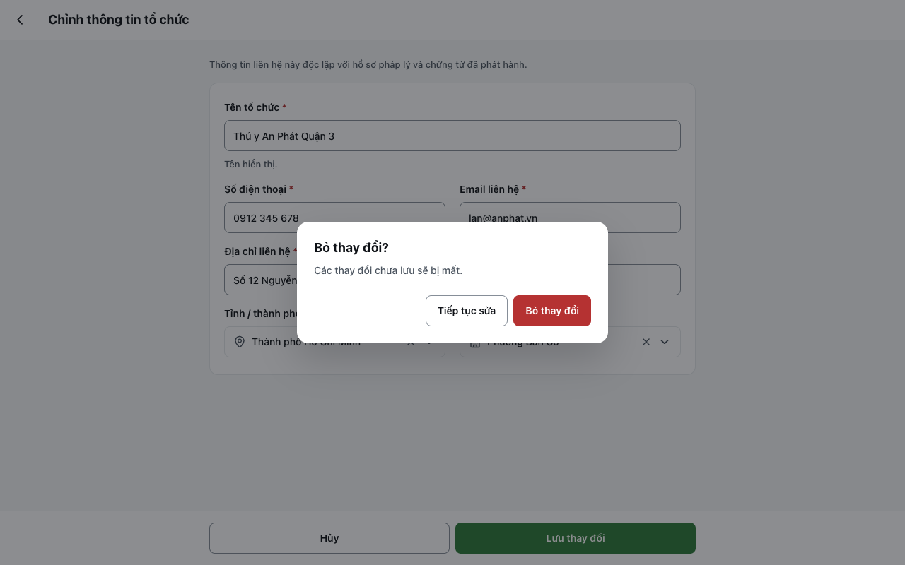 |
| org-legal__add-empty | 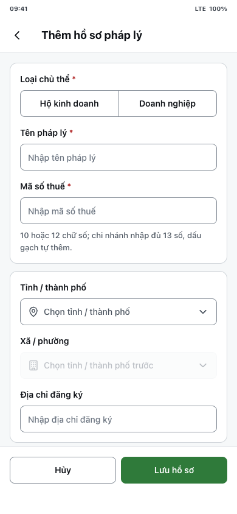 |  |
| org-legal__add-errors | 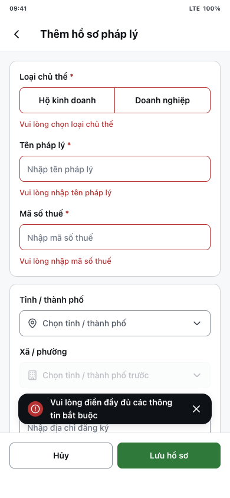 | 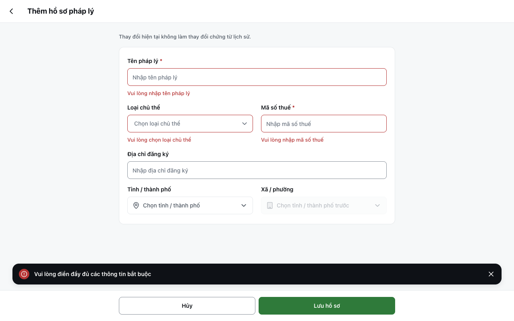 |
| org-legal__add-tax-format | 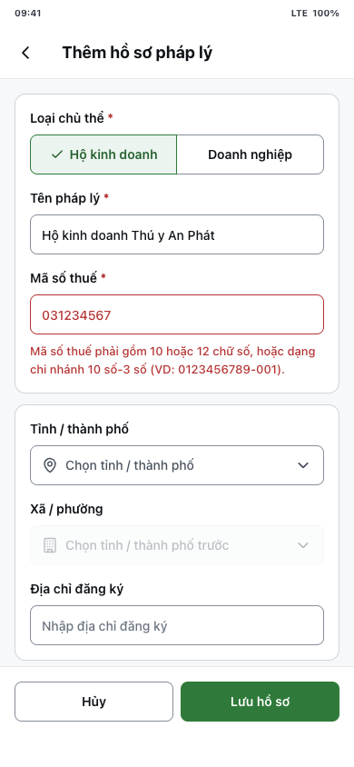 | 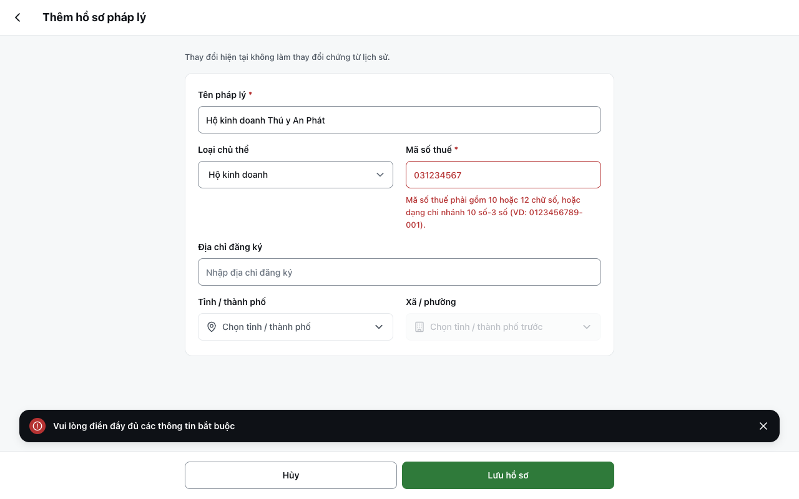 |
| org-legal__edit-filled | 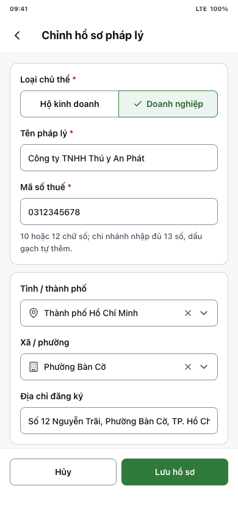 | 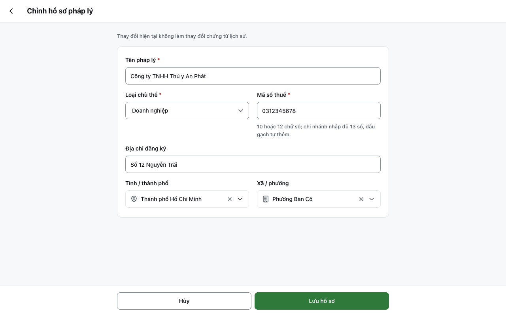 |
| org-legal__duplicate | 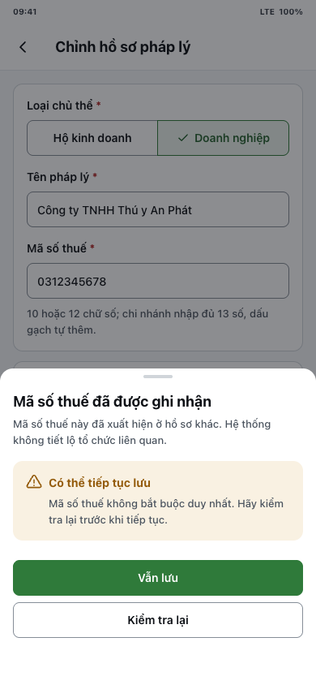 | 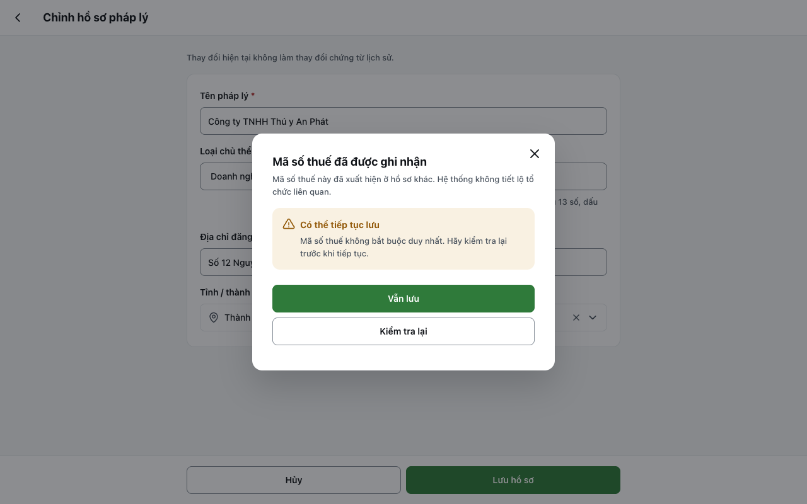 |

Sheet "Thao tác hồ sơ" (chỉ iPhone): 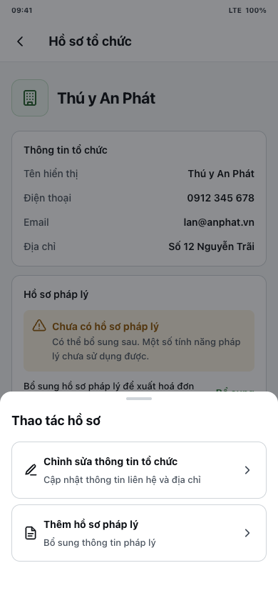

## Code prototype (chép nguyên văn, token thay bằng giá trị)

### iPhone

`app/org.js:16-64`

```js
/** Lỗi tải (chung nhiều màn IAM): giữa màn, đệm 16; H4 (w600) → khe 8 → bodySmall giữa → khe 24 → VButton "Thử lại". */
export const loadFailed = (title, message) => `<div class="t1-failed2"><h2 class="t1-h4 t1-h4--600">${esc(title)}</h2><div class="t1-gap-sm"></div><p class="t1-small t1-text-center">${esc(message)}</p><div class="t1-gap-lg"></div>${button('Thử lại')}</div>`;

/** OrganizationEmptyView(unauthorized): canh trên, đệm trên 12 / ngang 16; VCard đệm 24; vòng 64 warningBg + khiên 28; H3 w700; khe 4; mô tả; khe 16; link "Quay lại". */
export const orgUnauthorized = () => `<div class="t1-oempty"><div class="t1-card t1-oempty__card">
  <span class="t1-ring t1-ring--warning">${icon('shield')}</span><div class="t1-gap-md"></div>
  <h2 class="t1-h3 t1-text-center">Không có quyền xem tổ chức</h2><div class="t1-gap-xs"></div>
  <p class="t1-body2 t1-text-center">Liên hệ chủ cửa hàng để được cấp quyền quản lý tổ chức nền tảng.</p><div class="t1-gap-md"></div>
  ${button('Quay lại', { variant: 'link' })}</div></div>`;

/** _InfoRow: nhãn bodyDefault textMuted ↔ giá trị bodyDefault w600 phải ("—" khi rỗng). */
export const info = (l, val) => kv(l, val || '—', 't1-kv--profile');
const section = (title, inner) => `<section class="t1-card t1-card--pad t1-orgm__sec"><h3 class="t1-h4 t1-h4--600">${esc(title)}</h3>${inner}</section>`;

/** _LegalNotice: nền warningBg bo 12 đệm 16; icon cảnh báo 20 + khe 8; tiêu đề bodyDefault w700 warning, khe 4, bodySmall. */
export const warnBox = (title, message) => `<div class="t1-warnbox">${icon('alert')}<div><b>${esc(title)}</b><p class="t1-small">${esc(message)}</p></div></div>`;

/**
 * Bố cục iPhone thiết kế lại qua impeccable live (2026-11-25); chữ giữ nguyên Flutter: ô tòa nhà 52 + tên tổ chức → thẻ "Thông tin tổ chức" → thẻ "Hồ sơ pháp lý".
 * Chưa có pháp lý: hộp vàng + dòng nhắc "Bổ sung hồ sơ pháp lý…" + link "Bổ sung" (BR-14, gộp vào thẻ pháp lý thay banner đầu màn).
 */
function profileBody(hasLegal) {
  const legal = hasLegal
    ? [info('Loại chủ thể', LEGAL.entityType), info('Tên pháp lý', LEGAL.legalName), info('Mã số thuế', LEGAL.taxCode), info('Địa chỉ đăng ký', LEGAL.registeredAddress)].join('')
    : `${warnBox(LEGAL_NOTICE.title, LEGAL_NOTICE.message)}<div class="t1-orgm__add"><p>Bổ sung hồ sơ pháp lý để xuất hoá đơn điện tử.</p>${button('Bổ sung', { variant: 'link' })}</div>`;
  return `<div class="t1-list t1-orgm">
    <div class="t1-orgm__head"><div class="t1-orgm__icon" aria-hidden="true">${icon('building')}</div><h2>${esc(ORG.name)}</h2></div>
    ${section('Thông tin tổ chức', [info('Tên hiển thị', ORG.name), info('Điện thoại', ORG.phone), info('Email', ORG.email), info('Địa chỉ', ORG.address)].join(''))}
    ${section('Hồ sơ pháp lý', legal)}
  </div>`;
}

/** OrganizationProfileActionsBottomSheet: đệm 16 / 8 / 16 / 24; H3 w700; khe 16; hai VCard (icon 20 + khe 8 + chữ + mũi tên 20) cách 8. */
function actionsSheet(hasLegal) {
  const opt = (ic, t, sub) => `<div class="t1-card t1-card--pad t1-optcard">${icon(ic)}<div><b>${esc(t)}</b><span>${esc(sub)}</span></div>${icon('chevronRight', 't1-optcard__chev')}</div>`;
  return `<div class="t1-sheetpad"><h2 class="t1-h3">Thao tác hồ sơ</h2><div class="t1-gap-md"></div>
    ${opt('edit', 'Chỉnh sửa thông tin tổ chức', 'Cập nhật thông tin liên hệ và địa chỉ')}<div class="t1-gap-sm"></div>
    ${opt('fileText', hasLegal ? 'Chỉnh sửa hồ sơ pháp lý' : 'Thêm hồ sơ pháp lý', hasLegal ? 'Cập nhật thông tin pháp lý' : 'Bổ sung thông tin pháp lý')}</div>`;
}

export const PROFILE_STATES = {
  'no-legal': {}, 'with-legal': { legal: true }, loading: { loading: true }, error: { error: true }, forbidden: { forbidden: true },
  actions: { sheet: 'actions' }, 'actions-legal': { legal: true, sheet: 'actions' },
  'toast-saved': { toast: ['success', 'Đã lưu thay đổi', 'Thông tin tổ chức đã được cập nhật thành công.'] },
  'toast-legal-saved': { legal: true, toast: ['success', 'Đã lưu hồ sơ pháp lý.', ''] },
};

export function profilePage(v) {
```

`app/org.js:99-120`

```js
  const body = `<div class="t1-list t1-orgedit">
    ${card(`<div class="t1-form">
      ${field({ label: 'Tên tổ chức', required: true, control: input({ value: x.name, invalid: !!e.name }), error: e.name, desc: 'Tên hiển thị.' })}
      ${field({ label: 'Số điện thoại', required: true, control: input({ value: x.phone, invalid: !!e.phone }), error: e.phone })}
      ${field({ label: 'Email liên hệ', required: true, control: input({ value: x.email, invalid: !!e.email }), error: e.email })}
    </div>`, 't1-card--pad')}
    ${card(`<div class="t1-form">
      ${unitSection({ province: ORG.province, commune: ORG.commune, required: false })}
      ${field({ label: 'Địa chỉ liên hệ', required: true, control: input({ value: x.address, invalid: !!e.address }), error: e.address })}
    </div>`, 't1-card--pad')}
    <p class="t1-orgedit__note">${icon('info')}<span>Thông tin liên hệ này độc lập với hồ sơ pháp lý và chứng từ đã phát hành.</span></p>
  </div>`;
  const page = vScaffold({ ...base, body, bottomBar: twoBar('Lưu thay đổi', !!s.busy), toastHtml: s.toast ? toast(...s.toast, { device: v.device, above: BAR_H }) : '' });
  return { page, overlay: s.dialog ? confirmDialog(DISCARD) : '' };
}

// ---------------------------------------------------------------- ID-13
const TAX_FORMAT = 'Mã số thuế phải gồm 10 hoặc 12 chữ số, hoặc dạng chi nhánh 10 số-3 số (VD: 0123456789-001).';
export const LEGAL_STATES = {
  'add-empty': {}, 'add-errors': { errors: { type: 'Vui lòng chọn loại chủ thể', name: 'Vui lòng nhập tên pháp lý', tax: 'Vui lòng nhập mã số thuế' }, toast: ['danger', 'Thiếu thông tin', 'Vui lòng điền đầy đủ các thông tin bắt buộc'] },
  'add-tax-format': { values: { type: 'Hộ kinh doanh', name: 'Hộ kinh doanh Thú y An Phát', tax: '031234567' }, errors: { tax: TAX_FORMAT }, toast: ['danger', 'Thiếu thông tin', 'Vui lòng điền đầy đủ các thông tin bắt buộc'] },
  'edit-filled': { edit: true }, submitting: { edit: true, busy: true },
```

`app/org.js:131-158`

```js
/** Loại chủ thể (iPhone): hai nút liền nhau 44; đang chọn → nền surfaceBrand + viền primary + chữ textBrand; lỗi → viền danger. */
const ENTITY_TYPES = ['Hộ kinh doanh', 'Doanh nghiệp'];
const entitySegment = (value, invalid) => `<div class="t1-segctl${invalid ? ' is-invalid' : ''}" role="radiogroup" aria-label="Loại chủ thể">${ENTITY_TYPES.map((n) => `<button type="button" role="radio" aria-checked="${n === value}">${n === value ? icon('check') : ''}<span>${esc(n)}</span></button>`).join('')}</div>`;

export function legalPage(v) {
  const s = LEGAL_STATES[v.state];
  const title = s.edit ? 'Chỉnh hồ sơ pháp lý' : 'Thêm hồ sơ pháp lý';
  const base = { title, placeWidth: v.width };
  if (s.loading) return { page: vScaffold({ ...base, body: centerLoading(), fixed: true }) };
  const x = s.edit ? { type: LEGAL.entityType, name: LEGAL.legalName, tax: LEGAL.taxCode, address: LEGAL.registeredAddress, ...s.values } : { type: '', name: '', tax: '', address: '', ...s.values };
  const e = s.errors || {};
  // Bố cục iPhone thiết kế lại qua impeccable live (2026-11-25): thẻ pháp lý (loại chủ thể hai nút) → thẻ địa chỉ (tỉnh, xã, địa chỉ) → ghi chú. "Loại chủ thể" có * theo TH-01 US-05.3 FR-01.
  const body = `<div class="t1-list t1-orgedit">
    ${card(`<div class="t1-form">
      ${field({ label: 'Loại chủ thể', required: true, control: entitySegment(x.type, !!e.type), error: e.type })}
      ${field({ label: 'Tên pháp lý', required: true, control: input({ value: x.name, hint: 'Nhập tên pháp lý', invalid: !!e.name }), error: e.name })}
      ${field({ label: 'Mã số thuế', required: true, control: input({ value: x.tax, hint: 'Nhập mã số thuế', invalid: !!e.tax }), error: e.tax, desc: '10 hoặc 12 chữ số; chi nhánh nhập đủ 13 số, dấu gạch tự thêm.' })}
    </div>`, 't1-card--pad')}
    ${card(`<div class="t1-form">
      ${unitSection(s.edit ? { province: ORG.province, commune: ORG.commune, required: false } : { required: false })}
      ${field({ label: 'Địa chỉ đăng ký', control: input({ value: x.address, hint: 'Nhập địa chỉ đăng ký' }) })}
    </div>`, 't1-card--pad')}
    <p class="t1-orgedit__note">${icon('info')}<span>Thay đổi hiện tại không làm thay đổi chứng từ lịch sử.</span></p>
  </div>`;
  const page = vScaffold({ ...base, body, bottomBar: twoBar('Lưu hồ sơ', !!s.busy), toastHtml: s.toast ? toast(...s.toast, { device: v.device, above: BAR_H }) : '' });
  const overlay = s.sheet ? adaptiveSheet(v.width, duplicateSheet(), 'Mã số thuế đã được ghi nhận') : s.dialog ? confirmDialog(DISCARD) : '';
  return { page, overlay };
}
```

`styles/t1.css:230-249`

```css
/* ------------------------------------------------ Hồ sơ tổ chức + Chi tiết lời mời + Chi tiết thành viên (iPhone, impeccable live 2026-11-25; web ở t1-web.css) */
.t1-orgm { display: flex; flex-direction: column; gap: 12px; }
.t1-orgm__head { display: flex; align-items: center; gap: 12px; padding: 8px 0; }
.t1-orgm__head h2 { margin: 0; min-width: 0; overflow-wrap: anywhere; font-size: 22px; line-height: 32px; font-weight: 700; letter-spacing: -0.3px; color: #0E1116 /*text-primary*/; }
.t1-orgm__head > div:last-child { min-width: 0; }
.t1-orgm__head p { margin: 0; font-size: 14px /*fs-md*/; line-height: 22px; font-weight: 500; color: #4A535E /*text-secondary*/; }
.t1-orgm__avatar { display: grid; place-items: center; flex: none; width: 52px; height: 52px; border: 1px solid #BDD9C2 /*border-brand*/; border-radius: 999px /*radius-pill*/; background: #EBF4EE /*surface-brand*/; color: #26612F /*text-brand*/; font-size: 20px /*fs-xl*/; line-height: 24px; font-weight: 700; }
.t1-orgm__avatar.is-off { border-color: #D0D5DA /*border-strong*/; background: #F1F3F5 /*neutral-150*/; color: #4A535E /*text-secondary*/; }
.t1-orgm__status { display: flex; align-items: center; justify-content: space-between; gap: 16px; font-size: 14px /*fs-md*/; line-height: 22px; }
.t1-orgm__status > span:first-child { font-weight: 500; color: #4A535E /*text-secondary*/; }
.t1-orgm__icon { display: grid; place-items: center; flex: none; width: 52px; height: 52px; border: 1px solid #BDD9C2 /*border-brand*/; border-radius: 12px /*radius-icon-box*/; background: #EBF4EE /*surface-brand*/; color: #26612F /*icon-brand*/; font-size: 24px; }
.t1-orgm__sec { display: flex; flex-direction: column; gap: 12px; }
.t1-orgm__sec .t1-kv { gap: 16px; }
.t1-orgm__sec .t1-kv span { color: #4A535E /*text-secondary*/; }
.t1-orgm__sec .t1-kv b { overflow-wrap: anywhere; }
.t1-orgm__sec .t1-warnbox { padding: 12px; border-radius: 8px /*radius-3*/; }
.t1-orgm__sec .t1-warnbox b { margin-bottom: 0; }
.t1-orgm__add { display: flex; align-items: center; gap: 12px; margin: -4px 0 -8px; }
.t1-orgm__add p { flex: 1; margin: 0; font-size: 13px /*fs-sm*/; line-height: 20px; font-weight: 500; color: #0E1116 /*text-primary*/; }
```

`styles/t1.css:251-263`

```css
/* ------------------------------------------------ Chỉnh thông tin tổ chức + Hồ sơ pháp lý (iPhone, impeccable live 2026-11-25; web ở t1-web.css) */
.t1-orgedit { display: flex; flex-direction: column; gap: 12px; }
/* Ô chọn tỉnh / xã cùng viền với ô nhập. */
.t1-orgedit .t1-unit:not(.is-disabled):not(.is-invalid) { border-color: #868E98 /*border-input*/; }
.t1-segctl { display: grid; grid-template-columns: 1fr 1fr; }
.t1-segctl button { position: relative; display: flex; align-items: center; justify-content: center; gap: 6px; min-height: 44px; padding: 0 8px; border: 1px solid #868E98 /*border-input*/; background: #FFFFFF /*surface-default*/; font-size: 14px /*fs-md*/; line-height: 20px; font-weight: 600; color: #0E1116 /*text-primary*/; cursor: pointer; }
.t1-segctl button:first-child { border-radius: 8px /*radius-input*/ 0 0 8px /*radius-input*/; }
.t1-segctl button:last-child { margin-left: -1px; border-radius: 0 8px /*radius-input*/ 8px /*radius-input*/ 0; }
.t1-segctl button[aria-checked="true"] { z-index: 1; border-color: #2F7A3A /*action-primary-default*/; background: #EBF4EE /*surface-brand*/; color: #26612F /*text-brand*/; }
.t1-segctl.is-invalid button { border-color: #B53232 /*text-danger*/; }
.t1-segctl .icon { font-size: 16px; }
.t1-orgedit__note { display: flex; gap: 8px; margin: 0; padding: 4px 2px 0; font-size: 13px /*fs-sm*/; line-height: 20px; font-weight: 500; color: #4A535E /*text-secondary*/; }
.t1-orgedit__note .icon { flex: none; margin-top: 2px; font-size: 16px; color: #6B7480 /*icon-secondary*/; }
```

`styles/t1.css:577-597`

```css
.t1-kv { display: flex; align-items: flex-start; justify-content: space-between; gap: 0; }
.t1-kv span { flex: 0 0 auto; color: #6B7480 /*text-muted*/; }
.t1-kv b { flex: 0 1 auto; min-width: 0; text-align: right; color: #0E1116 /*text-primary*/; }
.t1-kv--profile span, .t1-kv--profile b { font-size: 14px /*fs-md*/; line-height: 22px; font-weight: 500; }
.t1-kv--profile b { font-weight: 600; }
.t1-kv--small span, .t1-kv--small b { font-size: 13px /*fs-sm*/; line-height: 20px; font-weight: 500; }
.t1-kv--small span { color: #4A535E /*text-secondary*/; }
.t1-kv--small b { font-weight: 700; }

/* ID-11…13 */
.t1-warnbox { display: flex; align-items: flex-start; gap: 8px; padding: 16px; border-radius: 12px /*radius-card*/; background: #F9F1E2 /*surface-warning*/; }
.t1-warnbox > .icon { flex: 0 0 auto; font-size: 20px; color: #935A0A /*text-warning*/; }
.t1-warnbox b { display: block; margin-bottom: 4px; font-size: 14px /*fs-md*/; line-height: 22px; font-weight: 700; color: #935A0A /*text-warning*/; }
.t1-optcard { display: flex; align-items: center; gap: 8px; font-size: 20px; color: #0E1116 /*text-primary*/; cursor: pointer; }
.t1-optcard > div { flex: 1; min-width: 0; display: flex; flex-direction: column; gap: 4px; }
.t1-optcard b { font-size: 14px /*fs-md*/; line-height: 22px; font-weight: 700; }
.t1-optcard span { font-size: 13px /*fs-sm*/; line-height: 20px; font-weight: 500; color: #4A535E /*text-secondary*/; }
.t1-optcard__chev { color: #4A535E /*text-secondary*/; }
.t1-failed2 { flex: 1; display: flex; flex-direction: column; align-items: center; justify-content: center; padding: 16px; }
.t1-oempty { padding: 12px 16px 0; }
.t1-oempty__card { display: flex; flex-direction: column; align-items: center; padding: 24px; }
```


### Web

`app/web/org.js:8-84`

```js
/**
 * Hồ sơ tổ chức (chọn qua impeccable live 2026-11-24): đầu trang (ô toà nhà 48 + tên H2 + email · điện thoại) → khối "Thông tin tổ chức"
 * (nút bút chì "Chỉnh sửa thông tin tổ chức") → khối "Hồ sơ pháp lý": chưa có → hộp vàng + "Thêm hồ sơ pháp lý"; đã có → 4 dòng + nút bút chì.
 * Thao tác nằm ngay ở từng khối, không còn nút "Thao tác ⌃" / sheet; bỏ banner info (trùng ý hộp vàng).
 */
function profileBody(hasLegal) {
  const orgRows = [info('Tên hiển thị', ORG.name), info('Điện thoại', ORG.phone), info('Email', ORG.email), info('Địa chỉ', ORG.address)].join('');
  const legal = hasLegal
    ? `<div class="t1-stack12">${[info('Loại chủ thể', LEGAL.entityType), info('Tên pháp lý', LEGAL.legalName), info('Mã số thuế', LEGAL.taxCode), info('Địa chỉ đăng ký', LEGAL.registeredAddress)].join('')}</div>`
    : `${warnBox(LEGAL_NOTICE.title, LEGAL_NOTICE.message)}<div class="t1-gap-md"></div>${button('Thêm hồ sơ pháp lý', { full: true })}`;
  const sec = (title, action, inner) => `<section class="t1-orgsec"><div class="t1-orgsec__head"><h2>${esc(title)}</h2>${action}</div>${inner}</section>`;
  return `<div class="t1-orgp">
    <div class="t1-orgp__head"><div class="t1-mailbox" aria-hidden="true">${icon('building')}</div><div><h1>${esc(ORG.name)}</h1><p>${esc(ORG.email)} · ${esc(ORG.phone)}</p></div></div>
    ${sec('Thông tin tổ chức', iconButton('edit', 'Chỉnh sửa thông tin tổ chức', { size: 20 }), `<div class="t1-stack12">${orgRows}</div>`)}
    ${sec('Hồ sơ pháp lý', hasLegal ? iconButton('edit', 'Chỉnh sửa hồ sơ pháp lý', { size: 20 }) : '', legal)}
  </div>`;
}

export function profilePage(v) {
  const s = PROFILE_STATES[v.state];
  const base = { title: 'Hồ sơ tổ chức', placeWidth: v.width };
  let page;
  if (s.loading) page = vScaffold({ ...base, body: centerLoading(), fixed: true });
  else if (s.forbidden) page = vScaffold({ ...base, body: orgUnauthorized() });
  else if (s.error) page = vScaffold({ ...base, body: loadFailed('Không tải được hồ sơ', 'Không thể kết nối đến máy chủ. Vui lòng kiểm tra lại mạng.'), fixed: true });
  else {
    page = vScaffold({
      ...base, body: profileBody(!!s.legal),
      toastHtml: s.toast ? toast(...s.toast, { device: v.device, above: 0 }) : '',
    });
  }
  return { page };
}

export function editPage(v) {
  const s = EDIT_STATES[v.state];
  const base = { title: 'Chỉnh thông tin tổ chức', placeWidth: v.width };
  if (s.loading) return { page: vScaffold({ ...base, body: centerLoading(), fixed: true }) };
  const x = { name: ORG.name, phone: ORG.phone, email: ORG.email, address: ORG.address, ...s.values };
  const e = s.errors || {};
  // Câu dẫn → thẻ trắng lưới 2 cột (≥ 600): Tên và Địa chỉ trải hết ngang; Điện thoại | Email; Tỉnh | Xã. Chọn qua impeccable live (2026-11-24).
  const body = `<div class="t1-formpage">
    <p class="t1-small">Thông tin liên hệ này độc lập với hồ sơ pháp lý và chứng từ đã phát hành.</p>
    <div class="t1-formcard"><div class="t1-grid2">
      <div class="t1-grid2__wide">${field({ label: 'Tên tổ chức', required: true, control: input({ value: x.name, invalid: !!e.name }), error: e.name, desc: 'Tên hiển thị.' })}</div>
      ${field({ label: 'Số điện thoại', required: true, control: input({ value: x.phone, invalid: !!e.phone }), error: e.phone })}
      ${field({ label: 'Email liên hệ', required: true, control: input({ value: x.email, invalid: !!e.email }), error: e.email })}
      <div class="t1-grid2__wide">${field({ label: 'Địa chỉ liên hệ', required: true, control: input({ value: x.address, invalid: !!e.address }), error: e.address })}</div>
      ${unitSection({ province: ORG.province, commune: ORG.commune, required: false })}
    </div></div>
  </div>`;
  const page = vScaffold({ ...base, body, bottomBar: twoBar('Lưu thay đổi', !!s.busy), toastHtml: s.toast ? toast(...s.toast, { device: v.device, above: BAR_H }) : '' });
  return { page, overlay: s.dialog ? confirmDialog(DISCARD) : '' };
}

export function legalPage(v) {
  const s = LEGAL_STATES[v.state];
  const title = s.edit ? 'Chỉnh hồ sơ pháp lý' : 'Thêm hồ sơ pháp lý';
  const base = { title, placeWidth: v.width };
  if (s.loading) return { page: vScaffold({ ...base, body: centerLoading(), fixed: true }) };
  const x = s.edit ? { type: LEGAL.entityType, name: LEGAL.legalName, tax: LEGAL.taxCode, address: LEGAL.registeredAddress, ...s.values } : { type: '', name: '', tax: '', address: '', ...s.values };
  const e = s.errors || {};
  // Cùng bố cục với ID-12 (câu dẫn → thẻ trắng lưới 2 cột ≥ 600): Tên pháp lý và Địa chỉ đăng ký trải hết ngang; Loại chủ thể | Mã số thuế; Tỉnh | Xã.
  const body = `<div class="t1-formpage">
    <p class="t1-small">Thay đổi hiện tại không làm thay đổi chứng từ lịch sử.</p>
    <div class="t1-formcard"><div class="t1-grid2">
      <div class="t1-grid2__wide">${field({ label: 'Tên pháp lý', required: true, control: input({ value: x.name, hint: 'Nhập tên pháp lý', invalid: !!e.name }), error: e.name })}</div>
      ${field({ label: 'Loại chủ thể', control: select({ value: x.type, hint: 'Chọn loại chủ thể', invalid: !!e.type }), error: e.type })}
      ${field({ label: 'Mã số thuế', required: true, control: input({ value: x.tax, hint: 'Nhập mã số thuế', invalid: !!e.tax }), error: e.tax })}
      <div class="t1-grid2__wide">${field({ label: 'Địa chỉ đăng ký', control: input({ value: x.address, hint: 'Nhập địa chỉ đăng ký' }) })}</div>
      ${unitSection(s.edit ? { province: ORG.province, commune: ORG.commune, required: false } : { required: false })}
    </div></div>
  </div>`;
  const page = vScaffold({ ...base, body, bottomBar: twoBar('Lưu hồ sơ', !!s.busy), toastHtml: s.toast ? toast(...s.toast, { device: v.device, above: BAR_H }) : '' });
  const overlay = s.sheet ? adaptiveSheet(v.width, duplicateSheet(), 'Mã số thuế đã được ghi nhận') : s.dialog ? confirmDialog(DISCARD) : '';
  return { page, overlay };
}
```

`styles/t1-web.css:68-90`

```css
/* Hồ sơ tổ chức: đầu trang (ô toà nhà + tên + email · điện thoại), các khối có nút thao tác ở tiêu đề. */
.t1-orgp { display: flex; flex-direction: column; gap: 16px; padding: 24px 16px 32px; }
.t1-orgp__head { display: flex; align-items: center; gap: 16px; margin-bottom: 8px; }
.t1-orgp__head h1 { margin: 0; font-size: 24px; line-height: 32px; font-weight: 700; color: #0E1116 /*text-primary*/; }
.t1-orgp__head p { margin: 2px 0 0; font-size: 14px /*fs-md*/; line-height: 20px; font-weight: 500; color: #4A535E /*text-secondary*/; }
.t1-orgp__head .t1-mailbox { flex: none; }
.t1-orgsec { padding: 20px; border: 1px solid #E5E8EB /*border-default*/; border-radius: 12px /*radius-card*/; background: #FFFFFF /*surface-default*/; }
.t1-orgsec__head { display: flex; align-items: center; justify-content: space-between; gap: 8px; min-height: 40px; margin-bottom: 12px; }
.t1-orgsec__head h2 { margin: 0; font-size: 16px /*fs-lg*/; line-height: 24px; font-weight: 700; color: #0E1116 /*text-primary*/; }
.t1-orgsec__head .t1-icon-btn { margin-right: calc(-1 * 12px); }
.t1-stack12 { display: flex; flex-direction: column; gap: 12px; }

/* Form trong thẻ (Chỉnh thông tin tổ chức): câu dẫn → thẻ trắng; lưới 2 cột từ 600 (ô __wide trải hết ngang). */
.t1-formpage { display: flex; flex-direction: column; gap: 16px; padding: 24px 16px 32px; }
.t1-formcard { padding: 24px 20px; border: 1px solid #E5E8EB /*border-default*/; border-radius: 12px /*radius-card*/; background: #FFFFFF /*surface-default*/; }
.t1-grid2 { display: grid; grid-template-columns: 1fr; gap: 16px 20px; align-items: start; }
.t1-grid2 > .t1-form { display: contents; }
@media (min-width: 600px) {
  .t1-grid2 { grid-template-columns: 1fr 1fr; }
  .t1-grid2__wide { grid-column: 1 / -1; }
}

/* Người dùng — web (≥ 840): bảng toàn màn. Chữ viết tắt đầu tên dùng chung cả danh sách hẹp. */
```


### Ánh xạ phần tử → Flutter

| Prototype | Flutter |
|---|---|
| `.t1-orgm__head` + `.t1-orgm__icon` 52 | `DetailHeaderNarrow(leading: DetailIconTile(icon))` |
| `.t1-orgp__head` + `.t1-mailbox` 48 | `DetailHeaderWide(leading: FlowIcon.medium(icon))` |
| `.t1-card.t1-orgm__sec` (viền `border-strong`, đệm 16, khe 12) | `DetailSectionNarrow` |
| `.t1-orgsec` (viền `border-default`, đệm 20, đầu khối cao ≥ 40) | `DetailSectionWide(action:)` |
| `.t1-kv--profile` | `DetailRow`; nhãn `textSecondary` (hẹp), `textMuted` (web); giá trị w600 canh phải; khe 16 |
| `iconButton('edit', label, {size: 20})` | `VIconButton` / `IconButton(tooltip: label)` vùng chạm ≥ 44, dịch phải 12 |
| `.t1-warnbox` | `LegalNoticeBox` (tách từ `_LegalNotice`): hẹp đệm 12 bo 8; web đệm 16 bo card |
| `.t1-formcard` | `FlowCard` |
| `.t1-grid2` (khe hàng 16, cột 20) | `Row(crossAxisAlignment: start)` hai `Expanded`, khe 20 |
| `.t1-orgedit__note` | `Row` icon `VIcons.info` 16 `textMuted` + chữ `bodySmall` |
| `.t1-segctl` | `EntityTypeSegment`: hai nửa cao ≥ 44, bo 8 hai đầu, chọn → nền `surfaceBrand`, viền `primary`, chữ `textBrand`, icon check 16; lỗi → viền `danger` |
| `twoBar`, `actionBar` | giữ code thanh dưới hiện có |

## Bảng "Đang làm gì"

| Thứ bị thay | Đang làm gì | Sau khi sửa | Test giữ hành vi |
|---|---|---|---|
| `OrganizationProfilePage` | Tải / lỗi + "Thử lại" / không quyền | Nguyên | có sẵn `forbidden…`; T0: `load error retries` |
| | Banner nhắc + "Bổ sung" → form pháp lý | Trong khối pháp lý (**đổi có chủ đích**, Q6) | T0: `add legal opens the form`, tìm theo `Key` banner_add |
| | "Thao tác" → sheet → sửa / pháp lý; `changed == true` → tải lại | Nguyên ở hẹp; web là nút ở từng khối | có sẵn `loads tenant profile…`; T0: `returning true reloads` |
| | Thẻ tên tổ chức, hai thẻ thông tin, tiêu đề là header | Nguyên chữ; hẹp tên ở đầu màn | có sẵn `section headings expose header semantics` |
| `OrganizationEditProfilePage` | Điền sẵn (SĐT +84 → 0), kiểm khi lưu, xoá lỗi khi gõ, toast, `pop(true)` | Nguyên | có sẵn 5 ca + `profile_phone_validation` |
| | `PopScope` hỏi bỏ thay đổi; đang lưu thì không hỏi | Nguyên | có sẵn 3 ca |
| `OrganizationLegalProfileFormPage` | Tiêu đề Thêm / Chỉnh; bàn phím số, tự chèn gạch; kiểm; trùng MST → sheet | Nguyên | có sẵn 5 ca + `e2e_e02_u01_fr01_02` |
| | Sai dạng MST → toast "Thiếu thông tin" | Không toast (**đổi có chủ đích**, Q1) | Task 3 |
| | "Vẫn lưu" xong | Đóng trang (**sửa**, Q5) | Task 3 |
| `AdministrativeUnitsFormSection` | Chọn / xoá tỉnh, xã; lỗi; nhãn * | Nguyên khi không truyền tham số mới | có sẵn 5 ca + `signup_page_test` |
| `OrganizationEmptyView(unauthorized)` | Câu có "nền tảng" | Bỏ (**đổi có chủ đích**, Q4) | có sẵn, đổi kỳ vọng |

## Review Focus

1. **Kéo cửa sổ 900 → 700 khi đang sửa** ID-12 và ID-13 (đã chọn tỉnh, loại chủ thể, MST đã chèn gạch): mọi giá trị còn, `PopScope` vẫn coi là có thay đổi. Test ở Task 2, 3.
2. **"Vẫn lưu" khi máy chủ trả lời chậm 500 ms:** không ném lỗi, về Hồ sơ tổ chức, không hỏi "Bỏ thay đổi?". Test ở Task 3.
3. **Tổ chức chỉ có tên** (mọi trường khác trống): đầu trang web không có "·" lẻ, các dòng "—". Test ở Task 1.
4. **Địa chỉ đã gõ kèm tên xã, tỉnh:** không lặp. Test ở Task 1.
5. **Chữ 2.0, 320 × 568 và 840 × 900:** ba màn không tràn (lưới 2 cột ở 840 nằm trong cột 640). Test ở Task 1–3.

---

### Task 0: Test giữ hành vi trên code cũ

**Files:**
- Modify: `apps/erp/test/features/iam/presentation_module/widgets/organization_profile_page_test.dart`

**Interfaces:**
- Consumes: `ScriptedOrganizationRepository` (`test/features/iam/support/scripted_iam_repositories.dart`).
- Produces: hàm dựng router giả `pumpOrgProfile(WidgetTester, {required Size size, required ScriptedOrganizationRepository repository})` với ba route `/more/organization-profile{,/edit,/legal}`; hai trang con là `Text('EDIT_PAGE')` / `Text('LEGAL_PAGE')` có nút trả `true`.

- [ ] **Step 1: Viết ca T0 trong bảng**, khổ 390 × 844. `returning true reloads`: đếm lời gọi `getTenant` tăng thêm 1.
- [ ] **Step 2: Chạy, phải xanh trên code cũ** — `cd apps/erp && flutter test test/features/iam/presentation_module/widgets/organization_profile_page_test.dart`

### Task 1: Hồ sơ tổ chức + khối dùng chung (lỗi 7, 8)

**Files:**
- Modify: prototype `app/org.js`, `app/web/org.js`, `app/admin-data.js`, `app/cases.js`, `tests/t1.test.mjs`, `README.md` (mục 38, 39, 40 thêm "Đã sửa 10-8g")
- Create: `apps/erp/lib/features/iam/presentation/shared/detail_layout.dart`, `apps/erp/lib/core/widgets/address/vn_address_text.dart`, `…/organization_profile/widgets/{legal_notice_box,organization_profile_narrow,organization_profile_wide}.dart`
- Modify: `…/organization_profile/views/organization_profile_page.dart`, `…/organizations/widgets/organization_empty_view.dart:83`
- Test: `organization_profile_page_test.dart`, `organization_empty_view_test.dart`; Create: `apps/erp/test/core/widgets/address/vn_address_text_test.dart`, `apps/erp/test/features/iam/presentation_module/org_golden_test.dart`

**Interfaces:**
- Consumes: `FlowIcon`, `isWideLayout`.
- Produces (10-8h, i, k dùng):

```dart
// iam/presentation/shared/detail_layout.dart
class DetailIconTile extends StatelessWidget { const DetailIconTile(this.icon, {super.key}); }                 // 52, viền borderBrand, icon 24
class DetailAvatar extends StatelessWidget { const DetailAvatar(this.initials, {super.key, this.size = 52, this.muted = false}); } // tròn; muted: viền borderStrong, nền neutral150, chữ textSecondary
class DetailHeaderNarrow extends StatelessWidget { const DetailHeaderNarrow({super.key, required Widget leading, required String title, String? subtitle, Widget? badge}); }
class DetailHeaderWide   extends StatelessWidget { const DetailHeaderWide({super.key, required Widget leading, required String title, String? subtitle, Widget? trailing}); }
class DetailSectionNarrow extends StatelessWidget { const DetailSectionNarrow({super.key, required String title, Widget? trailing, required List<Widget> children}); } // khe 12
class DetailSectionWide   extends StatelessWidget { const DetailSectionWide({super.key, required String title, Widget? action, required List<Widget> children, double gap = 12}); }
class DetailRow extends StatelessWidget { const DetailRow({super.key, required String label, required String value, bool muted = false}); } // rỗng → '—'; muted: nhãn textMuted (web)
// tiêu đề khối và tên ở đầu trang: Semantics(header: true); DetailRow: MergeSemantics

// core/widgets/address/vn_address_text.dart
String composeVnAddress({required String text, String? provinceCode, String? communeCode, required List<VnAdministrativeUnit> units});
class VnAddressBuilder extends StatelessWidget { const VnAddressBuilder({super.key, required String text, String? provinceCode, String? communeCode, required Widget Function(BuildContext, String address) builder}); }

// hai widget cùng tham số:
const OrganizationProfileNarrow({super.key, required OrganizationProfileUiModel profile, required VoidCallback onEdit, required VoidCallback onLegal});
const OrganizationProfileWide({super.key, required OrganizationProfileUiModel profile, required VoidCallback onEdit, required VoidCallback onLegal});
```

- [ ] **Step 1: Prototype**
  - `org.js`, `web/org.js` (profile): "Địa chỉ" = `[ORG.address, ORG.commune, ORG.province].join(', ')`; `LEGAL.registeredAddress` = `'Số 12 Nguyễn Trãi'` và hiện `[LEGAL.registeredAddress, ORG.commune, ORG.province].join(', ')`.
  - `orgUnauthorized`: câu theo Q4.
  - `LEGAL_STATES['add-tax-format']`: bỏ `toast`.
  - `web/org.js` legal: `required: true` ở "Loại chủ thể"; `desc: '10 hoặc 12 chữ số; chi nhánh nhập đủ 13 số, dấu gạch tự thêm.'` ở "Mã số thuế"; `WEB_NOTES['org-legal']` bỏ câu "ô mã số thuế không có dòng mô tả"; sửa câu mô tả ca `forbidden`, `add-tax-format`.
  - `node --test` PASS; `node tools/capture.mjs org-`; chép lại mọi ảnh ở mục Ảnh.

- [ ] **Step 2: Viết test**

```dart
// vn_address_text_test.dart (units: tỉnh '79' 'Thành phố Hồ Chí Minh', xã '27139' 'Phường Bàn Cờ')
test('joins text, ward, province', …)        // 'Số 12 Nguyễn Trãi, Phường Bàn Cờ, Thành phố Hồ Chí Minh'
test('skips parts already in the text', …)   // text có 'phường bàn cờ' → không lặp
test('province only, unknown codes, empty text', …) // 'Thành phố Hồ Chí Minh'; mã lạ → chỉ text; tất cả trống → ''
// organization_profile_page_test.dart
testWidgets('390: address shows ward and province', …)
testWidgets('390: no legal profile shows notice, reminder and Bổ sung; no banner', …) // VBanner findsNothing
testWidgets('1280: no Thao tác; edit icons open edit and legal', …)                  // byTooltip('Chỉnh sửa thông tin tổ chức'), ('Chỉnh sửa hồ sơ pháp lý')
testWidgets('1280: no legal profile shows Thêm hồ sơ pháp lý', …)
testWidgets('1280: header omits empty contact parts', …)                             // không có '·'
testWidgets('320 at text scale 2.0 and 840x900 do not overflow', …)
// organization_empty_view_test.dart: đổi kỳ vọng câu (Q4)
```

- [ ] **Step 3: Chạy → FAIL** — `cd apps/erp && flutter test test/core/widgets/address test/features/iam/presentation_module/widgets/organization_profile_page_test.dart test/features/iam/presentation_module/widgets/organization_empty_view_test.dart`
- [ ] **Step 4: Cài đặt** Q3, Q4, Q6, Q10.
- [ ] **Step 5: Chạy → PASS** (lệnh Step 3) và `flutter test test/features/tenant_context/presentation/wgt_e05_tenant_context_test.dart`
- [ ] **Step 6: Golden** `org-profile__{no-legal,with-legal,forbidden}` × 2, `org-profile__actions` × 390 (trang trần, khổ như 10-8e). So ảnh, ghi lệch.

### Task 2: Chỉnh thông tin tổ chức

**Files:**
- Create: `…/organization_profile/widgets/{organization_edit_narrow,organization_edit_wide}.dart`
- Modify: `…/views/organization_edit_profile_page.dart`, `apps/erp/lib/core/widgets/address/administrative_units_form_section.dart`
- Test: `organization_edit_profile_page_test.dart`, `administrative_units_form_section_test.dart`, `org_golden_test.dart`

**Interfaces:**
- Consumes: `FlowCard`.
- Produces: `AdministrativeUnitsFormSection({…, Axis direction = Axis.vertical, bool inputBorder = false})`; hai widget cùng `({super.key, required Widget nameField, phoneField, emailField, addressField, unitsSection})`. Trang dựng `unitsSection` với `direction: isWide ? Axis.horizontal : Axis.vertical`, `inputBorder: !isWide`.

- [ ] **Step 1: Viết test**

```dart
// administrative_units_form_section_test.dart
testWidgets('horizontal puts both fields on one row', …)            // cùng dy, khe 20
testWidgets('inputBorder uses borderInput only when enabled and valid', …)
// organization_edit_profile_page_test.dart
testWidgets('390: two cards, units above address, note at the end', …)
testWidgets('1280: grid — phone and email share a row, units share a row', …)
testWidgets('resizing keeps values and still asks before leaving', …)
testWidgets('320 at text scale 2.0 and 840x900 do not overflow', …)
```

- [ ] **Step 2: Chạy → FAIL** — `flutter test test/features/iam/presentation_module/widgets/organization_edit_profile_page_test.dart test/features/iam/presentation_module/widgets/administrative_units_form_section_test.dart`
- [ ] **Step 3: Cài đặt** Q8, Q9.
- [ ] **Step 4: Chạy → PASS** — lệnh Step 2, thêm `test/features/iam/presentation_module/widgets/profile_phone_validation_test.dart test/features/auth/presentation/pages/signup_page_test.dart test/features/tenant_admin`
- [ ] **Step 5: Golden** `org-edit__{filled,errors,discard}` × 2. So ảnh.

### Task 3: Hồ sơ pháp lý (lỗi 5, 6, Q5)

**Files:**
- Create: `…/organization_profile/widgets/{organization_legal_narrow,organization_legal_wide,entity_type_segment}.dart`
- Modify: `…/views/organization_legal_profile_form_page.dart`, `docs/refactor/PLAN.md`
- Test: `organization_legal_profile_form_page_test.dart`, `org_golden_test.dart`

**Interfaces:**
- Consumes: `FlowCard`, `AdministrativeUnitsFormSection(direction, inputBorder)`.
- Produces:

```dart
class EntityTypeSegment extends StatelessWidget {
  const EntityTypeSegment({super.key, required String? value, required ValueChanged<String> onChanged, bool invalid = false});
} // giá trị 'HOUSEHOLD_BUSINESS' | 'ENTERPRISE', thứ tự như vậy
// hai widget cùng ({super.key, required Widget entityField, nameField, taxField, addressField, unitsSection})
```

- [ ] **Step 1: Viết test**

```dart
testWidgets('malformed tax code shows the field error without a toast', …)   // loại + tên đã điền, MST '031234567' → taxCodeFormatMessage; find.text('Vui lòng điền đầy đủ các thông tin bắt buộc') không có
testWidgets('missing fields still show the toast', …)
testWidgets('typing clears the legal name and tax code errors', …)
testWidgets('malformed tax code is reported even without an entity type', …) // hai lỗi cùng lúc + toast (thiếu loại chủ thể)
testWidgets('save anyway with a 500ms response closes the form without asking', …)
  // repository trả lời sau 500 ms; push form từ trang nền → 'Vẫn lưu' → pump 600ms + settle → về trang nền, kết quả true, không có 'Bỏ thay đổi?', takeException isNull
testWidgets('390: entity type is a two-part radio', …)                       // semantics checked đổi khi bấm; phím mũi tên đổi lựa chọn
testWidgets('390: invalid entity type turns both halves danger', …)
testWidgets('1280: entity type is required and tax code has a hint', …)      // ' *' ba lần; câu mô tả MST
testWidgets('resizing keeps entity type, tax code and units', …)
testWidgets('320 at text scale 2.0 and 840x900 do not overflow', …)
```

Test có sẵn chọn loại qua `VSelect` ở khổ hẹp: đổi sang bấm `EntityTypeSegment`; giữ một ca `VSelect` ở 1280.

- [ ] **Step 2: Chạy → FAIL** — `flutter test test/features/iam/presentation_module/widgets/organization_legal_profile_form_page_test.dart`
- [ ] **Step 3: Cài đặt** Q1, Q2, Q5, Q5b, Q5c, Q7.
- [ ] **Step 4: Chạy → PASS**

Run: `cd apps/erp && flutter test test/features/iam/presentation_module/widgets/organization_legal_profile_form_page_test.dart test/features/tenant_admin test/core/widgets && dart analyze lib test && dart run tool/check_feature_imports.dart`
Expected: PASS, không lỗi analyze mới, không vi phạm import mới

- [ ] **Step 5: Golden** `org-legal__{add-empty,add-errors,add-tax-format,edit-filled,duplicate}` × 2. So ảnh.
- [ ] **Step 6: PLAN.md** dòng Theme 1: 10-8g đã làm

## Kiểm tay (người dùng)

- [ ] iPhone + web: xem hồ sơ (có / chưa có pháp lý), sửa thông tin, thêm / sửa pháp lý, MST sai dạng, MST trùng → "Vẫn lưu" và "Kiểm tra lại", rời khi đang sửa.
- [ ] Web ≥ 1024: thanh bên còn, thân canh giữa; thu cửa sổ dưới 840 khi đang sửa.
- [ ] CHECKLIST ID-11, ID-12, ID-13 cột "Mới".

## Kết quả

## Review

**R1 (2026-11-26):** Q1–Q10 đúng; đủ ca test plan; `e2e_e02_u07_fr01_01` lỗi sẵn (TEST-BASELINE). Lệch so prototype, đã sửa:

| # | Lỗi | Sửa |
|---|---|---|
| 1 | `DetailRow`: nhãn `Flexible` + giá trị `Expanded` chia đôi ngang, địa chỉ dài xuống 4 dòng (390) / 2 dòng (1280) | Nhãn theo bề rộng chữ, tối đa 45%; giá trị lấy phần còn lại |
| 2 | Cỡ chữ: tên đầu trang hẹp 18 (proto 22), web 22 (24); tiêu đề khối web 14 (16) | `headingH2`; web 24/32; khối web 16/24 |
| 3 | Web: hộp vàng → "Thêm hồ sơ pháp lý" cách ~28 (proto 16) | Gộp vào `Column` khe 16 |
| 4 | Golden form: seed danh mục ở `setUp` (ngoài vùng thời gian giả) → `FutureBuilder` không nhận, ô tỉnh / xã trông như tắt | Seed trong thân test (`_captureOrg`); chụp lại ảnh |
| 5 | "Địa chỉ đăng ký" ẩn vẫn để khe 12 cuối thẻ | `VnAddressBuilder` dựng cả khối dòng pháp lý |
| 6 | `EntityTypeSegment` viền giữa 2px, chữ 1 dòng bị cắt ở chữ 2.0 | Cạnh chung chỉ một nửa vẽ (nửa đang chọn giữ); chữ tối đa 2 dòng |
| 7 | "Bổ sung hồ sơ pháp lý…" cách hộp vàng 12 (proto 8) | Khe 8 |
| 8 | `cachedUnits` ghi được từ ngoài; `seedCacheForTest` không đánh dấu | Getter chỉ đọc; `@visibleForTesting` |

Chạy lại: test Task 0–3 + `signup_page_test`, `tenant_admin`, `wgt_e05` PASS (trừ ca baseline); golden 23 ca; `dart analyze` không lỗi mới; `check_feature_imports` không vi phạm mới. Còn: kiểm tay.
