# 10-8k Tài khoản của tôi — Implementation Plan

> **For agentic workers:** REQUIRED SUB-SKILL: Use superpowers:subagent-driven-development (recommended) or superpowers:executing-plans to implement this plan task-by-task. Steps use checkbox (`- [ ]`) syntax for tracking.

**Goal:** ID-21 Tài khoản của tôi và ID-22 Chỉnh sửa thông tin có bố cục iPhone và web đúng prototype Theme 1, thao tác nằm ngay trong màn; sửa lỗi 15; sửa kèm 5 lỗi thấy khi đọc code (Q5–Q9). Xong plan này thì Theme 1 đóng.

**Architecture:** Trang giữ cubit, điều hướng (`Navigator.push` sang sửa / đặt lại mật khẩu như hiện nay), toast, đăng xuất; bố cục `Narrow` / `Wide` nhận callback. Form sửa giữ controller, kiểm lỗi, `PopScope`; ô nhập gắn `GlobalKey`. Dùng lại `detail_layout.dart` (10-8g).

**Tech Stack:** Flutter, flutter_bloc, go_router, `c45_design_system` 1.10.0.

**Spec:** bản thiết kế "10-8: Theme 1 về Flutter" duyệt trong chat 2026-11-25, phần chung ở [10-8d](10-8d-nen-theme1-flutter.md#thiết-kế-đã-duyệt-phần-chung-cho-10-8dk). Nguồn hình: `specs/themes/theme-01/03.design/prototype/html/app/account.js`, `app/web/account.js`. **Làm sau 10-8d, 10-8f, 10-8g.**

## Global Constraints

- Chữ, câu lỗi, RPC, route giữ nguyên, trừ điều ghi ở Quyết định. `AccountRepository` không đổi.
- Không còn nút / sheet "Thao tác" ở cả hai khung (TH-01 US-08.1 FR-02).
- Màu `context.vColors` / `VColors`, `VSpacing`, `VRadius`, `VTypography`.
- Chỉ chạy test liệt kê ở từng task; **không** chạy `flutter test` toàn app (nghiệm thu Theme 1 ở Task 3 do người dùng quyết).

## Quyết định

| # | Quyết định | Lý do |
|---|---|---|
| Q1 | "Đăng xuất" ở màn này mở sheet xác nhận "Đăng xuất khỏi Mosaic Retail?" (TH-01 US-08.4), **cả hai khung**; bấm "Đăng xuất" trong sheet mới đăng xuất. Khôi phục `logout_confirmation_bottom_sheet.dart` từ `git show 8539ef201^:…` + export ở `iam/presentation.dart`. Tab Thêm và thanh bên giữ như hiện nay (đăng xuất ngay) | Người dùng chọn 2026-11-25, thay quyết định ở commit `8539ef201`: "Đăng xuất" giờ nằm ngay trong màn, dễ chạm nhầm |
| Q2 | ← ở Tài khoản của tôi ẩn khi cửa sổ ≥ 1024 (`MediaQuery.sizeOf(context).width < VBreakpoints.desktop`), cả ba trạng thái tải / lỗi / có dữ liệu. Chỉnh sửa và Đặt lại mật khẩu luôn có ← | 10-8c Q5 |
| Q3 | Cột web 1040 từ 840; hai cột 300 \| còn lại từ 900, dưới 900 xếp dọc. Chỉnh sửa: cột 560 | `web/account.js` |
| Q4 | **Lỗi 15:** SĐT sai → viền đỏ (một `VField(invalid:)` bọc cả nhãn và ô, bỏ `VField` lồng). Dòng "Ảnh đại diện" chỉ hiển thị: bỏ mũi tên, bỏ "Chạm để thay hoặc xóa ảnh", không bấm được, ô chữ viết tắt + tiêu đề. Sửa prototype hai khung trước | Dòng này không nối chức năng; TH-01 US-08.2 đã sửa ở 10-8d |
| Q5 | **Sửa kèm:** nhãn "Chủ sở hữu" theo tổ chức **đang dùng** (`SessionController.isOwner`); không có tổ chức đang dùng thì theo "có tổ chức nào sở hữu" như cũ | `my_account_cubit.dart` đang lấy `tenants.any(isOwner)`: chủ tổ chức A xem ở tổ chức B (nhân viên) vẫn thấy "Chủ sở hữu" |
| Q6 | **Sửa kèm:** gõ ô nào chỉ xoá lỗi ô đó | Gõ tên đang xoá luôn lỗi số điện thoại |
| Q7 | **Sửa kèm:** bấm "Đăng xuất" trong sheet thì sheet đóng, dòng / nút "Đăng xuất" ở trang tắt (web xoay) tới khi xong; không gọi `signOut` hai lần | Bấm nhanh hai lần gọi `signOut` hai lần |
| Q8 | **Sửa kèm:** sau đặt lại mật khẩu, `signOut` ném lỗi hoặc không xoá được phiên trên máy → toast "Đăng xuất thất bại" + câu lỗi như đăng xuất thường, không `go('/login')` | Đang không bắt lỗi; còn phiên trên máy mà vẫn sang `/login`, không một lời báo |
| Q9 | **Sửa kèm:** bỏ hai bản `_maskEmail` trong trang, dùng `maskEmail` (`password_reset_result.dart`); xoá `my_account_actions_bottom_sheet.dart` + export | Trùng hàm, che khác nhau (2 ký tự / 1 ký tự); file hết người dùng |
| Q10 | Chữ viết tắt: `VAvatar` (chữ đầu từ đầu + chữ đầu từ cuối) qua `DetailAvatar`; tên rỗng → "?" và tiêu đề "(chưa có tên)" | `account.js:15-20` |
| Q11 | `_MyAccountSampleBody`, `_EditMyAccountSampleBody` (test) dùng chung bố cục mới | Test đang dựng trang bằng `data:` |
| Q12 | Thanh dưới màn sửa chỉ còn một gạch (bỏ viền và nền riêng, `VPageScaffold` đã có); prototype web bỏ `t1-bar-line` | Hai gạch chồng, như Q7 10-8f |
| Q13 | Sheet xác nhận đăng xuất chữ và hai nút 52 như ảnh; đóng bằng ✕, Esc, bấm ngoài hoặc "Quay lại" thì không đăng xuất | `account.js:33-36` |

## Ảnh

Nguồn: `tools/proto-final/`, chép 2026-11-25; `account-edit__*` chụp lại ở Task 1. Cột Flutter: golden `img/10-8k/flutter-<ca>-{390,1280}.png`.

| Ca | 390 | 1280 |
|---|---|---|
| account__owner | 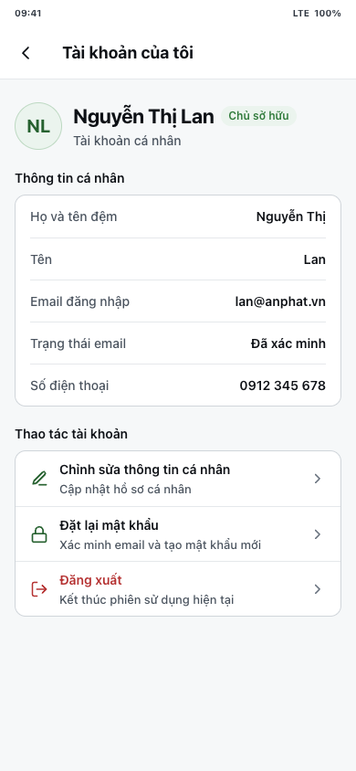 | 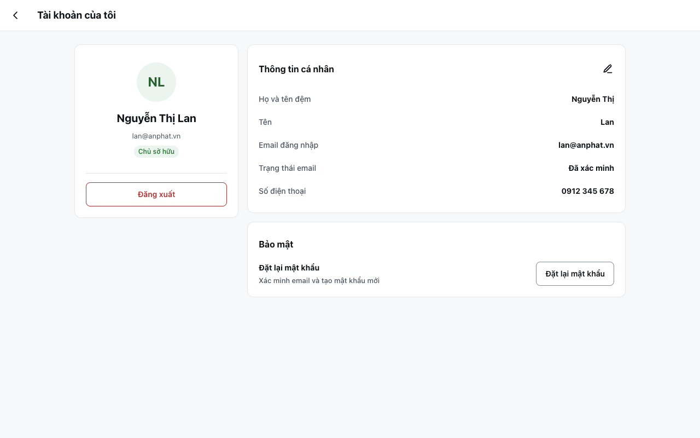 |
| account__staff | 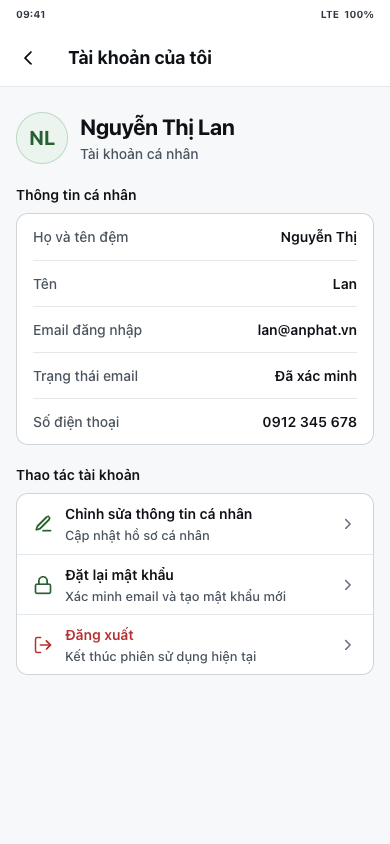 |  |
| account__no-phone | 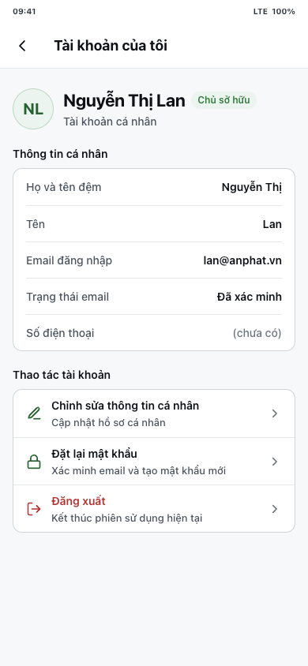 | 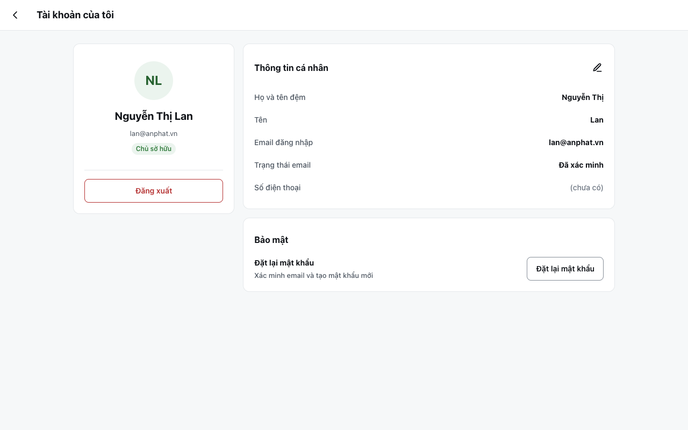 |
| account__error | 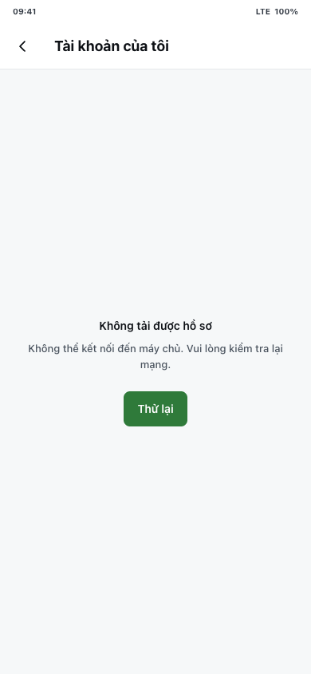 | 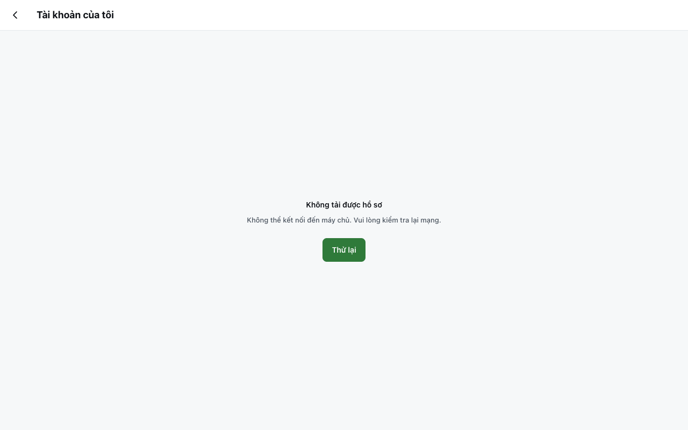 |
| account__logout | 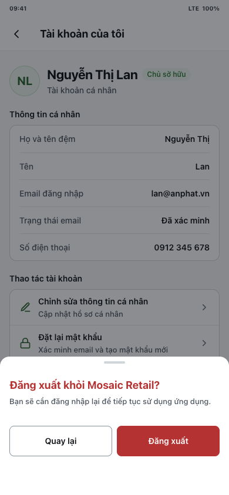 | 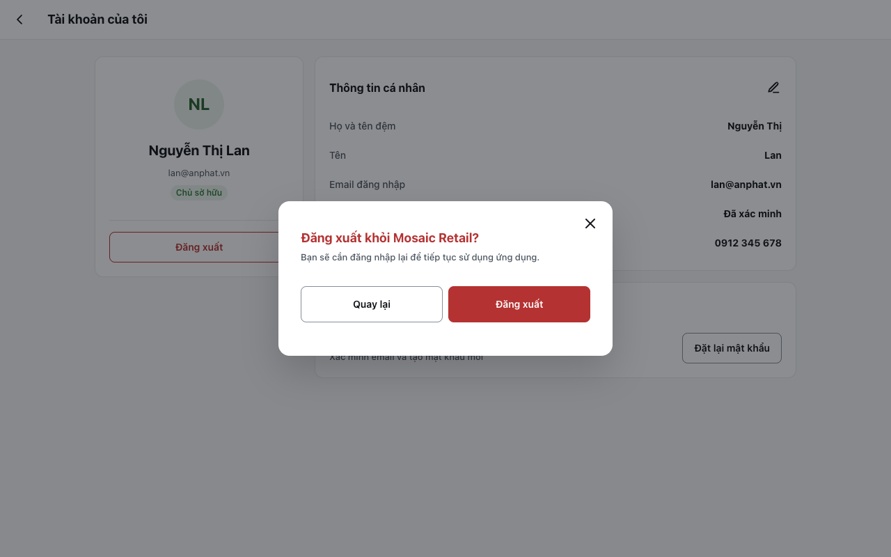 |
| account__toast-logout-failed | 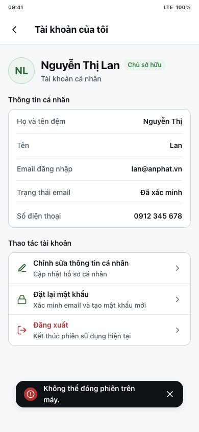 | 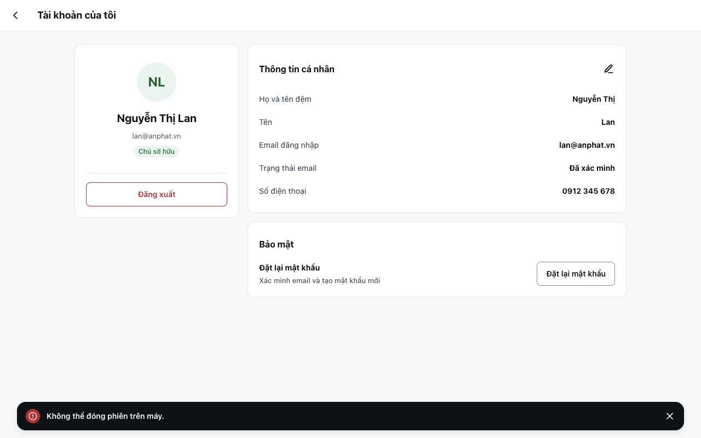 |
| account-edit__default | 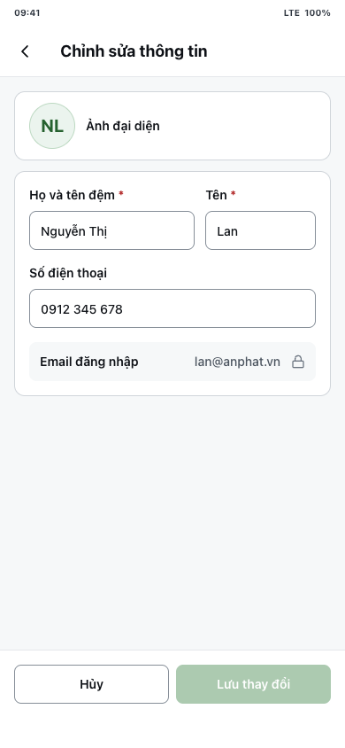 | 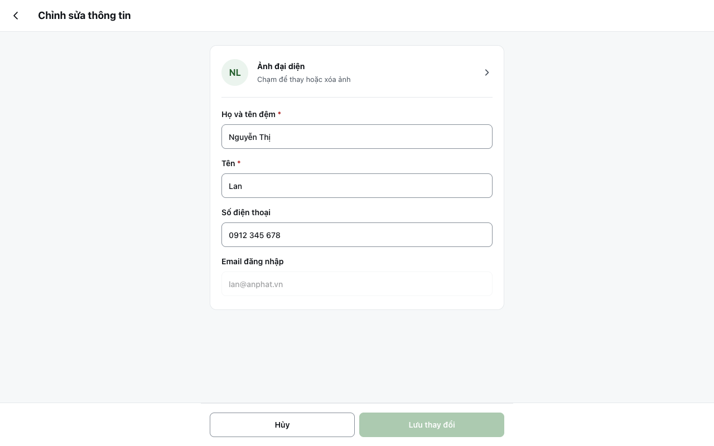 |
| account-edit__errors | 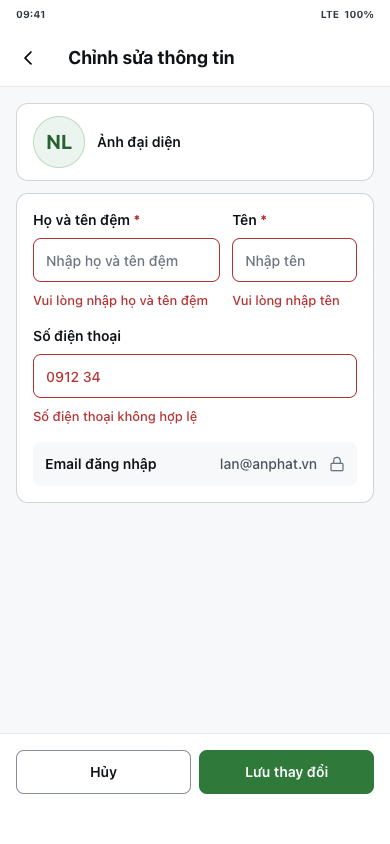 | 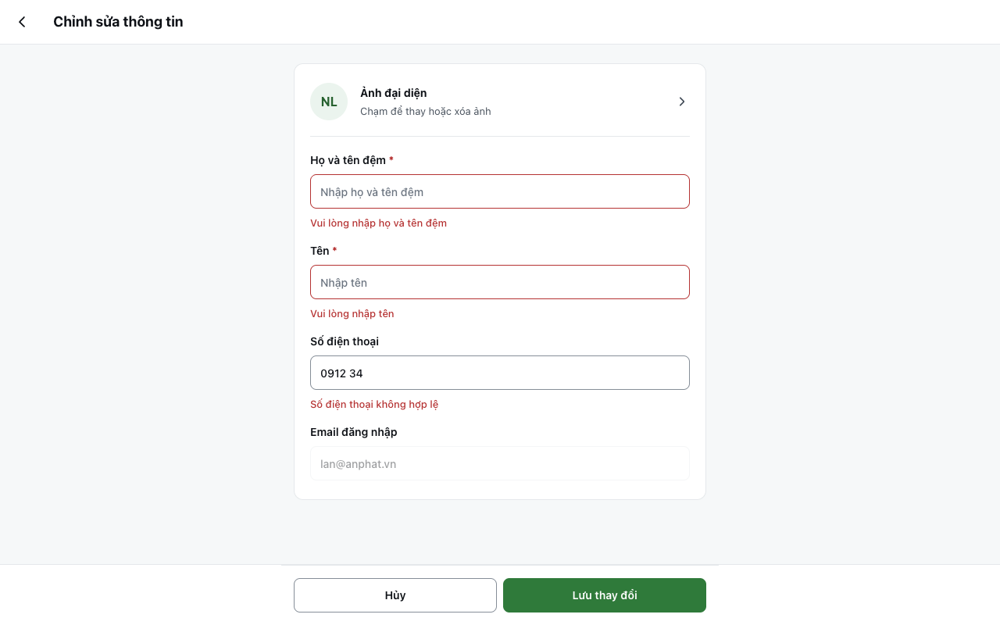 |
| account-edit__submitting | 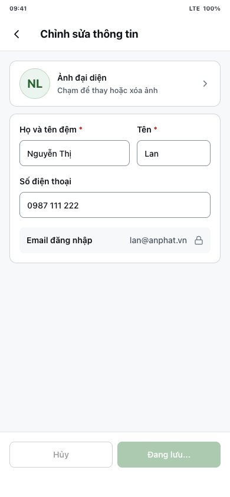 | 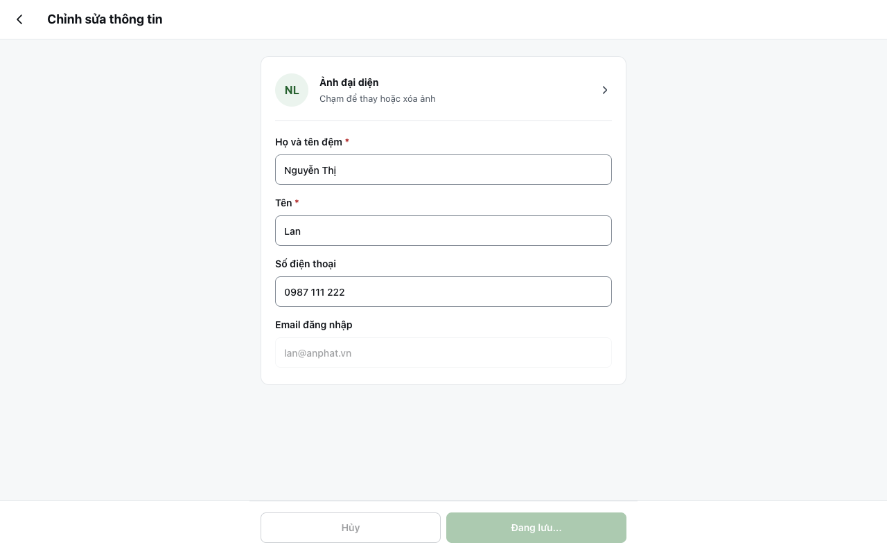 |
| account-edit__discard | 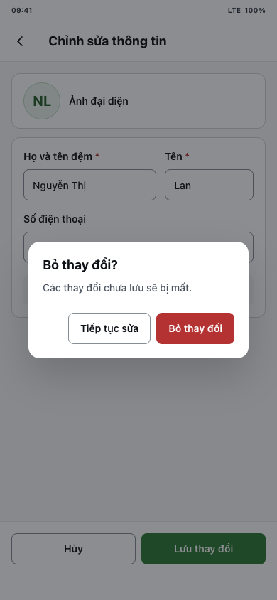 | 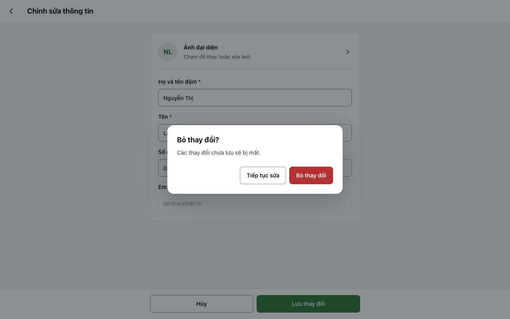 |

## Code prototype (chép nguyên văn, token thay bằng giá trị)

### iPhone

`app/account.js:10-56`

```js
export const ME = { lastName: 'Nguyễn Thị', firstName: 'Lan', email: 'lan@anphat.vn', emailStatus: 'Đã xác minh', phone: '0912 345 678' };
/** VAvatar._initialsFrom: nhiều từ → chữ đầu từ đầu + chữ đầu từ cuối, viết hoa. */
export const initials = (name) => {
  const w = String(name).trim().split(/\s+/).filter(Boolean);
  if (!w.length) return '?';
  return (w.length === 1 ? w[0][0] : w[0][0] + w[w.length - 1][0]).toUpperCase();
};

/** Thanh dưới tự vẽ (màn sửa): đệm 16 + nền surface + gạch trên 1 (chồng gạch của VPageScaffold) + SafeArea → cao 78. */
export const BAR2 = 78;

/** _buildInfoRow: đệm dọc 8; nhãn bodyDefault textSecondary, khe 8, giá trị bodyDefault w700 phải; rỗng → "(chưa có)" textMuted w thường. */
export const infoRow = (l, val) => `<div class="t1-acrow"><span>${esc(l)}</span><b${val ? '' : ' class="is-empty"'}>${esc(val || '(chưa có)')}</b></div>`;

export const ACCOUNT_STATES = {
  owner: {}, staff: { staff: true }, 'no-phone': { me: { phone: '' } }, loading: { loading: true }, error: { error: true },
  logout: { sheet: 'logout' },
  'toast-updated': { toast: ['success', 'Thành công', 'Đã cập nhật thông tin cá nhân'] },
  'toast-logout-failed': { toast: ['danger', 'Đăng xuất thất bại', 'Không thể đóng phiên trên máy.'] },
};

/** Dòng thao tác (iPhone, impeccable live 2026-11-25; thay nút + sheet "Thao tác"): icon 20 + tên + mô tả + mũi tên; Đăng xuất màu danger. */
const actRow = (ic, title, sub, danger = false) => `<button type="button" class="t1-actlist__row${danger ? ' is-danger' : ''}">${icon(ic, 't1-actlist__ic')}<span class="t1-actlist__text"><b>${esc(title)}</b><small>${esc(sub)}</small></span>${icon('chevronRight', 't1-actlist__go')}</button>`;
/** Sheet đăng xuất: đệm 16 / 16; H3 w700 danger; khe 4; bodySmall; khe 32; hai nút large (52) chia đôi khe 8; khe 16. */
export const logoutSheet = () => `<div class="t1-list"><h2 class="t1-h3 t1-danger">Đăng xuất khỏi Mosaic Retail?</h2><div class="t1-gap-xs"></div>
  <p class="t1-small">Bạn sẽ cần đăng nhập lại để tiếp tục sử dụng ứng dụng.</p><div class="t1-gap-xl"></div>
  <div class="t1-row2 t1-row2--8">${button('Quay lại', { variant: 'secondary', full: true, cls: 't1-btn--lg' })}${button('Đăng xuất', { full: true, cls: 't1-btn--danger t1-btn--lg' })}</div><div class="t1-gap-md"></div></div>`;

export function accountPage(v) {
  const s = ACCOUNT_STATES[v.state];
  const base = { title: 'Tài khoản của tôi', placeWidth: v.width };
  if (s.loading) return { page: vScaffold({ ...base, body: centerLoading(), fixed: true }) };
  if (s.error) return { page: vScaffold({ ...base, body: loadFailed('Không tải được hồ sơ', 'Không thể kết nối đến máy chủ. Vui lòng kiểm tra lại mạng.'), fixed: true }) };
  const me = { ...ME, ...s.me };
  // Ô tròn chữ viết tắt + tên + nhãn → "Thông tin cá nhân" → "Thao tác tài khoản" (sửa, đặt lại mật khẩu, đăng xuất).
  const name = `${me.lastName} ${me.firstName}`;
  const row = (l, val) => `<div class="t1-rows__row"><span>${esc(l)}</span><b${val ? '' : ' class="is-empty"'}>${esc(val || '(chưa có)')}</b></div>`;
  const body = `<div class="t1-list t1-acc">
    <div class="t1-orgm__head"><span class="t1-orgm__avatar" aria-hidden="true">${esc(initials(name))}</span><div><div class="t1-selrole__name"><h2>${esc(name)}</h2>${s.staff ? '' : badge('Chủ sở hữu', 'success')}</div><p>Tài khoản cá nhân</p></div></div>
    <h3 class="t1-acc__title">Thông tin cá nhân</h3>
    ${card(`${row('Họ và tên đệm', me.lastName)}${row('Tên', me.firstName)}${row('Email đăng nhập', me.email)}${row('Trạng thái email', me.emailStatus)}${row('Số điện thoại', me.phone)}`, 't1-rows')}
    <h3 class="t1-acc__title t1-acc__title--next">Thao tác tài khoản</h3>
    ${card(`${actRow('edit', 'Chỉnh sửa thông tin cá nhân', 'Cập nhật hồ sơ cá nhân')}${actRow('lock', 'Đặt lại mật khẩu', 'Xác minh email và tạo mật khẩu mới')}${actRow('logout', 'Đăng xuất', 'Kết thúc phiên sử dụng hiện tại', true)}`, 't1-actlist')}
  </div>`;
  const page = vScaffold({ ...base, body, toastHtml: s.toast ? toast(...s.toast, { device: v.device }) : '' });
  return { page, overlay: s.sheet === 'logout' ? adaptiveSheet(v.width, logoutSheet(), 'Đăng xuất') : '' };
}
```

`app/account.js:59-92`

```js
export const DISCARD = { title: 'Bỏ thay đổi?', message: 'Các thay đổi chưa lưu sẽ bị mất.', cancel: 'Tiếp tục sửa', action: 'Bỏ thay đổi', destructive: true };
export const EDIT_ACCOUNT_STATES = {
  default: {}, changed: { values: { phone: '0987 111 222' }, dirty: true },
  errors: { values: { last: '', first: '', phone: '0912 34' }, dirty: true, errors: { last: 'Vui lòng nhập họ và tên đệm', first: 'Vui lòng nhập tên', phone: 'Số điện thoại không hợp lệ' } },
  submitting: { values: { phone: '0987 111 222' }, dirty: true, busy: true },
  discard: { values: { phone: '0987 111 222' }, dirty: true, dialog: true },
  'toast-failed': { values: { phone: '0987 111 222' }, dirty: true, toast: ['danger', 'Không lưu được', 'Không thể kết nối đến máy chủ. Vui lòng kiểm tra lại mạng.'] },
  loading: { loading: true }, error: { error: true },
};

export function editAccountPage(v) {
  const s = EDIT_ACCOUNT_STATES[v.state];
  const base = { title: 'Chỉnh sửa thông tin', placeWidth: v.width };
  if (s.loading) return { page: vScaffold({ ...base, body: centerLoading(), fixed: true }) };
  if (s.error) return { page: vScaffold({ ...base, body: loadFailed('Không tải được hồ sơ', 'Không thể kết nối đến máy chủ. Vui lòng kiểm tra lại mạng.'), fixed: true }) };
  const x = { last: ME.lastName, first: ME.firstName, phone: ME.phone, ...s.values };
  const e = s.errors || {};
  // Bố cục iPhone thiết kế lại qua impeccable live (2026-11-25): thẻ "Ảnh đại diện" (Flutter chưa nối onTap) → thẻ form (họ + tên cùng hàng 3 : 2, số điện thoại, email khoá một dòng).
  const body = `<div class="t1-list t1-accedit">
    ${card(`<button type="button" class="t1-accedit__pic"><span class="t1-orgm__avatar" aria-hidden="true">${esc(initials(`${ME.lastName} ${ME.firstName}`))}</span><span class="t1-accedit__text"><b>Ảnh đại diện</b><small>Chạm để thay hoặc xóa ảnh</small></span>${icon('chevronRight', 't1-actlist__go')}</button>`)}
    ${card(`<div class="t1-form">
      <div class="t1-signup__names">
        ${field({ label: 'Họ và tên đệm', required: true, control: input({ value: x.last, hint: 'Nhập họ và tên đệm', invalid: !!e.last }), error: e.last })}
        ${field({ label: 'Tên', required: true, control: input({ value: x.first, hint: 'Nhập tên', invalid: !!e.first }), error: e.first })}
      </div>
      ${/* VField ngoài không invalid → ô số điện thoại không đổi viền đỏ dù có lỗi */ ''}${field({ label: 'Số điện thoại', control: input({ value: x.phone, hint: 'Nhập số điện thoại' }), error: e.phone })}
      <div class="t1-invreg__mail"><span>Email đăng nhập</span><b>${esc(ME.email)}</b>${icon('lock')}</div>
    </div>`, 't1-card--pad')}
  </div>`;
  // Lưu: tắt khi chưa đổi gì; đang lưu → chữ "Đang lưu..." + tắt (không vòng xoay).
  const bar = `<div class="t1-bar-pad t1-row2 t1-row2--8">${button('Hủy', { variant: 'secondary', full: true, disabled: !!s.busy })}${button(s.busy ? 'Đang lưu...' : 'Lưu thay đổi', { full: true, disabled: !s.dirty || !!s.busy, attrs: 'data-primary' })}</div>`;
  const page = vScaffold({ ...base, body, bottomBar: bar, toastHtml: s.toast ? toast(...s.toast, { device: v.device, above: BAR_H }) : '' });
  return { page, overlay: s.dialog ? confirmDialog(DISCARD) : '' };
}
```

`styles/t1.css:360-388`

```css
/* ------------------------------------------------ Tài khoản của tôi (iPhone, impeccable live 2026-11-25; web ở t1-web.css) */
.t1-acc { padding-bottom: 34px; }
.t1-acc .t1-orgm__head { padding-bottom: 20px; }
.t1-acc__title { margin: 0 0 8px; font-size: 14px /*fs-md*/; line-height: 20px; font-weight: 600; color: #0E1116 /*text-primary*/; }
.t1-acc__title--next { margin-top: 20px; }
.t1-rows { padding: 0 16px; }
.t1-rows__row { display: flex; align-items: center; justify-content: space-between; gap: 16px; min-height: 46px; padding: 10px 0; font-size: 14px /*fs-md*/; line-height: 22px; }
.t1-rows__row + .t1-rows__row { border-top: 1px solid #E5E8EB /*border-default*/; }
.t1-rows__row span { flex: none; font-weight: 500; color: #4A535E /*text-secondary*/; }
.t1-rows__row b { min-width: 0; overflow-wrap: anywhere; text-align: right; font-weight: 600; color: #0E1116 /*text-primary*/; }
.t1-rows__row b.is-empty { font-weight: 500; color: #6B7480 /*text-muted*/; }
.t1-actlist { overflow: hidden; }
.t1-actlist__row { display: flex; align-items: center; gap: 12px; width: 100%; min-height: 60px; padding: 8px 16px; border: 0; background: transparent; text-align: left; color: #0E1116 /*text-primary*/; cursor: pointer; }
.t1-actlist__row + .t1-actlist__row { border-top: 1px solid #E5E8EB /*border-default*/; }
.t1-actlist__row:hover { background: #F8FAFB /*neutral-50*/; }
.t1-actlist__row:focus-visible { outline-offset: -2px; }
.t1-actlist__ic { flex: none; font-size: 20px; color: #26612F /*icon-brand*/; }
.t1-actlist__text { flex: 1; min-width: 0; }
.t1-actlist__text b { display: block; font-size: 14px /*fs-md*/; line-height: 22px; font-weight: 600; }
.t1-actlist__text small { display: block; font-size: 13px /*fs-sm*/; line-height: 20px; font-weight: 500; color: #4A535E /*text-secondary*/; }
.t1-actlist__go { flex: none; font-size: 18px; color: #6B7480 /*icon-secondary*/; }
.t1-actlist__row.is-danger b, .t1-actlist__row.is-danger .t1-actlist__ic { color: #B53232 /*text-danger*/; }

/* ------------------------------------------------ Chỉnh sửa thông tin cá nhân (iPhone, impeccable live 2026-11-25; web ở t1-web.css) */
.t1-accedit { display: flex; flex-direction: column; gap: 12px; }
.t1-accedit__pic { display: flex; align-items: center; gap: 12px; width: 100%; padding: 12px 16px; border: 0; border-radius: 12px /*radius-card*/; background: transparent; text-align: left; color: #0E1116 /*text-primary*/; cursor: pointer; }
.t1-accedit__text { flex: 1; min-width: 0; }
.t1-accedit__text b { display: block; font-size: 14px /*fs-md*/; line-height: 22px; font-weight: 600; }
.t1-accedit__text small { display: block; font-size: 13px /*fs-sm*/; line-height: 20px; font-weight: 500; color: #4A535E /*text-secondary*/; }
```


### Web

`app/web/account.js:7-54`

```js
export function accountPage(v) {
  const s = ACCOUNT_STATES[v.state];
  const base = { title: 'Tài khoản của tôi', placeWidth: v.width };
  if (s.loading) return { page: vScaffold({ ...base, body: centerLoading(), fixed: true }) };
  if (s.error) return { page: vScaffold({ ...base, body: loadFailed('Không tải được hồ sơ', 'Không thể kết nối đến máy chủ. Vui lòng kiểm tra lại mạng.'), fixed: true }) };
  const me = { ...ME, ...s.me };
  // Thiết kế lại qua impeccable live (2026-11-24): web ≥ 900 hai cột — trái thẻ hồ sơ (chữ viết tắt 72, tên, email, nhãn Chủ sở hữu, "Đăng xuất");
  // phải "Thông tin cá nhân" (nút bút chì) + "Bảo mật" (Đặt lại mật khẩu). Hẹp: xếp dọc. Không còn thanh "Thao tác" / sheet.
  const name = `${me.lastName} ${me.firstName}`;
  const sec = (title, action, inner) => `<section class="t1-orgsec"><div class="t1-orgsec__head"><h2>${esc(title)}</h2>${action}</div>${inner}</section>`;
  const body = `<div class="t1-orgp"><div class="t1-acgrid">
    <div class="t1-accard"><span class="t1-avatar t1-avatar--xl" aria-hidden="true">${esc(initials(name))}</span><h1>${esc(name)}</h1><p>${esc(me.email)}</p>
      ${s.staff ? '' : '<span class="t1-badge t1-badge--success">Chủ sở hữu</span>'}
      <div class="t1-accard__out">${button('Đăng xuất', { variant: 'secondary', full: true, cls: 't1-btn--danger-outline' })}</div></div>
    <div class="t1-acright">
      ${sec('Thông tin cá nhân', iconButton('edit', 'Chỉnh sửa thông tin cá nhân', { size: 20 }), `<div class="t1-stack4">${infoRow('Họ và tên đệm', me.lastName)}${infoRow('Tên', me.firstName)}${infoRow('Email đăng nhập', me.email)}${infoRow('Trạng thái email', me.emailStatus)}${infoRow('Số điện thoại', me.phone)}</div>`)}
      ${sec('Bảo mật', '', `<div class="t1-acpw"><div><b>Đặt lại mật khẩu</b><p class="t1-small">Xác minh email và tạo mật khẩu mới</p></div>${button('Đặt lại mật khẩu', { variant: 'secondary' })}</div>`)}
    </div></div></div>`;
  const page = vScaffold({ ...base, body, toastHtml: s.toast ? toast(...s.toast, { device: v.device, above: 0 }) : '' });
  // Web cần cột rộng hơn 720 cho hai cột.
  const wide = v.width >= 900 ? page.replace(/(<div class="t1-col" style=")[^"]*(")/, '$1max-width:1040px$2') : page;
  const overlay = s.sheet === 'logout' ? adaptiveSheet(v.width, logoutSheet(), 'Đăng xuất') : '';
  return { page: wide, overlay };
}

export function editAccountPage(v) {
  const s = EDIT_ACCOUNT_STATES[v.state];
  const base = { title: 'Chỉnh sửa thông tin', placeWidth: v.width };
  if (s.loading) return { page: vScaffold({ ...base, body: centerLoading(), fixed: true }) };
  if (s.error) return { page: vScaffold({ ...base, body: loadFailed('Không tải được hồ sơ', 'Không thể kết nối đến máy chủ. Vui lòng kiểm tra lại mạng.'), fixed: true }) };
  const x = { last: ME.lastName, first: ME.firstName, phone: ME.phone, ...s.values };
  const e = s.errors || {};
  // Thiết kế lại qua impeccable live (2026-11-24): cột 560, một thẻ — dòng "Ảnh đại diện" (chữ viết tắt 48 + mô tả + mũi tên) → gạch → 4 ô xếp dọc.
  const body = `<div class="t1-formpage"><div class="t1-formcard">
    <button type="button" class="t1-avrow"><span class="t1-avatar t1-avatar--lg" aria-hidden="true">${esc(initials(`${ME.lastName} ${ME.firstName}`))}</span><span><b>Ảnh đại diện</b><small>Chạm để thay hoặc xóa ảnh</small></span>${icon('chevronRight', 't1-chev20')}</button>
    <hr class="t1-avsep">
    <div class="t1-form">
      ${field({ label: 'Họ và tên đệm', required: true, control: input({ value: x.last, hint: 'Nhập họ và tên đệm', invalid: !!e.last }), error: e.last })}
      ${field({ label: 'Tên', required: true, control: input({ value: x.first, hint: 'Nhập tên', invalid: !!e.first }), error: e.first })}
      ${/* VField ngoài không invalid → ô số điện thoại không đổi viền đỏ dù có lỗi */ ''}${field({ label: 'Số điện thoại', control: input({ value: x.phone, hint: 'Nhập số điện thoại' }), error: e.phone })}
      ${field({ label: 'Email đăng nhập', control: input({ value: ME.email, disabled: true }) })}
    </div></div></div>`;
  // Lưu: tắt khi chưa đổi gì; đang lưu → chữ "Đang lưu..." + tắt (không vòng xoay).
  const bar = `<div class="t1-bar-pad t1-bar-line t1-row2 t1-row2--8">${button('Hủy', { variant: 'secondary', full: true, disabled: !!s.busy })}${button(s.busy ? 'Đang lưu...' : 'Lưu thay đổi', { full: true, disabled: !s.dirty || !!s.busy })}</div>`;
  const page = vScaffold({ ...base, body, bottomBar: bar, toastHtml: s.toast ? toast(...s.toast, { device: v.device, above: BAR2 }) : '' });
  const narrow = v.width >= 600 ? page.replace(/(<div class="t1-col" style=")[^"]*(")/g, '$1max-width:560px$2') : page;
  return { page: narrow, overlay: s.dialog ? confirmDialog(DISCARD) : '' };
}
```

`styles/t1-web.css:190-209`

```css
/* Tài khoản của tôi: hai cột từ 900 (thẻ hồ sơ 300 | thông tin + bảo mật). */
.t1-acgrid { display: grid; grid-template-columns: 1fr; gap: 16px; align-items: start; }
@media (min-width: 900px) { .t1-acgrid { grid-template-columns: 300px 1fr; } }
.t1-accard { display: flex; flex-direction: column; align-items: center; gap: 8px; padding: 32px 20px 20px; border: 1px solid #E5E8EB /*border-default*/; border-radius: 12px /*radius-card*/; background: #FFFFFF /*surface-default*/; text-align: center; }
.t1-avatar--xl { width: 72px; height: 72px; font-size: 24px; }
.t1-accard h1 { margin: 8px 0 0; font-size: 20px; line-height: 28px; font-weight: 700; color: #0E1116 /*text-primary*/; }
.t1-accard p { margin: 0; font-size: 13px /*fs-sm*/; color: #4A535E /*text-secondary*/; overflow-wrap: anywhere; }
.t1-accard__out { width: 100%; margin-top: 20px; padding-top: 16px; border-top: 1px solid #E5E8EB /*border-default*/; }
.t1-acright { display: flex; flex-direction: column; gap: 16px; min-width: 0; }
.t1-acpw { display: flex; align-items: center; justify-content: space-between; gap: 16px; }
.t1-acpw p { margin: 2px 0 0; }
.t1-stack4 { display: flex; flex-direction: column; gap: 4px; }
@media (max-width: 599px) { .t1-acpw { flex-direction: column; align-items: stretch; } }

/* Chỉnh sửa thông tin (tài khoản): dòng ảnh đại diện đầu thẻ + gạch ngăn. */
.t1-avrow { display: flex; align-items: center; gap: 16px; width: 100%; padding: 0; border: 0; background: transparent; font: inherit; text-align: left; cursor: pointer; }
.t1-avrow > span:nth-child(2) { flex: 1; display: flex; flex-direction: column; gap: 2px; }
.t1-avrow b { font-size: 14px /*fs-md*/; font-weight: 700; color: #0E1116 /*text-primary*/; }
.t1-avrow small { font-size: 13px /*fs-sm*/; color: #4A535E /*text-secondary*/; }
.t1-avsep { margin: 20px 0; border: 0; border-top: 1px solid #E5E8EB /*border-default*/; }
```


CSS đã có ở 10-8g: `.t1-orgm__head`, `.t1-orgm__avatar`, `.t1-orgsec*`, `.t1-formpage`, `.t1-formcard`; `.t1-signup__names` ở 10-8e; `.t1-invreg__mail` ở 10-8f.

### Ánh xạ phần tử → Flutter

| Prototype | Flutter |
|---|---|
| `.t1-orgm__head` + `.t1-orgm__avatar` | `DetailHeaderNarrow(leading: DetailAvatar(initials), badge:)` |
| `.t1-rows` (dòng cao ≥ 46, gạch giữa) | `VCard(padding: ngang 16)` + `_AccountRow`; rỗng → "(chưa có)" `textMuted` w500 |
| `.t1-actlist__row` ≥ 60 | `_ActionRow`: `InkWell`, `MergeSemantics` + `Semantics(button)`; icon 20 `textBrand`, mũi tên 18 `textMuted`; Đăng xuất màu `danger` |
| `.t1-accard` | `FlowCard` căn giữa, `DetailAvatar(size: 72)` |
| `sec('Thông tin cá nhân', bút chì)` | `DetailSectionWide(action: IconButton(tooltip: 'Chỉnh sửa thông tin cá nhân'))`, `gap: 4` |
| `.t1-acpw` | `Row` chữ \| `VButton` secondary "Đặt lại mật khẩu" |
| `.t1-btn--danger-outline` | `VButton(variant: secondary, tone: danger, fullWidth)` |
| `.t1-accedit__pic`, `.t1-avrow` | `Row` `DetailAvatar(48 / 52)` + "Ảnh đại diện" (không `InkWell`) |
| dòng email khoá iPhone | như Q9 10-8f: nhãn "Email đăng nhập", email, icon khoá 16, `Semantics(label: 'Email đăng nhập, <email>, không sửa được')` |

## Bảng "Đang làm gì"

| Thứ bị thay | Đang làm gì | Sau khi sửa | Test giữ hành vi |
|---|---|---|---|
| `MyAccountPage` | Tải / lỗi + "Thử lại"; 5 dòng thông tin; nhãn chủ | Nguyên | có sẵn 7 ca, e2e 5 ca; T0: `load error retries` |
| "Thao tác" + sheet | Sửa, Đặt lại mật khẩu, Đăng xuất | Dòng / nút trong màn (**đổi có chủ đích**) | T0 tìm theo chữ "Chỉnh sửa thông tin cá nhân", "Đặt lại mật khẩu", "Đăng xuất" sau một hàm `openActions` (code mới: hàm rỗng): `edit saves then toast`, `reset password signs out` |
| Đăng xuất | Ngay, không hỏi (`8539ef201`) | Hỏi xác nhận (**đổi có chủ đích**, Q1) | `…logs out immediately without confirmation` thay bằng 3 ca sheet ở Task 2 |
| `EditMyAccountPage` | "Lưu thay đổi" tắt khi chưa đổi; lỗi dưới ô; toast khi lưu lỗi; hỏi khi rời | Nguyên | có sẵn 5 ca + `profile_phone_validation` |
| | Dòng ảnh đại diện có mũi tên | Chỉ hiển thị (**đổi có chủ đích**, Q4) | có sẵn `…renders avatar card…`, đổi kỳ vọng |
| | Email là ô tắt | iPhone dòng đọc, web ô tắt | có sẵn, đổi kỳ vọng ở khổ hẹp |

## Review Focus

1. **Vào từ menu "Quản lý" ở 1280** (không pop được): không có ←, thanh bên còn, vẫn sửa và đặt lại mật khẩu được rồi quay về. Test ở Task 2.
2. **Kéo cửa sổ 900 → 700 khi đang sửa:** chữ còn, vẫn hỏi "Bỏ thay đổi?". Test ở Task 3.
3. **Chủ tổ chức A đang ở tổ chức B:** không có nhãn "Chủ sở hữu"; đổi về A thì có. Test ở Task 1.
4. **Email 60 ký tự, họ tên 60 ký tự, không có số:** không tràn ở 320 chữ 2.0 và 840. Test ở Task 2.
5. **Đặt lại mật khẩu xong nhưng mất mạng khi đăng xuất:** có toast, không kẹt. Test ở Task 1.

---

### Task 0: Test giữ hành vi trên code cũ

**Files:**
- Modify: `apps/erp/test/features/iam/presentation_module/widgets/my_account_page_test.dart`

- [x] **Step 1: Viết ca T0 trong bảng** ở 390 × 844.
- [x] **Step 2: Chạy, phải xanh trên code cũ** — `cd apps/erp && flutter test test/features/iam/presentation_module/widgets/my_account_page_test.dart test/features/my_account`

### Task 1: Prototype + logic

**Files:**
- Modify: prototype `app/account.js`, `app/web/account.js`, `app/cases.js`, `tests/t1.test.mjs`, `README.md` (mục 53–58)
- Modify: `apps/erp/lib/features/iam/logic/my_account_cubit.dart`, `presentation/users/views/my_account_page.dart` (Q7, Q8, Q9)
- Test: `my_account_page_test.dart`; Create: `apps/erp/test/features/iam/logic/my_account_cubit_test.dart`

**Interfaces:**
- Produces: `MyAccountState.isOwner` theo Q5; trong trang `Future<void> _logout()` có cờ `_loggingOut`.

- [x] **Step 1: Prototype** — giữ ca `account/logout` và `logoutSheet`; dòng ảnh đại diện hai khung thành `<div>` không mũi tên, không `<small>`; ô SĐT `invalid: !!e.phone`; thanh dưới web bỏ `t1-bar-line`; sửa câu mô tả ca, `WEB_NOTES`, README. `node --test` PASS; `node tools/capture.mjs account`; chép lại ảnh ở mục Ảnh.
- [x] **Step 2: Viết test**

```dart
// my_account_cubit_test.dart
test('owner badge follows the current tenant', …)            // tenants: A chủ, B nhân viên; current B → false; current A → true
test('no current tenant falls back to any owned tenant', …)
// my_account_page_test.dart
testWidgets('signing out twice in a row calls signOut once', …)        // gọi onLogout lần hai khi lần đầu chưa xong (Completer)
testWidgets('failed sign-out after password reset shows a toast and stays', …)
testWidgets('remote failure still goes to login with the banner', …)  // localCleared true
```

- [x] **Step 3: Chạy → FAIL** — `flutter test test/features/iam/logic/my_account_cubit_test.dart test/features/iam/presentation_module/widgets/my_account_page_test.dart`
- [x] **Step 4: Cài đặt** Q5, Q7–Q9 (phần logic; sheet xoá ở Task 2).
- [x] **Step 5: Chạy → PASS** (lệnh Step 3)

### Task 2: Tài khoản của tôi

**Files:**
- Create: `users/widgets/{my_account_narrow,my_account_wide}.dart`, `users/widgets/logout_confirmation_bottom_sheet.dart` (khôi phục, Q1), `apps/erp/test/features/iam/presentation_module/account_golden_test.dart`
- Modify: `users/views/my_account_page.dart`
- Delete: `users/widgets/my_account_actions_bottom_sheet.dart`, export `iam/presentation.dart:70`
- Test: `my_account_page_test.dart`, `test/features/my_account/presentation/e2e_e06_u01_fr01_01_my_account_test.dart`

**Interfaces:**
- Consumes: `DetailHeaderNarrow`, `DetailAvatar`, `DetailSectionWide`, `FlowCard`, `isWideLayout`.
- Produces: `Future<void> showLogoutConfirmationBottomSheet({required BuildContext context, required VoidCallback onConfirm})`; hai widget cùng `({super.key, required MyAccountUiModel data, required VoidCallback onEdit, required VoidCallback onResetPassword, required VoidCallback? onLogout, required bool loggingOut})`.

- [x] **Step 1: Viết test**

```dart
testWidgets('390: rows and three actions in the page, no Thao tác, no bottom bar', …)
testWidgets('1280: profile card, pencil, security section', …)
testWidgets('870 stacks the two columns', …)
testWidgets('390 and 1280: Đăng xuất asks first, confirming signs out once', …) // 'Đăng xuất khỏi Mosaic Retail?', 'Bạn sẽ cần đăng nhập lại để tiếp tục sử dụng ứng dụng.'
testWidgets('Quay lại, Esc and tapping outside do not sign out', …)
testWidgets('1280: the confirmation is a dialog with a close button', …)          // VSheetDialog, tooltip 'Đóng'
testWidgets('back is hidden at 1024 and above in every state', …)   // 1023 đẩy từ /more: có; 1024: không; tải, lỗi cũng vậy
testWidgets('1280 opened by go: edit and reset still return here', …)
testWidgets('320 at text scale 2.0 and 840 with long name and email do not overflow', …)
testWidgets('labeled tap targets', …)                                // meetsGuideline iOSTapTarget, labeledTapTarget ở 390
```

- [x] **Step 2: Chạy → FAIL** — `flutter test test/features/iam/presentation_module/widgets/my_account_page_test.dart test/features/my_account`
- [x] **Step 3: Cài đặt** Q1–Q3, Q10, Q11, Q13. Test e2e `e2e_e06_u04_*` thêm bước bấm "Đăng xuất" trong sheet.
- [x] **Step 4: Chạy → PASS** (lệnh Step 2) và `flutter test test/features/more`
- [x] **Step 5: Golden** `account__{owner,staff,no-phone,error,logout,toast-logout-failed}` × 2. So ảnh, ghi lệch.

### Task 3: Chỉnh sửa thông tin + đóng Theme 1

**Files:**
- Create: `users/widgets/{edit_account_narrow,edit_account_wide}.dart`
- Modify: `users/views/edit_my_account_page.dart`, `docs/requirements/TH-01-to-chuc-va-nguoi-dung.md`, `docs/refactor/PLAN.md`, `specs/themes/theme-01/03.design/prototype/html/README.md`
- Test: `edit_my_account_page_test.dart`, `profile_phone_validation_test.dart`, `account_golden_test.dart`

**Interfaces:**
- Produces: hai widget cùng `({super.key, required String fullName, required String email, required Widget lastNameField, firstNameField, phoneField, emailField})`; `EditAccountNarrow` không dùng `emailField` (tự vẽ dòng khoá).

- [x] **Step 1: Viết test**

```dart
testWidgets('invalid phone turns the field border danger', …)
testWidgets('typing a name keeps the phone error', …)                 // Q6
testWidgets('avatar row is not tappable and has no chevron', …)
testWidgets('390: names share a row 3 : 2, email is a read-only row', …)
testWidgets('1280: one card in a 560 column, email is a disabled field', …)
testWidgets('bottom bar has a single top border', …)
testWidgets('resizing keeps values and still asks before leaving', …)
testWidgets('320 at text scale 2.0 does not overflow', …)
```

- [x] **Step 2: Chạy → FAIL** — `flutter test test/features/iam/presentation_module/widgets/edit_my_account_page_test.dart`
- [x] **Step 3: Cài đặt** Q4, Q6, Q11, Q12.
- [x] **Step 4: TH-01** — US-08.4 FR-01 giữ nguyên, thêm "(Tài khoản của tôi; tab Thêm và thanh bên đăng xuất ngay). Lỗi → toast "Đăng xuất thất bại"."; US-08.1 FR-01: nhãn "Chủ sở hữu" nếu là Owner **của tổ chức đang dùng**.
- [x] **Step 5: Chạy → PASS**

Run: `cd apps/erp && flutter test test/features/iam test/features/auth test/features/my_account test/features/tenant_admin test/features/invitations test/features/more test/features/dashboard test/core && dart analyze lib test && dart run tool/check_feature_imports.dart`
Expected: PASS, không lỗi analyze mới, không vi phạm import mới (đây là phạm vi Theme 1; so `TEST-BASELINE.md`)

- [x] **Step 6: Golden** `account-edit__{default,errors,submitting,discard}` × 2. So ảnh.
- [x] **Step 7: Đóng Theme 1** — PLAN.md dòng Theme 1 cột "Plan chuyển Flutter" ✅, cột "Xong" chờ kiểm tay; README prototype thêm bảng "Đã có trong Flutter" theo plan 10-8d…k

## Kiểm tay (người dùng)

- [ ] iPhone + web: xem, sửa (lỗi, lưu, bỏ), đặt lại mật khẩu, đăng xuất (hỏi xác nhận; "Quay lại"); tài khoản ở hai tổ chức.
- [ ] Web: vào từ "Quản lý" ở ≥ 1024 và từ Thêm ở < 1024.
- [ ] CHECKLIST ID-21, ID-22 cột "Mới"; rà lại ID-01…ID-23 một lượt trên máy thật.

## Kết quả

Làm xong Task 0–3; xử lý review R1 (2026-11-26). Golden `test/features/iam/presentation_module/account_golden_test.dart`: 20 ảnh, so cạnh prototype ở mục Ảnh. Còn lệch chấp nhận được:

- Icon ra ô vuông, không có ← trên app bar: golden không nạp font icon và trang không có route để quay lại (giống 10-8g…i). Ảnh prototype `account__*` vẽ ← ở 1280, Flutter ẩn theo Q2.
- Web Tài khoản: cột trong 1040 có đệm 24 (prototype 16), hai cột hẹp hơn khoảng 16 px.
- iPhone màn sửa: nhãn "Email đăng nhập" ở dòng khoá dùng `bodySmall` (prototype 14 đậm hơn).

Kiểm: `flutter test test/features/iam test/features/my_account test/features/more` 575 PASS, 1 FAIL `e2e_e06_u02_fr01_01: edit profile save` (có sẵn trong `TEST-BASELINE.md`); `node --test tests/t1.test.mjs` 25 PASS; `dart analyze` phần iam, my_account 4 info có sẵn, không có mục mới; `check_feature_imports` không vi phạm iam. Còn: kiểm tay.

## Review

**R1 (2026-11-26):** Test xanh, logic Q1, Q2, Q5–Q9, Q13 đúng (nhãn chủ theo `SessionController.isOwner` khi có tổ chức đang dùng; sheet đóng rồi mới đăng xuất, cờ `_loggingOut` chặn gọi hai lần; lỗi đăng xuất sau đặt lại mật khẩu ra toast, không sang `/login`). Thiếu bước và lỗi, đã sửa:

| # | Lỗi | Sửa |
|---|---|---|
| A | Task 1 Step 1: ảnh `proto-account-edit__*` chưa chụp lại sau khi sửa prototype (còn mũi tên, "Chạm để thay hoặc xóa ảnh", SĐT không viền đỏ) → Task 3 Step 6 so với ảnh cũ | `node tools/capture.mjs account-edit`, chép lại 8 ảnh |
| B | Golden `account__logout`, `account-edit__discard` không có sheet / hộp thoại: `RepaintBoundary` chỉ bọc `home`, lớp phủ của Navigator nằm ngoài | Bọc ở `MaterialApp.builder`; chụp lại |
| C | Golden `account-edit__errors`: hai ô tên trống không có chữ gợi ý (chụp giữa hiệu ứng mờ dần) | Chờ 300 ms trước khi chụp |
| D | `## Kết quả`, `## Review` trống; README prototype mục 56, 58 chưa đánh dấu (plan ghi mục 53–58) | Ghi như trên; 56, 58 ghi "Giữ 10-8k" |
| 1 | Web dòng rỗng: `DetailRow(muted: true)` làm mờ **nhãn**, "(chưa có)" vẫn đậm đen (prototype `b.is-empty`: giá trị `textMuted` w500) | `DetailRow` thêm `valueMuted`; `MyAccountWide` dùng `valueMuted` thay `muted` |
| 2 | Web dòng thông tin dính nhau (~26 px/dòng; prototype `.t1-acrow` đệm dọc 8 + gap 4 → ~42) | Bọc mỗi dòng `Padding(vertical: 8)` |
| 3 | Web chữ viết tắt ô 72 cỡ `headingH4` (prototype `.t1-avatar--xl` chữ 24) | `DetailAvatar`: `size >= 72` → chữ 24 |

Test thêm: `1280: empty value is muted, rows spaced like prototype, initials 24`. Chụp lại golden; `account__no-phone`, `account__logout`, `account-edit__errors` hai khung khớp prototype trừ lệch đã ghi.

Để sau (không chặn):
- iPhone dòng "Đăng xuất" khi đang đăng xuất chỉ tắt, nhìn không khác.
- `onLogout` ở `app_router.dart` (`/more/my-account`) chỉ bắt `AppException` và trùng `signOutAndGoToLogin` (`more_logout.dart`).
