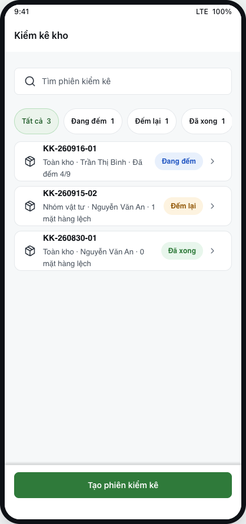
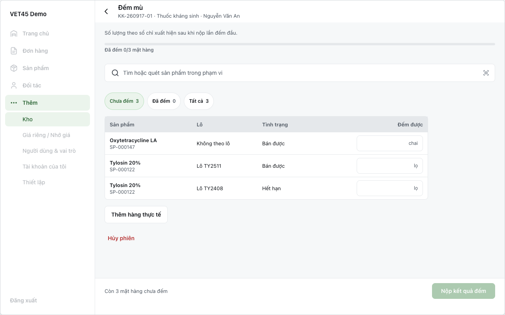
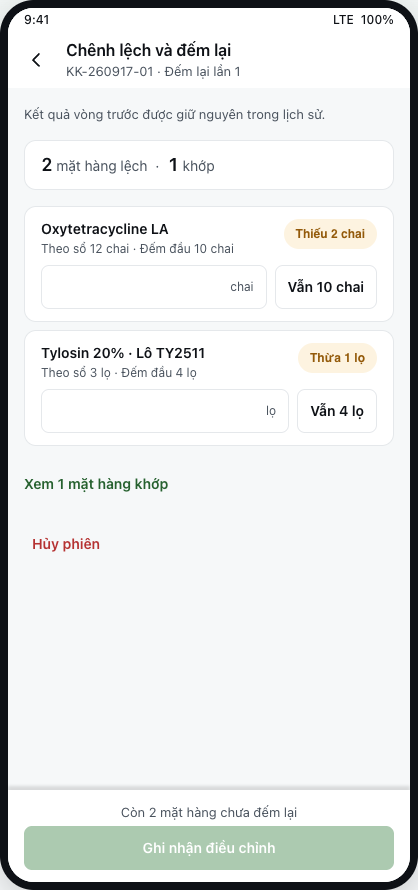

# T7-G5-5 — Kiểm kê, điều chỉnh có lý do, bỏ tồn cơ bản Theme 2

> Theme 7 · plan **G5-5** của [PLAN.md](../../PLAN.md) mục "Theme 7" (bảng Plan)
> Trạng thái: Plan ✅ (duyệt 2026-11-11) | Làm ✅ 2026-11-12 | Review ✅ R2 2026-11-12
> Thiết kế: duyệt trong chat 2026-11-11 (6 câu hỏi + 4 phần: SQL kiểm kê, màn Flutter, bỏ tồn cơ bản, chia task). Nguồn: [UIF-08](../../../../specs/themes/theme-07/03.design/flows/UIF-08-BJ-08.md), SCR-042 / 043 / 044 / 045 / 047 (FROZEN, làm theo bản rút gọn), prototype `app/bj08.js` v5.28.0, [spec giá vốn](T7-G5-gia-von-thiet-ke.md) mục 4 (`COUNT_GAIN` / `COUNT_LOSS` / `WRITE_OFF`), mục 6 (`STOCKTAKE_OPEN`), mục 9 ca 7. Phụ thuộc: G5-0b (`_post_movements`, `_value_line`, idempotency), G5-2 / G5-2a (`_product_stock_rows`, `_lot_expiry_end`, chi tiết tồn), G5-4 (lookup bán hàng đã đọc sổ kho).

> **For agentic workers:** REQUIRED SUB-SKILL: Use superpowers:subagent-driven-development (recommended) or superpowers:executing-plans to implement this plan task-by-task. Steps use checkbox (`- [ ]`) syntax for tracking.

**Goal:** Cửa hàng kiểm kê được (tạo phiên toàn kho / một sản phẩm / một lô → đếm mù → xem chênh lệch, đếm lại → ghi nhận thẳng → kết quả). Thiếu / thừa ghi sổ kho + sổ giá trị theo phương pháp giá (hao hụt). Hàng hỏng / hết hạn / thất thoát giảm kho bằng lý do trên dòng thiếu. Tồn cơ bản Theme 2 bị gỡ hẳn: Catalog chỉ còn **đọc** tồn từ sổ kho.

**Architecture:** Migration mới `20261116001_inventory_stocktake.sql` gồm 3 bảng phiên / dòng / lần đếm (lần đếm chỉ thêm), 10 RPC và `_has_open_stocktake`. Ghi nhận gọi `_post_movements` một lần. **Không khoá phạm vi**: chênh lệch luôn tính theo **tồn vật lý hiện tại** (`stock_balances`), ghi nhận đưa tồn của dòng lệch về đúng số đếm lại. Tồn cơ bản: sửa **bản cuối** của các hàm Catalog cho đọc `inventory._product_stock_rows`. Migration dọn `20261116002_catalog_drop_basic_stock.sql` xoá trigger / hàm / cột / bảng. Flutter có thư mục mới `features/inventory/{data,logic,presentation}/stocktake/`, còn phía Catalog xoá SP-10, bước tồn khi tạo sản phẩm và mục `missing_stock`.

**Tech Stack:** PostgreSQL / Supabase (plpgsql), Flutter, `flutter_bloc`, `go_router`, `vet45_design_system`.

**Spec:** mục 1–2 của plan này + Screen Contract SCR-042…047 (chữ mục 8, trừ chỗ mục 2.5 ghi đổi) + PLAN.md Theme 7 → "Quy ước chung cho mọi plan G5".

## Global Constraints

- Quy ước chung: PLAN.md Theme 7 → "Quy ước chung cho mọi plan G5" (cấu trúc code, SQL, test SQL, review plan có SQL, UI Flutter trích code prototype).
- **Sửa migration gốc**, không tạo bản ghi đè: hàm Catalog sửa ở **bản định nghĩa cuối** (bảng mục 2.6). `get_warehouse_hub_summary` sửa tại `20261110001`. Lệnh `drop` chỉ đặt ở `20261116002`.
- Hàm kho mới: `security definer`, `set search_path = inventory, iam, catalog, pg_temp`. RPC công khai có `grant execute … to authenticated` và gọi `inventory._assert_actor(p_tenant_id, 'inventory.read')` đầu tiên (mọi người có quyền Kho đều tạo / đếm / ghi nhận được — Q-5-4). Hàm `_` có `revoke all … from public, anon, authenticated`, không `grant`. Lỗi qua `inventory._raise(code, message)`. Ngày ghi sổ là `inventory._today()`.
- Số lượng kiểm kê theo **ĐVT cơ sở** (`numeric`, ≥ 0). ĐVT hiện trên màn lấy từ `catalog._product_base_unit_name(tenant, product)`.
- Tiền (`adjustment_value_vnd`, `adjust_value_vnd`) **chỉ trả khi `is_owner`**: nhân viên thì khoá vắng mặt trong JSON, không phải `null`.
- Đếm mù: khi phiên `COUNTING`, `get_stocktake_session` **không trả** `book_qty`, `variance`, `first_qty` (khoá vắng mặt).
- Chạy SQL: `tools/db_check.sh` (đủ 3 bước) phải ✅ trước khi báo xong mỗi task có SQL. Chỉ chạy một tệp: `tools/db_check.sh --no-reset <tên>` (nhận **một** tên). Reset Dev (`--linked`) **hỏi người dùng**.
- Flutter: dùng `dart analyze` (không `flutter analyze`). Test: `cd apps/erp && flutter test --no-pub -r compact <đường dẫn>`. Số test đỏ không được hơn `docs/refactor/TEST-BASELINE.md`.
- Trước khi sửa symbol đã có (hàm SQL mục 2.6, `get_warehouse_hub_summary`, `WarehouseHubRepository`, `warehouseEntries` / `warehouseQuickActions`, `StockDetailPage`, `ProductRepository`, `ProductGuidedCreateCubit`, `ProductControlCenterBody`, các evaluator readiness): chạy `impact({target, direction: "upstream"})` và ghi Kết quả. HIGH / CRITICAL ⇒ dừng, báo người dùng. Task cuối chạy `detect_changes({scope: "compare", base_ref: "main"})`.
- `AGENTS.md`, `CLAUDE.md`: không `git add`. Ghi mục 5 Kết quả sau mỗi task. Làm **từng task một** (người dùng chốt), mỗi task một commit.

## Review Focus

1. **Bán xen giữa lúc kiểm (Q-5-2):** sổ 10 → mở phiên → bán 2 → đếm 8 ⇒ nộp lần đầu **khớp**, không điều chỉnh. Biến thể: đếm đầu 7 (lệch), bán thêm 1 trước khi đếm lại, đếm lại 6 ⇒ `COUNT_LOSS` **−1** (6 − 7 hiện tại), không phải −3. Test: Task 2 `sale_during_count_matches`, `recount_uses_current_book`.
2. **Dòng đã khớp ở lần đầu không bị điều chỉnh** dù sổ đổi sau đó (bán sau khi nộp lần đầu): chỉ dòng `needs_recount` được ghi. Test: Task 2 `matched_line_not_adjusted_after_sale`.
3. **Lộ số sổ khi đếm mù** qua RPC: `get_stocktake_session` của phiên `COUNTING` không có khoá `book_qty` / `variance` / `first_qty` ở bất kỳ dòng nào; cây widget 044 không có số sổ. Test: Task 1 `blind_count_hides_book`; Task 5 `count_page_has_no_book_qty`.
4. **Tranh nhau giữa ghi nhận và bán:** `submit_stocktake_recount` lấy `pg_advisory_xact_lock(hashtext(tenant), hashtext(product))` (cùng khoá với `_post_movements`) theo `product_id` tăng dần **trước** khi đọc `stock_balances` ⇒ không có bán chen giữa lúc đọc sổ và lúc ghi. Test: Task 2 contract `recount_locks_before_reading_book` (vị trí `pg_advisory_xact_lock` < vị trí `from inventory.stock_balances` trong thân hàm).
5. **Hàm Catalog còn đọc bảng đã xoá:** sau `20261116002`, `plpgsql_check` sạch; không migration nào ngoài các bản cũ đã bị ghi đè còn tham chiếu `product_stock_profiles` trong bản cuối của hàm. Test: Task 8 `catalog_no_basic_stock_refs` + `tools/db_check.sh`.

---

## 1. Quyết định (người dùng, 2026-11-11)

| Q | Nội dung |
|---|---|
| Q-5-1 | **Một plan**, chia task nhỏ, người dùng làm từng task một (không tách G5-5c) |
| Q-5-2 | **Không khoá phạm vi.** "Theo sổ" và chênh lệch luôn tính theo **tồn vật lý hiện tại**. Ghi nhận đưa tồn của dòng lệch về đúng số đếm lại (ví dụ sổ 10, bán 2 lúc đang kiểm, đếm 8 ⇒ khớp) |
| Q-5-3 | **Điều chỉnh có lý do nằm trong phiên kiểm kê** (không có màn riêng): dòng *Thiếu* ở 045 chọn "Thất thoát" (mặc định) · "Hỏng" · "Hết hạn". Huỷ lô hết hạn = phiên phạm vi "Lô", đếm 0, lý do "Hết hạn"; nút "Điều chỉnh lô hết hạn" ở BJ-01 mở 043 với lô đó |
| Q-5-4 | **Mọi người có quyền Kho** (`inventory.read`) tạo / đếm / ghi nhận. Tiền chỉ chủ cửa hàng thấy |
| Q-5-5 | **"Thêm hàng thực tế" giữ, chỉ cho sản phẩm đã có giá** (`product_costs.moving_avg_cost > 0` hoặc `official_unit_cost` có giá trị). Bỏ ô tình trạng. Bỏ trạng thái `PRICE_BASIS_REQUIRED` |
| Q-5-6 | **Phạm vi: Toàn kho · Sản phẩm · Lô** (bỏ "Nhóm sản phẩm", vì Catalog không có nhóm; ghi lệch vào báo cáo) |
| Q-5-7 | **Bỏ readiness `missing_stock`** (và `pending_stock_from_inventory`, R-plan #3): bỏ **cột lưu** `products.fact_has_stock` / `fact_stock_mode`; cột trả về `has_stock` / `stock_mode` của `_product_operational_facts` **giữ**, đọc từ sổ kho. Thẻ Tồn kho ở PCC đọc sổ kho, nút đổi thành "Xem tồn kho" mở SCR-003. Bỏ bước nhập tồn khi tạo sản phẩm. Danh sách sản phẩm đọc tồn từ sổ kho |
| Q-5-8 | **Xoá hẳn** bảng `catalog.product_stock_profiles`, `catalog.product_stock_movements`. **Không** nhận sửa `catalog_th02.sql` (nợ đã biết), chỉ không làm nó tệ thêm |

**Mặc định đã báo trong chat (duyệt cùng thiết kế):** dòng của phiên chốt lúc mở = mỗi cặp (sản phẩm, lô) trong phạm vi có tồn vật lý > 0. Chỉ **một** vòng đếm lại rồi ghi nhận. Một sản phẩm chỉ nằm trong một phiên đang mở (`CONFLICT`). Không có nút quét (ô tìm khớp tên / mã / mã vạch, như G5-2). `_has_open_stocktake` chỉ cung cấp cho G5-6, chưa gắn vào lần tính.

**Thêm lúc viết plan (người dùng duyệt cùng plan):**

| Chỗ | Nội dung | Lý do |
|---|---|---|
| Lý do mặc định của dòng thiếu | Lô **đã hết hạn** ⇒ mặc định "Hết hạn"; còn lại ⇒ "Thất thoát" | Luồng huỷ lô hết hạn khỏi phải đổi tay |
| Dòng chỉ được ghi nhận khi `needs_recount` | Dòng khớp ở lần đầu không bao giờ bị điều chỉnh | Q-5-2: số đếm đầu của dòng khớp đã cũ khi ghi nhận |
| Lỗi thiếu số / sai trạng thái | Mã mới `STOCKTAKE_SCOPE_EMPTY`, `STOCKTAKE_STATE_CHANGED`, `STOCKTAKE_COUNT_MISSING`, `STOCKTAKE_LINE_EXISTS`, `CANCEL_REASON_REQUIRED` | Màn 043 / 044 / 045 cần phân biệt trạng thái |
| Xung đột mở phiên | Trả kết quả `{conflict: {…}}` (không ném lỗi) | 043 cần mã phiên + phạm vi để hiện banner và "Mở phiên đang kiểm" |

### "Đang làm gì" (hành vi bị thay)

| Thành phần | Hiện làm | Sau G5-5 |
|---|---|---|
| Hub mục "Kiểm kê kho" (`warehouse_entries.dart`) | `route: null` (ẩn) | `/warehouse/stocktakes` |
| Hub nút nhanh "Kiểm kê" | `/warehouse/area/control` | `/warehouse/stocktakes` |
| `get_warehouse_hub_summary` | `problems` 5 số | thêm `stocktakes_open` |
| BJ-01 "Điều chỉnh lô hết hạn" (`stock_detail_body.dart`, `stock_lot_sheet.dart`) | `onAdjustExpired` không truyền ⇒ nút ẩn | mở `/warehouse/stocktakes/new?lotId=` (một lô hết hạn) hoặc `?productId=` (nhiều lô) |
| SP-10 `product_stock_adjustment_page.dart` + route `/products/items/:productId/stock` | Sửa tồn cơ bản (`adjust_basic_stock`) | **Xoá** |
| PCC thẻ Tồn kho | `stock_mode 'basic'`, "Sửa" mở SP-10 | `stock_mode 'advanced'`, số từ sổ kho, nút "Xem tồn kho" → `/warehouse/stock/:productId` |
| Tạo sản phẩm có hướng dẫn | Bước nhập tồn ⇒ `p_basic_stock_quantity_base` | Bỏ bước. Tham số SQL giữ trong chữ ký, khác `null` ⇒ lỗi |
| Readiness | Mục `missing_stock` (`stock_mode 'basic'`) / `pending_stock_from_inventory` (`'advanced'`), `is_ready_to_sell` cần `has_stock` | Bỏ cả hai mục. `is_ready_to_sell` không xét tồn |
| `search_products` (`stock_qty`, lọc Còn / Hết hàng) | `product_stock_profiles` | `available` của `_product_stock_rows` |
| Cảnh báo xoá / đổi trạng thái sản phẩm "còn tồn" | `basic_stock_quantity_base > 0` | tồn vật lý sổ kho > 0 |

Hành vi cần giữ: tạo / sửa / xoá sản phẩm, đơn vị, giá của Catalog (test Flutter `test/features/catalog`); lookup bán hàng và 6 kịch bản Sales (`sales_th05.sql`, `inventory_sales_link.sql`). Task 0 ghi mốc.

## 2. Thiết kế

### 2.1 Dữ liệu (`supabase/migrations/20261116001_inventory_stocktake.sql`)

| Bảng | Cột |
|---|---|
| `inventory.stocktake_sessions` | `id uuid pk`, `tenant_id uuid not null → iam.tenants`, `code text not null` (`KK-YYMMDD-nn`, `unique (tenant_id, code)`), `warehouse_id uuid not null → inventory.warehouses`, `scope_kind text not null check in ('ALL','PRODUCT','LOT')`, `scope_product_id uuid null → catalog.products`, `scope_lot_id uuid null → inventory.lots`, `scope_label text not null`, `counter_user_id uuid not null`, `reason text not null check (length(btrim(reason)) between 1 and 200)`, `status text not null default 'COUNTING' check in ('COUNTING','RECOUNT','COMPLETED','CANCELLED')`, `result_kind text null check in ('MATCHED','ADJUSTED')`, `opened_at timestamptz not null default now()`, `opened_by uuid not null`, `first_submitted_at`, `completed_at`, `completed_by`, `cancelled_at`, `cancelled_by`, `cancel_reason text`, `adjustment_value_vnd bigint null`, `stock_changes jsonb null`. Ràng buộc: `ALL` ⇒ hai cột scope `null`; `PRODUCT` ⇒ chỉ `scope_product_id`; `LOT` ⇒ cả hai (sản phẩm của lô) |
| `inventory.stocktake_lines` | `id uuid pk`, `tenant_id`, `session_id uuid not null → stocktake_sessions on delete cascade`, `line_no int not null`, `product_id uuid not null`, `lot_id uuid null → inventory.lots`, `new_lot_code text null`, `new_expiry_date date null`, `new_expiry_precision text null check in ('DAY','MONTH','YEAR')`, `is_unexpected boolean not null default false`, `draft_qty numeric null check (draft_qty >= 0)`, `needs_recount boolean not null default false`, `loss_reason text null check in ('LOSS','DAMAGED','EXPIRED')`, `book_qty_at_commit numeric null`, `adjust_qty numeric null`, `adjust_value_vnd bigint null`. `unique (session_id, line_no)`. Unique index `(session_id, product_id, coalesce(lot_id::text, lower(btrim(new_lot_code)), ''))` |
| `inventory.stocktake_counts` | `id uuid pk`, `tenant_id`, `session_id`, `line_id uuid not null → stocktake_lines`, `round smallint not null check in (1, 2)`, `quantity numeric not null check (quantity >= 0)`, `counted_by uuid not null`, `counted_at timestamptz not null default now()`. `unique (line_id, round)`. Trigger `before update or delete … execute function inventory._forbid_ledger_mutation()` (chỉ thêm) |

Ba bảng đều `enable row level security` + `revoke all … from public, anon, authenticated` (chỉ đọc / ghi qua RPC, như `goods_receipts`). Số phiếu theo khuôn `record_goods_receipt`: `pg_advisory_xact_lock(hashtextextended(tenant || ':stocktake_code:' || today, 0))`, đếm phiên mở hôm nay + 1, `'KK-' || to_char(today,'YYMMDD') || '-' || lpad(n, 2, '0')`.

**Sổ hiện tại của dòng** (gọi là `book`): `coalesce(sb.physical_quantity, 0)` với `sb` = `stock_balances` của kho phiên, `product_id`, `lot_key = coalesce(lot_id, '00000000-0000-0000-0000-000000000000')`. Dòng lô mới (`new_lot_code`) có `book = 0`.

**Số đếm hiện hành của dòng:** vòng 2 nếu có, ngược lại vòng 1.

### 2.2 RPC

| RPC | Vào | Luật / Ra |
|---|---|---|
| `list_stocktake_sessions(p_tenant_id uuid) returns jsonb` | — | `{items: [...]}` gồm phiên `COUNTING` / `RECOUNT` và phiên `COMPLETED` / `CANCELLED` có `coalesce(completed_at, cancelled_at) >= now() - interval '30 days'`, sắp `opened_at desc`. Mỗi phần tử: `id`, `code`, `scope_label`, `counter_name ← iam._member_display_name(counter_user_id)`, `status`, `opened_at`, `line_count`, `counted_count` (`COUNTING`: số dòng `draft_qty is not null`; khác: `line_count`), `variance_count` (số dòng `needs_recount`) |
| `get_stocktake_form_options(p_tenant_id uuid) returns jsonb` | — | `{all_count, products: [{id ← products.id, name ← products.name, code ← products.sku, uom ← _product_base_unit_name, line_count}], lots: [{id ← lots.id, product_id, product_name, code ← products.sku, lot_code ← lots.lot_code, expiry_date, expiry_precision, is_expired ← _lot_expiry_end(…) < _today(), uom}], members: [{user_id ← memberships.user_id, name ← _member_display_name}], me ← auth.uid()}`. Chỉ cặp (sản phẩm, lô) có `physical_quantity > 0` trong kho của tenant. `all_count` = số cặp đó. `members` = `iam.memberships` của tenant có `is_active` |
| `open_stocktake(p_tenant_id uuid, p_idempotency_key text, p_payload jsonb) returns jsonb` | `{scope_kind, product_id?, lot_id?, counter_user_id, reason}` | Idempotency scope `'stocktake.open'`, hash `md5(payload)`. Kiểm `counter_user_id` là thành viên đang hoạt động (sai ⇒ `CONTEXT_INVALID`); `reason` sau `btrim` dài 1–200 (sai ⇒ `CONTEXT_INVALID`). Dòng = cặp có tồn > 0 trong phạm vi (`LOT`: đúng lô; `PRODUCT`: mọi lô của sản phẩm + `lot_key` 0). Không dòng nào ⇒ `STOCKTAKE_SCOPE_EMPTY`. **Xung đột**: có phiên `COUNTING` / `RECOUNT` mà (phiên đó `ALL`) hoặc (phiên mới `ALL`) hoặc (có dòng cùng `product_id`) ⇒ trả `{conflict: {session_id, code, scope_label}}`, `_complete_idempotency(…, 'failed', kết quả)`, không tạo gì. Thành công ⇒ `{session_id, code}`. `scope_label`: `'Toàn kho'` / `products.name` / `products.name || ' · Lô ' || lots.lot_code` |
| `get_stocktake_session(p_tenant_id uuid, p_session_id uuid) returns jsonb` | — | Không thấy phiên của tenant ⇒ `CONTEXT_INVALID`. Đầu phiên: `id`, `code`, `scope_kind`, `scope_label`, `counter_name`, `reason`, `status`, `result_kind`, `opened_at`, `first_submitted_at`, `completed_at`, `completed_by_name`, `cancelled_at`, `cancel_reason`, `stock_changes`, `adjustment_value_vnd` (**chỉ chủ**). `lines[]` sắp `line_no`: `line_id`, `product_id`, `product_name`, `product_code ← sku`, `lot_id`, `lot_code ← coalesce(lots.lot_code, new_lot_code)`, `expiry_date`, `is_expired`, `uom`, `is_unexpected`, `draft_qty`, `needs_recount`, `loss_reason`. **Khi `status <> 'COUNTING'`** thêm `first_qty`, `recount_qty`, `book_qty` (`COMPLETED`: `book_qty_at_commit` nếu có, ngược lại `book` hiện tại), `variance = số đếm hiện hành − book_qty`, `adjust_qty`, `adjust_value_vnd` (**chỉ chủ**) |
| `save_stocktake_draft(p_tenant_id uuid, p_session_id uuid, p_line_id uuid, p_quantity numeric) returns void` | `p_quantity null` = xoá số | Phiên phải `COUNTING` hoặc `RECOUNT` (khác ⇒ `STOCKTAKE_STATE_CHANGED`). `RECOUNT` chỉ nhận dòng `needs_recount` (khác ⇒ `CONTEXT_INVALID`). `p_quantity < 0` ⇒ `CONTEXT_INVALID`. Ghi đè `draft_qty` |
| `get_stocktake_unexpected_options(p_tenant_id uuid, p_session_id uuid) returns jsonb` | — | `{products: [{id, name, code, uom, tracking_mode, lots: [{id, lot_code, expiry_date, expiry_precision}]}]}`: sản phẩm trong phạm vi phiên (`ALL`: mọi sản phẩm chưa xoá; `PRODUCT` / `LOT`: `scope_product_id`) **có giá** (`product_costs.moving_avg_cost > 0 or official_unit_cost is not null`). `lots` = mọi lô của sản phẩm chưa có dòng trong phiên |
| `add_stocktake_unexpected_line(p_tenant_id uuid, p_session_id uuid, p_payload jsonb) returns jsonb` | `{product_id, lot_id?, lot_code?, expiry_date?, expiry_precision?}` | Phiên `COUNTING` (khác ⇒ `STOCKTAKE_STATE_CHANGED`). Sản phẩm ngoài phạm vi ⇒ `CONTEXT_INVALID`. Chưa có giá ⇒ `UNIT_COST_REQUIRED` (message `'<tên> chưa từng nhập kho. Lập phiếu nhận để đưa hàng vào kho.'`). `tracking_mode 'lot'`: cần `lot_id` (lô của sản phẩm) hoặc `lot_code` (lô chưa có — trùng `lot_code_normalized` lô sẵn có ⇒ dùng lô đó). `expiry_required` và lô mới không có `expiry_date` ⇒ `EXPIRY_REQUIRED`. `'none'`: có lô ⇒ `LOT_NOT_ALLOWED`. Trùng dòng ⇒ `STOCKTAKE_LINE_EXISTS`. Thêm dòng `is_unexpected = true`, `line_no` = max + 1. Trả dòng theo dạng `lines[]` của `get_stocktake_session` (đang `COUNTING`) |
| `submit_stocktake_first_count(p_tenant_id uuid, p_idempotency_key text, p_session_id uuid, p_counts jsonb) returns jsonb` | `[{line_id, quantity}]` | Scope `'stocktake.first'`. Phiên `COUNTING` (khác ⇒ `STOCKTAKE_STATE_CHANGED`). Thiếu dòng nào / `quantity` null / < 0 ⇒ `STOCKTAKE_COUNT_MISSING` (message = số dòng thiếu). Thêm `stocktake_counts` vòng 1. `needs_recount = (quantity <> book)` từng dòng. Xoá `draft_qty`. Không dòng lệch ⇒ `status 'COMPLETED'`, `result_kind 'MATCHED'`, `completed_at/by`. Ngược lại ⇒ `'RECOUNT'`. `first_submitted_at = now()`. Trả `{status, result_kind}` |
| `submit_stocktake_recount(p_tenant_id uuid, p_idempotency_key text, p_session_id uuid, p_counts jsonb) returns jsonb` | `[{line_id, quantity, loss_reason?}]` | Scope `'stocktake.recount'`. Phiên `RECOUNT` (khác ⇒ `STOCKTAKE_STATE_CHANGED`). Phải đủ **mọi** dòng `needs_recount` (thiếu ⇒ `STOCKTAKE_COUNT_MISSING`); dòng khác trong `p_counts` ⇒ `CONTEXT_INVALID`. Thứ tự: (1) `pg_advisory_xact_lock(hashtext(tenant::text), hashtext(product::text))` theo `product_id` tăng dần của các dòng `needs_recount`; (2) thêm vòng 2; (3) mỗi dòng `delta = quantity − book` (đọc **sau** khoá). `delta > 0` ⇒ `{movement_kind 'COUNT_GAIN', reason 'COUNT'}`. `delta < 0` và `coalesce(loss_reason,'LOSS') = 'LOSS'` ⇒ `{'COUNT_LOSS', 'LOSS'}`. `DAMAGED` / `EXPIRED` ⇒ `{'WRITE_OFF', <lý do>}`. Mỗi phần tử có `line_id`, `product_id`, `lot_id` hoặc (`lot_code ← new_lot_code`, `expiry_date`, `expiry_precision`), `quantity_delta ← delta`, `unit_cost null`. (4) Có phần tử ⇒ **một** lần `_post_movements(tenant, warehouse_id, 'STOCKTAKE', session_id, _today(), elems, actor)`. Ghi `book_qty_at_commit`, `adjust_qty`, `adjust_value_vnd ← lines[].amount_vnd` (theo `line_id`), `loss_reason` (chỉ dòng thiếu), `adjustment_value_vnd = Σ`, `stock_changes`, `result_kind 'ADJUSTED'`. Không phần tử ⇒ `'MATCHED'`. `status 'COMPLETED'`, `completed_at/by`. Trả `{status, result_kind}` |
| `cancel_stocktake(p_tenant_id uuid, p_idempotency_key text, p_session_id uuid, p_reason text) returns jsonb` | — | Scope `'stocktake.cancel'`. Phiên `COUNTING` / `RECOUNT` (khác ⇒ `STOCKTAKE_STATE_CHANGED`). `btrim(p_reason)` rỗng ⇒ `CANCEL_REASON_REQUIRED`. `status 'CANCELLED'`, `cancelled_at/by`, `cancel_reason`. Trả `{status}` |
| `_has_open_stocktake(p_tenant_id uuid) returns boolean` | — | Có phiên `COUNTING` / `RECOUNT`. Không `grant` (G5-6 dùng) |

Mọi RPC ghi gọi `_complete_idempotency(…, 'succeeded', kết quả)` ở cuối; replay ⇒ trả `result_snapshot`; `in_progress` ⇒ `COMMAND_IN_PROGRESS` (khuôn `record_goods_receipt`). Lỗi của `_post_movements` (`PERIOD_CLOSED`, `UNIT_COST_REQUIRED`…) đi thẳng.

**Hub** (`get_warehouse_hub_summary`, `20261110001`): khi `activated`, `problems` thêm `'stocktakes_open'` = số phiên `COUNTING` / `RECOUNT`.

### 2.3 Luồng + route (Flutter)

```
Hub "Kiểm kê" / "Kiểm kê kho" ─► 042 /warehouse/stocktakes
042 "Tạo phiên kiểm kê" ─► 043 /warehouse/stocktakes/new[?productId=|?lotId=]
043 "Mở phiên" (sheet) ─► 044 /warehouse/stocktakes/:id/count     (conflict ⇒ banner + "Mở phiên đang kiểm")
044 "Nộp kết quả" ─► MATCHED ⇒ 047 /:id/result · RECOUNT ⇒ 045 /:id/recount
045 "Ghi nhận" ─► 047
044 / 045 "Hủy phiên" ─► 047 (CANCELLED)
042 chạm dòng ─► theo status: COUNTING 044 · RECOUNT 045 · COMPLETED / CANCELLED 047
BJ-01 "Điều chỉnh lô hết hạn" ─► 043 ?lotId= (một lô hết hạn) | ?productId= (nhiều)
```

`stocktake_routes.dart` có `stocktakeRoutes()` đăng ký cạnh `goodsReceiptRoutes()` trong `app_router.dart`: `GoRoute('/warehouse/stocktakes')` + con `new`, `:sessionId/count`, `:sessionId/recount`, `:sessionId/result`. 044 / 045 nạp phiên mà `status` không khớp màn ⇒ `context.go(stocktakeRouteFor(id, status))`. 042: nút quay lại "Quay về Kho". 043 / 044 / 045: quay lại về 042. 047: không nút quay lại; ra bằng "Về kiểm kê" / "Xem tồn kho" (`/warehouse/stock`).

### 2.4 Mã lỗi → câu (Flutter `inventory_error_codes.dart`)

| Mã | Câu |
|---|---|
| `STOCKTAKE_SCOPE_EMPTY` | `'Kho chưa có hàng trong phạm vi này để kiểm kê.'` |
| `STOCKTAKE_STATE_CHANGED` | màn 044 / 045 nạp lại phiên. `CANCELLED` ⇒ `InventoryStale` "Phiên không còn hiệu lực" + "Phiên đã bị hủy. Số đã đếm vẫn được lưu." + "Về kiểm kê". Khác ⇒ `InventoryStale` "Người khác vừa nộp phiên này" + "Tải lại để xem bước hiện hành của phiên." + "Tải lại" |
| `STOCKTAKE_COUNT_MISSING` | 044 / 045 chuyển `VALIDATION_ERROR` (lỗi dưới ô "Nhập số đếm được") |
| `STOCKTAKE_LINE_EXISTS` | `'Mặt hàng này đã có trong phiên.'` |
| `CANCEL_REASON_REQUIRED` | lỗi dưới ô "Lý do": `'Nhập lý do hủy phiên'` |
| `UNIT_COST_REQUIRED` (thêm hàng thực tế) | dùng `serverMessage` |

### 2.5 Prototype v5.28 (chép nguyên) + ánh xạ Flutter

Ảnh đích (chụp v5.28.0 lúc viết plan: `python3 -m http.server 8765` ở thư mục prototype + `node tools/golden.mjs capture <dir> UIF-08_SCR-04`, `DEVICE=web` cho 1280): `img/G5-5/proto-SCR-042-READY-{390,1280}.png`, `proto-SCR-043-READY-…`, `proto-SCR-044-BLIND_COUNT-…`, `proto-SCR-045-RECOUNT_REQUIRED-…`, `proto-SCR-047-COMPLETED-…`.

  

Token (`styles/tokens.css`) → Flutter: `--vet45-v2-space-1/2/3/4/5` = 4/8/12/16/20 ⇒ `VSpacing.space1/2/3/4/5`; `radius-card` 12 ⇒ `VRadius.r12`; `text-primary #0E1116`, `text-secondary #4A535E`, `text-brand #26612F`, `text-danger #B53232`, `border-default #E5E8EB`, `surface-default #FFFFFF`, `focus-ring #2F7A3A` ⇒ `context.vColors.{textPrimary, textSecondary, textBrand, textDanger, borderDefault, surfaceDefault, focusRing}` (tên hằng đúng theo `packages/vet45_design_system/lib/src/foundation/`; khác tên thì dùng hằng cùng giá trị, ghi Kết quả). Khuôn K1 / K4 / K6 / K7 đã có ở `features/inventory/presentation/patterns/` (`k6_task_list.dart`, `k4_result_page.dart`, `k7_edit_cell.dart`, `inventory_footer.dart`, `inventory_states.dart`) ⇒ không chép CSS khuôn.

Hằng / helper chung của BJ-08:

```js
// app/bj08.js:13-30
const BJ08_STAFF = "Nguyễn Văn An";
const BJ08_OWNER = "Chủ cửa hàng";
const BJ08_MEMBERS = [BJ08_STAFF, "Trần Thị Bình", BJ08_OWNER];
const BJ08_OPENED_AT = "17/09/2026 18:30";
const BJ08_FIRST_AT = "17/09/2026 19:05";
const BJ08_RECOUNT_AT = "17/09/2026 19:20";
const BJ08_APPROVED_AT = "17/09/2026 20:10";
const BJ08_CANCELLED_AT = "17/09/2026 19:10";
const BJ08_SCOPE_KINDS = [["ALL", "Toàn kho"], ["GROUP", "Nhóm sản phẩm"], ["PRODUCT", "Sản phẩm"], ["LOT", "Lô"]];
const BJ08_UNEXPECTED_STATES = [["SELLABLE", "Bán được"], ["QUARANTINE", "Cách ly"], ["DAMAGED", "Hỏng"]];
const BJ08_STATUS = { COUNTING: ["Đang đếm", "Info"], RECOUNT: ["Đếm lại", "Warning"], PENDING: ["Chờ duyệt", "Warning"], DONE: ["Đã xong", "Success"], CANCELLED: ["Đã hủy", "Neutral"] };
const BJ08_FILTERS = {
  ALL: () => true,
  COUNTING: (s) => s.status === "COUNTING",
  RECOUNT: (s) => s.status === "RECOUNT",
  PENDING: (s) => s.status === "PENDING",
  DONE: (s) => s.status === "DONE" || s.status === "CANCELLED",
};
```
```js
// app/bj08.js:67-83
const bj08Num = (v) => Number(String(v ?? "").replace(",", ".")) || 0;
const bj08Filled = (v) => String(v ?? "").trim() !== "";
const bj08Valid = (v) => bj08Filled(v) && Number.isFinite(Number(String(v).replace(",", "."))) && Number(String(v).replace(",", ".")) >= 0;
const bj08Attr = (v) => escapeAttribute(String(v ?? ""));
function bj08CanDecide() { return ["approver", "owner"].includes(currentActor()); }
function bj08ShowMoney() { return t7ShowMoney(); }
function bj08ActorName() { return bj08CanDecide() ? BJ08_OWNER : BJ08_STAFF; }
function bj08FmtAbs(n) { return t7FmtMoney(Math.abs(n)); }
function bj08FmtSigned(n) { return `${n < 0 ? "−" : n > 0 ? "+" : ""}${bj08FmtAbs(n)}`; }
// Mọi chuỗi tiền dựng qua hàm này: người không xem được tiền nhận chuỗi rỗng (không có phần tử nào mang số tiền trong DOM).
function bj08Money(n, abs = false) { if (!bj08ShowMoney() || n == null) return ""; return abs ? bj08FmtAbs(n) : bj08FmtSigned(n); }
function bj08Session(id = bj08SelectedId) { return bj08Sessions.find((s) => s.id === id) || null; }
function bj08LotText(l) { return l.lot ? `Lô ${l.lot}` : "Không theo lô"; }
function bj08LineName(l) { return `${l.name}${l.lot ? ` · Lô ${l.lot}` : ""}`; }
function bj08StateLabel(l) { return l.state ? t7LotStateLabel(l.state) : "Chưa chọn tình trạng"; }
// Cụm "Không theo lô" / "Bán được" giữ nguyên một khối (NBSP) để dòng phụ ngắt giữa các cụm, không ngắt giữa chữ.
function bj08LineSub(l) { return [l.code, bj08LotText(l), bj08StateLabel(l)].map((x) => x.replace(/ /g, "\u00a0")).join(" · "); }
```
```js
// app/bj08.js:135-155
function bj08Eff(s) { const eff = {}; s.rounds.forEach((r) => Object.assign(eff, r.values)); return eff; }
function bj08Variance(s, eff = bj08Eff(s)) {
  return s.lines.filter((l) => bj08Filled(eff[l.key]) && bj08Num(eff[l.key]) !== l.book).map((l) => {
    const count = bj08Num(eff[l.key]), variance = count - l.book;
    return { line: l, count, variance, value: l.unitCost ? variance * l.unitCost : null };
  });
}
function bj08MatchedLines(s, eff = bj08Eff(s)) { return s.lines.filter((l) => bj08Filled(eff[l.key]) && bj08Num(eff[l.key]) === l.book); }
function bj08Totals(s) {
  const v = bj08Variance(s);
  const money = v.filter((x) => x.value != null);
  return { lines: v.length, short: v.filter((x) => x.variance < 0).length, over: v.filter((x) => x.variance > 0).length, net: money.reduce((a, x) => a + x.value, 0), abs: money.reduce((a, x) => a + Math.abs(x.value), 0), hasMoney: money.length > 0 };
}
function bj08PriceMissing(s) { return bj08Variance(s).find((x) => x.variance > 0 && !x.line.unitCost) || null; }
function bj08CountedN(s) { return s.lines.filter((l) => bj08Filled(s.counts[l.key])).length; }
function bj08RecountN(s) { return s.rounds.filter((r) => r.type === "RECOUNT").length; }
function bj08ListSub(s) {
  const tail = s.status === "COUNTING" ? `Đã đếm ${bj08CountedN(s)}/${s.lines.length}` : `${bj08Variance(s).length} mặt hàng lệch`;
  return `${s.scope.label} · ${s.counter} · ${tail}`;
}
function bj08VarianceBadge(x) { return ds24Badge(`${x.variance < 0 ? "Thiếu" : "Thừa"} ${t7Qty(Math.abs(x.variance), x.line.uom)}`, "Warning"); }
```
```js
// app/bj08.js:263-275
function bj08Shell(opts) { return appShell({ extraClass: "k7-wide", ...opts }); }
function bj08Denied(title, back = false) { return bj08Shell({ title, body: k1Denied({ what: "kiểm kê", next: "Liên hệ chủ cửa hàng để được cấp quyền.", exitAttr: k1ExitAttr("SCR-042") }), centered: true, back }); }
function bj08Loading(title, blocks, back = false) { return bj08Shell({ title, body: k1Loading({ blocks }), centered: true, back }); }
function bj08Lead(text) { return `<p class="bj08-lead">${esc(text)}</p>`; }
function bj08Progress(done, total) {
  if (!total) return "";
  return `<div class="bj02-progress-block bj08-progress" data-ds-component="VProgress"><div class="bj02-progress" role="progressbar" aria-label="Tiến độ đếm" aria-valuemin="0" aria-valuemax="${total}" aria-valuenow="${done}"><span style="width:${Math.round(done / total * 100)}%"></span></div><small data-bj08-progress-text>Đã đếm ${done}/${total} mặt hàng</small></div>`;
}
function bj08CancelLink() { return `<button class="bj08-cancel-link" type="button" data-bj08-action="cancel-open" data-action-contract="ACT-09-CANCEL">Hủy phiên</button>`; }
function bj08Subtitle(s, extra = "") { return `${s.id} · ${extra || `${s.scope.label} · ${s.counter}`}`; }
function bj08ToList() { return { label: "Về kiểm kê", attr: 'data-bj08-action="to-list"' }; }
function bj08ExitFooter(primary = true) { return k4Footer([{ ...bj08ToList(), primary }]); }
function bj08NoSession(title) { return bj08Shell({ title, body: k1Locked({ title: "Không có phiên kiểm kê", description: "Mở lại từ danh sách phiên kiểm kê." }), back: false, actions: bj08ExitFooter() }); }
```

CSS riêng của BJ-08:

```css
/* styles/screens.css:4143-4173 */
.bj08-lead { margin: 0; font: 400 13px/20px Inter, system-ui, sans-serif; color: var(--vet45-v2-text-secondary); }
.bj08-form, .bj08-count { display: flex; flex-direction: column; gap: var(--vet45-v2-space-4); width: 100%; min-width: 0; }
.bj08-form .bj06-section { display: flex; flex-direction: column; gap: var(--vet45-v2-space-2); }
.bj08-scope-pick { justify-content: space-between; align-items: center; width: 100%; min-height: 44px; }
.bj08-scope-pick > em { font-style: normal; font-weight: 600; color: var(--vet45-v2-text-brand); }
.bj08-scope-items h3 { margin: 0 0 var(--vet45-v2-space-2); font: 600 14px/20px Inter, system-ui, sans-serif; color: var(--vet45-v2-text-primary); }
.bj08-scope-items ul { margin: 0; padding-left: var(--vet45-v2-space-5); font: 400 13px/22px Inter, system-ui, sans-serif; color: var(--vet45-v2-text-primary); }
.bj08-scope-items__more { list-style: none; margin-left: calc(-1 * var(--vet45-v2-space-5)); color: var(--vet45-v2-text-secondary); }
.bj08-progress { width: 100%; }
.bj08-line { display: grid; grid-template-columns: minmax(0, 1fr) 132px; align-items: center; column-gap: var(--vet45-v2-space-3); row-gap: var(--vet45-v2-space-2); padding: var(--vet45-v2-space-3) var(--vet45-v2-space-4); border: 1px solid var(--vet45-v2-border-default); border-radius: var(--vet45-v2-radius-card); background: var(--vet45-v2-surface-default); box-sizing: border-box; }
.bj08-line[hidden], .k7-table tr[hidden] { display: none; }
.bj08-line--recount { grid-template-columns: minmax(0, 1fr) auto; align-items: start; }
.bj08-line__copy { display: flex; flex-direction: column; align-items: flex-start; gap: 2px; min-width: 0; }
.bj08-line__copy > strong { font: 600 14px/20px Inter, system-ui, sans-serif; color: var(--vet45-v2-text-primary); overflow-wrap: anywhere; }
.bj08-line__copy > small { font: 400 12px/16px Inter, system-ui, sans-serif; color: var(--vet45-v2-text-secondary); }
.bj08-line__copy > .ds24-badge { margin-top: var(--vet45-v2-space-1); }
.bj08-line__field { min-width: 0; }
.bj08-line__state { grid-column: 1 / -1; display: flex; flex-direction: column; gap: var(--vet45-v2-space-1); }
.bj08-recount-field { grid-column: 1 / -1; display: flex; align-items: flex-start; gap: var(--vet45-v2-space-2); }
.bj08-recount-field > .k7-edit { flex: 1 1 auto; min-width: 0; }
.bj08-recount-cell { display: flex; align-items: flex-start; justify-content: flex-end; gap: var(--vet45-v2-space-2); }
.bj08-same { flex: 0 0 auto; width: auto; min-width: 44px; min-height: 44px; padding-inline: var(--vet45-v2-space-3); white-space: nowrap; }
.bj08-add { align-self: flex-start; }
.bj08-link { align-self: flex-start; min-height: 44px; display: inline-flex; align-items: center; }
.bj08-cancel-link { align-self: flex-start; min-height: 44px; padding: 0 var(--vet45-v2-space-2); border: 0; background: transparent; color: var(--vet45-v2-text-danger); font: 600 14px/20px Inter, system-ui, sans-serif; cursor: pointer; }
.bj08-cancel-link:focus-visible { outline: 2px solid var(--vet45-v2-focus-ring); outline-offset: 2px; }
.bj08-money { font: 500 12px/16px var(--vet45-v2-font-mono); font-variant-numeric: tabular-nums; color: var(--vet45-v2-text-primary); }
.bj08-review-row .ds24-list-row__trailing { flex-direction: column; align-items: flex-end; gap: var(--vet45-v2-space-1); }
.k2-reject-sheet__desc { margin: 0 0 var(--vet45-v2-space-3); font: 400 14px/20px Inter, system-ui, sans-serif; color: var(--vet45-v2-text-secondary); }
.device-preview.is-web .k7-wide :is(.bj08-form, .bj08-count) :is(.form-field, .ds-choice-list, .bj06-section, .k2-attention, .ds24-list-row, .v-banner, .cf12-strip, .bj08-progress) { width: 100%; max-width: none; box-sizing: border-box; }
.device-preview.is-web .k7-table td .bj08-recount-cell .k7-edit { margin-left: 0; }
```
```css
/* styles/screens.css:4321-4321 */
.device-preview.is-web .bj08-count .k7-table-wrap { max-width: 820px; }
```

#### SCR-042 Kiểm kê kho

```js
// app/bj08.js:279-305
function render042BJ08(state) {
  if (activeFlowId !== "UIF-08") return renderGeneric(screens.find((s) => s.id === "SCR-042"), state);
  const title = "Kiểm kê kho";
  bj08Seed("SCR-042", state);
  if (state === "PERMISSION_DENIED") return bj08Denied(title);
  if (state === "LOADING") return bj08Shell({ title, body: k1Loading({ blocks: ["search", "row", "row", "row"] }), back: false });
  const all = state === "EMPTY" ? [] : bj08Sessions;
  const q = ioNormalizeSearch(bj08ListQuery);
  const text = (s) => ioNormalizeSearch(`${s.id} ${s.scope.label} ${s.counter}`);
  const rows = state === "FILTER_EMPTY" ? [] : all.filter((s) => BJ08_FILTERS[bj08ListFilter](s) && (!q || text(s).includes(q))).map((s) => {
    const [label, tone] = BJ08_STATUS[s.status];
    return { id: s.id, title: s.id, subtitle: bj08ListSub(s), status: { label, tone }, scope: s.scope.label, counter: s.counter, progress: s.status === "COUNTING" ? `${bj08CountedN(s)}/${s.lines.length}` : `${bj08Variance(s).length} lệch`, openedAt: s.openedAt, statusHtml: ds24Badge(label, tone), searchText: text(s) };
  });
  const count = (key) => all.filter(BJ08_FILTERS[key]).length;
  const items = [["ALL", "Tất cả"], ["COUNTING", "Đang đếm"], ["RECOUNT", "Đếm lại"], ["DONE", "Đã xong"]].map(([k, l]) => [k, l, count(k)]);
  const columns = [{ key: "title", label: "Phiên", mono: true }, { key: "scope", label: "Phạm vi" }, { key: "counter", label: "Người đếm" }, { key: "progress", label: "Đã đếm", align: "end", mono: true }, { key: "openedAt", label: "Mở lúc", mono: true }, { key: "statusHtml", label: "Tình trạng", html: true }];
  const body = k6TaskList({
    search: { value: bj08ListQuery, attr: "data-bj08-search", placeholder: "Tìm phiên kiểm kê" },
    filters: { items, selected: bj08ListFilter, attrName: "data-bj08-filter" },
    columns, rows, total: all.length,
    rowAttr: (r) => `data-bj08-row="${bj08Attr(r.id)}" data-bj08-search-text="${bj08Attr(r.searchText)}"`,
    empty: { title: "Chưa có phiên kiểm kê", description: "Tạo phiên để đếm toàn kho hoặc một nhóm hàng." },
    filterEmpty: { title: "Không tìm thấy phiên kiểm kê", description: "Thử từ khóa hoặc bộ lọc khác.", actionLabel: "Xem tất cả", actionAttr: 'data-bj08-action="clear-filter"' },
    filterEmptyAttr: "data-bj08-filter-empty",
  });
  return bj08Shell({ title, body, back: false, centered: state === "EMPTY", actions: primaryFooter("Tạo phiên kiểm kê", 'data-bj08-action="create"') });
}
```

| Phần tử | Flutter | Tham số |
|---|---|---|
| Khung | `VPageScaffold(title: 'Kiểm kê kho')` như `ReceiptListPage`; quay lại "Quay về Kho" | web `k7-wide` ⇒ nội dung rộng đủ khung |
| `k6TaskList` | `K6TaskList` (search `'Tìm phiên kiểm kê'`; chip `'Tất cả'` · `'Đang đếm'` · `'Đếm lại'` · `'Đã xong'` kèm số; lọc tại chỗ trên `code + scope_label + counter_name`, `VTextNormalizer.normalizeForSearch`) | `Đã xong` = `COMPLETED` + `CANCELLED` |
| Dòng iPhone | `K6TaskRow(title: code, subtitle: stocktakeListSubtitle(row), status: K6Status(label: …, tone: …))` | phụ: `'{scope} · {counter} · Đã đếm {a}/{b}'` (`COUNTING`) hoặc `'{scope} · {counter} · {k} mặt hàng lệch'` |
| Bảng web | `K7Table` (`K7Column`) cột "Phiên" (mono) · "Phạm vi" · "Người đếm" · "Đã đếm" (phải, mono, `'{a}/{b}'` hoặc `'{k} lệch'`) · "Mở lúc" (mono, `dd/MM/yyyy HH:mm`) · "Tình trạng" (badge) | |
| Badge | `COUNTING` "Đang đếm" info · `RECOUNT` "Đếm lại" warning · `COMPLETED` "Đã xong" success · `CANCELLED` "Đã hủy" neutral | |
| Rỗng / lọc rỗng | `InventoryEmpty('Chưa có phiên kiểm kê', 'Tạo phiên để đếm toàn kho hoặc một nhóm hàng.')`; `('Không tìm thấy phiên kiểm kê', 'Thử từ khóa hoặc bộ lọc khác.', action 'Xem tất cả')` | chữ "một nhóm hàng" giữ nguyên văn Screen Contract |
| Đang tải | `InventoryLoading(blocks: [search, row, row, row])` | |
| Chân | `InventoryFooter([InventoryFooterAction(label: 'Tạo phiên kiểm kê', primary: true)])` | |
| `PERMISSION_DENIED` | bỏ — rút gọn (không chia quyền) | |

#### SCR-043 Tạo phiên kiểm kê

```js
// app/bj08.js:87-107
function bj08ScopeKeys(kind, target) {
  if (kind === "ALL") return BJ08_CATALOG.map((c) => c.key);
  if (kind === "GROUP") return (BJ08_GROUPS.find((g) => g[0] === target) || [null, null, []])[2];
  if (kind === "PRODUCT") return BJ08_CATALOG.filter((c) => c.code === target).map((c) => c.key);
  return BJ08_CATALOG.filter((c) => c.key === target).map((c) => c.key);
}
function bj08ScopeLabel(kind, target) {
  if (kind === "ALL") return "Toàn kho";
  if (kind === "GROUP") return (BJ08_GROUPS.find((g) => g[0] === target) || [null, ""])[1];
  const c = BJ08_CATALOG.find((x) => (kind === "PRODUCT" ? x.code === target : x.key === target));
  if (!c) return "";
  return kind === "PRODUCT" ? c.name : bj08LineName(c);
}
function bj08ScopeOptions(kind) {
  if (kind === "GROUP") return BJ08_GROUPS.map(([key, title, keys]) => ({ key, title, subtitle: `${keys.length} mặt hàng` }));
  if (kind === "PRODUCT") {
    const codes = [...new Set(BJ08_CATALOG.map((c) => c.code))];
    return codes.map((code) => { const rows = BJ08_CATALOG.filter((c) => c.code === code); return { key: code, title: rows[0].name, subtitle: `${code} · ${rows.length} mặt hàng` }; });
  }
  return BJ08_CATALOG.map((c) => ({ key: c.key, title: bj08LineName(c), subtitle: c.code }));
}
```
```js
// app/bj08.js:309-358
function bj08DraftBlocker() {
  if (!bj08DraftScopeKnown()) return "Chọn phạm vi cụ thể";
  if (!bj08Draft.reason.trim()) return "Nhập lý do kiểm kê";
  return "";
}
function bj08ScopeBlock(showError) {
  const known = bj08DraftScopeKnown(), n = bj08DraftKeys().length;
  const rows = BJ08_SCOPE_KINDS.map(([kind, label]) => dsChoiceRow({
    title: label,
    subtitle: kind === bj08Draft.kind && known ? `${n} mặt hàng` : kind === "ALL" ? `${BJ08_CATALOG.length} mặt hàng` : "",
    selected: bj08Draft.kind === kind, attrs: `data-bj08-scope="${kind}"`,
  })).join("");
  const targetName = bj08Draft.target ? bj08ScopeLabel(bj08Draft.kind, bj08Draft.target) : "";
  const pick = bj08Draft.kind === "ALL" ? "" : targetName
    ? `<button class="button button--secondary bj08-scope-pick" type="button" data-bj08-action="scope-open"><span>${esc(targetName)}</span><em>Đổi</em></button>`
    : `<button class="button button--secondary bj08-scope-pick" type="button" data-bj08-action="scope-open">Chọn phạm vi cụ thể</button>`;
  const err = showError && !known ? `<small class="field-error" role="alert">Chọn phạm vi cụ thể</small>` : "";
  return `<section class="bj06-section">${ds24SectionTitle("Phạm vi")}<div class="ds-choice-list" role="radiogroup" aria-label="Phạm vi">${rows}</div>${pick}${err}</section>`;
}
function bj08LockNotice() {
  if (!bj08DraftScopeKnown()) return "";
  return k2Attention([[`${bj08DraftKeys().length} mặt hàng sẽ được đếm.`, ""], ["Số theo sổ được chốt lúc mở phiên.", "", "info"]], { title: "Khi mở phiên" });
}
function bj08ScopeSummary() {
  const keys = bj08DraftKeys(), known = bj08DraftScopeKnown();
  const lines = keys.map((k) => BJ08_CATALOG.find((c) => c.key === k));
  const shown = lines.slice(0, 8).map((l) => `<li>${esc(bj08LineName(l))}</li>`).join("");
  const more = lines.length > 8 ? `<li class="bj08-scope-items__more">và ${lines.length - 8} mặt hàng khác</li>` : "";
  const list = known ? `<div class="bj08-scope-items"><h3>Mặt hàng trong phạm vi</h3><ul>${shown}${more}</ul></div>` : "";
  return `${ac310KeyValueSurface("Tóm tắt", [["Phạm vi", known ? bj08ScopeLabel(bj08Draft.kind, bj08Draft.target) : "—"], ["Người đếm", bj08Draft.counter]])}${list}`;
}
function render043BJ08(state) {
  if (activeFlowId !== "UIF-08") return renderGeneric(screens.find((s) => s.id === "SCR-043"), state);
  const title = "Tạo phiên kiểm kê";
  bj08Seed("SCR-043", state);
  if (state === "PERMISSION_DENIED") return bj08Denied(title, true);
  if (state === "COUNT_SCOPE_HAS_UNRESOLVED_VALUATION") {
    const body = vBanner("warning", "Chưa thể mở phiên", "Phạm vi còn hàng chờ xác nhận giá trị. Hoàn tất phần giá trị hàng nhận trước khi kiểm kê.");
    const back = { ...bj08ToList(), primary: !bj08CanDecide() };
    const actions = k4Footer(bj08CanDecide() ? [back, { label: "Mở hàng chờ xác lập giá trị", attr: 'data-bj08-action="to-valuation"', primary: true }] : [back]);
    return bj08Shell({ title, body, actions });
  }
  const showError = state === "VALIDATION_ERROR";
  const blocker = bj08DraftBlocker();
  const conflict = state === "CONFLICT" ? (() => { const c = bj08Session(bj08ConflictId); return k1Stale({ title: "Phạm vi đang có phiên khác", description: `${c ? c.id : bj08ConflictId} đang kiểm ${c ? c.scope.label : "phạm vi này"}. Mở phiên đó hoặc chọn phạm vi khác.`, actionLabel: "Mở phiên đang kiểm", actionAttr: 'data-bj08-action="open-conflict"' }); })() : "";
  const reasonError = showError && !bj08Draft.reason.trim() ? "Nhập lý do kiểm kê" : "";
  const form = `<div class="bj08-form">${conflict}${bj08ScopeBlock(showError)}${cfSelect("Người đếm", bj08Draft.counter, BJ08_MEMBERS.map((m) => [m, esc(m)]), 'data-bj08-counter aria-label="Người đếm"')}${cfField("Lý do kiểm kê", bj08Draft.reason, 'data-bj08-reason aria-label="Lý do kiểm kê"', "text", "", reasonError)}<div data-bj08-lock>${bj08LockNotice()}</div></div>`;
  const body = `${k7Split({ main: form, aside: bj08ScopeSummary(), asideWebOnly: true })}${bj08Overlays()}`;
  return bj08Shell({ title, body, actions: k4ReasonFooter({ label: "Mở phiên kiểm kê", attr: 'data-bj08-action="open"', disabled: Boolean(blocker), reason: blocker }) });
}
```
```js
// app/bj08.js:526-531
function bj08ScopeSheet() {
  const opts = bj08ScopeOptions(bj08Draft.kind);
  const rows = opts.map((o) => ds24ListRow({ title: o.title, subtitle: o.subtitle, leading: null, attrs: `data-bj08-scope-pick="${bj08Attr(o.key)}" data-bj08scope-search-text="${bj08Attr(ioNormalizeSearch(`${o.title} ${o.subtitle}`))}"`, theme: "Theme7ScopeResult" })).join("");
  const body = `${ds24Search(bj08ScopeFind, "data-bj08-scope-find", "Tìm kiếm")}<div class="ds24-list-stack">${rows}</div><div data-bj08scope-filter-empty hidden>${k1Empty({ title: "Không tìm thấy phạm vi", description: "Thử từ khóa khác." })}</div>`;
  return ds24Sheet({ title: "Chọn phạm vi", attrs: 'data-bj08-action="dialog-close"', body });
}
```
```js
// app/bj08.js:550-553
function bj08DialogSheet() {
  const s = bj08Session(), common = { open: true, closeAttr: 'data-bj08-action="dialog-close"', closeLabel: "Quay lại", withReason: false };
  const confirm = (name) => `data-bj08-action="${name}"`;
  if (bj08Dialog === "open") return k2RejectSheet({ ...common, title: "Mở phiên kiểm kê?", description: `Số theo sổ của ${bj08DraftKeys().length} mặt hàng được chốt lúc mở phiên.`, confirmAttr: confirm("confirm-open"), confirmLabel: "Mở phiên" });
```

| Phần tử | Flutter | Tham số |
|---|---|---|
| `dsChoiceRow` ×4 | `VChoiceList<StocktakeScopeKind>` **3 lựa chọn**: "Toàn kho" (phụ `'{all_count} mặt hàng'`) · "Sản phẩm" · "Lô" (phụ `'{n} mặt hàng'` khi đã chọn) | "Nhóm sản phẩm" bỏ — Q-5-6 |
| `bj08-scope-pick` | `VButton(variant: secondary)` cao tối thiểu 44, rộng đủ; chưa chọn ⇒ chữ "Chọn phạm vi cụ thể"; đã chọn ⇒ `Row(tên, Spacer, Text('Đổi', textBrand w600))` | ẩn khi "Toàn kho" |
| Sheet "Chọn phạm vi" | `showVAdaptiveSheet` + `VSearchBar(hint: 'Tìm kiếm')` + `VListRow` (Sản phẩm: tiêu đề `name`, phụ `'{code} · {line_count} mặt hàng'`; Lô: tiêu đề `'{name} · Lô {lot_code}'`, phụ `code`) + rỗng `('Không tìm thấy phạm vi', 'Thử từ khóa khác.')` | nguồn `get_stocktake_form_options` |
| `cfSelect` "Người đếm" | `VSelect` (DS `forms/v_select.dart`), mặc định `me` | `members` |
| `cfField` "Lý do kiểm kê" | `VTextField(label: 'Lý do kiểm kê')`, mặc định `'Kiểm kê định kỳ'`, lỗi `'Nhập lý do kiểm kê'` | |
| `k2Attention` "Khi mở phiên" | `VBanner(tone: info, title: 'Khi mở phiên')` hai dòng: `'{n} mặt hàng sẽ được đếm.'` · **`'Hàng vẫn bán, nhận bình thường; chênh lệch tính theo tồn lúc ghi nhận.'`** | dòng 2 **đổi** (Q-5-2); chỉ hiện khi đã biết phạm vi |
| `k7Split` + Tóm tắt (web) | `K7Split(main, aside)`; cột phải `VKeyValueGroup('Tóm tắt', [Phạm vi, Người đếm])` + "Mặt hàng trong phạm vi" tối đa 8 dòng + `'và {n} mặt hàng khác'` | chỉ web |
| `k1Stale` CONFLICT | `InventoryStale(title: 'Phạm vi đang có phiên khác', description: '{code} đang kiểm {scope_label}. Mở phiên đó hoặc chọn phạm vi khác.', actionLabel: 'Mở phiên đang kiểm')` → route theo phiên | từ `{conflict}` |
| `COUNT_SCOPE_HAS_UNRESOLVED_VALUATION` | bỏ — rút gọn (BJ-03 bỏ) | |
| `k4ReasonFooter` | `InventoryFooter` nút "Mở phiên kiểm kê", tắt kèm lý do `'Chọn phạm vi cụ thể'` / `'Nhập lý do kiểm kê'` | |
| Sheet "Mở phiên kiểm kê?" | `showVAdaptiveSheet`: tiêu đề "Mở phiên kiểm kê?", mô tả **`'Phiên sẽ đếm {n} mặt hàng. Hàng vẫn bán, nhận bình thường trong lúc kiểm.'`**, nút "Quay lại" / "Mở phiên" | mô tả **đổi** (Q-5-2) |
| Lỗi `STOCKTAKE_SCOPE_EMPTY` | `VBanner(tone: warning)` câu mục 2.4 trên chân | |

#### SCR-044 Đếm mù

```js
// app/bj08.js:362-415
function bj08EditCell(s, l, value, attr, error) {
  return k7EditCell({ value, attr: `${attr}="${bj08Attr(l.key)}" enterkeyhint="next"`, unit: l.uom, error, label: `Số lượng thực tế — ${bj08LineName(l)}` });
}
function bj08UnexpectedState(l) {
  return dsSegmented({ items: BJ08_UNEXPECTED_STATES, value: l.state, attr: `data-bj08-for="${bj08Attr(l.key)}" data-bj08-unexpected-state`, label: `Tình trạng — ${bj08LineName(l)}` });
}
function bj08CountVisible(s, forceAll = false) {
  const q = ioNormalizeSearch(bj08Find);
  return s.lines.filter((l) => {
    const done = bj08Filled(s.counts[l.key]);
    if (!forceAll && bj08CountFilter === "TODO" && done) return false;
    if (!forceAll && bj08CountFilter === "DONE" && !done) return false;
    return !q || ioNormalizeSearch(`${l.name} ${l.code} ${l.lot}`).includes(q);
  });
}
function bj08CountChips(s) {
  const a = bj08CountedN(s), b = s.lines.length;
  return k7FilterChips({ items: [["TODO", "Chưa đếm", b - a], ["DONE", "Đã đếm", a], ["ALL", "Tất cả", b]], selected: bj08CountFilter, attrName: "data-bj08-count-filter" });
}
function bj08ScanButton() { return `<button type="button" class="ds24-search__action" data-bj08-action="scan-open" aria-label="Quét mã vạch">${icon("scan", "icon--sm")}</button>`; }
function bj08LineCopy(name, sub, tag = "") { return `<div class="bj08-line__copy"><strong>${esc(name)}</strong><small>${esc(sub)}</small>${tag}</div>`; }
function bj08CountRow(s, l, showError) {
  const value = s.counts[l.key] ?? "", error = showError && !bj08Valid(value) ? "Nhập số đếm được" : "";
  const text = bj08Attr(ioNormalizeSearch(`${l.name} ${l.code} ${l.lot}`));
  const tag = l.unexpected ? ds24Badge("Hàng thực tế", "Info") : "";
  const state = l.unexpected ? `<div class="bj08-line__state"><span class="vet45-text-style-8">Tình trạng</span>${bj08UnexpectedState(l)}</div>` : "";
  const mobile = `<div class="bj08-line" data-bj08-line="${bj08Attr(l.key)}" data-bj08-line-text="${text}">${bj08LineCopy(l.name, bj08LineSub(l), tag)}<div class="bj08-line__field">${bj08EditCell(s, l, value, "data-bj08-count", error)}</div>${state}</div>`;
  return { key: l.key, text, mobile, product: `<strong>${esc(l.name)}</strong><small>${esc(l.code)}</small>${tag}`, lot: esc(bj08LotText(l)), stateHtml: l.unexpected ? bj08UnexpectedState(l) : esc(bj08StateLabel(l)), count: bj08EditCell(s, l, value, "data-bj08-count", error) };
}
function bj08CountFooter(s) {
  const blocker = bj08FirstBlocker(s);
  return k4ReasonFooter({ label: "Nộp kết quả đếm", attr: 'data-bj08-action="submit-first"', disabled: Boolean(blocker), reason: blocker });
}
function render044BJ08(state) {
  if (activeFlowId !== "UIF-08") return renderGeneric(screens.find((s) => s.id === "SCR-044"), state);
  const title = "Đếm mù";
  bj08Seed("SCR-044", state);
  if (state === "PERMISSION_DENIED") return bj08Denied(title);
  const s = bj08Session();
  if (!s) return bj08NoSession(title);
  const subtitle = bj08Subtitle(s);
  if (state === "LOCK_LOST") return bj08Shell({ title, subtitle, back: false, body: k1Stale({ title: "Phiên không còn hiệu lực", description: "Phiên đã bị hủy hoặc đã mở khoá. Số đã đếm vẫn được lưu.", actionLabel: "Về kiểm kê", actionAttr: 'data-bj08-action="to-list"' }) });
  if (state === "CONFLICT") return bj08Shell({ title, subtitle, back: false, body: k1Stale({ title: "Người khác vừa nộp phiên này", description: "Tải lại để xem bước hiện hành của phiên.", actionLabel: "Tải lại", actionAttr: 'data-bj08-action="reload"' }) });
  const showError = state === "VALIDATION_ERROR";
  if (showError) bj08CountFilter = "TODO";
  const rows = bj08CountVisible(s).map((l) => bj08CountRow(s, l, showError));
  const columns = [{ key: "product", label: "Sản phẩm", html: true }, { key: "lot", label: "Lô", html: true }, { key: "stateHtml", label: "Tình trạng", html: true }, { key: "count", label: "Đếm được", html: true, align: "end" }];
  const table = rows.length
    ? k7Table({ columns, rows, mobileRow: (r) => r.mobile, caption: "Hàng trong phạm vi", rowAttr: (r) => `data-bj08-line="${bj08Attr(r.key)}" data-bj08-line-text="${r.text}"` })
    : (s.lines.length && bj08CountFilter === "TODO" && !bj08Find ? `<p class="bj08-lead bj08-all-counted">Đã đếm hết các mặt hàng.</p>` : k1Empty({ title: "Không tìm thấy sản phẩm", description: "Thử mã, tên hoặc bộ lọc khác." }));
  const addBtn = `<button class="button button--secondary bj08-add" type="button" data-bj08-action="add-open">Thêm hàng thực tế</button>`;
  const main = `${bj08Lead("Số lượng theo sổ chỉ xuất hiện sau khi nộp lần đếm đầu.")}<div data-bj08-progress>${bj08Progress(bj08CountedN(s), s.lines.length)}</div>${ds24Search(bj08Find, "data-bj08-find", "Tìm hoặc quét sản phẩm trong phạm vi", bj08ScanButton())}<div data-bj08-chips>${bj08CountChips(s)}</div>${table}${addBtn}${bj08CancelLink()}`;
  return bj08Shell({ title, subtitle, body: `<div class="bj08-count">${main}</div>${bj08Overlays()}`, actions: bj08CountFooter(s) });
}
```
```js
// app/bj08.js:532-538
function bj08AddSheet(s) {
  const free = BJ08_EXTRAS.filter((e) => !s.lines.some((l) => l.code === e.code && l.lot === e.lot));
  const rows = free.map((e) => ds24ListRow({ title: e.name, subtitle: `${e.code} · ${bj08LotText(e)} · ${e.uom}`, leading: null, attrs: `data-bj08-add-pick="${bj08Attr(e.code)}" data-bj08add-search-text="${bj08Attr(ioNormalizeSearch(`${e.name} ${e.code} ${e.lot}`))}"`, theme: "Theme7UnexpectedItemResult" })).join("");
  const empty = k1Empty({ title: free.length ? "Không tìm thấy sản phẩm" : "Không còn sản phẩm để thêm", description: free.length ? "Thử mã hoặc tên khác." : "Mọi sản phẩm tìm được đã có trong phiên." });
  const body = `${ds24Search("", "data-bj08-add-find", "Tìm hoặc quét sản phẩm")}<div class="ds24-list-stack">${rows}</div><div data-bj08add-filter-empty${free.length ? " hidden" : ""}>${empty}</div>`;
  return ds24Sheet({ title: "Thêm hàng thực tế", attrs: 'data-bj08-action="dialog-close"', body });
}
```
```js
// app/bj08.js:554-554
  if (bj08Dialog === "first") return k2RejectSheet({ ...common, title: "Nộp lần đếm đầu?", description: "Sau khi nộp, số sổ và chênh lệch mới được hiển thị. Không sửa được lần đếm này.", confirmAttr: confirm("confirm-first"), confirmLabel: "Nộp kết quả" });
```
```js
// app/bj08.js:556-556
  if (bj08Dialog === "cancel") return k2RejectSheet({ ...common, withReason: true, title: "Hủy phiên kiểm kê?", description: "Không tạo điều chỉnh; toàn bộ lịch sử đếm được giữ và phạm vi được mở khóa.", reason: bj08CancelReason, reasonAttr: "data-bj08-cancel-reason", reasonLabel: "Lý do", placeholder: "Bắt buộc để lưu lịch sử quyết định.", confirmAttr: confirm("confirm-cancel"), confirmLabel: "Hủy phiên", tone: "danger" });
```

| Phần tử | Flutter | Tham số |
|---|---|---|
| Khung | tiêu đề "Đếm mù", phụ `'{code} · {scope_label} · {counter_name}'` | |
| `bj08Lead` | `Text('Số lượng theo sổ chỉ xuất hiện sau khi nộp lần đếm đầu.')` 13/20 `textSecondary` | |
| `bj08Progress` | `VProgress(value: a/b)` + `'Đã đếm {a}/{b} mặt hàng'` | `a` = dòng có số (ô hoặc `draft_qty`) |
| `ds24Search` | `VSearchBar(hint: 'Tìm hoặc quét sản phẩm trong phạm vi')` lọc `name + code + lot_code + barcode`; **không** nút quét | `bj08ScanButton` bỏ (2026-11-10); máy quét cầm tay gõ như bàn phím vẫn khớp |
| `k7FilterChips` | `K7FilterChips` "Chưa đếm" (mặc định) · "Đã đếm" · "Tất cả" | |
| `bj08-line` iPhone | `StocktakeLineCard`: `Container` viền `borderDefault` 1, bo 12, đệm dọc 12 ngang 16, `Row(Expanded(copy), SizedBox(width: 132, K7EditCell))`; copy = tên 14/20 w600 + phụ 12/16 `textSecondary` `'{code} · {Lô X | Không theo lô} · {Bán được | Hết hạn}'` (NBSP trong từng vế) + `VBadge('Hàng thực tế', info)` khi `is_unexpected` | khoảng giữa dòng 12 |
| Bảng web | `K7Table` cột "Sản phẩm" (tên + mã) · "Lô" · "Tình trạng" (`Hết hạn` nếu `is_expired`, ngược lại `Bán được`) · "Đếm được" (`K7EditCell`, phải); bảng tối đa rộng 820 | |
| `K7EditCell` | `unit: uom`, `textInputAction: next`, Enter ⇒ focus ô **chưa đếm** kế tiếp; gõ ⇒ cubit `setCount` (cập nhật tiến độ / chip / chân, không dựng lại danh sách) + `save_stocktake_draft` debounce 400 ms | lỗi `'Nhập số đếm được'` |
| `bj08UnexpectedState` | bỏ — rút gọn (không tình trạng hàng, Q-5-5) | |
| "Đã đếm hết các mặt hàng." | `Text` như `bj08Lead` khi chip "Chưa đếm" rỗng | |
| "Thêm hàng thực tế" | `VButton(secondary)` căn trái → sheet `StocktakeUnexpectedSheet`: `VSearchBar('Tìm hoặc quét sản phẩm')` + `VListRow(name, '{code} · {uom}')`; chọn sản phẩm theo lô ⇒ bước 2 chọn lô có sẵn hoặc nhập lô mới (`VTextField('Lô')` + `InventoryExpiryField`) | nguồn `get_stocktake_unexpected_options`; rỗng ⇒ `('Không còn sản phẩm để thêm', 'Chỉ thêm được sản phẩm đã từng nhập kho.')` |
| `bj08CancelLink` | `VButton(variant: tertiary, tone: danger, label: 'Hủy phiên')` căn trái, cao tối thiểu 44 | cuối nội dung |
| Sheet hủy | tiêu đề "Hủy phiên kiểm kê?", mô tả **`'Không tạo điều chỉnh; toàn bộ lịch sử đếm được giữ.'`**, ô "Lý do" (gợi ý `'Bắt buộc để lưu lịch sử quyết định.'`), "Quay lại" / "Hủy phiên" (danger) | bỏ vế "phạm vi được mở khóa" (Q-5-2) |
| Chân | nút "Nộp kết quả đếm", tắt kèm `'Còn {n} mặt hàng chưa đếm'` | bỏ `'Chọn tình trạng cho hàng thực tế'` |
| Sheet nộp | "Nộp lần đếm đầu?" · "Sau khi nộp, số sổ và chênh lệch mới được hiển thị. Không sửa được lần đếm này." · "Quay lại" / "Nộp kết quả" | |
| `LOCK_LOST` / `CONFLICT` | theo `STOCKTAKE_STATE_CHANGED` mục 2.4 | |

#### SCR-045 Chênh lệch và đếm lại

```js
// app/bj08.js:419-449
function bj08RecountRow(s, x, blocked, showError) {
  const l = x.line, value = s.recounts[l.key] ?? "", error = showError && !bj08Valid(value) ? "Nhập số đếm được" : "";
  const cell = k7EditCell({ value, attr: `data-bj08-recount="${bj08Attr(l.key)}" enterkeyhint="next"`, unit: l.uom, error, label: `Số lượng đếm lại — ${bj08LineName(l)}`, disabled: blocked });
  const same = `<button class="button button--secondary bj08-same" type="button" data-bj08-same="${bj08Attr(l.key)}"${blocked ? " disabled" : ""}>Vẫn ${t7Qty(x.count, l.uom)}</button>`;
  const mobile = `<div class="bj08-line bj08-line--recount" data-bj08-line="${bj08Attr(l.key)}">${bj08LineCopy(bj08LineName(l), `Theo sổ ${t7Qty(l.book, l.uom)} · Đếm đầu ${t7Qty(x.count, l.uom)}`)}<span class="bj08-line__badge">${bj08VarianceBadge(x)}</span><div class="bj08-recount-field">${cell}${same}</div></div>`;
  return { key: l.key, mobile, product: `<strong>${esc(l.name)}</strong><small>${esc(l.code)}</small>`, lot: esc(bj08LotText(l)), book: `${l.book} ${esc(l.uom)}`, first: `${x.count} ${esc(l.uom)}`, diff: bj08VarianceBadge(x), recount: `<div class="bj08-recount-cell">${cell}${same}</div>` };
}
function render045BJ08(state) {
  if (activeFlowId !== "UIF-08") return renderGeneric(screens.find((s) => s.id === "SCR-045"), state);
  const title = "Chênh lệch và đếm lại";
  bj08Seed("SCR-045", state);
  if (state === "PERMISSION_DENIED") return bj08Denied(title);
  const s = bj08Session();
  if (!s) return bj08NoSession(title);
  const subtitle = bj08Subtitle(s, `Đếm lại lần ${s.rounds.length || 1}`);
  if (state === "LOCK_LOST") return bj08Shell({ title, subtitle, back: false, body: k1Stale({ title: "Phiên không còn hiệu lực", description: "Phiên đã bị hủy hoặc đã mở khoá. Số đã đếm vẫn được lưu.", actionLabel: "Về kiểm kê", actionAttr: 'data-bj08-action="to-list"' }) });
  const blocked = state === "PRICE_BASIS_REQUIRED";
  const showError = state === "VALIDATION_ERROR";
  const variance = bj08Variance(s), matched = bj08MatchedLines(s);
  const missing = bj08PriceMissing(s);
  const banner = blocked ? vBanner("warning", "Hàng thừa chưa có giá vốn", `${esc(missing ? missing.line.name : "Hàng thừa")} chưa có giá vốn nên chưa ghi nhận được. Phiên vẫn khoá; chủ cửa hàng cần xác lập giá trị trước.`) : "";
  const strip = cf12Strip([[variance.length, "mặt hàng lệch"], [matched.length, "khớp"]]);
  const matchedBtn = matched.length ? `<button class="k7-row-link bj08-link" type="button" data-bj08-action="matched-open">Xem ${matched.length} mặt hàng khớp</button>` : "";
  const rows = variance.map((x) => bj08RecountRow(s, x, blocked, showError));
  const columns = [{ key: "product", label: "Sản phẩm", html: true }, { key: "lot", label: "Lô", html: true }, { key: "book", label: "Theo sổ", html: true, align: "end", mono: true }, { key: "first", label: "Đếm đầu", html: true, align: "end", mono: true }, { key: "diff", label: "Chênh lệch", html: true, align: "end" }, { key: "recount", label: "Đếm lại", html: true, align: "end" }];
  const table = k7Table({ columns, rows, mobileRow: (r) => r.mobile, caption: "Dòng cần đếm lại", rowAttr: (r) => `data-bj08-line="${bj08Attr(r.key)}"` });
  const main = `${banner}${bj08Lead("Kết quả vòng trước được giữ nguyên trong lịch sử.")}${strip}${table}${matchedBtn}${bj08CancelLink()}`;
  const blocker = blocked ? "Chờ giá vốn của hàng thừa" : bj08RecountBlocker(s);
  const actions = k4ReasonFooter({ label: "Ghi nhận điều chỉnh", attr: 'data-bj08-action="submit-recount"', disabled: Boolean(blocker), reason: blocker });
  return bj08Shell({ title, subtitle, body: `<div class="bj08-count">${main}</div>${bj08Overlays()}`, actions });
}
```
```js
// app/bj08.js:544-548
function bj08MatchedSheet(s) {
  const eff = bj08Eff(s);
  const rows = bj08MatchedLines(s).map((l) => ds24ListRow({ title: bj08LineName(l), subtitle: `${l.code} · Theo sổ ${t7Qty(l.book, l.uom)} · Đếm được ${t7Qty(bj08Num(eff[l.key]), l.uom)}`, trailing: ds24Badge("Khớp", "Success"), leading: null, type: "Status", interactive: false })).join("");
  return ds24Sheet({ title: "Mặt hàng khớp", attrs: 'data-bj08-action="dialog-close"', body: `<div class="ds24-list-stack">${rows}</div><button class="ds24-button ds24-button--secondary" type="button" data-bj08-action="dialog-close" data-ds-component="VButton">Đóng</button>` });
}
```
```js
// app/bj08.js:555-555
  if (bj08Dialog === "recount") return k2RejectSheet({ ...common, title: "Ghi nhận điều chỉnh?", description: "Kết quả đếm lại được lưu, không sửa được. Dòng còn lệch được điều chỉnh vào tồn kho theo số đếm.", confirmAttr: confirm("confirm-recount"), confirmLabel: "Ghi nhận" });
```

| Phần tử | Flutter | Tham số |
|---|---|---|
| Khung | tiêu đề "Chênh lệch và đếm lại", phụ `'{code} · Đếm lại lần 1'` | chỉ một vòng đếm lại |
| `bj08Lead` | `'Kết quả vòng trước được giữ nguyên trong lịch sử.'` | |
| `cf12Strip` | `VSummaryStrip([(k, 'mặt hàng lệch'), (m, 'khớp')])` | `k` = dòng `needs_recount` |
| "Xem {m} mặt hàng khớp" | `VButton(tertiary)` → sheet "Mặt hàng khớp": `VListRow('{tên}[ · Lô X]', '{code} · Theo sổ {a} · Đếm được {b}', trailing VBadge('Khớp', success))` + nút "Đóng" | ẩn khi `m = 0` |
| `bj08-line--recount` iPhone | `StocktakeRecountCard`: copy (tên + lô; phụ `'Theo sổ {book} · Đếm đầu {first} {uom}'`) + `VBadge('Thiếu {d} {uom}' | 'Thừa {d} {uom}', warning)` bên phải; hàng dưới `Row(Expanded(K7EditCell 'Số lượng đếm lại'), VButton(secondary, 'Vẫn {first} {uom}'))` | "Vẫn" điền số đầu + focus dòng kế |
| **Lý do (mới)** | dòng có `variance < 0`: hàng thứ ba `VSegmentedControl` 3 mục "Thất thoát" · "Hỏng" · "Hết hạn", mặc định `defaultLossReason(line)` | khung mục 2.5.1 |
| Bảng web | cột "Sản phẩm" · "Lô" · "Theo sổ" (phải, mono) · "Đếm đầu" (phải, mono) · "Chênh lệch" (badge) · **"Lý do"** (segmented, chỉ dòng thiếu; dòng thừa `—`) · "Đếm lại" (ô + "Vẫn {first}") | |
| Banner `PRICE_BASIS_REQUIRED` | bỏ (Q-5-5) | |
| `bj08CancelLink` + sheet | như 044 | |
| Chân | nút **"Ghi nhận điều chỉnh"**, tắt kèm `'Còn {n} mặt hàng chưa đếm lại'` | |
| Sheet | "Ghi nhận điều chỉnh?" · "Kết quả đếm lại được lưu, không sửa được. Dòng còn lệch được điều chỉnh vào tồn kho theo số đếm." · "Quay lại" / "Ghi nhận" | |

##### 2.5.1 Khung dòng thiếu có lý do (không có prototype)

```
iPhone 390                                   Web 1280 (một hàng bảng)
┌────────────────────────────────────────┐   Sản phẩm      Lô      Theo sổ Đếm đầu Chênh lệch   Lý do                         Đếm lại
│ Tylosin 20% · Lô TY2408   [Thiếu 11 lọ]│   Tylosin 20%   TY2408  11 lọ   0 lọ    [Thiếu 11 lọ] (Thất thoát|Hỏng|●Hết hạn)  [____ lọ][Vẫn 0 lọ]
│ Theo sổ 11 lọ · Đếm đầu 0 lọ           │
│ [______________ lọ] [ Vẫn 0 lọ ]       │
│ Lý do                                  │
│ ( Thất thoát | Hỏng | ●Hết hạn )       │
└────────────────────────────────────────┘
```

| Phần tử | Flutter |
|---|---|
| Nhãn "Lý do" (iPhone) | `Text` 12/16 w500 `textSecondary`, cách hàng ô 8 |
| Ô chọn | `VSegmentedControl(items: ['Thất thoát','Hỏng','Hết hạn'])`, rộng đủ (iPhone) / tối đa 280 (web) |
| Giá trị gửi | `LOSS` / `DAMAGED` / `EXPIRED` |

#### SCR-047 Kết quả kiểm kê

```js
// app/bj08.js:504-522
function render047BJ08(state) {
  if (activeFlowId !== "UIF-08") return renderGeneric(screens.find((s) => s.id === "SCR-047"), state);
  const title = "Kết quả kiểm kê";
  bj08Seed("SCR-047", state);
  if (state === "PERMISSION_DENIED") return bj08Denied(title);
  if (state === "PROCESSING") return bj08Loading(title, ["heading", "card", "row"]);
  const s = bj08Session();
  if (!s) return bj08NoSession(title);
  const toList = bj08ToList(), toStock = { label: "Xem tồn kho", attr: 'data-bj08-action="to-stock"', primary: true };
  if (state === "UNKNOWN") {
    return k3Unknown({ operation: "Ghi điều chỉnh kiểm kê", scope: `${s.id} · ${s.scope.label}`, ref: `ADJ-${s.id.slice(3)}`, sentAt: BJ08_APPROVED_AT, sourceFlow: "UIF-08", exitAttr: k1ExitAttr("SCR-042"), handoff: { operation: s.id, scope: `Kho trung tâm · ${s.scope.label}` } });
  }
  const r = s.result;
  if (state === "REJECTED_EXECUTION") return k4Result({ screenTitle: title, kind: "warning", title: "Chưa thực hiện điều chỉnh", description: "Điều kiện nghiệp vụ không đạt; không có tác động tồn kho.", facts: [["Phiên", s.id], ["Tác động", "Không ghi nhận"]], next: [{ ...toList, primary: true }] });
  if (state === "CANCELLED" || r?.type === "CANCELLED") return k4Result({ screenTitle: title, kind: "warning", title: "Đã hủy phiên", description: "Không tạo điều chỉnh. Lịch sử đếm được giữ và phạm vi đã mở khóa.", facts: [["Phiên", s.id], ["Phạm vi", s.scope.label], ["Lý do", r?.reason || "—"], ["Thời điểm", r?.committedAt || BJ08_CANCELLED_AT]], next: [{ ...toList, primary: true }] });
  if (r?.type === "ZERO") return k4Result({ screenTitle: title, title: "Đã hoàn tất kiểm kê", description: "Kết quả thực tế khớp số sổ. Không cần tạo điều chỉnh và phạm vi đã mở khóa.", facts: [["Phiên", s.id], ["Phạm vi", s.scope.label], ["Hoàn tất lúc", r.committedAt]], next: [toList, toStock] });
  const facts = [["Phiên", s.id], ["Phạm vi", s.scope.label], ["Đã điều chỉnh", `${r?.lines ?? 0} dòng`], ["Thiếu / thừa", `Thiếu ${r?.short ?? 0} · thừa ${r?.over ?? 0} mặt hàng`], ...(bj08Money(r?.net) && r?.hasMoney ? [["Giá trị điều chỉnh", bj08Money(r.net)]] : []), ["Người ghi nhận", r?.approver || BJ08_OWNER], ["Ghi nhận lúc", r?.committedAt || BJ08_APPROVED_AT]];
  return k4Result({ screenTitle: title, title: "Đã hoàn tất kiểm kê", description: "Điều chỉnh chênh lệch đã được ghi vào tồn kho.", facts, next: [toList, toStock] });
}
```

| Phần tử | Flutter | Tham số |
|---|---|---|
| `k4Result` ADJUSTED | `K4ResultPage(screenTitle: 'Kết quả kiểm kê', kind: success, title: 'Đã hoàn tất kiểm kê', description: 'Điều chỉnh chênh lệch đã được ghi vào tồn kho.')`; facts: "Phiên" · "Phạm vi" · "Đã điều chỉnh" `'{n} dòng'` · "Thiếu / thừa" `'Thiếu {a} · thừa {b} mặt hàng'` · "Giá trị điều chỉnh" (chỉ khi JSON có `adjustment_value_vnd`, `MoneyFormatter` có dấu, mono) · "Người ghi nhận" · "Ghi nhận lúc"; `stockChanges` ← `stock_changes` (U5) | `n` = số dòng `adjust_qty ≠ 0` |
| MATCHED | description **`'Kết quả thực tế khớp số sổ. Không cần tạo điều chỉnh.'`**; facts "Phiên" · "Phạm vi" · "Hoàn tất lúc" | bỏ vế "phạm vi đã mở khóa" |
| CANCELLED | kind warning, "Đã hủy phiên", description **`'Không tạo điều chỉnh. Lịch sử đếm được giữ.'`**; facts "Phiên" · "Phạm vi" · "Lý do" · "Thời điểm" | |
| Chân | `[InventoryFooterAction('Về kiểm kê'), InventoryFooterAction('Xem tồn kho', primary: true)]`; CANCELLED chỉ "Về kiểm kê" (primary) | |
| `UNKNOWN`, `REJECTED_EXECUTION`, `PROCESSING` | bỏ — rút gọn (K3 bỏ; đang ghi dùng nút chờ của sheet) | |

### 2.6 Bỏ tồn cơ bản Theme 2

**SQL — sửa bản cuối** (sửa tại chỗ, giữ chữ ký và khoá JSON):

| Hàm | Migration | Đổi |
|---|---|---|
| `catalog.search_products` | `20260805003_catalog_search_products_summary_counts.sql` | `stock_qty ← st.available` (`left join inventory._product_stock_rows(p_tenant_id, <id trang>) st`); `has_stock ← coalesce(st.physical, 0) > 0`; `stock_mode ← 'advanced'`; lọc / đếm "Còn hàng" = `available > 0`, "Hết hàng" = `coalesce(available,0) = 0`; đối số `p_has_stock`, `p_stock_mode` của `_product_readiness_is_ready` truyền `null` |
| `catalog.get_product_control_center`, `catalog.find_product_by_barcode` | `20260725019_catalog_search_pcc_price_after_vat.sql` | `stock_qty ← physical` của sổ kho (`coalesce(…, 0)`); `stock_version ← null`; `stock_mode ← 'advanced'`; `has_stock ← physical > 0`; `stock_qty` ở bản `search_products` cùng tệp (bị ghi đè, **để nguyên**) |
| `catalog._product_operational_facts` | `20260722001_catalog_pending_automatic_price_bands.sql` | **giữ** `returns table` (cột `has_stock`, `stock_mode` vẫn có); `has_stock ← exists (select 1 from inventory.stock_balances sb where sb.tenant_id = p_tenant_id and sb.product_id = p_product_id and sb.physical_quantity > 0)`; `stock_mode ← 'advanced'`. Nhờ vậy `get_product_readiness` (`20260709003`) và `set_product_base_unit` (`20260723001`) **không phải sửa** chỗ đọc `f.has_stock` / `v_facts.stock_mode` |
| `catalog.create_guided_product` | `20260722001` | giữ tham số `p_basic_stock_quantity_base numeric default null`; khác `null` ⇒ `raise exception 'validation_exception: basic stock removed'`; bỏ nhánh `set_basic_stock_quantity_base` và kiểm `catalog.product.manage_stock` |
| `catalog._refresh_product_operational_facts` | `20260714006` | bỏ gán `fact_has_stock`, `fact_stock_mode`; đối số `_product_readiness_is_ready` truyền `null` |
| `catalog._product_readiness_is_ready` | `20260830004` | giữ chữ ký 8 tham số; bỏ `and coalesce(p_has_stock, false)`; chú thích "p_has_stock / p_stock_mode giữ cho tương thích chữ ký (G5-5)" |
| `catalog._readiness_blockers_from_facts` (`20260709005`), `catalog._refresh_product_readiness` (`20260709010`), `catalog._product_readiness_summary_json` (`20260709014`) | như cột trái | bỏ **cả hai** mục `missing_stock` và `pending_stock_from_inventory` (giữ chữ ký; tham số / cột tồn không còn dùng). Không bỏ `pending_stock_from_inventory` thì mọi sản phẩm chưa nhập kho thành “chưa sẵn sàng” vì `stock_mode` nay luôn `'advanced'` |
| `catalog._product_deletion_issues`, `catalog._product_business_status_warnings` | `20260712003` | mục `has_stock` khi `exists (select 1 from inventory.stock_balances sb where sb.tenant_id = … and sb.product_id = … and sb.physical_quantity > 0)` |

Cách ghép `_product_stock_rows` theo G5-4 (một lần cho cả danh sách id, không gọi theo từng dòng — R1 #9 của G5-4).

**`supabase/migrations/20261116002_catalog_drop_basic_stock.sql`** (sau `20261116001`), theo thứ tự: `drop trigger if exists trg_product_stock_profiles_refresh_operational_facts on catalog.product_stock_profiles`; `drop function if exists catalog._trg_product_stock_profiles_refresh_operational_facts()`, `catalog.set_basic_stock_quantity_base(uuid, uuid, text, numeric)`, `catalog.adjust_basic_stock(uuid, uuid, numeric, text, numeric)`, `catalog.get_product_stock_history(uuid, uuid, int)` (hàm chết: Flutter không gọi, đọc `product_stock_movements`; R-plan #4); `alter table catalog.products drop column if exists fact_has_stock, drop column if exists fact_stock_mode`; `drop table if exists catalog.product_stock_movements`, `catalog.product_stock_profiles`. `REGISTRY.yaml` ghi các mục bị xoá (gồm xoá dòng `get_product_stock_history`). `tools/db_check_known.txt` xoá dòng nợ `catalog.get_product_stock_history`.

**Flutter (Catalog):**

| Tệp | Đổi |
|---|---|
| `presentation/pages/product_stock_adjustment_page.dart`, `logic/product_stock_adjustment_cubit.dart` (+ state nếu tách tệp) | Xoá |
| `core/router/app_router.dart` (route `/products/items/:productId/stock`, `ProductStockAdjustmentRouteArgs`) | Xoá |
| `data/product_repository.dart` | Xoá `setBasicStock`, `adjustBasicStock`; bỏ `'p_basic_stock_quantity_base'` khỏi payload tạo |
| `logic/catalog_rules.dart` | Xoá `checkSetBasicStock`, `checkAdjustBasicStock` |
| `data/models/product_inputs.dart` | Bỏ `basicStockQuantityBase` |
| `presentation/widgets/product_guided_step_inventory.dart`, `logic/product_guided_create_state.dart`, `logic/product_guided_create_cubit.dart` | Bỏ bước nhập tồn (xoá tệp widget; bỏ field / step khỏi state + cubit) |
| `logic/product_readiness.dart` (thẻ Tồn kho dòng 472–491) | `mode: StockMode.advanced`, `source: StockDataSource.inventoryModule`, `sourceLabel: 'Tồn kho từ module Kho'`, `canAdjust: false`, `isPendingExternal: false`, `isMissing: false`; bỏ blocker `missing_stock` và `pendingStockFromInventory` khỏi evaluator (dòng 62, 234) |
| `data/models/product_readiness.dart` (gồm `ReadinessBlocker.pendingStockFromInventory`), `data/models/catalog_enums.dart` (`ReadinessBlockerCode.pendingStockFromInventory`), `presentation/models/product_readiness_status.dart`, `presentation/mappers/catalog_ui_mapper.dart`, `presentation/pages/product_readiness_checklist_page.dart`, `presentation/widgets/product_readiness_checklist_body.dart` | Bỏ mục `missing_stock` và `pending_stock_from_inventory` |
| `presentation/widgets/product_control_center_body.dart` (`_openStockAdjustment`), `product_control_center_operational_section.dart` (thẻ "Tồn kho") | đổi thành `_openStockView` ⇒ `context.push('/warehouse/stock/${product.id}', extra: product.name)`; nút thẻ `actionText: 'Xem tồn kho'` |
| Test **xoá** (R-plan #5): `test/features/catalog/presentation/pages/product_stock_e2e_test.dart`, `test/features/catalog/logic/product_stock_adjustment_cubit_test.dart`, `test/features/catalog/presentation/product_basic_stock_quantity_validation_test.dart` | Xoá |
| Test **sửa** (grep `ProductStockAdjustment\|basicStockQuantityBase\|BasicStock` lúc viết plan), dưới `test/features/catalog/`: `catalog_e2e_harness.dart`, `logic/catalog_rules_test.dart`, `support/fake_catalog_repositories.dart`, `support/fake_catalog_repositories_test.dart`, `support/fake_catalog_scenario.dart`, `support/fake_catalog_backend.dart`, `data/product_rpc_parity_test.dart`, `data/catalog_errors_test.dart`, `presentation/catalog_5w_behavior_preservation_test.dart`; cộng các tệp có `missing_stock` / `pendingStockFromInventory` (`support/fake_product_readiness_builder.dart`, `logic/product_readiness_test.dart`, `presentation/mappers/catalog_ui_mapper_test.dart`, `presentation/pages/product_readiness_checklist_page_test.dart`, `presentation/pages/product_readiness_e2e_test.dart`) | Bỏ phần tồn cơ bản / hai mục readiness; PCC thẻ tồn `advanced`. Ca chỉ kiểm tồn cơ bản thì xoá ca, ghi Kết quả |

### 2.7 Luật Flutter (`logic/stocktake/stocktake_rules.dart`)

| Hàm | Luật |
|---|---|
| `num? parseStocktakeCount(String raw)` | `btrim`, đổi `,` thành `.`; số hữu hạn ≥ 0 ⇒ số; ngược lại `null` (khớp `bj08Valid`) |
| `String? firstCountBlocker(int missing)` | `missing > 0` ⇒ `'Còn $missing mặt hàng chưa đếm'`; ngược lại `null` |
| `String? recountBlocker(int missing)` | `'Còn $missing mặt hàng chưa đếm lại'` / `null` |
| `String varianceLabel(num variance, String uom)` | `< 0` ⇒ `'Thiếu {|v|} {uom}'`; `> 0` ⇒ `'Thừa {v} {uom}'` (số qua `formatStockQuantity`) |
| `StocktakeLossReason defaultLossReason(StocktakeLine line)` | `line.isExpired` ⇒ `expired`; ngược lại `loss` |
| `String stocktakeListSubtitle(StocktakeListRow r)` | mục 2.5 SCR-042 |
| `(String label, VComponentTone tone) stocktakeStatusBadge(StocktakeStatus s)` | mục 2.5 SCR-042 |
| `String stocktakeRouteFor(String id, StocktakeStatus s)` | `COUNTING` ⇒ `/warehouse/stocktakes/$id/count`; `RECOUNT` ⇒ `…/recount`; còn lại ⇒ `…/result` |
| `String stocktakeLineSub(StocktakeLine l)` | `'{code} · {Lô X | Không theo lô} · {Hết hạn | Bán được}'`, NBSP trong từng vế |

## 3. Tệp

| Tệp | Task |
|---|---|
| `supabase/migrations/20261116001_inventory_stocktake.sql` (mới) | 1, 2 |
| `supabase/migrations/20261110001_inventory_core.sql` (`get_warehouse_hub_summary`) | 1 |
| `supabase/tests/inventory_stocktake.sql` (mới) | 1, 2 |
| `apps/erp/test/features/inventory/data/stocktake_sql_contract_test.dart` (mới) | 1, 2 |
| `supabase/migrations/REGISTRY.yaml` | 1, 8 |
| `apps/erp/lib/features/inventory/data/stocktake/{stocktake_models,stocktake_repository}.dart` (mới), `data/core/inventory_error_codes.dart` | 3 |
| `apps/erp/lib/features/inventory/logic/stocktake/stocktake_rules.dart` (mới) + test | 3 |
| `apps/erp/lib/features/inventory/logic/stocktake/{stocktake_list,stocktake_create,stocktake_count,stocktake_recount}_cubit.dart` + state (mới) | 4, 5, 6 |
| `apps/erp/lib/features/inventory/presentation/stocktake/*.dart` (mới) | 4, 5, 6, 7 |
| `apps/erp/lib/features/inventory/{data,presentation}/hub/*`, `presentation/stock/{stock_detail_page,stock_detail_body,stock_lot_sheet}.dart`, `apps/erp/lib/core/router/app_router.dart`, DI (`core/di/`) | 7 |
| Hàm Catalog mục 2.6 + `supabase/migrations/20261116002_catalog_drop_basic_stock.sql` (mới) + `supabase/tests/catalog_stock_ledger.sql` (mới) + `apps/erp/test/features/catalog/data/basic_stock_removed_sql_contract_test.dart` (mới) | 8 |
| Flutter Catalog mục 2.6 | 9 |
| `docs/refactor/plans/T7/img/G5-5/flutter-*.png`, `apps/erp/test/features/inventory/presentation/stocktake/stocktake_golden_test.dart` | 10 |
| `docs/refactor/PLAN.md` | 10 |

## 4. Task

### Task 0: Mốc giữ hành vi

**Files:** plan này (mục 5).

- [x] **Step 1: `impact`** cho các symbol Global Constraints; ghi bảng (symbol · số caller trực tiếp · rủi ro) vào Kết quả. HIGH / CRITICAL ⇒ dừng, báo người dùng.
- [x] **Step 2: Mốc** — `tools/db_check.sh` (ghi tệp đỏ, phải chỉ là nợ trong `tools/db_check_known.txt`); `cd apps/erp && flutter test --no-pub -r compact test/features/catalog test/features/inventory test/features/sales` (ghi số pass / fail). Không commit (chỉ ghi Kết quả; commit cùng Task 1).

### Task 1: SQL — bảng, mở phiên, đọc phiên, nháp, hàng thực tế, huỷ, Hub

**Files:** Create `supabase/migrations/20261116001_inventory_stocktake.sql`, `supabase/tests/inventory_stocktake.sql`, `apps/erp/test/features/inventory/data/stocktake_sql_contract_test.dart`; Modify `supabase/migrations/20261110001_inventory_core.sql`, `supabase/migrations/REGISTRY.yaml`.

**Interfaces:**
- Consumes: `_assert_actor`, `_begin_idempotency`, `_complete_idempotency`, `_raise`, `_today`, `_lot_expiry_end`, `_forbid_ledger_mutation`, `catalog._product_base_unit_name`, `iam._member_display_name`, `stock_balances`, `lots`, `product_costs`.
- Produces: 3 bảng mục 2.1; RPC `list_stocktake_sessions`, `get_stocktake_form_options`, `open_stocktake`, `get_stocktake_session`, `save_stocktake_draft`, `get_stocktake_unexpected_options`, `add_stocktake_unexpected_line`, `cancel_stocktake`, `_has_open_stocktake` (đúng chữ ký mục 2.2); `problems.stocktakes_open`.

- [x] **Step 1: Test hợp đồng (đỏ)** — `stocktake_sql_contract_test.dart` (khuôn `goods_receipt_sql_contract_test.dart`): `tables_rls_revoked` (3 bảng có `enable row level security` + `revoke all on inventory.<bảng>`); `counts_append_only` (`stocktake_counts` có trigger gọi `_forbid_ledger_mutation`); `public_rpcs_granted` (8 RPC công khai có `security definer` + `grant execute … to authenticated` + `_assert_actor(p_tenant_id, 'inventory.read')`); `has_open_not_granted` (`_has_open_stocktake` có `revoke all`, không `grant`); `open_uses_idempotency` (`open_stocktake` có `_begin_idempotency(` + `'stocktake.open'`); `hub_counts_stocktakes` (`20261110001` có `'stocktakes_open'`).
- [x] **Step 2: Chạy, thấy đỏ** — `cd apps/erp && flutter test --no-pub -r compact test/features/inventory/data/stocktake_sql_contract_test.dart`.
- [x] **Step 3: Viết migration** (mục 2.1, 2.2 trừ hai RPC nộp) + sửa `get_warehouse_hub_summary`; `REGISTRY.yaml` thêm bảng / hàm.
- [x] **Step 4: Viết `supabase/tests/inventory_stocktake.sql`** (fixture chép `inventory_goods_receipts.sql`: role `store_owner` + `is_owner`, `products.reference_id`, `store_warehouse_assignments`; thêm một nhân viên `is_owner false` có `inventory.read`. Hàng vào bằng `_post_movements` `RECEIPT` (`intent_type 'TEST'`, giá 10.000): SP Oxy không theo lô 12; SP Tylosin theo lô: TY2511 3 (hạn +60 ngày), TY2408 11 (hạn hôm qua); SP Găng tay 0 (nhập 5 rồi `COUNT_LOSS` 5 ⇒ có giá, tồn 0); SP Dầu chưa từng nhập. Mỗi ca sai ⇒ `raise exception 'FAIL: <ca>'`):
  - `options_only_stock`: `all_count = 3`; `products` có Oxy, Tylosin (`line_count 2`), không có Găng tay / Dầu; `lots` có TY2408 `is_expired true`.
  - `open_all`, `open_product`, `open_lot`: số dòng 3 / 2 / 1; `code` dạng `KK-<yymmdd>-01`, phiên thứ hai trong ngày `-02`; `scope_label` `'Toàn kho'` / `'Tylosin …'` / `'Tylosin … · Lô TY2408'`.
  - `open_conflict_same_product`: phiên LOT TY2408 đang mở ⇒ mở PRODUCT Tylosin trả `conflict.code` của phiên đầu, không thêm phiên. `open_conflict_all`: có phiên bất kỳ đang mở ⇒ mở ALL bị `conflict`; có ALL đang mở ⇒ mở LOT bị `conflict`. Sau khi huỷ ⇒ mở được.
  - `open_scope_empty`: LOT của lô có tồn 0 ⇒ `STOCKTAKE_SCOPE_EMPTY`.
  - `open_replay`: cùng khoá + payload ⇒ cùng `session_id`, một phiên.
  - `blind_count_hides_book`: phiên `COUNTING` ⇒ không phần tử `lines` nào có khoá `book_qty`, `variance`, `first_qty` (`not (l ? 'book_qty')`).
  - `draft_saved`: `save_stocktake_draft` 10 ⇒ `draft_qty 10`, `list_stocktake_sessions.counted_count 1`; `null` ⇒ xoá; `-1` ⇒ `CONTEXT_INVALID`.
  - `unexpected_requires_cost`: options của phiên ALL có Găng tay, không có Dầu; thêm Dầu ⇒ `UNIT_COST_REQUIRED`; thêm Găng tay ⇒ dòng `is_unexpected`; thêm lại ⇒ `STOCKTAKE_LINE_EXISTS`; Tylosin lô mới `'TY2601'` có hạn ⇒ dòng `lot_code 'TY2601'`, `lot_id null`.
  - `cancel_requires_reason`: lý do `'  '` ⇒ `CANCEL_REASON_REQUIRED`; có lý do ⇒ `CANCELLED`; huỷ lại ⇒ `STOCKTAKE_STATE_CHANGED`; nháp sau huỷ ⇒ `STOCKTAKE_STATE_CHANGED`.
  - `staff_no_money`: chạy `get_stocktake_session` bằng nhân viên ⇒ không có khoá `adjustment_value_vnd` (đầu phiên) — kiểm lại sau Task 2 với phiên đã ghi nhận.
  - `hub_open_count`: `get_warehouse_hub_summary → problems.stocktakes_open` = số phiên mở; `_has_open_stocktake` đúng / sai theo đó.
- [x] **Step 5: Chạy** — `tools/db_check.sh` ⇒ `✅` (gồm `inventory_stocktake` và mọi tệp cũ); test hợp đồng xanh.
- [ ] **Step 6: Commit** `feat(inventory): kiểm kê — bảng, mở / đọc / nháp / huỷ phiên (G5-5 Task 1)`.

### Task 2: SQL — nộp đếm đầu, đếm lại, ghi nhận điều chỉnh

**Files:** Modify `supabase/migrations/20261116001_inventory_stocktake.sql`, `supabase/tests/inventory_stocktake.sql`, `apps/erp/test/features/inventory/data/stocktake_sql_contract_test.dart`, `supabase/migrations/REGISTRY.yaml`.

**Interfaces:**
- Consumes: Task 1; `_post_movements(uuid, uuid, text, uuid, date, jsonb, uuid)` (trả `lines[].{line_id, amount_vnd}`, `stock_changes`).
- Produces: `submit_stocktake_first_count`, `submit_stocktake_recount` (mục 2.2); dòng sổ `intent_type 'STOCKTAKE'`, `intent_id = session_id`, `intent_line_id = line_id`.

- [x] **Step 1: Test hợp đồng (đỏ):** `submits_granted` (2 RPC `grant execute` + `_begin_idempotency(` với `'stocktake.first'` / `'stocktake.recount'`); `recount_locks_before_reading_book` (trong thân `submit_stocktake_recount`, vị trí `pg_advisory_xact_lock` < vị trí `from inventory.stock_balances`); `recount_posts_once` (đúng một `_post_movements(` trong thân, có `'STOCKTAKE'`, `'COUNT_GAIN'`, `'COUNT_LOSS'`, `'WRITE_OFF'`).
- [x] **Step 2: Chạy, thấy đỏ.**
- [x] **Step 3: Viết 2 RPC** theo mục 2.2.
- [x] **Step 4: Thêm ca vào `inventory_stocktake.sql`** (sau mỗi ca ghi sổ kiểm bất biến: theo sản phẩm `product_costs.ledger_value_vnd = Σ value_movements.amount_vnd` và `Σ stock_balances.physical_quantity = Σ stock_movements.quantity_delta`):
  - `first_missing`: thiếu một dòng ⇒ `STOCKTAKE_COUNT_MISSING`, phiên vẫn `COUNTING`.
  - `first_all_match`: đếm đúng sổ ⇒ `COMPLETED` / `MATCHED`, không dòng sổ mới; `get_stocktake_session` có `book_qty`, `variance 0`.
  - `sale_during_count_matches` (Review Focus 1): mở phiên LOT TY2511 (3) → `_post_movements` `SALE` −2 (`intent_type 'TEST'`) → đếm 1 ⇒ `MATCHED`, không dòng `STOCKTAKE`.
  - `recount_uses_current_book` (Review Focus 1): Oxy 12, đếm đầu 7 ⇒ `RECOUNT`, `needs_recount`; bán 1 (sổ 11); đếm lại 6 ⇒ một dòng `COUNT_LOSS` `quantity_delta −5`, `reason 'LOSS'`, `book_qty_at_commit 11`, `adjust_qty −5`; tồn Oxy = 6.
  - `matched_line_not_adjusted_after_sale` (Review Focus 2): phiên PRODUCT Tylosin, TY2511 đếm đúng sổ, TY2408 đếm 0 (lệch) ⇒ bán 1 TY2511 sau nộp đầu ⇒ đếm lại TY2408 0 ⇒ chỉ một dòng sổ (TY2408), TY2511 không đổi thêm.
  - `expired_write_off`: phiên LOT TY2408 (11), đếm 0, đếm lại 0, `loss_reason 'EXPIRED'` ⇒ `WRITE_OFF` `reason 'EXPIRED'` −11; dòng giá trị `kind 'WRITE_OFF'` `amount_vnd −110000`; `adjustment_value_vnd −110000` (chủ).
  - `damaged_write_off`: `DAMAGED` ⇒ `WRITE_OFF` `reason 'DAMAGED'`.
  - `count_gain_moving`: Oxy đếm thừa 2 ⇒ `COUNT_GAIN` `reason 'COUNT'`, `unit_cost` = `moving_avg_cost` trước đó, `amount_vnd 20000`.
  - `count_gain_periodic`: `cost_policies.method = 'PERIODIC'` + chèn tay `cost_versions` / `product_costs.official_unit_cost 12000` ⇒ `COUNT_GAIN` lấy 12.000 (spec giá vốn mục 4); `COUNT_LOSS` lấy `official_unit_cost`, chưa có ⇒ `is_provisional true` (ca riêng, sản phẩm chưa có giá chính thức).
  - `unexpected_new_lot_gain`: dòng thực tế lô mới `TY2601` hạn +90 ngày đếm 4 ⇒ sau ghi nhận có `lots` `TY2601`, `COUNT_GAIN` +4.
  - `recount_back_to_book`: đếm lại bằng đúng sổ hiện tại ⇒ `MATCHED`, không dòng sổ.
  - `recount_replay`: gọi lại cùng khoá ⇒ cùng kết quả, không thêm dòng sổ / vòng đếm.
  - `recount_wrong_state`: phiên `COMPLETED` ⇒ `STOCKTAKE_STATE_CHANGED`.
  - `staff_no_money`: phiên đã ghi nhận đọc bằng nhân viên ⇒ không có `adjustment_value_vnd`, không dòng nào có `adjust_value_vnd`; bằng chủ ⇒ có.
- [x] **Step 5: Chạy** — `tools/db_check.sh` ⇒ `✅`; test hợp đồng xanh.
- [ ] **Step 6: Commit** `feat(inventory): kiểm kê — nộp đếm, đếm lại, ghi nhận điều chỉnh (G5-5 Task 2)`.

### Task 3: Model + repository + luật thuần + mã lỗi

**Files:** Create `apps/erp/lib/features/inventory/data/stocktake/stocktake_models.dart`, `stocktake_repository.dart`, `apps/erp/lib/features/inventory/logic/stocktake/stocktake_rules.dart`; Modify `apps/erp/lib/features/inventory/data/core/inventory_error_codes.dart`; Test `apps/erp/test/features/inventory/data/stocktake/stocktake_repository_test.dart`, `apps/erp/test/features/inventory/logic/stocktake/stocktake_rules_test.dart`.

**Interfaces:**
- Consumes: JSON mục 2.2; `InventoryRpc.query` / `mutate`.
- Produces:
  - enum `StocktakeStatus { counting, recount, completed, cancelled }`, `StocktakeResultKind { matched, adjusted }`, `StocktakeScopeKind { all, product, lot }`, `StocktakeLossReason { loss, damaged, expired }` (có `wire` ↔ chuỗi SQL).
  - `StocktakeListRow`, `StocktakeFormOptions` (+ `StocktakeProductOption`, `StocktakeLotOption`, `StocktakeMember`), `OpenStocktakeResult { String? sessionId; String? code; StocktakeConflict? conflict }`, `StocktakeSession` (+ `List<StocktakeLine> lines`; `int? adjustmentValueVnd`; `List<K4StockChange>`-tương thích `stockChanges`), `StocktakeLine` (`bookQty`, `variance`, `firstQty`, `recountQty`, `adjustQty`, `adjustValueVnd` đều nullable — vắng khoá ⇒ `null`), `StocktakeUnexpectedOptions`, `StocktakeCountInput { lineId, quantity, lossReason? }`, `StocktakeSubmitResult { status, resultKind? }`.
  - `StocktakeRepository` (mỗi phương thức một RPC): `list()`, `formOptions()`, `open({required String idempotencyKey, required StocktakeScopeKind kind, String? productId, String? lotId, required String counterUserId, required String reason})`, `get(String sessionId)`, `saveDraft({required String sessionId, required String lineId, num? quantity})`, `unexpectedOptions(String sessionId)`, `addUnexpected({required String sessionId, required String productId, String? lotId, String? lotCode, DateTime? expiryDate, String? expiryPrecision})`, `submitFirst({required String idempotencyKey, required String sessionId, required List<StocktakeCountInput> counts})`, `submitRecount({…cùng dạng})`, `cancel({required String idempotencyKey, required String sessionId, required String reason})`. Ghi có khoá dùng `mutate(scope: 'stocktake.open' | 'stocktake.first' | 'stocktake.recount' | 'stocktake.cancel')`; `saveDraft`, `addUnexpected` dùng `query` (không khoá).
  - Luật mục 2.7.
  - `InventoryErrorCode` thêm 5 mã mục 2.4; `inventoryErrorMessage` có câu mục 2.4.

- [x] **Step 1: Test (đỏ):**
  - `parse_count`: `'8'` ⇒ 8; `'2,5'` ⇒ 2.5; `''`, `'-1'`, `'abc'` ⇒ `null`; `'0'` ⇒ 0.
  - `blockers`: `firstCountBlocker(3) == 'Còn 3 mặt hàng chưa đếm'`, `(0) == null`; `recountBlocker(2) == 'Còn 2 mặt hàng chưa đếm lại'`.
  - `variance_label`: `(-2, 'chai') == 'Thiếu 2 chai'`; `(1, 'lọ') == 'Thừa 1 lọ'`.
  - `default_loss_reason`: dòng `isExpired` ⇒ `expired`; không ⇒ `loss`.
  - `list_subtitle`: `COUNTING` `('Toàn kho','An',4,9)` ⇒ `'Toàn kho · An · Đã đếm 4/9'`; `RECOUNT` 2 lệch ⇒ `'Toàn kho · An · 2 mặt hàng lệch'`.
  - `route_for`: 3 nhánh mục 2.7.
  - `session_from_json_blind`: JSON không có `book_qty` ⇒ `line.bookQty == null`; có `adjustment_value_vnd` ⇒ đọc được, không có ⇒ `null`.
  - `open_conflict_json`: `{conflict: {session_id: 's', code: 'KK-261111-01', scope_label: 'Toàn kho'}}` ⇒ `result.conflict!.code == 'KK-261111-01'`, `sessionId == null`.
  - `repository_calls_one_rpc`: fake `InventoryRpc` ghi tên hàm; mỗi phương thức gọi đúng tên mục 2.2 và scope idempotency đúng.
  - `error_messages`: `STOCKTAKE_SCOPE_EMPTY` ⇒ câu mục 2.4.
- [x] **Step 2: Chạy, thấy đỏ.**
- [x] **Step 3: Viết** model / repository / luật / mã lỗi.
- [x] **Step 4: Chạy xanh** — hai tệp test; `dart analyze apps/erp/lib/features/inventory apps/erp/test/features/inventory` sạch.
- [ ] **Step 5: Commit** `feat(inventory): kiểm kê — model, repository, luật (G5-5 Task 3)`.

### Task 4: Màn 042 + 043

**Files:** Create `apps/erp/lib/features/inventory/logic/stocktake/stocktake_list_cubit.dart` (+ state), `stocktake_create_cubit.dart` (+ state), `apps/erp/lib/features/inventory/presentation/stocktake/stocktake_list_page.dart`, `stocktake_create_page.dart`, `widgets/stocktake_scope_sheet.dart`, `widgets/stocktake_confirm_sheet.dart` (sheet xác nhận / lý do dùng chung cho 043 / 044 / 045); Test `apps/erp/test/features/inventory/presentation/stocktake/stocktake_list_page_test.dart`, `stocktake_create_page_test.dart`.

**Interfaces:**
- Consumes: Task 3.
- Produces: `StocktakeListPage({required ValueChanged<StocktakeListRow> onOpen, required VoidCallback onCreate})`; `StocktakeCreatePage({String? initialProductId, String? initialLotId, required ValueChanged<String> onOpened /* sessionId */, required void Function(String id, StocktakeStatus s) onOpenConflict})`; `showStocktakeConfirmSheet(BuildContext, {required String title, required String description, required String confirmLabel, bool withReason = false, bool danger = false}) → Future<String?>` (trả lý do / `''` khi xác nhận, `null` khi quay lại).

- [x] **Step 1: Widget test (đỏ)**, fake repository, cả 390 × 844 và 1280 × 800:
  - `list_ready`: 3 phiên (COUNTING / RECOUNT / COMPLETED) ⇒ chip `'Tất cả 3'`, `'Đang đếm 1'`, `'Đếm lại 1'`, `'Đã xong 1'`; iPhone thấy `'Toàn kho · Nguyễn Văn An · Đã đếm 4/9'`; web thấy cột `'Mở lúc'`; chạm dòng RECOUNT ⇒ `onOpen` nhận đúng phiên.
  - `list_empty`: `'Chưa có phiên kiểm kê'` + nút `'Tạo phiên kiểm kê'`.
  - `list_filter_empty`: gõ `'zzz'` ⇒ `'Không tìm thấy phiên kiểm kê'`; `'Xem tất cả'` xoá lọc.
  - `create_ready`: 3 lựa chọn (không có `'Nhóm sản phẩm'`); `'Toàn kho'` có `'3 mặt hàng'`; banner `'Khi mở phiên'` có `'3 mặt hàng sẽ được đếm.'` và `'Hàng vẫn bán, nhận bình thường; chênh lệch tính theo tồn lúc ghi nhận.'`.
  - `create_validation`: chọn `'Lô'` chưa chọn lô ⇒ chân tắt + `'Chọn phạm vi cụ thể'`; xoá lý do ⇒ `'Nhập lý do kiểm kê'`.
  - `create_prefill_lot`: `initialLotId` ⇒ đã chọn `'Lô'` + tên `'Tylosin 20% · Lô TY2408'` + `'Đổi'`.
  - `create_open_confirm`: bấm `'Mở phiên kiểm kê'` ⇒ sheet `'Mở phiên kiểm kê?'` + `'Phiên sẽ đếm 3 mặt hàng. Hàng vẫn bán, nhận bình thường trong lúc kiểm.'`; `'Mở phiên'` ⇒ `onOpened('s1')`.
  - `create_conflict`: repository trả `conflict` ⇒ `'Phạm vi đang có phiên khác'` + `'KK-261111-01 đang kiểm Toàn kho. Mở phiên đó hoặc chọn phạm vi khác.'`; `'Mở phiên đang kiểm'` ⇒ `onOpenConflict`.
- [x] **Step 2: Chạy, thấy đỏ.**
- [x] **Step 3: Viết** cubit + page theo bảng ánh xạ 042 / 043 (mục 2.5). Khoá idempotency tạo một lần khi mở sheet xác nhận, giữ khi "Thử lại".
- [x] **Step 4: Chạy xanh** + `dart analyze` sạch.
- [ ] **Step 5: Commit** `feat(inventory): kiểm kê — màn danh sách phiên, tạo phiên (G5-5 Task 4)`.

### Task 5: Màn 044 Đếm mù

**Files:** Create `apps/erp/lib/features/inventory/logic/stocktake/stocktake_count_cubit.dart` (+ state), `apps/erp/lib/features/inventory/presentation/stocktake/stocktake_count_page.dart`, `widgets/stocktake_line_card.dart`, `widgets/stocktake_unexpected_sheet.dart`; Modify `apps/erp/lib/features/inventory/presentation/patterns/k7_edit_cell.dart` (R-plan #1); Test `apps/erp/test/features/inventory/presentation/patterns/k7_edit_cell_test.dart` (tạo nếu chưa có), `apps/erp/test/features/inventory/presentation/stocktake/stocktake_count_page_test.dart`, `apps/erp/test/features/inventory/logic/stocktake/stocktake_count_cubit_test.dart`.

**Interfaces:**
- Consumes: Task 3, `showStocktakeConfirmSheet` (Task 4), `K7EditCell`, `InventoryExpiryField`.
- Produces: `StocktakeCountPage({required String sessionId, required void Function(String id, StocktakeStatus s) onNavigate, required VoidCallback onBackToList})`; `K7EditCell` thêm `bool allowDecimal = false` và `ValueChanged<String>? onSubmitted` (mặc định giữ hành vi cũ cho các chỗ gọi hiện có).

- [x] **Step 0: `impact`** cho `K7EditCell` (Task 0: 8 caller, `MEDIUM`); ghi Kết quả.
- [x] **Step 1: Test (đỏ):**
  - `k7_default_digits_only`: mặc định gõ `'2,5'` ⇒ ô còn `'25'` (giữ hành vi cũ, `keyboardType` vẫn `TextInputType.number`).
  - `k7_allow_decimal`: `allowDecimal: true` ⇒ gõ `'2,5'` giữ `'2,5'`; gõ thêm `','` lần hai bị chặn; `keyboardType == TextInputType.numberWithOptions(decimal: true)`.
  - `k7_on_submitted`: `onSubmitted` nhận giá trị khi `tester.testTextInput.receiveAction(TextInputAction.next)`.
  - `count_page_has_no_book_qty` (Review Focus 3): phiên 3 dòng (sổ 12 / 3 / 11 trong fake, nhưng JSON đếm mù không có `book_qty`) ⇒ `find.textContaining('12')` không thấy trong cây widget; thấy `'Số lượng theo sổ chỉ xuất hiện sau khi nộp lần đếm đầu.'`, `'Đã đếm 0/3 mặt hàng'`, chip `'Chưa đếm 3'`.
  - `count_progress`: gõ `'10'` ô đầu ⇒ `'Đã đếm 1/3 mặt hàng'`, chip `'Đã đếm 1'`, chân `'Còn 2 mặt hàng chưa đếm'`; Enter ⇒ focus ô dòng chưa đếm kế tiếp.
  - `count_draft_debounced` (cubit): hai lần `setCount` trong 400 ms ⇒ `saveDraft` gọi một lần với số cuối.
  - `count_submit_recount`: đủ số ⇒ sheet `'Nộp lần đầu…'`; `'Nộp kết quả'` ⇒ `submitFirst` một lần ⇒ kết quả `RECOUNT` ⇒ `onNavigate(id, recount)`.
  - `count_submit_matched`: kết quả `COMPLETED` ⇒ `onNavigate(id, completed)`.
  - `count_state_changed`: `submitFirst` ném `STOCKTAKE_STATE_CHANGED`, nạp lại phiên `CANCELLED` ⇒ `'Phiên không còn hiệu lực'` + `'Phiên đã bị hủy. Số đã đếm vẫn được lưu.'`; phiên `RECOUNT` ⇒ `'Người khác vừa nộp phiên này'` + `'Tải lại'`.
  - `count_cancel`: `'Hủy phiên'` ⇒ sheet có `'Không tạo điều chỉnh; toàn bộ lịch sử đếm được giữ.'`; lý do rỗng ⇒ nút tắt; có lý do ⇒ `cancel` ⇒ `onNavigate(id, cancelled)`.
  - `count_unexpected`: sheet liệt kê từ `unexpectedOptions`; chọn sản phẩm không theo lô ⇒ `addUnexpected` ⇒ dòng mới có badge `'Hàng thực tế'`.
  - `count_web_table`: 1280 ⇒ cột `'Sản phẩm'`, `'Lô'`, `'Tình trạng'`, `'Đếm được'`; dòng TY2408 có `'Hết hạn'`.
- [x] **Step 2: Chạy, thấy đỏ.**
- [x] **Step 3: Viết** `K7EditCell` trước: `allowDecimal` ⇒ `TextInputType.numberWithOptions(decimal: true)` + formatter chỉ cho chữ số và **một** dấu `,` hoặc `.`; ngược lại giữ `digitsOnly`; `onSubmitted` truyền xuống `TextField.onSubmitted`. Màn 044 / 045 dùng `allowDecimal: true` + `onSubmitted` để chuyển ô. Rồi viết màn theo bảng ánh xạ 044. Số trong ô giữ trong state cubit (không mất khi quay lại rồi vào lại: nạp từ `draft_qty`).
- [x] **Step 4: Chạy xanh** + `dart analyze` sạch.
- [ ] **Step 5: Commit** `feat(inventory): kiểm kê — màn đếm mù (G5-5 Task 5)`.

### Task 6: Màn 045 + 047

**Files:** Create `apps/erp/lib/features/inventory/logic/stocktake/stocktake_recount_cubit.dart` (+ state), `apps/erp/lib/features/inventory/presentation/stocktake/stocktake_recount_page.dart`, `stocktake_result_page.dart`, `widgets/stocktake_recount_card.dart`; Test `apps/erp/test/features/inventory/presentation/stocktake/stocktake_recount_page_test.dart`, `stocktake_result_page_test.dart`.

**Interfaces:**
- Consumes: Task 3, Task 4 (`showStocktakeConfirmSheet`), `K4ResultPage`, `VSummaryStrip`, `VSegmentedControl`.
- Produces: `StocktakeRecountPage({required String sessionId, required void Function(String, StocktakeStatus) onNavigate, required VoidCallback onBackToList})`, `StocktakeResultPage({required String sessionId, required VoidCallback onBackToList, required VoidCallback onViewStock})`.

- [x] **Step 1: Test (đỏ):**
  - `recount_ready`: phiên RECOUNT 3 dòng (Oxy sổ 12 đếm 10; Tylosin TY2511 sổ 3 đếm 4; TY2408 khớp) ⇒ `'2 mặt hàng lệch'`, `'1 khớp'`, `'Xem 1 mặt hàng khớp'`; `'Thiếu 2 chai'`, `'Thừa 1 lọ'`; `'Theo sổ 12 chai · Đếm đầu 10 chai'`; nút `'Vẫn 10 chai'`.
  - `recount_reason_only_short`: dòng Oxy (thiếu) có `VSegmentedControl` chọn sẵn `'Thất thoát'`; dòng Tylosin (thừa) không có. Dòng lô hết hạn thiếu ⇒ chọn sẵn `'Hết hạn'`.
  - `recount_same_button`: `'Vẫn 10 chai'` ⇒ ô = `'10'`, chân còn `'Còn 1 mặt hàng chưa đếm lại'`.
  - `recount_submit`: đủ số, đổi lý do Oxy sang `'Hỏng'` ⇒ sheet `'Ghi nhận điều chỉnh?'` ⇒ `'Ghi nhận'` ⇒ `submitRecount` nhận `[{lineId oxy, 10, damaged}, {lineId ty2511, 4, null}]` ⇒ `onNavigate(id, completed)`.
  - `result_adjusted_owner`: phiên `ADJUSTED` có `adjustment_value_vnd -110000` + `stock_changes` một dòng ⇒ `'Đã hoàn tất kiểm kê'`, `'Điều chỉnh chênh lệch đã được ghi vào tồn kho.'`, `'Đã điều chỉnh'` `'1 dòng'`, `'Giá trị điều chỉnh'`, `'Tồn kho đã đổi'`, `'Người ghi nhận'`.
  - `result_adjusted_staff`: không có `adjustment_value_vnd` ⇒ không thấy `'Giá trị điều chỉnh'`.
  - `result_matched`: `'Kết quả thực tế khớp số sổ. Không cần tạo điều chỉnh.'` + `'Hoàn tất lúc'`.
  - `result_cancelled`: `'Đã hủy phiên'`, `'Không tạo điều chỉnh. Lịch sử đếm được giữ.'`, `'Lý do'`; chỉ nút `'Về kiểm kê'`.
  - Cả 390 và 1280 cho `recount_ready` (web có cột `'Lý do'`, `'Đếm lại'`).
- [x] **Step 2: Chạy, thấy đỏ.**
- [x] **Step 3: Viết** theo bảng ánh xạ 045 / 047 + khung 2.5.1.
- [x] **Step 4: Chạy xanh** + `dart analyze` sạch.
- [ ] **Step 5: Commit** `feat(inventory): kiểm kê — màn đếm lại, kết quả (G5-5 Task 6)`.

### Task 7: Điều hướng, Hub, BJ-01, luồng đầu–cuối

**Files:** Create `apps/erp/lib/features/inventory/presentation/stocktake/stocktake_routes.dart`, `apps/erp/test/features/inventory/presentation/stocktake/stocktake_flow_test.dart`; Modify `apps/erp/lib/core/router/app_router.dart`, DI đăng ký `StocktakeRepository` (cùng chỗ `GoodsReceiptRepository`), `apps/erp/lib/features/inventory/presentation/hub/warehouse_entries.dart`, `data/hub/warehouse_hub_summary.dart`, `data/hub/warehouse_hub_repository.dart`, `presentation/hub/warehouse_hub_page.dart`, `presentation/stock/stock_detail_page.dart`, `presentation/stock/stock_detail_body.dart` (R-plan #2), `presentation/stock/stock_lot_sheet.dart`; Test hub / stock tương ứng.

**Interfaces:**
- Consumes: Task 4–6 page.
- Produces: `stocktakeRoutes({StocktakeRepository? repository})`; `WarehouseHubSummary.openStocktakes` (`int`, mặc định 0); `StockDetailBody` thay `VoidCallback? onAdjustExpired` bằng `VoidCallback? onAdjustExpiredProduct` (banner) + `ValueChanged<StockLot>? onAdjustExpiredLot` (trong `openLot`: `StockLotSheet.show(onAdjustExpired: onAdjustExpiredLot == null ? null : () => onAdjustExpiredLot!(lot))`); `StockLotSheet` giữ `VoidCallback? onAdjustExpired`.

- [x] **Step 1: `impact`** cho `warehouseAreaEntries`, `warehouseQuickActions`, `WarehouseHubRepository.getSummary`, `WarehouseHubPage`, `StockDetailPage`, `StockDetailBody`, `StockLotSheet`; ghi Kết quả.
- [x] **Step 2: Test (đỏ):**
  - `hub_entry_stocktakes`: mục `'Kiểm kê kho'` có `route == '/warehouse/stocktakes'`; nút nhanh `'Kiểm kê'` cũng vậy.
  - `hub_attention_stocktakes`: summary `problems.stocktakes_open 2` ⇒ Hub có dòng `'Kiểm kê đang dở'` phụ `'2 phiên chưa ghi nhận'`, chạm ⇒ `/warehouse/stocktakes`; `0` ⇒ không có dòng.
  - `stock_detail_adjust_expired`: chi tiết có một lô hết hạn ⇒ nút `'Điều chỉnh lô hết hạn'` hiện, chạm ⇒ `/warehouse/stocktakes/new?lotId=<id>`; hai lô hết hạn ⇒ banner mở `?productId=<id>`; mở sheet của **lô thứ hai** rồi bấm nút ⇒ `?lotId=<id lô thứ hai>` (không phải lô đầu).
  - `stocktake_flow_test` (fake repository giữ trạng thái): Hub → `'Kiểm kê'` → 042 rỗng → `'Tạo phiên kiểm kê'` → 043 Toàn kho → `'Mở phiên'` → 044 gõ đủ (một dòng lệch) → nộp → 045 → `'Vẫn …'` → `'Ghi nhận'` → 047 `'Đã hoàn tất kiểm kê'` → `'Về kiểm kê'` → 042 có phiên `'Đã xong'`.
  - `deep_link_wrong_step`: mở `/warehouse/stocktakes/s1/count` khi phiên `RECOUNT` ⇒ về `/warehouse/stocktakes/s1/recount`.
- [x] **Step 3: Chạy, thấy đỏ.**
- [x] **Step 4: Viết** route (mục 2.3), Hub (`problems` đọc `stocktakes_open` thành `openStocktakes`; dòng "Cần chú ý" như dòng tồn kho: `VListRow(asCard: true, leading: VIcons.checkList, title: 'Kiểm kê đang dở', subtitle: '$n phiên chưa ghi nhận', trailing: _buildCountBadge(n))`; `activated` false ⇒ không hiện), BJ-01: `StockDetailPage` truyền `onAdjustExpiredProduct` (một lô hết hạn ⇒ `?lotId=` lô đó; nhiều lô ⇒ `?productId=`) và `onAdjustExpiredLot` (⇒ `?lotId=lot.id`).
- [x] **Step 5: Chạy xanh** — `cd apps/erp && flutter test --no-pub -r compact test/features/inventory`; `dart analyze` sạch.
- [ ] **Step 6: Commit** `feat(inventory): kiểm kê — điều hướng, Hub, lối từ tồn kho (G5-5 Task 7)`.

### Task 8: Bỏ tồn cơ bản — SQL

**Files:** Modify các migration bảng mục 2.6, `supabase/migrations/REGISTRY.yaml`, `tools/db_check_known.txt`; Create `supabase/migrations/20261116002_catalog_drop_basic_stock.sql`, `supabase/tests/catalog_stock_ledger.sql`, `apps/erp/test/features/catalog/data/basic_stock_removed_sql_contract_test.dart`.

**Interfaces:**
- Consumes: `inventory._product_stock_rows(uuid, uuid[])`, `inventory.stock_balances`.
- Produces: JSON Catalog giữ khoá; `stock_mode` luôn `'advanced'`; `stock_version` luôn `null`; không còn RPC `set_basic_stock_quantity_base`, `adjust_basic_stock`, `get_product_stock_history`; readiness không còn `missing_stock` / `pending_stock_from_inventory`.

- [x] **Step 1: `impact`** cho mọi hàm bảng mục 2.6; ghi Kết quả.
- [x] **Step 2: Test hợp đồng (đỏ)** `basic_stock_removed_sql_contract_test.dart`: `catalog_no_basic_stock_refs` (Review Focus 5) — với mỗi hàm bảng 2.6, **khối định nghĩa cuối** (cắt từ `create or replace function catalog.<tên>(` tới `$$;` kế tiếp) trong tệp ghi ở bảng không chứa `product_stock_profiles`, `basic_stock_quantity_base`, `fact_has_stock`, `fact_stock_mode`, `missing_stock`, `pending_stock_from_inventory`; `facts_keep_columns` (`_product_operational_facts` ở `20260722001` vẫn có `has_stock boolean` và `stock_mode text` trong `returns table`); `drop_migration_order` (`20261116002` có đủ 6 lệnh mục 2.6 gồm `get_product_stock_history`, `drop trigger` đứng trước `drop table … product_stock_profiles`); `readiness_ignores_stock` (`_product_readiness_is_ready` ở `20260830004` không còn `p_has_stock, false`).
- [x] **Step 3: Chạy, thấy đỏ.**
- [x] **Step 4: Sửa** các hàm + viết `20261116002`; `REGISTRY.yaml`.
- [x] **Step 5: `supabase/tests/catalog_stock_ledger.sql`** (fixture khuôn `inventory_goods_receipts.sql`; sản phẩm A có `RECEIPT` 5 lô còn hạn + 2 lô hết hạn, sản phẩm B chưa nhập):
  - `search_stock_from_ledger`: `search_products` ⇒ A `stock_qty 5`, `has_stock true`, `stock_mode 'advanced'`; B `stock_qty 0`, `has_stock false`; đếm "Còn hàng" / "Hết hàng" đúng.
  - `pcc_stock_from_ledger`: `get_product_control_center(A)` ⇒ `stock_qty 7` (vật lý), `stock_version null`, `stock_mode 'advanced'`; `find_product_by_barcode` như vậy.
  - `readiness_without_stock`: B có ĐVT + giá ⇒ `is_ready_to_sell true`; `get_product_readiness(B)` chạy được (`has_stock false`, `stock_mode 'advanced'`), không có `missing_stock` lẫn `pending_stock_from_inventory`; `set_product_base_unit` trên sản phẩm mới chạy được.
  - `guided_create_rejects_stock`: `create_guided_product(…, p_basic_stock_quantity_base := 3)` ⇒ lỗi `validation_exception: basic stock removed`; `null` ⇒ tạo được.
  - `deletion_issue_from_ledger`: `_product_deletion_issues(A)` có `has_stock`; B không.
  - `tables_dropped`: `to_regclass('catalog.product_stock_profiles') is null`, `to_regclass('catalog.product_stock_movements') is null`; `to_regprocedure('catalog.adjust_basic_stock(uuid,uuid,numeric,text,numeric)') is null`; `to_regprocedure('catalog.get_product_stock_history(uuid,uuid,integer)') is null`.
- [x] **Step 6: Chạy** — `tools/db_check.sh` ⇒ `✅` (plpgsql_check không lỗi mới; `sales_th05`, `inventory_sales_link`, mọi `inventory_*`, `catalog_stock_ledger` xanh; `catalog_th02` vẫn chỉ là nợ đã biết — lỗi mới trong tệp đó do G5-5 ⇒ ghi Kết quả, hỏi người dùng). Nợ `plpgsql` đã biết của `catalog.search_products` (hàm Task 8 sửa): thông điệp đổi ⇒ sửa nếu nguyên nhân nằm trong phần G5-5 đụng, còn lại cập nhật dòng nợ và ghi Kết quả. Test hợp đồng xanh.
- [ ] **Step 7: Commit** `refactor(catalog): bỏ tồn cơ bản, Catalog đọc tồn từ sổ kho (G5-5 Task 8)`.

### Task 9: Bỏ tồn cơ bản — Flutter Catalog

**Files:** bảng Flutter mục 2.6.

**Interfaces:**
- Consumes: JSON Task 8.
- Produces: không còn `ProductStockAdjustmentPage`, `ProductStockAdjustmentRouteArgs`, `setBasicStock`, `adjustBasicStock`, `basicStockQuantityBase`, mục readiness `missing_stock` / `pending_stock_from_inventory`.

- [x] **Step 1: `impact`** cho `ProductRepository.setBasicStock`, `ProductRepository.adjustBasicStock`, `ProductGuidedCreateCubit`, `ProductControlCenterBody`, evaluator readiness trong `logic/product_readiness.dart`; ghi Kết quả.
- [x] **Step 2: Test (đỏ):**
  - `pcc_stock_card_view_only`: PCC với `stock_mode 'advanced'`, `stock_qty 7` ⇒ thẻ "Tồn kho" hiện `7`, nút `'Xem tồn kho'`; chạm ⇒ `/warehouse/stock/<productId>`; không còn chữ `'Thiếu thiết lập tồn kho'`.
  - `readiness_no_missing_stock`: evaluator với sản phẩm không tồn, cả `StockMode.basic` lẫn `advanced` ⇒ không blocker `missing_stock` / `pendingStockFromInventory`; checklist không có `'Thiếu tồn kho'` / `'Chờ tồn kho từ module Kho'`.
  - `guided_create_no_stock_step`: luồng tạo có hướng dẫn không có bước / ô tồn; payload tạo không có khoá `p_basic_stock_quantity_base`.
- [x] **Step 3: Chạy, thấy đỏ.**
- [x] **Step 4: Sửa / xoá** theo bảng mục 2.6 (đủ 3 tệp test xoá + các tệp test sửa).
- [x] **Step 5: Chạy xanh** — `grep -rn "basicStock\|BasicStock\|missing_stock\|ProductStockAdjustment\|/stock'" apps/erp/lib/features/catalog apps/erp/lib/core/router apps/erp/test/features/catalog` ⇒ rỗng (thêm `pendingStockFromInventory\|pending_stock_from_inventory` vào mẫu grep); `cd apps/erp && flutter test --no-pub -r compact test/features/catalog test/features/inventory test/features/sales`; `dart analyze apps/erp/lib apps/erp/test` không `error` / `warning` mới.
- [ ] **Step 6: Commit** `refactor(catalog): gỡ SP-10, bước tồn khi tạo, readiness missing_stock (G5-5 Task 9)`.

### Task 10: Đối chiếu ảnh + kiểm cuối + PLAN

**Files:** Create `apps/erp/test/features/inventory/presentation/stocktake/stocktake_golden_test.dart`, `docs/refactor/plans/T7/img/G5-5/flutter-SCR-{042-READY,043-READY,044-BLIND_COUNT,045-RECOUNT_REQUIRED,047-COMPLETED}-{390,1280}.png`; Modify `docs/refactor/PLAN.md`, plan này (mục 5).

- [x] **Step 1: Golden test** (tag `golden`, `matchesGoldenFile`, khuôn `goods_receipt_golden_test.dart`) dùng **cùng dữ liệu ảnh prototype**: phiên `KK-260917-01` · "Thuốc kháng sinh" ⇒ thay bằng `'Toàn kho'` (Q-5-6) · người đếm "Nguyễn Văn An"; dòng Oxytetracycline LA `SP-000147` không lô 12 chai (đếm 10), Tylosin 20% `SP-000122` lô TY2511 3 lọ (đếm 4), lô TY2408 hết hạn 11 lọ (khớp); 042 có `KK-260916-01` Toàn kho đang đếm 4/9, `KK-260915-02` đếm lại, `KK-260830-01` đã xong. `--update-goldens`, chép ảnh sang `img/G5-5/`.
- [x] **Step 2: So ảnh** từng cặp `proto-` / `flutter-`; ghi lệch (khoảng cách, chữ, thứ tự) vào Kết quả; lệch có chủ đích (mục 2.5 "đổi" / "bỏ — rút gọn", cột "Lý do") ghi rõ là có chủ đích.
- [x] **Step 3:** `tools/db_check.sh` (đủ 3 bước) ⇒ `✅`, dán đoạn cuối vào Kết quả; `cd apps/erp && flutter test --no-pub -r compact test/features/catalog test/features/inventory test/features/sales` ⇒ so `TEST-BASELINE.md`; `dart analyze apps/erp/lib apps/erp/test`.
- [x] **Step 4:** `detect_changes({scope: "compare", base_ref: "main"})` ⇒ chỉ symbol mục 3; ghi Kết quả.
- [x] **Step 5:** PLAN.md — bảng Plan dòng G5-5: cột Làm ✅ + ngày; đoạn "Thay tồn cơ bản của Theme 2" ghi "đã làm ở G5-5"; mục "Rút gọn 2026-11-09" bảng BJ: BJ-10 ghi "đã thay bằng lý do trên dòng thiếu (G5-5)"; spec giá vốn mục 6 `STOCKTAKE_OPEN` ghi "hàm `_has_open_stocktake` có từ G5-5". Ghi "Dev cần reset `--linked`" — hỏi người dùng, không tự chạy.
- [ ] **Step 6: Commit** `docs(refactor): kết quả G5-5`.

## 5. Kết quả

### Task 0 (2026-11-12)

**1. GitNexus `impact` (re-index `erp-sales-inventory` tại `137bf8c`, 43.631 nodes / 93.777 edges):**

| Symbol | Số caller trực tiếp (`d=1`) | Tổng ảnh hưởng | Rủi ro | Ghi chú |
|---|---|---|---|---|
| `WarehouseHubRepository` | 4 | 47 | `MEDIUM` | Phương thức `getSummary`: 0 / `LOW` |
| `warehouseAreaEntries` | 2 | 4 | `LOW` | Plan ghi `warehouseEntries` |
| `warehouseQuickActions` | 0 | 0 | `LOW` | — |
| `StockDetailPage` | 2 | 4 | `LOW` | — |
| `StockDetailBody` | 4 | 6 | `LOW` | Bổ sung kiểm tra |
| `StockLotSheet` | 2 | 7 | `LOW` | Bổ sung kiểm tra |
| `K7EditCell` | 8 | 11 | `MEDIUM` | `stock_threshold_tab`, `stock_threshold_single_page` |
| `ProductRepository` (cả class) | 23 | 105 | **`HIGH`** ⚠️ | Do `IMPORTS` rộng (Catalog, `sales_draft_backend`, `injection`). Riêng các method bị sửa/xoá: `setBasicStock` (`1` / `LOW`), `adjustBasicStock` (`1` / `LOW`), `createGuided` (`0` / `LOW`) |
| `ProductGuidedCreateCubit` | 12 | 49 | `MEDIUM` | — |
| `ProductControlCenterBody` | 2 | 6 | `LOW` | — |
| `ProductControlCenterOperationalSection` | 2 | 5 | `LOW` | — |
| `ProductReadinessEvaluator` | 1 | 73 | `MEDIUM` | — |
| `ProductReadinessViewAssembler` | 1 | 73 | `MEDIUM` | — |
| `ProductControlCenterAssembler` | 1 | 73 | `MEDIUM` | — |
| Hàm SQL (`get_warehouse_hub_summary`, các hàm mục 2.6) | — | — | `UNKNOWN` | GitNexus không lập chỉ mục hàm PL/pgSQL trong `.sql` (`Target not found`). Đếm qua `grep` trong `apps/erp/lib/` + `supabase/migrations/`: `get_warehouse_hub_summary` (4), `search_products` (30), `get_product_control_center` (13), `find_product_by_barcode` (7), `_product_operational_facts` (49), `create_guided_product` (27), `_refresh_product_operational_facts` (10), `_product_readiness_is_ready` (28), `set_product_base_unit` (20), `_readiness_blockers_from_facts` (4), `_refresh_product_readiness` (32), `_product_readiness_summary_json` (3), `_product_deletion_issues` (6), `_product_business_status_warnings` (4), `set_basic_stock_quantity_base` (16), `adjust_basic_stock` (10), `get_product_readiness` (2), `get_product_stock_history` (1) |

> **Cảnh báo HIGH:** `ProductRepository` (class) trả `HIGH` (`direct: 23`, `impactedCount: 105`) — dừng theo Global Constraints để báo người dùng trước khi sửa sang Task tiếp theo (dù 3 method cụ thể bị chạm ở Task 9 đều ở mức `LOW`).
>
> **Người dùng đã đồng ý đi tiếp** (xác nhận 2026-11-12, sau review R2): chỉ 3 method `setBasicStock`, `adjustBasicStock`, `createGuided` bị chạm, đều `LOW`; mức `HIGH` là do lớp được import rộng.
>
> **Xác nhận người dùng:** Người dùng đã xem cảnh báo `HIGH` ở Task 0 và đồng ý tiếp tục thực hiện Task 1–10.

**2. Mốc `tools/db_check.sh`:** ✅ **DB check đạt** (exit 0).
- `[1/3] supabase db reset --local`: ✅ migration lên đủ.
- `[2/3] plpgsql_check`: ✅ không có lỗi mới (4 nợ đã biết trong `tools/db_check_known.txt`: `catalog.create_product`, `catalog.get_product_stock_history`, `catalog.search_products`, `einvoice.record_issuance_undetermined`).
- `[3/3] supabase/tests/*.sql`: 11 tệp ✅ (`iam_*`, `inventory_*`, `partner_th03`, `sales_th05`); 3 tệp ⚠️ đều thuộc `tools/db_check_known.txt` (`catalog_th02`, `einvoice_th08`, `pricing_th04`).

**3. Mốc Flutter (`cd apps/erp && flutter test --no-pub -r compact test/features/catalog test/features/inventory test/features/sales`):**
- Kết quả: **`+1876 / -45`** (exit 1).
- Toàn bộ 45 lỗi nằm trong `test/features/catalog/presentation/pages/*` (`inventory` và `sales` = 0 lỗi): **43 lỗi** thuộc danh sách `apps/erp` trong `docs/refactor/TEST-BASELINE.md` (`product_guided_create_page_test: initial stock uses Design System integer field` đã xanh) + **2 lỗi** đã ghi nhận sẵn ở mục *"Sau 5-C"* của `TEST-BASELINE.md` (`product_guided_create_e2e_test.dart: duplicate SKU opens existing product in PCC` và `product_change_history_e2e_test.dart: product change history can be viewed from PCC`). Không có lỗi mới.

### Task 1 (2026-11-12)

- **Tạo mới:**
  - `supabase/migrations/20261116001_inventory_stocktake.sql` (3 bảng `stocktake_sessions`, `stocktake_lines`, `stocktake_counts` với RLS + `revoke all` và trigger append-only trên `stocktake_counts`; helper nội bộ `_has_open_stocktake`; 8 RPC: `list_stocktake_sessions`, `get_stocktake_form_options`, `open_stocktake`, `get_stocktake_session`, `save_stocktake_draft`, `get_stocktake_unexpected_options`, `add_stocktake_unexpected_line`, `cancel_stocktake`).
  - `apps/erp/test/features/inventory/data/stocktake_sql_contract_test.dart` (6 test hợp đồng: `tables_rls_revoked`, `counts_append_only`, `public_rpcs_granted`, `has_open_not_granted`, `open_uses_idempotency`, `hub_counts_stocktakes`; chạy đỏ trước khi tạo migration, sau đó xanh cả 6/6).
  - `supabase/tests/inventory_stocktake.sql` (đủ 11 nhóm ca Task 1).
- **Sửa:**
  - `supabase/migrations/20261110001_inventory_core.sql` (`get_warehouse_hub_summary`: thêm `'stocktakes_open'` vào `problems` khi `activated`).
  - `supabase/migrations/REGISTRY.yaml` (đăng ký `_has_open_stocktake` và 8 RPC mới trong `inventory:`).
- **Kiểm chứng:**
  - `tools/db_check.sh`: exit 0 (`✅ DB check đạt` — migration lên đủ, 0 lỗi `plpgsql_check` mới ngoài 4 nợ đã biết, `inventory_stocktake` và toàn bộ 11 tệp SQL xanh cũ đạt).
  - `cd apps/erp && flutter test --no-pub -r compact test/features/inventory/data/stocktake_sql_contract_test.dart`: `+6` đạt toàn bộ sau lần sửa SQL cuối cùng.

### Task 2 (2026-11-12)

- **Sửa:**
  - `supabase/migrations/20261116001_inventory_stocktake.sql` (thêm `submit_stocktake_first_count` và `submit_stocktake_recount`: khoá `pg_advisory_xact_lock` theo `product_id` tăng dần trước khi đọc `stock_balances`, ghi vòng 1/2 vào `stocktake_counts`, gọi `inventory._post_movements` đúng một lần với `intent_type = 'STOCKTAKE'`, xử lý `COUNT_GAIN`, `COUNT_LOSS`, `WRITE_OFF` với `LOSS` / `DAMAGED` / `EXPIRED`, cập nhật `book_qty_at_commit`, `adjust_qty`, `adjust_value_vnd`, `adjustment_value_vnd`, `stock_changes`).
  - `apps/erp/test/features/inventory/data/stocktake_sql_contract_test.dart` (thêm 3 test hợp đồng: `submits_granted`, `recount_locks_before_reading_book`, `recount_posts_once`; chạy đỏ trước khi thêm RPC, sau đó xanh cả 9/9).
  - `supabase/tests/inventory_stocktake.sql` (thêm `pg_temp.assert_invariants` và toàn bộ 14 ca Task 2: `first_missing`, `first_all_match`, `sale_during_count_matches`, `recount_uses_current_book`, `matched_line_not_adjusted_after_sale`, `expired_write_off`, `damaged_write_off`, `count_gain_moving`, `count_gain_periodic`, `unexpected_new_lot_gain`, `recount_back_to_book`, `recount_replay`, `recount_wrong_state`, `staff_no_money` trên phiên đã ghi nhận).
  - `supabase/migrations/REGISTRY.yaml` (đăng ký `submit_stocktake_first_count`, `submit_stocktake_recount`).
- **Kiểm chứng:**
  - `tools/db_check.sh`: exit 0 (`✅ DB check đạt` — migration lên đủ, 0 lỗi `plpgsql_check` mới ngoài 4 nợ đã biết, `inventory_stocktake` và toàn bộ 11 tệp SQL xanh cũ đạt).
  - `cd apps/erp && flutter test --no-pub -r compact test/features/inventory/data/stocktake_sql_contract_test.dart`: `+9` đạt toàn bộ.
  - `cd apps/erp && dart analyze test/features/inventory/data/stocktake_sql_contract_test.dart`: `No issues found!`.

### Task 3 (2026-11-12)

- **Tạo mới:**
  - `apps/erp/lib/features/inventory/data/stocktake/stocktake_models.dart` (4 enum `StocktakeStatus`, `StocktakeResultKind`, `StocktakeScopeKind`, `StocktakeLossReason` và đầy đủ model `StocktakeListRow`, `StocktakeFormOptions`, `StocktakeProductOption`, `StocktakeLotOption`, `StocktakeMember`, `OpenStocktakeResult`, `StocktakeConflict`, `StocktakeSession`, `StocktakeLine`, `StocktakeUnexpectedOptions`, `StocktakeUnexpectedProduct`, `StocktakeUnexpectedLot`, `StocktakeCountInput`, `StocktakeSubmitResult`; giữ `null` cho các trường blind / tiền khi JSON không có).
  - `apps/erp/lib/features/inventory/data/stocktake/stocktake_repository.dart` (`StocktakeRepository` với đủ 10 method map 1-1 sang 10 RPC kiểm kê; dùng `mutate` kèm scope idempotency cho `open`, `submitFirst`, `submitRecount`, `cancel` và `query` cho đọc/`saveDraft`/`addUnexpected`).
  - `apps/erp/lib/features/inventory/logic/stocktake/stocktake_rules.dart` (đủ các hàm thuần mục 2.7: `parseStocktakeCount`, `firstCountBlocker`, `recountBlocker`, `varianceLabel`, `defaultLossReason`, `stocktakeListSubtitle`, `stocktakeStatusBadge`, `stocktakeRouteFor`, `stocktakeLineSub`).
  - `apps/erp/test/features/inventory/data/stocktake/stocktake_repository_test.dart` (4 test: `session_from_json_blind`, `open_conflict_json`, `repository_calls_one_rpc`, `error_messages`).
  - `apps/erp/test/features/inventory/logic/stocktake/stocktake_rules_test.dart` (7 test: `parse_count`, `blockers`, `variance_label`, `default_loss_reason`, `list_subtitle` + `stocktakeStatusBadge`, `route_for`, `stocktakeLineSub`).
- **Sửa:**
  - `apps/erp/lib/features/inventory/data/core/inventory_error_codes.dart` (thêm 5 mã lỗi kiểm kê `stocktakeScopeEmpty`, `stocktakeStateChanged`, `stocktakeCountMissing`, `stocktakeLineExists`, `cancelReasonRequired` và thông báo tiếng Việt tương ứng trong `inventoryErrorMessage`).
- **Kiểm chứng:**
  - `cd apps/erp && flutter test --no-pub -r compact test/features/inventory/data/stocktake/stocktake_repository_test.dart test/features/inventory/logic/stocktake/stocktake_rules_test.dart`: `+11` đạt toàn bộ (chạy đỏ trước khi triển khai, xanh sau khi sửa).
  - `cd apps/erp && dart analyze lib/features/inventory test/features/inventory`: `No issues found!`.
  - `cd apps/erp && dart run tool/check_feature_imports.dart`: 0 vi phạm trong `inventory`.

### Task 4 (2026-11-12)

- **Tạo mới:**
  - `apps/erp/lib/features/inventory/logic/stocktake/stocktake_list_state.dart` & `stocktake_list_cubit.dart` (lọc chip `Tất cả` / `Đang đếm` / `Đếm lại` / `Đã xong` gồm `COMPLETED` + `CANCELLED`, tìm kiếm không dấu qua `VTextNormalizer.normalizeForSearch` trên `code + scope_label + counter_name`).
  - `apps/erp/lib/features/inventory/logic/stocktake/stocktake_create_state.dart` & `stocktake_create_cubit.dart` (prefill `initialLotId` / `initialProductId`, mặc định người đếm `me` và lý do `'Kiểm kê định kỳ'`, giữ `_pendingOpenKey` khi bấm `Thử lại`, làm mới khoá khi sửa nháp hoặc đổi phạm vi sau xung đột).
  - `apps/erp/lib/features/inventory/presentation/stocktake/widgets/stocktake_confirm_sheet.dart` (`showStocktakeConfirmSheet` dùng chung cho 043 / 044 / 045, hỗ trợ `withReason` + `danger`).
  - `apps/erp/lib/features/inventory/presentation/stocktake/widgets/stocktake_scope_sheet.dart` (`showStocktakeScopeSheet` tìm kiếm + chọn sản phẩm/lô cụ thể trên `showVAdaptiveSheet`).
  - `apps/erp/lib/features/inventory/presentation/stocktake/stocktake_list_page.dart` (`StocktakeListPage` dùng `K6TaskList`, bảng web `K7Table` 6 cột gồm `'Mở lúc'`, chân `InventoryFooter` đối chiếu prototype 390 & 1280).
  - `apps/erp/lib/features/inventory/presentation/stocktake/stocktake_create_page.dart` (`StocktakeCreatePage` 3 phạm vi theo Q-5-6, banner `'Khi mở phiên'` theo Q-5-2, `K7Split` cột tóm tắt web, `InventoryStale` khi xung đột).
  - `apps/erp/test/features/inventory/presentation/stocktake/stocktake_list_page_test.dart` (4 widget test trên 390 & 1280: `list_ready` 390 & 1280, `list_empty`, `list_filter_empty`).
  - `apps/erp/test/features/inventory/presentation/stocktake/stocktake_create_page_test.dart` (7 widget test trên 390 & 1280: `create_ready`, `create_validation`, `create_prefill_lot`, `create_open_confirm`, `create_conflict`, `create_retry_reuses_idempotency_key`, `create_scope_sheet`).
- **Ghi chú:** Lưu ý sử dụng DS trong `VField` (mọi `VFieldLabel` / `VFieldError` bọc trong `VField`) và `VTable` chuyển tiêu đề cột sang chữ hoa ở widget runtime.
- **Kiểm chứng:**
  - `cd apps/erp && flutter test --no-pub -r compact test/features/inventory/presentation/stocktake/stocktake_list_page_test.dart test/features/inventory/presentation/stocktake/stocktake_create_page_test.dart`: `+11` đạt toàn bộ (chạy đỏ trước khi triển khai, xanh sau khi sửa).
  - `cd apps/erp && dart analyze lib/features/inventory test/features/inventory`: `No issues found!`.
  - `cd apps/erp && dart run tool/check_feature_imports.dart`: 0 vi phạm trong `inventory`.

### Task 5 (2026-11-12)

- **Step 0 — Impact cho `K7EditCell`:** Môi trường hiện tại không có GitNexus MCP server nên đối chiếu bằng `grep -rn "K7EditCell"`: xác nhận 4 file production (`stock_threshold_single_page.dart`, `near_expiry_tab.dart`, `stock_threshold_tab.dart`, `threshold_edit_sheet.dart`) và `k7_edit_cell_test.dart`, khớp mốc Task 0 (`8 caller`, `MEDIUM`). Tham số mới `allowDecimal = false` và `onSubmitted` tùy chọn giữ nguyên hành vi mặc định (`digitsOnly`, `TextInputType.number`).
- **Tệp đã sửa / tạo mới:**
  - Sửa `apps/erp/lib/features/inventory/presentation/patterns/k7_edit_cell.dart`: thêm `allowDecimal` (`false` mặc định; `true` cho nhập chữ số và tối đa một dấu `,` hoặc `.` với `TextInputType.numberWithOptions(decimal: true)`) và `onSubmitted`.
  - Tạo `apps/erp/lib/features/inventory/logic/stocktake/stocktake_count_state.dart` & `apps/erp/lib/features/inventory/logic/stocktake/stocktake_count_cubit.dart`: giữ nguyên danh sách dòng đang hiển thị trong lúc đang nhập, debounce lưu nháp `saveDraft` 400 ms theo từng dòng, xử lý `STOCKTAKE_STATE_CHANGED` (phân nhánh `lockLost` vs `conflict`), `addUnexpected`, `submitFirst`, `cancel`.
  - Tạo `apps/erp/lib/features/inventory/presentation/stocktake/widgets/stocktake_line_card.dart`, `apps/erp/lib/features/inventory/presentation/stocktake/widgets/stocktake_unexpected_sheet.dart`, `apps/erp/lib/features/inventory/presentation/stocktake/stocktake_count_page.dart` (đã đối chiếu prototype `proto-SCR-044-BLIND_COUNT-390.png` và `proto-SCR-044-BLIND_COUNT-1280.png`; UI đếm mù không render `bookQty`, Enter chuyển focus sang ô chưa đếm kế tiếp, web table 4 cột `maxWidth: 820`).
  - Sửa `apps/erp/test/features/inventory/presentation/patterns/k7_edit_cell_test.dart` (+3 test) và tạo `apps/erp/test/features/inventory/logic/stocktake/stocktake_count_cubit_test.dart` (1 test), `apps/erp/test/features/inventory/presentation/stocktake/stocktake_count_page_test.dart` (8 test).
- **Kiểm chứng:**
  - `cd apps/erp && flutter test --no-pub -r compact test/features/inventory/presentation/patterns/k7_edit_cell_test.dart test/features/inventory/logic/stocktake/stocktake_count_cubit_test.dart test/features/inventory/presentation/stocktake/stocktake_count_page_test.dart`: `+18 All tests passed!` (9 test ở `k7_edit_cell_test.dart` + 1 ở `stocktake_count_cubit_test.dart` + 8 ở `stocktake_count_page_test.dart`; chạy đỏ trước khi triển khai, xanh sau khi sửa).
  - `cd apps/erp && dart analyze lib/features/inventory test/features/inventory`: `No issues found!`.
  - `cd apps/erp && dart run tool/check_feature_imports.dart`: 0 vi phạm trong `inventory`.

### Task 6 (2026-11-12)

- **Impact `K7Table` (bổ sung `columnWidths` tùy chọn):** Môi trường hiện tại không có GitNexus MCP server, đã kiểm tra bằng `grep -rn "K7Table"` xác nhận 6 call site đều không truyền `columnWidths`; thêm tham số tùy chọn giữ nguyên hành vi mặc định.
- **Tệp đã tạo mới / sửa:**
  - Sửa `apps/erp/lib/features/inventory/presentation/patterns/inventory_layout.dart`: thêm `columnWidths` tùy chọn cho `K7Table` để bảng web 7 cột của SCR-045 không bị ép đều cột.
  - Tạo `apps/erp/lib/features/inventory/logic/stocktake/stocktake_recount_state.dart`, `apps/erp/lib/features/inventory/logic/stocktake/stocktake_recount_cubit.dart`, `apps/erp/lib/features/inventory/logic/stocktake/stocktake_result_state.dart`, `apps/erp/lib/features/inventory/logic/stocktake/stocktake_result_cubit.dart`.
  - Tạo `apps/erp/lib/features/inventory/presentation/stocktake/widgets/stocktake_recount_card.dart`, `apps/erp/lib/features/inventory/presentation/stocktake/stocktake_recount_page.dart`, `apps/erp/lib/features/inventory/presentation/stocktake/stocktake_result_page.dart` (đã đối chiếu prototype `proto-SCR-045-RECOUNT_REQUIRED-{390,1280}.png` và `proto-SCR-047-COMPLETED-{390,1280}.png`; `VSummaryStrip`, `VSegmentedControl` chỉ cho dòng thiếu với mặc định `EXPIRED`/`LOSS`, nút `Vẫn {first} {uom}`, sheet `Mặt hàng khớp`, sheet `Ghi nhận điều chỉnh?`, `K4ResultPage` cho `ADJUSTED`/`MATCHED`/`CANCELLED` ẩn `Giá trị điều chỉnh` khi null).
  - Tạo `apps/erp/test/features/inventory/presentation/stocktake/stocktake_recount_page_test.dart` (6 test) và `apps/erp/test/features/inventory/presentation/stocktake/stocktake_result_page_test.dart` (4 test).
- **Kiểm chứng:**
  - `cd apps/erp && flutter test --no-pub -r compact test/features/inventory/presentation/stocktake/stocktake_recount_page_test.dart test/features/inventory/presentation/stocktake/stocktake_result_page_test.dart`: `+10 All tests passed!` (6 test ở `stocktake_recount_page_test.dart` + 4 ở `stocktake_result_page_test.dart`; chạy đỏ trước khi triển khai, xanh sau khi sửa).
  - `cd apps/erp && dart analyze lib/features/inventory test/features/inventory`: `No issues found!`.
  - `cd apps/erp && dart run tool/check_feature_imports.dart`: 0 vi phạm trong `inventory`.

### Task 7 (2026-11-12)

- **Impact (`warehouseAreaEntries`, `warehouseQuickActions`, `WarehouseHubRepository`, `WarehouseHubPage`, `StockDetailPage`, `StockDetailBody`, `StockLotSheet`):** Môi trường hiện tại không có GitNexus MCP server, đã kiểm tra call site bằng `grep -rn`. `StockDetailBody` được gọi ở `StockDetailPage` và `StockListPage` (chế độ master-detail desktop không truyền `onAdjustExpired*`, nên tách hai callback tùy chọn `onAdjustExpiredProduct` và `onAdjustExpiredLot` không phá vỡ caller hiện tại).
- **Tệp đã tạo mới / sửa:**
  - Tạo `apps/erp/lib/features/inventory/presentation/stocktake/stocktake_routes.dart` (`stocktakeRoutes({StocktakeRepository? repository})`, `new?productId=&lotId=`, deep-link `:sessionId/count|recount|result` chuyển bước theo `stocktakeRouteFor`).
  - Sửa `apps/erp/lib/core/di/injection.dart` (đăng ký `StocktakeRepository` lazy singleton) và `apps/erp/lib/core/router/app_router.dart` (gắn `...stocktakeRoutes()`).
  - Sửa Hub: `warehouse_entries.dart` (gắn route `/warehouse/stocktakes` cho mục `Kiểm kê kho` và nút nhanh `Kiểm kê`), `warehouse_hub_summary.dart` (`openStocktakes`), `warehouse_hub_repository.dart` (đọc `problems['stocktakes_open']`), `warehouse_hub_page.dart` (dòng `Kiểm kê đang dở` trong mục Cần chú ý khi `activated && openStocktakes > 0`).
  - Sửa BJ-01: `stock_lot_sheet.dart` (đóng sheet an toàn trước khi gọi `onAdjustExpired`), `stock_detail_body.dart` (`onAdjustExpiredProduct` cho banner, `onAdjustExpiredLot` cho từng lô trong `openLot`), `stock_detail_page.dart` (1 lô hết hạn ⇒ `?lotId=`, nhiều lô ⇒ `?productId=`, từng lô ⇒ `?lotId=${lot.lotId}`).
  - Sửa 5 màn hình `stocktake_{list,create,count,recount,result}_page.dart` ưu tiên `context.read<StocktakeRepository>()` fallback `getIt<StocktakeRepository>()`, và cập nhật `_StocktakeListView` thành `StatefulWidget` tự `load()` lại khi route con trả về `/warehouse/stocktakes`.
  - Test: cập nhật `warehouse_hub_repository_test.dart`, `warehouse_hub_pages_test.dart`, `stock_detail_page_test.dart`, `inventory_router_harness.dart` và tạo `apps/erp/test/features/inventory/presentation/stocktake/stocktake_flow_test.dart`.
- **Kiểm chứng:**
  - Trước triển khai: chạy test Task 7 bị đỏ (`+9 -6`, thiếu `openStocktakes` và fail các assertion mới).
  - Sau chỉnh sửa cuối cùng: `cd apps/erp && flutter test --no-pub -r compact test/features/inventory` ⇒ `+470 All tests passed!`.
  - `cd apps/erp && dart analyze lib/features/inventory test/features/inventory lib/core` ⇒ `No issues found!`.
  - `cd apps/erp && dart run tool/check_feature_imports.dart | grep "inventory"` ⇒ `0` vi phạm trong `inventory`.

### Task 8 (2026-11-12)

- **Impact các hàm mục 2.6:** Môi trường hiện tại không có GitNexus MCP server (và GitNexus không lập chỉ mục PL/pgSQL); đã kiểm tra định nghĩa cuối và mọi caller trong `supabase/migrations/`, `supabase/migrations/REGISTRY.yaml` và `apps/erp/lib/` bằng `grep -rn`. Lưu ý quan trọng về thứ tự migration: `_product_operational_facts` (`20260722001`), `_product_business_status_warnings` và `_product_deletion_issues` (`20260712003`) nằm trước `20261110001_inventory_core.sql`, nên đã chuyển sang `language plpgsql` với `set search_path = catalog, inventory, pg_temp` để PostgreSQL không bind `inventory.stock_balances` tại thời điểm `CREATE FUNCTION` khi chạy `supabase db reset`.
- **Nợ `plpgsql_check` & overload cũ của `catalog.search_products`:** Sau khi xoá `catalog.product_stock_profiles` và `catalog.get_product_stock_history`, đã xác minh trên Postgres local rằng bản 9 tham số (`20260805003`, đường dẫn `ProductRepository.search`) sạch lỗi `plpgsql_check`; lỗi `catalog.search_products:17 — relation "catalog.product_stock_profiles" does not exist` phát sinh ở overload 7 tham số cũ (`oid 19142`, thay cho thông điệp cũ `column sp.initial_stock does not exist`). Đã xoá dòng nợ `catalog.get_product_stock_history` và cập nhật thông điệp nợ `catalog.search_products` trong `tools/db_check_known.txt`.
- **Tệp đã tạo mới / sửa:**
  - Sửa 9 tệp migration bảng mục 2.6: `20260805003_catalog_search_products_summary_counts.sql` (`search_products` left-join `inventory._product_stock_rows(p_tenant_id, <id trang>)` một lần cho cả trang, `stock_qty = available`, `has_stock = physical > 0`, `stock_mode = 'advanced'`, bỏ đọc `fact_has_stock`/`fact_stock_mode`), `20260725019_catalog_search_pcc_price_after_vat.sql` (`get_product_control_center` & `find_product_by_barcode` lấy `stock_qty` vật lý từ `inventory.stock_balances`, `stock_version = null`, `stock_mode = 'advanced'`), `20260722001_catalog_pending_automatic_price_bands.sql` (`_product_operational_facts` đọc `inventory.stock_balances`, giữ cột trả về `has_stock`/`stock_mode`; `create_guided_product` giữ tham số `p_basic_stock_quantity_base` nhưng reject `validation_exception: basic stock removed`), `20260714006_catalog_patch_product_readiness_facts_schema.sql` (`_refresh_product_operational_facts`), `20260830004_catalog_align_ready_to_sell_exclude_images.sql` (`_product_readiness_is_ready`), `20260709005_catalog_units.sql` (`_readiness_blockers_from_facts`), `20260709010_catalog_product_profile_maintenance.sql` (`_refresh_product_readiness`), `20260709014_catalog_custom_field_values.sql` (`_product_readiness_summary_json`), `20260712003_catalog_rename_basic_stock_quantity_base.sql` (`_product_business_status_warnings`, `_product_deletion_issues`).
  - Tạo `supabase/migrations/20261116002_catalog_drop_basic_stock.sql` (xoá trigger `trg_product_stock_profiles_refresh_operational_facts` trước khi xoá hàm trigger, 3 RPC `set_basic_stock_quantity_base`/`adjust_basic_stock`/`get_product_stock_history`, 2 cột `fact_has_stock`/`fact_stock_mode`, 2 bảng `product_stock_movements`/`product_stock_profiles`).
  - Sửa `supabase/migrations/REGISTRY.yaml` (gỡ 4 mục đã xoá) và `tools/db_check_known.txt`.
  - Tạo `apps/erp/test/features/catalog/data/basic_stock_removed_sql_contract_test.dart` (4 test hợp đồng) và `supabase/tests/catalog_stock_ledger.sql` (đủ 6 nhóm ca: `search_stock_from_ledger`, `pcc_stock_from_ledger`, `readiness_without_stock`, `guided_create_rejects_stock`, `deletion_issue_from_ledger`, `tables_dropped`).
- **Kiểm chứng:**
  - Trước triển khai: `basic_stock_removed_sql_contract_test.dart` chạy đỏ (`+1 -3`).
  - Sau chỉnh sửa cuối cùng: `cd apps/erp && flutter test --no-pub -r compact test/features/catalog/data/basic_stock_removed_sql_contract_test.dart` ⇒ `+4 All tests passed!`; `dart analyze test/features/catalog/data/basic_stock_removed_sql_contract_test.dart` ⇒ `No issues found!`.
  - `./tools/db_check.sh` ⇒ exit 0 (`✅ DB check đạt`): `[1/3] migration lên đủ`, `[2/3] ✅ không có lỗi tên bảng / cột / kiểu mới (3 nợ đã biết)`, `[3/3] ✅ catalog_stock_ledger — ALL CATALOG STOCK LEDGER SQL TESTS PASSED!`, toàn bộ `inventory_*`, `sales_th05`, `iam_*`, `partner_th03` xanh; `catalog_th02` vẫn dừng ở nợ đã biết (`permission denied for table products`), `einvoice_th08` và `pricing_th04` giữ nguyên nợ đã biết.

### Task 9 (2026-11-12)

- **Impact (`ProductRepository.setBasicStock`, `ProductRepository.adjustBasicStock`, `ProductGuidedCreateCubit`, `ProductControlCenterBody`, `logic/product_readiness.dart`):** Môi trường hiện tại không có GitNexus MCP server, đã đối chiếu toàn bộ call site qua `grep -rn` (khớp mốc Task 0: `setBasicStock`/`adjustBasicStock` chỉ còn 1 caller Production/Route & test SP-10; `ProductGuidedCreateCubit` dời `baseStepCount` 6→5 và `targetStepIndex` 5→4; `ProductControlCenterBody` chuyển tap thẻ Tồn kho sang `/warehouse/stock/:productId`).
- **Tệp đã xoá (7 tệp):**
  - Production: `apps/erp/lib/features/catalog/presentation/pages/product_stock_adjustment_page.dart`, `apps/erp/lib/features/catalog/logic/product_stock_adjustment_cubit.dart`, `apps/erp/lib/features/catalog/logic/product_stock_adjustment_state.dart`, `apps/erp/lib/features/catalog/presentation/widgets/product_guided_step_inventory.dart`.
  - Test SP-10 & field tồn khi tạo: `apps/erp/test/features/catalog/presentation/pages/product_stock_e2e_test.dart`, `apps/erp/test/features/catalog/logic/product_stock_adjustment_cubit_test.dart`, `apps/erp/test/features/catalog/presentation/product_basic_stock_quantity_validation_test.dart`.
- **Tệp đã sửa:**
  - Production (`apps/erp/lib/`): `core/router/app_router.dart` (gỡ route `/products/items/:productId/stock`), `features/catalog/data/catalog_errors.dart`, `features/catalog/data/models/catalog_enums.dart`, `features/catalog/data/models/product_inputs.dart`, `features/catalog/data/models/product_readiness.dart`, `features/catalog/data/product_repository.dart`, `features/catalog/logic/catalog_rules.dart`, `features/catalog/logic/product_readiness.dart` (gỡ `_appendStockBlockers`, thẻ PCC chỉ xem + `Xem tồn kho`), `features/catalog/logic/product_guided_create_state.dart`, `features/catalog/logic/product_guided_create_cubit.dart`, `features/catalog/presentation/mappers/guided_price_band_submission_resolver.dart`, `features/catalog/presentation/mappers/catalog_ui_mapper.dart`, `features/catalog/presentation/widgets/product_guided_create_body.dart`, `features/catalog/presentation/pages/product_readiness_checklist_page.dart`, `features/catalog/presentation/widgets/product_readiness_checklist_body.dart`, `features/catalog/presentation/widgets/product_control_center_body.dart` (chạm thẻ Tồn kho điều hướng sang `/warehouse/stock/${product.id}`), `features/catalog/presentation/widgets/product_control_center_operational_section.dart` (`Xem tồn kho`).
  - Test & harness (`apps/erp/test/features/catalog/`): thêm 3 test mới (`pcc_stock_card_view_only`, `readiness_no_missing_stock`, `guided_create_no_stock_step`), đồng thời cập nhật `support/fake_catalog_{scenario,backend,repositories,repositories_test}.dart`, `support/catalog_router_harness.dart` (đăng ký fake `StockRepository` cho `/warehouse/stock/:productId`), `catalog_e2e_harness.dart`, `data/catalog_errors_test.dart`, `data/product_rpc_parity_test.dart`, `logic/catalog_rules_test.dart`, `presentation_module/guided_price_band_submission_resolver_test.dart`, `presentation/catalog_5w_behavior_preservation_test.dart`, `presentation/pages/product_guided_create_{page,e2e}_test.dart`, `presentation/pages/product_readiness_{checklist_page,e2e}_test.dart`.
- **Kiểm chứng:**
  - Trước triển khai: 3 test mới chạy đỏ đúng assertion (`missing_stock` blocker vẫn sinh, bước `'4. Tồn kho khởi tạo'` còn tồn tại, thiếu nút `'Xem tồn kho'`).
  - Sau chỉnh sửa cuối cùng:
    - 3 tệp test chứa 3 test mới (`product_readiness_test.dart`, `product_control_center_page_test.dart`, `product_guided_create_page_test.dart`): `+26 All tests passed!`.
    - `cd apps/erp && flutter test --no-pub -r compact test/features/catalog/presentation/catalog_5w_behavior_preservation_test.dart`: `+24 All tests passed!`.
    - `cd apps/erp && flutter test --no-pub -r compact test/features/catalog test/features/inventory test/features/sales`: **`+1897 / -42`** (tăng `+21` ca đạt so với mốc Task 0 `+1876 / -45`; `inventory` và `sales` = `0` lỗi; 42 lỗi đều nằm trong danh sách có sẵn của `TEST-BASELINE.md` — 40 thuộc danh sách 53 + 2 thuộc mục "Sau 5-C", giảm đúng 3 lỗi đã xoá ở `product_stock_e2e_test.dart`; ngoài ra còn 1 ca baseline khác đã bị xoá vì bỏ chức năng là `product_guided_create_page_test.dart: initial stock uses Design System integer field`).
    - `grep -rn "basicStock\|BasicStock\|missing_stock\|ProductStockAdjustment\|/stock'\|pendingStockFromInventory\|pending_stock_from_inventory" apps/erp/lib/features/catalog apps/erp/lib/core/router apps/erp/test/features/catalog`: chỉ còn 4 dòng trong `test/` là mô tả test mới `readiness_no_missing_stock` và regex phủ định của test hợp đồng SQL Task 8 (`basic_stock_removed_sql_contract_test.dart`).
    - `cd apps/erp && dart analyze lib test`: exit `0` (`256 issues found.`, toàn bộ là `info` sẵn có, `0` error, `0` warning).
    - `cd apps/erp && dart run tool/check_feature_imports.dart`: không phát sinh vi phạm mới; `inventory` giữ `0` vi phạm.

### Task 10 (2026-11-12)

- **1. Golden test & 10 ảnh đích (`apps/erp/test/features/inventory/presentation/stocktake/stocktake_golden_test.dart`):**
  - Tag `golden`, dùng `matchesGoldenFile` ghi trực tiếp sang `docs/refactor/plans/T7/img/G5-5/flutter-SCR-{042-READY,043-READY,044-BLIND_COUNT,045-RECOUNT_REQUIRED,047-COMPLETED}-{390,1280}.png`.
  - `cd apps/erp && flutter test --no-pub --update-goldens --tags golden -r compact test/features/inventory/presentation/stocktake/stocktake_golden_test.dart` ⇒ `+5 All tests passed!`; chạy lại `--tags golden` không `--update-goldens` ⇒ `+5 All tests passed!`.

- **2. Đối chiếu từng cặp ảnh `proto-` vs `flutter-`:**
  - **SCR-042 (`READY`, `390` & `1280`):** Khớp thanh tìm kiếm, 4 chip (`Tất cả 3`, `Đang đếm 1`, `Đếm lại 1`, `Đã xong 1`), 3 phiên đúng trạng thái/màu badge, bảng web 6 cột (`Phiên`, `Phạm vi`, `Người đếm`, `Đã đếm`, `Mở lúc`, `Tình trạng`), nút `'Tạo phiên kiểm kê'`. Lệch: trên `390`, AppBar có nút quay lại về Hub Kho; font Ahem (test headless) rộng hơn font UI nên chip `'Đã xong 1'` tràn nhẹ sang phải vùng cuộn ngang; trên `1280`, tiêu đề cột `VTable` viết hoa toàn bộ theo chuẩn DS.
  - **SCR-043 (`READY`, `390` & `1280`):** Khớp bố cục chọn phạm vi, Người đếm (`Nguyễn Văn An`), Lý do (`Kiểm kê định kỳ`), banner `'Khi mở phiên'`, cột phải 1280 (`Tóm tắt` + `Mặt hàng trong phạm vi` 8 dòng + `'và 1 mặt hàng khác'`), nút `'Mở phiên kiểm kê'`. **Lệch có chủ đích:** `VChoiceList` còn 3 lựa chọn (bỏ `"Nhóm sản phẩm"` theo Q-5-6); dòng 2 banner đổi sang `'Hàng vẫn bán, nhận bình thường; chênh lệch tính theo tồn lúc ghi nhận.'` (Q-5-2). Nút chọn không có nền trắng riêng biệt trên bề mặt thẻ như prototype.
  - **SCR-044 (`BLIND_COUNT`, `390` & `1280`):** Khớp tiêu đề `"Đếm mù"`, tiến độ `'Đã đếm 0/3 mặt hàng'`, chip `'Chưa đếm 3' / 'Đã đếm 0' / 'Tất cả 3'`, 3 thẻ/dòng (`Oxytetracycline LA`, `Tylosin 20% TY2511`, `Tylosin 20% TY2408 Hết hạn`), nút `'Thêm hàng thực tế'`, `'Hủy phiên'`, chân `'Còn 3 mặt hàng chưa đếm'` + `'Nộp kết quả đếm'`. **Lệch có chủ đích:** phụ đề header đổi phạm vi sang `'Toàn kho'` (Q-5-6); ô tìm bỏ nút quét mã bên phải (`bj08ScanButton` bỏ ngày 2026-11-10).
  - **SCR-045 (`RECOUNT_REQUIRED`, `390` & `1280`):** Khớp header, dòng dẫn, dải `2 mặt hàng lệch · 1 khớp`, 2 dòng lệch (`Oxytetracycline LA` `Thiếu 2 chai`, `Tylosin 20% · Lô TY2511` `Thừa 1 lọ`), `'Xem 1 mặt hàng khớp'`, `'Hủy phiên'`, chân `'Ghi nhận điều chỉnh'`. **Lệch có chủ đích:** bổ sung hàng/cột **`Lý do`** (`VSegmentedControl`: `Thất thoát` · `Hỏng` · `Hết hạn`) chỉ cho dòng thiếu (mục 2.5.1, prototype v5.28.0 chưa có); `VSummaryStrip` hiển thị nhãn trên – số dưới theo chuẩn DS. **Lệch bố cục cần lưu ý (chủ yếu ở 1280):** do thêm cột `Lý do` trong `K7Table` đặt `minWidth: 1180` bên trong `SingleChildScrollView` ngang, cột 7 (`Đếm lại` chứa ô nhập + nút `'Vẫn 10 chai'`/`'Vẫn 4 lọ'`) bị tràn ra ngoài khung nhìn 1280px (cần cuộn ngang bảng để thấy trọn nút `'Vẫn ...'`), và `'Không theo lô'` ở cột `Lô` bị gãy nhiều dòng.
  - **SCR-047 (`COMPLETED`, `390` & `1280`):** Khớp biểu tượng check xanh, `'Đã hoàn tất kiểm kê'`, 6 dòng thông tin chính (`Phiên`, `Phạm vi`, `Đã điều chỉnh`, `Thiếu / thừa`, `Người ghi nhận`, `Ghi nhận lúc`), cặp nút `'Về kiểm kê'` + `'Xem tồn kho'`. **Lệch có chủ đích:** `Phạm vi` đổi sang `'Toàn kho'` (Q-5-6); thêm dòng **`Tồn kho đã đổi`** (`Oxytetracycline LA: 12 chai → 10 chai`) theo quy ước **U5**; `390` hiển thị bottom nav 5 tab từ `ShellRoute` của app.

- **3. Kiểm cuối (`db_check.sh`, `flutter test`, `dart analyze`):**
  - `./tools/db_check.sh` ⇒ exit `0`:
    ```text
    [1/3] supabase db reset --local
    ✅ migration lên đủ
    [2/3] plpgsql_check (schema của app)
    ⚠️  nợ đã biết: catalog.create_product:44 — column p.sku_normalized does not exist
    ⚠️  nợ đã biết: catalog.search_products:17 — relation "catalog.product_stock_profiles" does not exist
    ⚠️  nợ đã biết: einvoice.record_issuance_undetermined:42 — structure of query does not match function result type
    ✅ không có lỗi tên bảng / cột / kiểu mới (3 nợ đã biết)
    [3/3] supabase/tests/*.sql
    ✅ catalog_stock_ledger — ALL CATALOG STOCK LEDGER SQL TESTS PASSED!
    ✅ inventory_core, inventory_default_pair, inventory_goods_receipts, inventory_sales_link, inventory_stock_policy, inventory_stock_view, inventory_stocktake, inventory_supplier_programs
    ✅ iam_*, partner_th03, sales_th05 (3 nợ đã biết: catalog_th02, einvoice_th08, pricing_th04)
    ✅ DB check đạt
    ```
  - `cd apps/erp && flutter test --no-pub -r compact test/features/catalog test/features/inventory test/features/sales` ⇒ **`+1902 / -42`** (`inventory` và `sales` = `0` lỗi; toàn bộ 42 lỗi thuộc `test/features/catalog/presentation/pages/*` trong `TEST-BASELINE.md` — 40 thuộc danh sách 53 + 2 thuộc mục "Sau 5-C", giảm 3 lỗi đã xoá ở `product_stock_e2e_test.dart` theo Task 9; không có lỗi mới).
  - `cd apps/erp && dart analyze lib test` ⇒ exit `0` (`256 issues found.`, toàn bộ là `info` sẵn có, `0` error, `0` warning).

- **4. Kiểm phạm vi thay đổi (so sánh với mục 3):**
  - Môi trường không có GitNexus MCP server nên không gọi được `detect_changes({scope: "compare", base_ref: "main"})`; đã kiểm tra bằng `git status --short` (tính từ `HEAD` `137bf8c50` cuối G5-4). Toàn bộ tệp thêm / sửa / xoá thuộc đúng danh sách mục 3 của G5-5 (kèm `tools/db_check_known.txt` cập nhật nợ `plpgsql_check` Task 8 và `docs/refactor/plans/T7/T7-G5-gia-von-thiet-ke.md` cập nhật theo Task 10 Step 5).

- **5. Cập nhật tài liệu & Dev Supabase:**
  - Đã cập nhật `docs/refactor/PLAN.md` (dòng bảng G5-5 `Làm ✅ 2026-11-12` / `Review ⬜ (Dev cần reset --linked)`, đoạn "Thay tồn cơ bản của Theme 2", dòng `BJ-10` bảng Rút gọn, bảng tổng tiến độ `Theme 7`) và `docs/refactor/plans/T7/T7-G5-gia-von-thiet-ke.md` (mục 6.3 `STOCKTAKE_OPEN`).
  - **Dev cần `supabase db reset --linked`** (hỏi người dùng trước, không tự chạy).

## 6. Review

### R1 (2026-11-12) — Đạt có điều kiện: sửa #1, #2 rồi commit

**Đã kiểm:** đọc `20261116001` (10 RPC), `20261116002`, diff 9 migration Catalog + `20261110001`, cubit 043 / 044 / 045, `stocktake_routes.dart`, BJ-01, 047, `PLAN.md`, ảnh `proto-` / `flutter-`. Chạy lại `flutter test --no-pub -r compact test/features/inventory` + 4 tệp test Catalog Task 8 / 9 ⇒ `+505 All tests passed!`; `dart analyze lib test` ⇒ 0 error / 0 warning (256 info sẵn có). **Không chạy DB** — số `db_check.sh` lấy từ Kết quả.

**Review Focus:**

| # | Kết luận |
|---|---|
| 1 Bán xen giữa lúc kiểm | ✅ Lần đầu và đếm lại đều so với `stock_balances` hiện tại; test `sale_during_count_matches`, `recount_uses_current_book` đúng ca |
| 2 Dòng khớp không bị điều chỉnh | ✅ Vòng lặp đếm lại chỉ lấy `needs_recount = true` |
| 3 Đếm mù | ✅ Khi `COUNTING` chỉ ghép thêm `first_qty` / `book_qty` / `variance` nếu `status <> 'COUNTING'`; màn 044 không đọc `bookQty` |
| 4 Khoá trước khi đọc sổ | ✅ `pg_advisory_xact_lock(hashtext(tenant), hashtext(product))` theo `product_id` tăng dần, trước vòng đọc; `_post_movements` lấy lại cùng khoá trong giao dịch (không deadlock) |
| 5 Hàm Catalog còn đọc bảng đã xoá | ⚠️ xem #2 |

**Phát hiện:**

| # | Mức | Chỗ | Vấn đề | Sửa |
|---|---|---|---|---|
| 1 | Trung bình | `stocktake_recount_page.dart:451` (+ `_webColumnWidths` dòng 300–306) | Bảng web 045 ép `minWidth: math.max(constraints.maxWidth, 1180)`. Ở 1280 vùng nội dung chỉ ~1008 px ⇒ **luôn** phải cuộn ngang, cột "Đếm lại" và nút "Vẫn …" bị cắt (Kết quả Task 10 đã thấy nhưng chưa sửa). Hai cột cố định 280 + 324 chiếm 604 px. Prototype giới hạn bảng ở 820 | Bỏ `minWidth` cố định. Cột "Lý do" `FixedColumnWidth(232)` (`VSegmentedControl` co lại được; mục 2.5.1 ghi **tối đa** 280), cột "Đếm lại" `FixedColumnWidth(236)` (ô 104 + nút), các cột còn lại `Flex`. Chụp lại `flutter-SCR-045-…-1280.png` và kiểm tra không có cuộn ngang ở 1280 (thêm `expect` trong `recount_ready` 1280: nút `'Vẫn 10 chai'` nằm trọn trong `tester.view` |
| 2 | Trung bình | `20261116002_catalog_drop_basic_stock.sql`, `tools/db_check_known.txt` | Overload cũ `catalog.search_products(uuid, text, text[], text, boolean, int, int)` (`20260709004`) vẫn còn và giờ hỏng vì **chính G5-5** xoá `product_stock_profiles` (thông điệp nợ đổi). Plan Task 8 Step 6: nguyên nhân thuộc phần G5-5 ⇒ sửa, không cập nhật nợ. Ngoài ra `plpgsql_check` **không quét hàm `language sql`**, nên "db_check xanh" chưa chứng minh không còn hàm SQL nào đọc bảng / cột đã xoá | (a) Thêm vào `20261116002`, trước lệnh `drop table`: `drop function if exists catalog.search_products(uuid, text, text[], text, boolean, int, int);` (kiểm Flutter / RPC không gọi bản 7 tham số), xoá dòng nợ `catalog.search_products` trong `db_check_known.txt`. (b) Sau `db reset`, chạy truy vấn ở cuối mục này và dán kết quả — phải rỗng |
| 3 | Thấp | `save_stocktake_draft` (`20261116001:743`) | Đọc trạng thái phiên không khoá. Một lần lưu nháp đang chạy dở lúc `submit_stocktake_first_count` chạy sẽ chờ khoá dòng rồi vẫn ghi `draft_qty` (kể cả dòng không `needs_recount`) **sau** khi lần nộp đã xoá nháp | Thêm `for share` vào `select s.status … from inventory.stocktake_sessions` |
| 4 | Thấp | `open_stocktake` (`20261116001:358-361`) | Thiếu `scope_kind` ⇒ `v_scope_kind` là `null`, `null not in (…)` không báo lỗi ⇒ rơi vào nhánh LOT; nếu payload có `lot_id` thì `insert` lỗi NOT NULL thô thay vì `CONTEXT_INVALID` | `if v_scope_kind is null or v_scope_kind not in ('ALL','PRODUCT','LOT') then` |
| 5 | Quy trình | — | (a) Chưa có commit nào cho Task 1–10 (mọi Step "Commit" còn ⬜, tất cả nằm chung working tree) — plan yêu cầu mỗi task một commit. (b) Task 0 ghi `ProductRepository` **HIGH** và "dừng để báo người dùng", nhưng Task 1–10 vẫn chạy tiếp — cần ghi rõ người dùng đã đồng ý. (c) `detect_changes` không chạy được (Task 10 thay bằng `git status`); trước khi commit chạy lại khi có GitNexus | Sau khi sửa #1–#4: chạy `detect_changes`, rồi commit (có thể tách theo nhóm task: SQL kiểm kê · Flutter kiểm kê · bỏ tồn cơ bản · docs) |

**Gợi ý (không chặn):**
- 045 không lưu / khôi phục số đếm lại: `StocktakeRecountCubit.load` nạp từ `recountQty` (luôn `null` khi `RECOUNT`) và không gọi `saveDraft`, trong khi SQL đã nhận nháp ở `RECOUNT`. Nạp từ `draftQty` + debounce như 044 thì rời màn không mất số.
- Ô "Lý do" ở 045 hiện theo dấu của **lần đếm đầu**; nếu đếm đầu thừa nhưng đếm lại thấp hơn sổ thì server ghi `LOSS` mặc định, người dùng không chọn được "Hỏng" / "Hết hạn". Đúng như plan viết, ghi vào báo cáo đồ án là đủ.
- Ảnh golden vẫn dùng font Ahem (như G5-3), nên chỉ so được bố cục, không so được chữ.

**Truy vấn cho #2(b)** (chạy local sau `tools/db_check.sh`):

```sql
select p.oid::regprocedure, l.lanname
from pg_proc p
join pg_namespace n on n.oid = p.pronamespace
join pg_language l on l.oid = p.prolang
where n.nspname in ('catalog', 'inventory', 'sales', 'pricing')
  and p.prosrc ~ '(product_stock_profiles|product_stock_movements|fact_has_stock|fact_stock_mode|set_basic_stock_quantity_base|adjust_basic_stock|set_initial_stock)';
```

### Khắc phục sau Review R1 (2026-11-12)

1. **#1 — Bảng web SCR-045 vừa 1280px, không cuộn ngang:**
   - Sửa `apps/erp/lib/features/inventory/presentation/stocktake/stocktake_recount_page.dart`: bỏ `LayoutBuilder` / `SingleChildScrollView(Axis.horizontal)` / `ConstrainedBox(minWidth: math.max(..., 1180))` và `import 'dart:math'`; cập nhật `_webColumnWidths` cột 5 (`Lý do`) thành `FixedColumnWidth(232)` (`maxWidth: 216` trên `ConstrainedBox`) và cột 6 (`Đếm lại`) thành `FixedColumnWidth(236)` (`K7EditCell maxWidth: 84` + `Flexible(VButton(..., size: VButtonSize.small))`).
   - Sửa `apps/erp/test/features/inventory/presentation/stocktake/stocktake_recount_page_test.dart`: bổ sung kiểm tra trong test 1280 rằng nút `VButton` `'Vẫn 10 chai'` nằm trọn trong khung `0..1280` (`rect.left >= 0`, `rect.right <= 1280`) và không có `SingleChildScrollView` cuộn ngang ⇒ `+6 All tests passed!`.
   - Chạy lại golden (`flutter test --no-pub --update-goldens --tags golden` + chạy lại không `--update-goldens`) ⇒ `+5 All tests passed!`; đã xem lại `docs/refactor/plans/T7/img/G5-5/flutter-SCR-045-RECOUNT_REQUIRED-1280.png`: toàn bộ 7 cột và nút `'Vẫn 10 chai'` / `'Vẫn 4 lọ'` nằm gọn trong khung 1280, không bị cắt mép phải.
2. **#2 — Drop overload `catalog.search_products` 7 tham số + kiểm tra `pg_proc`:**
   - Sửa `supabase/migrations/20261116002_catalog_drop_basic_stock.sql`: thêm `drop function if exists catalog.search_products(uuid, text, text[], text, boolean, int, int);` trước lệnh `drop table`.
   - Sửa `tools/db_check_known.txt`: xoá dòng nợ `plpgsql	catalog.search_products	relation "catalog.product_stock_profiles" does not exist`.
   - Chạy `./tools/db_check.sh` sau sửa:
     ```text
     [1/3] supabase db reset --local -> ✅ migration lên đủ
     [2/3] plpgsql_check -> ⚠️ nợ đã biết: catalog.create_product:44, einvoice.record_issuance_undetermined:42 -> ✅ không có lỗi tên bảng / cột / kiểu mới (2 nợ đã biết)
     [3/3] supabase/tests/*.sql -> ✅ catalog_stock_ledger, iam_*, inventory_*, partner_th03, sales_th05 (3 nợ đã biết: catalog_th02, einvoice_th08, pricing_th04)
     ✅ DB check đạt
     ```
   - Chạy truy vấn `#2(b)` trên Postgres local sau `db reset`:
     ```text
                           oid                       | lanname
     ------------------------------------------------+---------
      catalog._product_change_history_category(text) | sql
     (1 row)
     ```
     Giải thích: `catalog._product_change_history_category(text)` chỉ là hàm thuần ánh xạ tên action lịch sử (`'set_basic_stock_quantity_base'`, `'set_initial_stock'`, `'adjust_basic_stock'` -> `'stock'`) để đọc log lịch sử cũ, không truy cập bất kỳ bảng/cột nào đã xoá (kể cả bản 23 tham số của `catalog.create_guided_product` cũng chỉ giữ guard từ chối `p_basic_stock_quantity_base is not null` theo ca test `catalog_stock_ledger.sql:249`). `catalog.search_products` 7 tham số đã bị gỡ sạch.
3. **#3 — `save_stocktake_draft` khoá đọc phiên:**
   - Sửa `supabase/migrations/20261116001_inventory_stocktake.sql`: thêm `for share` vào câu `select s.status into v_status from inventory.stocktake_sessions s where s.id = p_session_id and s.tenant_id = p_tenant_id`.
4. **#4 — `open_stocktake` chặn `scope_kind` null:**
   - Sửa `supabase/migrations/20261116001_inventory_stocktake.sql`: đổi điều kiện thành `if v_scope_kind is null or v_scope_kind not in ('ALL', 'PRODUCT', 'LOT') then`.
   - Sửa `supabase/tests/inventory_stocktake.sql`: bổ sung ca test `open_stocktake missing scope_kind` kiểm tra lỗi `CONTEXT_INVALID`; chạy trực tiếp `supabase/tests/inventory_stocktake.sql` và trong `db_check.sh` đều `DO` / `✅`.
5. **#5 — Kiểm thử Flutter / static analysis & phạm vi sau sửa R1:**
   - `cd apps/erp && flutter test --no-pub -r compact test/features/inventory test/features/catalog/data/basic_stock_removed_sql_contract_test.dart test/features/catalog/logic/product_readiness_test.dart test/features/catalog/presentation/pages/product_control_center_page_test.dart test/features/catalog/presentation/pages/product_guided_create_page_test.dart` ⇒ **`+505 All tests passed!`** (`0` lỗi).
   - `cd apps/erp && dart analyze lib test` ⇒ exit `0` (`256 issues found.`, toàn bộ `info` sẵn có, `0` error / `0` warning).
   - `cd apps/erp && dart run tool/check_feature_imports.dart | grep 'lib/features/inventory'` ⇒ rỗng (`0` vi phạm mới trong `inventory`).
   - Môi trường không có GitNexus MCP server nên chưa gọi được `detect_changes`; working tree hiện vẫn chưa commit để người dùng rà R2 hoặc chốt lệnh tách commit (`SQL kiểm kê`, `Flutter kiểm kê`, `Bỏ tồn cơ bản`, `Golden + docs`).

### R2 (2026-11-12) — Đạt

**Đã kiểm:** đọc lại phần đổi theo mục "Khắc phục sau Review R1".

| R1 | Kết luận |
|---|---|
| #1 bảng 045 web | ✅ Đã bỏ `minWidth 1180` và cuộn ngang. Cột 5 / 6 là `Fixed(232)` / `Fixed(236)`, còn cột 2–4 dùng `IntrinsicColumnWidth`. Test 1280 có kiểm nút `'Vẫn 10 chai'` nằm trong khung. Ảnh `flutter-SCR-045-…-1280.png` (09:50) đủ 7 cột, không bị cắt mép phải |
| #2 overload `search_products` cũ | ✅ `20261116002:14` đã drop bản 7 tham số **trước** `drop table`; dòng nợ đã xoá (plpgsql_check còn 2 nợ). Truy vấn `pg_proc` chỉ còn `_product_change_history_category(text)`: hàm này chỉ ánh xạ tên action trong lịch sử cũ, không đọc bảng / cột đã xoá ⇒ chấp nhận |
| #3 `for share` | ✅ `20261116001:747` |
| #4 `scope_kind` null | ✅ `20261116001:359` + ca `open_stocktake missing scope_kind` (`inventory_stocktake.sql:1250`) |

**Chạy lại (phiên review):** `flutter test --no-pub -r compact test/features/inventory/presentation/stocktake test/features/inventory/data/stocktake_sql_contract_test.dart test/features/catalog/data/basic_stock_removed_sql_contract_test.dart` ⇒ `+49 All tests passed!`; `dart analyze lib/features/inventory test/features/inventory` ⇒ `No issues found!`. Kết quả `tools/db_check.sh` lấy từ mục "Khắc phục" (phiên review không chạy DB).

**Đóng plan (2026-11-12, người dùng giao phiên review làm):**
1. ✅ Đã ghi vào Kết quả Task 0 rằng người dùng đồng ý đi tiếp dù `ProductRepository` ra mức `HIGH`.
2. ✅ `detect_changes` (CLI `node .gitnexus/run.cjs detect-changes -s all`, index `137bf8c` up-to-date; dùng `all` = working tree so với `HEAD` vì `main` còn chứa nhiều plan trước): **64 tệp, 53 symbol, 1 luồng bị ảnh hưởng (`Build → InventoryErrorMessage`, đổi `inventoryErrorMessage`), rủi ro `medium`**. Symbol nằm đúng phạm vi mục 3: router (`appRouter`), Catalog (`ProductGuidedCreateCubit` / `State`, `ProductReadinessViewAssembler`, `ProductControlCenterAssembler`, `_appendStock`, `CatalogUiMapper`, `GuidedPriceBandSubmissionResolver`, `ProductControlCenterBody` / `_openStockAdjustment`, `ProductControlCenterOperationalSection`, `ProductGuidedCreateBody`, `ProductChangeHistoryAction`), Kho (`inventoryErrorMessage`…). Tệp mới (chưa track) không được tính.
3. ✅ Commit tách 4 nhóm: SQL kiểm kê · Flutter kiểm kê · bỏ tồn cơ bản · golden + docs. `PLAN.md` dòng G5-5: Review ✅ R2.
4. Reset Dev (`--linked`): người dùng quyết định **không cần**.

**Gợi ý từ R1 vẫn mở (không chặn):** nháp đếm lại ở 045; ô "Lý do" theo dấu của lần đếm đầu.
