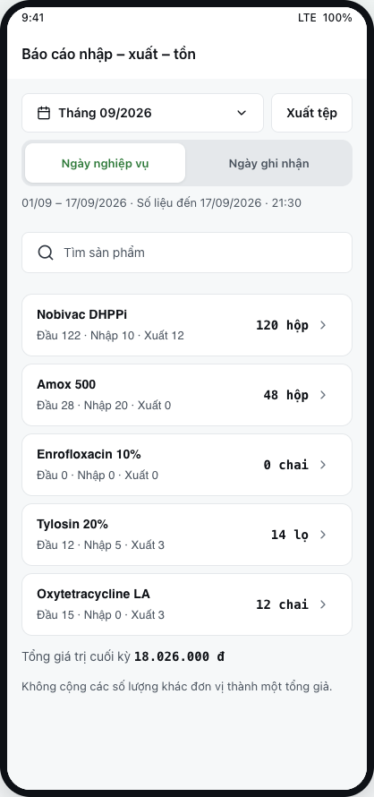
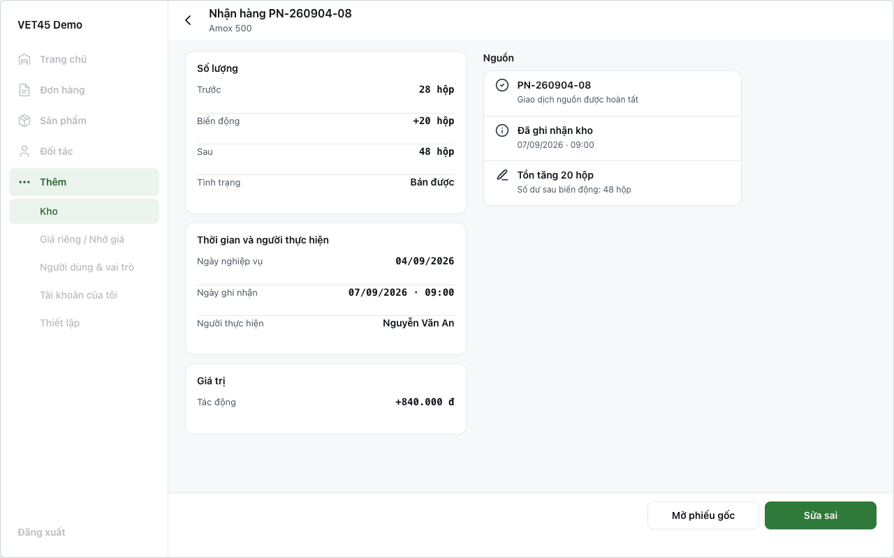

# T7-G5-7 — Báo cáo kho: nhập – xuất – tồn, thẻ kho, lãi gộp, nhập theo NCC (BJ-15)

> Theme 7 · plan **G5-7** của [PLAN.md](../../PLAN.md) mục "Theme 7" (bảng Plan)
> Trạng thái: Plan ✅ (người dùng duyệt 2026-11-13) | Làm ✅ 2026-11-13 | Review ✅ R2 đạt 2026-11-13
> Thiết kế: duyệt trong chat 2026-11-12 / 13 (3 câu hỏi + 3 phần: dữ liệu / RPC; màn / lối vào; test / task). Nguồn nghiệp vụ: Screen Contract SCR-055 / 056 (FROZEN v5.27.0), UIF-15, [spec giá vốn](T7-G5-gia-von-thiet-ke.md) mục 7 (báo cáo lãi gộp), 8 (G5-7), PLAN.md "Ghi chú G5-7" (D1 kỳ tháng, D5 dấu sổ). Prototype `app/bj15.js` (mục 2.6). Phụ thuộc: G5-0b (`stock_movements`, `value_movements`, `product_costs`), G5-2a (`_product_stock_rows`), G5-3 (`goods_receipts*`), G5-4 (dòng đơn lưu giá vốn), G5-5 (`STOCKTAKE`), G5-5b (`supplier_rebate_allocations`), G5-6 (`COGS_TRUE_UP` / `LOSS_TRUE_UP`, SCR-077).

> **For agentic workers:** REQUIRED SUB-SKILL: Use superpowers:subagent-driven-development (recommended) or superpowers:executing-plans to implement this plan task-by-task. Steps use checkbox (`- [ ]`) syntax for tracking.

**Goal:** Chủ cửa hàng và nhân viên tra báo cáo nhập – xuất – tồn theo kỳ, thẻ kho từng sản phẩm (theo lô) và chi tiết một biến động có "Mở phiếu gốc"; chủ cửa hàng xem thêm giá trị sổ, báo cáo lãi gộp (theo sản phẩm / theo đơn) và báo cáo nhập hàng theo nhà cung cấp. Mọi số đọc từ sổ, khớp từng đồng với `product_costs` và kết quả công bố G5-6.

**Architecture:** Migration mới `20261119001_inventory_reports.sql`: helper `_movement_source`, `_report_range_check` và 5 RPC **chỉ đọc** (không bảng mới, không sửa migration cũ). Flutter: BJ mới `features/inventory/{data,logic,presentation}/reports/` (055 báo cáo + thẻ kho, 056, lãi gộp, nhập theo NCC, sheet "Chọn kỳ" dùng chung); nối lối vào Hub, 077, SCR-003.

**Tech Stack:** PostgreSQL / Supabase (plpgsql), Flutter, `flutter_bloc`, `go_router`, `get_it`, `c45_design_system`.

**Spec:** mục 1–2 của plan này + Screen Contract SCR-055 / 056 + PLAN.md Theme 7 → "Quy ước chung cho mọi plan G5".

## Global Constraints

- Quy ước chung: PLAN.md Theme 7 → "Quy ước chung cho mọi plan G5" (gồm "UI Flutter: trích code prototype" — code đã chép ở mục 2.6; phiên code không thêm phần tử ngoài bảng ánh xạ).
- Header migration theo khuôn `20261110001_inventory_core.sql`; cập nhật `supabase/migrations/REGISTRY.yaml`. **Không** sửa migration đã có.
- Hàm Kho mới: `security definer`, `set search_path = inventory, iam, catalog, sales, partner, pg_temp`, `stable`. RPC: `grant execute … to authenticated`, gọi `inventory._assert_actor(p_tenant_id, 'inventory.read', <owner_only>)` **đầu tiên**: `false` cho `get_stock_report`, `get_stock_card`, `get_movement_detail`; `true` cho `get_gross_profit_report`, `get_supplier_purchase_report` (nhân viên ⇒ `PERMISSION_DENIED`). Kho = `(v_actor->>'warehouse_id')::uuid`, cửa hàng = `(v_actor->>'store_id')::uuid`, chủ = `(v_actor->>'is_owner')::boolean` (như `get_stock_detail`, `20261112001`). Hàm `_`: `revoke all … from public, anon, authenticated`, không `grant`.
- Che tài chính ở **server**: nhân viên nhận mọi khoá tiền = `null` (không tính rồi giấu ở app).
- Kỳ: `p_from date`, `p_to date` theo `business_date` (giờ VN). `p_from is null or p_to is null or p_from > p_to` ⇒ `CONTEXT_INVALID`. Ngày của cột `timestamptz` bên Sales: `(x at time zone 'Asia/Ho_Chi_Minh')::date`.
- Tiền `bigint` (đồng); số lượng ĐVT cơ sở `numeric`; số lượng Sales `*_micros / 1000000.0`. Hiển thị: `MoneyFormatter.formatMinor(int)`; số có dấu dùng `signedMoney` (G5-6, dấu trừ `−` U+2212); số lượng `formatQuantity`.
- Chạy SQL: `tools/db_check.sh` (reset + `plpgsql_check` + mọi tệp test) phải ✅ trước khi báo xong task có SQL; một tệp: `tools/db_check.sh --no-reset inventory_reports`. Lệnh DB chỉ chạy **local**; reset Dev (`--linked`) **hỏi người dùng**.
- Flutter: `dart analyze` (không `flutter analyze`). Test: `cd apps/erp && flutter test --no-pub -r compact <đường dẫn>`. Số test đỏ không hơn `docs/refactor/TEST-BASELINE.md`.
- Chữ trên màn: **nguyên văn** Screen Contract mục 8 + chữ mới mục 2.5 (đã duyệt). Phần bỏ (mục 1 Q-7-4) không dựng, không để chuỗi trong code.
- Trước khi sửa symbol đã có (`warehouseAreaEntries`, `CostResultPage`, `stockRoutes`, `StockDetailBody`, `app_router.dart`, `injection.dart`): chạy `impact({target, direction: "upstream"})`, ghi Kết quả; HIGH / CRITICAL ⇒ dừng, báo người dùng. Task cuối: `detect_changes({scope: "compare", base_ref: "main"})`.
- `AGENTS.md`, `CLAUDE.md`: không `git add`. Ghi mục 5 Kết quả sau mỗi task. Làm từng task một, mỗi task một commit.

## Review Focus

1. **Thẻ kho lọc theo lô** ⇒ đầu kỳ, tồn sau từng dòng và cuối kỳ chỉ tính lô đó; cuối kỳ "Tất cả lô" = cuối kỳ dòng sản phẩm trên 055 = tồn SCR-003. Sản phẩm không theo lô ⇒ câu "Sản phẩm không quản lý theo lô.", không chip. Test: Task 1 `r2_card_by_lot`; Task 4 `card_non_lot_note_390`.
2. **Nhân viên** ⇒ RPC trả khoá tiền `null`; màn 055 / thẻ kho / 056 không có chuỗi "đ" (kể cả dòng tổng, khối "Giá trị"); mở URL lãi gộp / NCC ⇒ K1 không có quyền. Test: Task 1 `r5_staff_masked`; Task 4 `report_staff_no_money_390`; Task 5 `movement_staff_no_value`; Task 6 `gross_profit_denied_390`.
3. **Kỳ** ⇒ "Tháng này" = 01 → hôm nay, "Tháng trước" đủ tháng; "Tùy chọn" ngày sai thứ tự báo lỗi tại ô, không gọi RPC; cột "Khả dụng" chỉ khi `to ≥ hôm nay`. Test: Task 3 `period_rules_*`; Task 4 `period_sheet_invalid_range`, `report_available_only_current`.
4. **Đơn tháng trước bị trả / huỷ tháng này** ⇒ giảm trừ doanh thu và giá vốn hoàn lại vào **tháng này** (chế độ sản phẩm); chế độ đơn không đổi số của đơn. Test: Task 2 `r6_prior_month_return`.
5. **Chứng từ không có màn xem** (`STOCKTAKE`) ⇒ 056 không có nút "Mở phiếu gốc"; dòng huỷ đơn mở **đơn gốc**. Test: Task 1 `r4_sources`; Task 5 `movement_stocktake_no_source_button`, `movement_cancellation_opens_order`.

---

## 1. Quyết định (người dùng, 2026-11-12 / 13)

| Q | Nội dung |
|---|---|
| Q-7-1 | **Một plan đủ 4 phần**: 055 (báo cáo + thẻ kho), 056, lãi gộp (hai chế độ trên một màn), nhập hàng theo NCC (bảng NCC, mở xem theo sản phẩm) |
| Q-7-2 | **Lãi gộp theo ngày phát sinh** (giảm trừ doanh thu kỳ phát sinh): doanh thu = đơn hoàn tất trong kỳ + dòng hàng đổi; giảm trừ = hàng trả trong kỳ + đơn huỷ trong kỳ; giá vốn đọc thẳng sổ giá trị theo `business_date`. Rounding cấp đơn không chia xuống sản phẩm |
| Q-7-3 | **Giá trị trên 055 = giá trị sổ** (Σ `value_movements.amount_vnd` tới hết `to`), bố cục giữ prototype (một cột "Giá trị cuối kỳ" + dòng tổng). Lệch Screen Contract §6 ("cuối kỳ × giá chính thức") ghi báo cáo đồ án. Khối "Giá trị · Tác động" ở 056 cũng là `amount_vnd` của dòng sổ |
| Q-7-4 | **Bỏ** (rút gọn 2026-11-09): "Xuất tệp" + sheet xuất + SCR-059 (màn bỏ); "Sửa sai" (BJ-11); `ARCHIVED_DATA`; `STALE` / `CONFLICT` / `LOCKED` (đọc trực tiếp sổ, không có dữ liệu chậm); "Tình trạng" ở 056 (BJ-09); công tắc "Ngày nghiệp vụ \| Ngày ghi nhận" (mọi RPC ghi sổ dùng `_today()` ⇒ hai ngày trùng; 056 vẫn hiện cả hai ngày) |
| Q-7-5 | **"Mở phiếu gốc"** chỉ khi nguồn có màn: phiếu nhận `/warehouse/receipts/:id`, đơn `/sales/orders/:id` (bán, huỷ), phiếu trả / đổi `/sales/orders/:o/returns/:r/detail`. Phiên kiểm kê không có màn xem đã ghi ⇒ không nút |

**Thêm lúc viết plan (duyệt cùng plan):**

| Chỗ | Nội dung | Lý do |
|---|---|---|
| Nhập / Xuất trên 055, thẻ kho | Tách theo **dấu** `quantity_delta` (huỷ đơn, trả hàng, kiểm kê thừa ở "Nhập") | Khớp cột ±; đầu + nhập − xuất = cuối luôn đúng |
| Sản phẩm có trên 055 | Có ít nhất một dòng `stock_movements` với `business_date ≤ to` **và** (có biến động trong kỳ **hoặc** đầu kỳ ≠ 0) | Sản phẩm chưa từng vào kho không có dòng |
| "Trước / Sau" ở 056 | Tồn **cả sản phẩm** (mọi lô) theo `ledger_sequence` (như `bj15Balances`) | Screen Contract 056 mục 3.1 |
| Hao hụt (lãi gộp) | `−Σ amount_vnd` của `COUNT_LOSS`, `WRITE_OFF`, `COUNT_GAIN`, `LOSS_TRUE_UP` theo `business_date` | Kiểm kê thừa bù hao hụt; `REVALUE_ROUNDING` không vào lãi gộp (chỉ giá trị tồn) |
| Chiết khấu NCC (lãi gộp) | Chỉ **phần đã bán**: Σ `supplier_rebate_allocations.cogs_part_vnd` theo `supplier_rebates.business_date`. Phần tồn (dòng `SUPPLIER_REBATE`) không vào lãi gộp | Phần tồn giảm giá trị tồn, tới lúc bán mới thành giá vốn thấp hơn |
| Đơn huỷ | Doanh thu của đơn hoàn tất trong kỳ **gồm** đơn bị huỷ sau đó; giảm trừ ghi ở kỳ của `cancelled_at`. Chế độ đơn chỉ liệt kê đơn `lifecycle_status = 'completed'` | Cùng kỳ ⇒ triệt tiêu; khác kỳ ⇒ đúng ngày phát sinh |
| Tỷ lệ lãi gộp (`margin_pct`) | `null` khi doanh thu thuần ≤ 0 (không chỉ = 0): dòng chỉ có hàng trả ra tỷ lệ dương giả (R1 #1) | Tỷ lệ trên doanh thu âm không có nghĩa |
| Doanh thu theo đơn | Σ `line_total_minor` (không gồm rounding cấp đơn); chế độ đơn **không** trừ hàng trả về sau | Spec giá vốn mục 7: "theo đơn: giá vốn lúc bán" |
| Đơn giá gốc bình quân (NCC) | `landed_vnd / (paid_base + free_base)`, 4 chữ số; mẫu 0 ⇒ `null` | Mua X tặng Y chia tiền cho cả hàng tặng (spec 12.1) |
| Lối vào 077 | "Xem báo cáo tồn" (primary) + "Xem báo cáo lãi gộp" mở kỳ `period_month` → `min(cuối tháng, hôm nay)` | Screen Contract 055 lối vào; spec giá vốn mục 7 |

---

## 2. Thiết kế

### 2.1 RPC (`supabase/migrations/20261119001_inventory_reports.sql`)

| Hàm | Ra / luật |
|---|---|
| `_report_range_check(p_from date, p_to date) returns void` | Một trong hai `null` hoặc `p_from > p_to` ⇒ `_raise('CONTEXT_INVALID', 'Khoảng ngày không hợp lệ.')` |
| `_movement_source(p_tenant_id uuid, p_intent_type text, p_intent_id uuid) returns jsonb` | Bảng dưới. Không khớp ⇒ `{kind: 'OTHER', doc_code: '', target: null}` |
| `get_stock_report(p_tenant_id uuid, p_from date, p_to date, p_search text default null) returns jsonb` | Mục 2.2 |
| `get_stock_card(p_tenant_id uuid, p_product_id uuid, p_from date, p_to date, p_lot_id uuid default null) returns jsonb` | Mục 2.2. Sản phẩm không thuộc tenant ⇒ `CONTEXT_INVALID` |
| `get_movement_detail(p_tenant_id uuid, p_movement_id uuid) returns jsonb` | Mục 2.2. Dòng không thuộc tenant ⇒ `CONTEXT_INVALID` |
| `get_gross_profit_report(p_tenant_id uuid, p_from date, p_to date, p_mode text) returns jsonb` | `p_mode` ∉ (`PRODUCT`, `ORDER`) ⇒ `CONTEXT_INVALID`. Mục 2.3 |
| `get_supplier_purchase_report(p_tenant_id uuid, p_from date, p_to date) returns jsonb` | Mục 2.4 |

**`_movement_source`:**

| `intent_type` | `kind` | `doc_code ←` | `target` |
|---|---|---|---|
| `GOODS_RECEIPT` | `RECEIPT` | `goods_receipts.receipt_no` | `{receipt_id ← goods_receipts.id}` |
| `SALES_ORDER` | `ORDER` | `sales_orders.order_code` | `{order_id ← sales_orders.id}` |
| `SALES_CANCELLATION` | `CANCELLATION` | `sales_orders.order_code` qua `sales_order_cancellations.sales_order_id` | `{order_id ← sales_order_cancellations.sales_order_id}` |
| `RETURN_EXCHANGE` | `RETURN_EXCHANGE` | `sales_orders.order_code` qua `return_exchange_orders.sales_order_id` | `{order_id ← return_exchange_orders.sales_order_id, return_id ← return_exchange_orders.id}` |
| `STOCKTAKE` | `STOCKTAKE` | `stocktake_sessions.code` | `null` |

### 2.2 055 / thẻ kho / 056

Chung: `sm` = `stock_movements` của tenant + kho; `open(p, lot?)` = Σ `quantity_delta` với `business_date < p_from`; trong kỳ = `business_date between p_from and p_to`; `in` = Σ `quantity_delta` dương, `out` = Σ `−quantity_delta` của dòng âm; `closing = opening + in − out`. `value_to(p)` = Σ `value_movements.amount_vnd` với `business_date ≤ p_to` (mọi loại, gồm điều chỉnh).

**`get_stock_report`** ⇒ `{from, to, as_of ← now(), show_available (p_to ≥ _today()), financial_masked (not is_owner), rows: [{product_id, name ← products.name, code ← coalesce(products.sku,''), uom ← catalog._product_base_unit_name(tenant, product), opening_qty, in_qty, out_qty, closing_qty, available ← _product_stock_rows(tenant, ids).available khi show_available (khác null), closing_value ← value_to (null nếu masked)}], total_closing_value (Σ, null nếu masked)}`. Lọc `p_search` (không phân biệt hoa thường, bỏ dấu cách đầu cuối) trên `name` / `sku`. Sắp `name`.

**`get_stock_card`** ⇒ `{product: {product_id, name, code, uom, is_lot_tracked ← products.tracking_mode = 'lot'}, from, to, as_of, financial_masked, lots: [{lot_id, lot_code ← lots.lot_code, closing_qty}] (chỉ sản phẩm theo lô; lô có dòng `business_date ≤ to`; sắp lot_code), summary: {opening_qty, in_qty, out_qty, closing_qty}, closing_value (value_to; null nếu masked hoặc p_lot_id khác null — giá trị không theo lô), rows: [{movement_id, ledger_sequence, business_date, recorded_at ← sm.created_at, movement_kind, reason, intent_type, doc_code ← _movement_source, lot_code, quantity_delta, balance_after, actor_name ← iam._member_display_name(sm.created_by)}]}`. `summary` và `balance_after` tính theo bộ lọc lô (`p_lot_id null` = mọi lô); `rows` sắp `ledger_sequence`.

**`get_movement_detail`** ⇒ `{movement_id, product: {product_id, name, code, uom, is_lot_tracked}, lot_code, movement_kind, reason, intent_type, quantity_delta, before_qty ← Σ delta cùng sản phẩm, mọi lô, ledger_sequence < dòng này, after_qty, business_date, recorded_at, actor_name, value_amount ← value_movements.amount_vnd where movement_id = dòng này (null nếu masked hoặc không có), source: _movement_source(...)}`.

### 2.3 Lãi gộp

Cửa hàng = `store_id` của actor. Ngày Sales: `d(x) = (x at time zone 'Asia/Ho_Chi_Minh')::date`.

**`PRODUCT`** — mỗi sản phẩm `p` có ít nhất một số ≠ 0:

| Khoá | Nguồn |
|---|---|
| `revenue_vnd` | Σ `sales_order_lines.line_total_minor` của đơn `d(completed_at)` trong kỳ (mọi `lifecycle_status`) **+** Σ `round(quantity_micros / 1e6 × unit_value_minor)` của `return_exchange_lines` `line_role = 'exchange'`, phiếu `status = 'completed'`, `d(completed_at)` trong kỳ |
| `deduction_vnd` | Σ `round(quantity_micros / 1e6 × unit_value_minor)` dòng `line_role = 'returned'` của phiếu `completed`, `d(completed_at)` trong kỳ **+** Σ `line_total_minor` của đơn `lifecycle_status = 'cancelled'`, `d(cancelled_at)` trong kỳ |
| `net_revenue_vnd` | `revenue − deduction` |
| `cogs_at_sale_vnd` | `−Σ amount_vnd` sổ giá trị `kind in ('SALE','SALE_REVERSAL','RETURN_IN')`, `business_date` trong kỳ |
| `cogs_adjust_vnd` | `−Σ amount_vnd` `kind = 'COGS_TRUE_UP'` (D5) |
| `rebate_vnd` | Σ `cogs_part_vnd` (≥ 0) của `supplier_rebate_allocations` nối `supplier_rebates` có `business_date` trong kỳ |
| `cogs_after_vnd` | `cogs_at_sale + cogs_adjust − rebate` |
| `gross_profit_vnd` | `net_revenue − cogs_after` |
| `margin_pct` | `round(gross_profit × 100.0 / net_revenue, 1)`; `net_revenue = 0` ⇒ `null` |

Kèm `name`, `code`, `uom` như 2.2. Ra `{from, to, as_of, mode: 'PRODUCT', rows (sắp gross_profit desc, name), loss_vnd (hao hụt mục 1), totals: {revenue, deduction, net_revenue, cogs_at_sale, cogs_adjust, rebate, cogs_after, gross_profit, margin_pct, loss, profit_after_loss ← gross_profit − loss}}`.

**`ORDER`** — đơn `lifecycle_status = 'completed'`, `d(completed_at)` trong kỳ: `{order_id, order_code, completed_on, revenue_vnd ← Σ line_total_minor, cogs_vnd ← Σ coalesce(cogs_amount_vnd, 0), gross_profit_vnd, margin_pct, has_provisional ← bool_or(cogs_is_provisional)}` sắp `completed_on desc, order_code desc`; `totals: {revenue, cogs, gross_profit, margin_pct}`.

### 2.4 Nhập hàng theo NCC

`goods_receipts` của tenant, `business_date` trong kỳ; `rebates` = `supplier_rebates` nối `supplier_programs` (lấy `supplier_id`), `business_date` trong kỳ. Ra `{from, to, as_of, suppliers: [{supplier_id, name ← partner.partners.display_name, is_system ← partners.is_system, receipt_count, purchase_vnd ← Σ purchase_total_vnd, freight_vnd ← Σ freight_cost_vnd, trade_discount_vnd ← Σ trade_discount_vnd, landed_vnd ← Σ landed_total_vnd, rebate_vnd ← Σ rebates.rebate_amount_vnd, products: [{product_id, name, code, uom, paid_qty ← Σ paid_qty × conversion_rate, free_qty ← Σ free_qty × conversion_rate, purchase_vnd ← Σ purchase_amount_vnd, landed_vnd ← Σ landed_amount_vnd, avg_landed_unit_cost (mục 1)}] (sắp landed desc)}] (sắp landed desc, name), totals: {purchase, freight, trade_discount, landed, rebate}}`. NCC chỉ có chiết khấu trong kỳ (không phiếu) vẫn có dòng, `receipt_count 0`, `products []`.

### 2.5 Luật Flutter (`logic/reports/`) + chữ mới

`report_period.dart`:
- `class ReportPeriod extends Equatable {final DateTime from; final DateTime to;}`; `factory ReportPeriod.thisMonth(DateTime today)` = 01 → `today`; `ReportPeriod.lastMonth(DateTime today)` = đủ tháng trước; `ReportPeriod.ofMonth(DateTime month, DateTime today)` = 01 → `min(cuối tháng, today)`.
- `ReportPeriodKind kindOf(ReportPeriod p, DateTime today)` ⇒ `thisMonth` / `lastMonth` / `custom`.
- `String periodLabel(ReportPeriod p)` ⇒ `'Tháng MM/yyyy'` khi `from.day == 1` và cùng tháng; khác ⇒ `'dd/MM – dd/MM/yyyy'` (như `bj15PeriodLabel`). `String periodRange(p)` ⇒ `'dd/MM – dd/MM/yyyy'`.
- `String? customRangeError(DateTime? from, DateTime? to)` ⇒ thiếu ngày ⇒ `'Nhập ngày theo dạng dd/mm/yyyy'`; `from > to` ⇒ `'Ngày bắt đầu phải trước ngày kết thúc'`; đúng ⇒ `null`.
- Query route: `?from=yyyy-MM-dd&to=yyyy-MM-dd`; thiếu ⇒ `thisMonth`.

`reports_rules.dart`:
- `String movementLabel(String kind, String intentType, String? reason)`:

  | Điều kiện | Nhãn |
  |---|---|
  | `RECEIPT` | Nhận hàng |
  | `SALE` + `SALES_ORDER` | Bán hàng |
  | `SALE` + `RETURN_EXCHANGE` | Đổi hàng |
  | `SALE_REVERSAL` + `SALES_CANCELLATION` | Huỷ đơn |
  | `SALE_REVERSAL` / `RETURN_IN` + `RETURN_EXCHANGE` | Trả hàng |
  | `COUNT_GAIN` | Kiểm kê thừa |
  | `COUNT_LOSS` / `WRITE_OFF`, `reason` `DAMAGED` / `EXPIRED` / `LOSS` | Hỏng / Hết hạn / Thất thoát |
  | `COUNT_LOSS` / `WRITE_OFF`, `reason` `COUNT` hoặc `null` | Kiểm kê thiếu |

- `String signedQty(num v)` ⇒ `'+20'` / `'−2'` / `'0'` (U+2212, `formatQuantity`).
- `String marginText(num? pct)` ⇒ `null` ⇒ `'—'`; khác ⇒ `'35,2%'` (dấu phẩy thập phân).
- `String asOfText(DateTime t)` ⇒ `'dd/MM/yyyy · HH:mm'` (giờ máy).

Chữ mới (không có Screen Contract):

| Màn | Chữ |
|---|---|
| Hub "Báo cáo & lịch sử" | ô `'Lãi gộp'` / phụ `'Doanh thu, giá vốn và lãi theo kỳ'`; ô `'Nhập hàng theo NCC'` / phụ `'Tiền mua, hàng tặng và giá gốc theo nhà cung cấp'` |
| SCR-003 / sheet nguồn | dùng nút có sẵn `'Xem thẻ kho và lịch sử'` |
| Lãi gộp | tiêu đề `'Lãi gộp'`; chế độ `'Theo sản phẩm'` · `'Theo đơn'`; tổng `'Doanh thu thuần'` · `'Giá vốn'` · `'Lãi gộp'` · `'Hao hụt / huỷ'` · `'Lãi sau hao hụt'`; cột `'Sản phẩm'` · `'Doanh thu thuần'` · `'Giá vốn lúc bán'` · `'Điều chỉnh'` · `'Chiết khấu NCC'` · `'Giá vốn sau điều chỉnh'` · `'Lãi gộp'` · `'Tỷ lệ'`; dòng iPhone `'DT {x} · GV {y}'` + `'Lãi {z} · {tỷ lệ}'`; sheet sản phẩm thêm `'Doanh thu'` · `'Giảm trừ (trả / huỷ)'`; chế độ đơn cột `'Đơn'` · `'Ngày'` · `'Doanh thu'` · `'Giá vốn lúc bán'` · `'Lãi gộp'` · `'Tỷ lệ'`, nhãn `'Giá tạm'`, ghi chú `'Điều chỉnh giá vốn không chia xuống từng đơn.'`; rỗng `'Chưa có đơn bán trong kỳ'` + `'Đổi khoảng ngày để xem dữ liệu khác.'`; không quyền `InventoryDenied(what: 'xem lãi gộp', next: 'Chỉ chủ cửa hàng xem báo cáo lãi gộp.', exitLabel: 'Về Kho')` |
| Nhập theo NCC | tiêu đề `'Nhập hàng theo NCC'`; `'Tổng giá gốc {x}'`; cột `'Nhà cung cấp'` · `'Số phiếu'` · `'Tiền mua'` · `'Chi phí thu mua'` · `'Chiết khấu thương mại'` · `'Giá gốc'` · `'Chiết khấu đạt mốc'`; dòng iPhone `'{n} phiếu'` + `'Giá gốc {x}'`; sheet sản phẩm cột `'Sản phẩm'` · `'SL mua'` · `'SL tặng'` · `'Tiền mua'` · `'Giá gốc'` · `'Đơn giá gốc'`; rỗng `'Chưa nhập hàng trong kỳ'` + `'Đổi khoảng ngày để xem dữ liệu khác.'`; không quyền `InventoryDenied(what: 'xem báo cáo nhập hàng', next: 'Chỉ chủ cửa hàng xem báo cáo nhập hàng.', exitLabel: 'Về Kho')` |
| 077 | thêm `'Xem báo cáo lãi gộp'` (secondary) cạnh `'Xem báo cáo tồn'` (primary) |

### 2.6 Màn + code prototype + ánh xạ Flutter

Route (`presentation/reports/reports_routes.dart`, `reportsRoutes()`; mọi màn ngoài `StatefulShellRoute`, như `costingRoutes()`):

| Route | Màn |
|---|---|
| `/warehouse/reports/stock?from&to` | 055 báo cáo |
| `/warehouse/reports/stock/:productId?from&to&back=stock` | 055 thẻ kho (`back=stock` ⇒ quay lại về `/warehouse/stock/:productId`; khác ⇒ về báo cáo) |
| `/warehouse/movements/:movementId` | 056 |
| `/warehouse/reports/gross-profit?from&to&mode=PRODUCT\|ORDER` | Lãi gộp |
| `/warehouse/reports/supplier-purchases?from&to` | Nhập theo NCC |

Ảnh đích (`img/G5-7/`): `proto-SCR-055-READY-{390,1280}.png`, `proto-SCR-055-FINANCIAL_RESTRICTED-{390,1280}.png`, `proto-SCR-055-EMPTY-{390,1280}.png`, `proto-SCR-056-READY-{390,1280}.png`. Prototype có "Xuất tệp", công tắc ngày, "Tình trạng", "Sửa sai" ⇒ lệch có chủ đích (Q-7-4), ghi Kết quả. Thẻ kho không có ảnh `proto-final` ⇒ dựng theo code.

 

**CSS** (`styles/screens.css:4259-4312`, `components.css:2522-2524`; token đã giải):
```css
.bj15-screen { display: flex; flex-direction: column; gap: 12px; width: 100%; }
.bj15-toolbar { display: flex; flex-direction: column; gap: 8px; }
.bj15-period { display: inline-flex; align-items: center; justify-content: flex-start; gap: 8px; width: auto; min-height: 44px; }  /* web 40px */
.bj15-period > span { flex: 1 1 auto; text-align: left; font-weight: 600; }
.bj15-asof { margin: 0; font: 400 13px/20px Inter; color: #4A535E; }
.bj15-end { font: 600 14px/20px mono; font-variant-numeric: tabular-nums; white-space: nowrap; color: #0E1116; }
.bj15-mv { display: flex; flex-direction: column; align-items: flex-end; gap: 2px; white-space: nowrap; }
.bj15-mv__delta { font: 600 14px/20px mono; color: #0E1116; }
.bj15-mv small { font: 400 12px/16px mono; color: #4A535E; }
.bj15-balance { display: flex; align-items: baseline; justify-content: space-between; gap: 12px; min-height: 44px; padding: 8px 16px; border-radius: 12px; background: var(--surface-subtle); font: 400 13px/20px Inter; color: #4A535E; }
.bj15-balance strong { font: 600 14px/20px mono; color: #0E1116; white-space: nowrap; }
.bj15-total { margin: 0; font: 400 14px/22px Inter; color: #4A535E; }
.bj15-total strong { font: 600 14px/22px mono; color: #0E1116; }
.bj15-note { margin: 0; font: 400 13px/20px Inter; color: #4A535E; }
.k7-table tbody tr.bj15-edge-row > td { background: var(--surface-subtle); font-weight: 600; color: #0E1116; }
.bj15-dates { display: grid; grid-template-columns: repeat(2, minmax(0, 1fr)); gap: 8px; align-items: start; }
.bj15-strip { display: grid; grid-template-columns: repeat(4, minmax(0, 1fr)); gap: 8px; }   /* + .cf12-strip: padding 12px 16px; border 1px #E5E8EB; radius 4; nền #FFF */
.bj15-strip .cf12-strip__item { display: flex; flex-direction: column; align-items: flex-start; gap: 2px; font: 400 12px/16px Inter; color: #4A535E; }
.bj15-strip .cf12-strip__item strong { font: 600 16px/22px mono; color: #0E1116; }
/* UIF-15: .ds24-list-row min-height 64px, padding-block 12px, chữ không cắt; .ds24-key-value-row > strong.bj15-text = 600 14px/20px Inter (chữ, không mono) */
```

#### SCR-055 Báo cáo

```js
// app/bj15.js:234-241 (bỏ dsSegmented + exportBtn — Q-7-4)
function bj15Toolbar() {
  const period = `<button type="button" class="button button--secondary bj15-period" data-bj15-action="period-open" …>${icon("calendar", "icon--sm")}<span>${esc(bj15PeriodLabel())}</span>${icon("chevronDown", "icon--sm")}</button>`;
  return `<section class="bj15-toolbar"><div class="bj15-toolbar__row">${period}</div><p class="bj15-asof">${esc(bj15PeriodRange())} · Số liệu đến ${esc(BJ15_AS_OF)}</p></section>`;
}
// app/bj15.js:245-276
function bj15ReportMobileRow(r) {
  return ds24ListRow({ title: r.name, subtitle: `Đầu ${bj15Number(r.opening)} · Nhập ${bj15Number(r.inQty)} · Xuất ${bj15Number(r.outQty)}`, trailing: `<span class="bj15-end">${esc(t7Qty(bj15Number(r.closing), r.uom))}</span>`, leading: null, … });
}
function bj15ReportBody(state) {
  const money = bj15ShowMoney(state), rows = bj15Report();
  const showAvail = cf15Period.to >= BJ15_TODAY;
  const search = { value: cf15Query, attr: "data-bj15-search", placeholder: "Tìm sản phẩm" };
  const columns = [
    { key: "product", label: "Sản phẩm", html: true },
    { key: "opening", label: "Đầu kỳ", align: "end", mono: true },
    { key: "inQty", label: "Nhập", align: "end", mono: true },
    { key: "outQty", label: "Xuất", align: "end", mono: true },
    { key: "closing", label: "Cuối kỳ", align: "end", mono: true },
    ...(showAvail ? [{ key: "avail", label: "Khả dụng", align: "end", mono: true }] : []),
    ...(money ? [{ key: "valueText", label: "Giá trị cuối kỳ", align: "end", mono: true }] : []),
  ];
  const view = rows.map((r) => ({ ...r, product: `<strong>${esc(r.name)}</strong><small>${esc(r.code)} · ${esc(r.uom)}</small>`, … }));
  const total = rows.reduce((a, r) => a + r.value, 0);
  const list = k6TaskList({ search, filters: null, columns, rows: view, total: rows.length || 1, mobileRow: …, rowOpen: true,
    empty: { title: "Không có biến động trong kỳ", description: "Đổi khoảng ngày hoặc sản phẩm để xem dữ liệu khác." },
    filterEmpty: { title: "Không có biến động trong kỳ", description: "Đổi khoảng ngày hoặc sản phẩm để xem dữ liệu khác.", actionLabel: "Xem tất cả", actionAttr: 'data-bj15-action="clear-filter"' },
    caption: "Báo cáo nhập – xuất – tồn" });
  const totalLine = money ? `<p class="bj15-total">Tổng giá trị cuối kỳ <strong>${esc(t7FmtMoney(total))}</strong></p>` : "";
  const note = `<p class="bj15-note">Không cộng các số lượng khác đơn vị thành một tổng giả.</p>`;
  return { rows, html: rows.length ? `${list}${totalLine}${note}` : `${ds24Search(…)}${bj15Empty("FILTER_EMPTY")}` };
}
// app/bj15.js:224-231 (rỗng)
function bj15Empty(state) {
  const filtered = state === "FILTER_EMPTY" || cf15Query.trim() || (cf15Mode === "CARD" && cf15Lot !== "ALL");
  return k1Empty({ title: "Không có biến động trong kỳ", description: "Đổi khoảng ngày hoặc sản phẩm để xem dữ liệu khác.",
    actionLabel: filtered ? "Xem tất cả" : "Xem tháng trước", … });
}
```

| Phần tử | Flutter | Ghi chú |
|---|---|---|
| Khung | `Scaffold` + `VAppBar(title: 'Báo cáo nhập – xuất – tồn')` trong `InventoryPage` của khuôn (như `CostOverviewPage`), thân `Column(gap: VSpacing.space3)` | quay lại về Kho |
| Thanh lọc | **mới** `ReportPeriodBar(period, asOf, onTap)` (`report_period_sheet.dart`): `VButton(variant: secondary, leading: VIcons.calendar, trailing: VIcons.chevronDown, label: periodLabel)` min-height 44 (web 40) căn trái + `Text('{periodRange} · Số liệu đến {asOfText}')` kiểu `.bj15-asof` | dùng chung cho 4 màn |
| Danh sách | `K6TaskList<StockReportRow>(search: K6Search(hint: 'Tìm sản phẩm'), filters: null, columns: [Sản phẩm (tên + '{code} · {uom}'), Đầu kỳ, Nhập, Xuất, Cuối kỳ (mono end), Khả dụng (khi showAvailable), Giá trị cuối kỳ (khi !financialMasked)], title: name, subtitle: 'Đầu {a} · Nhập {b} · Xuất {c}', trailing: '{d} {uom}' kiểu `.bj15-end`, onOpen ⇒ thẻ kho cùng kỳ)` | Không có badge trạng thái. `K6TaskList` / `K6TaskRow` hiện chưa có `trailing` ⇒ thêm `Widget Function(T)? trailing` (hiện thay badge, căn phải, không đo chỗ badge) và đổi `status` thành `K6Status Function(T)?` (`assert(status != null \|\| trailing != null)`); chỗ gọi cũ không đổi — `impact` trước |
| Tổng | `Text.rich('Tổng giá trị cuối kỳ ' + bold mono)` kiểu `.bj15-total`; chỉ khi `!financialMasked` | |
| Ghi chú | `Text('Không cộng các số lượng khác đơn vị thành một tổng giả.')` kiểu `.bj15-note` | |
| Rỗng | `InventoryEmpty('Không có biến động trong kỳ', 'Đổi khoảng ngày hoặc sản phẩm để xem dữ liệu khác.', action: có tìm ⇒ 'Xem tất cả' (xoá tìm) / không ⇒ 'Xem tháng trước')` | |
| Đang tải | `InventoryLoading(blocks: search, row, row, row)` | |
| Lỗi | `InventoryEmpty(title: inventoryErrorMessage, action 'Thử lại')` (như 072) | |

#### SCR-055 Thẻ kho

```js
// app/bj15.js:278-325
function bj15Strip(l) {
  const item = (label, n) => `<span class="cf12-strip__item">${esc(label)} <strong>${bj15Number(n)}</strong></span>`;
  return `<div class="cf12-strip bj15-strip">${[item("Đầu kỳ", l.opening), item("Nhập", l.inQty), item("Xuất", l.outQty), item("Cuối kỳ", l.closing)].join(dot)}</div>`;
}
function bj15LotChips(p) {
  const lots = bj15Lots(p);
  if (!lots.length) return `<p class="bj15-note">Sản phẩm không quản lý theo lô.</p>`;
  return k7FilterChips({ items: [["ALL", "Tất cả lô", end("ALL")], ...lots.map((l) => [l, `Lô ${l}`, end(l)])], selected: cf15Lot, … });
}
function bj15CardRows(p, l) {
  const edge = (label, n) => ({ edge: true, date: "", doc: "", desc: label, lot: "", inQty: "", outQty: "", stock: bj15Number(n), mobileLabel: label, mobileValue: t7Qty(bj15Number(n), p.stockUom) });
  const body = l.rows.map((m) => ({ edge: false, id: m.id, date: …, doc: m.doc, desc: `${m.kind}${m.note ? ` — ${m.note}` : ""}`, lot: m.lot || "—",
    inQty: m.delta > 0 ? bj15Number(m.delta) : "", outQty: m.delta < 0 ? bj15Number(-m.delta) : "", stock: bj15Number(m.balance), m }));
  return { lotCol, rows: [edge("Tồn đầu kỳ", l.opening), ...body, edge("Tồn cuối kỳ", l.closing)] };
}
function bj15CardMobileRow(r, p) {
  if (r.edge) return `<div class="bj15-balance"><span>${esc(r.mobileLabel)}</span><strong>${esc(r.mobileValue)}</strong></div>`;
  const sub = [bj15DateOf(m), p.tracking === "LOT" && m.lot ? `Lô ${m.lot}` : "", m.actor, bj15OtherDate(m), m.note].filter(Boolean).join(" · ");
  const trailing = `<span class="bj15-mv"><strong class="bj15-mv__delta">${esc(bj15Signed(m.delta))}</strong><small>Tồn ${esc(bj15Number(m.balance))}</small></span>`;
  return ds24ListRow({ title: `${m.kind} ${m.doc}`, subtitle: sub, trailing, … });
}
function bj15CardBody(state) {
  const value = money ? `<p class="bj15-total">Giá trị cuối kỳ <strong>${esc(t7FmtMoney(…))}</strong></p>` : "";
  if (!l.rows.length) return { empty: true, html: `${chips}${strip}${value}${bj15Empty(state)}` };
  const columns = [{ key: "date", label: dateLabel, mono: true }, { key: "doc", label: "Chứng từ", mono: true }, { key: "desc", label: "Diễn giải" },
    ...(lotCol ? [{ key: "lot", label: "Lô" }] : []),
    { key: "inQty", label: "Nhập", align: "end", mono: true }, { key: "outQty", label: "Xuất", align: "end", mono: true }, { key: "stock", label: "Tồn", align: "end", mono: true }];
  const table = k7Table({ columns, rows, mobileRow: …, caption: `Thẻ kho ${p.name}`, rowOpen: (r) => !r.edge });
  return { empty: false, html: `${chips}${strip}${value}${table}` };
}
```

| Phần tử | Flutter | Ghi chú |
|---|---|---|
| Khung | `VAppBar(title: 'Thẻ kho', subtitle: '{name} · {code} · {uom}')` | quay lại theo `back` |
| Thanh lọc | `ReportPeriodBar` | |
| Lô | `is_lot_tracked` ⇒ `K7FilterChips([K7Filter(null,'Tất cả lô', summary.closing của tất cả), …K7Filter(lotId,'Lô {code}', closing_qty)])`; khác ⇒ `Text('Sản phẩm không quản lý theo lô.')` | đổi chip ⇒ gọi lại RPC với `p_lot_id` |
| Dải số | **mới** `StockCardStrip(summary)`: `Container` viền `VColors.borderDefault` 1px, radius 4, padding 12/16, `Row` 4 cột đều; nhãn 12/16 secondary, số `600 16/22` mono | `.bj15-strip` |
| Giá trị | `Text.rich('Giá trị cuối kỳ ' + bold mono)` khi `closingValue != null` | |
| Bảng web | `K7Table<StockCardLine>(columns: [Ngày nghiệp vụ (dd/MM/yyyy), Chứng từ, Diễn giải (movementLabel), Lô (khi theo lô), Nhập, Xuất, Tồn], rows: [cạnh 'Tồn đầu kỳ', …, cạnh 'Tồn cuối kỳ'], rowStyle cạnh: nền `surfaceSubtle`, chữ 600; onTap dòng không phải cạnh ⇒ 056)` | |
| iPhone | Cạnh: `Container` `.bj15-balance`; dòng: `VListRow(title: '{movementLabel} {doc_code}', subtitle: '{dd/MM/yyyy} · Lô {lot} · {actor}', trailing: Column(end)[signedQty mono 600 14, 'Tồn {balance}' mono 12 secondary])` | |
| Rỗng | như báo cáo; chip lô khác "Tất cả" ⇒ action `'Xem tất cả'` | |

#### Sheet "Chọn kỳ"

```js
// app/bj15.js:330-338
function bj15PeriodSheet() {
  const chips = k7FilterChips({ items: [["THIS", "Tháng này"], ["LAST", "Tháng trước"], ["CUSTOM", "Tùy chọn"]], selected: kind, … });
  const fields = c ? `<div class="bj15-dates">${cfField("Từ ngày", c.from, …, c.fromError)}${cfField("Đến ngày", c.to, …, c.toError)}</div>` : "";
  const actions = `<div class="sheet-actions">${cfSecondary("Quay lại", …)}${c ? `<button class="button button--primary" …>Áp dụng</button>` : ""}</div>`;
  return ds24Sheet({ title: "Chọn kỳ", body: `${chips}${fields}${actions}` });
}
```

`ReportPeriodSheet.show(context, current, today) → Future<ReportPeriod?>` (`showVAdaptiveSheet`, tiêu đề `'Chọn kỳ'`): `K7FilterChips` 3 chip; "Tháng này" / "Tháng trước" trả kỳ ngay; "Tùy chọn" hiện 2 `VDatePicker` ("Từ ngày", "Đến ngày") lưới 2 cột + `'Áp dụng'` (primary); lỗi `customRangeError` hiện dưới ô "Đến ngày" (sai thứ tự) / ô thiếu, không đóng sheet; `'Quay lại'` (secondary).

#### SCR-056 Chi tiết biến động

```js
// app/bj15.js:375-399 (bỏ "Tình trạng", CONFLICT, LOCKED, "Sửa sai" — Q-7-4)
function bj15Facts(title, rows) {
  return `<section class="ac310-surface"><div class="ac310-surface__head"><h2>${esc(title)}</h2></div><div class="ac310-key-value-stack">${rows.map(([label, value, text]) => ds24KeyValueRow(label, value, false, text ? 'class="bj15-text"' : "")).join("")}</div></section>`;
}
function bj15Timeline(m, p, after) {
  const move = m.delta === 0 ? "Tồn không đổi" : `${m.delta > 0 ? "Tồn tăng" : "Tồn giảm"} ${t7Qty(bj15Number(Math.abs(m.delta)), p.stockUom)}`;
  return ac310AuditSurface("Nguồn", [ac310AuditItem("Create", m.doc, "Giao dịch nguồn được hoàn tất"), ac310AuditItem("System", "Đã ghi nhận kho", m.recorded), ac310AuditItem("Update", move, `Số dư sau biến động: ${t7Qty(bj15Number(after), p.stockUom)}`)]);
}
function render056BJ15(state) {
  const head = { title: esc(`${m.kind} ${m.doc}`), subtitle: esc(`${p.name}${p.tracking === "LOT" && m.lot ? ` · Lô ${m.lot}` : ""}`), back: true };
  if (state === "LOADING") return bj15Shell({ ...head, title: esc(title), subtitle: null, body: k1Loading({ blocks: ["heading", "card", "card"] }) });
  const quantity = bj15Facts("Số lượng", [["Trước", t7Qty(bj15Number(bal.before), u)], ["Biến động", m.delta === 0 ? t7Qty(0, u) : `${bj15Signed(m.delta)} ${u}`], ["Sau", t7Qty(bj15Number(bal.after), u)], ...(p.tracking === "LOT" && m.lot ? [["Lô", m.lot]] : [])]);
  const who = bj15Facts("Thời gian và người thực hiện", [["Ngày nghiệp vụ", m.business], ["Ngày ghi nhận", m.recorded], ["Người thực hiện", m.actor, true]]);
  const value = money ? bj15Facts("Giá trị", [["Tác động", t7FmtMoney(…, true)]]) : "";
  const buttons = []; if (bj15SourceOf(m)) buttons.push({ label: "Mở phiếu gốc", attr: 'data-bj15-action="open-source"' });
  return bj15Shell({ ...head, body: `${k7Split({ main: `${quantity}${who}${value}`, aside: bj15Timeline(m, p, bal.after) })}`, actions: buttons.length ? k4Footer(buttons) : "" });
}
```

| Phần tử | Flutter | Ghi chú |
|---|---|---|
| Khung | `VAppBar(title: '{movementLabel} {doc_code}', subtitle: '{name}' + (' · Lô {lot}' khi theo lô))`; đang tải tiêu đề `'Chi tiết biến động'` | |
| Khối | `K7Split(main: [VCard(VKeyValueGroup('Số lượng', [Trước, Biến động ('{signedQty} {uom}'), Sau, Lô?] mono)), VCard('Thời gian và người thực hiện', [Ngày nghiệp vụ 'dd/MM/yyyy' mono, Ngày ghi nhận 'dd/MM/yyyy · HH:mm' mono, Người thực hiện chữ 600 Inter]), VCard('Giá trị', [Tác động signedMoney mono]) khi valueAmount != null], aside: MovementSourceTimeline)` | iPhone xếp dọc, "Nguồn" cuối |
| Nguồn | **mới** `MovementSourceTimeline` (`movement_detail_page.dart`, riêng màn): tiêu đề `'Nguồn'`; `VCard` 3 dòng ngăn `VDivider`: (`VIcons.checkCircle`, doc_code, 'Giao dịch nguồn được hoàn tất'), (`VIcons.info`, 'Đã ghi nhận kho', 'dd/MM/yyyy · HH:mm'), (`VIcons.edit`, 'Tồn tăng / giảm {n} {uom}' / 'Tồn không đổi', 'Số dư sau biến động: {after} {uom}') | chữ 600 14 + 400 13 secondary |
| Chân | `InventoryFooter([InventoryFooterAction('Mở phiếu gốc', secondary)])` khi `source.target != null` ⇒ route mục 1 Q-7-5 (`context.push`) | không target ⇒ không chân |
| Đang tải | `InventoryLoading(blocks: heading, card, card)` | |

#### Lãi gộp (không prototype — khung đã duyệt trong chat)

```
iPhone 390                               Web 1280
┌──────────────────────────────┐   ┌──────────────────────────────────────────────────────────────┐
│ ← Lãi gộp                    │   │ Lãi gộp                                                       │
│ [📅 Tháng 11/2026 ▾]         │   │ [📅 Tháng 11/2026 ▾]  [Theo sản phẩm | Theo đơn]               │
│ [Theo sản phẩm | Theo đơn]   │   │ 01/11 – 13/11/2026 · Số liệu đến 13/11/2026 · 10:20           │
│ 01/11 – 13/11/2026 · Số liệu…│   ├──────────┬────────┬────────┬────────┬──────┬─────┬──────┬────┤
│ ┌──────────────────────────┐ │   │Sản phẩm  │DT thuần│GV lúc  │Điều    │CK NCC│GV   │Lãi   │Tỷ  │
│ │Doanh thu thuần 12.400.000│ │   │          │        │bán     │chỉnh   │      │sau  │gộp   │lệ  │
│ │Giá vốn          8.100.000│ │   ├──────────┼────────┼────────┼────────┼──────┼─────┼──────┼────┤
│ │Lãi gộp          4.300.000│ │   │…         │        │        │        │      │     │      │    │
│ │Hao hụt / huỷ      150.000│ │   ├──────────┴────────┴────────┴────────┴──────┴─────┴──────┴────┤
│ │Lãi sau hao hụt  4.150.000│ │   │ thẻ tổng (VSummaryStrip): DT thuần · Giá vốn · Lãi gộp ·      │
│ └──────────────────────────┘ │   │ Hao hụt / huỷ · Lãi sau hao hụt                               │
│ Amoxicillin 500mg         ›  │   └──────────────────────────────────────────────────────────────┘
│ DT 5.200.000 · GV 3.380.000  │   Chạm dòng sản phẩm → sheet chi tiết (Doanh thu, Giảm trừ,
│ Lãi 1.820.000 · 35,0%        │   DT thuần, GV lúc bán, Điều chỉnh, Chiết khấu NCC, GV sau,
└──────────────────────────────┘   Lãi gộp, Tỷ lệ)
```

| Phần tử | Flutter |
|---|---|
| Thanh | `ReportPeriodBar` + `VSegmentedControl(segments: ['Theo sản phẩm','Theo đơn'])` (iPhone dưới nút kỳ; web cùng hàng) |
| Tổng (`PRODUCT`) | `VCard` + `VKeyValueRow` mono 5 dòng: Doanh thu thuần, Giá vốn (`cogs_after`), Lãi gộp, Hao hụt / huỷ, Lãi sau hao hụt |
| Danh sách web | `K7Table<GrossProfitRow>` 8 cột mục 2.5 (tiền mono end; Điều chỉnh `signedMoney`; Chiết khấu NCC hiện `−{x}` khi > 0; Tỷ lệ `marginText`); chạm ⇒ `GrossProfitProductSheet` |
| Danh sách iPhone | `VListRow(title: name, subtitle: 'DT {net} · GV {cogs_after}\nLãi {gp} · {marginText}', type: navigation)` ⇒ sheet |
| Sheet sản phẩm | `showVAdaptiveSheet`, tiêu đề tên sản phẩm; 9 `VKeyValueRow` mono; chân `'Đóng'` |
| `ORDER` | `K7Table` / `VListRow` (title `order_code`, subtitle `'dd/MM/yyyy · DT {x} · GV {y}'`, trailing lãi + `VBadge('Giá tạm', warning)` khi `has_provisional`); chạm ⇒ `context.push('/sales/orders/:id')`; tổng `VCard` 3 dòng; ghi chú `.bj15-note` 'Điều chỉnh giá vốn không chia xuống từng đơn.' |
| Rỗng / tải / không quyền / lỗi | `InventoryEmpty` / `InventoryLoading(row ×3)` / `InventoryDenied` / lỗi + 'Thử lại' (chữ mục 2.5) |

#### Nhập hàng theo NCC (không prototype)

```
iPhone                                    Web: K7Table NCC | Số phiếu | Tiền mua | Chi phí thu mua |
┌──────────────────────────────┐               CK thương mại | Giá gốc | CK đạt mốc
│ ← Nhập hàng theo NCC         │          Chạm NCC → SupplierPurchaseSheet (bảng sản phẩm)
│ [📅 Tháng 11/2026 ▾]         │
│ 01/11 – 13/11/2026 · Số liệu…│
│ Tổng giá gốc 45.200.000 đ    │
│ Cty Thú y A          3 phiếu ›│
│ Giá gốc 30.100.000 đ         │
│ Mua lẻ / khác        1 phiếu ›│
└──────────────────────────────┘
```

| Phần tử | Flutter |
|---|---|
| Tổng | `Text.rich('Tổng giá gốc ' + bold mono)` `.bj15-total` |
| Danh sách | web `K7Table<SupplierPurchaseRow>` 7 cột; iPhone `VListRow(title: name, subtitle: 'Giá gốc {x}', trailing: '{n} phiếu')` |
| Sheet | `SupplierPurchaseSheet`: tiêu đề tên NCC; `VKeyValueRow` 'Chiết khấu đạt mốc' khi > 0; web `K7Table` / iPhone `VListRow(title: name, subtitle: 'Mua {a} · Tặng {b} {uom}', trailing: giá gốc mono, below: 'Đơn giá gốc {c}/{uom}')`; chân `'Đóng'` |

#### Lối vào

- `warehouse_entries.dart` (`WarehouseArea.history`): `stock_card_reports` `route: '/warehouse/reports/stock'`; thêm `gross_profit` (`VIcons.coins`, `/warehouse/reports/gross-profit`, `ownerOnly: true`), `supplier_purchases` (`VIcons.cloudUpload`, `/warehouse/reports/supplier-purchases`, `ownerOnly: true`) — chữ mục 2.5.
- `cost_result_page.dart`: `next: [toList, 'Xem báo cáo lãi gộp' (secondary), 'Xem báo cáo tồn' (primary)]`, kỳ `ReportPeriod.ofMonth(run.periodMonth, today)`.
- `stock_routes.dart`: truyền `onOpenStockCard` cho `StockDetailBody` ⇒ `/warehouse/reports/stock/:productId?back=stock` (nút `'Xem thẻ kho và lịch sử'` của `StockProvenanceSheet` đã có).

### 2.7 Ngoài phạm vi

Xuất tệp / SCR-059; công tắc loại ngày; sửa sai; lưu trữ kỳ; `STALE` / `CONFLICT` / `LOCKED`; màn xem phiên kiểm kê đã ghi; phân trang (dữ liệu đồ án nhỏ — ghi báo cáo đồ án là điểm cần phân trang / chỉ mục `stock_movements (tenant_id, product_id, business_date)`); lãi gộp theo nhân viên / khách hàng; doanh thu theo kênh.

---

## 3. Tệp

| Tệp | Task |
|---|---|
| `supabase/migrations/20261119001_inventory_reports.sql` (mới), `REGISTRY.yaml` | 1, 2 |
| `supabase/tests/inventory_reports.sql` (mới) | 1, 2 |
| `apps/erp/test/features/inventory/data/reports_sql_contract_test.dart` (mới) | 1, 2 |
| `apps/erp/lib/features/inventory/data/reports/{reports_models,reports_repository}.dart` (mới) | 3 |
| `apps/erp/lib/features/inventory/logic/reports/` (mới): `report_period.dart`, `reports_rules.dart`, `stock_report_cubit/state.dart`, `stock_card_cubit/state.dart`, `movement_detail_cubit/state.dart`, `gross_profit_cubit/state.dart`, `supplier_purchase_cubit/state.dart` | 3 |
| `apps/erp/lib/features/inventory/presentation/reports/` (mới): `report_period_sheet.dart` (`ReportPeriodBar`, `ReportPeriodSheet`), `stock_report_page.dart`, `stock_card_page.dart`, `stock_card_strip.dart`, `movement_detail_page.dart`, `gross_profit_page.dart`, `gross_profit_product_sheet.dart`, `supplier_purchase_page.dart`, `supplier_purchase_sheet.dart`, `reports_routes.dart` | 4, 5, 6, 7 |
| `presentation/patterns/k6_task_list.dart` (tham số `trailing`, `status` không bắt buộc) | 4 |
| `presentation/hub/warehouse_entries.dart`, `presentation/costing/cost_result_page.dart`, `presentation/stock/stock_routes.dart`, `core/router/app_router.dart`, `core/di/injection.dart` | 7 |
| Test Flutter `apps/erp/test/features/inventory/{data,logic,presentation}/reports/` | 3–7 |
| `docs/refactor/PLAN.md`, `docs/refactor/plans/T7/img/G5-7/flutter-*.png` | 7 |

## 4. Task

### Task 0: Mốc + impact

- [ ] Ghi mốc: `git rev-parse HEAD`, `cd apps/erp && flutter test --no-pub -r compact test/features/inventory` (số đỏ), `tools/db_check.sh` (✅ / nợ đã biết).
- [ ] `impact` upstream cho mọi symbol ở Global Constraints + `K6TaskList`, `K6TaskRow`; ghi bảng vào Kết quả; HIGH / CRITICAL ⇒ dừng, hỏi người dùng.

### Task 1: SQL — nguồn chứng từ, 055, thẻ kho, 056

**Files:** migration mới (`_report_range_check`, `_movement_source`, `get_stock_report`, `get_stock_card`, `get_movement_detail`); `inventory_reports.sql`; `reports_sql_contract_test.dart`.

**Interfaces — Produces:** chữ ký + JSON mục 2.1–2.2.

Fixture: chép khuôn `inventory_goods_receipts.sql` (role `store_owner` + `is_owner`, `products.reference_id`, `store_warehouse_assignments`) + phần "Task 2: Sales link tests" của `inventory_sales_link.sql` (đơn qua RPC Sales thật, huỷ `confirm_sales_order_cancellation`, trả `confirm_return_exchange`) + `_post_movements` với `p_business_date` tháng trước (như `inventory_costing.sql`). Một sản phẩm theo lô (2 lô), một không theo lô; một user nhân viên cùng tenant.

- [ ] Viết ca (mỗi ca sai ⇒ `raise exception 'FAIL: <ca>'`):
  - `r1_report_balance`: nhận 2 phiếu (lô A 10, lô B 5) → bán 3 → huỷ đơn đó → bán 2 → trả 1 → kiểm kê thiếu 1. Mỗi dòng: `opening + in − out = closing`; `closing_qty` = Σ `stock_balances.physical_quantity`; `closing_value` = `product_costs.ledger_value_vnd`; `total_closing_value` = Σ; huỷ đơn nằm ở `in_qty`.
  - `r2_card_by_lot`: lọc lô A ⇒ `balance_after` dòng cuối = `lots[A].closing_qty`; `summary.closing_qty` "tất cả lô" = 055; `closing_value` null khi lọc lô; sản phẩm không theo lô ⇒ `lots = []`, `is_lot_tracked false`.
  - `r3_prior_month`: dữ liệu tháng trước + tháng này ⇒ `opening_qty` tháng này = `closing_qty` tháng trước (cả 055 lẫn thẻ kho); `show_available` false với tháng trước.
  - `r4_sources`: 056 của dòng nhận / bán / huỷ / trả / kiểm kê ⇒ `before_qty + quantity_delta = after_qty`, `before_qty` = tồn sản phẩm trước dòng; `source.kind` lần lượt `RECEIPT` / `ORDER` / `CANCELLATION` / `RETURN_EXCHANGE` / `STOCKTAKE`; `CANCELLATION.target.order_id` = đơn gốc; `STOCKTAKE.target` null; `doc_code` đúng `receipt_no` / `order_code` / `code`.
  - `r5_staff_masked`: nhân viên gọi 3 RPC ⇒ `financial_masked true`, mọi `closing_value`, `total_closing_value`, `value_amount` null; số lượng giống chủ.
  - `r10_bad_range`: `from > to` và `null` ⇒ `CONTEXT_INVALID`; sản phẩm / dòng của tenant khác ⇒ `CONTEXT_INVALID`.
  - Test hợp đồng: có 5 hàm; `security definer` + `search_path`; `grant` 3 RPC, `revoke` 2 hàm `_`; `_assert_actor(p_tenant_id, 'inventory.read', false)` đứng trước truy vấn đầu của 3 RPC; không có `insert` / `update` / `delete` trong tệp.
- [ ] `tools/db_check.sh --no-reset inventory_reports` ⇒ đỏ (hàm chưa có).
- [ ] Viết migration mục 2.1–2.2 + `REGISTRY.yaml`.
- [ ] `tools/db_check.sh` ⇒ ✅ (mọi tệp); `flutter test --no-pub -r compact test/features/inventory/data/reports_sql_contract_test.dart` ⇒ xanh.
- [ ] Commit `feat(inventory): RPC báo cáo nhập – xuất – tồn, thẻ kho, chi tiết biến động (G5-7 Task 1)`.

### Task 2: SQL — lãi gộp, nhập theo NCC

**Files:** migration (`get_gross_profit_report`, `get_supplier_purchase_report`); `inventory_reports.sql`; test hợp đồng.

**Interfaces — Consumes:** Task 1 (`_report_range_check`). **Produces:** JSON mục 2.3–2.4.

- [ ] Viết ca:
  - `r6_gross_profit_product`: tháng này đơn A 3 hộp × 100.000 (line_total 300.000), đơn B 2 hộp × 100.000 (200.000) rồi huỷ B, trả 1 hộp của A (`unit_value_minor` 100.000) ⇒ `revenue` 500.000, `deduction` 300.000, `net_revenue` 200.000; `cogs_at_sale` = `−Σ` (SALE, SALE_REVERSAL, RETURN_IN) của sổ trong kỳ = giá vốn 2 hộp.
  - `r6_prior_month_return`: đơn tháng trước, trả tháng này ⇒ tháng này `deduction` có giá trả, `cogs_at_sale` âm phần hoàn; tháng trước không đổi; `ORDER` tháng trước vẫn đủ đơn.
  - `r7_adjust_and_rebate`: ví dụ 5.1 `PERIODIC` công bố `MID_PERIOD` ⇒ `cogs_adjust_vnd` 20.000; chiết khấu loại 3 ví dụ 12.4 ⇒ `rebate_vnd` 3.500.000; kiểm kê thiếu ⇒ `loss_vnd` > 0 và không nằm trong `cogs_*`; `profit_after_loss = gross_profit − loss`.
  - `r8_gross_profit_order`: không huỷ / trả ⇒ Σ `cogs_vnd` của `ORDER` = Σ `cogs_at_sale_vnd` của `PRODUCT`; đơn bán theo giá tạm ⇒ `has_provisional true`; đơn bị huỷ không có trong `ORDER`; `p_mode = 'X'` ⇒ `CONTEXT_INVALID`.
  - `r9_supplier_purchase`: phiếu có bậc giảm giá + mua 10 tặng 1 + chi phí 50.000 + chiết khấu thương mại 20.000 ⇒ `purchase_vnd` / `freight_vnd` / `trade_discount_vnd` / `landed_vnd` = Σ cột `goods_receipts`; `paid_qty` 10 và `free_qty` 1 (× `conversion_rate`); `avg_landed_unit_cost = landed / 11`; NCC có chiết khấu đạt mốc trong kỳ ⇒ `rebate_vnd`.
  - `r5b_staff_denied`: nhân viên gọi 2 RPC ⇒ `PERMISSION_DENIED`.
  - Test hợp đồng: thêm 2 hàm, `_assert_actor(p_tenant_id, 'inventory.read', true)` trước truy vấn đầu; đọc `cogs_part_vnd`; đọc `COGS_TRUE_UP` với dấu `−`.
- [ ] Chạy ⇒ đỏ; viết mục 2.3–2.4; `tools/db_check.sh` ⇒ ✅; test hợp đồng xanh.
- [ ] Commit `feat(inventory): RPC lãi gộp, nhập hàng theo NCC (G5-7 Task 2)`.

### Task 3: Model, repository, luật, cubit

**Files:** `data/reports/*`, `logic/reports/*`; test `data/reports/reports_models_test.dart`, `logic/reports/{report_period,reports_rules}_test.dart`, `logic/reports/*_cubit_test.dart`.

**Interfaces — Produces:**
- Model (`fromJson`, `Equatable`, khoá JSON mục 2.2–2.4): `StockReport {from, to, asOf, showAvailable, financialMasked, List<StockReportRow> rows, int? totalClosingValue}`; `StockReportRow {productId, name, code, uom, num openingQty, inQty, outQty, closingQty, num? available, int? closingValue}`; `StockCard {StockCardProduct product, from, to, asOf, financialMasked, List<StockCardLot> lots, StockCardSummary summary, int? closingValue, List<StockCardLine> rows}`; `StockCardLine {movementId, businessDate, recordedAt, movementKind, reason?, intentType, docCode, lotCode?, num quantityDelta, num balanceAfter, actorName}`; `MovementDetail {movementId, product, lotCode?, movementKind, reason?, intentType, num quantityDelta, beforeQty, afterQty, businessDate, recordedAt, actorName, int? valueAmount, MovementSource source}`; `MovementSource {String kind, String docCode, String? receiptId, String? orderId, String? returnId}` + `String? get route` (Q-7-5; `STOCKTAKE` / `OTHER` ⇒ `null`); `GrossProfitByProduct {…, rows, int lossVnd, GrossProfitTotals totals}`; `GrossProfitRow` (khoá mục 2.3, `num? marginPct`); `GrossProfitByOrder {…, rows: List<GrossProfitOrderRow>, totals}`; `SupplierPurchaseReport {…, suppliers, totals}`; `SupplierPurchaseRow {…, List<SupplierPurchaseProduct> products}`.
- `ReportsRepository({required InventoryRpc rpc})`: `stockReport(ReportPeriod p, {String? search})`, `stockCard(String productId, ReportPeriod p, {String? lotId})`, `movementDetail(String movementId)`, `grossProfitByProduct(ReportPeriod p)`, `grossProfitByOrder(ReportPeriod p)`, `supplierPurchases(ReportPeriod p)` — mỗi hàm một `_rpc.query`, ngày gửi `yyyy-MM-dd`.
- Luật mục 2.5.
- Cubit (state `status: loading|ready|denied|error`, `String? message`, dữ liệu, `ReportPeriod period`; `PERMISSION_DENIED` ⇒ `denied`): `StockReportCubit(repo, period)` `load()`, `setPeriod(p)`, `search(String)` (debounce 300 ms); `StockCardCubit(repo, productId, period)` `load()`, `setPeriod`, `selectLot(String? lotId)`; `MovementDetailCubit(repo, id)` `load()`; `GrossProfitCubit(repo, period, mode)` `load()`, `setPeriod`, `setMode(GrossProfitMode product|order)`; `SupplierPurchaseCubit(repo, period)` `load()`, `setPeriod`.

- [ ] Test: `period_rules_this_month` (`thisMonth(2026-11-13)` = 01/11–13/11, nhãn `'Tháng 11/2026'`), `period_rules_last_month` (= 01/10–31/10), `period_rules_custom_label` (`'05/11 – 10/11/2026'`), `period_rules_of_month_caps_today`, `custom_range_error_*` (2 câu), `movement_label_table` (đủ 9 hàng mục 2.5), `signed_qty`, `margin_text` (`35.2 ⇒ '35,2%'`, `null ⇒ '—'`), `movement_source_route` (5 kind), `fromJson` mỗi model với JSON có `null` tiền; cubit: `stock_report_denied`, `stock_card_select_lot_reloads_with_lot`, `gross_profit_set_mode_calls_order_rpc`, `set_period_reloads`.
- [ ] Chạy ⇒ đỏ; viết; xanh; `dart analyze` sạch.
- [ ] Commit `feat(inventory): model, repository, luật kỳ, cubit báo cáo (G5-7 Task 3)`.

### Task 4: SCR-055 báo cáo + thẻ kho + sheet "Chọn kỳ"

**Files:** `report_period_sheet.dart`, `stock_report_page.dart`, `stock_card_page.dart`, `stock_card_strip.dart`, (`k6_task_list.dart`); test `presentation/reports/{stock_report_page,stock_card_page,report_period_sheet}_test.dart`.

- [ ] Widget test (fake repo, 390 + 1280): `report_ready_390` (dòng "Đầu 122 · Nhập 10 · Xuất 12", trailing "120 hộp", "Tổng giá trị cuối kỳ 18.026.000 đ", câu "Không cộng…"), `report_ready_1280` (bảng 7 cột khi kỳ gồm hôm nay), `report_available_only_current` (tháng trước ⇒ không cột "Khả dụng"), `report_staff_no_money_390` (không có `'đ'` trong cây widget), `report_empty_prev_month_action`, `report_search_empty_clear`, `period_sheet_last_month_applies`, `period_sheet_invalid_range` (lỗi "Ngày bắt đầu phải trước ngày kết thúc", repo không được gọi), `card_lot_chips_390` (chip "Tất cả lô" + "Lô A" có số; chạm "Lô A" ⇒ `selectLot`), `card_non_lot_note_390`, `card_table_1280` (dòng đầu "Tồn đầu kỳ", cuối "Tồn cuối kỳ", cột "Lô" chỉ khi theo lô), `card_row_opens_movement`, `card_back_to_stock_when_from_stock`.
- [ ] Chạy ⇒ đỏ; dựng theo bảng ánh xạ 055 + sheet; xanh.
- [ ] Commit `feat(inventory): báo cáo nhập – xuất – tồn, thẻ kho 055 (G5-7 Task 4)`.

### Task 5: SCR-056 + "Mở phiếu gốc"

**Files:** `movement_detail_page.dart`; test `presentation/reports/movement_detail_page_test.dart`.

- [ ] Widget test: `movement_ready_390` (tiêu đề "Nhận hàng PN-260904-08", "Trước 28 hộp", "Biến động +20 hộp", "Sau 48 hộp", "Tác động +840.000 đ", 3 dòng "Nguồn"), `movement_ready_1280` (`K7Split` — "Nguồn" bên phải), `movement_staff_no_value` (không khối "Giá trị", không `'đ'`), `movement_receipt_opens_receipt` (push `/warehouse/receipts/:id`), `movement_cancellation_opens_order` (push `/sales/orders/:orderId` đơn gốc), `movement_return_opens_return_detail`, `movement_stocktake_no_source_button`, `movement_zero_delta_copy` ("Tồn không đổi").
- [ ] Chạy ⇒ đỏ; dựng; xanh.
- [ ] Commit `feat(inventory): chi tiết biến động 056, mở phiếu gốc (G5-7 Task 5)`.

### Task 6: Lãi gộp + Nhập theo NCC

**Files:** `gross_profit_page.dart`, `gross_profit_product_sheet.dart`, `supplier_purchase_page.dart`, `supplier_purchase_sheet.dart`; test `presentation/reports/{gross_profit_page,supplier_purchase_page}_test.dart`.

- [ ] Widget test: `gross_profit_product_390` (thẻ tổng 5 dòng, dòng "DT … · GV …" + "Lãi … · 35,0%"), `gross_profit_product_1280` (8 cột; "Điều chỉnh" `'+20.000 đ'`; "Chiết khấu NCC" `'−3.500.000 đ'`), `gross_profit_product_sheet` (9 dòng gồm "Giảm trừ (trả / huỷ)"), `gross_profit_order_mode` (badge "Giá tạm", ghi chú "Điều chỉnh giá vốn không chia xuống từng đơn.", chạm đơn ⇒ `/sales/orders/:id`), `gross_profit_empty`, `gross_profit_denied_390`, `supplier_list_390` ("Tổng giá gốc …", "3 phiếu"), `supplier_list_1280` (7 cột), `supplier_sheet_products` ("Mua 10 · Tặng 1 hộp", "Đơn giá gốc …/hộp"), `supplier_denied_390`.
- [ ] Chạy ⇒ đỏ; dựng theo khung + bảng mục 2.6; xanh.
- [ ] Commit `feat(inventory): báo cáo lãi gộp, nhập hàng theo NCC (G5-7 Task 6)`.

### Task 7: Route, DI, lối vào, ảnh, kiểm cuối, PLAN

**Files:** `reports_routes.dart`; `app_router.dart` (`...reportsRoutes()` cạnh `costingRoutes()`); `injection.dart` (`ReportsRepository`); `warehouse_entries.dart`; `cost_result_page.dart`; `stock_routes.dart`; test `presentation/reports/reports_flow_test.dart`, test Hub / 077 / SCR-003 hiện có.

- [ ] Test: `hub_history_entries` (chủ thấy 3 ô, nhân viên chỉ "Báo cáo tồn & thẻ kho"; ô trỏ đúng route), `result_page_report_links` (077 "Xem báo cáo tồn" ⇒ `/warehouse/reports/stock?from=2026-10-01&to=2026-10-31` cho run kỳ 10/2026), `stock_detail_opens_card` (sheet nguồn ⇒ thẻ kho `?back=stock`), luồng `reports_flow` trên fake repo: Hub ⇒ 055 ⇒ dòng sản phẩm ⇒ thẻ kho ⇒ dòng nhận hàng ⇒ 056 ⇒ "Mở phiếu gốc" ⇒ route phiếu nhận.
- [ ] Chạy ⇒ đỏ; viết; xanh; `dart analyze`.
- [ ] Golden `matchesGoldenFile` 390 / 1280: 055 báo cáo READY, 055 nhân viên, 055 rỗng, thẻ kho theo lô, 056 READY, lãi gộp sản phẩm, nhập theo NCC ⇒ `docs/refactor/plans/T7/img/G5-7/flutter-<màn>-<trạng thái>-{390,1280}.png`; so với `proto-…` (055 / 056), ghi lệch vào Kết quả (gồm lệch có chủ đích Q-7-4).
- [ ] `tools/db_check.sh` ⇒ ✅; `flutter test --no-pub -r compact test/features/inventory` ⇒ không đỏ hơn mốc Task 0; `dart analyze` sạch; `detect_changes({scope: "compare", base_ref: "main"})` ghi Kết quả.
- [ ] PLAN.md: dòng G5-7 (Làm ✅ + ngày); dưới "Ghi chú G5-7" ở mục "Giá vốn" thêm một dòng: "G5-7: giá trị 055 / 056 = giá trị sổ (lệch SCR-055 §6); bỏ xuất tệp, công tắc loại ngày, sửa sai (Q-7-3, Q-7-4 của plan G5-7) — ghi báo cáo đồ án".
- [ ] Reset Dev `--linked`: **hỏi người dùng** (migration mới).
- [ ] Commit `feat(inventory): lối vào báo cáo, route, ảnh G5-7 (G5-7 Task 7)` rồi `docs(refactor): kết quả G5-7`.

## 5. Kết quả

_(phiên làm ghi sau mỗi task)_

**Mốc (Task 0):** HEAD trước khi làm `172b8f1e7`. `flutter test test/features/inventory` = **607 đạt / 0 đỏ**. `tools/db_check.sh`: **không chạy** (lệnh DB do người dùng chạy local).

**Impact (GitNexus CLI, repo `erp-sales-inventory`):**

| Symbol | Kết quả | Xử lý |
|---|---|---|
| `K6TaskList`, `K6TaskRow`, `warehouseAreaEntries`, `StockDetailBody` | CRITICAL — ~1.865 symbol, con số **y hệt** cho mọi widget Dart (nhiễu do tên `build` trùng). Grep: K6TaskList/K6TaskRow 5 màn + 1 test; `warehouseAreaEntries` 3 file + 2 test; `StockDetailBody` 3 file + 1 test | Hỏi người dùng → **tiếp tục, chỉ thay đổi cộng thêm** (người dùng chọn). Sau sửa chạy lại test 5 màn dùng K6 + `k6_task_list_test`: xanh |
| `CostResultPage`, `stockRoutes` | không có trong chỉ mục | sửa theo grep (`costing_routes.dart`, `stock_detail_page.dart`) |
| `detect_changes` base `172b8f1e7` | 59 file / 13 symbol, 0 luồng bị ảnh hưởng, rủi ro low (chỉ mục chưa có code mới). Base `main` không dùng được: cả nhánh refactor lệch 3.827 file | |

**Commit:** Task 1–2 `c2cc49dde` · Task 3 `0e6499ea9` · Task 4 `3b293220d` · Task 5 `618c3c582` · Task 6 `e0391b846` · Task 7 `5bcc1277c`.

**Kiểm:** `flutter test test/features/inventory` = **702 đạt / 0 đỏ** (+95 test mới, gồm 7 test golden; 607 → 702); `dart analyze` (lib + test inventory) sạch; test hợp đồng SQL xanh. **DB (người dùng chạy local):** `tools/db_check.sh` đủ 3 bước — migration lên đủ, `plpgsql_check` không lỗi mới; `inventory_reports` đạt sau 5 lần sửa **fixture test** (không sửa RPC): `is_ready_to_sell` bị đặt lại sau khi gán bảng giá; đơn sẽ huỷ phải bán nợ (EP-05); thiếu tham số tenant ở `r3`; `cost_runs` thật cho `r7`; `quantity` của lô = tổng nhận gồm hàng tặng (`r9`). Các tệp `inventory_*` khác đạt ở lần chạy đủ đầu tiên. **Còn lại:** chạy lại `tools/db_check.sh` đủ một lần sau các sửa fixture; reset Dev `--linked` (hỏi người dùng).

**Quyết định / lệch plan (Ruling):**
1. **Task 1 + 2 một commit** (`c2cc49dde`): cả hai nằm cùng một migration + một tệp test, tách commit theo hunk không có lợi. Commit **trước khi** `db_check` chạy vì lệnh DB do người dùng chạy — nếu `db_check` đỏ thì sửa tiếp trong migration / test.
2. `periodLabel` / `periodRange` của plan đổi tên **`reportPeriodLabel` / `reportPeriodRange`** (`costing_rules.dart` đã có `periodLabel(DateTime)`; nhập cả hai vào `cost_result_page.dart` sẽ trùng tên). Khác năm ⇒ `dd/MM/yyyy – dd/MM/yyyy`.
3. Tiền VND hiển thị bằng `MoneyFormatter.formatMinor` = `18.026.000đ` (**không** dấu cách, plan ghi `18.026.000 đ`); số có dấu `signedMoney` = `+20.000 đ` (có dấu cách) — đúng hai hàm plan chỉ định, test theo đầu ra thật.
4. `InventoryDenied` không có tham số `exitLabel` (nút luôn là "Về Kho") ⇒ bỏ `exitLabel`.
5. Nối thẻ kho từ SCR-003 sửa ở **`stock_detail_page.dart`** (nơi dựng `StockDetailBody`), không phải `stock_routes.dart` như plan ghi; test cũ `provenance_sheet_no_reservation` đổi `findsNothing` → `findsOneWidget` cho "Xem thẻ kho và lịch sử".
6. Test cũ phải đổi vì hành vi đổi theo plan: `area_hides_entries_without_route` (lịch sử nay có 3 lối vào) ⇒ `hub_history_entries`; `result_completed_*` (077 nay có 3 nút) ⇒ kỳ vọng 3 nút; ảnh golden `flutter-077-COMPLETED-{390,1280}.png` của G5-6 **chụp lại**.
7. `InventoryFooter` từ 3 nút: iPhone xếp dọc (nút chính trên), web `Wrap` căn phải (Row cũ tràn 52 px ở 1280). `K7Filter.count` thành tuỳ chọn (chip "Tháng này" không có số).
8. Thêm `presentation/reports/reports_ui.dart` (helper dùng chung: `ReportTotalLine`, `ReportNote`, ô số / ô sản phẩm, `resolveReportsRepository`) và `logic/reports/report_status.dart` (enum + phân loại lỗi) — ngoài danh sách tệp mục 3.
9. Dòng "Tồn đầu kỳ / cuối kỳ" của thẻ kho (web): `VTable` không hỗ trợ nền theo dòng ⇒ chỉ chữ đậm, không nền `surfaceSubtle`. Chip lô: `K7Filter.count` là `int` ⇒ số lượng lẻ làm tròn trong chip (số đúng nằm ở dải số).
10. `balance_after` của thẻ kho = đầu kỳ + cộng dồn các dòng trong kỳ theo `ledger_sequence` (khớp `summary` ngay cả khi dòng nhập ngày quá khứ); "Trước / Sau" ở 056 theo `ledger_sequence` toàn sản phẩm như plan.
11. `r6_prior_month_return` (SQL): không có RPC Sales tạo đơn ở tháng trước ⇒ đơn được tạo hôm nay rồi **dời `completed_at` về cuối tháng trước**; phần sổ giá vốn trong kỳ không thử được theo cách này (giá vốn đọc thẳng theo `business_date`, đã phủ bởi `r6_gross_profit_product` / `r7`). `r7`: dòng `COGS_TRUE_UP` / `LOSS_TRUE_UP` và chiết khấu NCC **chèn thẳng** (số liệu tính đã có test ở `inventory_costing` / `inventory_supplier_rebates`), thử việc phân loại vào lãi gộp.

**Lệch prototype (ảnh `flutter-*` so `proto-*`):** bỏ "Xuất tệp", công tắc "Ngày nghiệp vụ | Ngày ghi nhận", "Tình trạng", "Sửa sai" (Q-7-4, có chủ đích); dòng danh sách K6 không có viền thẻ như prototype (cùng kiểu các màn K6 khác); ảnh dựng bằng font test (khối vuông) nên so bố cục, không so chữ. Thẻ kho / lãi gộp / NCC không có `proto-final` ⇒ dựng theo code.

**Giới hạn đã biết (ghi báo cáo đồ án):** không phân trang, chỉ mục `stock_movements (tenant_id, product_id, business_date)` là điểm cần thêm khi dữ liệu lớn (mục 2.7).

**Sửa sau R1:**
- **#1** `margin_pct` (4 chỗ: dòng sản phẩm, tổng, dòng đơn, tổng đơn) chỉ chia khi doanh thu thuần `> 0`, còn lại `null`; `r6_prior_month_return` thêm khẳng định `margin_pct` null. Số thật của ca đó là 103,3% (lãi −31.000 / thuần −30.000), không phải 33,3% như ví dụ trong R1.
- **#2** 056 web: `K7Split(wideMain: true)` + bề rộng nội dung tối đa 960 px; ảnh `flutter-056-READY-1280.png` chụp lại (số liệu ≈532 px, Nguồn ≈380 px).
- **#3** **Giữ nguyên, ghi lệch:** chip "Tất cả lô" = Σ `lots[].closing_qty`; dòng sổ có `lot_id` null (chỉ xảy ra nếu xoá lô thủ công — không câu lệnh nào xoá `inventory.lots`, `_post_movements` bắt buộc lô cho sản phẩm theo lô) không vào chip nhưng vào dải số / 055. Không thêm khoá RPC.
- **#4** số test 702.
- Migration sửa **tại chỗ** (chưa lên Dev). Cần `tools/db_check.sh` **đủ** (có reset): `--no-reset` không nạp lại migration đã sửa.

## 6. Review

### R1 (2026-11-13) — Đạt có điều kiện: chờ `tools/db_check.sh` đủ một lần; sửa #1, #2; #3 tuỳ chọn

**Đã xem:** toàn bộ `20261119001_inventory_reports.sql` (đối chiếu mục 2.1–2.4 và Review Focus 1–5); `supabase/tests/inventory_reports.sql` (đủ ca r1–r10, r5b; ca r6_prior_month_return dời `completed_at` như Ruling 11); `report_period.dart`, `reports_rules.dart`, `report_status.dart`, `reports_repository.dart`, 3 cubit (vé `_request` chặn trả lời cũ; debounce 300 ms); `reports_routes.dart`, `MovementSource.route` (khớp route có thật: `/warehouse/receipts/:id`, `/sales/orders/:orderId/returns/:returnExchangeId/detail`); `stock_report_page.dart`, `stock_card_page.dart`, `movement_detail_page.dart`; diff `inventory_layout.dart`, `k6_task_list.dart`; ảnh `flutter-056-READY-1280` so `proto-SCR-056-READY-1280`. Phiên review tự chạy: `dart analyze` (lib + test inventory) sạch; `flutter test --no-pub -r compact test/features/inventory` = **702 đạt / 0 đỏ**; golden không đổi sau khi chạy (git sạch). **Không chạy DB.**

| # | Mức | Chỗ | Vấn đề | Sửa |
|---|---|---|---|---|
| 1 | Trung bình | `get_gross_profit_report` — `margin_pct` (`20261119001:759-763`, `:808-811`; chế độ đơn `:572-576`, `:618-621`) | `net_revenue < 0` vẫn chia ⇒ dòng **chỉ có hàng trả** ra tỷ lệ **dương**. Ví dụ đúng ca `r6_prior_month_return`: doanh thu 0, giảm trừ 30.000 ⇒ thuần −30.000; giá vốn hoàn −20.000 ⇒ lãi −10.000 ⇒ `−10.000 × 100 / −30.000` = **33,3%** — màn hiện "Lãi −10.000 đ · 33,3%". Cùng lỗi ở dòng tổng của một kỳ ít bán nhiều trả | `net_revenue <= 0` ⇒ `null` (cả 4 chỗ; màn đã hiện "—"). Thêm khẳng định vào `r6_prior_month_return`: `margin_pct` null. Ghi vào bảng "Thêm lúc viết plan" mục 1 (plan chỉ nói `= 0`) |
| 2 | Thấp | 056 web: `movement_detail_page.dart:95-97` + `K7Split` mặc định (`inventory_layout.dart:31-36`, main 5 / aside 7) | Cột "Nguồn" **rộng hơn** khối số liệu (≈ 720 / 510 px), trang trải hết 1280. Prototype: hai cột gần bằng nhau, khối chính bên trái rộng hơn chút, nội dung có bề rộng tối đa. Lệch này không có trong "Lệch prototype" | `K7Split(wideMain: true, …)`; cân nhắc `VPageScaffold.defaultContentMaxWidth` cho web (như 077). Chụp lại `flutter-056-READY-1280.png`. Nếu giữ ⇒ ghi lệch ở mục 5 |
| 3 | Thấp | Chip "Tất cả lô" (`stock_card_page.dart:212-218`) | Số = Σ `lots[].closing_qty`, mà `lots` nối **inner join** `inventory.lots` ⇒ dòng sổ có `lot_id` null (lô bị xoá → `on delete set null`) không vào chip, trong khi dải số / 055 có. Plan mục 2.6 ghi "summary.closing của tất cả". Hiếm gặp với dữ liệu đồ án | Tuỳ chọn: RPC thêm `all_lots_closing_qty` (không lọc lô) và chip đọc khoá đó; hoặc ghi lệch ở mục 5 |
| 4 | Thấp (tài liệu) | Mục 5 "Kiểm" | Ghi 695 test; chạy lại hiện **702** (khả năng 7 test golden Task 7 chưa tính). "Còn lại" vẫn là chạy `tools/db_check.sh` đủ một lần sau 5 commit sửa fixture | Sửa số; ghi kết quả `db_check` đủ khi người dùng chạy |

**Không phải lỗi (đã kiểm):** che tiền ở server (`case when v_is_owner`, `financial_masked`; thẻ kho trả `closing_value` null khi lọc lô); `_assert_actor` là lệnh đầu tiên của cả 5 RPC (`false` ×3, `true` ×2); `_report_range_check` trước mọi truy vấn; `lifecycle_status` của Sales chỉ có `completed` / `cancelled` (`20260830005:132`) ⇒ mọi đơn huỷ đều có doanh thu ở kỳ `completed_at` (không có giảm trừ "mồ côi"); `value_movements` theo tenant (không có `warehouse_id`) — cùng gốc với `product_costs`, khớp r1; `balance_after` = đầu kỳ + cộng dồn theo `ledger_sequence` khớp `summary` (Ruling 10); `before_qty` 056 theo `ledger_sequence` duy nhất trong tenant; Nhập / Xuất tách theo dấu; chiết khấu NCC chỉ `cogs_part_vnd`, hao hụt gồm `COUNT_GAIN` / `LOSS_TRUE_UP`, không gồm `REVALUE_ROUNDING`; NCC chỉ có chiết khấu vẫn có dòng; `STOCKTAKE` / `OTHER` không có route ⇒ không chân; huỷ đơn mở đơn gốc; cột "Khả dụng" theo `show_available` của server; nút rỗng "Xem tất cả" / "Xem tháng trước" đúng điều kiện.

**Cần người dùng chạy (local):**
```
tools/db_check.sh
```
Gửi lại phần tóm tắt cuối (migration, `plpgsql_check`, các suite `inventory_*`). Sau khi sửa #1: chạy thêm `tools/db_check.sh --no-reset inventory_reports`. Reset Dev `--linked` vẫn chờ người dùng quyết.

**Phiên sửa:** ghi "Sửa sau R1" ở mục 5; chạy lại `flutter test --no-pub -r compact test/features/inventory` + `dart analyze`.

### R2 (2026-11-13) — Đạt

**Đã xem:** commit `20d6aeae7` ("Sửa sau R1" mục 5): diff migration (4 chỗ `margin_pct` đổi `<> 0` → `> 0`), khẳng định mới ở `r6_prior_month_return`, `movement_detail_page.dart` (`K7Split(wideMain: true)` + bề rộng tối đa 960 trên desktop), dòng mới ở bảng mục 1, ảnh `flutter-056-READY-1280.png` mới. Phiên review tự chạy: `dart analyze` sạch; `flutter test --no-pub -r compact test/features/inventory` = **702 đạt / 0 đỏ**; golden không đổi sau khi chạy.

**`tools/db_check.sh`** (người dùng chạy đủ, có reset, 2026-11-13): ✅ DB check đạt — migration lên đủ; `plpgsql_check` 0 lỗi mới (2 nợ đã biết: `catalog.create_product:44`, `einvoice.record_issuance_undetermined:42`); `inventory_reports: OK` cùng mọi suite `inventory_*`, `sales_th05`, `partner_th03`; nợ đã biết `catalog_th02`, `einvoice_th08`, `pricing_th04`.

| # R1 | Kết quả | Ghi chú |
|---|---|---|
| 1 | ✅ | Đúng 4 chỗ; ca r6 khẳng định `null`. Ví dụ số trong R1 sai (đúng là 103,3%, như phiên sửa ghi) — kết luận lỗi không đổi |
| 2 | ✅ | Ảnh mới: số liệu ≈ 530 px trái, Nguồn ≈ 380 px phải, nội dung giữa trang — khớp bố cục prototype |
| 3 | ✅ (giữ, đã ghi lệch) | Lập luận đúng: không lệnh nào xoá `inventory.lots`, `_post_movements` bắt buộc lô cho sản phẩm theo lô |
| 4 | ✅ | Số test 702 |

**Còn sót (tài liệu, không chặn):** mục 2.3 dòng `margin_pct` vẫn ghi "`net_revenue = 0` ⇒ `null`" (quy tắc mới nằm ở bảng mục 1); mục 5 "Kiểm" vẫn ghi "Còn lại: chạy lại `tools/db_check.sh`" — nay đã chạy đạt (R2). Reset Dev `--linked` vẫn chờ người dùng.
