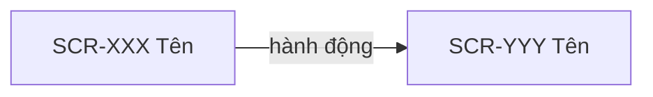

# T7-P · Dọn tài liệu `03.design` (mục 7.1 của plan tổng thể)

> Theme: Theme 7 Inventory · Trạng thái: Plan ✅ (làm trước **Giai đoạn 2**; độc lập với code nên làm lúc nào cũng được) | Làm ⬜ | Review ⬜
> Thuộc [T7-P](T7-P-thiet-ke-lai-luong.md) mục 7.1. Ước lượng: **~0,5 ngày, 1 commit**. Làm **trước** bước C của BJ-01 (bước E của BJ-01 dùng khuôn tạo ở đây).
> Người làm: bạn. Review: phiên plan / review.

Đường dẫn tính từ `specs/themes/theme-07/` nếu không ghi khác.

## 1. Mục tiêu

1. Có **khuôn Screen Contract** và **khuôn UIF** mới để bước E của mỗi BJ viết lại tài liệu theo cùng một mẫu: không còn đoạn chèn `### vX.Y`, một hệ đánh số, tiếng Việt.
2. Bỏ 7 file `RETIRED` lẻ; mọi màn đã bỏ tra ở một bảng.
3. Có một bảng tra 96 màn cho biết màn nào có trong prototype, màn nào chưa dựng, màn nào đã gộp.
4. `03.design/prototype/README.md` thành hướng dẫn ngắn; lịch sử để `html/CHANGELOG.md` và git giữ.

**Không** viết lại nội dung Screen Contract / UIF hiện có trong plan này (việc đó làm ở bước E của từng BJ).

## 2. Việc làm

### 2.1 `03.design/screens/_TEMPLATE.md` (tạo)

Chép nguyên văn khối dưới:

```markdown
---
id: SCR-XXX
type: screen-contract
theme: theme-07
title: "<Tiêu đề hiện trên app bar>"
bj: BJ-XX
uif: UIF-XX
status: IN_REVIEW
prototype: "app/bjXX.js · renderXXX"
updated: YYYY-MM-DD
---
# SCR-XXX — <Tiêu đề>

## 1. Mục đích

Một đoạn: ai đến màn này, lúc nào, để biết hoặc làm gì.

## 2. Lối vào và lối ra

| Hướng | Từ / đến | Điều kiện | Cách (nút, liên kết) |
|---|---|---|---|
| Vào | | | |
| Ra | | | |

## 3. Thứ bậc thông tin

Từ trên xuống, mỗi dòng một khối:

1. <Khối> — <nội dung> — <thành phần DS>

## 4. Trạng thái

| Trạng thái | Khi nào | Hiện gì | Làm được gì | Lối ra |
|---|---|---|---|---|

## 5. Hành động

| Hành động | Bật khi | Kết quả | Mã |
|---|---|---|---|

## 6. Quyền và che tài chính

Ai thấy / làm được gì; dữ liệu nào không được có trong màn khi không có quyền; số tiền nào ẩn khi `FINANCIAL_MASKED`.

## 7. Thành phần DS

Danh sách thành phần dùng (tên trong `vet45_design_system` / prototype), ghi rõ thành phần mới.

## 8. Chữ trên màn

| Vị trí | Chữ |
|---|---|

## 9. Truy vết

BJ · UC · UIF · BC · quyết định `T7-DR-…` · kịch bản golden.
```

Quy tắc ghi ngay dưới khối (thêm vào cuối `_TEMPLATE.md`, ngoài khối mã):

- Không có mục lịch sử phiên bản; thay đổi ghi ở `03.design/prototype/html/CHANGELOG.md`, lịch sử để git giữ.
- Một hệ đánh số `## 1…9`; mục con dùng `###` không đánh số.
- Mã kỹ thuật (BC, API, enum) chỉ ở mục 9; các mục khác viết bằng lời người dùng.
- Chữ ở mục 8 là chuỗi chuẩn: prototype và Flutter chép đúng.

### 2.2 `03.design/flows/_TEMPLATE.md` (tạo)

```markdown
---
id: UIF-XX
type: ui-flow
theme: theme-07
bj: BJ-XX
title: "<Tên luồng>"
status: IN_REVIEW
prototype: "app/bjXX.js"
updated: YYYY-MM-DD
---
# UIF-XX — <Tên luồng>

## 1. Việc thật

Ai, lúc nào, cần đạt gì; tần suất.

## 2. Lối vào và lối ra

| Hướng | Từ / đến | Điều kiện |
|---|---|---|

## 3. Sơ đồ luồng



## 4. Chuyển màn

| Từ | Hành động | Đến | Ghi chú |
|---|---|---|---|

## 5. Khuôn dùng chung áp dụng

K1…K6 (xem T7-P mục 5) và chỗ áp.

## 6. Liên kết với BJ khác

| Sang / từ BJ | Ở màn | Cách |
|---|---|---|

## 7. Truy vết

BJ · UC · Screen Contract · kịch bản golden.
```

(Trong file thật, khối `mermaid` nằm trong khối `markdown` nên dùng hàng rào 4 dấu backtick cho khối ngoài.)

### 2.3 `03.design/screens/RETIRED.md` (tạo) và xoá 7 file lẻ

Nội dung:

```markdown
# Màn đã bỏ

ID giữ để tra cứu và chuyển hướng liên kết cũ; không dùng lại cho nghĩa mới.

| Màn | Tên cũ | Bỏ từ | Thay bằng | Ghi chú |
|---|---|---|---|---|
| SCR-016 | Căn cứ và cách tính | v3.13.0 | SCR-015 | Nội dung nằm ở SCR-015 hoặc sheet trong SCR-015 / 017; liên kết cũ `#/sg-03/scr-03` → SCR-015 |
| SCR-018 | Ghi chi phí mua bổ sung | v3.13.0 | SCR-085 | Nghiệp vụ thuộc BJ-13 |
| SCR-073 | Thiết lập lần tính | v3.13.0 | SCR-074 | Là trạng thái thiết lập của SCR-074; phương pháp tính đọc từ chính sách cửa hàng |
| SCR-075 | Blocker và adjustment | v3.13.0 | SCR-074 | Là trạng thái / khối của SCR-074 |
| SCR-076 | Rà soát công bố | v3.13.0 | SCR-074 | Là trạng thái `PUBLISH_REVIEW` của SCR-074; xác nhận cuối bằng sheet |
| SCR-087 | Phân bổ điều chỉnh | v3.13.0 | SCR-086 | Chọn phạm vi và xem trước phân bổ nằm ở SCR-086 |
| SCR-088 | Rà soát điều chỉnh giá trị | v4.6.0 | SCR-086 | SCR-086 có xem trước và sheet xác nhận trước khi ghi |
```

Rồi xoá `03.design/screens/SCR-016.md`, `SCR-018.md`, `SCR-073.md`, `SCR-075.md`, `SCR-076.md`, `SCR-087.md`, `SCR-088.md`.

Sửa chỗ còn trỏ tới 7 file đó:

| File | Dòng | Sửa |
|---|---|---|
| `03.design/patterns/PAT-NAV.md` | 121, 129, 130, 132, 137, 139, 141 | Liên kết `../screens/SCR-0xx.md` → `../screens/RETIRED.md`; giữ chữ mô tả |
| `README.md` (theme) | 127, 133 | Giữ câu, thêm "(xem `03.design/screens/RETIRED.md`)" |
| `09.generated/registries/design/screen-registry.md` / `.json`, `ui-flow-registry.json`, `action-registry.json`, `COMPONENT-USAGE-REGISTRY.yaml`, `09.generated/matrices/design/ui-traceability.json` | trường đường dẫn của 7 màn | `03.design/screens/SCR-0xx.md` → `03.design/screens/RETIRED.md`; giữ ID và trạng thái `RETIRED` |

**Không sửa:** các file `runtime-state-registry-v*.json` (ảnh chụp lịch sử theo phiên bản), `structure-path-migration-v3.11.0.json` (lịch sử), `prototype/html/data/workbench-data.json` và `app/core.js` (ID dùng để chuyển hướng liên kết cũ).

### 2.4 `03.design/screens/INDEX.md` (tạo)

```markdown
# Bảng tra màn Theme 7

Cột "Trong prototype": **Có** = có hàm dựng trong `03.design/prototype/html`; màn Hub nằm ở `app/hub.js`. Cập nhật bảng này ở bước E của mỗi BJ (T7-P mục 4.5).

<bảng ở mục 5 của plan này>
```

(Thay dòng `<bảng ở mục 5 của plan này>` bằng bảng ở mục 5.)

### 2.5 `03.design/prototype/README.md` (viết lại)

Giữ phần frontmatter, đổi `version: v5.1.0`, `source_baseline: v5.1.0`, bỏ `parent`. Thân file thay bằng:

```markdown
# Prototype — Theme 07

Prototype HTML của Theme 7 (Kho & Giá vốn) cho điện thoại. Nguồn hình ảnh và hành vi cho code Flutter; nghiệp vụ theo BJ / UC.

## Chạy

    cd specs/themes/theme-07/03.design/prototype/html
    python3 -m http.server 8765 --bind 127.0.0.1
    # mở http://127.0.0.1:8765/index.html

- Theo từng luồng: `?uif=UIF-02&screen=SCR-010&state=PENDING_APPROVAL` (UIF-02 thêm `&flow=quick` hoặc `&flow=document`).
- Toàn Theme 7 từ Hub Kho: `?mode=theme&app=inventory`.

## Cấu trúc và cách sửa

Xem [`html/README.md`](html/README.md): cấu trúc thư mục, khung `app/core.js` + `app/hub.js`, mỗi BJ một file `app/bjNN.js`, công cụ golden.

## Đặc tả đi kèm

- Screen Contract: [`../screens/`](../screens/) — bảng tra [`INDEX.md`](../screens/INDEX.md), màn đã bỏ [`RETIRED.md`](../screens/RETIRED.md).
- UI Flow: [`../flows/`](../flows/).
- Kế hoạch thiết kế lại: `docs/refactor/plans/T7/T7-P-thiet-ke-lai-luong.md`.

## Lịch sử

[`html/CHANGELOG.md`](html/CHANGELOG.md) từ v5.0.0; các phiên bản trước (v0.2 → v4.6.8) xem lịch sử git của thư mục này.
```

### 2.6 Đồng bộ registry

`python3 03.design/prototype/html/tools/sync-registry.py` chỉ đồng bộ phần `03.design/prototype/`. Sau khi tạo / xoá file ở `screens/` và `flows/`, cập nhật thêm `09.generated/registries/artifact-registry.csv/.json` và `09.generated/indexes/package-checksums.sha256` cho các file đó: bỏ dòng của 7 file đã xoá, thêm dòng cho `_TEMPLATE.md` (2 file), `RETIRED.md`, `INDEX.md` (sha256 + size). Cách nhanh: sửa `PROTO = '03.design/prototype/'` trong `sync-registry.py` thành `PROTO = '03.design/'` và chạy một lần (script quét cả `03.design/`), rồi trả lại như cũ.

## 3. Kiểm

| Kiểm | Cách | Đạt khi |
|---|---|---|
| Không còn liên kết gãy | `grep -rn "screens/SCR-0\(16\|18\|73\|75\|76\|87\|88\)\.md" specs docs` | Chỉ còn trong `runtime-state-registry-v*.json` và `structure-path-migration-v3.11.0.json` |
| Prototype không đổi | `node tools/golden.mjs capture … && compare` | "Khớp hoàn toàn" (plan này không đụng code) |
| Registry | `python3 …/sync-registry.py` chạy không lỗi; số dòng giảm 7, tăng 4 | |
| Bảng tra | Mỗi file `screens/SCR-*.md` còn lại có đúng một dòng trong `INDEX.md`; 7 màn đã bỏ có trong `RETIRED.md` | 89 + 7 = 96 |

## 4. Ghi chú khi làm

(Bạn ghi lệch plan, vấn đề phát sinh.)

## 5. Bảng tra 96 màn (để dán vào `INDEX.md`)

Đo 2026-10-16. Dòng `RETIRED` giữ trong bảng để tra; file của chúng đã xoá ở 2.3.

| Màn | Tên | BJ | Trạng thái file | Trong prototype |
|---|---|---|---|---|
| SCR-001 | Tồn kho | BJ-01 | FROZEN | Có |
| SCR-002 | Kết quả khả dụng — MERGED | BJ-01 | FROZEN | Không — đã gộp vào SCR-001 (dòng sản phẩm hiện khả dụng) |
| SCR-003 | Chi tiết tồn kho | BJ-01 | FROZEN | Có |
| SCR-004 | Chi tiết lô — OVERLAY COMPATIBILITY | BJ-01, BJ-05 | FROZEN | Có, là sheet lô trong SCR-003 |
| SCR-005 | Nguồn số liệu — OVERLAY COMPATIBILITY | BJ-15 | FROZEN | Có, là sheet "Nguồn và thời điểm cập nhật" trong SCR-003 |
| SCR-006 | Chọn cách nhận hàng | BJ-02 | FROZEN | Có |
| SCR-007 | Chứng từ chờ nhận | BJ-02 | FROZEN | Có |
| SCR-008 | Thông tin nhập hàng nhanh | BJ-02 | IN_REVIEW | Có |
| SCR-009 | Hàng thực nhận | BJ-02 | FROZEN | Có |
| SCR-010 | Rà soát và gửi xử lý | BJ-02 | FROZEN | Có |
| SCR-011 | Phê duyệt yêu cầu nhận hàng | BJ-02 | FROZEN | Có |
| SCR-012 | Kết quả nhận hàng | BJ-02 | FROZEN | Có |
| SCR-013 | Đối soát kết quả nhận hàng | BJ-02 | FROZEN | Có |
| SCR-014 | Hàng chờ xác lập giá trị | BJ-03 | IN_REVIEW | Có |
| SCR-015 | Xác lập giá trị nhập ban đầu | BJ-03 | IN_REVIEW | Có |
| SCR-016 | Căn cứ và cách tính — Đã hợp nhất | — | RETIRED | Đã bỏ (xem RETIRED.md) |
| SCR-017 | Rà soát giá trị nhập ban đầu | BJ-03 | IN_REVIEW | Có |
| SCR-018 | Ghi chi phí mua bổ sung — Đã thay thế | BJ-13 | RETIRED | Đã bỏ (xem RETIRED.md) |
| SCR-019 | Kết quả xác lập giá trị | BJ-03 | IN_REVIEW | Có |
| SCR-020 | Đơn cần giữ hàng | BJ-04 | FROZEN | Chưa dựng (BJ-04 hiện chỉ có SCR-021) |
| SCR-021 | Giữ hàng theo đơn | BJ-04 | FROZEN | Có |
| SCR-022 | Rà soát giữ hàng | BJ-04 | FROZEN | Chưa dựng (BJ-04 hiện chỉ có SCR-021) |
| SCR-023 | Giải phóng hoặc phân bổ lại | BJ-04 | FROZEN | Chưa dựng (BJ-04 hiện chỉ có SCR-021) |
| SCR-024 | Kết quả reservation | BJ-04 | FROZEN | Chưa dựng (BJ-04 hiện chỉ có SCR-021) |
| SCR-025 | Đơn cần lấy hàng | BJ-05 | FROZEN | Có |
| SCR-026 | Hàng cần lấy | BJ-05 | FROZEN | Có |
| SCR-027 | Chi tiết lấy hàng | BJ-05 | FROZEN | Có |
| SCR-028 | Rà soát bàn giao | BJ-05 | FROZEN | Có |
| SCR-029 | Kết quả bàn giao | BJ-05 | FROZEN | Có |
| SCR-030 | Hàng khách trả | BJ-06 | FROZEN | Có |
| SCR-031 | Hàng khách trả | BJ-06 | FROZEN | Có |
| SCR-032 | Chi tiết hàng trả | BJ-06 | FROZEN | Có |
| SCR-033 | Phân loại hàng trả | BJ-06 | FROZEN | Có |
| SCR-034 | Ngoại lệ lô cần duyệt | BJ-06 | FROZEN | Có |
| SCR-035 | Kết quả hàng trả | BJ-06 | FROZEN | Có |
| SCR-036 | Hàng cần xử lý | BJ-07, BJ-09, BJ-10 | FROZEN | Có |
| SCR-037 | Chi tiết hàng và bằng chứng | BJ-07, BJ-09, BJ-10 | FROZEN | Có |
| SCR-038 | Chuyển trạng thái | BJ-09 | FROZEN | Có |
| SCR-039 | Bàn giao trả nhà cung cấp | BJ-07 | FROZEN | Có |
| SCR-040 | Xác nhận tiêu hủy | BJ-10 | FROZEN | Có |
| SCR-041 | Kết quả xử lý | BJ-07, BJ-09, BJ-10 | FROZEN | Có |
| SCR-042 | Phiên kiểm kê | BJ-08 | FROZEN | Có |
| SCR-043 | Chọn phạm vi và mở phiên | BJ-08 | FROZEN | Có |
| SCR-044 | Đếm mù | BJ-08 | FROZEN | Có |
| SCR-045 | Chênh lệch và đếm lại | BJ-08 | FROZEN | Có |
| SCR-046 | Duyệt kết quả kiểm kê | BJ-08 | FROZEN | Có |
| SCR-047 | Kết quả kiểm kê | BJ-08 | FROZEN | Có |
| SCR-048 | Nghiệp vụ cần kiểm soát | BJ-11 | FROZEN | Có |
| SCR-049 | Chi tiết nghiệp vụ kho | BJ-11 | FROZEN | Có |
| SCR-050 | Nội dung sửa sai | BJ-11 | FROZEN | Có |
| SCR-051 | Duyệt sửa sai | BJ-11 | FROZEN | Có |
| SCR-052 | Hủy hoặc chọn cách sửa | BJ-11 | FROZEN | Có |
| SCR-053 | Kết quả sửa sai | BJ-11 | FROZEN | Có |
| SCR-054 | Tra cứu thẻ kho / Thiết lập báo cáo tồn | BJ-15 | FROZEN | Có |
| SCR-055 | Báo cáo tồn / Thẻ kho | BJ-15 | FROZEN | Có |
| SCR-056 | Chi tiết biến động tồn kho | BJ-09, BJ-15 | FROZEN | Có |
| SCR-057 | Nguồn biến động | BJ-15 | FROZEN | Có |
| SCR-058 | Xuất báo cáo | BJ-15 | FROZEN | Có |
| SCR-059 | Kết quả xuất báo cáo | BJ-15 | FROZEN | Có |
| SCR-060 | Chỉ báo tồn kho | BJ-01 | FROZEN | Chưa dựng — chỉ báo nằm ở bộ lọc SCR-001 |
| SCR-061 | Chi tiết chỉ báo sản phẩm | BJ-01 | FROZEN | Chưa dựng — chỉ báo nằm ở SCR-003 |
| SCR-062 | Cấu hình chính sách tồn | CAP-01 | FROZEN | Có |
| SCR-063 | Cấu hình hàng cận hạn | CAP-01 | FROZEN | Có |
| SCR-064 | Rà soát chính sách | CAP-01 | FROZEN | Có |
| SCR-065 | Kết quả cập nhật | CAP-01 | FROZEN | Có |
| SCR-066 | Khởi tạo tồn kho | BJ-12 | FROZEN | Có |
| SCR-067 | Dữ liệu tồn kho đầu kỳ | BJ-12 | FROZEN | Có |
| SCR-068 | Kết quả kiểm tra dữ liệu | BJ-12 | FROZEN | Có |
| SCR-069 | Rà soát số dư đầu kỳ | BJ-12 | FROZEN | Có |
| SCR-070 | Duyệt số dư đầu kỳ | BJ-12 | FROZEN | Có |
| SCR-071 | Kết quả khởi tạo tồn kho | BJ-12 | FROZEN | Có |
| SCR-072 | Công việc giá vốn | BJ-14 | IN_REVIEW | Có |
| SCR-073 | Thiết lập lần tính — Đã hợp nhất | — | RETIRED | Đã bỏ (xem RETIRED.md) |
| SCR-074 | Tính và rà soát giá vốn | BJ-14 | IN_REVIEW | Có |
| SCR-075 | Blocker và adjustment — Đã hợp nhất | — | RETIRED | Đã bỏ (xem RETIRED.md) |
| SCR-076 | Rà soát công bố — Đã hợp nhất | — | RETIRED | Đã bỏ (xem RETIRED.md) |
| SCR-077 | Kết quả công bố giá vốn | BJ-14 | IN_REVIEW | Có |
| SCR-078 | Hồ sơ cần kiểm tra | BJ-16, BJ-17 | FROZEN | Có |
| SCR-079 | Bằng chứng & kết luận | BJ-16, BJ-17 | FROZEN | Có |
| SCR-080 | Phương án xử lý | BJ-16, BJ-17 | FROZEN | Có |
| SCR-081 | Đang khôi phục số liệu | BJ-16 | FROZEN | Có |
| SCR-082 | Rà soát kết quả | BJ-16, BJ-17 | FROZEN | Có |
| SCR-083 | Kết quả xử lý | BJ-16, BJ-17 | FROZEN | Có |
| SCR-084 | Chi tiết hàng thực nhận | BJ-02 | FROZEN | Có |
| SCR-085 | Điều chỉnh giá trị hàng nhập | BJ-13 | IN_REVIEW | Có |
| SCR-086 | Phân bổ điều chỉnh giá trị | BJ-13 | IN_REVIEW | Có |
| SCR-087 | Phân bổ điều chỉnh — Đã hợp nhất | — | RETIRED | Đã bỏ (xem RETIRED.md) |
| SCR-088 | Rà soát điều chỉnh giá trị — đã hợp nhất | — | RETIRED | Đã bỏ (xem RETIRED.md) |
| SCR-089 | Kết quả điều chỉnh giá trị | BJ-13 | IN_REVIEW | Có |
| SCR-090 | Kho | — | FROZEN | Có, trong `app/hub.js` (Home Kho) |
| SCR-091 | Tồn kho | — | FROZEN | Có, trong `app/hub.js` (khu Tồn kho) |
| SCR-092 | Nhập, xuất & hoàn trả | — | FROZEN | Có, trong `app/hub.js` (khu Nhập, xuất & hoàn trả) |
| SCR-093 | Kiểm kê & xử lý | — | FROZEN | Có, trong `app/hub.js` (khu Kiểm kê & xử lý) |
| SCR-094 | Giá trị kho | — | FROZEN | Có, trong `app/hub.js` (khu Giá trị kho) |
| SCR-095 | Báo cáo & lịch sử | — | FROZEN | Có, trong `app/hub.js` (khu Báo cáo & lịch sử) |
| SCR-096 | Thiết lập kho | — | FROZEN | Có, trong `app/hub.js` (Thiết lập kho) |

## 6. Review

(Phiên review điền.)
