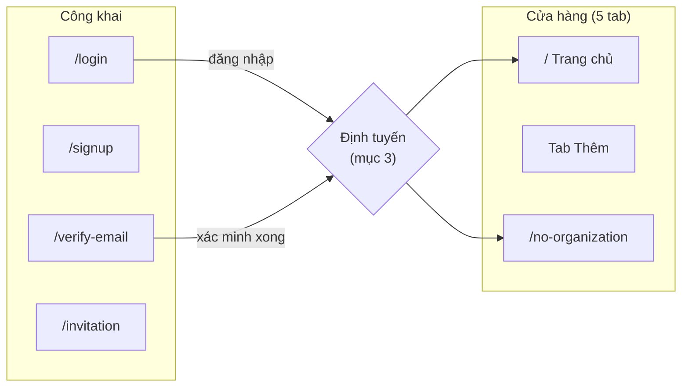
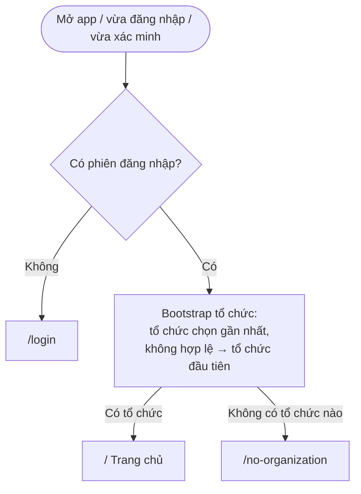
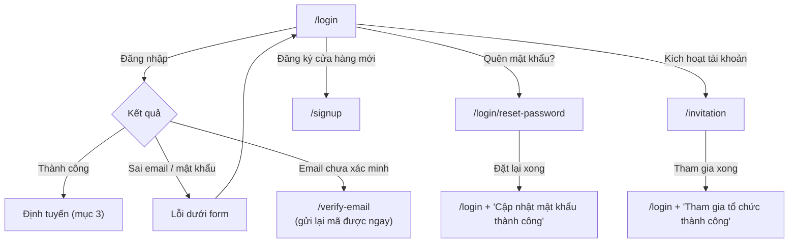
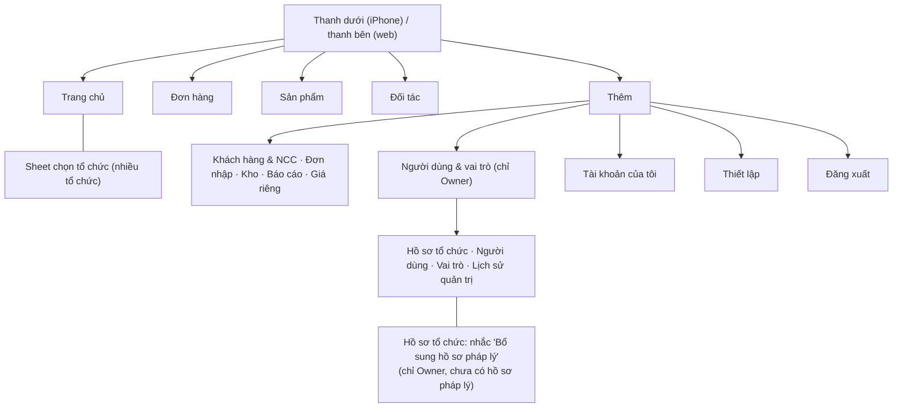

# Luồng ứng dụng sau khi gộp app

> Phiên bản 1.4 · 2026-10-22 · Bổ sung cho [TH-01](TH-01-to-chuc-va-nguoi-dung.md) mục 1.2, 2.3 và [PLAN](../refactor/PLAN.md) P2, P3.
> v1.4: iPhone và web **đều là thiết bị chính** ở mọi màn (mục 1.1; bỏ bảng thiết bị chính theo phần). v1.3: thiết bị ưu tiên iPhone + web, khung web thanh bên (mục 1.1). v1.2: bỏ Platform Admin (3-E). v1.1 đã bỏ khu `/admin`.
> Tài liệu này mô tả **đường đi giữa các màn**. Nội dung từng màn vẫn lấy theo TH-01…TH-08. Luồng đăng ký / xác minh / gửi lại mail: [LUONG-DANG-KY-XAC-MINH-EMAIL](LUONG-DANG-KY-XAC-MINH-EMAIL.md).

## 1. Tổng quan

Trước đây có 2 app: `apps/erp` (cửa hàng) và `apps/admin`. Sau refactor chỉ còn `apps/erp`, chỉ có Owner và thành viên:

| Vùng | Route | Ai dùng | Khung |
|---|---|---|---|
| **Công khai** | `/login`, `/login/reset-password`, `/signup`, `/verify-email`, `/invitation` | Chưa đăng nhập (và người đang nhận lời mời) | Không có thanh dưới |
| **Cửa hàng** | `/`, đơn hàng, sản phẩm, đối tác, `/more/**`, `/no-organization` | Owner, thành viên | 5 mục **Trang chủ · Đơn hàng · Sản phẩm · Đối tác · Thêm**: thanh dưới trên iPhone, thanh bên trái trên web (mục 1.1) |

Nguyên tắc:
1. **Một màn đăng nhập** cho mọi người.
2. **Không ai tạo tổ chức sau khi đăng nhập.** Tổ chức chỉ sinh ra từ `/signup` (BR-01).
3. Không có quản trị nền tảng trên app: không tạm ngừng / đóng tổ chức, không tạm ngừng tài khoản, không chuyển Owner.
4. Router guard chỉ để ẩn / chuyển màn; quyền thật do RPC kiểm (BR-60).

### 1.1 Thiết bị và khung (chốt 2026-10-20)

**Thiết bị ưu tiên:** **iPhone** và **web trên trình duyệt máy tính** (Chrome, Safari, Edge). Android vẫn build từ cùng mã, không thiết kế / kiểm riêng. Không làm iPad, không app macOS / Windows.

**Khung:**

| Bề rộng cửa sổ | Khung | Ghi chú |
|---|---|---|
| Hẹp (iPhone, cửa sổ web thu nhỏ) | Thanh dưới 5 tab như hiện tại | |
| Rộng (web) | **Thanh bên trái** cùng 5 mục; các khu trong "Thêm" (Kho, Người dùng & vai trò, Báo cáo…) là mục con của "Thêm" trên thanh bên | Ngưỡng bề rộng chốt ở plan khung web (W-1) |

Bố cục theo **bề rộng**; mật độ điều khiển theo **cách thao tác** (`VDensity`: `comfortable` cho cảm ứng, `compact` cho chuột / bàn phím trên web), không suy từ bề rộng.

**Cả hai là thiết bị chính (sửa 2026-10-22):** iPhone và web ngang nhau ở **mọi màn, mọi phần của app** — mỗi màn thiết kế và tối ưu đủ cho cả hai (bố cục, mật độ, cách nhập liệu); không có thiết bị phụ chỉ cần "không vỡ, đủ hành động". Ai thường dùng ở đâu (nhân viên cầm iPhone tại kho / quầy, Owner hay ngồi máy tính) chỉ là bối cảnh để chọn bố cục, không dùng để xếp thiết bị nào xuống hàng phụ. Bản 2026-10-20 xếp "thiết bị chính" theo phần (TH-01 web, TH-07 theo màn…) là hiểu sai — bỏ.

**Bố cục web chung:** danh sách – chi tiết hai cột (không đổi trang khi chọn); bảng thay danh sách thẻ khi nhiều cột số; ngoại lệ: Người dùng, Vai trò, Lịch sử quản trị (TH-01 5.12) dùng bảng toàn màn, chi tiết mở toàn màn (10-8); sheet dưới thành hộp thoại hoặc bảng bên; đi được hết bằng bàn phím (Tab, Enter, Esc). **Nhập liệu:** quét mã = camera trên iPhone, máy quét USB (gõ như bàn phím) trên web; chọn tệp = nút trên iPhone, thêm kéo thả trên web.

## 2. Ai thấy gì

| Người dùng | Vào được | Không thấy |
|---|---|---|
| Khách (chưa đăng nhập) | Vùng công khai | Mọi thứ khác → `/login` |
| Thành viên (không phải Owner) | Khu cửa hàng; tab Thêm: nghiệp vụ, Tài khoản của tôi, Thiết lập, Đăng xuất | "Người dùng & vai trò" |
| Owner | Như thành viên + **"Người dùng & vai trò"**, lời nhắc hồ sơ pháp lý | — |
| Người không còn tổ chức nào | `/no-organization`, `/invitation` | Khu cửa hàng |

## 3. Mở app và định tuyến sau đăng nhập

Bảng guard (`core/router/route_guard.dart`):

| # | Điều kiện | Đang ở | Chuyển tới | Làm ở |
|---|---|---|---|---|
| G1 | Chưa đăng nhập | ngoài vùng công khai | `/login` | 1-B |
| G2 | Đã đăng nhập | `/login`, `/signup`, `/verify-email` | `/` | 2-B1 |
| G5 | Không có tổ chức | khu cửa hàng (trừ `/no-organization`, `/invitation`) | `/no-organization` | 2-B1 |
| G6 | Có tổ chức | `/no-organization` | `/` | 2-B1 |
| — | Email chưa xác minh | — | Không phải guard: màn đăng nhập nhận `email_not_confirmed` rồi chuyển `/verify-email` | 2-B1 |

(G3, G4 của bản 1.0 — chuyển vào / ra khu `/admin` — đã bỏ. G7 và nhánh tổ chức tạm ngừng / đóng bỏ ở 3-E.)

## 4. Vùng công khai

### 4.1 Đăng nhập

### 4.2 Đăng ký, xác minh, lời mời

Xem [LUONG-DANG-KY-XAC-MINH-EMAIL](LUONG-DANG-KY-XAC-MINH-EMAIL.md) (luồng A, B, C).

## 5. Khu cửa hàng

## 6. Mất quyền khi đang dùng (TH-01 US-04.2)

| Sự kiện | App làm gì |
|---|---|
| Bị loại / tạm ngừng khỏi tổ chức đang dùng | Bootstrap lại: còn tổ chức khác → vào tổ chức đó; không còn → `/no-organization` |

## 7. Việc cần làm để khớp tài liệu này

| Việc | Ở đâu |
|---|---|
| G1, G2, G5, G6; `/signup`, `/verify-email`, `/no-organization`; bỏ readiness | Đã làm: 2-B1, 2-B3 |
| Bỏ Platform Admin, G7, trạng thái chặn tổ chức / tài khoản, chuyển Owner | Đã làm: 3-E |
| Bỏ `apps/admin`, wizard khởi tạo, `provisioning` | 3-B, 3-D |
| Khung web thanh bên; bố cục web cho màn đã làm của Theme 1, 2, 3 (mục 1.1) | W-* (PLAN mục "Web cho app") |
