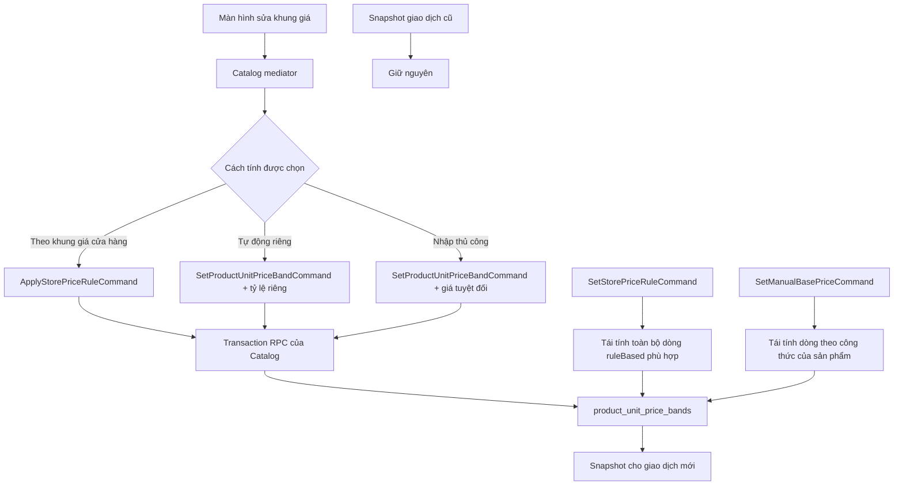

# Kế hoạch triển khai ba cách tính khung giá theo đơn vị sản phẩm — TH-02

> **Dành cho tác nhân thực thi:** BẮT BUỘC dùng `superpowers:test-driven-development` cho từng hạng mục và dùng `superpowers:verification-before-completion` trước khi tuyên bố hoàn thành. Nếu triển khai trong phiên khác, dùng `superpowers:executing-plans`. Chưa được sửa mã nguồn nghiệp vụ trước khi kế hoạch này được duyệt và chấp thuận.

**Mục tiêu:** Xây dựng lại luồng khung giá theo đơn vị sản phẩm để mỗi khung giá đang hoạt động chỉ dùng đúng một trong ba cách tính: Theo khung giá cửa hàng, Tự động riêng theo cấu hình, hoặc Nhập thủ công; đồng thời các khung giá theo công thức phải được lưu đúng nguồn tỷ lệ và tự tái tính khi dữ liệu nguồn thay đổi.

**Kiến trúc:** Giữ nguyên luồng CQRS của Catalog: `UI -> IExecutionContext -> IModuleMediator -> command/query handler -> gateway -> Supabase RPC`. Bảng `catalog.product_unit_price_bands` tiếp tục lưu giá tiền VND đã tính sẵn để đọc nhanh và chụp snapshot. Tỷ lệ của khung giá cửa hàng chỉ nằm trong `catalog.store_price_rules`; tỷ lệ cấu hình riêng nằm trên chính dòng `catalog.product_unit_price_bands`; chế độ thủ công chỉ lưu giá tuyệt đối. Việc tái tính được thực hiện rõ ràng và nguyên tử trong RPC của Catalog.

**Công nghệ:** Flutter/Dart, `flutter_bloc`, Vet45 CQRS/codegen, các package Domain/Application/Infrastructure/Presentation của Catalog, Supabase PostgreSQL RPC dạng draft, widget test và E2E test Flutter.

## Ràng buộc chung

- Tuân thủ `AGENTS.md`, `.cursor/rules/vet45-architecture.mdc` và nghi thức TH-02.
- Không tạo hoặc sửa migration chính thức dạng `supabase/migrations/[0-9]*.sql`; chỉ viết SQL vào `supabase/migrations/_drafts/`.
- Không sửa `.g.dart` bằng tay; chạy `melos run codegen`.
- UI không được gọi Supabase hay PostgREST trực tiếp.
- Application không import Infrastructure; Domain không import Application, Flutter hoặc Supabase.
- Không hardcode mã quyền; dùng hằng số trong `CatalogPermissions`.
- Trước khi sửa một symbol hiện có, phải chạy GitNexus `impact(..., direction: "upstream")` theo `AGENTS.md`.
- Nếu kết quả phân tích ảnh hưởng trả về mức HIGH hoặc CRITICAL, phải báo người duyệt trước khi sửa.
- Trước khi commit phải chạy GitNexus `detect_changes(scope: "compare", base_ref: "main")`.
- Không sửa, stage hoặc hoàn tác thay đổi có sẵn của người dùng tại `apps/erp/ios/Runner.xcodeproj/project.pbxproj`.

---


## 1. Các quyết định nghiệp vụ đã chốt


### 1.1 Ba cách tính loại trừ lẫn nhau

Mỗi khung giá đang hoạt động của một đơn vị sản phẩm chỉ được chọn đúng một cách tính:


| Nhãn trên giao diện         | Giá trị trong Flutter | Giá trị lưu ở `source_type` | Nguồn tỷ lệ                        |
| --------------------------- | --------------------- | --------------------------- | ---------------------------------- |
| Theo khung giá cửa hàng     | `storeRule`           | `ruleBased`                 | `catalog.store_price_rules`        |
| Tự động riêng theo cấu hình | `customConfig`        | `customConfig`              | `catalog.product_unit_price_bands` |
| Nhập thủ công               | `manual`              | `manual`                    | Không có tỷ lệ                     |


Giữ giá trị kỹ thuật `ruleBased` để tương thích dữ liệu và RPC hiện tại. Giao diện tiếp tục gọi lựa chọn này là “Theo khung giá cửa hàng”.

### 1.2 Công thức tính

```text
basePriceForUnit = basePricePerBaseUnit * conversionRateToBase
price = round(basePriceForUnit * (1 + markupRatio))
```

Quy ước:

- Tỷ lệ lưu trong database và truyền qua RPC là số thập phân: `40% = 0.40`.
- Giao diện hiển thị và nhập theo phần trăm: `40`.
- Giá VND được làm tròn tới 1 đồng gần nhất bằng `round`, không cắt phần thập phân.
- Tỷ lệ giá niêm yết bắt buộc với `customConfig`.
- Tỷ lệ giá sàn có thể để trống nếu đơn vị không dùng giá sàn.
- Mọi tỷ lệ phải lớn hơn hoặc bằng 0.
- Nếu có tỷ lệ giá sàn thì `floorMarkupRatio <= listMarkupRatio`.
- Nếu có giá sàn thì `floorPrice <= listPrice`.


### 1.3 Hành vi khi dữ liệu nguồn thay đổi

Khi giá cơ sở của sản phẩm thay đổi:

- Tái tính và lưu ngay mọi khung giá đang hoạt động có `source_type = 'ruleBased'` và đang tham chiếu một quy tắc giá cửa hàng hoạt động.
- Tái tính và lưu ngay mọi khung giá đang hoạt động có `source_type = 'customConfig'` bằng tỷ lệ riêng trên từng dòng.
- Không thay đổi khung giá `manual`.

Khi tỷ lệ trong quy tắc giá cửa hàng đang hoạt động thay đổi:

- Tái tính và lưu ngay toàn bộ khung giá đang hoạt động có `source_type = 'ruleBased'` và tham chiếu quy tắc giá cửa hàng đó trong tenant.
- Không thay đổi `customConfig`.
- Không thay đổi `manual`.

Đây là lựa chọn A đã được duyệt: cập nhật toàn bộ khung giá đang theo quy tắc giá cửa hàng.

### 1.4 Chuyển đổi cách tính

Việc chuyển cách tính cập nhật cùng dòng khung giá đang hoạt động và phải xóa cấu hình không còn thuộc cách tính mới:


| Chuyển sang                 | Dữ liệu phải lưu                                                                                            |
| --------------------------- | ----------------------------------------------------------------------------------------------------------- |
| Theo khung giá cửa hàng     | Có `store_price_rule_id`; hai tỷ lệ riêng bằng `NULL`; giá được tính từ quy tắc giá cửa hàng đang hoạt động |
| Tự động riêng theo cấu hình | `store_price_rule_id = NULL`; lưu tỷ lệ niêm yết/sàn riêng; giá được tính từ giá cơ sở hiện tại             |
| Nhập thủ công               | `store_price_rule_id = NULL`; hai tỷ lệ bằng `NULL`; lưu giá tuyệt đối do người dùng nhập                   |


Toàn bộ chuyển đổi phải nằm trong một transaction RPC, không được để lộ trạng thái trung gian trộn dữ liệu của hai cách tính.

### 1.5 Snapshot lịch sử

- Việc tái tính chỉ cập nhật giá hiện hành trong Catalog.
- Giao dịch Sales/Promotions cũ giữ nguyên snapshot giá đã chụp.
- Giao dịch mới đọc giá tuyệt đối mới nhất từ Catalog.
- Không cập nhật ngược các dòng giao dịch lịch sử.


### 1.6 Các giả định cần duyệt

1. Khi quy tắc giá cửa hàng chuyển sang `inactive`, giữ nguyên giá tuyệt đối gần nhất và giữ `source_type = 'ruleBased'`; thay đổi giá cơ sở trong thời gian này không tái tính các dòng đó. Giao diện báo quy tắc không khả dụng. Khi quy tắc được kích hoạt lại, toàn bộ dòng theo quy tắc được tái tính ngay.
2. Dữ liệu cũ có `source_type = 'manual'` không đủ thông tin để xác định dòng nào từng là cấu hình riêng. Chuyển đổi tất cả thành thủ công, tỷ lệ bằng `NULL`; không suy ngược tỷ lệ từ giá đã làm tròn.
3. Slice này không mở rộng chính sách VAT. Theo hợp đồng hiện tại, giá trước VAT được chép sang giá sau VAT. Nếu có giá sàn thì chép cho cả `floor_before_vat` và `floor_after_vat`.
4. `is_custom_override` không còn là nguồn sự thật. Chỉ giữ tạm nếu phân tích ảnh hưởng còn phát hiện nơi sử dụng cũ.


## 2. Ví dụ nghiệm thu cụ thể

Với đơn vị có giá cơ sở `50.000 đ`:


| Cách tính                   | Tỷ lệ niêm yết | Tỷ lệ sàn | Giá niêm yết đã lưu | Giá sàn đã lưu      |
| --------------------------- | -------------- | --------- | ------------------- | ------------------- |
| Theo khung giá cửa hàng     | 40%            | 20%       | 70.000 đ            | 60.000 đ            |
| Tự động riêng theo cấu hình | 35%            | 15%       | 67.500 đ            | 57.500 đ            |
| Nhập thủ công               | —              | —         | Giá người dùng nhập | Giá người dùng nhập |


Khi giá cơ sở đổi từ `50.000 đ` thành `60.000 đ`:

- Theo khung giá cửa hàng 40%/20% thành `84.000 đ / 72.000 đ`.
- Tự động riêng 35%/15% thành `81.000 đ / 69.000 đ`.
- Nhập thủ công không đổi.

Khi quy tắc giá cửa hàng tiếp tục đổi thành 45%/25%:

- Mọi khung giá đang theo quy tắc giá cửa hàng đó được tái tính; ví dụ thành `87.000 đ / 75.000 đ`.
- Tự động riêng và Nhập thủ công không đổi.

Với đơn vị Hộp có `conversion_rate_to_base = 10`, giá cơ sở đơn vị gốc `50.000 đ`:

```text
basePriceForUnit = 50.000 * 10 = 500.000
Cấu hình riêng 30%/10% = 650.000 / 550.000
```


## 3. Mô hình dữ liệu đích

Giữ các cột giá tuyệt đối hiện tại và thêm hai cột tỷ lệ:

```sql
alter table catalog.product_unit_price_bands
  add column if not exists list_markup_ratio numeric null,
  add column if not exists floor_markup_ratio numeric null;
```

Ma trận ràng buộc bắt buộc ở database:


| `source_type`  | `store_price_rule_id` | `list_markup_ratio` | `floor_markup_ratio`                          | Giá tuyệt đối          |
| -------------- | --------------------- | ------------------- | --------------------------------------------- | ---------------------- |
| `ruleBased`    | Bắt buộc              | `NULL`              | `NULL`                                        | Được tính và lưu       |
| `customConfig` | `NULL`                | Bắt buộc, `>= 0`    | Có thể `NULL`; nếu có thì `>= 0` và `<= list` | Được tính và lưu       |
| `manual`       | `NULL`                | `NULL`              | `NULL`                                        | Người dùng nhập và lưu |


Giữ partial unique index hiện tại để bảo đảm mỗi `(tenant_id, product_id, product_unit_id)` chỉ có một khung giá active.

`is_custom_override` được chuyển thành trường tương thích tạm thời:

- Code mới không dùng cột này để xác định mode.
- Nếu còn nơi sử dụng cũ, RPC ghi `is_custom_override = (source_type = 'customConfig')`.
- Chỉ xóa cột trong một đợt dọn dẹp riêng sau khi GitNexus xác nhận không còn nơi sử dụng.


## 4. Luồng xử lý đích




## 5. Hợp đồng DDD

1. **Vòng đời:** khung giá được cấu hình, kích hoạt, tái tính khi nguồn công thức đổi, chuyển cách tính khi người dùng yêu cầu và ngừng hoạt động theo vòng đời hiện có.
2. **Bounded Context:** toàn bộ phép tính và persistence thuộc Catalog. Sales và Promotions chỉ dùng snapshot, không sở hữu rule của Catalog.
3. **Aggregate:** `ProductUnitPriceBand` sở hữu mode, ma trận trường dữ liệu, giá tuyệt đối, thời gian hiệu lực và trạng thái. `StorePriceRule` sở hữu tỷ lệ cấp cửa hàng và trạng thái active/inactive.
4. **Quy tắc nghiệp vụ:** đúng một cách tính; tỷ lệ không âm; tỷ lệ sàn không vượt tỷ lệ niêm yết; giá sàn không vượt giá niêm yết; cách tính theo công thức cần giá cơ sở hợp lệ; quy tắc giá cửa hàng phải hoạt động khi áp dụng hoặc tái tính.
5. **Lệnh:** giữ `ApplyStorePriceRuleCommand`; mở rộng `SetProductUnitPriceBandCommand`; dùng `SetManualBasePriceCommand` và `SetStorePriceRuleCommand` để kích hoạt tái tính nguyên tử.
6. **Truy vấn:** `ListProductUnitPriceBandsQuery` trả cách tính và tỷ lệ cấu hình riêng đã lưu; `SuggestProductUnitPriceQuery` tiếp tục phục vụ xem trước theo quy tắc giá cửa hàng và giá cơ sở đã quy đổi.
7. **Sự kiện miền:** mở rộng `ProductPriceBandChanged` với loại nguồn và tỷ lệ khi có. `ProductBasePriceUpdated` tiếp tục biểu diễn việc giá cơ sở thay đổi.
8. **Integration event:** chưa thêm event liên module trong slice này. Khi Costing thay đổi giá cơ sở trong tương lai, nó phải gọi cùng use case tái tính của Catalog thay vì ghi trực tiếp price band.
9. **Dịch vụ miền:** thêm `PriceBandMarkupCalculator` thuần, dùng chung cho quy tắc giá cửa hàng và cấu hình riêng.
10. **Port và snapshot:** handler tiếp tục qua gateway Catalog. `ProductPriceBandSnapshotDto` chỉ chứa giá tuyệt đối để module downstream không cần hiểu công thức.
11. **Chống anti-pattern:** không tính chỉ ở UI; không dùng DB trigger; không tính giá bán động lúc đọc; không direct PostgREST; không `Either` trong handler; không import `src` xuyên package; không tạo migration timestamp trong slice.
12. **Điều kiện hoàn thành:** domain invariant, CQRS, mapper, fake, draft SQL, UI và E2E đều có test; codegen/analyze/test/harness đều pass.


## 6. Phương án kỹ thuật được chọn

Chọn cách tái tính rõ ràng trong RPC bằng một hàm SQL riêng dùng chung:

- Giữ `ApplyStorePriceRuleCommand` cho `ruleBased` để không phá hợp đồng overwrite/version hiện tại.
- Mở rộng `SetProductUnitPriceBandCommand` cho `customConfig` và `manual`.
- Chưa đổi tên `PriceBandSourceType`; chỉ thêm `customConfig`. Việc rename semantic thực hiện sau bằng GitNexus-aware rename.
- Domain/Application tính trước để kiểm tra hợp lệ và hiển thị cảnh báo.
- RPC khóa và đọc nguồn mới nhất rồi tính lại một lần nữa; kết quả database là kết quả chuẩn.
- `catalog.set_manual_base_price` và `catalog.set_store_price_rule` gọi helper tái tính trong cùng transaction với thay đổi nguồn.

Không chọn các phương án sau:

- **DB trigger:** che giấu nghiệp vụ, khó truyền actor/audit và khó kiểm thử hợp đồng RPC.
- **Tính lúc đọc:** tăng chi phí query, làm snapshot không ổn định và không có giá hiện hành đã materialize.
- **Chỉ tính trên UI:** chính là lỗi hiện tại; thay đổi từ màn hình khác làm giá bị cũ.
- **Tạo một lệnh mới cho cả ba cách tính:** làm vỡ hợp đồng áp dụng quy tắc giá cửa hàng hiện có nhưng chưa đem lại đủ lợi ích trong lát triển khai này.


## 7. Bản đồ file


### File tạo mới

- `modules/catalog/domain/lib/src/pricing/price_band/price_band_markup_config.dart`
- `modules/catalog/domain/lib/src/pricing/price_band/price_band_markup_calculator.dart`
- `modules/catalog/domain/test/price_band_markup_calculator_test.dart`
- `modules/catalog/application/test/product_unit_price_band_calculation_modes_test.dart`
- `modules/catalog/presentation/test/edit_product_unit_price_band_cubit_test.dart`
- `apps/erp/lib/features/catalog/presentation/widgets/price_band_store_rule_section.dart`
- `apps/erp/lib/features/catalog/presentation/widgets/price_band_custom_config_section.dart`
- `apps/erp/lib/features/catalog/presentation/widgets/price_band_manual_section.dart`
- `apps/erp/lib/features/catalog/presentation/widgets/price_band_warning_ack_sheet.dart`
- `apps/erp/test/features/catalog/presentation/pages/edit_product_unit_price_band_e2e_test.dart`
- `supabase/migrations/_drafts/catalog_price_band_calculation_modes_schema.sql`
- `supabase/migrations/_drafts/catalog_price_band_calculation_modes_rpcs.sql`


### File chỉnh sửa

- `modules/catalog/domain/lib/src/pricing/price_band/product_unit_price_band.dart`
- `modules/catalog/domain/lib/src/pricing/price_band/events/product_price_band_changed.dart`
- `modules/catalog/domain/lib/src/pricing/store_rule/store_price_rule.dart`
- `modules/catalog/domain/lib/domain.dart`
- `modules/catalog/application/lib/src/product_unit_price_band/queries/list_product_unit_price_bands/price_band_source_type.dart`
- `modules/catalog/application/lib/src/product_unit_price_band/queries/list_product_unit_price_bands/product_unit_price_band_row_dto.dart`
- `modules/catalog/application/lib/src/product_unit_price_band/commands/set_product_unit_price_band/set_product_unit_price_band_command.dart`
- `modules/catalog/application/lib/src/product_unit_price_band/commands/set_product_unit_price_band/set_product_unit_price_band_command_validator.dart`
- `modules/catalog/application/lib/src/product_unit_price_band/commands/set_product_unit_price_band/set_product_unit_price_band_command_handler.dart`
- `modules/catalog/application/lib/src/product_unit_price_band/commands/set_product_unit_price_band/set_product_unit_price_band_result.dart`
- `modules/catalog/application/lib/src/ports/i_product_price_band_gateway.dart`
- `modules/catalog/application/lib/src/testing/fake_catalog_module.dart`
- `modules/catalog/application/test/product_unit_price_band_handlers_test.dart`
- `modules/catalog/application/test/fake_catalog_module_test.dart`
- `modules/catalog/infrastructure/lib/src/domain/pricing/product_price_band_rpc_mapper.dart`
- `modules/catalog/infrastructure/lib/src/domain/pricing/supabase_product_price_band_gateway.dart`
- `modules/catalog/infrastructure/test/product_price_band_rpc_mapper_test.dart`
- `modules/catalog/presentation/lib/src/bloc/edit_product_unit_price_band_state.dart`
- `modules/catalog/presentation/lib/src/bloc/edit_product_unit_price_band_cubit.dart`
- `apps/erp/lib/features/catalog/presentation/pages/edit_product_unit_price_band_page.dart`
- `apps/erp/lib/features/catalog/presentation/widgets/price_band_calculation_type_selector.dart`
- `apps/erp/test/features/catalog/presentation/pages/product_price_bands_e2e_test.dart`
- `apps/erp/test/features/catalog/product_price_band_snapshot_e2e_test.dart`
- `docs/themes/TH-02-product-pricing/harness/01-domain-model.md`
- `docs/themes/TH-02-product-pricing/harness/03-architecture-and-flows.md`
- `docs/themes/TH-02-product-pricing/harness/04-slice-roadmap.md`
- `docs/themes/TH-02-product-pricing/harness/05-traceability.md`
- `docs/themes/TH-02-product-pricing/harness/07-api-contracts.md`
- `docs/themes/TH-02-product-pricing/EPIC-06-pricing/US-02/FR-01.md`
- `docs/themes/TH-02-product-pricing/EPIC-06-pricing/US-02/FR-02.md`
- `docs/themes/TH-02-product-pricing/EPIC-06-pricing/US-02/FR-03.md`
- `docs/themes/TH-02-product-pricing/EPIC-06-pricing/US-02/FR-04.md`


### File chỉ xóa sau khi chứng minh không còn sử dụng

- `apps/erp/lib/features/catalog/presentation/bloc/edit_product_unit_price_band_cubit.dart`
- `apps/erp/lib/features/catalog/presentation/bloc/edit_product_unit_price_band_state.dart`

Hai file trên có vẻ trùng với bloc trong `modules/catalog/presentation`. Chỉ xóa sau khi `rg` và GitNexus xác nhận không có import/nơi gọi.

### File không được sửa

- `supabase/migrations/[0-9]*.sql`
- Dữ liệu transaction/snapshot lịch sử của Sales và Promotions
- Chính sách VAT ngoài phạm vi đã nêu
- `apps/erp/ios/Runner.xcodeproj/project.pbxproj`

---


## Hạng mục 0: Tiền kiểm, impact analysis và khóa hợp đồng

**File:** Chỉ đọc, chưa sửa code.

**Đầu vào:** Quy định repo và code Catalog hiện tại.

**Đầu ra:** Báo cáo impact cho mọi symbol sẽ sửa và baseline test đã ghi nhận.

- [ ] **Bước 1: Đọc đầy đủ tài liệu bắt buộc**

```text
AGENTS.md
.cursor/rules/vet45-architecture.mdc
docs/harness/PROGRESS.md
docs/themes/TH-02-product-pricing/README.md
docs/themes/TH-02-product-pricing/harness/00-agent-ritual.md
docs/themes/TH-02-product-pricing/harness/04-slice-roadmap.md
docs/themes/TH-02-product-pricing/harness/07-api-contracts.md
docs/themes/TH-02-product-pricing/EPIC-06-pricing/US-02/FR-01.md
docs/themes/TH-02-product-pricing/EPIC-06-pricing/US-02/FR-02.md
docs/themes/TH-02-product-pricing/EPIC-06-pricing/US-02/FR-03.md
docs/themes/TH-02-product-pricing/EPIC-06-pricing/US-02/FR-04.md
.cursor/skills/ddd-domain-modeling/SKILL.md
.cursor/skills/domain-layer/SKILL.md
.cursor/skills/application-layer/SKILL.md
.cursor/skills/infrastructure-layer/SKILL.md
.cursor/skills/presentation-layer/SKILL.md
.cursor/rules/vet45-presentation-ui.mdc
packages/vet45_async_query/docs/AGENT_INTEGRATION_PLAYBOOK.md
```

- [ ] **Bước 2: Kiểm tra độ mới của GitNexus index**

Đọc `gitnexus://repo/vet45/context`. Nếu index cũ, chạy:

```bash
node .gitnexus/run.cjs analyze
```

Nếu wrapper không tồn tại và cần tải công cụ, xin quyền người dùng trước khi dùng network. Không được bỏ qua impact analysis.

- [ ] **Bước 3: Chạy impact theo chiều upstream**

Tối thiểu kiểm tra:

```text
ProductUnitPriceBand
StorePriceRule
PriceBandSourceType
SetProductUnitPriceBandCommand
SetProductUnitPriceBandCommandHandler
IProductPriceBandGateway.setProductUnitPriceBand
ProductPriceBandRpcMapper
SupabaseProductPriceBandGateway
EditProductUnitPriceBandCubit
EditProductUnitPriceBandLoaded
```

Ghi lại nơi gọi trực tiếp, luồng thực thi bị ảnh hưởng và mức rủi ro. Nếu HIGH/CRITICAL, dừng trước khi sửa và báo người duyệt.

- [ ] **Bước 4: Chạy baseline test**

```bash
git status --short
(cd modules/catalog/domain && dart test)
(cd modules/catalog/application && dart test test/product_unit_price_band_handlers_test.dart test/fake_catalog_module_test.dart)
(cd modules/catalog/infrastructure && dart test test/product_price_band_rpc_mapper_test.dart)
(cd apps/erp && flutter test test/features/catalog/presentation/pages/product_price_bands_e2e_test.dart)
```

Kỳ vọng: các test hiện có đều PASS. Nếu có lỗi sẵn, ghi riêng làm baseline và không quy cho slice này.

## Hạng mục 1: Cập nhật harness và hợp đồng nghiệm thu trước khi viết code

**File:** Các file TH-02 harness và FR trong mục “File chỉnh sửa”.

**Đầu vào:** Các quyết định ở mục 1–3.

**Đầu ra:** Hợp đồng nghiệp vụ/API thống nhất và các scenario có mã truy vết.

- [ ] **Bước 1: Thêm lát triển khai bổ sung vào lộ trình**

Tên slice: `EPIC-06 hoàn thiện ba cách tính khung giá`. Chia lane thành Domain/Application/Infrastructure, DB draft và FE/E2E. Chưa đánh dấu lane hoàn thành trước khi verification tương ứng pass.

- [ ] **Bước 2: Cập nhật hợp đồng dữ liệu**

Ghi rõ:

```text
PriceBandSourceType = ruleBased | customConfig | manual
customConfig.listMarkupRatio: decimal, bắt buộc
customConfig.floorMarkupRatio: decimal?, tùy chọn
Đơn vị truyền/lưu: số thập phân, 40% = 0.40
Đơn vị hiển thị UI: số phần trăm, 40
Làm tròn: tới 1 VND gần nhất
```

Thêm ma trận mode và toàn bộ trigger tái tính ở mục 1.

- [ ] **Bước 3: Thêm scenario truy vết**

```text
scn_e06_u02_price_mode_01  lưu giá theo khung cửa hàng
scn_e06_u02_price_mode_02  lưu tỷ lệ và giá của cấu hình riêng
scn_e06_u02_price_mode_03  thủ công xóa mọi nguồn công thức
scn_e06_u02_price_mode_04  đổi giá cơ sở chỉ tái tính cách tính theo công thức
scn_e06_u02_price_mode_05  đổi quy tắc cửa hàng tái tính mọi khung giá đang theo quy tắc
scn_e06_u02_price_mode_06  quy đổi đơn vị xảy ra trước markup
scn_e06_u02_price_mode_07  không suy ngược legacy manual thành custom
scn_e06_u02_price_mode_08  quy tắc cửa hàng không hoạt động đóng băng giá hiện tại
scn_e06_u02_price_mode_09  snapshot lịch sử không thay đổi
```

- [ ] **Bước 4: Kiểm tra harness**

```bash
bash scripts/ci/verify_harness.sh
```

Kỳ vọng: PASS, hoặc chỉ còn trạng thái `todo` được harness cho phép ở lane chưa triển khai. Phải xóa mâu thuẫn hiện tại nơi UI nói cấu hình riêng tự cập nhật nhưng backend lại lưu nó thành thủ công.

## Hạng mục 2: Xây dựng domain calculator và invariant theo TDD

**File:**

- Tạo `price_band_markup_config.dart`, `price_band_markup_calculator.dart`, `price_band_markup_calculator_test.dart`.
- Sửa `ProductUnitPriceBand`, `ProductPriceBandChanged`, `StorePriceRule`, `domain.dart`.

**Đầu vào:** Giá cơ sở đã quy đổi và tỷ lệ dạng thập phân.

**Đầu ra:** `PriceBandMarkupConfig`, `CalculatedPriceBand`, `PriceBandMarkupCalculator` và aggregate kiểm soát ma trận mode.

- [ ] **Bước 1: Viết test đỏ cho phép tính**

```dart
test('làm tròn giá markup tới một đồng gần nhất', () {
  final result = PriceBandMarkupCalculator.calculate(
    basePriceForUnit: 50000,
    config: PriceBandMarkupConfig(
      listMarkupRatio: 0.40,
      floorMarkupRatio: 0.20,
    ),
  );

  expect(result.listPrice, 70000);
  expect(result.floorPrice, 60000);
});
```

Thêm test cho: floor bằng null, base đã quy đổi `500000`, làm tròn số lẻ, tỷ lệ âm, floor ratio lớn hơn list ratio và aggregate từ chối trường không tương thích với mode.

- [ ] **Bước 2: Chạy test để xác nhận đang đỏ**

```bash
(cd modules/catalog/domain && dart test test/price_band_markup_calculator_test.dart)
```

Kỳ vọng: FAIL do các type mới chưa tồn tại.

- [ ] **Bước 3: Viết phần hiện thực tối thiểu**

API công khai bắt buộc:

```dart
final class PriceBandMarkupConfig {
  PriceBandMarkupConfig({
    required this.listMarkupRatio,
    this.floorMarkupRatio,
  });

  final double listMarkupRatio;
  final double? floorMarkupRatio;
}

final class CalculatedPriceBand {
  const CalculatedPriceBand({
    required this.listPrice,
    this.floorPrice,
  });

  final int listPrice;
  final int? floorPrice;
}

abstract final class PriceBandMarkupCalculator {
  static CalculatedPriceBand calculate({
    required num basePriceForUnit,
    required PriceBandMarkupConfig config,
  });
}
```

`StorePriceRule.suggestPrices` phải ủy quyền cho calculator này để hai luồng không lệch công thức.

- [ ] **Bước 4: Mở rộng aggregate**

Domain không import enum từ Application. Dùng biểu diễn thuộc Domain hoặc ba hàm tạo có tên:

```text
ProductUnitPriceBand.setRuleBased(...)
ProductUnitPriceBand.setCustomConfig(...)
ProductUnitPriceBand.setManual(...)
```

Mỗi hàm tạo chỉ nhận đúng các trường thuộc cách tính của nó. Sự kiện phát ra chứa loại nguồn dạng nguyên thủy và tỷ lệ khi có.

- [ ] **Bước 5: Chạy test xanh**

```bash
(cd modules/catalog/domain && dart test test/price_band_markup_calculator_test.dart test/store_price_rule_test.dart)
```

Kỳ vọng: PASS.

## Hạng mục 3: Mở rộng hợp đồng Application, validator và handler

**File:** Enum, row DTO, command, validator, handler, result, port và test Application trong bản đồ file.

**Đầu vào:** Mode, tỷ lệ hoặc giá tuyệt đối từ Presentation.

**Đầu ra:** Command đã validate và lời gọi gateway đầy đủ dữ liệu nguồn.

- [ ] **Bước 1: Viết test đỏ cho command/handler**

Tối thiểu có các test:

- Cấu hình riêng nhận tỷ lệ `0.35/0.15`, dùng giá cơ sở đã quy đổi, tính `67.500/57.500` và gửi cả hai tỷ lệ xuống gateway.
- Thủ công gửi giá tuyệt đối, tỷ lệ và mã quy tắc đều null.
- `ruleBased` tiếp tục qua `ApplyStorePriceRuleCommand`.
- Mọi tổ hợp mode/trường sai bị chặn trước khi gateway được gọi.
- Floor để trống vẫn là null, không chuyển thành 0.

- [ ] **Bước 2: Chạy test đỏ**

```bash
(cd modules/catalog/application && dart test test/product_unit_price_band_calculation_modes_test.dart)
```

Kỳ vọng: FAIL do thiếu `customConfig` và các trường ratio.

- [ ] **Bước 3: Mở rộng enum và DTO**

```dart
enum PriceBandSourceType {
  ruleBased,
  customConfig,
  manual,
}
```

Thêm vào `ProductUnitPriceBandRowDto`, `SetProductUnitPriceBandCommand` và `SetProductUnitPriceBandResult`:

```dart
final double? listMarkupRatio;
final double? floorMarkupRatio;
```

Giữ `isCustomOverride` có đánh dấu deprecated trong giai đoạn tương thích. Code mới chỉ nhận diện cấu hình riêng qua `sourceType == PriceBandSourceType.customConfig`.

- [ ] **Bước 4: Cài ma trận validation**

```text
customConfig:
  - listMarkupRatio bắt buộc
  - storePriceRuleId phải null
  - tỷ lệ không âm
  - floor ratio nếu có không vượt list ratio

manual:
  - hai tỷ lệ và storePriceRuleId phải null
  - listBeforeVat/listAfterVat bắt buộc

ruleBased:
  - SetProductUnitPriceBandCommand từ chối
  - nơi gọi phải dùng `ApplyStorePriceRuleCommand`

tất cả mode:
  - floor price nếu có không vượt list price
```

- [ ] **Bước 5: Mở rộng port**

```dart
Future<void> setProductUnitPriceBand({
  required String tenantId,
  required String productId,
  required String productUnitId,
  required int listBeforeVat,
  required int listAfterVat,
  required PriceBandSourceType sourceType,
  int? floorBeforeVat,
  int? floorAfterVat,
  double? listMarkupRatio,
  double? floorMarkupRatio,
  DateTime? effectiveFrom,
  DateTime? effectiveTo,
  ProductPriceBandStatus? status,
  String? storePriceRuleId,
});
```

- [ ] **Bước 6: Cập nhật handler**

Với cấu hình riêng:

1. Đọc giá cơ sở từ control center.
2. Lấy conversion rate của đơn vị đích.
3. Tính `basePriceForUnit`.
4. Gọi `PriceBandMarkupCalculator` để kiểm tra hợp lệ, xem trước và tạo cảnh báo.
5. Gửi cách tính, tỷ lệ và giá xem trước xuống gateway.
6. Chấp nhận kết quả RPC là kết quả chuẩn vì RPC tính lại dưới lock.

- [ ] **Bước 7: Chạy test Application**

```bash
(cd modules/catalog/application && dart test test/product_unit_price_band_calculation_modes_test.dart test/product_unit_price_band_handlers_test.dart test/store_price_rule_handlers_test.dart)
```

Kỳ vọng: PASS.

## Hạng mục 4: Đồng bộ FakeCatalogModule trước khi sửa UI

**File:**

- `modules/catalog/application/lib/src/testing/fake_catalog_module.dart`
- `modules/catalog/application/test/fake_catalog_module_test.dart`

**Đầu vào:** Các command/query pricing hiện có.

**Đầu ra:** Fake có hành vi giống backend thật cho cả ba mode và snapshot.

- [ ] **Bước 1: Viết test đỏ cho fake**

Kiểm tra:

- Lưu tỷ lệ cấu hình riêng theo từng đơn vị sản phẩm.
- Reload đúng tỷ lệ đã lưu, không suy ngược từ giá.
- `SetManualBasePriceCommand` tái tính quy tắc giá cửa hàng đang hoạt động và cấu hình riêng, không đổi thủ công.
- `SetStorePriceRuleCommand` chỉ tái tính các dòng `ruleBased` phù hợp.
- Snapshot chụp trước thay đổi vẫn giữ nguyên.

- [ ] **Bước 2: Chạy test đỏ**

```bash
(cd modules/catalog/application && dart test test/fake_catalog_module_test.dart)
```

Kỳ vọng: FAIL ở các assertion mới.

- [ ] **Bước 3: Cài hành vi tương đương production**

Fake phải gọi `PriceBandMarkupCalculator`, không tự viết lại phép tính. Fake lưu ratio dạng `0.40`; chỉ Presentation đổi sang `40` để hiển thị.

- [ ] **Bước 4: Chạy test xanh**

```bash
(cd modules/catalog/application && dart test test/fake_catalog_module_test.dart)
```

Kỳ vọng: PASS.

## Hạng mục 5: Mở rộng mapper RPC và Supabase gateway

**File:**

- `modules/catalog/infrastructure/lib/src/domain/pricing/product_price_band_rpc_mapper.dart`
- `modules/catalog/infrastructure/lib/src/domain/pricing/supabase_product_price_band_gateway.dart`
- `modules/catalog/infrastructure/test/product_price_band_rpc_mapper_test.dart`

**Đầu vào:** Application DTO/command đã mở rộng.

**Đầu ra:** RPC params và row mapping chứa đúng mode/tỷ lệ.

- [ ] **Bước 1: Viết mapper test đỏ**

```dart
expect(params, containsPair('p_source_type', 'customConfig'));
expect(params, containsPair('p_list_markup_ratio', 0.35));
expect(params, containsPair('p_floor_markup_ratio', 0.15));
expect(params, containsPair('p_store_price_rule_id', null));
```

Thêm trường hợp ánh xạ dòng `customConfig`, thủ công không có tỷ lệ, quy tắc giá cửa hàng không có tỷ lệ riêng và dòng dữ liệu cũ chưa có cột mới.

- [ ] **Bước 2: Chạy test đỏ**

```bash
(cd modules/catalog/infrastructure && dart test test/product_price_band_rpc_mapper_test.dart)
```

Kỳ vọng: FAIL do mapper chưa đọc/ghi các trường mới.

- [ ] **Bước 3: Cập nhật mapper/gateway**

- Tên param chính xác: `p_list_markup_ratio`, `p_floor_markup_ratio`.
- Ratio truyền dạng thập phân.
- Gateway chỉ gọi RPC qua client hiện có.
- Không thêm direct PostgREST write.
- Mapper đọc `list_markup_ratio`, `floor_markup_ratio`, `source_type` từ list RPC.

- [ ] **Bước 4: Chạy test Infrastructure**

```bash
(cd modules/catalog/infrastructure && dart test test/product_price_band_rpc_mapper_test.dart test/store_price_rule_rpc_mapper_test.dart)
```

Kỳ vọng: PASS.

## Hạng mục 6: Viết draft SQL cho schema và tái tính RPC

**File tạo mới:**

- `supabase/migrations/_drafts/catalog_price_band_calculation_modes_schema.sql`
- `supabase/migrations/_drafts/catalog_price_band_calculation_modes_rpcs.sql`

**Đầu vào:** Hợp đồng mode, ratio và recalculation.

**Đầu ra:** Hai draft SQL chưa promote, không có timestamp.

- [ ] **Bước 1: Viết schema draft**

Draft phải:

1. Thêm `list_markup_ratio` và `floor_markup_ratio`.
2. Mở check của `source_type` để nhận `customConfig`.
3. Thêm check constraint cho toàn bộ ma trận mode.
4. Giữ partial unique index một active band trên mỗi product unit.
5. Đặt ratio của mọi legacy `ruleBased` và `manual` thành null.
6. Không suy ngược legacy manual thành custom.
7. Chỉ giữ `is_custom_override` nếu phân tích ảnh hưởng xác nhận còn nơi sử dụng.

- [ ] **Bước 2: Viết helper tính giá dùng chung**

Biểu thức chuẩn duy nhất:

```sql
round(p_base_price_for_unit * (1 + p_markup_ratio))::bigint
```

Helper tái tính phải:

1. Lock các source row liên quan.
2. Tính `base_price_after_vat * conversion_rate_to_base`.
3. Với `ruleBased`, dùng tỷ lệ từ quy tắc giá cửa hàng đang hoạt động.
4. Với `customConfig`, dùng ratio trên price band.
5. Bỏ qua thủ công và quy tắc giá cửa hàng không hoạt động.
6. Cập nhật nhất quán cả bốn cột before/after VAT.
7. Trả số dòng đã cập nhật nếu có thể thêm vào kết quả mà không phá nơi gọi hiện tại.

- [ ] **Bước 3: Chỉ thay các RPC thực sự đổi hành vi**

Danh sách `-- Touches:` dự kiến:

```text
catalog.set_manual_base_price
catalog.set_store_price_rule
catalog.set_product_unit_price_band
catalog.list_product_unit_price_bands
catalog.apply_store_price_rule
```

Chỉ thêm `catalog.suggest_product_unit_price` nếu body hoặc result contract thực sự thay đổi. Liệt kê cả private helper theo quy tắc trong `_drafts/README.md`. Không copy RPC không đổi chỉ để “đồng bộ”.

- [ ] **Bước 4: Cài hành vi từng RPC**

`catalog.set_product_unit_price_band`:

- Validate ma trận mode.
- Cấu hình riêng: khóa giá cơ sở/đơn vị, tính lại giá từ tỷ lệ, lưu tỷ lệ và giá.
- Thủ công: lưu giá tuyệt đối, xóa mã quy tắc và tỷ lệ.

`catalog.apply_store_price_rule`:

- Yêu cầu rule active.
- Lưu `source_type = 'ruleBased'` và rule id.
- Xóa hai custom ratio.
- Tính giá từ rule đã lock.

`catalog.set_manual_base_price`:

- Lưu giá cơ sở.
- Trong cùng transaction, tái tính cấu hình riêng đang hoạt động và quy tắc giá cửa hàng đang hoạt động của sản phẩm.
- Không đụng giá thủ công.

`catalog.set_store_price_rule`:

- Lưu rule và change history.
- Nếu rule active, tái tính toàn bộ active `ruleBased` band tham chiếu rule.
- Nếu chuyển inactive, giữ nguyên giá hiện tại.

`catalog.list_product_unit_price_bands`:

- Trả thêm `list_markup_ratio` và `floor_markup_ratio`.
- Trả loại nguồn chuẩn.

- [ ] **Bước 5: Kiểm tra policy draft**

```bash
rg -n "create or replace function|-- Touches:|list_markup_ratio|floor_markup_ratio|customConfig" supabase/migrations/_drafts/catalog_price_band_calculation_modes_*.sql
melos run migrate:verify-policy -- --strict
```

Kỳ vọng:

- Không có migration timestamp mới.
- Policy của migration chính thức vẫn PASS.
- Nếu trình kiểm tra không đọc `_drafts`, ghi rõ giới hạn này trong kết quả duyệt; không chạy `supabase db reset` để áp draft.


## Hạng mục 7: Xây lại Presentation state và Cubit theo TDD

**File:**

- `modules/catalog/presentation/lib/src/bloc/edit_product_unit_price_band_state.dart`
- `modules/catalog/presentation/lib/src/bloc/edit_product_unit_price_band_cubit.dart`
- `modules/catalog/presentation/test/edit_product_unit_price_band_cubit_test.dart`

**Đầu vào:** Price band row, suggestion và thao tác form.

**Đầu ra:** State typed đầy đủ, submit đúng command theo mode.

- [ ] **Bước 1: Viết Cubit test đỏ**

Kiểm tra:

- Khung giá chưa tồn tại mặc định chọn quy tắc giá cửa hàng và nút Lưu được bật nếu gợi ý hợp lệ.
- `ruleBased` đã lưu mở đúng “Theo khung giá cửa hàng”.
- `customConfig` mở đúng tỷ lệ đã lưu: `0.35 -> 35`, không suy ngược từ giá.
- `manual` mở đúng giá tuyệt đối.
- Chuyển mode submit đúng trường nguồn.
- Trường tùy chọn có thể xóa về null.
- Cấu hình riêng gửi `sourceType.customConfig` và tỷ lệ dạng thập phân.
- Warning state giữ danh sách `PriceBandValidationWarningDto`, không dùng chuỗi đặc biệt `WARNING_REQUIRE_ACK`.

- [ ] **Bước 2: Chạy test đỏ**

```bash
(cd modules/catalog/presentation && dart test test/edit_product_unit_price_band_cubit_test.dart)
```

Kỳ vọng: FAIL với state/case hiện tại.

- [ ] **Bước 3: Sửa mô hình state**

Thêm `hasPersistedBand` hoặc snapshot ban đầu tương đương để khung giá chưa tồn tại nhưng đã chọn quy tắc giá cửa hàng vẫn được coi là cần lưu.

Tên state đề xuất:

```text
customListMarkupPercent
customFloorMarkupPercent
manualListPrice
manualFloorPrice
```

Với nullable field, dùng copy sentinel hoặc hàm clear riêng; không dùng `newValue ?? oldValue` khi người dùng cần xóa giá trị.

- [ ] **Bước 4: Sửa luồng load**

```text
sourceType == ruleBased    -> storeRule
sourceType == customConfig -> customConfig + ratio đã lưu * 100
sourceType == manual       -> manual + giá tuyệt đối
band chưa tồn tại          -> storeRule nếu suggestion hợp lệ
```

Không còn dùng `isCustomOverride` hoặc phép suy ngược từ giá.

- [ ] **Bước 5: Sửa luồng save**

```text
storeRule:
  ApplyStorePriceRuleCommand

customConfig:
  SetProductUnitPriceBandCommand(
    sourceType: customConfig,
    listMarkupRatio: customListMarkupPercent / 100,
    floorMarkupRatio: customFloorMarkupPercent / 100 nếu có,
  )

manual:
  SetProductUnitPriceBandCommand(
    sourceType: manual,
    listMarkupRatio: null,
    floorMarkupRatio: null,
  )
```

Chép đồng nhất before VAT sang after VAT theo giả định đã chốt. Warning chuyển sang state typed `NeedsWarningAcknowledgment` chứa DTO thực tế.

- [ ] **Bước 6: Chạy test Presentation**

```bash
(cd modules/catalog/presentation && dart test test/edit_product_unit_price_band_cubit_test.dart)
```

Kỳ vọng: PASS.

## Hạng mục 8: Xây lại màn hình Flutter thành các widget nhỏ

**File:** Page, selector và bốn widget mới trong bản đồ file.

**Đầu vào:** State/Cubit ở hạng mục 7.

**Đầu ra:** Màn hình đúng screenshot, đúng ba mode và không có God Widget/inline dialog.

- [ ] **Bước 1: Viết widget/E2E test đỏ**

Kiểm tra:

- Header hiển thị `Khung giá bán` và tên đơn vị.
- Card dùng nhãn `Giá cơ sở định giá`, không dùng `Giá vốn cơ sở`.
- Chỉ chọn được một trong ba cách tính tại một thời điểm.
- Theo khung giá cửa hàng hiển thị tỷ lệ rule dạng chỉ đọc và giá tính sẵn.
- Tự động riêng hiển thị ô nhập tỷ lệ niêm yết/sàn và giá xem trước.
- Nhập thủ công hiển thị ô giá tuyệt đối.
- Khung giá chưa tồn tại nhưng quy tắc giá cửa hàng hợp lệ có thể bấm Lưu.
- Xóa giá sàn không biến thành 0.
- Rời form đã thay đổi dùng `UnsavedChangesConfirmSheet` hiện có.
- Xác nhận cảnh báo dùng sheet tách file và hiển thị cảnh báo thực tế.

- [ ] **Bước 2: Chạy test đỏ**

```bash
(cd apps/erp && flutter test test/features/catalog/presentation/pages/edit_product_unit_price_band_e2e_test.dart)
```

Kỳ vọng: FAIL với UI hiện tại.

- [ ] **Bước 3: Tách widget theo trách nhiệm**

`price_band_calculation_type_selector.dart` chỉ phụ trách radio và bố cục lựa chọn. Nội dung từng mode chuyển sang:

```text
PriceBandStoreRuleSection
PriceBandCustomConfigSection
PriceBandManualSection
```

Warning prompt chuyển sang `PriceBandWarningAckSheet`. Không đặt `AlertDialog` trực tiếp trong page.

- [ ] **Bước 4: Nối luồng save/rời trang**

- Chặn double submit.
- Giữ input của từng mode khi người dùng đổi qua lại trước khi lưu.
- Chỉ xóa field không tương thích ở command/database write.
- Dùng component của design system và `UnsavedChangesConfirmSheet`.

- [ ] **Bước 5: Kiểm tra và xóa bloc trùng nếu thật sự không dùng**

```bash
rg -n "features/catalog/presentation/bloc/edit_product_unit_price_band" apps modules test
rg -n "EditProductUnitPriceBandCubit|EditProductUnitPriceBandState" apps/erp/lib modules/catalog/presentation/lib apps/erp/test modules/catalog/presentation/test
```

Chạy GitNexus context/impact cho symbol trùng. Chỉ xóa hai file cục bộ của app khi không còn import/nơi gọi.

- [ ] **Bước 6: Chạy nhóm Flutter test tập trung**

```bash
(cd apps/erp && flutter test test/features/catalog/presentation/pages/edit_product_unit_price_band_e2e_test.dart test/features/catalog/presentation/pages/product_price_bands_e2e_test.dart test/features/catalog/presentation/pages/product_store_price_rule_e2e_test.dart test/features/catalog/presentation/pages/product_manual_base_price_e2e_test.dart)
```

Kỳ vọng: PASS.

## Hạng mục 9: E2E cho tái tính và snapshot

**File:**

- `apps/erp/test/features/catalog/presentation/pages/edit_product_unit_price_band_e2e_test.dart`
- `apps/erp/test/features/catalog/product_price_band_snapshot_e2e_test.dart`

**Đầu vào:** Fake Catalog đã đồng bộ và UI đã nối command.

**Đầu ra:** Regression test chứng minh ba mode phản ứng đúng với hai loại thay đổi nguồn.

- [ ] **Bước 1: Tạo scenario ba đơn vị**

```text
Lọ: Theo quy tắc giá cửa hàng 40%/20%
Hộp: Cấu hình riêng 30%/10%, hệ số quy đổi = 10
Vỉ: Thủ công 123.000/120.000
```

Kiểm tra đúng loại nguồn, tỷ lệ và giá ban đầu sau khi tải lại.

- [ ] **Bước 2: Đổi giá cơ sở**

Thực thi `SetManualBasePriceCommand`. Kiểm tra:

- Lọ tái tính theo quy tắc giá cửa hàng.
- Hộp tái tính theo tỷ lệ riêng và conversion.
- Vỉ giữ `123.000/120.000`.

- [ ] **Bước 3: Đổi quy tắc giá cửa hàng**

Thực thi `SetStorePriceRuleCommand` với tỷ lệ mới. Assert chỉ Lọ thay đổi; Hộp và Vỉ giữ nguyên.

- [ ] **Bước 4: Kiểm tra snapshot bất biến**

Chụp `GetProductPriceBandSnapshotQuery` trước khi đổi nguồn. Sau thay đổi:

- Fixture transaction cũ giữ giá cũ.
- Snapshot mới nhìn thấy giá materialized mới.

- [ ] **Bước 5: Chạy E2E**

```bash
(cd apps/erp && flutter test test/features/catalog/presentation/pages/edit_product_unit_price_band_e2e_test.dart test/features/catalog/product_price_band_snapshot_e2e_test.dart)
```

Kỳ vọng: PASS.

## Hạng mục 10: Codegen, kiểm chứng toàn bộ và audit phạm vi thay đổi

**Đầu vào:** Tất cả hạng mục code đã xanh ở test tập trung.

**Đầu ra:** Toàn repo pass và GitNexus xác nhận phạm vi đúng dự kiến.

- [ ] **Bước 1: Format**

```bash
dart format modules/catalog/domain modules/catalog/application modules/catalog/infrastructure modules/catalog/presentation apps/erp/lib/features/catalog apps/erp/test/features/catalog
```

Kỳ vọng: command thành công, không còn diff format ngoài phạm vi.

- [ ] **Bước 2: Chạy codegen**

```bash
melos run codegen
```

Kỳ vọng: PASS; không có `.g.dart` nào được sửa bằng tay.

- [ ] **Bước 3: Chạy verification toàn bộ**

```bash
melos run analyze
melos run test
bash scripts/ci/verify_harness.sh
(cd apps/erp && flutter test)
```

Kỳ vọng: tất cả PASS.

- [ ] **Bước 4: Chạy GitNexus detect changes**

```text
detect_changes(scope: "compare", base_ref: "main")
```

Phạm vi dự kiến chỉ gồm Catalog pricing, fake/test liên quan, tài liệu TH-02 và generated wiring của Catalog. Mọi flow ngoài dự kiến phải được điều tra trước khi hoàn thành.

- [ ] **Bước 5: Kiểm tra quyền sở hữu working tree**

```bash
git status --short
git diff --stat
git diff --check
```

Không stage, sửa hoặc revert `apps/erp/ios/Runner.xcodeproj/project.pbxproj`.

## Hạng mục 11: Cổng nâng cấp migration và phát hành — chưa được phép thực hiện

Kế hoạch này chỉ tạo draft SQL. Chỉ promote khi người dùng yêu cầu rõ ràng.

Khi được cho phép:

1. Đọc lại `supabase/migrations/_drafts/README.md`, `supabase/migrations/README.md` và `REGISTRY.yaml`.
2. Chạy `melos run migrate:promote-drafts` với intent/bundle đã duyệt.
3. Kiểm tra `-- Touches:` khớp chính xác mọi RPC bị replace.
4. Chạy `melos run migrate:verify-policy -- --strict`.
5. Chạy `melos run migrate:seed-registry -- --write`.
6. Kiểm thử migration đã được nâng cấp trong quy trình database local/CI được phê duyệt.
7. Deploy schema/RPC trước khi phát hành client gửi `source_type = 'customConfig'`.

Quy tắc tương thích khi phát hành:

- Không phát hành client mới trước khi database chấp nhận `customConfig`.
- Client cũ vẫn hiểu `ruleBased` và `manual` nhưng có thể hiển thị sai cấu hình riêng; nếu hệ thống cho phép nhiều phiên bản client cùng chạy, cần chính sách phiên bản tối thiểu.
- Khi quay lui phải giữ giá tuyệt đối đã lưu sẵn. Không được xóa giá hiện tại chỉ vì client cũ không hiểu tỷ lệ.

---


## 8. Định nghĩa hoàn thành

- [ ] Mỗi khung giá đang hoạt động thỏa đúng một cách tính trong ma trận dữ liệu.
- [ ] Cấu hình riêng lưu và tải lại chính xác tỷ lệ riêng theo đơn vị sản phẩm.
- [ ] Quy tắc giá cửa hàng tiếp tục lưu tỷ lệ tập trung trong `store_price_rules`.
- [ ] Thủ công không giữ tỷ lệ hoặc mã quy tắc.
- [ ] Đổi giá cơ sở tái tính nguyên tử các cách tính theo công thức và không đổi thủ công.
- [ ] Đổi quy tắc giá cửa hàng tái tính nguyên tử toàn bộ khung giá đang theo quy tắc và không đổi hai cách tính còn lại.
- [ ] Quy tắc giá cửa hàng không hoạt động đúng giả định đóng băng/kích hoạt lại.
- [ ] Phép tính dùng conversion rate và làm tròn tới một đồng.
- [ ] Snapshot transaction cũ không thay đổi.
- [ ] Khung giá chưa tồn tại có thể lưu theo quy tắc giá cửa hàng mà không cần sửa giả một trường để bật nút Lưu.
- [ ] Floor để trống vẫn là null.
- [ ] Warning và unsaved-change dùng typed state và sheet tách file.
- [ ] Không có migration timestamp mới trong quá trình triển khai slice.
- [ ] GitNexus impact/detect và toàn bộ verification command đều pass.


## 9. Các điểm người duyệt cần xác nhận

1. Cấu hình riêng bắt buộc tỷ lệ niêm yết; tỷ lệ sàn được phép để trống.
2. Quy tắc giá cửa hàng không hoạt động đóng băng giá đã lưu sẵn cho đến khi quy tắc được kích hoạt lại.
3. Dữ liệu thủ công cũ vẫn là thủ công; không suy ngược tỷ lệ để chuyển thành cấu hình riêng.
4. Giữ giá trị persistence `ruleBased`, còn giao diện gọi là “Theo khung giá cửa hàng”.
5. Không mở rộng chính sách VAT trong slice này.

