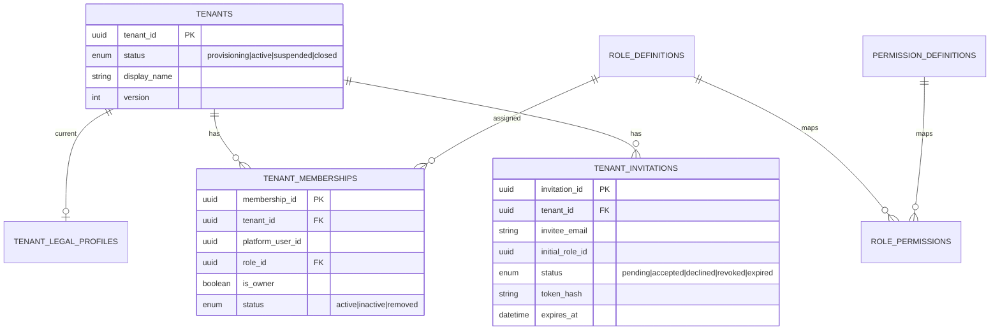

# TH-01 — Domain model

> Bounded context: **iam** (`modules/iam/`). Schema Postgres: `iam` (mở rộng theo slice).
> Product spec: [Theme-1-organization-users.md](../Theme-1-organization-users.md) §2–§3.
> Analyze: [ddd-domain-modeling](../../../../.cursor/skills/ddd-domain-modeling/SKILL.md) · Implement: [domain-layer](../../../../.cursor/skills/domain-layer/SKILL.md)

## Domain map

| Domain | Aggregate / authority | Primary responsibilities |
| ------ | --------------------- | ------------------------ |
| D-01 | **Tenant** | Lifecycle, profile, Legal Profile, ownership, readiness, activation |
| D-02 | **TenantMembership** / **TenantInvitation** | Membership + invitation lifecycle (≠ delivery outcome) |
| D-03 | **RoleDefinition** / **PermissionDefinition** | System-role catalog, assignment, EffectivePermissions input |
| D-04 | Authorization policy (runtime) | TenantContext, PlatformAdminContext, access evaluation |

**Không phải aggregate Theme 1:** credential/session (Supabase Auth external authority), Notification delivery DB — tham chiếu / orchestration only.

### Ownership (contract authority — đồng bộ với `02-module-map` / `07-api-contracts`)

| Data/capability | Authority | IAM responsibility |
| --- | --- | --- |
| Login email, verified state, credential, recovery OTP, session | Supabase Auth | Read-only snapshot / orchestration |
| Platform User profile fields | IAM, `iam.platform_user_profiles` | Self-service owner |
| IAM audit history | IAM, `iam.audit_logs` | Append immutable, redact before persist, tenant/platform views |
| Email delivery | Notification/Resend | IAM publishes request and reads outcome projection |
| Tenant/Invitation/Membership/Role | IAM | Domain owner |

**Supporting models IAM sở hữu (không phải aggregate, không tạo bounded context mới):**
- **Platform User profile** (`iam.platform_user_profiles`): projection self-only do IAM sở hữu; login email + verified state đọc read-only từ Supabase Auth (`iam.get_auth_user_snapshot`). Không phải copy authoritative của credential.
- **IAM audit history** (`iam.audit_logs`): immutable, secret-redacted, dùng chung cho tenant audit (S13) và platform audit (S16). Không mở cho module ngoài IAM; khi ≥2 bounded context cần audit → tạo decision record + extraction riêng.
- **PasswordResetOperation** (`iam.password_reset_operations`): chỉ metadata trạng thái/timing; recovery OTP + password authoritative ở Supabase Auth, không lưu code.
- **PlatformOnboardingOperation** (IAM persistence theo `operationId` / `idempotencyKey` / `correlationId`): theo dõi onboarding, retry từ bước chưa hoàn tất — không thuộc Tenant aggregate (OQ-02 closed).

## Model overview

## Lifecycle (tóm tắt)

| Entity | States (MVP) |
| ------ | ------------ |
| Tenant | `provisioning` → `active` → `suspended`; `closed` terminal read-only |
| Membership | `active` ↔ `inactive` → `removed` (terminal) |
| Invitation | `pending` → `accepted` \| `declined` \| `revoked` \| `expired` |
| RoleDefinition | `active` → `deprecated` |

## Invariants then chốt

- Tối đa một current Legal Profile; tối đa một current Owner Membership (`is_owner = true`).
- Owner **không** phải role; `role_id` và `is_owner` độc lập.
- Bốn system role MVP: Chủ cửa hàng, Nhân viên bán hàng, Kế toán, Thủ kho.
- Activation invitation (Identity) ≠ Tenant Invitation (Theme 1).
- Raw invitation/activation token: chỉ `token_hash` persist; không log raw.
- TenantReadiness = **derived** (blocker/warning); không aggregate riêng.
- EffectivePermissions = **derived**; không màn tự tra cứu cho member thường.

## Commands / Queries (catalog hướng tới)

Xem mapping chi tiết [07-api-contracts.md](07-api-contracts.md). Nhóm chính:

| Nhóm | Ví dụ |
| ---- | ----- |
| Context | `ListAccessibleTenantsQuery`, `SwitchTenantContextCommand` |
| Tenant | `GetTenantQuery`, `UpdateTenantProfileCommand`, `UpsertLegalProfileCommand`, `GetTenantReadinessQuery`, `ActivateTenantCommand` |
| Membership | `ListMembersQuery`, `DeactivateMemberCommand`, `ReactivateMemberCommand`, `RemoveMemberCommand`, `ChangeMemberRoleCommand` |
| Invitation | `CreateInvitationCommand`, `ResendInvitationCommand`, `RevokeInvitationCommand`, `AcceptInvitationCommand`, `DeclineInvitationCommand` |
| Roles | `ListSystemRolesQuery`, `GetRolePermissionsQuery` |
| Platform (Admin) | Onboarding, suspend/restore Tenant/User, privileged ownership transfer, audit query |
| Notification port | Outcome projection + Fake for FE; publish = mutation RPC `enqueue_outbox_message` → worker → `SendEmailDeliveryCommand` — Resend adapter ngoài aggregate |

## Domain events (Theme 1)

`TenantCreated`, `TenantProfileUpdated`, `TenantLegalProfileCreated|Updated`, `TenantActivated`, `TenantSuspended`, `TenantRestored`, `TenantOwnershipTransferred` (platform), `TenantInvitation*`, `TenantMembership*`, `TenantMemberRoleChanged`.

`TenantClosed` — Post-MVP registry only.

## Derived / referenced

| Model | Loại |
| ----- | ---- |
| TenantReadiness | Derived |
| EffectivePermissions | Derived |
| TenantContext / PlatformAdminContext | Runtime |
| LastSelectedTenant | Preference (Platform User Preference) |
| NotificationDeliveryStatus | Referenced (Notification / Resend) |
| PlatformUser | Referenced (Platform Identity) |
