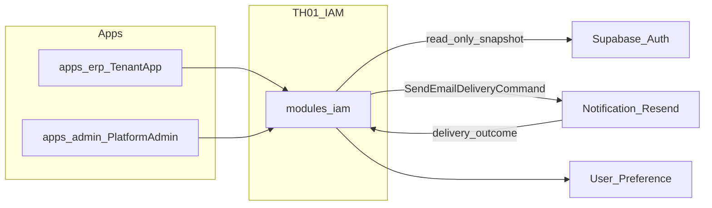

# TH-01 — Module map

**SoT:** file này. Root [`../02-module-map.md`](../02-module-map.md) chỉ redirect.

## Bảng module / capability

| Module / capability | Vai trò | Owner / Supporting | Package / surface | Trạng thái |
| ------------------- | ------- | ------------------ | ----------------- | ---------- |
| iam | Tenant, membership, invitation, role, context, readiness, platform user profile, IAM audit | **Owner** | `modules/iam/` | interim golden — mở rộng theo slice |
| Supabase Auth / Platform Identity | Login email, verified state, credential, recovery OTP, session, activation proof | Supporting (external authority) | Auth + IAM ports/adapters | referenced read-only / orchestration |
| Notification (Resend) | Email delivery + outcome | Supporting (adapter) | `packages/vet45_resend` + IAM internal command + worker | S-NOTIFY done (internal command path) |
| Platform Authorization | Platform permission + role–permission release manifest | Supporting | referenced | catalog |
| Platform User Preference | LastSelectedTenant | Supporting | referenced | validate trước dùng |
| apps/erp | Tenant App presentation | Presentation | `apps/erp` | auth shell + features |
| apps/admin | Platform Admin App | Presentation | `apps/admin` | Flutter scaffold; Melos sau |

### Ownership (contract authority — đồng bộ với `01-domain-model` / `07-api-contracts`)

| Data/capability | Authority | IAM responsibility |
| --- | --- | --- |
| Login email, verified state, credential, recovery OTP, session | Supabase Auth | Read-only snapshot / orchestration |
| Platform User profile fields | IAM, `iam.platform_user_profiles` | Self-service owner |
| IAM audit history | IAM, `iam.audit_logs` | Append immutable, redact before persist, tenant/platform views |
| Email delivery | Notification/Resend | IAM publishes request and reads outcome projection |
| Tenant/Invitation/Membership/Role | IAM | Domain owner |

## Sơ đồ phụ thuộc



> **Note:** Tenant/platform audit views đọc `iam.audit_logs` do IAM sở hữu — không còn Platform Audit module riêng cho sự kiện IAM (OQ-05).

## Permissions (Tenant — Theme 1)

Constants mục tiêu: `IamPermissions` / tenant permission codes trong `modules/iam/domain/` — không hardcode string.

| Permission | Epic/US (chính) |
| ---------- | --------------- |
| `tenant.view` | EP-02/US-01 |
| `tenant.profile.update` | EP-02/US-02 |
| `tenant.legal_profile.update` | EP-02/US-03 |
| `tenant.readiness.view` | EP-01/US-04 |
| `tenant.activate` | EP-01/US-05 |
| `tenant.member.view` | EP-03/US-01 |
| `tenant.member.invite` | EP-03/US-02, US-04 |
| `tenant.member.status.update` | EP-03/US-05 |
| `tenant.member.remove` | EP-03/US-06 |
| `tenant.role.view` | EP-04/US-01 |
| `tenant.permission.view` | EP-04/US-02 |
| `tenant.role.assign` | EP-04/US-03 |
| `tenant.audit.view` | EP-02/US-07 |

Platform permissions (`platform.user.*`, `platform.tenant.*`, `platform.audit.view`): [APPENDICES.md](../APPENDICES.md) §6.3.2 — Admin App.

Post-MVP: `tenant.ownership.transfer`, `tenant.close` — không slice phase 1.

## Ranh giới

- Theme 1 / IAM **sở hữu** `iam.platform_user_profiles`, `iam.audit_logs`, Tenant/Invitation/Membership/Role và onboarding-operation metadata.
- Theme 1 **không** sở hữu credential, recovery OTP, session storage (Supabase Auth), raw invitation/activation token plaintext, Notification delivery DB, hay mã xác nhận password-reset.
- Owner policy ≠ system role `Chủ cửa hàng`.
- Store / Warehouse **không** tạo khi provision Tenant.
- Activation invitation ≠ Tenant Invitation.
- Delivery failure ≠ Invitation revoke/expire.

## Messaging

Schema `iam`: outbox → inbox (self-consume) → `internal_commands` — [messaging_schema.md](../../../operations/messaging_schema.md).

S-NOTIFY: mutation RPC ghi outbox `iam.email.delivery_requested` (`enqueue_outbox_message`, cùng txn) → `ProcessOutbox` → `IEventsBus` → IAM inbox → `ProcessInbox` → IE handler → `ICommandScheduler.enqueue(SendEmailDeliveryCommand)` → `ProcessInternalCommands` → Resend. **Không** enqueue outbox từ Dart client. Layout = sales golden: `configuration/processing/{outbox,inbox,internal_commands}` + `IamStartup.processMessagingOnce`; email adapters ở `src/adapters/notification/`.

## Presentation layout (dự kiến)

```text
apps/erp/lib/features/
  auth/                 — login shell (hiện có)
  organization/         — hồ sơ, readiness, members, roles, selector, my-account
  ...

apps/admin/lib/features/
  users/                — Platform User
  tenants/              — onboarding, suspend/restore, ownership
  audit/

modules/iam/presentation/   — widgets/dialogs tái dùng (khi cần)
```

**Import rule:** apps → `vet45_iam_application` / presentation; module presentation **không** import `apps/*`.

Skill: [.cursor/skills/presentation-layer/SKILL.md](../../../../.cursor/skills/presentation-layer/SKILL.md)
