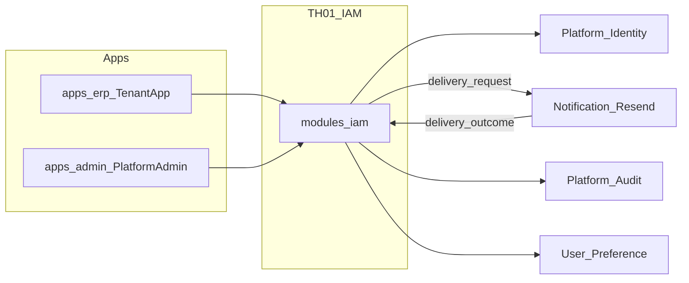

# TH-01 — Module map

**SoT:** file này. Root [`../02-module-map.md`](../02-module-map.md) chỉ redirect.

## Bảng module / capability

| Module / capability | Vai trò | Owner / Supporting | Package / surface | Trạng thái |
| ------------------- | ------- | ------------------ | ----------------- | ---------- |
| iam | Tenant, membership, invitation, role, context, readiness | **Owner** | `modules/iam/` | interim golden — mở rộng theo slice |
| Platform Identity | PlatformUser, credential, activation, password-reset, session | Supporting (contract) | ngoài Theme 1 | referenced |
| Notification (Resend) | Email delivery + outcome | Supporting (adapter) | worker / port — chưa package | contract trong harness (`S-NOTIFY`) |
| Platform Authorization | Platform permission + role–permission release manifest | Supporting | referenced | catalog |
| Platform Audit | AuditLog query / redact | Supporting | referenced | query only |
| Platform User Preference | LastSelectedTenant | Supporting | referenced | validate trước dùng |
| apps/erp | Tenant App presentation | Presentation | `apps/erp` | auth shell + features |
| apps/admin | Platform Admin App | Presentation | `apps/admin` | Flutter scaffold; Melos sau |

## Sơ đồ phụ thuộc



## Permissions (Tenant — Theme 1)

Constants mục tiêu: `IamPermissions` / tenant permission codes trong `modules/iam/domain/` — không hardcode string.

| Permission | Epic/US (chính) |
| ---------- | --------------- |
| `tenant.view` | EP-02/US-01 |
| `tenant.profile.update` | EP-02/US-02 |
| `tenant.legal_profile.update` | EP-02/US-03 |
| `tenant.readiness.view` | EP-01/US-04 |
| `tenant.activate` | EP-01/US-05 |
| `tenant.member.view` | EP-03/US-01 |
| `tenant.member.invite` | EP-03/US-02, US-04 |
| `tenant.member.status.update` | EP-03/US-05 |
| `tenant.member.remove` | EP-03/US-06 |
| `tenant.role.view` | EP-04/US-01 |
| `tenant.permission.view` | EP-04/US-02 |
| `tenant.role.assign` | EP-04/US-03 |
| `tenant.audit.view` | EP-02/US-07 |

Platform permissions (`platform.user.*`, `platform.tenant.*`, `platform.audit.view`): [APPENDICES.md](../APPENDICES.md) §6.3.2 — Admin App.

Post-MVP: `tenant.ownership.transfer`, `tenant.close` — không slice phase 1.

## Ranh giới

- Theme 1 **không** sở hữu Platform User DB, credential, raw token, mã xác nhận, Notification delivery DB, AuditLog table.
- Owner policy ≠ system role `Chủ cửa hàng`.
- Store / Warehouse **không** tạo khi provision Tenant.
- Activation invitation ≠ Tenant Invitation.
- Delivery failure ≠ Invitation revoke/expire.

## Messaging

Schema `iam`: outbox cho delivery request / domain events — [messaging_schema.md](../../../operations/messaging_schema.md). Worker consume → Notification (Resend) theo slice `S-NOTIFY`.

## Presentation layout (dự kiến)

```text
apps/erp/lib/features/
  auth/                 — login shell (hiện có)
  organization/         — hồ sơ, readiness, members, roles, selector, my-account
  ...

apps/admin/lib/features/
  users/                — Platform User
  tenants/              — onboarding, suspend/restore, ownership
  audit/

modules/iam/presentation/   — widgets/dialogs tái dùng (khi cần)
```

**Import rule:** apps → `vet45_iam_application` / presentation; module presentation **không** import `apps/*`.

Skill: [.cursor/skills/presentation-layer/SKILL.md](../../../../.cursor/skills/presentation-layer/SKILL.md)
