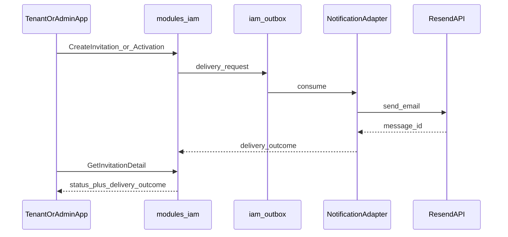
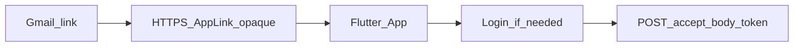

# TH-01 — Architecture & flows

Tuân theo [05-layered-module-structure.md](../../../architecture/05-layered-module-structure.md) và [02-architecture-style.md](../../../architecture/02-architecture-style.md) (CQRS, RPC-first).

Golden: mở rộng [`modules/iam/`](../../../../modules/iam/README.md).

## Quyết định kiến trúc (chốt 2026-07-16)

### Email = Resend (Notification boundary)

| Điểm | Quyết định |
| ---- | ---------- |
| Provider | **Resend** — activation invitation, Tenant Invitation, password-reset code, security notification |
| Ownership | Notification capability: IAM phát **delivery request** (outbox); adapter gửi Resend; ghi **delivery outcome** cho UI |
| Không | Theme 1 / IAM không sở hữu delivery DB, raw token, mã xác nhận; không dùng Supabase Auth mailer làm SoT Tenant Invitation |
| Secrets | `RESEND_API_KEY` (và related) chỉ qua `config/secrets` + `melos run env:sync` |
| Implement | Contract trong [07-api-contracts.md](07-api-contracts.md) §S-NOTIFY; code adapter ở slice roadmap — **không** trong bước scaffold harness |



**Hai loại mail — không gộp template/lifecycle:**

1. **Activation invitation** — Platform Identity (EP-01/US-02, US-03)
2. **Tenant Invitation** — Theme 1 Membership (EP-03); Invitation lifecycle **độc lập** delivery outcome (fail email ≠ revoke)

### Mở app từ Gmail = HTTPS App Link + opaque token

APPENDICES: raw token trong **request body**, không đặt trên API URL/query log.

| Lớp | Quy ước |
| --- | ------- |
| Email CTA | HTTPS App Link / Universal Link: `https://app…/i/{opaque}` (tenant invite) hoặc `/activate/{opaque}` |
| Opaque | One-time, ngắn hạn; client đọc từ deep-link **path**; không log raw |
| App | Mở invitation/activation surface → login nếu cần → `POST …/accept` (hoặc Identity activate) với token trong **JSON body** |
| Password reset | **Không** magic link URL — EP-06/US-03 dùng mã 6 số trong app (user đã login) |
| Surface | Tenant invite → `apps/erp`; activation/admin → `apps/admin` khi surface sẵn sàng |



**Pitfalls:** deep-link path ≠ API query string; không `GET` accept kèm token; resend = invalidate opaque cũ.

---

## Luồng chính

### Onboarding (Platform Admin → Owner activate)

```text
Admin App → resolve/create Platform User (Identity)
  → activation invitation (Resend via Notification)
  → create Tenant provisioning + Owner Membership + role Chủ cửa hàng (atomic IAM)
  → Owner activates identity → Tenant App → readiness → ActivateTenant
```

### Tenant Invitation + accept (App Link)

```text
1. CreateInvitationCommand → persist invitation (token_hash) + outbox delivery_request
2. Notification → Resend email với HTTPS App Link /i/{opaque}
3. User mở app → login + verified email khớp
4. AcceptInvitationCommand(token in body) → Membership active + invitation accepted (atomic)
```

### Switch Tenant context (EP-05)

```text
UI → ListAccessibleTenantsQuery → selector
  → SwitchTenantContextCommand → validate access → update LastSelectedTenant preference
  → reload permissions / partition cache
```

### My Account password reset (EP-06)

```text
Authenticated user → request code (Identity) → Resend email code
  → verify code in app → set new password
  (không deep-link magic URL)
```

## Điểm commit RPC (target — draft SQL theo slice)

| Nhóm | RPC (ví dụ naming) |
| ---- | ------------------ |
| Context | `iam.list_accessible_tenants`, `iam.switch_tenant_context` |
| Tenant | `iam.get_tenant`, `iam.update_tenant_profile`, `iam.upsert_legal_profile`, `iam.get_readiness`, `iam.activate_tenant` |
| Members | `iam.list_members`, `iam.deactivate_member`, `iam.reactivate_member`, `iam.remove_member`, `iam.change_member_role` |
| Invitations | `iam.create_invitation`, `iam.resend_invitation`, `iam.revoke_invitation`, `iam.accept_invitation`, `iam.decline_invitation` |
| Roles | `iam.list_roles`, `iam.get_role_permissions` |
| Platform | `iam.platform_*` (onboarding, suspend/restore, transfer-ownership) |

Draft only: `supabase/migrations/_drafts/` — không tạo file timestamp trừ khi user yêu cầu promote.

## Access control

- Tenant App: `@RequiresTenant()` + `@RequiresPermission(IamPermissions.*)` / Owner policy khi áp dụng
- Platform Admin: PlatformAdminContext + platform permissions; **không** yêu cầu Membership Tenant đích
- Codegen: `iam_access_metadata.g.dart`
