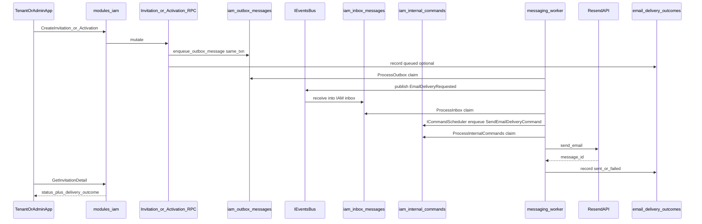
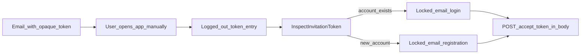

# TH-01 — Architecture & flows

Tuân theo [05-layered-module-structure.md](../../../architecture/05-layered-module-structure.md) và [02-architecture-style.md](../../../architecture/02-architecture-style.md) (CQRS, RPC-first).

Golden: mở rộng [`modules/iam/`](../../../../modules/iam/README.md).

## Quyết định kiến trúc (chốt 2026-07-16)

### Ownership boundary (chốt 2026-07-29 — Contract Gaps Task 1)

| Data/capability | Authority | IAM responsibility |
| --- | --- | --- |
| Login email, verified state, credential, recovery OTP, session | Supabase Auth | Read-only snapshot / orchestration |
| Platform User profile fields | IAM, `iam.platform_user_profiles` | Self-service owner |
| IAM audit history | IAM, `iam.audit_logs` | Append immutable, redact before persist, tenant/platform views |
| Email delivery | Notification/Resend | IAM publishes request and reads outcome projection |
| Tenant/Invitation/Membership/Role | IAM | Domain owner |

Đồng bộ với [01-domain-model.md](01-domain-model.md), [02-module-map.md](02-module-map.md), [07-api-contracts.md](07-api-contracts.md). Quyết định OQ contract: [APPENDICES.md](../APPENDICES.md) §6.6.

### Email = Resend (Notification boundary)

| Điểm | Quyết định |
| ---- | ---------- |
| Provider | **Resend** — activation invitation, Tenant Invitation, password-reset code, security notification |
| Ownership | Notification: mutation RPC `enqueue_outbox_message` (`iam.email.delivery_requested`) + optional queued outcome → worker self-consume inbox → `ICommandScheduler.enqueue(SendEmailDeliveryCommand)` → Resend (`packages/vet45_resend`); **delivery outcome** projection cho UI |
| Không | Theme 1 / IAM **không** gọi `enqueue_outbox_message` từ Dart; không dùng outbox làm task queue gửi mail trực tiếp; không sở hữu raw token / mã xác nhận; không dùng Supabase Auth mailer làm SoT Tenant Invitation |
| Delivery outcome | **OQ-08 closed:** async projection; create/resend trả `queued`; UI đọc theo `correlationId` |
| Secrets | `RESEND_API_KEY` (và related) chỉ qua `config/secrets` + `melos run env:sync` |
| Implement | Contract [07-api-contracts.md](07-api-contracts.md) §S-NOTIFY; consume path `Process*` + adapters `src/adapters/notification/`; publish path = RPC (invitation slice wires same-txn) |



**Hai loại mail — không gộp template/lifecycle:**

1. **Activation invitation** — Platform Identity (EP-01/US-02, US-03)
2. **Tenant Invitation** — Theme 1 Membership (EP-03); Invitation lifecycle **độc lập** delivery outcome (fail email ≠ revoke)

### Xác nhận từ email = manual opaque token, không URL

Email không chứa link hoặc URL xác nhận. Backend sinh raw token; người nhận tự mở app khi đang đăng xuất, copy/paste token vào màn xác nhận. Token chỉ được gửi tới API trong **JSON body**.

| Lớp | Quy ước |
| --- | ------- |
| Email | Chỉ hiển thị opaque token và hướng dẫn tự mở app; không button, URL, route hoặc token trong query string |
| Token | Backend sinh 32-byte CSPRNG, Base64URL; one-time; chỉ `SHA-256(token)` persist; raw token không log |
| Entry surface | Màn “Tôi có mã lời mời” chỉ xuất hiện khi chưa đăng nhập |
| Inspect | Hash token → kiểm tra pending/expiry/revoke/consume → trả invitation preview và `accountExists`; token sai không lộ account status |
| Existing account | Chuyển sang Invitation Login; `invitee_email` điền sẵn và khóa read-only → login → accept |
| New account | Chuyển sang Registration; email điền sẵn, khóa read-only; invitation token đồng thời là email proof → tạo verified identity → accept |
| Activation | Dùng token riêng do Platform Identity sở hữu; người dùng nhập thủ công, không dùng URL xác nhận |
| Password reset | EP-06/US-03 dùng mã 6 số nhập trong app; tách khỏi invitation/activation token |
| Surface | Tenant invite → `apps/erp`; activation/admin → `apps/admin` khi surface sẵn sàng |



**Pitfalls:** không persist token phía client; không log/analytics raw token; gửi lại lời mời phải rotate token và vô hiệu token cũ; chỉ consume token sau khi Membership được tạo thành công.

---

## Luồng chính

### Onboarding (Platform Admin → Owner activate)

```text
Admin App → resolve/create Platform User (Identity)
  → activation invitation (Resend via Notification)
  → create Tenant provisioning + Owner Membership + role Chủ cửa hàng (atomic IAM)
  → Owner activates identity → Tenant App → readiness → ActivateTenant
```

### Tenant Invitation + manual token confirmation

```text
1. CreateInvitationCommand → invitation RPC (persist + `enqueue_outbox_message` + queued outcome, same txn)
2. Worker → ProcessOutbox/Inbox/Internal → Resend; outcome projection cập nhật `sent`/`failed`

3. User đang đăng xuất tự mở app → nhập token → inspect invitation + resolve account theo canonical email
4a. Account đã tồn tại → Invitation Login khóa email → login
4b. Chưa có account → Registration khóa email; token là email proof → tạo verified Platform User
5. AcceptInvitationCommand(token in body) → Membership active + invitation accepted + token consumed (atomic IAM)
```

### Switch Tenant context (EP-05)

```text
UI → ListAccessibleTenantsQuery → selector
  → SwitchTenantContextCommand → validate access → update LastSelectedTenant preference
  → reload permissions / partition cache
```

### My Account password reset (EP-06)

```text
Authenticated user → request code (Auth/Resend) → verify code in app → set new password
  → revoke other sessions; rotate current session (OQ-09 closed)
  (không URL xác nhận)
```

### Logged-out forgot password (S0 companion)

```text
Login "Quên mật khẩu?" (email trên form)
  → RequestPasswordResetByEmailCommand
  → cùng UI mã 6 số / mật khẩu mới
  → CompletePasswordResetByEmailCommand (không session hiện hành)
  → pop về login + toast
Anti-enumeration: request luôn cùng shape; không lộ email tồn tại.
Không dùng RequestMyPasswordResetCommand (S14 / auth.uid()).
```

## Điểm commit RPC (target — draft SQL theo slice)

| Nhóm | RPC (ví dụ naming) |
| ---- | ------------------ |
| Context | `iam.list_accessible_tenants`, `iam.switch_tenant_context` |
| Tenant | `iam.get_tenant`, `iam.update_tenant_profile`, `iam.upsert_legal_profile`, `iam.get_readiness`, `iam.activate_tenant` |
| Members | `iam.list_members`, `iam.deactivate_member`, `iam.reactivate_member`, `iam.remove_member`, `iam.change_member_role` |
| Invitations | `iam.create_invitation`, `iam.resend_invitation`, `iam.revoke_invitation`, `iam.accept_invitation`, `iam.decline_invitation` |
| Roles | `iam.list_roles`, `iam.get_role_permissions` |
| Platform | `iam.platform_*` (onboarding, suspend/restore, transfer-ownership) |

Draft only: `supabase/migrations/_drafts/` — không tạo file timestamp trừ khi user yêu cầu promote.

## Access control

- Tenant App: `@RequiresTenant()` + `@RequiresPermission(IamPermissions.*)` / Owner policy khi áp dụng
- Platform Admin: PlatformAdminContext + platform permissions; **không** yêu cầu Membership Tenant đích
- Codegen: `iam_access_metadata.g.dart`
