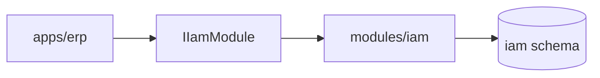

# TH-01 — Module map

| Module | Vai trò | Owner / Supporting | Trạng thái |
| ------ | ------- | ------------------ | ---------- |
| iam | Auth, tenant, membership, RBAC | **Owner** | `in_progress` (golden reference) |
| apps/erp `features/auth/` | Login shell | Presentation | `in_progress` |

Cross-cutting: mọi bounded context consume `IPermissionChecker` + `ITenantAccessChecker` từ host DI.
