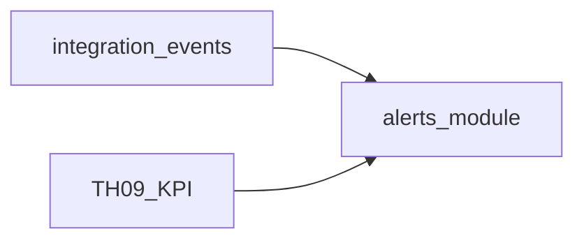

# TH-10 — Module map

| Module | Vai trò | Owner / Supporting | Trạng thái |
| ------ | ------- | ------------------ | ---------- |
| Alerts / Risk* | Rule, alert instance | **Owner** | planned |
| IAM | Access audit | Supporting | in_progress |
| Reporting | KPI threshold | Consumer | planned |

Cross-cutting: subscribe integration events + scheduled checks trên read models.

