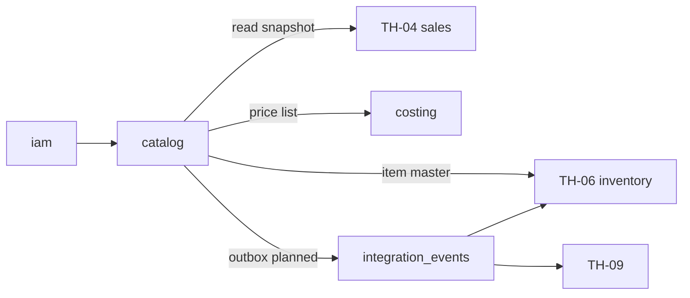

# TH-02 — Module map

| Module | Vai trò | Owner / Supporting | Package | Trạng thái |
| ------ | ------- | ------------------ | ------- | ---------- |
| catalog | Product master, UOM, pricing | **Owner** | `modules/catalog/` | planned (skeleton) |
| inventory | Stock item linkage, tồn cơ bản từ SP | Supporting | `modules/inventory/` | planned |
| costing | Cost reference cho giá vốn | Supporting | `modules/costing/` | planned |
| iam | Permissions (`catalog.*` khi seed) | Supporting | `modules/iam/` | in_progress |

## Downstream consumers

| Theme | Dùng dữ liệu TH-02 cho |
| ----- | ----------------------- |
| TH-04 Bán hàng | Snapshot SP/giá trên dòng đơn, barcode lookup |
| TH-06 Kho & giá vốn | Item linkage; tồn chi tiết tách khỏi tồn cơ bản lúc tạo SP |
| TH-07 Hóa đơn | Mô tả hàng trên hóa đơn |
| TH-09 Dashboard | KPI doanh thu theo SP/nhóm hàng |

## Integration (dự kiến)

Owner `catalog` có thể publish integration events (ví dụ `catalog.product.created`) qua outbox — consumers: inventory projection, search, reporting. Chi tiết messaging: [docs/architecture/07-integration-and-messaging.md](../../architecture/07-integration-and-messaging.md).

## Presentation (dự kiến)

- Pages: `apps/erp/lib/features/catalog/` (khi có UI slice)
- Reusable widgets: `modules/catalog/presentation/` (mirror TH-03)

Cross-theme: [TH-04 module map](../TH-04-sales-orders/02-module-map.md) · [TH-06 module map](../TH-06-inventory-and-costing/02-module-map.md)
