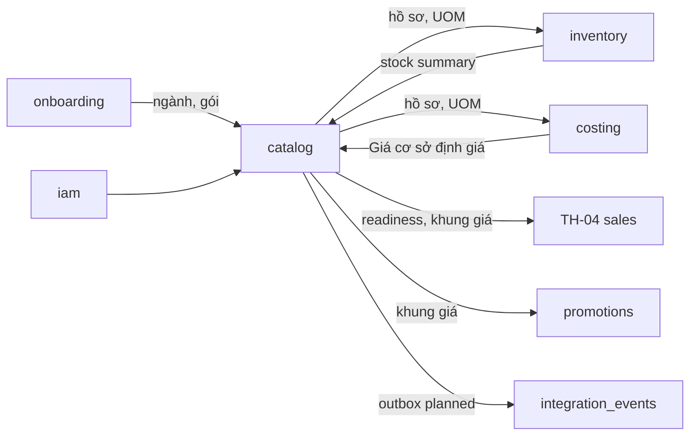

# TH-02 — Module map

| Module | Vai trò | Owner / Supporting | Package | Trạng thái |
| ------ | ------- | ------------------ | ------- | ---------- |
| catalog | Product master, readiness, UOM, stock profile, base price, price band, custom fields | **Owner** | `modules/catalog/` | planned (skeleton) |
| inventory | Advanced stock summary read; item linkage | Supporting | `modules/inventory/` | planned |
| costing | Costing-module base price read (Growth) | Supporting | `modules/costing/` | planned |
| iam | Permissions (`catalog.*` khi seed) | Supporting | `modules/iam/` | in_progress |
| onboarding | Ngành kinh doanh, gói sản phẩm tenant | Supporting (read) | TBD | planned |

## Downstream consumers

| Theme / Module | Dùng dữ liệu TH-02 cho |
| -------------- | ----------------------- |
| TH-04 Bán hàng | Snapshot SP, readiness, đơn vị bán, Giá niêm yết / Giá sàn |
| TH-06 Kho & giá vốn | Item linkage; stock summary (Advanced); base cost feed |
| Promotions | Giá niêm yết (trước KM), Giá sàn (ngưỡng) |
| TH-07 Hóa đơn | Mô tả hàng trên hóa đơn |
| TH-09 Dashboard | KPI doanh thu theo SP/nhóm hàng |

## Integration (v3)

Chi tiết integration diagrams: [appendices/README.md](appendices/README.md) (Phụ lục D).

## Ranh giới (v3)

| Nội dung | Thuộc catalog | Module khác |
| -------- | ------------- | ----------- |
| Hồ sơ SP, ảnh, readiness, custom fields | ✓ | |
| Basic stock (Foundation) | ✓ | |
| Advanced stock, phiếu kho | | inventory |
| Manual base price (Foundation) | ✓ | |
| FIFO/FILO/bình quân giá vốn | | costing |
| Giá niêm yết, Giá sàn, Store Price Rule | ✓ | |
| Giá cuối sau khuyến mãi | | promotions / sales |
| Giao dịch bán, snapshot đơn | | sales |

## Presentation (dự kiến)

- Pages: `apps/erp/lib/features/catalog/`
- Reusable widgets: `modules/catalog/presentation/` (mirror TH-03)
- Product Control Center: màn chi tiết điều phối — không dùng nút "Sửa" chung

Cross-theme: [TH-04 module map](../TH-04-sales-orders/02-module-map.md) · [TH-06 module map](../TH-06-inventory-and-costing/02-module-map.md)
