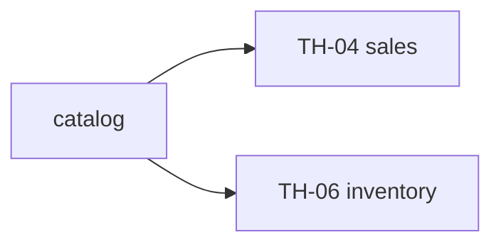

# TH-02 — Module map

| Module | Vai trò | Owner / Supporting | Trạng thái |
| ------ | ------- | ------------------ | ---------- |
| catalog | Product, price list | **Owner** | planned (skeleton) |
| inventory | Stock item linkage | Supporting | planned |
| costing | Cost reference | Supporting | planned |
| iam | Permissions | Supporting | in_progress |

