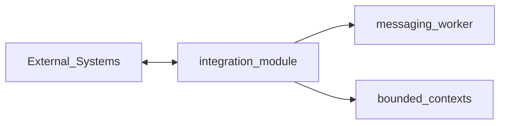

# TH-11 — Module map

| Module | Vai trò | Owner / Supporting | Trạng thái |
| ------ | ------- | ------------------ | ---------- |
| Integration* | Connectors, sync orchestration | **Owner** | planned |
| Messaging worker | Async job execution | Supporting | in_progress |
| Mọi module | Expose stable integration contracts | Supporting | — |

TH-07 MISA có thể là connector đầu tiên trước khi tách framework TH-11 đầy đủ.
