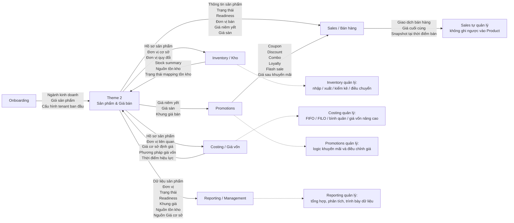

# TH-02 — Overview

> Nguồn: Theme 2 v3 (`theme_snapshot.md`). Chi tiết Epic/US/FR: [README.md](README.md). Phụ lục: [APPENDICES.md](APPENDICES.md).

## Giới thiệu

**Theme 2: Sản phẩm & Giá bán** giúp người dùng quản lý dữ liệu nền liên quan đến sản phẩm trong VET45, bao gồm hồ sơ sản phẩm, thông tin nhận diện, ảnh sản phẩm, đơn vị đo lường, tồn kho cơ bản, Giá cơ sở định giá, Giá niêm yết, Giá sàn, trạng thái kinh doanh, thông tin bổ sung và lịch sử thay đổi quan trọng.

Theme này là một mắt xích nền trong chuỗi vận hành của VET45. Dữ liệu sản phẩm không đứng độc lập, mà được sử dụng lại bởi nhiều nghiệp vụ phía sau như bán hàng, nhập hàng, tồn kho, giá vốn, hóa đơn, ghi sổ, báo cáo và quản trị hiệu quả theo sản phẩm.

VET45 trước mắt tập trung vào bán lẻ ngành thú y, nhưng sản phẩm được thiết kế theo hướng **retail-first, industry-extensible**. Điều này có nghĩa là hệ thống cần phục vụ tốt ngành thú y ở giai đoạn đầu, nhưng không được khóa cứng dữ liệu sản phẩm vào các trường chuyên biệt như thành phần, chỉ định, chống chỉ định, cách dùng hoặc thời gian ngưng sử dụng. Những thông tin này cần được chuyển sang mô hình **nhóm & trường thông tin bổ sung** để sau này có thể mở rộng sang ngành khác. Trong Guided creation, mỗi group active trở thành **card riêng có đánh số tự động**, nằm sau **Khung giá bán** và trước **Ghi chú**.

## Phạm vi của Theme

### Trong phạm vi

|Nhóm|Nội dung|
|---|---|
|Hồ sơ sản phẩm|Tên sản phẩm, tên thương mại, SKU, barcode, ảnh, mô tả, ghi chú|
|Đơn vị đo lường|Đơn vị cơ sở, đơn vị quy đổi, tỷ lệ quy đổi, trạng thái đơn vị|
|Tồn kho|Tồn kho cơ bản trong Foundation, stock summary khi dùng tồn kho nâng cao|
|Giá cơ sở định giá|Nhập thủ công trong Foundation, hoặc đọc từ module Giá vốn ở gói nâng cao|
|Khung giá bán|Giá niêm yết, Giá sàn, quy tắc tính giá, giá theo đơn vị|
|Thông tin bổ sung|Custom field groups, custom fields, custom field values theo sản phẩm|
|Vòng đời sản phẩm|Đang kinh doanh, ngừng kinh doanh, đã xóa|
|Readiness|Trạng thái sản phẩm đã đủ sẵn sàng để nhập, bán, quản trị chưa|
|Truy vết|Lịch sử thay đổi quan trọng về hồ sơ, đơn vị, tồn kho, giá, trạng thái|

### Ngoài phạm vi

|Ngoài phạm vi|Module / Theme xử lý|
|---|---|
|Tạo đơn bán hàng, checkout, thanh toán|Sales / Order-to-cash|
|Tạo phiếu nhập hàng, nhà cung cấp, công nợ nhập hàng|Purchase / Inbound|
|Quản lý kho nâng cao, nhập/xuất/điều chỉnh/kiểm kê|Inventory / Kho|
|Tồn kho theo warehouse hoặc chi nhánh|Inventory / Kho|
|Tính giá vốn theo FIFO, FILO, bình quân cuối kỳ, bình quân linh hoạt|Costing / Giá vốn|
|Tính giá bán cuối cùng sau khuyến mãi|Promotions / Sales|
|Coupon, discount, loyalty, flash sale, combo|Promotions|
|Phê duyệt bán dưới Giá sàn|Sales control / Approval|
|Import/export hàng loạt|Data onboarding / Import-export|

## Triết lý và nguyên tắc thiết kế

Theme 2 được thiết kế theo triết lý: **sản phẩm không chỉ là một bản ghi dữ liệu, mà là một đối tượng vận hành cần được đưa vào trạng thái sẵn sàng sử dụng trong hệ thống**.

Vì vậy, trọng tâm của Theme không phải là “tạo/sửa/xóa sản phẩm”, mà là giúp người dùng trả lời rõ các câu hỏi:

- Sản phẩm này là gì?

- Sản phẩm đã tồn tại trong hệ thống chưa?

- Sản phẩm có đủ dữ liệu để nhập hàng, bán hàng và quản trị chưa?

- Sản phẩm đang thiếu dữ liệu gì?

- Dữ liệu nào được nhập trực tiếp trong Product, dữ liệu nào đến từ module khác?

- Người dùng nên làm hành động gì tiếp theo?

### Các khái niệm thiết kế chủ đạo

|Khái niệm|Diễn giải|Hệ quả thiết kế|
|---|---|---|
|**Product Readiness**|Sản phẩm không chỉ “đã được tạo”, mà cần đủ dữ liệu để vận hành an toàn.|Mỗi sản phẩm cần có readiness status, checklist và blocker rõ ràng.|
|**Guided Product Creation**|Tạo sản phẩm là một hành trình có hướng dẫn, không phải một form lớn chứa tất cả field.|Flow tạo mới đi từ dữ liệu tối thiểu đến các bước hoàn thiện như đơn vị, tồn kho, giá và thông tin bổ sung.|
|**Product Control Center**|Màn chi tiết sản phẩm là trung tâm điều phối dữ liệu và hành động của sản phẩm.|Không dùng một nút “Sửa” chung; thay vào đó có các hành động theo ngữ cảnh.|
|**Progressive Completion**|Người dùng có thể tạo sản phẩm tối thiểu trước, rồi hoàn thiện dần.|Dữ liệu chưa có được ghi nhận thành readiness blocker thay vì ép nhập toàn bộ ngay từ đầu.|
|**Contextual Action**|Hành động hiển thị phụ thuộc vào quyền, trạng thái kinh doanh, readiness và mode của tenant.|UI chỉ hiển thị hoặc ưu tiên hành động phù hợp với tình trạng hiện tại của sản phẩm.|
|**Source-aware Product Data**|Một số dữ liệu được nhập trực tiếp trong Product, một số dữ liệu được đọc từ module chuyên trách.|Product cần phân biệt rõ Basic stock vs Advanced stock, Manual base price vs Costing-module base price.|
|**Extensible Product Model**|Product cần đủ lean cho Foundation nhưng vẫn mở rộng được sang ngành khác và gói cao hơn.|Thông tin bổ sung dùng custom fields; tồn kho, giá vốn, khuyến mãi được tách ranh giới rõ.|

### Nguyên tắc thiết kế chính

|Nguyên tắc|Diễn giải|
|---|---|
|Sản phẩm phải có hành trình hoàn thiện|Không ép người dùng nhập mọi thứ trong một form lớn; hệ thống cần cho phép tạo tối thiểu rồi dẫn dắt hoàn thiện.|
|Đơn vị cơ sở đi trước tồn kho và giá|Tồn kho, Giá cơ sở định giá và khung giá bán chỉ có ý nghĩa khi biết đang diễn giải theo đơn vị nào.|
|Tồn kho được chuẩn hóa theo đơn vị cơ sở|Trong Basic stock, tồn kho được ghi nhận theo đơn vị cơ sở; các đơn vị khác chỉ là cách quy đổi.|
|Giá cơ sở định giá là input của khung giá bán|Theme 2 không tính giá vốn nâng cao; hệ thống dùng Giá cơ sở định giá làm mốc để thiết lập Giá niêm yết và Giá sàn.|
|Giá bán được quản trị bằng khung giá|Theme 2 quản lý Giá niêm yết và Giá sàn, không quản lý giá cuối cùng sau khuyến mãi.|
|Thông tin bổ sung phải cấu hình được|Không hard-code thông tin thú y vào Product; các thông tin như thành phần, chỉ định, chống chỉ định, cách dùng được quản lý bằng custom fields.|
|Dữ liệu hiện hành không được phá vỡ dữ liệu lịch sử|Thay đổi tên, đơn vị, giá, tồn kho hoặc trạng thái hiện hành không được làm sai giao dịch, chứng từ hoặc báo cáo đã phát sinh.|

### Ranh giới thiết kế quan trọng

|Phạm vi|Thuộc Theme 2|Không thuộc Theme 2|
|---|---|---|
|Sản phẩm|Hồ sơ sản phẩm, ảnh, trạng thái, readiness|Giao dịch bán hàng hoặc nhập hàng|
|Đơn vị|Đơn vị cơ sở, đơn vị quy đổi, vai trò đơn vị|Snapshot đơn vị trên từng giao dịch|
|Tồn kho|Basic stock hoặc đọc stock summary từ module Kho|Phiếu nhập, phiếu xuất, kiểm kê, điều chuyển kho nâng cao|
|Giá cơ sở định giá|Nhập thủ công hoặc đọc từ module Giá vốn|Tính giá vốn FIFO, FILO, bình quân|
|Khung giá bán|Giá niêm yết, Giá sàn theo đơn vị bán<br>|Coupon, discount, loyalty, giá cuối cùng sau khuyến mãi|
|Thông tin bổ sung|Custom field groups, custom fields, custom field values|Logic chuyên môn sâu của từng ngành nếu nằm ngoài dữ liệu sản phẩm|
|Lịch sử|Product Change History cho thay đổi quan trọng|Audit log kỹ thuật cấp thấp nếu không cần hiển thị nghiệp vụ|

### Nguyên tắc UX

- Mỗi màn hình phải giúp người dùng biết sản phẩm đang ở trạng thái nào.

- Mỗi blocker phải chỉ rõ dữ liệu nào đang thiếu.

- Mỗi blocker quan trọng nên có hành động tiếp theo nếu người dùng có quyền.

- Các hành động nguy hiểm như ngừng kinh doanh, xóa hoặc đổi đơn vị cơ sở phải có xác nhận rõ ràng.

- UI không nên dùng trạng thái kỹ thuật như `ACTIVE`, `INACTIVE`, `READY_TO_SELL` cho người dùng cuối.

- Màn chi tiết sản phẩm không nên chỉ là màn “xem/sửa”, mà là nơi điều phối toàn bộ dữ liệu và hành động liên quan đến sản phẩm.

    

Tóm lại, Theme 2 được thiết kế để đảm bảo:

> Một sản phẩm không chỉ được tạo trong hệ thống,  
> 
> mà phải từng bước trở thành một sản phẩm sẵn sàng để vận hành.
> 
> 

## Hành trình người dùng

Tên hành trình đề xuất:

**Hành trình đưa sản phẩm vào trạng thái sẵn sàng vận hành**

Hành trình này mô tả cách người dùng biến một sản phẩm ngoài đời thành một sản phẩm có thể được hệ thống sử dụng trong bán hàng, nhập hàng, tồn kho, giá bán, hóa đơn, ghi sổ và báo cáo.

|**Chặng**|**Tên chặng**|**Mục tiêu**|**Kết quả**|
|---|---|---|---|
|P1<br>|Phát hiện nhu cầu sản phẩm|Người dùng cần đưa một sản phẩm thực tế vào hệ thống|Có ý định tạo hoặc kiểm tra sản phẩm|
|P2|Kiểm tra sản phẩm đã tồn tại chưa|Tránh tạo trùng sản phẩm|Tìm thấy sản phẩm cũ hoặc bắt đầu tạo mới|
|P3|Tạo hồ sơ sản phẩm tối thiểu|Ghi nhận thông tin nhận diện cơ bản|Có hồ sơ sản phẩm ban đầu|
|P4|Thiết lập đơn vị cơ sở<br>|Xác định đơn vị gốc để quản lý tồn kho và quy đổi|Có đơn vị cơ sở hợp lệ|
|P5|Thiết lập tồn kho hoặc nguồn tồn kho|Biết sản phẩm đang có bao nhiêu hàng hoặc lấy tồn từ đâu|Có tồn kho cơ bản hoặc stock source|
|P6|Thiết lập Giá cơ sở định giá hoặc nguồn giá cơ sở|Có mốc chi phí dùng để tính khung giá bán|Có manual base price hoặc base price source|
|P7|Thiết lập Giá niêm yết và Giá sàn|Tạo khung giá bán chuẩn|Có price band hợp lệ|
|P8|Bổ sung đơn vị quy đổi|Cho phép bán/nhập/xem theo nhiều đơn vị|Có các đơn vị quy đổi hợp lệ nếu cần|
|P9|Bổ sung thông tin bổ sung|Ghi nhận dữ liệu chuyên biệt theo ngành|Có custom field values nếu cần|
|P10|Kiểm tra readiness|Biết sản phẩm đã sẵn sàng vận hành chưa|Có readiness status/checklist|
|P11|Sử dụng trong vận hành|Sản phẩm được dùng bởi các module khác|Dữ liệu sản phẩm đi vào bán hàng, nhập hàng, kho, báo cáo|
|P12|Bảo trì vòng đời|Cập nhật khi thực tế thay đổi|Sản phẩm được sửa, ngừng, kinh doanh lại hoặc xóa nếu đủ điều kiện|

## Mô hình readiness của sản phẩm

**Readiness** là trạng thái giúp người dùng biết một sản phẩm đã đủ dữ liệu để được sử dụng trong vận hành hay chưa.

Readiness không thay thế trạng thái kinh doanh. Một sản phẩm có thể đang `ACTIVE`, nhưng vẫn chưa sẵn sàng bán vì thiếu Giá niêm yết hoặc Giá sàn. Ngược lại, một sản phẩm có thể có đủ hồ sơ, đơn vị, tồn kho và giá, nhưng đang `INACTIVE`, nên không được sử dụng trong giao dịch mới.

Các nhóm readiness:

|**Nhóm readiness**|**Câu hỏi cần trả lời**|
|---|---|
|Hồ sơ|Sản phẩm đã có thông tin nhận diện tối thiểu chưa?|
|Đơn vị|Sản phẩm đã có đơn vị cơ sở hợp lệ chưa?|
|Tồn kho|Sản phẩm đã có tồn kho cơ bản hoặc nguồn tồn kho hợp lệ chưa?|
|Giá cơ sở định giá|Sản phẩm đã có Giá cơ sở định giá hoặc nguồn giá cơ sở chưa?|
|Khung giá bán|Sản phẩm đã có Giá niêm yết và Giá sàn hợp lệ chưa?|
|Thông tin bổ sung|Đối với nhóm và trường thông tin bổ sung, các field được đánh dấu required là dữ liệu bắt buộc. Khi người dùng tạo hoặc sửa sản phẩm, hệ thống không cho lưu nếu các field required trong nhóm đang hoạt động chưa được điền hợp lệ.<br>Các field không required có thể bỏ trống và không ảnh hưởng readiness.|
|Vòng đời|Sản phẩm có được phép dùng trong giao dịch mới không?|

Các trạng thái readiness đề xuất:

|**Trạng thái**|**Ý nghĩa**|
|---|---|
|Chưa hoàn thiện|Sản phẩm đã được tạo nhưng còn thiếu dữ liệu quan trọng|
|Thiếu hồ sơ bắt buộc|Thiếu thông tin nhận diện tối thiểu|
|Thiếu đơn vị cơ sở|Chưa có đơn vị cơ sở hợp lệ|
|Thiếu thiết lập tồn kho|Chưa có tồn kho cơ bản hoặc stock source hợp lệ|
|Thiếu Giá cơ sở định giá|Chưa có manual base price hoặc base price từ module Giá vốn|
|Thiếu khung giá bán|Chưa có Giá niêm yết hoặc Giá sàn hợp lệ|
|Sẵn sàng nhập hàng|Có đủ hồ sơ và đơn vị để dùng trong nhập hàng|
|Sẵn sàng bán hàng|Có đủ hồ sơ, trạng thái hợp lệ, đơn vị bán và khung giá bán|
|Ngừng kinh doanh|Sản phẩm được giữ lại nhưng không dùng trong giao dịch mới|
|Đã xóa|Sản phẩm đã bị xóa mềm và không dùng trong vận hành mới|

Readiness nên được hiển thị ở ít nhất ba vị trí:

|**Vị trí**|**Cách hiển thị**|
|---|---|
|Danh sách sản phẩm|Chip ngắn như “Sẵn sàng bán”, “Thiếu giá”, “Ngừng KD”|
|Chi tiết sản phẩm|Checklist đầy đủ theo từng nhóm dữ liệu|
|Sau khi tạo sản phẩm|Gợi ý bước tiếp theo để hoàn thiện sản phẩm|

Ví dụ checklist sau khi tạo sản phẩm:

✓ Hồ sơ cơ bản

✓ Đơn vị cơ sở

○ Tồn kho

○ Giá cơ sở định giá

○ Khung giá bán

○ Đơn vị quy đổi

○ Thông tin bổ sung

## Các khái niệm cốt lõi

|**Khái niệm**|**Vai trò trong Theme 2**|
|---|---|
|**Hồ sơ sản phẩm**|Lớp nhận diện sản phẩm trong hệ thống, gồm tên sản phẩm, tên thương mại, SKU, barcode, ảnh, mô tả và ghi chú.|
|**Đơn vị đo lường**|Xác định cách diễn giải số lượng, tồn kho, quy đổi và giá. Mỗi sản phẩm cần có một đơn vị cơ sở tại một thời điểm.|
|**Tồn kho / nguồn tồn kho**|Cho biết sản phẩm có dữ liệu tồn kho cơ bản hoặc nguồn tồn kho nâng cao hợp lệ hay chưa.|
|**Giá cơ sở định giá**|Mốc chi phí dùng để thiết lập hoặc kiểm tra Giá niêm yết, Giá sàn và khung giá bán.|
|**Khung giá bán**|Gồm Giá niêm yết và Giá sàn theo đơn vị bán. Theme 2 quản lý khung giá bán, không tính giá bán cuối cùng sau khuyến mãi.|
|**Nhóm & trường thông tin bổ sung**|Tenant có thể cấu hình nhiều nhóm thông tin bổ sung cho sản phẩm. Mỗi nhóm gồm nhiều trường thông tin. Mỗi nhóm có tên, icon, thứ tự hiển thị và trạng thái. Các nhóm đang hoạt động được hiển thị như các card riêng trong flow tạo sản phẩm và Product Control Center.|
|**Vòng đời, lịch sử và snapshot**|Kiểm soát việc sản phẩm đang kinh doanh, ngừng kinh doanh, đã xóa mềm; đồng thời bảo toàn thay đổi quan trọng và dữ liệu đã phát sinh.|

Tóm lại, các khái niệm trên là lớp ngôn ngữ chung để đọc các Epic/FR phía sau. Mục này chỉ nhằm thống nhất cách hiểu, không cố gắng mô tả toàn bộ quan hệ xử lý của Theme 2.

## Hành vi theo gói và chế độ vận hành

Mục này mô tả cách Theme 2 thay đổi hành vi theo từng gói sản phẩm và từng chế độ vận hành.

Trong Theme 2, cần phân biệt rõ:

|**Lớp**|**Ý nghĩa**|
|---|---|
|**Gói sản phẩm**|Quyết định tenant được sử dụng nhóm năng lực nào.|
|**Chế độ vận hành**|Quyết định dữ liệu được nhập trực tiếp trong Product hay đọc từ module chuyên trách.|
|**Quy tắc chuyển đổi**|Quy định cách chuyển từ mô hình đơn giản sang mô hình nâng cao mà không phá vỡ dữ liệu cũ.|

Nguyên tắc chung:

- Gói thấp cần đơn giản, dùng được ngay.

- Gói cao có thể kết nối module chuyên trách.

- Product không được tự xử lý nghiệp vụ chuyên sâu của module khác.

- Khi chuyển từ chế độ đơn giản sang nâng cao, dữ liệu cũ phải được bảo toàn.

### Hành vi theo gói sản phẩm

|**Gói**|**Hành vi trong Theme 2**|
|---|---|
|**Foundation**|Quản lý hồ sơ sản phẩm, nhiều ảnh sản phẩm, đơn vị đo lường, tồn kho cơ bản nhập trực tiếp, Giá cơ sở định giá nhập thủ công, Giá niêm yết, Giá sàn và readiness cơ bản.|
|**Compliance**|Sử dụng dữ liệu sản phẩm để phục vụ hóa đơn, ghi sổ, truy vết và kiểm soát dữ liệu nền phục vụ tuân thủ.|
|**Management**|Bổ sung góc nhìn readiness, lịch sử thay đổi, quản trị khung giá và dữ liệu nền cho phân tích hiệu quả theo sản phẩm.|
|**Growth**|Cho phép kết nối module nâng cao như Kho, Giá vốn và Promotions; Product đọc dữ liệu từ module chuyên trách thay vì tự xử lý.|

### Hành vi tồn kho theo chế độ

|**Chế độ**|**Gói áp dụng**|**Hành vi**|
|---|---|---|
|**Basic stock**|Foundation|Người dùng nhập và chỉnh tồn kho cơ bản trực tiếp trong Product.|
|**Advanced stock**|Growth trở lên|Product không cho chỉnh tồn trực tiếp; tồn kho được đọc từ module Kho.|

### Hành vi Giá cơ sở định giá theo chế độ

|**Chế độ**|**Gói áp dụng**|**Hành vi**|
|---|---|---|
|**Manual base price**|Foundation|Người dùng nhập Giá cơ sở định giá trực tiếp trong Product.|
|**Costing-module base price**|Growth trở lên|Product đọc Giá cơ sở định giá từ module Giá vốn.|

### Quy tắc chuyển đổi sang chế độ nâng cao

|**Trường hợp**|**Hành vi**|
|---|---|
|**Chuyển Basic stock sang Advanced stock**|Khóa chỉnh tồn trực tiếp trong Product, bảo toàn dữ liệu tồn kho cơ bản cũ, đọc stock summary từ module Kho.|
|**Chuyển Manual base price sang Costing-module base price**|Khóa chỉnh manual base price nếu chính sách yêu cầu, hiển thị Giá cơ sở định giá từ module Giá vốn, bảo toàn lịch sử giá cơ sở thủ công.|
|**Module tích hợp chưa khả dụng**|Hiển thị trạng thái chưa có nguồn dữ liệu, không hiển thị dữ liệu không chắc chắn.|

## Ranh giới tích hợp và trách nhiệm module

Mục này mô tả cách Theme 2 tương tác với các module khác trong VET45.

Nguyên tắc chính:

- Theme 2 là nguồn quản lý dữ liệu nền của sản phẩm và khung giá bán.

- Theme 2 không xử lý nghiệp vụ chuyên sâu thuộc module khác.

- Khi cần dữ liệu từ module khác, Theme 2 chỉ đọc dữ liệu hoặc read model do module chuyên trách cung cấp.

- Khi module khác cần dùng dữ liệu sản phẩm, Theme 2 cung cấp dữ liệu hiện hành phù hợp.

- Giao dịch lịch sử cần dùng snapshot do module giao dịch ghi nhận, không phụ thuộc vào dữ liệu Product hiện hành.



|**Module**|**Theme 2 đọc gì từ module này**|**Theme 2 cung cấp gì cho module này**|**Ranh giới trách nhiệm**|
|---|---|---|---|
|**Onboarding**|Ngành kinh doanh, gói sản phẩm, cấu hình ban đầu của tenant.|Không đáng kể.|Onboarding xác định ngữ cảnh ban đầu; Theme 2 dùng ngữ cảnh đó để khởi tạo cấu hình sản phẩm phù hợp.|
|**Inventory / Kho**|Stock summary, nguồn tồn kho, trạng thái mapping tồn kho nếu tenant dùng Advanced stock.|Hồ sơ sản phẩm, đơn vị cơ sở, đơn vị quy đổi nếu cần cho module Kho.|Inventory quản lý tồn kho nâng cao; Theme 2 không tạo phiếu nhập, phiếu xuất, kiểm kê hoặc điều chuyển kho.|
|**Costing / Giá vốn**|Giá cơ sở định giá, phương pháp tính giá vốn, thời điểm hiệu lực nếu tenant dùng Costing-module base price.|Hồ sơ sản phẩm và đơn vị liên quan nếu module Giá vốn cần tham chiếu.|Costing tính giá vốn; Theme 2 không tự tính FIFO, FILO, bình quân hoặc các phương pháp giá vốn nâng cao.|
|**Sales / Bán hàng**|Không đọc dữ liệu giao dịch bán hàng để tính giá trong Theme 2.|Thông tin sản phẩm, trạng thái, readiness, đơn vị bán, Giá niêm yết và Giá sàn.|Sales ghi nhận giá cuối cùng trên giao dịch và snapshot dữ liệu cần thiết tại thời điểm bán.|
|**Promotions**|Không đọc khuyến mãi để thay đổi khung giá bán của Product.|Giá niêm yết làm giá trước khuyến mãi, Giá sàn làm ngưỡng kiểm soát.|Promotions xử lý coupon, discount, combo, loyalty, flash sale và các logic điều chỉnh giá.|
|**Reporting / Management**|Không xử lý báo cáo trong Theme 2.|Dữ liệu sản phẩm, đơn vị, trạng thái, readiness, khung giá, nguồn tồn kho và nguồn Giá cơ sở định giá.|Reporting tổng hợp, phân tích và trình bày dữ liệu; Theme 2 chỉ cung cấp dữ liệu nền.|

Ranh giới quan trọng:

|**Nội dung**|**Module chịu trách nhiệm chính**|
|---|---|
|Hồ sơ sản phẩm, ảnh, đơn vị, custom fields, readiness|Theme 2|
|Tồn kho cơ bản trong Foundation|Theme 2|
|Tồn kho nâng cao, tồn kho theo kho, kiểm kê, điều chuyển|Inventory / Kho|
|Giá cơ sở định giá thủ công|Theme 2|
|Giá vốn nâng cao|Costing / Giá vốn|
|Giá niêm yết, Giá sàn, khung giá bán|Theme 2|
|Giá cuối cùng sau khuyến mãi|Promotions / Sales|
|Giao dịch bán hàng và snapshot trên đơn hàng|Sales|
|Báo cáo quản trị theo sản phẩm|Reporting / Management|

Tóm lại:

> Theme 2 thiết lập dữ liệu nền về sản phẩm và khung giá bán.  
> 
> Các module chuyên trách sử dụng dữ liệu này để thực hiện nghiệp vụ sâu hơn, nhưng không ghi đè trách nhiệm lõi của Theme 2.
> 
> 

## Mô hình entity tóm tắt

Mục này mô tả ở mức tóm tắt các nhóm entity chính của Theme 2.

Theme 2 lấy **Product** làm entity trung tâm. Tuy nhiên, Product không nên chứa toàn bộ dữ liệu liên quan đến sản phẩm trong một bảng lớn. Các nhóm dữ liệu có vòng đời riêng như ảnh, đơn vị, tồn kho, Giá cơ sở định giá, khung giá bán, custom fields, readiness và lịch sử thay đổi cần được tách thành entity riêng.

Cách tổ chức này giúp:

- Giữ Product đủ gọn để quản lý thông tin nhận diện chính.

- Cho phép từng nhóm dữ liệu có vòng đời, quyền, validation và lịch sử riêng.

- Tránh hard-code dữ liệu ngành vào Product.

- Hỗ trợ mở rộng từ Foundation sang các gói nâng cao mà không phá dữ liệu cũ.

- Bảo toàn dữ liệu lịch sử khi dữ liệu hiện hành thay đổi.

    

Chi tiết entity, field chính và quan hệ đầy đủ được mô tả tại **Phụ lục E — Entity relationship diagram**.

```Plain Text
Product
├─ Product Image
├─ Product Unit
│  └─ Product Unit Price Band
├─ Product Stock Profile
├─ Product Base Price Profile
├─ Product Custom Field Value
├─ Product Readiness
└─ Product Change History

Custom Field Group
└─ Custom Field
   └─ Product Custom Field Value

Store Price Rule
└─ Product Unit Price Band
```

|**Nhóm entity**|**Vai trò chính**|
|---|---|
|**Product**|Lưu thông tin nhận diện và trạng thái chính của sản phẩm như tên, tên thương mại, SKU, barcode, mô tả, ghi chú, trạng thái kinh doanh và trạng thái xóa mềm.|
|**Product Image**|Lưu nhiều ảnh của sản phẩm, ảnh đại diện, thứ tự hiển thị và trạng thái ảnh.|
|**Product Unit**|Lưu đơn vị cơ sở, đơn vị quy đổi, tỷ lệ quy đổi, vai trò đơn vị và trạng thái đơn vị.|
|**Product Stock Profile**|Lưu cấu hình tồn kho của sản phẩm, bao gồm Basic stock hoặc Advanced stock, tồn kho cơ bản hoặc nguồn tồn kho nâng cao.|
|**Product Base Price Profile**|Lưu cấu hình Giá cơ sở định giá của sản phẩm, bao gồm Manual base price hoặc nguồn giá cơ sở từ module Giá vốn.|
|**Store Price Rule**|Lưu quy tắc định giá cấp cửa hàng hoặc tenant, dùng để gợi ý hoặc hỗ trợ thiết lập Giá niêm yết và Giá sàn.|
|**Product Unit Price Band**|Lưu khung giá bán theo sản phẩm, đơn vị bán và cửa hàng nếu có, gồm Giá niêm yết và Giá sàn.|
|**Custom Field Group**|Nhóm các nhóm & trường thông tin bổ sung hoặc theo nhu cầu cấu hình của tenant.|
|**Custom Field**|Định nghĩa field mở rộng như tên field, kiểu dữ liệu, required, searchable, filterable, display on list và trạng thái field.|
|**Product Custom Field Value**|Lưu giá trị custom field theo từng sản phẩm.|
|**Product Readiness**|Lưu hoặc phản ánh trạng thái sẵn sàng vận hành của sản phẩm và các blocker chính.|
|**Product Change History**|Lưu lịch sử thay đổi quan trọng của sản phẩm để phục vụ truy vết và kiểm soát.|

Nguyên tắc entity chính:

|**Nguyên tắc**|**Diễn giải**|
|---|---|
|**Product là trung tâm**|Product giữ thông tin nhận diện và trạng thái chính của sản phẩm.|
|**Dữ liệu có vòng đời riêng được tách riêng**|Ảnh, đơn vị, tồn kho, giá, custom fields, readiness và lịch sử không nên nhồi trực tiếp vào Product.|
|**Readiness là dữ liệu tổng hợp**<br>|Product Readiness phản ánh trạng thái sẵn sàng vận hành, có thể được tính động hoặc lưu cache tùy thiết kế kỹ thuật.|
|**Custom fields dùng mô hình mở rộng**|Custom Field Group và Custom Field giúp mở rộng theo ngành mà không hard-code vào Product.|
|**Khung giá gắn với đơn vị bán**|Product Unit Price Band gắn với Product Unit để hỗ trợ Giá niêm yết và Giá sàn theo từng đơn vị bán.|
|**Lịch sử được tách khỏi dữ liệu hiện hành**|Product Change History phục vụ truy vết, không thay thế dữ liệu hiện hành.|
|**Entity chi tiết nằm ở phụ lục**|Phần chính chỉ nêu mô hình entity tóm tắt; field-level và quan hệ chi tiết nằm ở Phụ lục E.|

## Yêu cầu xuyên suốt của Theme 2

Mục này mô tả các yêu cầu áp dụng cho toàn bộ Theme 2, bất kể người dùng đang tạo sản phẩm, xem danh sách, quản lý đơn vị, chỉnh tồn kho, thiết lập giá, bổ sung thông tin bổ sung hay thay đổi trạng thái sản phẩm.

Các yêu cầu này không thuộc riêng một Epic hoặc FR cụ thể. Chúng là luật nền mà mọi Epic/FR trong Theme 2 phải tuân thủ.

|**Nhóm**|**Yêu cầu**|
|---|---|
|**Tenant isolation**|Dữ liệu sản phẩm, ảnh, đơn vị, tồn kho, Giá cơ sở định giá, khung giá bán, custom fields, readiness và lịch sử thay đổi phải được giới hạn trong tenant hiện tại.|
|**Phân quyền**|Mỗi hành động như xem, tạo, sửa, chỉnh giá, chỉnh tồn kho, quản lý đơn vị, ngừng kinh doanh, xóa, khôi phục và xem lịch sử phải kiểm tra quyền phù hợp.|
|**Readiness**|Mọi thay đổi dữ liệu liên quan đến hồ sơ, đơn vị, tồn kho, Giá cơ sở định giá, khung giá bán, custom fields và vòng đời phải cập nhật readiness hoặc blocker tương ứng.|
|**Lịch sử thay đổi**|Các thay đổi quan trọng về hồ sơ, ảnh, đơn vị, tồn kho, Giá cơ sở định giá, khung giá bán, custom fields, trạng thái và xóa mềm cần được ghi nhận để truy vết.|
|**Snapshot**|Giao dịch lịch sử không được bị thay đổi khi dữ liệu sản phẩm hiện hành thay đổi. Module giao dịch chịu trách nhiệm lưu snapshot tại thời điểm phát sinh giao dịch.|
|**Soft delete**|Xóa sản phẩm ở UI người dùng là xóa mềm. Dữ liệu lịch sử, giao dịch và báo cáo liên quan phải được bảo toàn.|
|**Tích hợp module**|Product chỉ quản lý dữ liệu thuộc Theme 2. Tồn kho nâng cao, giá vốn, khuyến mãi và giá giao dịch thuộc module chuyên trách.|

Nguyên tắc áp dụng:

|**Nguyên tắc**|**Diễn giải**|
|---|---|
|**Dữ liệu hiện hành phục vụ vận hành hiện tại**|Product lưu trạng thái và dữ liệu mới nhất để sử dụng cho giao dịch mới.|
|**Dữ liệu snapshot phục vụ lịch sử**|Các giao dịch đã phát sinh phải dựa trên snapshot tại thời điểm giao dịch, không phụ thuộc vào dữ liệu Product hiện hành.|
|**Readiness phục vụ điều hướng và kiểm soát**|Readiness giúp người dùng biết sản phẩm còn thiếu gì và nên xử lý bước nào tiếp theo.|
|**Module chuyên trách chịu trách nhiệm nghiệp vụ chuyên sâu**|Theme 2 không tự xử lý tồn kho nâng cao, giá vốn nâng cao, khuyến mãi hoặc giá cuối cùng trên giao dịch.|
|**Quyền quyết định hành động khả dụng**|UI chỉ hiển thị hoặc cho phép hành động phù hợp với quyền, trạng thái sản phẩm và chế độ vận hành của tenant.|
|**Thay đổi hiện hành không phá dữ liệu quá khứ**|Các thay đổi về tên, đơn vị, giá, tồn kho, custom fields hoặc trạng thái không được làm sai giao dịch, chứng từ hoặc báo cáo đã phát sinh.|

## Ma trận validation chính

Mục này mô tả các validation chính áp dụng cho dữ liệu trong Theme 2.

Ma trận này không thay thế Business rules trong từng FR. Mục tiêu của nó là giúp team có một cái nhìn tổng hợp về các lỗi dữ liệu quan trọng, mức xử lý lỗi và ảnh hưởng đến readiness hoặc hành động của người dùng.

### Mức xử lý validation

|**Mức xử lý**|**Ý nghĩa**|
|---|---|
|**Chặn lưu**|Dữ liệu không hợp lệ nên hệ thống không cho lưu.|
|**Readiness blocker**|Dữ liệu có thể lưu, nhưng sản phẩm chưa được coi là sẵn sàng vận hành.|
|**Cảnh báo**|Dữ liệu có rủi ro nhưng chưa nhất thiết chặn lưu.|
|**Chặn hành động**|Dữ liệu hiện tại không cho phép thực hiện một hành động cụ thể.|
|**Ẩn/khóa UI**|Field hoặc hành động không khả dụng do thiếu điều kiện, thiếu quyền hoặc sai mode vận hành.|

### Ma trận validation

|**Nhóm dữ liệu**|**Validation chính**|**Mức xử lý**|**Kết quả khi lỗi**|
|---|---|---|---|
|**Tên sản phẩm**|Không được bỏ trống.|Chặn lưu|Không cho tạo hoặc lưu hồ sơ sản phẩm.|
|**SKU**|Không trùng trong cùng tenant nếu có nhập.|Chặn lưu|Báo lỗi SKU đã được sử dụng.|
|**Barcode**|Không trùng trong cùng tenant nếu có nhập.|Chặn lưu|Báo lỗi barcode đã được sử dụng.|
|**Ảnh sản phẩm**|Định dạng và dung lượng phải hợp lệ.|Chặn lưu ảnh / không chặn sản phẩm|Không lưu ảnh lỗi; vẫn có thể lưu sản phẩm nếu dữ liệu khác hợp lệ.|
|**Đơn vị cơ sở**|Mỗi sản phẩm có tối đa một đơn vị cơ sở hợp lệ.|Readiness blocker / chặn dữ liệu phụ thuộc|Ghi blocker “Thiếu đơn vị cơ sở”; không cho nhập tồn kho, đơn vị quy đổi hoặc giá phụ thuộc nếu chưa có đơn vị.|
|**Đơn vị quy đổi**|Tỷ lệ quy đổi > 0; không trùng đơn vị đang hoạt động trong cùng sản phẩm.|Chặn lưu|Không cho lưu đơn vị quy đổi.|
|**Tồn kho cơ bản**|Cần có đơn vị cơ sở; không âm theo chính sách mặc định.|Chặn lưu / cảnh báo theo chính sách|Không cho lưu tồn kho hoặc hiển thị cảnh báo nếu chính sách tenant cho phép tồn âm.|
|**Giá cơ sở định giá**|Không âm; cần có đơn vị áp dụng hoặc nguồn giá hợp lệ.|Readiness blocker / chặn lưu nếu nhập sai|Ghi blocker “Thiếu Giá cơ sở định giá” hoặc báo lỗi tại field giá.|
|**Khung giá bán**|Giá sàn không được lớn hơn Giá niêm yết.|Chặn lưu|Không cho lưu price band.|
|**Custom fields**|Đúng kiểu dữ liệu, đúng option, đủ field bắt buộc nếu có.|Chặn lưu / readiness blocker|Báo lỗi field hoặc ghi blocker “Thiếu thông tin bổ sung bắt buộc”.|
|**Trạng thái sản phẩm**|Ngừng kinh doanh, kinh doanh lại, xóa mềm hoặc khôi phục cần quyền và điều kiện phù hợp.|Chặn hành động|Không cho thực hiện nếu thiếu quyền hoặc không đủ điều kiện.|
|**Mode tích hợp**|Không cho chỉnh dữ liệu trực tiếp nếu dữ liệu thuộc module chuyên trách.|Ẩn/khóa UI / chặn hành động|Khóa chỉnh tồn kho trong Advanced stock; khóa chỉnh Giá cơ sở trong Costing-module base price nếu chính sách yêu cầu.|

### Nguyên tắc áp dụng validation

|**Nguyên tắc**|**Diễn giải**|
|---|---|
|**Validation phải theo tenant**<br>|SKU, barcode, custom fields, đơn vị và dữ liệu sản phẩm chỉ được kiểm tra trong phạm vi tenant hiện tại.|
|**Validation phải theo mode vận hành**|Basic stock khác Advanced stock; Manual base price khác Costing-module base price.|
|**Validation phải theo quyền**|Người dùng không có quyền thì không được thực hiện hành động, kể cả khi dữ liệu hợp lệ.|
|**Validation phải cập nhật readiness**|Các lỗi ảnh hưởng readiness cần tạo, cập nhật hoặc xóa blocker tương ứng.|
|**Validation không được phá dữ liệu lịch sử**|Dữ liệu hiện hành sai hoặc thay đổi không được làm sai giao dịch, snapshot hoặc báo cáo đã phát sinh.|
|**Validation UI phải dễ hiểu**|Lỗi cần hiển thị bằng ngôn ngữ nghiệp vụ, không dùng mã kỹ thuật nếu không cần thiết.|

## Yêu cầu phi chức năng

Mục này mô tả các yêu cầu phi chức năng áp dụng cho Theme 2.

Các yêu cầu này không mô tả trực tiếp người dùng làm gì, nhưng quyết định chất lượng vận hành của hệ thống: dữ liệu có đáng tin không, màn hình có đủ nhanh không, quyền có được kiểm soát không, lịch sử có truy vết được không, và hệ thống có mở rộng được sang ngành/gói cao hơn không.

|**Nhóm**|**Yêu cầu**|
|---|---|
|**Toàn vẹn dữ liệu**<br>|SKU, barcode, đơn vị, tồn kho, Giá cơ sở định giá, khung giá bán và custom fields phải được validate trước khi lưu. Dữ liệu không hợp lệ không được làm sai readiness, giao dịch hoặc báo cáo.|
|**Hiệu năng**|Danh sách sản phẩm, tìm kiếm, lọc, quét barcode và readiness summary phải đủ nhanh cho trải nghiệm mobile-first.|
|**Bảo mật & phân quyền**|Dữ liệu giá, tồn kho, lịch sử thay đổi, sản phẩm đã xóa và các hành động nhạy cảm chỉ hiển thị hoặc thực hiện theo quyền phù hợp.|
|**Truy vết**|Các thay đổi quan trọng cần ghi nhận người thực hiện, thời điểm, loại thay đổi và giá trị trước/sau nếu khả dụng.|
|**Mở rộng ngành**|Custom fields phải đủ linh hoạt để thêm ngành mới mà không sửa cấu trúc Product lõi.|
|**Mở rộng gói**|Foundation phải dùng được độc lập; Growth có thể kết nối module Kho, Giá vốn và Promotions mà không phá dữ liệu cũ.|
|**Khả dụng khi tích hợp lỗi**|Nếu module Kho, Giá vốn hoặc module tích hợp khác chưa trả dữ liệu, Product phải hiển thị trạng thái chưa khả dụng, không hiển thị dữ liệu không chắc chắn.|

### Nguyên tắc hiệu năng

|**Khu vực**|**Yêu cầu**|
|---|---|
|**Danh sách sản phẩm**|Phải tải nhanh trên mobile, hỗ trợ phân trang, lazy loading hoặc cơ chế tương đương.|
|**Tìm kiếm**|Tìm theo tên, SKU, barcode cần phản hồi nhanh; exact match theo SKU/barcode nên được ưu tiên.|
|**Lọc sản phẩm**|Bộ lọc theo trạng thái, readiness và custom fields không được làm danh sách bị chậm rõ rệt.|
|**Readiness summary**|Không nên tính toán nặng lặp lại trên UI nếu có thể dùng read model hoặc cache hợp lý.|
|**Ảnh sản phẩm**|Ảnh cần được tối ưu để không làm chậm danh sách và màn chi tiết.|

### Nguyên tắc bảo mật và quyền

|**Khu vực**|**Yêu cầu**|
|---|---|
|**Tenant isolation**|Mọi truy vấn và thao tác phải giới hạn trong tenant hiện tại.|
|**Dữ liệu giá**|Giá cơ sở định giá, Giá sàn và lịch sử giá chỉ hiển thị cho người dùng có quyền phù hợp.|
|**Dữ liệu tồn kho**|Số lượng tồn kho và lịch sử điều chỉnh tồn kho chỉ hiển thị theo quyền.|
|**Lịch sử thay đổi**|Không tiết lộ lịch sử sản phẩm cho người dùng không có quyền truy vết.|
|**Sản phẩm đã xóa**|Sản phẩm xóa mềm chỉ hiển thị cho người dùng có quyền xem dữ liệu đã xóa hoặc dữ liệu lịch sử.|
|**Hành động nguy hiểm**|Ngừng kinh doanh, kinh doanh lại, xóa mềm, khôi phục và đổi đơn vị cơ sở cần quyền và xác nhận rõ ràng.|

### Nguyên tắc khả dụng khi tích hợp lỗi

|Tình huống|Hành vi mong muốn|
|---|---|
|**Module Kho chưa trả stock summary**<br>|Hiển thị trạng thái chưa có dữ liệu tồn kho; không hiển thị số tồn kho không chắc chắn.|
|**Module Giá vốn chưa trả Giá cơ sở định giá**|Hiển thị trạng thái chưa có nguồn Giá cơ sở; không tự tính thay module Giá vốn.|
|**Promotions chưa khả dụng**|Product vẫn hiển thị khung giá bán hiện hành; không tính giá cuối cùng sau khuyến mãi.|
|**Reporting chưa đồng bộ**|Product vẫn lưu dữ liệu hiện hành; báo cáo xử lý đồng bộ theo trách nhiệm của Reporting.|
|**Read model bị stale**|UI cần thể hiện trạng thái đang cập nhật hoặc yêu cầu tải lại nếu dữ liệu có rủi ro sai.|

### Nguyên tắc mở rộng

|**Hướng mở rộng**|**Yêu cầu**|
|---|---|
|**Mở rộng ngành**|Không thêm field ngành cố định vào Product nếu có thể xử lý bằng custom fields.|
|**Mở rộng gói**|Các mode như Basic stock, Advanced stock, Manual base price, Costing-module base price phải cùng tồn tại được theo cấu hình tenant.|
|**Mở rộng module**|Theme 2 chỉ đọc hoặc cung cấp dữ liệu qua ranh giới rõ ràng; không phụ thuộc trực tiếp vào logic nội bộ của module khác.|
|**Mở rộng dữ liệu giá**|Product Unit Price Band cần hỗ trợ giá theo đơn vị bán và có khả năng mở rộng theo cửa hàng nếu cần.|
|**Mở rộng lịch sử**|Product Change History cần đủ linh hoạt để ghi nhận các loại thay đổi mới mà không phá dữ liệu cũ.|
