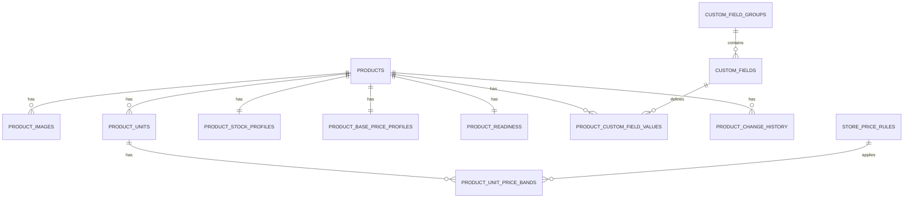

# TH-02 — Domain model (v3)

> Bounded context: **catalog** (`modules/catalog/`). Schema Postgres: `catalog`.
> ERD chi tiết: [appendices/README.md](../appendices/README.md) (Phụ lục E).
> Analyze: [ddd-domain-modeling](../../../../.cursor/skills/ddd-domain-modeling/SKILL.md) · Implement: [domain-layer](../../../../.cursor/skills/domain-layer/SKILL.md)

## Entity tree (conceptual)

```text
Product
├─ Product Image
├─ Product Unit
│  └─ Product Unit Price Band
├─ Product Stock Profile
├─ Product Base Price Profile
├─ Product Custom Field Value
├─ Product Readiness
└─ Product Change History

Custom Field Group
└─ Custom Field
   └─ Product Custom Field Value

Store Price Rule
└─ Product Unit Price Band (suggest/apply)
```



## Aggregates (target)

| Aggregate | Folder | Ghi chú |
| --------- | ------ | ------- |
| `Product` | `domain/lib/src/product/` | Hồ sơ nhận diện, trạng thái KD, soft delete |
| `ProductUnit` | `domain/lib/src/unit/` | Đơn vị cơ sở + quy đổi (có thể child của Product tùy slice) |
| `ProductStockProfile` | `domain/lib/src/stock/` | Basic vs Advanced stock mode |
| `ProductBasePriceProfile` | `domain/lib/src/pricing/` | Manual vs Costing-module base price |
| `StorePriceRule` | `domain/lib/src/pricing/` | Quy tắc giá cấp cửa hàng/tenant (1/tenant) |
| `ProductUnitPriceBand` | `domain/lib/src/pricing/` | Giá niêm yết + Giá sàn theo UOM |
| `CustomFieldGroup` / `CustomField` | `domain/lib/src/custom_fields/` | Cấu hình ngành |
| `ProductReadiness` | `domain/lib/src/readiness/` | Trạng thái + blocker (computed hoặc cached) |

**Không** gộp Change History vào aggregate root — projection/table riêng.

## Value objects

| VO | Mô tả |
| -- | ----- |
| `ProductName` | Tên sản phẩm (bắt buộc); tên thương mại optional |
| `Sku` / `Barcode` | Optional; unique per tenant nếu có |
| `ProductStatus` | Đang kinh doanh / Ngừng KD / Đã xóa (soft delete) |
| `ReadinessStatus` | Chưa hoàn thiện, Sẵn sàng bán, Sẵn sàng nhập, … |
| `ReadinessBlocker` | Nhóm + mã blocker (thiếu UOM, thiếu giá, …) |
| `UnitOfMeasure` | Tên đơn vị; vai trò base / conversion |
| `ConversionRate` | > 0; quy về base |
| `StockMode` | `basic` \| `advanced` |
| `StockQuantity` | Theo base unit; policy âm theo tenant |
| `BasePriceMode` | `manual` \| `costing_module` |
| `BasePrice` | Giá cơ sở định giá (manual) |
| `ListPrice` / `FloorPrice` | Khung giá bán |
| `PriceRatio` | Tỷ lệ gợi ý từ Store Price Rule |
| `CustomFieldValue` | Typed value theo Custom Field definition |

## Commands (by epic)

| Command | Epic/US | Ghi chú |
| ------- | ------- | ------- |
| `CreateProductCommand` | EPIC-02/US-01 | Guided minimal create |
| `CheckDuplicateProductCodeQuery` | EPIC-02/US-01 | SKU/barcode tenant-scoped |
| `SetProductBaseUnitCommand` | EPIC-02/US-01, EPIC-04/US-01 | Đơn vị cơ sở |
| `SetInitialStockCommand` | EPIC-02/US-02, EPIC-05/US-02 | Basic stock ban đầu |
| `SetManualBasePriceCommand` | EPIC-02/US-02, EPIC-06/US-01 | Giá cơ sở thủ công |
| `SetInitialPriceBandCommand` | EPIC-02/US-02, EPIC-06/US-03 | Khung giá ban đầu (optional step) |
| `SearchProductsQuery` | EPIC-01/US-01 | + readiness filter |
| `GetProductControlCenterQuery` | EPIC-01/US-02 | Detail + checklist + actions |
| `GetProductChangeHistoryQuery` | EPIC-01/US-02, EPIC-07/US-04 | Lịch sử thay đổi |
| `AddProductUnitCommand` | EPIC-04/US-02 | Đơn vị quy đổi |
| `DeactivateProductUnitCommand` | EPIC-04/US-02 | |
| `ReactivateProductUnitCommand` | EPIC-04/US-02 | |
| `ChangeBaseUnitCommand` | EPIC-04/US-03 | Preview + controlled change |
| `AdjustBasicStockCommand` | EPIC-05/US-02 | Không tạo phiếu kho |
| `SetStockModeCommand` | EPIC-05/US-01, US-04 | Basic → Advanced |
| `SetStorePriceRuleCommand` | EPIC-06/US-02 | Store-level rule |
| `SetProductUnitPriceBandCommand` | EPIC-06/US-03 | List + floor per UOM |
| `UpdateProductProfileCommand` | EPIC-07/US-01 | Nhận diện, không đổi mode |
| `UpdateProductImagesCommand` | EPIC-07/US-01 | |
| `DeactivateProductCommand` | EPIC-07/US-02 | |
| `ReactivateProductCommand` | EPIC-07/US-02 | |
| `DeleteProductCommand` | EPIC-07/US-03 | Soft delete |
| `RestoreProductCommand` | EPIC-07/US-03 | Khôi phục |
| `UpsertCustomFieldValuesCommand` | EPIC-03/US-02 | Theo ngành |
| `InitializeIndustryFieldsCommand` | EPIC-03/US-01 | Từ onboarding |

## Domain events

| Event | Khi |
| ----- | --- |
| `ProductCreated` | Sau guided create |
| `ProductReadinessChanged` | Blocker resolved/added |
| `ProductProfileUpdated` | Sửa hồ sơ |
| `ProductStockAdjusted` | Basic stock adjust |
| `ProductBaseUnitChanged` | Đổi đơn vị cơ sở |
| `ProductPriceBandChanged` | Khung giá thay đổi |
| `ProductDeactivated` / `ProductReactivated` | Trạng thái KD |
| `ProductDeleted` / `ProductRestored` | Soft delete / restore |
| `StorePriceRuleChanged` | Cấp cửa hàng |
| `CustomFieldValuesUpdated` | Giá trị ngành |

## Integration events — publish

| Type | Khi |
| ---- | --- |
| `catalog.product.created` | CreateProduct |
| `catalog.product.readiness_changed` | Readiness update |
| `catalog.product.profile_updated` | Update profile |
| `catalog.product.stock_adjusted` | Adjust basic stock |
| `catalog.product.unit_changed` | UOM mutations |
| `catalog.product.price_band_changed` | Price band |
| `catalog.pricing.store_rule_changed` | Store price rule |
| `catalog.product.deactivated` / `reactivated` / `deleted` | Lifecycle |

## Integration events — consume

| Source | Event | Mục đích |
| ------ | ----- | -------- |
| onboarding | `onboarding.tenant.configured` | Khởi tạo custom field groups (EPIC-03) |
| costing | `costing.base_cost.updated` | Read model cho Costing-module base price (Growth) |
| inventory | `inventory.stock.summary_updated` | Read model Advanced stock (Growth) |

## Data rules (v3 highlights)

| Rule ID | Rule |
| ------- | ---- |
| DR-01 | Tên sản phẩm bắt buộc; guided create không ép toàn bộ field |
| DR-02 | SKU/barcode optional; unique per tenant |
| DR-03 | Readiness tách khỏi trạng thái kinh doanh |
| DR-04 | Basic stock theo base unit; không tạo phiếu nhập |
| DR-05 | Advanced stock: read-only trong Product |
| DR-06 | Manual base price (Foundation); costing read (Growth) |
| DR-07 | Giá sàn ≤ Giá niêm yết |
| DR-08 | Custom fields thay medical_info hard-code |
| DR-09 | Soft delete; bảo toàn snapshot giao dịch |
| DR-10 | Đổi base unit: preview tác động; không sửa snapshot cũ |

## Anti-patterns

- God aggregate gộp readiness history + change history vào `Product`
- Hard-code thông tin thú y vào `Product` entity
- Chỉnh tồn trực tiếp khi `StockMode = advanced`
- Tính giá cuối sau khuyến mãi trong catalog
- Dup-check SKU/barcode chỉ ở UI
- Hiển thị `ACTIVE` / `READY_TO_SELL` cho end user

## Implement

Code domain: [domain-layer skill](../../../../.cursor/skills/domain-layer/SKILL.md) → `modules/catalog/domain/lib/src/`.

Commands/handlers: [application-layer](../../../../.cursor/skills/application-layer/SKILL.md).

**Lưu ý:** Harness code (`modules/catalog/`) chưa cập nhật theo v3 — cập nhật khi slice EPIC-02/US-01 CONTRACT lane bắt đầu.
