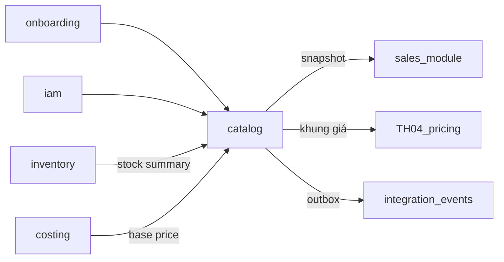

# TH-02 — Module map

## Bảng module

| Module | Vai trò | Owner / Supporting | Package | Trạng thái |
| ------ | ------- | ------------------ | ------- | ---------- |
| catalog | Product master, readiness, UOM, stock/base price profiles, price band, nhóm & trường thông tin bổ sung | **Owner** | `modules/catalog/` | in_progress (EPIC-02/US-01 BE done) |
| inventory | Advanced stock summary read | Supporting | `modules/inventory/` | planned |
| costing | Costing-module base price read (Growth) | Supporting | `modules/costing/` | planned |
| iam | Auth, tenant, RBAC (`catalog.*`) | Supporting | `modules/iam/` | in_progress |
| onboarding | Ngành/gói tenant → template seed nhóm & trường | Supporting (read) | TBD | planned |

## Downstream consumers

| Theme / Module | Dùng dữ liệu TH-02 cho |
| -------------- | ----------------------- |
| Sales module | Snapshot SP, readiness, đơn vị bán, Giá niêm yết / Giá sàn |
| TH-04 Chính sách giá & ưu đãi | `ProductPriceBandSnapshot` để kiểm tra giá niêm yết / giá sàn theo đơn vị bán |
| TH-06 Kho & giá vốn | Item linkage; stock summary (Advanced); base cost feed |
| Promotions | Giá niêm yết (trước KM), Giá sàn (ngưỡng) |
| TH-07 Hóa đơn | Mô tả hàng trên hóa đơn |
| TH-09 Dashboard | KPI doanh thu theo SP/nhóm hàng |

## Sơ đồ phụ thuộc (v3)



Chi tiết integration diagrams: [APPENDICES.md](../APPENDICES.md) (Phụ lục D).

## Snapshot DTOs (cho module khác)

| DTO | Consumer |
| --- | -------- |
| `ProductSnapshot` | sales (dòng đơn, barcode) |
| `ProductPriceBandSnapshot` | sales, pricing (list/floor per UOM) — EPIC-06/US-04 |
| `ProductReadinessSnapshot` | sales (chặn chọn SP chưa sẵn sàng) |

## Permissions (v3 — draft)

Constants: `CatalogPermissions` trong `modules/catalog/domain/`.

| Permission code | Gherkin label (ví dụ) | Epic/US |
| --------------- | --------------------- | ------- |
| `catalog.product.view` | Xem danh mục sản phẩm | EPIC-01/US-01 |
| `catalog.product.view_detail` | Xem Product Control Center | EPIC-01/US-02 |
| `catalog.product.create` | Tạo sản phẩm (guided) | EPIC-02/US-01 |
| `catalog.product.update` | Sửa hồ sơ / ảnh | EPIC-07/US-01 |
| `catalog.product.manage_stock` | Chỉnh basic stock | EPIC-05/US-02 |
| `catalog.product.manage_units` | Quản lý UOM | EPIC-04/* (trừ US-03 out_of_scope) |
| `catalog.product.manage_pricing` | Base price, price band | EPIC-06/* |
| `catalog.product.manage_status` | Ngừng KD / KD lại | EPIC-07/US-02 |
| `catalog.product.delete` | Xóa mềm / khôi phục | EPIC-07/US-03 |
| `catalog.product.view_history` | Xem change history | EPIC-07/US-04 |
| `catalog.custom_fields.manage` | Cấu hình nhóm & trường thông tin | EPIC-03/US-01 (FR-01..06) |
| `catalog.pricing.manage_store_rule` | Store Price Rule | EPIC-06/US-02 |

Ma trận đầy đủ: [APPENDICES.md](../APPENDICES.md) (Phụ lục F).

## Ranh giới (v3)

| Nội dung | Thuộc catalog | Module khác |
| -------- | ------------- | ----------- |
| Hồ sơ SP, ảnh, readiness, thông tin bổ sung | ✓ | |
| Basic stock (Foundation) | ✓ | |
| Advanced stock, phiếu kho | | inventory |
| Manual base price (Foundation) | ✓ | |
| FIFO/FILO/bình quân giá vốn | | costing |
| Giá niêm yết, Giá sàn, Store Price Rule | ✓ | |
| Giá cuối sau khuyến mãi | | promotions / sales |
| Giao dịch bán, snapshot đơn | | sales |

Ghi chú agent:

- Catalog **không** tạo đơn bán, phiếu nhập, phiếu kho chi tiết, hóa đơn, giá sau KM
- Advanced stock: **read-only** stock summary từ inventory
- Costing-module base price: **read-only** từ costing (Growth)
- Thông tin bổ sung = nhóm & trường cấu hình được — không hard-code ngành vào Product

## Presentation layout

```text
apps/erp/lib/features/catalog/presentation/
  pages/          — list, guided_create, product_control_center
  widgets/        — readiness_chip, contextual_actions, custom_field_group_card
  bloc/

modules/catalog/presentation/
  lib/src/widgets/ — dialogs tái dùng (deactivate, …)
```

**Card nhóm thông tin:** mỗi nhóm active = một card riêng trên Product Control Center và guided create — sau **Khung giá bán**, trước **Ghi chú** ([EPIC-01/US-02/FR-03](../EPIC-01-discovery-readiness/US-02/FR-03.md), [APPENDICES.md](../APPENDICES.md) UXF-10).

Skill: [.cursor/skills/presentation-layer/SKILL.md](../../../../.cursor/skills/presentation-layer/SKILL.md)

Cross-theme: [TH-04 module map](../../TH-04-pricing-promotions/harness/02-module-map.md) · TH-07 Inventory & Costing (planned; chưa có theme package canonical)
